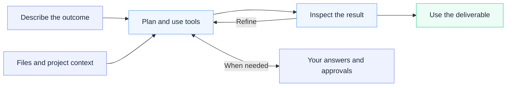
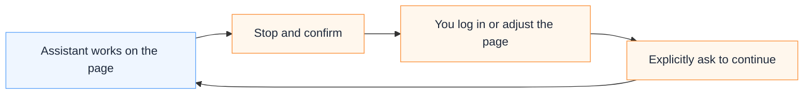
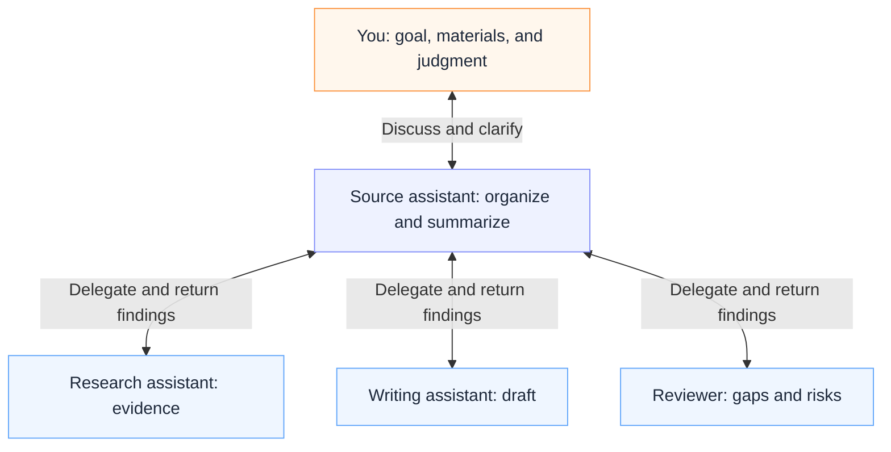
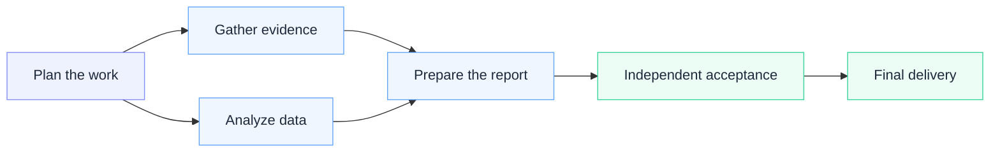

# JustDo

### An AI workspace for turning ideas into finished work.

**Bring your files. Describe the outcome. Work with AI from the first plan to the final deliverable.**

[简体中文](README_zh.md) · **English** · [Explore the features](docs/features/README.md) · [Development guide](docs/development.md)

---

_Workspace concept illustration. The panels represent product capabilities, rather than an application screenshot._

A report to prepare, a folder of documents to review, a website to work through, a project with several moving parts. Useful AI work needs context, tools, and a place to bring the results together.

JustDo is a local-first desktop AI assistant that brings conversations, project files, browser tasks, and extensible tools into one workspace. Powered by OpenClaw, it can work with the materials you provide, use the capabilities you configure, and show its progress as the task develops. You can review a plan, answer a question, inspect an output, or step in when your judgment is needed.

Start with a single request. Build up to dedicated assistants, team discussions, scheduled work, and multi-stage workflows as your needs grow.

## From a request to something you can use

Bring the context, describe the outcome, and keep working with the assistant as the result takes shape. The workspace keeps materials, execution, and review close together.

**The deliverable can take the form the task needs:** a document to share, a spreadsheet to examine, an editable diagram, a project change, or a comparison that helps you make a decision.

## What would you like to get done?

| Your next task                                | How JustDo can help                                                                                                 |
| --------------------------------------------- | ------------------------------------------------------------------------------------------------------------------- |
| Turn a pile of material into something useful | Review documents, compare findings, analyze data, and prepare reports or presentations with the bundled skills.     |
| Work through a browser task                   | Open the page alongside the conversation, follow the assistant's actions, and step in before asking it to continue. |
| Explain a complicated idea                    | Ask for an editable diagram, a comparison table, a chart, or an interactive explanation.                            |
| Give a project sustained attention            | Set a goal and let the assistant continue across rounds within the configured budget and execution limits.          |
| Bring several perspectives to a decision      | Invite specialized assistants to collaborate or discuss a topic, with you participating in the conversation.        |
| Run a process across many inputs              | Use a workflow with dependencies, batch progress, individual results, and review stages.                            |
| Make room for recurring work                  | Schedule a task and review its results in the application's inbox.                                                  |

These are examples to adapt to your work. Available actions depend on your model, connected tools, enabled plugins, and permissions.

## One workspace, from request to result

### Work with the files that matter

Choose a project directory, attach the relevant material, and explain the result you want. Your conversation stays close to the files you are working on, so you can move between the request, the execution, and the output.

Bundled skills cover **Word documents, spreadsheets, presentations, PDFs, data analysis, frontend design, and diagrams**. Use them to prepare a draft, examine a dataset, structure a report, or develop a visual explanation.

The workspace provides a file tree and previews for PDFs, Markdown, images, audio, video, and source files. Supported text formats can be edited in place; Office and other specialized formats can use compatible file apps when installed. Open the workspace in a separate window when you want more room to inspect the results.

> “Review the materials in this folder, summarize the main findings, and prepare a presentation with the questions we still need to resolve.”

### Keep the plan and progress in view

A task can involve several tool calls, questions, and revisions. JustDo brings the working conversation together with execution details, plan review, and permission requests, so you can follow what the assistant is doing and decide when to intervene.

For work that takes several rounds, **Goal mode** gives the assistant an explicit objective and supports continued progress within token budgets and automatic continuation limits. You can pause, stop, or continue the goal as needed.

This is useful for tasks such as investigating a project, working through a review, or refining a deliverable against your requirements.

> “Review this project, propose a plan for the issues you find, and work through the approved changes while checking the results.”

### Work together on a real web page

The built-in browser places the live page beside your conversation. You can watch the task develop, stop the current execution, take over to complete a login or adjust the page, and then explicitly ask the assistant to continue.

When a process is easier to demonstrate than describe, record your browser actions, review the steps and screenshots, and send the demonstration as context for the assistant.

JustDo also offers isolated browser, user Chrome, and Chrome extension connection modes, so you can choose the setup that suits your environment. Browser automation follows the selected execution mode and permissions.

> “Use this page to compare the available options. I'll handle the login, then you can continue with the comparison.”

### Shape the output together

Some ideas are easier to understand as a diagram, a table, or a small interactive view. JustDo supports visual responses alongside the conversation, including comparison cards, charts, forms, and step-by-step explanations.

The built-in **draw.io** integration takes diagrams further: ask for a flowchart, system architecture, UML, or an entity relationship diagram, then edit the shapes, text, and connections yourself. Continue asking the assistant to revise the current canvas and save the source or export PNG and SVG.

The draw.io editor is bundled locally. You can keep refining the diagram in the application without opening a public drawing service.

> “Draw an editable purchase approval flow. Separate the employee, manager, and finance responsibilities, then help me simplify the handoffs.”

### Build assistants around the way you work

Create persistent assistants with their own roles and working instructions. A research assistant, a writing partner, and a project reviewer can each bring a different approach to a task.

When you need several perspectives, enable the optional **Agent Team** extension:

- **Task collaboration** lets the source assistant organize work among members. Explore the collaboration graph and open a member's execution history.
- **Group discussion** gives assistants a shared discussion timeline. Join directly, add material, mention members, and receive a summary in the source conversation.

You can ask the source assistant to organize the team in natural language. The team view gives you a way to inspect the work and participate as it develops.

The example below shows one possible division of work. Choose the roles to suit your task; you can also join a group discussion directly.

> “Ask a product reviewer, an engineer, and a user advocate to discuss this proposal. Compare the tradeoffs and summarize the decisions I need to make.”

### Give complex work a visible structure

Enable the optional **Swarm Workflow** plugin when a task needs explicit stages, dependencies, and review. It turns a request into a workflow that includes planning, work stages, independent acceptance checks, and delivery.

The graph shows how the stages connect. Open a node to inspect its result or failure, pause new dispatches, supply additional direction, and retry confirmed failed stages while retaining completed work.

For repeated work across a file collection or a JSONL manifest, batch stages provide progress tracking, search and filtering, individual result details, and separate execution directories. Shared concurrency limits keep dispatch bounded.

**Agent Team organizes collaboration around roles; Swarm Workflow organizes work around stages, dependencies, and acceptance.** Choose the mode that fits the task.

For example, a report workflow can gather evidence and analyze data in parallel, then bring those results into drafting and acceptance. The actual stages are planned for your request.

> “Review each document in this folder against the same checklist, collect the individual findings, and produce a summary after all items pass review.”

### Put recurring work on the calendar

Create one-time or recurring tasks, choose an assistant and, when needed, a task-specific model. Run a task manually to check its behavior, then review subsequent results in the application's inbox.

Use scheduled work for recurring material reviews, project summaries, or routine checks against sources your assistant can access. Results remain available to open and inspect after execution.

Scheduling runs through the local runtime, so keep the application and its execution environment available when the work needs to run.

> “Every Friday, review this project's weekly notes and prepare a summary of progress, open questions, and next actions.”

### Connect the capabilities you need

Manage **skills, MCP servers, hooks, and extensions** from the plugin interface. Add task expertise, connect an existing service, or enable a specialized workflow as your work evolves.

Model settings let you configure providers and endpoints, choose an application default, and select a model for a conversation or a dedicated assistant. Speech, image, and video capabilities are available through their supported adapters when configured; voice input and reply playback offer another way to work with the assistant.

This makes JustDo useful for setups built around internal model endpoints and company services, as well as individually configured tools.

## Local-first, with choices you control

Your project files, application settings, and managed runtime live on your machine. Conversation history is managed by the local OpenClaw runtime. You choose the model endpoints, connected services, plugins, and execution permissions used for your work.

**Local-first describes where the workspace lives.** Model requests and tool calls may still send data to the services you configure. Fully offline use depends on the model and tools you supply.

That gives you a practical place to work with local projects while connecting to the capabilities available in your environment.

## Start with one useful task

1. **Open JustDo and configure a model.** Set the endpoint and authentication for the service you use.
2. **Bring in the context.** Start a conversation, choose a project directory, and attach the material that matters.
3. **Describe the outcome.** Explain what you want to receive, along with any constraints or review requirements.
4. **Work through the result.** Follow the execution, answer questions, review approvals, and inspect the files or pages produced.
5. **Expand when you need to.** Add a dedicated assistant, connect tools, enable a team or workflow, or schedule recurring work.

Agent Team and Swarm Workflow are optional and disabled by default. Start with ordinary conversations and enable them from the plugin settings when you need them.

For a source checkout, environment setup and launch instructions are in the [development guide](docs/development.md).

## Explore further

Most detailed project documentation is currently in Chinese.

| Learn more about                    | Read                                                                                                                                            |
| ----------------------------------- | ----------------------------------------------------------------------------------------------------------------------------------------------- |
| Product capabilities and boundaries | [Product overview](docs/architecture/01-overview.md)                                                                                            |
| Available features                  | [Feature guide](docs/features/README.md)                                                                                                        |
| Assistants and team collaboration   | [Assistant profiles](docs/features/assistants/assistants-and-collaboration.md) · [Agent Team](docs/features/assistants/agent-team.md)           |
| Multi-stage and batch work          | [Swarm Workflow](docs/features/workflow/swarm-workflow.md) · [Batch execution](docs/features/workflow/swarm-workflow-batches.md)                |
| Browser tasks and demonstrations    | [Browser modes](docs/features/browser/browser-settings-design.md) · [Operation recording](docs/features/browser/browser-operation-recording.md) |
| Visual answers and diagrams         | [Interactive answers](docs/features/chat/interactive-answers.md) · [draw.io](docs/features/chat/drawio-offline.md)                              |
| Models and extensions               | [Model settings](docs/features/models/model-management.md) · [Plugin Hub](docs/features/plugins/plugin-hub-experience.md)                       |
| Development and troubleshooting     | [Development guide](docs/development.md) · [Documentation index](docs/README.md)                                                                |

## Contribute

Help improve the experience, report a reproducible issue, refine the documentation, or contribute a capability. Start with the [development guide](docs/development.md) for setup, building, testing, and troubleshooting, and [AGENTS.md](AGENTS.md) for repository conventions.

## License

[MIT](LICENSE)
