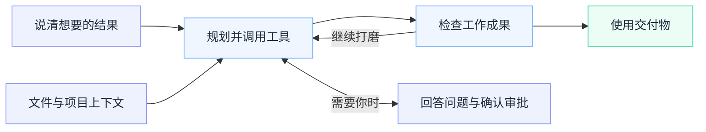
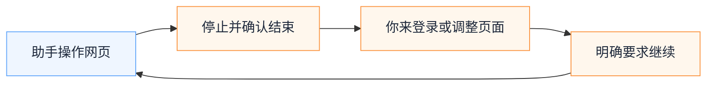
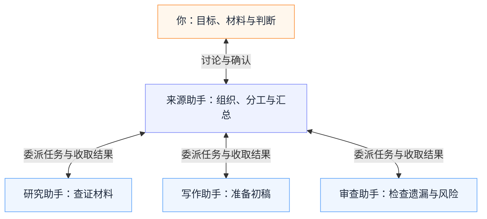
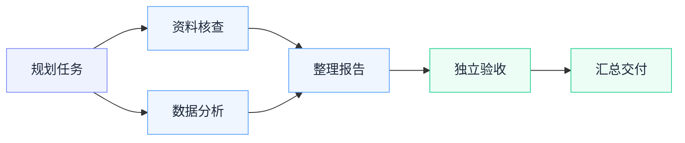

# JustDo

### 从一个想法，到一份真正完成的工作。

**带上你的文件，说清想要的结果，与 AI 一起完成从规划、执行到交付的每一步。**

**简体中文** · [English](README.md) · [了解功能](docs/features/README.md) · [开发指南](docs/development.md)

---

_工作空间概念插画，以面板示意产品能力，非应用界面截图。_

一份等待整理的报告，一个堆满资料的文件夹，一项需要在网页上完成的操作，一个涉及多个环节的项目。要让 AI 在这些工作中发挥作用，需要材料、工具，也需要一个能把过程和成果放在一起的工作空间。

JustDo 是一款本地优先的桌面 AI 助手，将对话、项目文件、浏览器任务和可扩展工具汇集在同一个应用中。它由 OpenClaw 驱动，可以围绕你提供的材料开展工作，使用你配置的能力，并让你随时查看进展、审核计划、检查产物，在需要判断时参与其中。

你可以从一次普通对话开始，再逐步建立专属助手、组织团队讨论、安排定时任务，把复杂工作交给分阶段的工作流。

## 从一句需求，到一份可以使用的成果

带上材料，说清想要的结果，再和助手一起逐步打磨。工作空间把上下文、执行与审核放在一起，让你随时接得上任务进展。

**成果可以是任务真正需要的形式：** 一份可以分享的文档、一张可以核对的表格、一幅可以继续编辑的图、一组项目修改，或一份帮助你做决定的对比分析。

## 今天，有什么工作想交给 AI？

| 你想做的事               | JustDo 如何参与                                                |
| ------------------------ | -------------------------------------------------------------- |
| 把一堆材料变成可用的成果 | 阅读文档、比较结论、分析数据，借助内置技能准备报告或演示文稿。 |
| 完成一项网页任务         | 在对话旁打开真实网页，观察助手操作，手动介入后再让它继续。     |
| 把复杂问题讲清楚         | 生成可编辑图表、对比表格、数据图或交互式说明。                 |
| 持续推进一个项目         | 设置明确目标，让助手在预算和执行限制内跨轮次继续工作。         |
| 为决策引入不同视角       | 让不同角色的助手分工协作或展开讨论，你也可以直接加入。         |
| 对大量材料执行同一套流程 | 使用有依赖关系的工作流，查看批次进度、单项结果与验收情况。     |
| 把重复工作安排起来       | 创建定时任务，在应用内的结果收件箱中查看每次执行结果。         |

这些是可以按需调整的使用场景；实际可执行的操作取决于已配置的模型、工具、插件和权限。

## 一个工作空间，连接任务与成果

### 围绕你的文件，开展实际工作

选择项目目录，附上相关材料，再说明你希望得到什么。对话、工作过程和输出文件围绕同一项任务展开，你可以一边讨论，一边查看文件与成果。

内置技能覆盖 **Word 文档、电子表格、演示文稿、PDF、数据分析、前端设计和图表设计**。从整理初稿、检查数据，到组织报告结构、制作视觉说明，都可以成为一次任务的起点。

工作区提供文件树，以及 PDF、Markdown、图片、音频、视频和源码等预览。支持的文本格式可以直接编辑；Office 等专业格式可通过已安装的兼容文件应用打开。需要仔细核对成果时，还可以把工作区拆到独立窗口，留出更充足的查看空间。

> “阅读这个文件夹里的项目资料，提炼核心结论，整理一份汇报演示文稿，并列出还需要确认的问题。”

### 看得见过程，也握得住方向

一项工作往往要经历工具调用、补充提问和多次修改。JustDo 将执行详情、计划审核和权限请求放在任务对话中，让你了解助手正在做什么，在需要时决定下一步。

对于需要持续推进的任务，**Goal 模式**可以记录明确的目标，支持助手在 token 预算与自动续跑次数限制内跨轮次工作。你可以按需要暂停、停止或继续目标。

检查一个项目、逐项完成审查、对照要求反复打磨交付物，都可以围绕这样的目标展开。

> “检查这个项目，先给出问题清单和修改计划，按我审核的方案逐项处理，并检查修改结果。”

### 与 AI 一起，操作同一个真实网页

内置浏览器把实时网页放在对话旁边。你可以观察任务进展，停止当前执行，接手完成登录或调整页面，再明确要求助手继续。

有些操作用文字很难说清，演示一次就直观得多。你可以录制自己的浏览器操作，检查步骤与关键截图，整理后作为参考材料发给助手。

JustDo 也提供隔离浏览器、日常 Chrome 和 Chrome 扩展连接方式，方便你根据工作环境选择合适的入口。浏览器自动化遵循当前执行模式与权限设置。

> “在这个页面上比较几个方案。我来完成登录，然后你继续整理差异和需要注意的条款。”

### 让成果变得直观，也能继续修改

有些问题适合用图解释，有些决策需要放在表格里比较，还有些内容需要交互才能看清变化。JustDo 支持在对话中呈现可视化回答，包括对比卡片、图表、表单和分步说明。

内置 **draw.io** 让图表可以继续打磨：用自然语言生成流程图、系统架构图、UML 或实体关系图，再亲自调整图形、文字和连线。你还可以让助手围绕当前画布继续修改，最后保存源文件，或导出 PNG、SVG。

draw.io 编辑器随应用本地提供，你可以在工作空间中完成绘图、修改和导出。

> “画一张可编辑的采购审批流程图，分清员工、主管和财务的职责，再帮我简化交接环节。”

### 建立专属助手，让不同视角一起工作

为不同工作创建长期助手，分别配置角色与工作说明。研究助手可以关注证据，写作伙伴可以打磨表达，项目审查者可以检查遗漏，让每个角色形成适合任务的工作方式。

需要多个角色共同参与时，可以启用可选的 **Agent Team** 扩展：

- **任务协作**：由来源助手组织成员分工，通过协作关系图查看任务联系，打开成员详情了解执行过程。
- **群组讨论**：让助手在共享时间线中讨论。你可以直接发言、补充材料、提及成员，并在来源对话中接收汇总。

用自然语言说明需要哪些角色、讨论什么问题，即可让来源助手组织团队。随着工作推进，你可以查看细节，也可以随时加入讨论。

下面是一种任务分工示例。角色可以随工作需要调整；在群组讨论中，你也可以直接参与交流。

> “请产品评审、工程师和用户代表一起讨论这份方案，比较取舍，最后汇总需要我拍板的事项。”

### 把复杂任务，组织成清晰的工作流

当工作需要明确的先后顺序、阶段依赖与验收环节时，可以启用可选的 **Swarm Workflow** 插件。它把任务组织为包含规划、工作阶段、独立验收和最终交付的流程。

在图形视图中，你可以看到各阶段如何衔接，打开节点检查结果或失败原因，暂停后续派发，补充指导，并在失败得到确认后重试对应阶段、保留已经完成的工作。

面对一组文件或 JSONL 清单，批量阶段提供进度追踪、搜索筛选、单项结果详情和独立执行目录，在共享并发额度内逐项推进。

**Agent Team 适合围绕角色分工与讨论，Swarm Workflow 适合围绕阶段、依赖和验收组织过程。** 根据任务选择合适的方式即可。

例如，一份报告可以先并行完成资料核查与数据分析，再进入内容整理、独立验收与交付。实际阶段会围绕你的任务规划。

> “按同一份检查清单审查这个文件夹里的每份文档，分别保存发现，所有项目通过审查后再生成总报告。”

### 把重复工作，放进日程

创建一次性或周期性任务，选择执行助手，并按需要指定任务模型。你可以先手动运行一次检查效果，再到应用内的结果收件箱查看后续执行结果。

定期整理资料、汇总项目进展、检查助手能够访问的信息来源，都可以安排为重复任务。每次执行的结果都可以继续打开查看，方便你回顾和处理。

定时任务由本地运行时执行，任务需要运行时应保持应用与执行环境可用。

> “每周五整理这个项目的周记，汇总本周进展、未决问题和下一步行动。”

### 让工具和模型，适应你的工作环境

在插件界面统一管理 **技能、MCP 服务、Hook 和扩展**。随着需求变化，你可以增加特定任务的知识与方法，连接已有服务，或启用专门的工作流程。

模型设置支持配置服务提供方和端点，选择应用默认模型，也可以为具体会话或专属助手选择模型。语音、图像与视频能力可通过支持的适配器按需配置；语音输入与回复朗读则提供了另一种与助手交流的方式。

无论使用内网模型端点、企业服务，还是自行配置的工具，都可以围绕现有工作环境组合所需能力。

## 本地优先，由你选择连接什么

项目文件、应用配置和受管运行时保存在本机，对话历史由本地 OpenClaw 运行时管理。使用哪些模型端点、连接哪些服务、启用哪些插件、允许哪些操作，都由你的配置决定。

**本地优先描述的是工作空间的归属。** 模型请求和工具调用仍可能向你配置的服务发送数据；能否完全离线使用，取决于所提供的模型与工具。

你可以围绕本地项目工作，再连接当前环境中可用的能力。

## 从一件真正有用的小事开始

1. **打开 JustDo，配置模型。** 填写所使用服务的端点与认证信息。
2. **带上工作材料。** 创建对话，选择项目目录，添加相关文件。
3. **说清想要的成果。** 描述希望收到什么，并补充约束与审核要求。
4. **一起完成任务。** 查看执行过程、回答问题、处理审批，检查生成的文件或页面。
5. **按需要扩展。** 创建专属助手、连接工具、启用团队或工作流，或者安排定时任务。

Agent Team 与 Swarm Workflow 均为可选插件，默认关闭。可以先从普通对话开始，需要时再到插件设置中启用。

从源码运行项目的环境准备与启动步骤，统一见[开发指南](docs/development.md)。

## 进一步了解

| 想了解的内容         | 文档入口                                                                                                                          |
| -------------------- | --------------------------------------------------------------------------------------------------------------------------------- |
| 产品能力与使用边界   | [产品与系统总览](docs/architecture/01-overview.md)                                                                                |
| 全部功能导航         | [功能文档](docs/features/README.md)                                                                                               |
| 专属助手与团队协作   | [助手档案](docs/features/assistants/assistants-and-collaboration.md) · [Agent Team](docs/features/assistants/agent-team.md)       |
| 分阶段工作与批量执行 | [Swarm Workflow](docs/features/workflow/swarm-workflow.md) · [批量执行](docs/features/workflow/swarm-workflow-batches.md)         |
| 浏览器任务与操作演示 | [浏览器模式](docs/features/browser/browser-settings-design.md) · [操作录制](docs/features/browser/browser-operation-recording.md) |
| 可视化回答与图表     | [交互式回答](docs/features/chat/interactive-answers.md) · [draw.io](docs/features/chat/drawio-offline.md)                         |
| 模型与能力扩展       | [模型设置](docs/features/models/model-management.md) · [Plugin Hub](docs/features/plugins/plugin-hub-experience.md)               |
| 开发与问题排查       | [开发指南](docs/development.md) · [完整文档](docs/README.md)                                                                      |

## 参与共建

欢迎分享使用体验、反馈可复现的问题、改进文档，或贡献新的能力。环境准备、构建测试和日志排查请从[开发指南](docs/development.md)开始，仓库协作约定见 [AGENTS.md](AGENTS.md)。

## 许可证

[MIT](LICENSE)
