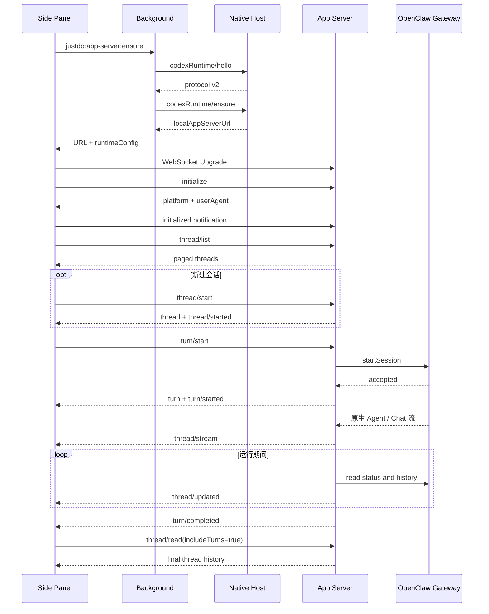

# Chrome 扩展生命周期、错误与恢复

本文的 `clientTurnId`、`activeTurn`、`executionSettled` 与错误码只适用于 Chrome
能力入口。CLI stdio／本机 WebSocket 的通知和恢复边界见[通用客户端](../external-clients.md)。

## 正常启动与对话

Server 每 500 ms 从 JustDo/OpenClaw 权威状态刷新活动 turn，并以 Gateway runtime 状态而非
可能短暂滞后的持久化 session 状态判断本轮是否仍在运行。实时文本、Thinking 和工具
来自独立 `thread/stream` 订阅；轮询负责历史校准及兼容层完成通知，不能代替消息流。
活动阶段复用原生增量游标，每 20 次轮询读取完整快照，终态期间强制完整读取。
这些频率是实现细节，不是客户端协议保证；异步读取耗时也计入实际间隔。

## 停止生成

Side Panel 在当前所选线程收到 `turn/started` 后把 Send 按钮切换为 Stop。点击后调用
`turn/interrupt`，携带精确的 `threadId` 和客户端 `turnId`。Main 从既有运行回执读取
`rootRunId`，只请求原生 `sessions.abort({key,runId})`，不以旧请求停止后继运行。
返回 `{status:"requested",executionSettled:false}` 只确认停止请求，不撤销终态核对，
也不发送 `turn/completed`；面板保留当前运行和 Stop，直到该运行的精确 whole-run 证据到达。

## 完成判定

`turn/completed` 必须携带 `executionSettled:true`。运行结果须来自精确 whole-run
终态证据；chat final、单次尝试、yield、idle 和 Stop ACK 均不能结算执行。
Runtime 保留有界运行元数据：原生 key、物理 sessionId、runId、客户端连接代次、
序号、状态、结束时间与错误。私有 `lifecycleGeneration` 可缺省；有显式值时拒绝冲突，
缺省时仍严格核对物理身份、run、连接代次和序号，不按后缀或当前 owner 猜测身份。

实时路径只接受已准入的 `lifecycle end/error` 且 `executionSettled:true`。
聊天 final 可先退役本地显示 owner；其有界原生绑定允许同一身份和更高序号的真正末端
补齐回执。退役后 canonical agent 帧仍推进序号高水位，旧终态不能越过已观察的新帧。

缺少实时终态时，只能使用发送前已捕获的精确绑定进行 `agent.wait(timeoutMs:0)` 核对，
并在前后复核 `sessions.describe`、连接代次和生命周期版本。必须匹配原生 run，
返回有限 `endedAt`、可确认的结果且非 yield；普通等待超时不算终态。
已核实结果只进入最多 100 项的元数据缓存，后续读取仍复核身份，不缓存正文或伪造事件序号。
timeout 证据优先于随之产生的机械 aborted 标记，不能误报用户停止。
具体身份准入与回执补偿规则见[扩展侧聊](../../features/browser/browser-extension-side-chat.md)。

Controller 核对后才投影 `completed`、`failed` 或 `interrupted`。后继运行、旧 incarnation、
旧代次和迟到序号不能结算当前输入。已有内部 managed handoff 错误过滤保持一致。

精确终态后至少保留 3 次稳定历史校准；缺少最终历史最多再校准 20 次。
这些次数只决定历史刷新何时收敛，不产生执行结果。读取失败保留已有消息；连续异常
降低刷新频率，不伪造失败。找不到线程仅释放其轮询，不宣称该执行失败。

`thread/read({turnId})` 返回顶层 `activeTurn`，其中 `id` 是客户端 `clientTurnId`，
`nativeRunId` 来自原生接纳回执的显式绑定。尚未核实终态时 `executionSettled:false`，
`status` 为 `inProgress` 或 `unknown`。客户端不重发未确认输入。进程重启、连接代次更换
或元数据退役后若缺少可核验 whole-run 证据，状态保持 unknown；不读取 transcript 文件补造终态。

## WebSocket 错误码

| code     | message 示例                     | 场景                                        |
| -------- | -------------------------------- | ------------------------------------------- |
| `-32700` | `Parse error.`                   | frame 不是合法 JSON                         |
| `-32600` | `Invalid request.`               | payload 不是 object 或缺少 string method    |
| `-32600` | `Already initialized.`           | 同一连接重复调用 initialize                 |
| `-32002` | `Connection is not initialized.` | initialized 前调用其他 request              |
| `-32601` | `Method not found.`              | 未实现的方法                                |
| `-32603` | 具体 Error.message               | 参数缺失、thread 不存在、业务拒绝或内部错误 |

当前参数错误仍统一映射为 `-32603`，尚未细分为 `-32602 Invalid params`。无 `id` 的 notification
发生错误时不会返回响应，符合 JSON-RPC notification 语义。

## 客户端超时

| 通道                 |  超时 |
| -------------------- | ----: |
| Native Host 单次请求 | 20 秒 |
| 完整实例发现         | 45 秒 |
| WebSocket 握手       | 10 秒 |
| initialize 握手      | 15 秒 |
| app-server 单次请求  | 60 秒 |

超时仅拒绝客户端 Promise，不保证服务端工作已经取消。业务 turn 必须使用 `turn/interrupt`。
发现、WebSocket 和初始化分别有期限；握手只收到 close、没有 error 时也立即拒绝。
面板关闭会取消当前握手，迟到的发现响应不能再创建连接；旧 socket 的消息不能更新新连接。

连接失败通过扩展内部 `connection/failed` 事件提供 `{ code, stage }`，不包含发现 URL。
`stage` 为 `discovery`、`socket` 或 `initialize`；界面按结构化代码显示本地化恢复提示：

| code                                                | 含义                                                       |
| --------------------------------------------------- | ---------------------------------------------------------- |
| `APP_NOT_RUNNING`                                   | 尚无已运行的桌面实例，用户启动应用后继续发现               |
| `NATIVE_HOST_UNAVAILABLE`                           | Native host 缺失、断开或不可用，重新启动已安装应用刷新注册 |
| `NATIVE_HOST_TIMEOUT` / `DISCOVERY_TIMEOUT`         | 本机发现超过期限                                           |
| `INCOMPATIBLE_VERSION` / `INVALID_APP_SERVER`       | 协议版本或发现响应不合法                                   |
| `SOCKET_TIMEOUT` / `SOCKET_ERROR` / `SOCKET_CLOSED` | 本机 WebSocket 握手未完成或已断开                          |
| `INITIALIZE_TIMEOUT`                                | app-server 初始化未在期限内完成                            |

调用错误的 `requestSent:false` 只表示该次 RPC 明确未发出，或服务端明确证明原生准入前已拒绝。
原生发送 owner 关闭而未调用 `chat.send` 时，通过 `onNativeSendAbandoned` 提供该证明；
准备失败或取消释放本次输入，入口处停止等待／前序未知的本地拒绝也明确标记未发送，
但不释放前序运行的停止或未知保护。
消息发出后断线、超时，以及缺少准入证据的业务错误保持 `requestSent:true`，保留原输入身份并核对，不能自动补发。

## 断线重连

WebSocket 关闭时客户端：

1. 只处理当前 socket 的 close，忽略已经被替换的旧 socket。
2. 拒绝所有 pending 请求。
3. 通知 UI `connection/closed`，保留未确认发送及执行状态。
4. 1 秒后重新执行 Native Host `hello + ensure`。
5. 连续失败也只重新发现和连接，不发送 `codexRuntime/restart`。
6. 重连成功后发送本地 UI 事件 `connection/reconnected`，重新加载线程与消息。

`connection/closed`、`connection/failed` 和 `connection/reconnected` 是扩展内部事件，不从 WebSocket server 发出。
每次新连接都必须重新执行 initialize/initialized，订阅也不会跨连接保留。

## 应用退出与重启

- 正常退出：删除属于当前 PID 的 rendezvous，终止所有 WebSocket client，关闭 listener。
- app-server 重启：旧连接断开，端口和 token 都可能变化；客户端必须重新走 Native Host。
- 桌面应用未运行：Native Host 立即返回手动启动提示，不启动子进程；扩展后续重试可发现用户新启动的实例。
- 桌面应用已运行：直接返回有效 rendezvous；扩展重启请求始终拒绝，并保留已有发现信息。
- 开发版和安装版遵守相同规则。应用和 app-server 的重启由用户或 Main 自有生命周期负责，扩展不能触发。
