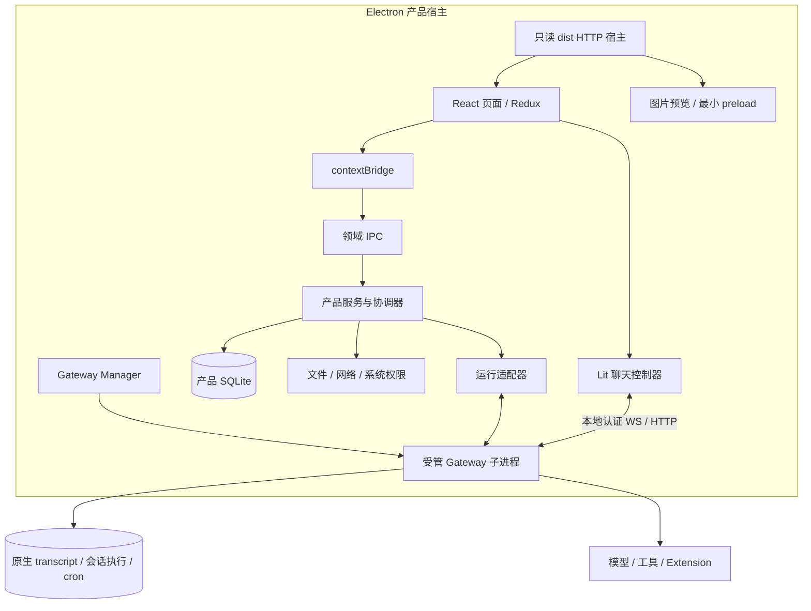
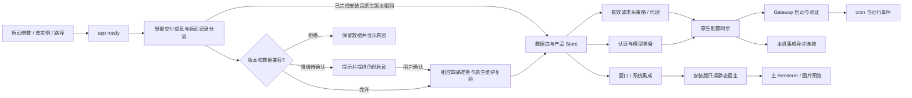

# 系统架构：产品宿主与执行运行时

桌面可选业务使用独立 Native/Main/Browser 插件包；通用 SDK、可信代码审核、冷包变更和历史清理所有权见 [应用插件宿主](17-app-plugin-host.md)。

本文描述产品宿主与运行时的组合、依赖和生命周期。产品概念见[总览](01-overview.md)，具体跨进程接口见[进程模型](03-process-model.md)。这里的核心问题是：一次产品操作如何跨组件完成，以及组件失败后谁负责恢复。

## 1. 两个状态所有者，一个桌面产品

应用由 Electron 产品宿主和 OpenClaw 执行运行时组成。Main 持有产品配置、会话索引、权限期望、运行回执和系统资源；Gateway 持有原生会话、消息、工具、任务与 cron。两者通过身份映射和明确的准备/确认过程协作，不能互相复制成第二套权威。

Renderer 同时接收两类数据：preload 提供产品命令与系统能力；集中式聊天控制器连接 loopback Gateway，接收消息与执行流。React 负责页面和工作区，Lit 负责高频聊天渲染，Redux 负责产品 UI 状态。

安装版 Renderer 由 Main 持有的只读静态宿主加载：每个主窗口在随机 `127.0.0.1` 端口读取打包的 `dist/index.html`，替代 `file:` 页面，使原生 Widget sandbox 能核对 HTTP(S) 父页面来源。该服务只提供构建资源及固定预览、工作区和 Widget viewer 入口，不提供产品 API、任意文件访问或 Gateway 凭据。

桌面 Widget 在独立内存 guest session 中跟随浏览器代理，固定 viewer 的最小 preload 不含应用桥；原生 sandbox 和认证读取归属保持不变。窗口关闭、加载失败或应用退出时撤销入口并关闭服务；开发环境仍使用 Vite。

应用外壳和设置页持有导航、布局及设置草稿；这些 UI 细节不改变进程边界。启动展示及功能准入统一见[启动与历史升级](../features/app/startup-and-history-upgrade.md)，会话目录与摘要查询见[数据存储](10-data-storage.md#会话目录与按需摘要查询)，外壳导航、会话列表及设置交互见[应用导航与会话列表](../features/app/navigation-and-session-list.md)。

数据面直连只属于聊天库，不允许普通页面自行读取 token、创建任意 Gateway client 或调用 Node。Gateway 的进程独立性也不代表它不受产品权限约束：每次任务发送仍要先准备并核对原生 session mode/root。

静态页面仍保留显式 preload、context isolation、sandbox 与无 Node 的窗口边界。生产 CSP 只允许自身脚本和打包入口中可信内联脚本的 SHA-256 哈希，禁止表单提交、插件对象及被其他页面嵌入；网络连接继续受配置端点和原生策略约束。主窗口导航只接受当前宿主的主入口，图片预览使用同一 origin 的固定入口和独立最小 preload，因此可以读取主窗口创建的图片 Blob，不能获得主窗口桥接能力。

## 2. 组合根与依赖注入

`src/main/main.ts` 负责创建服务、注入依赖、注册 handler、绑定运行事件和关闭资源。数据库及重型服务通过 getter 延迟访问，避免模块加载期间使用未就绪的 app 路径或 SQLite。领域逻辑留在所属模块，不能把所有恢复与业务分支放回 main.ts。

| 组件                         | 输入与职责                                    | 不负责的事实                     |
| ---------------------------- | --------------------------------------------- | -------------------------------- |
| SqliteStore / 领域 Store     | schema、同步事务、产品查询                    | 原生消息与执行结论               |
| CoworkEngineService / Router | 产品 session 到原生运行的路由和生命周期       | UI timeline                      |
| OpenClawEngineManager        | runtime 资源、端口、token、进程、readiness    | 单条工具的业务结果               |
| ConfigSyncService            | 受管配置投影、串行写入、reload/restart 与验证 | 会话级权限的即时修改             |
| Permission coordinator       | session 权限/root 写入和回读                  | 扩大其他会话权限                 |
| Goal coordinator             | 根据原生 Goal 决定续跑、等待和重试            | 原生目标内容与预算               |
| AppPluginManager / Registry  | 按清单加载插件、校验产物和注册寿命、撤回贡献  | Team/Workflow 业务协调与消息正文 |
| Cron/result sync             | 原生任务映射与本地结果收件箱                  | 第二套时钟或 cron 引擎           |

协调器不是通用事件总线。它们各自保留必要状态，并通过窄接口协作；同一产品状态不能被多个模块独立判定和反复写回。

## 3. 源码按责任组织

### 资源、构建和运行时目录

应用资源按用途组织：`resources/icons/` 聚合标志、平台图标和托盘素材，`pages/` 保存开发错误页与偏好恢复空白页，`python/` 保存受管依赖清单和路径初始化源码，离线下载统一放在仓库根目录下忽略提交的 `cache/<capability>/`，构建中间产物统一放在根目录的 `build/`，其中 `runtimes/`、`tar/`、`speech-models/v1/`、`browser-extension/` 分别承载准备好的运行时、Windows 运行时归档、模型发布包和浏览器扩展组装产物。

开发环境和打包从 `build/runtimes/{mingit,python-win,local-tts}/` 读取准备产物；安装资源沿用各运行时的既有名称，托盘映射到安装资源的 `tray/`。macOS 签名权限、安装器许可证及宠物素材分别由 `mac/`、`licenses/`、`pets/` 管理。完整归属见[资源说明](../../resources/README.md)。

`resources/package-manager-config/` 保存应用级 npm、pip 可选配置，打包后位于安装资源目录下同名的 `package-manager-config/`。Main 从该位置读取并设置应用、Gateway 和 MCP 子进程的环境变量，配置文件直接随安装资源使用；环境专属的 `.npmrc`、`pip.ini` 不提交到 Git。

`resources/openclaw/docs/` 保存随 OpenClaw 运行时组装的资源：`reference/templates/` 提供角色初始化模板，`channels/` 和 `gateway/config-channels.md` 提供当前产品支持范围的渠道说明。资源同步脚本将这些文件写入运行时原生的 `docs/` 对应位置，模板沿用复制覆盖、渠道目录完整替换、Gateway 说明单文件覆盖的既有行为。这里的文档和 `AGENTS.md` 模板是运行时资产；仓库架构、功能和维护说明继续位于根 `docs/`。

内置插件集中在仓库根目录 `plugins/`，按 `extensions/`、`skills/`、`mcp-servers/`、`hooks/`、`browser-extensions/` 分类。OpenClaw 扩展和独立技能分别由前两类承载，`mcp-servers/` 与 `hooks/` 预留；Chrome 加载的 Browser Assistant 位于 `plugins/browser-extensions/browser-assistant/`，独立于 Gateway 插件加载流程。

扩展自带技能保留在扩展内部，宿主管理代码仍在 `src/main/plugins/`、`src/renderer/features/plugins/` 和 `src/shared/plugins/`，OpenClaw 构建产物沿用原生目录。具体约定见[插件系统](07-plugin-system.md)。

公开 App SDK 与配套构建工具源码位于 `plugins/sdk/`，由根 npm workspace 和独立制品发布流程管理；运行时扩展发现继续读取 `plugins/extensions/`。SDK 契约与编写方式见[应用插件宿主](17-app-plugin-host.md)。

### Main 领域和原生配置投影

Main 的 `core/` 分为 app、window、network、runtime、filesystem、development。浏览器、语音、外部集成和 Windows 沙盒有自己的领域，不塞入通用工具文件。`providers/` 管理产品模型配置与认证；`openclaw/config/` 管理它们向原生配置的投影。

应用启动在 Main 的 `startup/` 下分为 `routing`、`history`、`upgrade`、`initialization`：分别拥有四路判定、历史迁移、正常升级的原生数据库维护和应用初始化。Renderer 的 `app/shell/startup/` 保留路由、历史结果和初始化展示，窗口与 preload 保留安全创建和窄桥接职责。流程见[启动与历史升级](../features/app/startup-and-history-upgrade.md)。

`openclaw/config/` 内按 agents、models、speech、plugins、policies 组织原生配置投影；配置结构整理、校验与同步协调器留在根目录。`openclawConfigBuilders.ts` 保留现有聚合入口，各投影直接依赖所属能力和必要的纯配置辅助，不反向引用聚合入口。模型 SecretRef 投影仍归原生配置，产品凭据获取和轮换仍归 `main/providers/`。

`openclaw/runtime/launch/` 管理运行包定位、启动参数、端口和进程辅助；EngineManager 继续持有 Gateway 的实例状态、启动和关闭生命周期，原生支持源码仍保留在 `runtime/native-support/`。

### Renderer 组合与领域组件

Renderer 的 feature 负责页面行为，settings 内按 models/browser/speech/integrations/runtime 等领域组织。插件按 skills/mcp/hooks/extensions/marketplace 组织。Cowork 组件按领域组织：chat/composer/sessions/goals/subagents/approvals/questions/display/preview/terminal/review/status；跨领域组合仍由 CoworkView 承担。较大的领域内部按实际能力划分子模块，测试与实现同行，文件数量只作为审查提示，不作为强制拆并配额。

composer 的 attachments、draft、selection、speech、submission 分别管理附件、草稿与媒体指令、模型及运行选项选择、语音输入、提交与停止辅助。输入框入口继续组合这些能力并持有界面状态；模型切换模块保留跨输入框挂载的同一串行队列，Redux 继续拥有已确认选择与待确认状态，发送和停止的生命周期不另建状态所有者。斜杠菜单只消费输入框传入的状态和回调。

display 管理标签组合与选择：tabs 组织标签状态、菜单和浏览器/MCP Apps 等标签适配，summary 组织会话摘要与团队记录导航，workspace 组织稳定文档 portal、遮挡和窗口控制。团队组合界面由独立插件通过 SDK 插槽注册，Core 不持有 collaboration/discussions 业务组件。preview 管理文件展示和工作区浏览，terminal 管理终端界面，review 管理工作区变更审核，计划审核归 approvals。原生子任务图归 subagents，Workflow 界面归所属插件，复用样式与连接辅助放在 shared，不增加执行状态所有者。

### 国际化和浏览器边界

Renderer 国际化入口保留在 `services/i18n.ts`，`services/i18n/translations.ts` 只组合领域字典。`appTranslations` 管理外壳与通用操作；助手、协作、记忆、浏览器和 Workboard 分别使用独立字典。

定时任务字典仅包含调度、任务表单和结果收件箱，插件管理文案归 `pluginsTranslations`；文件树与文件编辑归 `filePreviewTranslations`，侧栏与标签组合归 `workspaceDisplayTranslations`，终端归 `terminalTranslations`。聊天、侧聊和审批文案归 `chatTranslations`，通用设置、执行配置、沙箱与引擎端口归 `settingsTranslations`。

每个翻译键只有一个所属字典，`zh`/`en` 成对维护；移动词条保留既有键和值，不依赖组合顺序覆盖不同文案。

浏览器 Main 与 Renderer 继续保持进程边界。Main 的 browserAgentBridge 和 Renderer 的 BrowserPanel 持有原有生命周期，录制、数据操作等辅助按能力分组；Main 的扩展通信与历史缓存独立于 Agent 操作，Renderer 的标注和人工介入独立于面板标签壳层。测试与辅助实现相邻，目录迁移不改变 Gateway 方法、guest 注册或配对协议。

### IPC、设置和 Shared 合约

IPC 同样按产品能力组织：插件管理归 plugins，语音归 speech，权限和桌面控制准入归 security，媒体模型配置归 providers；原生引擎、历史、模型查询、记忆和命令入口继续归 openclaw。main.ts 从各领域直接注册处理器，原有 IPC 常量、注册顺序和校验语义保持一致。公共 UI 基础组件统一放在 Renderer shared/components/ui；启动展示属于应用外壳，插件操作结果属于插件公共界面。仅服务 Cowork 或 Markdown 的路径辅助与实际消费领域相邻，不建立通用 utils 汇集目录。

设置目录按页面领域组织；`settingsCatalog.ts` 声明页面和检索信息，`Settings.tsx` 持有统一草稿、离开保护和保存流程。领域页面保留各自即时保存或统一保存语义，页面重排不能改变 Main/IPC 的持久化边界。

Shared 只放可序列化合约、常量、校验和纯函数。不能依赖 Node、Electron、DOM 或进程环境。主题运行时在 Renderer，离线生成和 Tailwind 插件在 `scripts/theme/`。

Shared 按契约所属领域组织，不能因为实现经由 OpenClaw 就把所有契约放入 `openclaw/`。助手身份与执行设置由 `agents/` 共享，模型引用和选择身份由 `providers/` 共享，外部 Agent 目录与设置属于 `integrations/`，权限审批和桌面控制准入属于 `security/`，提示词替换规则属于 `prompts/`。插件标识、扩展管理、MCP、Hooks 和出站 Header 策略由 `plugins/` 提供；内置浏览器的插件事件契约仍归浏览器领域。`openclaw/` 保留原生 Gateway 事件、消息准入、待发送输入、历史、连接、原生能力和运行时清单等契约。

`cowork/interactions/` 共享结构化问题、计划审核、计划预览和交接契约，公共交互模块通过仅类型引用组合问题与计划的 envelope，不形成运行时依赖环。`cowork/diagnostics/` 共享诊断报告、错误分类和投影纯函数；采集、扫描和导出仍由 Main 拥有。这些模块拆分不增加交互或诊断状态权威，测试继续与所属模块相邻。

### 控制器状态与模块上下文

大控制器入口持有实例状态和生命周期，领域模块接收显式类型上下文。`src/shared/app/propertyContext.ts` 提供实时访问器，使异步分支读取当前连接、会话和取消状态；不能用对象展开复制状态，也不能把整个控制器交给子模块。拆文件不意味着新增独立状态机。

## 4. 启动：从本地资源到可执行任务

启动不是“窗口出现即运行就绪”。关键依赖关系如下：

通用 Agent bridge client 模式在普通 UI 初始化之前处理。启动设置产品 userData、日志、依赖管理器环境和系统 CA；ready 后读取轻量版本信息与启动记录分流。已有完成记录、原生版本相同且无降级或未完成升级时，直接打开产品 Store、加载必要配置并启动 Gateway，不额外进行产品数据库预检、原生会话扫描、完整运行包哈希或离线会话规范校验。正常启动同时跳过 Python 资源健康检查，本机集成服务与 Gateway 启动并行。升级、迁移、首次采用及恢复继续经过详细数据分类和必要的原生维护；降级等待用户确认“仍然启动”。实际数据打开失败仍显示错误，不清空重建。

有效请求头策略由手工配置和已启用、验证通过的 Extension 声明合成，不能等 Gateway 已发出请求后才切换代理 generation。配置同步失败会记录原因，后续执行准入不得把失败状态当可用。

浏览器侧栏 app-server、Native Messaging 发现文件、Agent CLI 本机桥和托盘属于产品生命周期。它们有各自凭据和清理逻辑，不共用 Gateway token。UI 可显示启动或配置错误；窗口存在本身不证明模型可用。

### 本机集成和独立凭据

Chrome、通用本机 WebSocket 与 CLI stdio 的 app-server 共用 `main/appServer/` 中唯一的协议连接实现，统一解析、握手、方法路由及响应/通知；两类 WebSocket 入口也复用同一传输实现。连接由 Main 注入浏览器或外部线程的显式能力；浏览器仅访问扩展创建的会话，通用 WebSocket 与 stdio 使用相同的外部线程 binding。

通用服务随应用启动，独立 Bearer 凭据仅由主 frame 的复制配置 IPC 按需读取，不进入状态查询或 CLI 输出。各入口保留独立鉴权和断连权限。见[统一 app-server](../features/integrations/app-server.md)。

Agent CLI、ACP 与已实现的 Codex app-server 协议共用受认证本机桥和发现文件，随桌面后台启动即提供服务，没有客户端专用总开关或环境鉴权。
控制台进程只拥有 stdio，Main 外部会话服务负责映射、模型与权限准备，OpenClaw 继续拥有执行和历史。
ACP 会话 MCP 由 Runtime Services 通过公开工具与审批接口按原生身份租约提供，不改全局配置。
详见[通用 CLI / ACP](../features/integrations/agent-cli.md)。

### Renderer 身份与启动交接

随机静态端口会改变浏览器 origin。桌面聊天的 Ed25519 Gateway 连接身份通过既有 preload Store 保存到 Main 的 SQLite `kv`，不依赖该 origin 的 `localStorage`，因而重建窗口和重新启动仍可复用身份。此记录不新增 Redux 状态或消息缓存；存储不可用时只保留当前 Renderer 生命周期内的内存身份。

启动路由、临时窗口交接、首屏主题、两种启动展示和失败诊断统一维护在[启动与历史升级](../features/app/startup-and-history-upgrade.md)。架构上只保留以下准入关系：Renderer 先恢复 Main 持久化的 UI 偏好，再导入初始化 Gate；Main shell ready 后才加载 App/Redux。普通启动在 App 和首个工作区就绪后开放主页，引擎及本机服务可继续后台准备；首次安装与升级仍遵守各自维护门禁。当前进程代次的认证和权限核对成功之前，不允许发送；`running` 或窗口出现都不能代替执行准入。

## 5. 三条核心操作链

### 发送任务

产品会话先确定 main 身份、cwd、模型和权限。Main 等待配置更新、确认 Gateway readiness，并建立 clientTurnId/run receipt。原生会话准备核对 mode/root；发送后 Gateway 产生消息与运行事件。Main 更新生命周期，Renderer 合并实时与历史。发送超时需要确认原生是否接收，不能通过重复创建会话消除不确定性。

### 保存设置

Renderer 提交产品期望 → Main 校验并持久化 → 配置同步器生成受管字段 → 原生 reload 或必要的 restart → 回读验证 → UI 展示结果。不是所有字段都需要重启；会话权限走独立 RPC。可选扩展的显式关闭状态必须保留，不能被“补齐默认配置”覆盖。

### 安装插件

安装器先验证来源和格式，再在受管目录协调进程占用及文件变更，随后交原生管理接口应用，最后重新读取 inventory。下载成功、目录存在和运行注册成功是三个不同阶段。跨文件、SQLite、Gateway 的失败需要清理或明确补偿，不能用单个 SQLite transaction 声称全部原子。

## 6. 退出与更新安装

`registerAppShutdown` 保证 cleanup 只进入一次。锁定退出状态后先隐藏所有窗口并撤销托盘，
让关闭操作立即得到视觉响应；迟到的窗口 ready/activate 不得重新显示界面或启动轮询。
后台仍等待原生资源实际退休，隐藏窗口不代表进程已退出。main.ts 的清理顺序具有依赖：

1. 撤销新工作准入，等待原生启动资源及后台本机集成准备 owner 收尾；停止开发服务监控、凭据监控与活动上报，失效内存认证。
2. 立即撤销通用 WebSocket 的地址、凭据及新连接准入，并等待所属任务清理；清理浏览器 app-server 发现信息并关闭服务，销毁托盘，停止 Agent bridge。
3. 停止 cron 轮询，防止关闭过程中再启动后台工作。
4. 停止 Cowork 会话，再停止 Gateway。
5. 关闭 browser agent bridge、出站代理，最后关闭 SQLite。

更新安装复用同一清理过程。开发模式有 10 秒清理期限，超时独立尝试停止 Gateway 并最终退出；安装版不能照搬开发兜底为业务成功。先停数据库或代理会使仍工作的运行时失去依赖。

## 7. 故障按所有者恢复

| 故障                    | 恢复者                                  | 不能采取的捷径                 |
| ----------------------- | --------------------------------------- | ------------------------------ |
| Renderer 重载或会话切换 | UI 重订阅、查询产品索引并加载原生历史   | 从 Main 消息副本恢复           |
| Gateway 连接中断        | Adapter/client 新 generation 与状态对账 | 无条件重发最后一次写操作       |
| 配置应用失败            | ConfigSyncService 报错或按领域回滚      | UI 只显示“已保存”              |
| 整任务删除部分完成      | 持久删除进度继续补偿                    | 先隐藏全部本地行再丢失原生身份 |
| 原生接收结果未知        | 保留 unknown，按协议确认                | 将超时认定为未执行             |
| 文件被其他进程修改      | 文件授权版本校验拒绝或用户重载          | 覆盖冲突版本                   |

完整应用重启和同进程 Gateway 重启的恢复边界不同，见[执行引擎](05-agent-engine.md)。产品数据库也可能需要迁移，但运行时补丁不支持旧修订就地升级。

## 8. 验证与修改范围

架构变更应从共享合约追到实际注册、服务、消费方及测试。重点验证启动配置失败、快速停止、重连、卸载和部分删除，不能只跑首次成功发送。

入口测试包括 `core/app/appShutdown.test.ts`、运行时 manager 测试、cowork handler/adapter 测试和 config sync 测试，均位于 `src/main/` 相应领域。本页说明现有责任和检查范围，不把测试文件存在等同于当前平台已通过验收。
