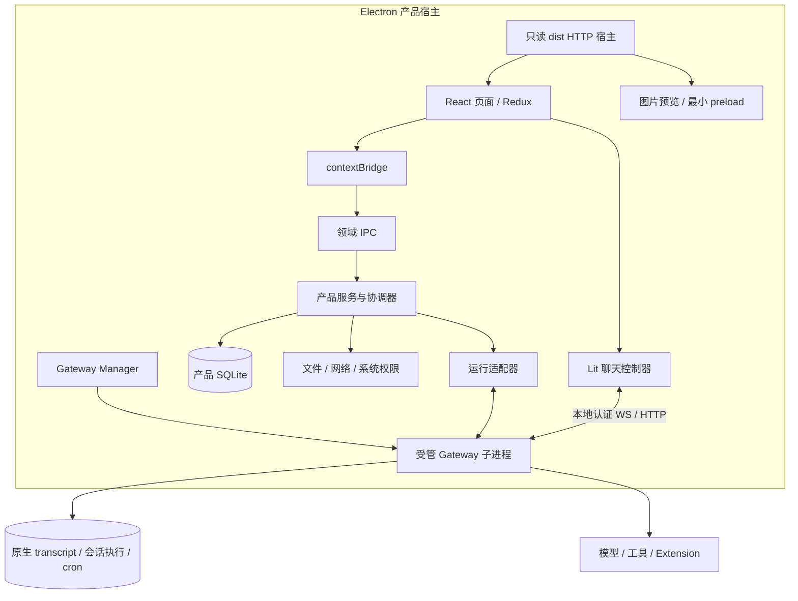
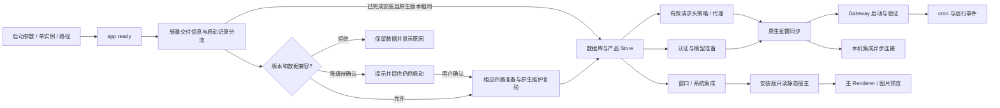

# 系统架构：产品宿主与执行运行时

桌面可选业务使用独立 Native/Main/Browser 插件包；通用 SDK、可信代码审核、冷包变更和历史清理所有权见 [应用插件宿主](17-app-plugin-host.md)。

本文描述产品宿主与运行时的组合、依赖和生命周期。产品概念见[总览](01-overview.md)，具体跨进程接口见[进程模型](03-process-model.md)。这里的核心问题是：一次产品操作如何跨组件完成，以及组件失败后谁负责恢复。

## 1. 两个状态所有者，一个桌面产品

应用由 Electron 产品宿主和 OpenClaw 执行运行时组成。Main 持有产品配置、会话索引、权限期望、运行回执和系统资源；Gateway 持有原生会话、消息、工具、任务与 cron。两者通过身份映射和明确的准备/确认过程协作，不能互相复制成第二套权威。

Renderer 同时接收两类数据：preload 提供产品命令与系统能力；集中式聊天控制器连接 loopback Gateway，接收消息与执行流。React 负责页面和工作区，Lit 负责高频聊天渲染，Redux 负责产品 UI 状态。

安装版 Renderer 由 Main 持有的只读静态宿主加载：每个主窗口在随机 `127.0.0.1` 端口读取打包的 `dist/index.html`，替代 `file:` 页面，使原生 Widget sandbox 能核对 HTTP(S) 父页面来源。该服务只提供构建资源及固定预览、工作区和 Widget viewer 入口，不提供产品 API、任意文件访问或 Gateway 凭据。桌面 Widget 在独立内存 guest session 中跟随浏览器代理，固定 viewer 的最小 preload 不含应用桥；原生 sandbox 和认证读取归属保持不变。窗口关闭、加载失败或应用退出时撤销入口并关闭服务；开发环境仍使用 Vite。

应用外壳的左侧功能导航为 44px 图标栏，顶部固定为主页、定时任务、插件与更多，账号头像和设置齿轮位于底部。头像通过 preload 发起 Main 拥有的登录流程，账号菜单以 Portal 展示，避免被外壳裁切。主页显示独立的聊天列表面板（新聊天、搜索与已有会话）；切换到其他功能或收起聊天列表后，图标栏与账号入口仍保留。记忆及已启用的 Workboard 从更多进入，可逐项固定或取消固定，固定入口排列在更多之后。侧边栏偏好通过既有 ConfigService / preload Store 保存为 `app_config.sidebarPinnedItems`，只持久化功能 ID 与顺序；Workboard 暂时不可用时隐藏入口但保留固定偏好，不复制插件配置或聊天历史。

会话侧栏使用两层产品元数据：完整轻量目录保留会话 ID、来源、归组、状态、原生定位及活动时间，服务计数、存在性与后台运行发现；标题和历史绑定展示摘要按当前展开范围批量读取，每次 IPC 最多 200 个 ID。目录仍为 O(N) 查询，但不加载标题、正文，也不逐条读取会话详情或检查工作目录。原生 worktree 发现独立在后台执行，采用后发出既有列表失效通知，不阻塞首屏或每次加载更多。

置顶、今天、昨天默认展开并读取该范围全部摘要；其他时间组、手动组及 CLI、浏览器扩展等来源组首次展开取前 20 条，继续每次最多追加 20 条，过滤后允许不足 20。分组总数来自完整目录，手动组保留创建与移动；来源组按真实入口固定归属，禁止手动迁入迁出。折叠保留已加载前缀；组内失败保留已有行并允许重试。全选与批量删除只覆盖当前展开且已显示的行。日期仍按本地日历和最近活跃时间分组，团队锚点先聚合完整目录中成员的活动时间再计数和选择前缀。

自动来源分组仅有 Chrome 和 CLI，不提供历史客户端专用分组或来源转换。两组都不属于可编辑的手动分组：会话项不提供移动菜单和拖拽，来源组不接收拖放。Main 按持久化来源拒绝这些会话的手动归组请求，并且仅允许普通会话移入真实存在的手动组或移出至未分组。普通用户组即使名为 Chrome 或 CLI 也保持可编辑；移动失败时界面不得改变归属。

分页摘要不能充当完整存在性证据：未读裁剪、后台标签及浏览器资源保留、idle 旧会话运行发现使用完整目录。搜索弹窗打开时独立读取完整简单摘要快照，按产品可见性确定范围，正文继续走原生 sessions.search；该快照不灌入侧栏摘要集合。未加载历史记录不得因侧栏折叠而退出搜索或后台发现。

聊天列表与消息区之间的分隔线支持左右拖动及键盘左右、Home/End 调整。列表默认 240px，可在 180–480px 内调整，同时为消息区保留至少 320px；窗口空间不足时优先收敛列表宽度，恢复空间后回到用户选择的宽度。宽度通过 `rendererPreferences` 的 `shell.session-list-width` 保存到 Main KV，在下次启动及设置页返回时恢复；窗口缩放不覆盖已保存宽度。拖动结束、取消、失焦、收起列表、切换功能或卸载均释放拖动状态。

主界面的窗口标题栏由应用外壳统一渲染，从左侧图标栏右边贯穿聊天列表与页面内容，窗口控制按钮位于最右侧。图标栏保持全高；聊天列表和各功能页面位于标题栏下方，页面切换、列表收起及聊天加载不再各自创建窗口控制按钮。设置页和初始化／错误界面保留各自独立的标题栏。“打开 Control UI”入口位于“设置 → 通用”的开发者区域，在 Control UI 设置下方随其草稿开关显示，保存生效后可用；主界面更多菜单不提供此入口。

主界面与设置页的 AI 引擎提示位于标题栏右侧、最小化按钮左边，按启动、重启、失败（查看原因）和未启动（启动按钮）四种展示；运行时隐藏。状态由 Main 提供，失败原因弹窗挂载主文档，避免标题栏裁切。该提示不属于右下角通知栈，不能覆盖设置页底部操作；详见[执行引擎](05-agent-engine.md)。

数据面直连只属于聊天库，不允许普通页面自行读取 token、创建任意 Gateway client 或调用 Node。Gateway 的进程独立性也不代表它不受产品权限约束：每次任务发送仍要先准备并核对原生 session mode/root。

静态页面仍保留显式 preload、context isolation、sandbox 与无 Node 的窗口边界。生产 CSP 只允许自身脚本和打包入口中可信内联脚本的 SHA-256 哈希，禁止表单提交、插件对象及被其他页面嵌入；网络连接继续受配置端点和原生策略约束。主窗口导航只接受当前宿主的主入口，图片预览使用同一 origin 的固定入口和独立最小 preload，因此可以读取主窗口创建的图片 Blob，不能获得主窗口桥接能力。

## 2. 组合根与依赖注入

`src/main/main.ts` 负责创建服务、注入依赖、注册 handler、绑定运行事件和关闭资源。数据库及重型服务通过 getter 延迟访问，避免模块加载期间使用未就绪的 app 路径或 SQLite。领域逻辑留在所属模块，不能把所有恢复与业务分支放回 main.ts。

| 组件                         | 输入与职责                                    | 不负责的事实              |
| ---------------------------- | --------------------------------------------- | ------------------------- |
| SqliteStore / 领域 Store     | schema、同步事务、产品查询                    | 原生消息与执行结论        |
| CoworkEngineService / Router | 产品 session 到原生运行的路由和生命周期       | UI timeline               |
| OpenClawEngineManager        | runtime 资源、端口、token、进程、readiness    | 单条工具的业务结果        |
| ConfigSyncService            | 受管配置投影、串行写入、reload/restart 与验证 | 会话级权限的即时修改      |
| Permission coordinator       | session 权限/root 写入和回读                  | 扩大其他会话权限          |
| Goal coordinator             | 根据原生 Goal 决定续跑、等待和重试            | 原生目标内容与预算        |
| CollaborationCoordinator     | 成员、轮次、发送准入、停止与删除补偿          | peer 消息正文和执行调度器 |
| Cron/result sync             | 原生任务映射与本地结果收件箱                  | 第二套时钟或 cron 引擎    |

协调器不是通用事件总线。它们各自保留必要状态，并通过窄接口协作；同一产品状态不能被多个模块独立判定和反复写回。

## 3. 源码按责任组织

应用资源按用途组织：`resources/icons/` 聚合标志、平台图标和托盘素材，`pages/` 保存开发错误页与偏好恢复空白页，`python/` 保存受管依赖清单和路径初始化源码，离线下载统一放在仓库根目录下忽略提交的 `cache/<capability>/`，构建中间产物统一放在根目录的 `build/`，其中 `runtimes/`、`tar/`、`speech-models/v1/`、`browser-extension/` 分别承载准备好的运行时、Windows 运行时归档、模型发布包和浏览器扩展组装产物。开发环境和打包从 `build/runtimes/{mingit,python-win,local-tts}/` 读取准备产物；安装资源沿用各运行时的既有名称，托盘映射到安装资源的 `tray/`。macOS 签名权限、安装器许可证及宠物素材分别由 `mac/`、`licenses/`、`pets/` 管理。完整归属见[资源说明](../../resources/README.md)。

`resources/package-manager-config/` 保存应用级 npm、pip 可选配置，打包后位于安装资源目录下同名的 `package-manager-config/`。Main 从该位置读取并设置应用、Gateway 和 MCP 子进程的环境变量，配置文件直接随安装资源使用；环境专属的 `.npmrc`、`pip.ini` 不提交到 Git。

`resources/openclaw/docs/` 保存随 OpenClaw 运行时组装的资源：`reference/templates/` 提供角色初始化模板，`channels/` 和 `gateway/config-channels.md` 提供当前产品支持范围的渠道说明。资源同步脚本将这些文件写入运行时原生的 `docs/` 对应位置，模板沿用复制覆盖、渠道目录完整替换、Gateway 说明单文件覆盖的既有行为。这里的文档和 `AGENTS.md` 模板是运行时资产；仓库架构、功能和维护说明继续位于根 `docs/`。

内置插件集中在仓库根目录 `plugins/`，按 `extensions/`、`skills/`、`mcp-servers/`、`hooks/`、`browser-extensions/` 分类。OpenClaw 扩展和独立技能分别由前两类承载，`mcp-servers/` 与 `hooks/` 预留；Chrome 加载的 Browser Assistant 位于 `plugins/browser-extensions/browser-assistant/`，独立于 Gateway 插件加载流程。扩展自带技能保留在扩展内部，宿主管理代码仍在 `src/main/plugins/`、`src/renderer/features/plugins/` 和 `src/shared/plugins/`，OpenClaw 构建产物沿用原生目录。具体约定见[插件系统](07-plugin-system.md)。

公开 App SDK 与配套构建工具源码位于 `plugins/sdk/`，由根 npm workspace 和独立制品发布流程管理；运行时扩展发现继续读取 `plugins/extensions/`。SDK 契约与编写方式见[应用插件宿主](17-app-plugin-host.md)。

Main 的 `core/` 分为 app、window、network、runtime、filesystem、development。浏览器、语音、外部集成和 Windows 沙盒有自己的领域，不塞入通用工具文件。`providers/` 管理产品模型配置与认证；`openclaw/config/` 管理它们向原生配置的投影。

应用启动在 Main 的 `startup/` 下分为 `routing`、`history`、`upgrade`、`initialization`：分别拥有四路判定、历史迁移、正常升级的原生数据库维护和应用初始化。Renderer 的 `app/shell/startup/` 保留路由、历史结果和初始化展示，窗口与 preload 保留安全创建和窄桥接职责。流程见[启动与历史升级](../features/app/startup-and-history-upgrade.md)。

`openclaw/config/` 内按 agents、models、speech、plugins、policies 组织原生配置投影；配置结构整理、校验与同步协调器留在根目录。`openclawConfigBuilders.ts` 保留现有聚合入口，各投影直接依赖所属能力和必要的纯配置辅助，不反向引用聚合入口。模型 SecretRef 投影仍归原生配置，产品凭据获取和轮换仍归 `main/providers/`。`openclaw/runtime/launch/` 管理运行包定位、启动参数、端口和进程辅助；EngineManager 继续持有 Gateway 的实例状态、启动和关闭生命周期，原生支持源码仍保留在 `runtime/native-support/`。

Renderer 的 feature 负责页面行为，settings 内按 models/browser/speech/integrations/runtime 等领域组织。插件按 skills/mcp/hooks/extensions/marketplace 组织。Cowork 组件按领域组织：chat/composer/sessions/goals/subagents/swarm-workflow/approvals/questions/display/preview/terminal/review/status；跨领域组合仍由 CoworkView 承担。较大的领域内部按实际能力划分子模块，测试与实现同行，文件数量只作为审查提示，不作为强制拆并配额。

composer 的 attachments、draft、selection、speech、submission 分别管理附件、草稿与媒体指令、模型及运行选项选择、语音输入、提交与停止辅助。输入框入口继续组合这些能力并持有界面状态；模型切换模块保留跨输入框挂载的同一串行队列，Redux 继续拥有已确认选择与待确认状态，发送和停止的生命周期不另建状态所有者。斜杠菜单只消费输入框传入的状态和回调。

display 管理标签组合与选择：tabs 组织标签状态、菜单和浏览器/MCP Apps 等标签适配，summary 组织会话摘要与团队记录导航，workspace 组织稳定文档 portal、遮挡和窗口控制。团队组合界面仍委托 collaboration 与 discussions，不接管其执行和持久化。preview 管理文件展示和工作区浏览，terminal 管理终端界面，review 管理工作区变更审核，计划审核归 approvals。原生子任务图与独立 Workflow 插件界面分别归 subagents 和 swarm-workflow，复用样式与连接辅助放在 shared，不增加执行状态所有者。

Renderer 国际化入口保留在 `services/i18n.ts`，`services/i18n/translations.ts` 只组合领域字典。`appTranslations` 管理外壳与通用操作；助手、协作、记忆、浏览器和 Workboard 分别使用独立字典。定时任务字典仅包含调度、任务表单和结果收件箱，插件管理文案归 `pluginsTranslations`；文件树与文件编辑归 `filePreviewTranslations`，侧栏与标签组合归 `workspaceDisplayTranslations`，终端归 `terminalTranslations`。聊天、侧聊和审批文案归 `chatTranslations`，通用设置、执行配置、沙箱与引擎端口归 `settingsTranslations`。每个翻译键只有一个所属字典，`zh`/`en` 成对维护；移动词条保留既有键和值，不依赖组合顺序覆盖不同文案。

浏览器 Main 与 Renderer 继续保持进程边界。Main 的 browserAgentBridge 和 Renderer 的 BrowserPanel 持有原有生命周期，录制、数据操作等辅助按能力分组；Main 的扩展通信与历史缓存独立于 Agent 操作，Renderer 的标注和人工介入独立于面板标签壳层。测试与辅助实现相邻，目录迁移不改变 Gateway 方法、guest 注册或配对协议。

IPC 同样按产品能力组织：插件管理归 plugins，语音归 speech，权限和桌面控制准入归 security，媒体模型配置归 providers；原生引擎、历史、模型查询、记忆和命令入口继续归 openclaw。main.ts 从各领域直接注册处理器，原有 IPC 常量、注册顺序和校验语义保持一致。公共 UI 基础组件统一放在 Renderer shared/components/ui；启动展示属于应用外壳，插件操作结果属于插件公共界面。仅服务 Cowork 或 Markdown 的路径辅助与实际消费领域相邻，不建立通用 utils 汇集目录。

设置使用独立滚动的分组侧栏与居中内容区，按用户要调整的对象分为个人偏好、模型与助手、任务执行、连接与集成、应用管理。个人偏好包含通用、外观、快捷键、语音和宠物；模型与助手管理模型来源与助手身份；任务执行包含执行设置、沙箱与隔离、Worktree、浏览器和电脑操控；连接与集成提供外部连接和消息通道；应用管理提供用量与存储、关于与帮助。浏览器和电脑操控是助手执行任务的能力，外部工具委派与消息接入属于连接设置。

`settingsCatalog.ts` 声明页面身份、分组、翻译检索词和内容宽度；`SettingsNavigation` 仅负责搜索和导航展示，搜索匹配页面名称、说明与设置关键词，不挂载隐藏页面或读取配置。选择结果仍交由 `Settings.tsx` 执行离开保护和页面切换。`Settings.tsx` 继续持有配置草稿、预览回滚与保存流程，各领域页面保留原有即时保存或统一保存语义；界面重构不改变 Main/IPC 的持久化边界。通用页标题累计点击 10 次后，直接显示带统一边框的开发者区域，包含 Control UI、应用代理与 Gateway 端口，不再提供开发者模式总开关；离开通用页会重置显示计数，但保留本次设置草稿。执行设置页按 Agent、侧栏标签页、Goal 模式、Code Mode、MCP、SubAgent 和 Swarm 分组展示参数，保留各分组的适用范围、实验性标识与行为说明；所有分组始终展开，不通过分类切换或折叠隐藏设置。配置草稿仍由父级持有。

Shared 只放可序列化合约、常量、校验和纯函数。不能依赖 Node、Electron、DOM 或进程环境。主题运行时在 Renderer，离线生成和 Tailwind 插件在 `scripts/theme/`。

Shared 按契约所属领域组织，不能因为实现经由 OpenClaw 就把所有契约放入 `openclaw/`。助手身份与执行设置由 `agents/` 共享，模型引用和选择身份由 `providers/` 共享，外部 Agent 目录与设置属于 `integrations/`，权限审批和桌面控制准入属于 `security/`，提示词替换规则属于 `prompts/`。插件标识、扩展管理、MCP、Hooks 和出站 Header 策略由 `plugins/` 提供；内置浏览器的插件事件契约仍归浏览器领域。`openclaw/` 保留原生 Gateway 事件、消息准入、待发送输入、历史、连接、原生能力和运行时清单等契约。

`cowork/interactions/` 共享结构化问题、计划审核、计划预览和交接契约，公共交互模块通过仅类型引用组合问题与计划的 envelope，不形成运行时依赖环。`cowork/diagnostics/` 共享诊断报告、错误分类和投影纯函数；采集、扫描和导出仍由 Main 拥有。这些模块拆分不增加交互或诊断状态权威，测试继续与所属模块相邻。

大控制器入口持有实例状态和生命周期，领域模块接收显式类型上下文。`src/shared/app/propertyContext.ts` 提供实时访问器，使异步分支读取当前连接、会话和取消状态；不能用对象展开复制状态，也不能把整个控制器交给子模块。拆文件不意味着新增独立状态机。

## 4. 启动：从本地资源到可执行任务

启动不是“窗口出现即运行就绪”。关键依赖关系如下：

通用 Agent bridge client 模式在普通 UI 初始化之前处理。启动设置产品 userData、日志、依赖管理器环境和系统 CA；ready 后读取轻量版本信息与启动记录分流。已有完成记录、原生版本相同且无降级或未完成升级时，直接打开产品 Store、加载必要配置并启动 Gateway，不额外进行产品数据库预检、原生会话扫描、完整运行包哈希或离线会话规范校验。正常启动同时跳过 Python 资源健康检查，本机集成服务与 Gateway 启动并行。升级、迁移、首次采用及恢复继续经过详细数据分类和必要的原生维护；降级等待用户确认“仍然启动”。实际数据打开失败仍显示错误，不清空重建。

有效请求头策略由手工配置和已启用、验证通过的 Extension 声明合成，不能等 Gateway 已发出请求后才切换代理 generation。配置同步失败会记录原因，后续执行准入不得把失败状态当可用。

浏览器侧栏 app-server、Native Messaging 发现文件、Agent CLI 本机桥和托盘属于产品生命周期。它们有各自凭据和清理逻辑，不共用 Gateway token。UI 可显示启动或配置错误；窗口存在本身不证明模型可用。

Chrome、通用本机 WebSocket 与 CLI stdio 的 app-server 共用 `main/appServer/` 中唯一的协议连接实现，统一解析、握手、方法路由及响应/通知；两类 WebSocket 入口也复用同一传输实现。连接由 Main 注入浏览器或外部线程的显式能力；浏览器仅访问扩展创建的会话，通用 WebSocket 与 stdio 使用相同的外部线程 binding。通用服务随应用启动，独立 Bearer 凭据仅由主 frame 的复制配置 IPC 按需读取，不进入状态查询或 CLI 输出。各入口保留独立鉴权和断连权限。见[统一 app-server](../features/integrations/app-server.md)。

Agent CLI、ACP 与已实现的 Codex app-server 协议共用受认证本机桥和发现文件，随桌面后台启动即提供服务，没有客户端专用总开关或环境鉴权。
控制台进程只拥有 stdio，Main 外部会话服务负责映射、模型与权限准备，OpenClaw 继续拥有执行和历史。
ACP 会话 MCP 由 Runtime Services 通过公开工具与审批接口按原生身份租约提供，不改全局配置。
详见[通用 CLI / ACP](../features/integrations/agent-cli.md)。

随机静态端口会改变浏览器 origin。桌面聊天的 Ed25519 Gateway 连接身份通过既有 preload Store 保存到 Main 的 SQLite `kv`，不依赖该 origin 的 `localStorage`，因而重建窗口和重新启动仍可复用身份。此记录不新增 Redux 状态或消息缓存；存储不可用时只保留当前 Renderer 生命周期内的内存身份。

启动展示位于 `app/shell/`，按目录分为两个独立模块：`first-launch/` 保留首次准备引导，
`startup/` 展示后续启动的扁平化动画与运行进度；中立的 `initialization/` 负责启动协调与错误边界。
Main 在进程初始化时确定 `firstLaunch`，将同一值传给临时窗口及后续主窗口，preload 同步暴露只读模式。
首次标记成功写入后，本进程的模式仍不改变；仅下次启动读取到该标记时才进入普通启动模式。
临时窗口也可能承载普通启动的数据打开错误，不能由临时窗口身份推断首次状态。
首次标记的读取、成功写入及文件准备继续由 Main 原有流程拥有，两个页面只消费同一权威状态。
普通启动页从居中的软件标志开始，横向展开品牌横条，再向下展开真实进度与五项独立状态：
打开应用数据、加载启动配置、启动 AI 引擎、连接本机服务、加载工作界面。后面三项可同时进行，
不使用唯一当前步骤表达并发工作；数据与配置项表示实际加载，不包含运行环境检查或宿主原生预检。
入场由 `startup/` 内的轻量浏览器模块拥有，构建时内嵌，不依赖 React 或远程动画资源。
同一文档的首屏、React 挂载和启动快照切换共用一次 1280ms 入场时钟，接续已播放的位置而不重播；
首次引导不启动该时钟。窗口尺寸改变时按当前布局重新定位标志，启动失败立即展开错误，不等待动画。
两个目录分别持有入口 HTML 模板及样式。打包入口同步按 preload 的固定模式选择模板，
使用构建时注入的中英文案，在 React、偏好恢复和编辑器加载前即可绘制；
普通窗口的每个文档在 preload 阶段向 Main 同步读取只包含模式与主题 ID 的只读外观快照，
源于既有 `app_config.theme` 与具名主题偏好；首屏不读取随机 origin 的 `app_config`。
该读取发生在旧 origin 偏好导入之后，每次 reload 都读取最新设置，不复用窗口创建时的旧值。
Main 将只读通道绑定到所属 WebContents，仅接受其主 frame；销毁窗口即移除监听，不增加文件或网络准备。
尚未打开产品 Store 的首次临时窗口使用产品默认浅色，不按系统外观猜测用户设置。
主题构建工具将现有主题 CSS 与轻量主题选择脚本内嵌到入口；首屏与完整 ThemeService 复用同一选择规则，
因此样式、界面偏好和主界面逐步加载时不会因默认值不同而突然切换明暗或配色。
入口模块加载失败保留可见的重新加载入口。可信内联脚本仍由静态宿主计算 CSP 哈希，资源及导航保护保持不变。
Renderer 先恢复 Main 持久化的界面偏好，再加载轻量初始化 Gate；Main 报告 shell ready 后才加载
Monaco、App 和 Redux。Gate 在后台挂载界面并继续显示同一种启动页面，直到 App 初始化及首次
Cowork 工作区加载成功后显示首页；不会在首次引导后插入普通启动动画。
普通启动在真实就绪且入场完成后，以 640 毫秒的左右揭开过渡露出已挂载首页；
过渡期间首页可见但保持 inert 和 aria-hidden，完成后撤去覆盖层并开放交互。
首次引导就绪后直接显示首页，不经过普通启动的入场或揭开过渡。加载期间界面不可见且不可交互。
普通启动在 App 和首个工作区就绪后开放主页，不再等待后台引擎或本机集成任务。
Main 的 `enginePreparationPending` / `enginePreparationFailure` 与引擎状态共同驱动
标题栏提示和功能可用性；只有当前 process/lifecycle 的认证、执行权限核对成功才开放发送。
进程 Running 本身不表示可执行，准备失败也不能卸载已开放的主页。首次安装与两类升级
仍等待原有检查，不缩减维护或数据准入。工作区后续重新挂载不会重新打开启动页面。
标题栏的引擎提示单独延迟加载，避免启动窗口隐式导入完整业务服务图。

两个模块都有真实步骤、当前活动、活动说明、总耗时和本项耗时，但使用独立文案：
首次引导的 `initializationTranslations.mts` 描述目录、默认文件与首次准备；
普通启动的 `startupTranslations.mts` 描述打开已有应用数据、加载启动配置及引擎、本机服务与界面的各自进度。
例如同一配置同步活动在首次引导中说明默认文件准备，在普通启动中显示“同步 AI 运行配置”，
避免把每次打开已有数据库描述成重新初始化数据。
网络策略、模型访问、本机服务与集成连接分别在实际操作前报告，不将长时间等待统一称作“加载应用”。
步骤计数只表示本机准备与启动交接；普通启动仍允许 AI 引擎在后台启动，不能从 shell ready 推断引擎可执行任务。
工作界面、偏好、主题、语言和最近对话加载使用各自的 Renderer 操作文案；没有可测总量时显示不定进度，
不按计时补造百分比。30 秒和 90 秒的等待提示不表示后端仍健康；活动变化才重置本项等待。
Main 就绪后首次进入界面加载会重置当前操作计时，总启动计时继续沿用 Main 的起点。
失败保留所属模式、实际步骤和错误；Main 初始化失败提供重启，界面模块及工作区失败提供重新加载。
快照读取失败同样保留该进程的启动模式。首次引导和普通启动的动画、流动进度及进度宽度过渡始终启用，
不随 Windows 的关闭动画或系统减少动态效果偏好停用；实际失败仍停止普通启动页的活动脉冲及流动进度。

启动诊断能力位于中立的 `initialization/`，两个展示模块只组合诊断入口，不互相导入页面。
Gate 直接订阅 preload 的引擎状态，不导入 Cowork 服务或 Redux，也不按当前步骤/错误文案判断引擎失败。
引擎实际 `error` 与 Main/Renderer 初始化错误可同时显示：点击引擎“查看诊断”才延迟加载既有
`EngineDiagnosticsModal` 并按 `diagnosticId` 调用原采集器；关闭、刷新、新故障与重新启动时取消旧采集。
弹窗位于启动遮罩内部独立层级，打开时背景不可交互；应用就绪后仍保留正在查看的报告，关闭再进入首页。
该等待只影响展示，普通启动仍不以引擎失败阻塞应用就绪。重试引擎使用既有启动接口，不重启整个应用。

其他失败保留实际异常的 message、code、stack 和有界 cause 链，Main 附带步骤、活动、数据及日志位置，
Renderer 附带界面活动；默认不扫描日志，不把阶段或异常文本推测成根因。详情与复制使用同一脱敏快照。
入口 HTML 在 React/偏好模块之前捕获模块资源错误、全局异常及未处理拒绝，用文本节点展示详情和复制入口；
Main 继续观察 preload、主页面加载与 Renderer 进程丢失，页面完全不可用时显示可复制/重启应用的原生错误框。
只保留本次启动内存证据，不读会话正文、不新增数据库或日志缓存、不上传；分享前提示检查路径等信息。

## 5. 三条核心操作链

### 发送任务

产品会话先确定 main 身份、cwd、模型和权限。Main 等待配置更新、确认 Gateway readiness，并建立 clientTurnId/run receipt。原生会话准备核对 mode/root；发送后 Gateway 产生消息与运行事件。Main 更新生命周期，Renderer 合并实时与历史。发送超时需要确认原生是否接收，不能通过重复创建会话消除不确定性。

### 保存设置

Renderer 提交产品期望 → Main 校验并持久化 → 配置同步器生成受管字段 → 原生 reload 或必要的 restart → 回读验证 → UI 展示结果。不是所有字段都需要重启；会话权限走独立 RPC。可选扩展的显式关闭状态必须保留，不能被“补齐默认配置”覆盖。

### 安装插件

安装器先验证来源和格式，再在受管目录协调进程占用及文件变更，随后交原生管理接口应用，最后重新读取 inventory。下载成功、目录存在和运行注册成功是三个不同阶段。跨文件、SQLite、Gateway 的失败需要清理或明确补偿，不能用单个 SQLite transaction 声称全部原子。

## 6. 退出与更新安装

`registerAppShutdown` 保证 cleanup 只进入一次。锁定退出状态后先隐藏所有窗口并撤销托盘，
让关闭操作立即得到视觉响应；迟到的窗口 ready/activate 不得重新显示界面或启动轮询。
后台仍等待原生资源实际退休，隐藏窗口不代表进程已退出。main.ts 的清理顺序具有依赖：

1. 撤销新工作准入，等待原生启动资源及后台本机集成准备 owner 收尾；停止开发服务监控、凭据监控与活动上报，失效内存认证。
2. 立即撤销通用 WebSocket 的地址、凭据及新连接准入，并等待所属任务清理；清理浏览器 app-server 发现信息并关闭服务，销毁托盘，停止 Agent bridge。
3. 停止 cron 轮询，防止关闭过程中再启动后台工作。
4. 停止 Cowork 会话，再停止 Gateway。
5. 关闭 browser agent bridge、出站代理，最后关闭 SQLite。

更新安装复用同一清理过程。开发模式有 10 秒清理期限，超时独立尝试停止 Gateway 并最终退出；安装版不能照搬开发兜底为业务成功。先停数据库或代理会使仍工作的运行时失去依赖。

## 7. 故障按所有者恢复

| 故障                    | 恢复者                                  | 不能采取的捷径                 |
| ----------------------- | --------------------------------------- | ------------------------------ |
| Renderer 重载或会话切换 | UI 重订阅、查询产品索引并加载原生历史   | 从 Main 消息副本恢复           |
| Gateway 连接中断        | Adapter/client 新 generation 与状态对账 | 无条件重发最后一次写操作       |
| 配置应用失败            | ConfigSyncService 报错或按领域回滚      | UI 只显示“已保存”              |
| 整任务删除部分完成      | 持久删除进度继续补偿                    | 先隐藏全部本地行再丢失原生身份 |
| 原生接收结果未知        | 保留 unknown，按协议确认                | 将超时认定为未执行             |
| 文件被其他进程修改      | 文件授权版本校验拒绝或用户重载          | 覆盖冲突版本                   |

完整应用重启和同进程 Gateway 重启的恢复边界不同，见[执行引擎](05-agent-engine.md)。产品数据库也可能需要迁移，但运行时补丁不支持旧修订就地升级。

## 8. 验证与修改范围

架构变更应从共享合约追到实际注册、服务、消费方及测试。重点验证启动配置失败、快速停止、重连、卸载和部分删除，不能只跑首次成功发送。

入口测试包括 `core/app/appShutdown.test.ts`、运行时 manager 测试、cowork handler/adapter 测试和 config sync 测试，均位于 `src/main/` 相应领域。本页说明现有责任和检查范围，不把测试文件存在等同于当前平台已通过验收。

## Agent Team 双模式

任务协作继续使用原有 peer room 与投递流程。群组讨论是现有可选 agent-team 扩展中的本地 Channel；Main 管理独立房间元数据，OpenClaw broadcast 管理成员调用及轮次。每次入站临时投影房间配置，不修改全局策略或写入每轮 roster。

详见 [Agent Team 现行契约](../features/assistants/agent-team.md)。
