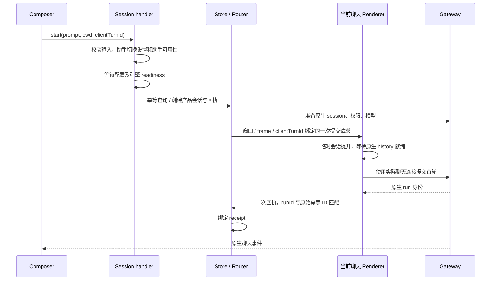
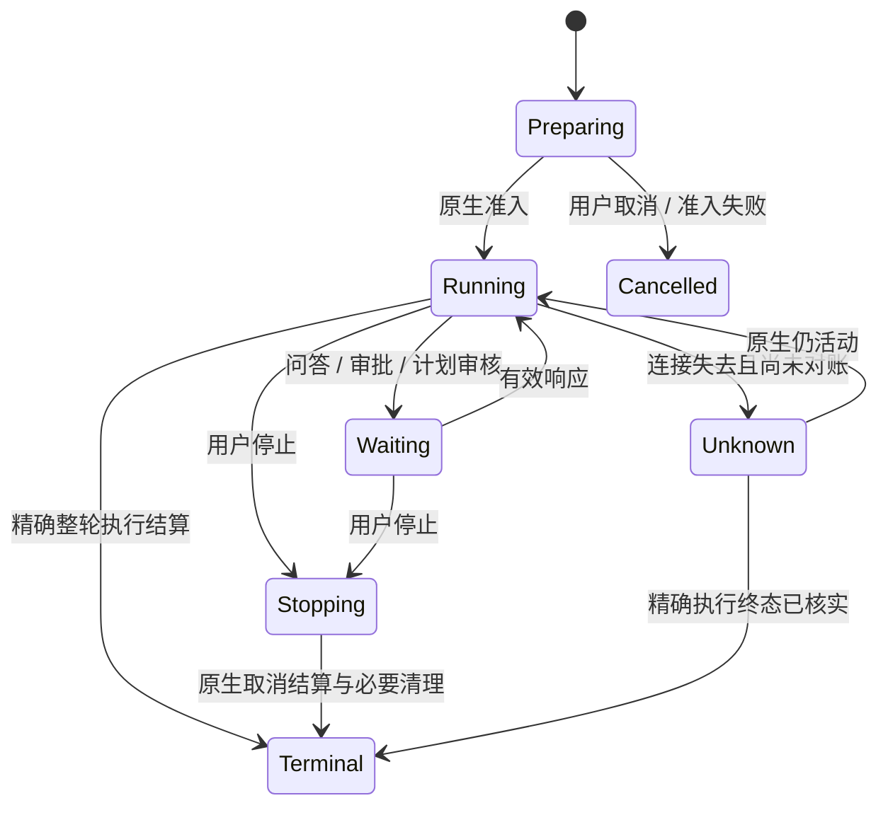

# Cowork：会话、回合与任务生命周期

Cowork 将桌面产品会话映射到 OpenClaw 原生执行。本文以当前 session handlers、CoworkStore、Router/Adapter 及聊天消费方为依据，按任务生命期说明成功、取消、恢复和删除。

## 1. 先区分四类身份

| 身份               | 创建方             | 用途                               |
| ------------------ | ------------------ | ---------------------------------- |
| 产品 sessionId     | Main / CoworkStore | 侧边栏、分组、cwd、模型、权限期望  |
| 原生 sessionKey/id | 受管映射与 Gateway | transcript、原生任务与会话 RPC     |
| clientTurnId       | 产品发送链路       | 用户提交幂等、准入前取消、运行计时 |
| 原生 runId         | Gateway            | 实际执行、事件归属和接收确认       |

受管 session key 包含 Agent 与产品 session 身份，但不能只解析字符串就授予访问。默认用户会话使用 main；设置中显式开启助手切换后，新会话可选择已启用且未删除的助手，关闭开关不改变历史会话归属。已有聊天切换助手保留工程目录并新建会话，不复制原生历史；任务内助手保留自己的身份，外部集成会话保存单独映射。会话复制、分支和旧 Handoff 来源属于不同关系。

## 2. 状态存放在哪里

`cowork_sessions` 保存产品索引，`cowork_session_runs` 保存 turn/run 绑定与计时，`cowork_plan_handoffs` 保存计划文件交接。Goal 内容、状态与预算由原生 session 持有，Main 的续跑快照另存 `cowork_config`。助手协作表只保存成员与投递元数据。

Redux cowork 管理列表、草稿、交互和产品状态；Lit 控制器维护当前历史窗口及实时投影。Thinking、Tool、Content 的唯一持久来源是 Gateway，不能写回 Main 或 Redux transcript cache。

Chrome 扩展新建会话的创建入口保存在产品 `source` 字段，完整会话与列表摘要都携带此元数据。
侧边栏将 `source: browser-extension` 与 Multica 外部映射分别投影为默认收起的来源分组，
不混入最近会话或用户分组，选中对应会话时自动展开。从扩展继续桌面会话不会更改创建来源；
来源分组不改变会话权限或原生历史所有权。

## 3. 首轮发送与准入前取消

消息可以由文字或合法附件组成。cwd 必须明确并经任务工作目录解析；main 模型继承应用默认，不读取历史 main 档案 override。activeSkillIds 是产品请求，不替代 Gateway 最终可用性判断。

主窗口 HTTP(S) 聊天首轮显式请求 Renderer 运输，由 Main 完成配置、权限、原生会话与运行身份准备后，只委托同一窗口当前文档的 `chat.send`；Main 继续持有执行、取消与恢复状态。提交前的同 URL 重载也撤销原窗口文档 lease。Renderer 先注册临时/原生会话提升，再等待当前连接可用，避免首轮流落入临时会话。后台调用保留 Main 发送通路，不公告可渲染 capability。

运输回执只收一次；失联、窗口退出或已发出的超时保留结果不确定状态，禁止改由 Main 补发或自动重试。未发送失败明确标记 `requestSent:false`；当前会话失败后清理发送占位和 streaming，不抢回用户已切走的会话。原生停止控制回执 `{ok:true,aborted,runIds}` 不创建执行 run，单独结束请求；Goal start 仍要求完整原生 structured receipt。

handler 用 clientTurnId 管理 pending start。用户在等待配置或启动期间取消，应退出准入，不创建一个稍后偷偷开始的任务。session 已建立时取消转为 Router stop。迟到取消只有在回执仍为当前运行时才生效，不能终止下一 turn。

重复提交已知 clientTurnId 返回同一产品会话和计时记录；不能因一次响应丢失生成第二个任务。原生是否接收仍由 run 绑定及运行状态确认。

## 4. 后续回合与设置修改

后续 turn 可由 Renderer chat controller 直连发送，但先经 Main 做配置等待、模型 readiness 和会话权限准备。产品 ask/auto/full 映射原生 guarded/workspace/full，每次发送前核对 mode/root；不通过修改全局 exec 模式实现单会话权限。

权限切换保存用户期望，活跃 run 期间延迟到适当边界应用；下一次发送必须收敛成功。模型引用保持 provider/model 限定，变更只作用于明确目标，不能让助手独立模型覆盖应用默认。

输入框模型切换先通过 `sessions.patch` 固定用户选择（包括与当前默认相同的模型），以返回的 `resolved` 确认会话选择，再保存后续新会话的默认值。设置页通过 `appConfig:patch` 在 Main 合并实际修改的顶层字段；它与默认模型修改共用写入/回滚队列，不能把 Renderer 缓存中的旧默认模型整体写回。提供商重命名也在该合并中更新最新默认模型的提供商引用。

默认模型保存必须验证最新目录中的提供商、模型启用状态和请求凭据；失效选择返回失败，不依赖配置解析的回退项宣称切换成功。内置目录刷新在网络请求完成后进入相同配置队列，基于最新配置提交。Renderer 的配置读取也等待该队列完成应用或回滚，异步响应受选择版本保护。模型列表与默认选择一起按已保存配置投影到 Redux，列表刷新产生的显示回退不再反向保存为用户默认值。

内置目录成功刷新后，若已保存的内置默认模型已下架或禁用，Main 按配置列表顺序选取首个已启用且具备地址与凭据的模型，保存为新的默认值，并由配置同步修复失效会话引用。仍然有效的用户选择保持不变；目录请求失败不作为下架依据，没有可用替代项时保留原偏好并显示无可用模型提示。

目录请求失败保留最近成功目录及最新启用状态，避免运行配置把暂时离线误判为下架。内置目录由 Main 管理；设置保存仅合并现存内置模型的启用开关，不得用旧快照恢复已下架模型或已注销的提供商。保存后界面使用 Main 返回的实际目录。

配置同步与用户切换按 native session key 串行。列表中的模型仍可用且与本地投影一致时，直接跳过该会话，不逐个查询历史会话，也不把列表快照写回。其余会话在串行边界内重新读取 `sessions.describe`，保留仍在配置目录中的原生选择（包括内置别名与 `/model` 的新选择），只修复已移除的路由，并保存 Gateway 确认结果作为本地投影。Renderer 的临时选择在切换完成后释放；重新打开会话、刷新模型目录或运行完成时读取原生选择，读取版本与切换版本共同阻止迟到响应覆盖用户的新选择。

默认模型保存及其回滚若经完整配置差异核对，只有 `agents.defaults.model` 与现有助手条目的 `model` 改变，且凭据及 Gateway 启动环境均未变化，则在原生配置应用和权限核验成功后跳过历史会话模型扫描。该路径不再等待历史会话的 `sessions.list` / `sessions.describe`，也不改变既有会话选择；当前会话发送前仍按精确原生身份准备和核对模型。启动、目录、路由、权限、插件或助手成员变化均保留完整协调，不能仅凭同步原因跳过核对。

模型菜单直接使用已加载的配置列表，展开时不重复请求运行时目录或显示目录刷新动画。会话或配置列表变化时，运行时目录和会话选择并行刷新。用户点击后立即显示所选模型，按钮不显示后台保存的刷新圆环。已有会话在 `sessions.patch` 确认后即完成本次切换并释放选择队列，默认值随后在 Main 配置队列中继续保存；后台默认值保存失败只提示，不能回退已确认的会话模型。尚无会话时仍需等待默认值应用成功才能发送。原生切换未确认前保留发送保护，失败则回退并提示，避免为缩短等待而用旧模型发送消息。消息发送仍遵守 Main 的配置更新等待和 readiness 检查。

快速连续选择时，同一会话与助手的尚未发出选择只保留最后一项；已经发出的切换继续等待原生结果，不取消或重试。不同会话各自完成原生切换，不等待其它会话或首页的慢操作。同一助手以最新一次用户选择决定后续默认值：较早的会话切换即使迟到确认，或较早的首页选择仍在排队，也不能再发起过时默认值保存；跳过的首页选择不确认旧值，只清理自己的 taskId。已经发出的保存继续由 Main 配置队列按顺序应用或回滚。不同助手的默认值选择互不覆盖。原生明确拒绝或明确未发出的失败立即返回，不为失败额外等待 `sessions.describe`；已发出且丢失响应，或原生应答成功后缺少确认身份、本地保存失败时，仍回读原生选择核实，避免把已经生效的选择回退。菜单中的已配置模型均可点击，运行就绪与认证信息不作为前端禁用条件。Main 不向应用目录传递运行时重试等待状态或到期时间；实际执行准入仍由 Gateway 决定。

后台默认值保存开始前，为同一助手的新会话入口设置独立的临时选择和发送保护；此时导航到首页也会显示待保存的新模型，不能以旧显示值发起使用新默认值的会话。保存完成或失败只清理对应 taskId，延迟开始的旧保存不能覆盖更新的首页选择。

发送失败要区分准入拒绝、明确原生失败和可能已接收的未知结果。乐观 user message 在 Renderer 中恢复或标错，不能据 UI 是否存在该消息决定是否重发。

## 5. 运行状态与停止

产品活跃状态综合原生主运行、活动后代，以及 Goal continuing/retrying 等阶段。父模型返回不代表后代全部结束；主运行和子任务计数字段不能互相充当对方事实。

该图是产品处理阶段，不是新增数据库 enum。实际 run 状态、Goal 阶段和交互状态各自有共享契约；Stop ACK 或 chat final 可收敛请求/显示，不能单独建立整轮执行结论。只有匹配 run 的 whole-run `executionSettled:true` 终态才结算；受管理工具 cleanup 另行核对。

停止交给原生取消语义，包含队列、后代和审批清理，Main 保留产品 stop latch 与回执。协作任务还冻结用户轮次并停止成员，防止迟到 peer send 重启旧工作。错误事件只有匹配运行及终态语义才结算，不能将任意工具错误视作整个会话结束。

协作流程标题栏可直接停止全队，来源已空闲时也保留入口；并发全队停止共享成员取消请求，并等待全部请求返回后报告部分失败。成员实时工作详情另有单执行停止入口，通过显式 `collaboration:stop-member` IPC 核对房间、成员、原生 SID 和当前 run，再发原生 `sessions.abort({key,runId})`。该路径不调用产品会话停止，也不触发全队级联，不清空后续输入或关闭协作轮次；停止 ACK 与执行结算保持分离，旧身份不能取消替换后的运行。

## 6. Goal 自动续跑

原生六种状态为 active、paused、blocked、usage_limited、budget_limited、complete。受限状态独立保留；resume 的预算窗口由原生处理。Main 仅在同一 Goal 仍为 active 时协调下一回合，并考虑等待用户、审批、退避、续跑上限和显式停止。

OpenClaw v2026.9.8 的 lifecycle `end/error` 可能只是一次模型尝试结束；Goal 续跑器仅消费 `executionSettled: true` 的整轮终态，不能提前去重、退避或续跑。断线对账取得 `agent.wait` 的确定终态后也按此契约处理。原生失败或超时会暂停 Goal，重试前必须重新读取原生状态，不能用普通消息隐式恢复。

`update_goal` 的工具传输成功不等于目标变更成功：状态转换拒绝可以返回普通工具结果中的 `status: error`。即时完成/阻塞反馈必须取得 `status: updated` 且目标身份、状态与请求匹配的原生回执；结果缺失或不可解析时等待整轮结束后读取原生 Goal，不根据请求参数推断成功。模型工具只允许 complete/blocked；暂停、恢复、清除仍由用户操作控制。

用户目标操作携带 goalId fence，避免迟到按钮操作改到新目标。重连扫描原生 Goal 和 runtime，再恢复产品快照；不能根据旧 SQLite snapshot 无条件续跑。目标仍存在时，普通消息编辑/撤回受限，目标修改通过 structured mutation 完成。

恢复运行时同时绑定续跑器的当前 runId，防止上一轮迟到的工具回执或 lifecycle 终态覆盖恢复后的执行状态。

## 7. 计划、问答与审批

AskUserQuestion 的 pending、默认和超时在 Extension 中；Main 转接 event/RPC，Renderer 展示并提交，重连使用 list/replay。UI 消失不等于问题被回答。

PresentPlan 将规范化计划作为工作区内受控文件持久化，并保存 SHA-256、长度、创建时 workspace root 与 handoff 身份。持久文件、handoff 和 awaitingReview 标记就绪后才展示侧栏。批准后通过原生 reset 建立实施上下文边界，注入隐藏实施指令；可见历史与模型上下文不同，不能删除规划历史来模拟 reset。

实施前的 `sessions.reset` 携带刚由 `sessions.describe` 读取的 `expectedSessionId`，
利用 OpenClaw 2026.9.6 的原生会话身份检查拒绝已被替换的目标；读取后还要重新核对 Gateway
连接代次。重置失败时不发送实施指令，保留可恢复的 handoff。此身份检查不等于轮次锁，
也不检测保持同一 sessionId 的其他 reset；原生 reset 的并发准入仍由 Gateway 负责。

审批与计划确认分开。exec/plugin approval 使用原生期限和决策集合；Main 校验请求仍有效，不能把关闭窗口、断线或默认选择视作允许。

## 8. 子任务与平级助手

子任务以 `sessions.list/describe` 的原生会话投影与 `sessions.changed` 为权威。Subagent 与 ACP 都保留原生 session key 作为产品 ID，状态、运行 ID、耗时和 usage 直接取当前原生快照；不再组合已经移除的 task ledger。查询失败保留不完整语义，详情不接受返回身份与请求 key 不一致的记录。完整读取立即替换成员集合，临时失败才保留上次已核验状态。

平级协作由默认关闭的 agent-team 扩展提供。模型准备成员后使用原生 sessions_send，侧栏只显示锚点任务，详情按成员读取原生历史。任务成员不是 Subagent 树节点，accepted 投递也不是任务完成。完整预算与删除协议见[协作机制](../features/assistants/assistants-and-collaboration.md)。

## 9. 历史、分支、复制与删除

历史由 Gateway 加载，Renderer 有界分页并与 live state 按身份合并。分支从稳定、已完成的原生助手 entry 创建，不根据屏幕数组索引推导切点。Plan reset 前后及 Goal 会话的操作门禁必须与原生语义一致。

侧栏搜索将本地标题匹配与原生 `sessions.search` 合并。标题支持多个关键词同时匹配；
置顶和分组筛选同时约束标题列表与 Main 映射出的原生 session-key 范围。每页最多返回
25 个正文命中的对话，「加载更多」通过排除已返回的产品会话 ID 搜索剩余范围，
不扩展原生 RPC 或增加运行时 patch。Main 的有界分批查询保留成功结果，并分别报告
索引更新、范围查询失败、结果截断及原生冷归档排除数量。Renderer 仅保存弹窗内的
临时结果，查询或范围变化后丢弃迟到响应；Main 不新增正文索引或 transcript cache。

正文结果保留原生 session key、物理 session ID 和 message ID。打开对话经过现有
文件预览导航门禁，再由聊天 wrapper 等待当前历史就绪、按需加载旧页并定位原生 entry。
定位期间核对产品会话、原生 key 与物理身份；切换对话或原生会话已被替换时取消定位。
输入法组词期间暂停正文搜索，Enter、方向键和 Escape 留给输入法处理。

单会话删除、整协作任务删除、定时任务结果删除有不同 owner，不能共用“删一行”的实现。整协作任务先持久冻结，再停止并逐个确认原生删除，最后删产品元数据；部分失败保留进度供重试。外部映射和结果 tombstone 防止后续同步复活已删条目。

附件先经过产品 staging/校验，预览与编辑通过 Main 授权；项目文件不随一般会话索引删除而任意清理。受管计划产物按其保存的 workspace root 定位，不能使用已变化的 cwd 误删。

## 10. 重启与故障诊断

恢复按身份进行：加载产品索引 → 建立 Gateway 连接 → 查询原生会话与任务 → 对账 run receipt、Goal 和交互 → 加载历史并接续实时流。完整应用重启使用 app-start boundary，同进程 Gateway 重启使用原生恢复；两者不等价。

| 症状                     | 优先核对                                                     |
| ------------------------ | ------------------------------------------------------------ |
| 点击发送后一直准备       | config queue、engine readiness、model/permission preparation |
| 停止后列表仍活动         | 原生后代、Goal phase、协作成员及取消失败                     |
| 回答重复或消失           | clientTurn/run 绑定、原生历史、Renderer reconcile            |
| 计划重启后找不到         | handoff 状态、创建时 workspace root、文件摘要                |
| 子任务已结束但父会话仍忙 | required-child join 与原生 task/session revision             |
| 删除失败或又出现         | owner 对应 cleanup/tombstone，而非只看 UI 列表               |

## 11. 实现与回归入口

会话右键「诊断」通过独立 IPC 读取有界运行元数据，不切换聊天或触发恢复协调。Main 用精确运行身份和原生外层终态生成确定性结论；历史 start 不作为当前运行的证明。在线环境查询与本地报告分开，Gateway 离线仍可查看已有记录。正文始终由 OpenClaw 管理，诊断没有 transcript cache。见[会话诊断](../features/chat/session-diagnostics.md)。

共享的过程问题汇总从当前快照事件与安全日志投影生成，由 Renderer、复制摘要和 Main 导出共用。汇总保留关联强弱与证据引用，独立于整轮终态分类；正常结束不掩盖中途工具或模型错误，时间窗口线索不提升为已确认根因。该派生视图不新增持久状态。

Main 从 `ipc/cowork/sessionExecution.ts`、`sessions.ts`、`sessionRuntime.ts`、`interactions.ts` 进入；Router 在 `engine/cowork/`，Adapter 在 `engine/openclaw/`，Goal 在 `openclaw/goals/`。Renderer 从 CoworkView、composer、sessions 和聊天 wrapper 组合。

Cowork 界面保持单层领域结构：`display` 组合标签、选择和会话面板状态，`preview` 渲染文件并浏览工作区，`terminal` 承载 Gateway 终端，`review` 展示工作区差异，`approvals` 处理执行与计划审核。`subagents` 展示原生子任务和 collector 分组；独立插件的工作流图、节点历史及介入界面归 `swarm-workflow`。跨领域的文件图标、文档样式、图形样式和连接辅助归 `shared`；这些公共模块不持有新的运行或 transcript 状态。

Swarm Workflow 的产品会话协调、返回值验证和助手名单投影归插件 `host/`，通过 live ports 读取 Main 的真实会话、运行时和助手资源。Main `cowork/swarm-workflow/` 是薄门面，`ipc/cowork/swarm-workflow/` 只绑定 Electron。API 归插件 contracts，shared 门面仅追加 Electron 通道名；浏览器图形、选择、轮询、批次/详情/介入与输入框准入逻辑归插件 `browser/`，Renderer 负责 preload ports、共享聊天和 UI/Tab。禁用后隐藏 Workflow 入口、退休 Tab 并停止读取，快速关开和迟到响应受 disable revision 约束；重新启用从原有 DAG 读取，不推断停止服务等于原生取消。DAG、批次状态、运行生命周期和未调用 launch 的证明由可选 Workflow 插件持有，通用原生 SDK 契约和文件系统准入由 Runtime Services 提供，原生子任务入口独立。

回归应覆盖准入前取消、重复 clientTurn、原生先完成后响应、停止失败、会话切换迟到事件、Plan reset、Goal fence、协作删除部分成功和历史恢复。对应 handler、Store、Adapter 与 controller 都有领域测试；一次正常发送不能替代这些边界验证。

## Agent Team 的群组讨论

当前优化保留主会话“＋”选模式和真实 Team 记录导航。显式 Team 发起遇到主会话忙碌时保留草稿及选择，不进入普通消息排队；原生 followup 的提交与执行没有通用公开绑定。受限发起守卫只覆盖能够核对精确当前输入的正常来源提交，由常驻 Runtime Services 收紧候选工具权限，尚需真实生命周期整合验收；不把它称为保证建群成功的可靠发起器。发起指令和扩展 skill 要求完整任务说明、附件/图片要点、交付位置及验收条件，并将已准备、已接受、执行中和未知分别报告；这些提示不成为授权。

普通来源消息与再次显式发起 Team 使用不同准入：`beginSessionRun` 尝试核对旧 launch 清理，只有带本次 Team 发起输入时才要求已核实释放并登记新 intent。普通消息保留原有发送／排队、停止、未确认准入和删除检查，旧 launch 尚未结算或核实失败不成为发送错误，也不会因此清除其原生工具守卫；工具权限仍由原生精确身份及已确认生命周期控制。

守卫的 Main KV 候选和 Runtime Services 无正文持久账本分别保存产品提交边界及原生执行事实；原生 session namespace 只是镜像。真实正常 SIGTERM 会退役并清除普通来源的插件 namespace，不能凭镜像缺失判定没有旧发起。旧 owner 未 released、账本损坏或读写未知时冻结；精确 released 与 generation CAS 才允许下一次显式 Team 发起。退役或客户端授权失效的迟到读取不能越过同步持久提交检查。

协作详情页的“引用到主会话”先重新核对房间、实际来源和成员身份，再向来源输入框添加纯定位卡片；来源助手详情仅聚焦输入框。受管 peer 另有独立补充输入，经 Main 核对当前来源/目标及 idle、Plan、Goal、停止与删除状态后，提交正常来源新 user turn，请求来源模型通过受管工具转发。来源接纳与目标 accepted run 分开显示；unknown 冻结，不自动重发或降级成第二次提交。它不改主草稿及选项，也不保证定向投递；旧结果和旧审核仍归原批次。

群聊/汇总的 owner 更换、最终文字和停止请求都不能推断原生执行结束。回执保留精确执行身份，只有 whole-run `executionSettled: true` 和 dispatcher 清理完成才能结算；没有证据的历史终态回执也投影为 unknown。未知群批次保留 active identity，不产生自动汇总；未结算汇总阻止新批次派发、来源参与变更以及团队/来源删除，包括批量删除。查询不支持时保持待核实，不自动重发。

群聊新输入由 Main 预留最多 3 条活动待发名额，正文保存到常驻 Runtime Services 拥有的独立锁定 inert harness 原生 holding 会话，以 custom-role、隐藏显示和 excludeFromContext 隔离。Main 只保存指纹、参数/权限快照、代次、接收状态和精确 native entry 身份。同群 FIFO 等待前批和汇总全部结算；派发前核对成员/来源 incarnation、权限、附件 SHA-256 和资源上限。Stop/明确禁用先同步取消产品代次，迟到保存 ACK 不复活；不确定队头保持占用。禁用 lease 覆盖配置变更，快速重开不能越过关闭。Main 原生归档/删除与 owning SDK 解锁分开完成，不伪造 pluginOwnerId。解锁后重启丢失原生 marker 时，只凭已 closed 的精确 durable slot 与仍 archived/unlocked 的原 incarnation 继续清理；不放宽正文准入。详见[本轮实现与验证边界](../features/assistants/agent-team.md)。

输入框“＋”菜单进入 Agent Team。任务协作保留图和既有工具；群组讨论使用独立页面、固定成员和有界轮次，人数、轮次、响应预算及并发受当前资源设置限制。房间不写 cowork_sessions；讨论转任务时创建真实的来源助手任务草稿及关联，用户发送前不执行。默认只读讨论，不复制原任务的计划审批状态。

详见 [Agent Team 现行契约](../features/assistants/agent-team.md)。

主会话可通过 team_discussion 组织群聊，与既有 task_assistants / sessions_send 协作共用活动运行身份校验。团队面板在同一任务下展示 Graph 和关联群聊，用户可直接在群聊输入框参与。 详见[主会话组织团队](../features/assistants/agent-team.md)。

原生助手的角色 workspace 与任务 cwd 分开：main 和专长助手统一使用
`stateDir/agent-workspaces/<agentId>` 保存角色与记忆，配置投影用 OpenClaw 的
`agents.defaults.cwd` / `agents.entries[id].cwd` 表达默认工程目录。每个会话的
`sessions.create.cwd` 仍是执行目录权威，不受之后首页工程选择影响。原生 runner
加载所属助手的 bootstrap 文件，并额外注入工程根 `AGENTS.md`；不会加载工程的
其他人格文件。应用不修改这套注入顺序。首次建立独立 main 角色目录时，从随应用提供的 OpenClaw 运行时模板初始化角色文件，保留目标目录中的已有编辑；初始化不读取工程目录。

### 团队组织者与结果交接（2026-10-03）

来源主助手固定承担组织职责；群聊默认不参与，开启参与时借用同一原生会话。页签只切换视图，讨论转执行向原来源准备草稿，保留真实非 main 身份。后台协调在面板关闭时仍有界核对活动批次与汇总 outbox，不启动未连接 Gateway。自然完成/部分失败触发无工具总结；用户停止先写持久抑制位，再取消精确原生执行。

协作使用 `task_assistants({seal:true})` 显式收束；delivery.state 仍为接收状态，executionOutcome 来自精确 whole-run 终态。批次还需组织者 closing run 终态，不另发重复总结。事件缺失保留未确认。见[实施与边界](../features/assistants/agent-team.md)。

Team 业务纯合约及提示归属可选插件的 `contracts/`、`prompt/`，托管与执行共用的身份和输入协议归属 Runtime Services 的 `agent-team/contracts/`；`shared/cowork/agent-team/` 只提供纯合约转出与 IPC，Graph 投影归插件。主进程协调、队列、用户附件、资源偏好及元数据事务归插件 `host/`，Main 原路径保留薄桥接和唯一实例的 Electron/生命周期接线；实际数据库、产品会话和运行能力通过 typed host ports 注入。Renderer 的草稿、继续协作状态、队列规则和消息格式归插件 `browser/`，仍在对应进程内执行，原生注册入口不加载 host/browser。可选插件组合协作、群聊执行及各自历史读取；必需 Runtime Services 独立持有禁用后发送保护、离线控制、holding 托管、无正文回执和发起保护，两个插件均不导入应用实现，常驻插件也不反向依赖可选插件。Renderer 的协作 Graph 与群聊界面分别在 `components/collaboration/` 和 `discussions/`，`display/` 组合真实团队页签，标题栏菜单和本次模式选择分别留在 `chat/`、`composer/`。完整归属及依赖图见 [Agent Team 模块边界](../features/assistants/agent-team.md#模块边界)。
