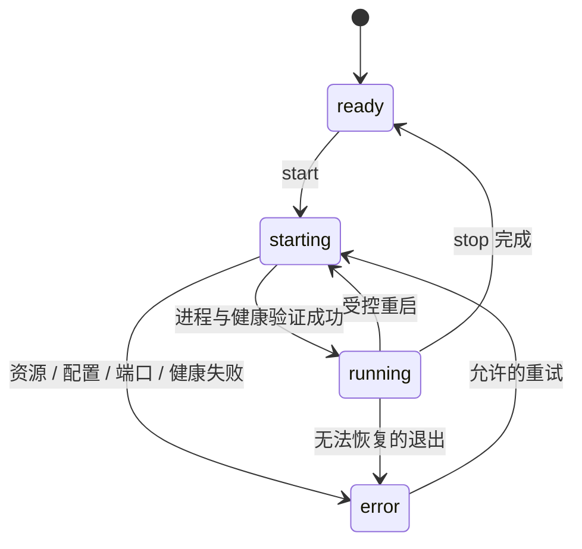
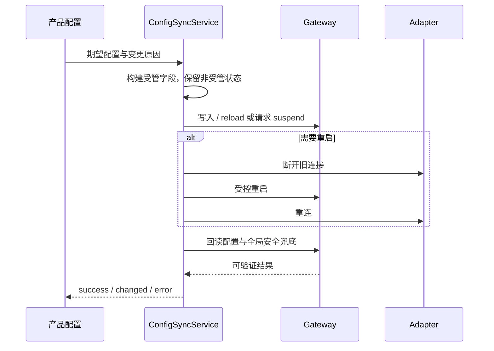

# 执行引擎：配置、准入与 Gateway 恢复

当前 Cowork 执行引擎是 OpenClaw。Router 提供稳定产品接口，Adapter 隔离原生 wire 与生命周期，Manager 托管运行时进程。本文按当前 v2026.10.4 集成组织，运行时补丁清单只维护在[版本目录](../../scripts/patches/v2026.10.4/README.md)。

## Code Mode 工具编排

运行设置中的 Code Mode 是原生 OpenClaw 工具编排能力，保存于现有
`agentRuntimeSettings:v1` 配置记录的 `codeMode.mode`，取值为 `off / auto / on`。
新配置默认 `off`，旧记录缺少该字段时补为 `off`，不重置其他运行偏好。界面保留
“自动（待模型支持）”但禁止选择；已有显式 `auto` 值保留并如实显示，可改选开启或关闭。
配置同步在完整配置、无模型配置、
登录与退出路径中映射到 `tools.codeMode.enabled = false / "auto" / true`，并选择
`executor: "quickjs"`。原生超时、输出、并发等其他 Code Mode 参数保留。

`auto` 由实际模型目录的 `compat.codeMode` 能力标记决定，不根据模型名称自行猜测。
应用投影的自定义模型可能没有该标记，因此自动模式不保证启用；需要验证这些模型时可
选择开启。该设置控制嵌入式 OpenClaw 运行时，不控制外部 ACP 或 provider-native harness。
本期界面管理全局启用方式，不提供逐模型覆盖编辑器；原生覆盖优先级由 OpenClaw 判定，
认证范围同步保留已有 agent/model 覆盖。普通完整同步仍按应用的托管模型与助手配置重建，
不能把手改生成配置当作持久的逐模型设置入口。

模型生成的 JavaScript、工具目录/MCP 发现、结果暂存、`exec / wait`、取消及失败恢复
均由 OpenClaw 管理；Main 不增加执行器或结果缓存。QuickJS 插件的显式禁用仍受尊重，
执行器缺失或被禁用时原生运行失败，不自动降级到 Node VM。内部工具调用继续经过
Gateway 权限、审批及 hooks；QuickJS 隔离本身不授予额外工具权限。

可运行 `node scripts/test/verify-code-mode-runtime.mjs [runtime-directory]`，只读检查
打包产物的 worker、WASM、文本编码模块，并实际验证执行、等待恢复、失败与取消。
该检查无需模型凭据，不替代真实模型/MCP/审批端到端验证。

### 已安装技能发现与会话中间结果

10.4 原生 `skills_search` / `skills_read` 分别搜索有效的已安装技能和读取完整说明。
提示词目录因预算省略技能时仍可搜索；禁用或禁止模型调用的技能不进入有效目录。
有读取权限时搜索可使用有界正文，撤销读取权限后只保留元数据搜索；读取技能不授予
执行技能所需工具的权限。Code Mode 使用同一目录的 `skills.search` / `skills.read`，
Main 不建立第二份技能索引。

交互式 Code Mode 的 `await store(key, value)` / `await load(key)` 可跨 cell、后续
回复及 Gateway 重启复用当前原生会话中的小型 JSON 值；普通 JavaScript 变量和
`results.save` 的当轮引用没有这一持久化语义。只有完成的 cell 提交缓冲写入，失败或
取消的未完成 cell 不提交。单值上限 256 KiB、当前值总量上限 1 MiB；覆盖或删除不会
抹除原生历史中的旧版本。此能力沿用 Code Mode 开关，没有独立的产品存储开关。

`node scripts/test/verify-native-skill-state-runtime.mjs [runtime-directory]` 使用隔离
Gateway、本机合成模型和与产品相同的 `stateDir/skills` 导入位置，检查上述发现、
读取权限、跨轮/重启持久化、会话隔离及失败/取消行为。它通过正常聊天执行入口和
精确 `executionSettled` 终态核对，不读取用户 transcript；合成模型不证明真实模型会
主动选择技能或正确编排 Code Mode，也不替代 MXC 实机验收。

## 1. 三层控制各管什么

| 层                           | 所有状态                                               | 主要入口                     |
| ---------------------------- | ------------------------------------------------------ | ---------------------------- |
| Router / CoworkEngineService | 产品会话到执行适配器的路由、停止与运行汇总             | `src/main/engine/cowork/`    |
| OpenClawRuntimeAdapter       | 连接、原生身份映射、交互、产品事件、Goal 协调          | `src/main/engine/openclaw/`  |
| OpenClawEngineManager        | runtime 路径、进程 generation、端口、token、启动和重启 | `src/main/openclaw/runtime/` |

Adapter 入口保留生命周期及状态，runtimeGatewayConnection、runtimeGatewayEvents、runtimeHistory、runtimePlanInteractions、runtimeGoalOperations、runtimeSessionStatus 处理各领域操作。它们通过显式实时上下文访问入口状态，不复制控制器状态，更不保存 transcript。

Chrome 侧聊通过 Runtime 的窄 `getRunTerminalReceipt` 读取已准入 whole-run `executionSettled:true` 的有界原生身份与终态元数据；chat final 后仅保留精确退役绑定以接受迟到末端，普通 wait/idle/Stop ACK 不生成回执。Controller 复核发送准备的物理 session、原生 run 映射、连接代次和当前身份后才结束进度；冷重启或代次变化后证据缺失保持 unknown，不另建正文缓存或补发输入。

电脑控制设置每次读取仍获取原生 `config.get`。同一配置 hash 和 runtime 路径的全局
工具权限判断复用一个进程内结果（并发读取共享 Promise），避免反复启动独立的原生
策略检查进程；配置版本或路径变化、设置写入及运行包不可用时失效，失败结果不缓存。
这里只缓存设置展示所需的全局策略判断，不缓存驱动可用性、会话授权或执行结果，
也不改变原生聊天工具准备阶段的电脑能力发现。

## 2. 从源码到可启动运行时

平台构建从锁定 pristine npm 产物开始：安装及校验来源 → 当前精确补丁 → 同步 current → bundle → 官方插件 → 产品资源 → Extension 预编译 → prune。运行时与应用自身 node_modules 是两套依赖集合。

产品提供的角色初始化模板、渠道说明和 Gateway 渠道配置说明集中在 `resources/openclaw/docs/`，由资源同步脚本写入原生 `docs/reference/templates/`、`docs/channels/` 和 `docs/gateway/config-channels.md`。这是构建时的运行时资源来源，不是产品开发文档，也不迁移或覆盖已有用户的角色工作区。

开发路径和安装包资源路径不同，由 Manager 解析。Windows 命令通过 Electron-safe Node/npm runner 及 MinGit/Python 资源执行，不能把 Electron GUI 当通用 node。bundled Skills、Hooks、Plugins 使用显式运行时目录，不依赖 bundle 中的 import.meta.url 猜源码位置。

Gateway bundle 位于运行时根目录，构建流程必须把原始 `dist/build-info.json` 同步到 bundle 旁，并作为必需 companion 验证。原生迁移检查从执行模块旁读取构建身份；缺失时会把检查点判为失效，每次启动重做迁移检查。这里保留原始构建身份和原生检查点规则，不伪造迁移完成状态；构建、配置或插件迁移指纹变化仍由 OpenClaw 判定是否需要重跑。

Bundle 启动器在 Gateway 正常退出时保存编译缓存，不在就绪后周期性执行同步 `flushCompileCache()`。10.4 运行时实测中，这项同步缓存序列化曾阻塞模型切换与其它 RPC 数秒；移出运行阶段后继续保留正常退出的启动加速缓存。强制终止可能丢失尚未保存的编译缓存，不影响原生会话持久化与恢复规则；一次性 CLI 在导入完成后仍可保存缓存。

冻结 manifest 把补丁、helper、source lock 和构建 recipe 绑定在一起。同版本输入变化也可能拒绝旧产物。历史或部分补丁标记不得就地迁移；从 pristine 包重建，见[开发指南](../development.md)。

原生助手向其它会话转发新任务时，调用者授权与 transcript 写入归属具有不同的寿命。
Gateway 保留发送者的授权、目标校验和取消信号，但目标任务必须取得自己的原生写入归属。
10.4 原生转发入口在恢复调用者上下文并核对当前授权之后，退出发送者的
transcript/CLI-history 写入上下文，避免目标任务在自动压缩后的恢复或终止记录保存时
误用发送者的写入归属。旧补丁 039 已移除；其它 RPC 和目标写入保护保持原生行为。
构建同时使 bundle 与动态 SDK 共用原生 `transcript-write-context` 和其依赖的
`cli-history-boundary` 状态模块；否则上下文清理函数与 CLI 写入者可能操作不同的
AsyncLocalStorage。异步工作载体已经由上游的全局 singleton 共享，保持原生行为。
Main 不接管 transcript 或重试转发。

### 轮末修订与流式交付

10.4 的原生 `before_agent_finalize` 默认会延迟整轮正文。补丁 026 为该钩子增加
`appliesToAgentRun` 身份选择器；在 `before_prompt_build` 完成并核对宿主仍有效之后、
模型输出之前，冻结本次 attempt 的 registration 与原 handler 引用。正文等待和轮末
调度共用该集合，reset/修订不重新选择，新的 attempt 才重新核对。身份缺失、读取异常、
异步或非布尔结果均保留保护；只有精确身份上的同步 `false` 能解除该钩子的等待。
最终身份失配拒绝修订，不在已经输出正文后重新纳入钩子。

Runtime Services 的 Team 发起保护及可选 Workflow 分别按原生当前 SID 和自身持久归属
声明适用范围，普通非所属会话可直接流式交付。此准入只控制交付等待，不授予工具、
发起或修订权限，也不构成整轮结算；原生 reasoning 延迟规则和执行终态证据保持原样。

### 原生历史读取的准备与响应

新会话的 `chat.startup` 与历史读取均使用原生 canonical 准备边界。Windows 下 SQLite
位置可能带 `\\?\` 命名空间前缀；补丁 027 让准备 locator 与缺省校验回执使用数据库
打开时已经登记的规范 filename，避免同一物理文件出现两个缓存键。显式路径、agent、
物理 generation 和撤销校验保持不变，不重新解析文件别名或制造 ready 事实。

内层读取可能捕获原生 deferred signal，但外层同步 frame 仍为 pending。补丁 028 在
history/startup 的响应发布前检查同一 frame；pending 时交回原生准备流程，真正完成
后才发布。权限、共享范围及取消仍在原有 read view 中核对，不跨 await 保留失效视图，
也不通过消息缓存、响应去重或重试次数上限掩盖无法准备的问题。

## 3. 启动与重启状态

Manager 对外 phase 为 ready、starting、running、error；canRetry 与 message 用于产品反馈。共享契约位于 `src/shared/openclaw/engineStatus.ts`；`starting` 上的 `restarting: true` 由 Main 提供，用于区分首次启动与真实重启。它们不是单个 Agent run 的状态。

运行时文件就绪检查与 CLI 环境读取不改变正在启动或运行中的 Gateway phase；CLI 读取复用该进程已选定的端口，不因端口已被启动进程占用而重新分配。冷启动的异步资源准备已属于 starting，不能在此期间展示尚未启动的按钮。资源缺失或版本元数据无效仍报告 error。

### 标题栏提示与入口清单

全局引擎提示由 `src/renderer/app/shell/EngineStartupStatusBar.tsx` 渲染，挂载于主界面及设置页的 `WindowHeader`，紧邻 Windows 最小化按钮左侧；其它平台显示在同一标题栏右侧。它不再进入右下角 `BottomRightStatusStack`，不随底部通知投影到工作区。正常运行时隐藏。

| Main 状态                     | 展示            | 可点击操作     |
| ----------------------------- | --------------- | -------------- |
| starting，未标记 restarting   | AI 引擎正在启动 | 无             |
| starting，restarting 为 true  | AI 引擎正在重启 | 无             |
| error，或启动命令失败         | AI 引擎启动失败 | 查看原因       |
| ready（资源就绪，进程未运行） | 启动 AI 引擎    | 整段为启动按钮 |
| running                       | 隐藏            | 无             |

“查看原因”在主文档的独立弹窗展示 Main 的失败消息或启动命令错误，避免标题栏裁切；可重试时提供启动按钮。UI 不查询或提供已退役的旧版运行时迁移入口。状态文案的中英翻译归 `appTranslations.ts`。

#### 按需采集引擎失败诊断

打开“查看原因”即调用 `engine:diagnostics:collect`，自动采集 Main、Gateway 本地输出和可确认来源的原生日志；重新采集与复制均在该弹窗内完成。Main 的 Manager 为失败保留独立 `diagnosticId`、启动/失败时间和进程 generation；新启动及后续失败推进身份。采集请求可携带当前失败 ID，旧 ID 拒绝读取。报告返回固定故障快照，采集期间引擎身份、进程或状态改变时明确标记，不把旧故障当成新进程的原因。

采集实现位于 `main/openclaw/runtime/engineDiagnostics.ts`，IPC 与来源校验位于 `main/ipc/openclaw/engineDiagnostics.ts`。Main 日志来自 logger 当前文件及保留的每日/轮转文件；Gateway 输出只读取 Manager 持有的固定日志路径。原生日志仅通过**已连接客户端**的 `logs.tail` 结构化 `file` 确认，再复用既有安全扫描器。离线、RPC 失败或来源不可信时单独记录缺口，仍采集本地来源；不从日志正文提取路径，不猜临时目录，不启动 Gateway、CLI、修复、模型请求或读取 transcript。Renderer 不能提供文件路径，IPC 仅接受主窗口主框架和合法请求/失败身份。

启动失败按本次启动开始至失败附近的时间关联，保留启动前后 2 秒上下文；运行中发生的错误使用失败前两分钟作为排查窗口，窗口结束不超过点击采集的时刻。复用完整文件捕获大小扫描和多行/UTF-8 拼接，不只取文件尾部，避免五分钟健康超时掩盖启动初期真正的错误。Main 与 Gateway 摘要中的时间按已有日志格式解释；缺少时间或记录过大时明确标记。来源是时间窗口关联，不证明因果、同一原生运行归属或故障已经恢复。

报告优先展示端口占用、资源/ABI、配置、凭据、权限、数据库锁/磁盘、网络、证书及内存等明确记录，再展示一般错误和超时/退出摘要。正常成功记录、配置对象、结构化聊天/模型/工具活动及已识别消息载荷不用于启动归因；未知错误保留可读节选，记录不足时不编造根因。每来源保留最多 30 条优先节选，每条最多 4000 字符；达到展示容量后仍扫描并累计匹配/省略数。来源文件缺失、权限/安全校验、读取超时、文件替换、解析与超长记录分别展示；没有匹配记录不证明不存在错误。

传给 Renderer 前复用 `core/logRedaction.ts` 遮盖常见凭据，原生 JSON 只提取消息/错误/堆栈/错误码等诊断字段。报告包含可读错误与有限启动上下文，路径及错误内容仍可能敏感；界面提示复制分享前检查。报告只保留于本次请求和弹窗，不落产品数据库、不建立日志缓存、不上传。复制从当前已显示报告生成，包含故障身份、时间、版本、进程代次、原因线索、日志节选及缺口；采集中禁用复制，复制失败保留快照并允许重试。

同一主窗口仅允许一个扫描任务。关闭弹窗、刷新、页面导航、窗口销毁或渲染进程退出会取消旧任务，迟到结果不能更新新弹窗；刷新等待旧扫描释放后开始。Renderer 的串行队列跨弹窗重挂载保留；整页刷新丢失该队列时，Main 仍等待已取消任务的所有来源及文件句柄收尾，后继请求在开始前重新核对窗口、框架和故障身份，未取消的并发请求仍拒绝。弹窗正文滚动、操作栏固定，支持 Escape、焦点约束与关闭后返回焦点。该引擎诊断独立于会话右键诊断，不读取会话历史或更改执行结论。

“启动 AI 引擎”通过 `EngineIpc.StartGateway` → Main 的 `ensureOpenClawRunningForCowork`，保留执行策略验证、共享在途启动、复用已运行进程。不能复用 restart IPC，否则过时的 ready 展示可能重启刚刚启动成功的引擎。

首次引导与普通启动页也复用此弹窗和采集接口，按真实引擎状态及 `diagnosticId` 打开；不将 Main 的
Engine 步骤或任意初始化错误视作引擎失败。启动 Gate 仅订阅轻量状态 bridge，点击后加载弹窗并采集。
应用就绪不会强制关闭正在查看的报告；关闭后继续原来的首次/普通启动流程。独立的数据库、配置或
界面错误保留各自异常详情，不能用引擎日志覆盖。普通启动的后台引擎启动仍是非致命流程。

Main 为完整重启的停止/准备阶段及崩溃恢复退避阶段连续发布 restarting；原生同进程重启依据当前受管进程的重启/ready 标记发布状态。Renderer 重挂载后读取同一事实，不根据页面访问历史、错误正文或消息推测。热更新、连接重连和延后重启请求本身不等于已开始重启。失败、正常运行和显式停止清除重启展示。

其它类似提示属于局部功能反馈，不使用此全局状态机：

| 位置                 | 代码/翻译                                                                                           | 含义                             |
| -------------------- | --------------------------------------------------------------------------------------------------- | -------------------------------- |
| 设置的端口与手动重启 | `settings/runtime`、`settingsTranslations.ts` 的 `openclawGatewayPort*` / `openclawGatewayRestart*` | 端口保存、生效要求及手动恢复结果 |
| 浏览器模式切换       | `BrowserSettingsTab`、`browserTranslations.ts` 的 `browserModeGatewayRestarting`                    | 当前切换操作的进度               |
| 插件导入与离线能力   | `pluginsTranslations.ts` 的 `extensionImportStageRestartingGateway` / `gatewayOffline*`             | 插件操作进度或当前连接不可用     |
| Workboard            | `workboardTranslations.ts` 的 `workboardGatewayUnavailable`                                         | 暂时无法读取，连接恢复后刷新     |
| 聊天发送与 WebChat   | `chatTranslations.ts` 的 `coworkErrorEngineNotReady` / `chatWebTokenError`                          | 本次操作未能取得执行准入或令牌   |

### 减少非必要重启

普通设置、模型和凭据更新沿用原生热更新与 `secrets.reload`；发送任务不重新投影全量配置，页面查询和浏览器代理调整不重启 Gateway。配置同步等待已有启动完成后再发布普通变更，避免刚启动完成就被替换。手动重启入口在 starting 时只等待现有启动/重启完成并恢复连接，不再紧接着发起第二次重启。

当前重启触发入口的处理如下；设置保存先判断实际变更，页面访问和会话切换本身不是重启理由。

| 操作或触发条件                                               | 生效方式与重启边界                                                                                                                             |
| ------------------------------------------------------------ | ---------------------------------------------------------------------------------------------------------------------------------------------- |
| Gateway 断线、心跳恢复、审批桥重连                           | running 时直接重新进行认证握手，不调用启动健康检查；starting 时加入已有启动，真实退出由 Manager 恢复                                           |
| 普通设置、模型、MCP、Hook、技能变更                          | 原生配置热更新；仅凭据值变化使用 `secrets.reload`；热更新未完成才请求原生协调重启                                                              |
| Agent Team / Swarm 等扩展启停                                | 原生插件运行时回执；Team 仍单独 `skills.update`，不再保留 9.8 技能发现的强制重启；仅原生要求或网络策略变化才重启                               |
| 扩展安装、卸载及离线 CLI 回退                                | 优先使用原生运行时回执、`plugins.reload` / `plugins.refresh`；Windows 真实目录锁恢复仍保留暂停、停止、重试、恢复流程                           |
| 扩展普通配置或 SecretRef 凭据轮换                            | 优先配置 reload ACK；无环境变量变更时可刷新 native secrets 后定向 `plugins.reload`，只有原生不能热应用才重启；凭据刷新失败保留待刷新并报告错误 |
| 非浏览器代理偏好切换                                         | 核对当前真实子进程的代理 URL/capability、CA、NO_PROXY 环境与活动本地代理一致后，使用动态上游，无需重启；未使用该路由时仍需完整重启刷新继承环境 |
| 浏览器网页代理、链接打开偏好                                 | 只更新网页 session 或 UI 偏好，不重启 Gateway                                                                                                  |
| 端口、Windows sandbox 等子进程环境或扩展出站 Header 策略变化 | 仍需完整重启刷新不可变的启动输入及代理 generation；保留 suspension 与进程 generation 校验                                                      |
| 用户显式重启                                                 | starting 时加入已有工作；running 优先同进程重启；仅明确未发送、不支持或拒绝时可回退，不能对超时/断线的未知请求盲目重试                         |
| 真实进程异常退出                                             | Manager 有界恢复并递增退避；不因单次 WebSocket 握手失败替换健康进程                                                                            |

原生已接受的同进程重启由原生协调器合并与延后，冷却等待或 ready 观察超时不追加完整重启。请求已发出但没有权威回执时报告生效未确认，不宣称成功、不停止引擎、不盲目追加重启；配置同步保留已写入事实，执行准入仍独立核验权限。此策略减少冗余重启，不隐藏真实重启或放宽执行准入。

启动使用有界健康轮询，当前 boot timeout 为 300 秒，同进程重启等待上限 60 秒；异常重启最多 5 次并递增退避。调用者应消费状态，不自行启动第二个 Gateway。端口选择限定 loopback，保存端口还需校验范围与占用。

开发时，本地源码扩展只在真正创建 Gateway 进程前异步复制，复用同一个启动任务；健康进程复用、运行时就绪查询和 CLI 环境读取不重写运行中的扩展。显式重启重新准备源码，已预编译的扩展保持不变。复制失败可重试；复制期间停止后，迟到结果不得创建进程或覆盖停止状态。文件复制不能阻塞 Electron 主线程与连接心跳。

Windows Gateway 子进程通过专用 Node IPC 接收退出请求，宿主注入的 shutdown preload 转交给 OpenClaw 原生 SIGTERM 处理器释放数据库租约；父进程断开时也执行同一清理。不能把 Windows `child.kill()` 当作优雅退出，它会跳过清理，遗留租约在 PID 被系统进程复用且无法读取创建时间时可能阻塞下次启动。原生插件与连接清理可能超过 4 秒，退出请求 15 秒后仍未完成才强制结束，整个停止过程最多等待 16 秒。开发宿主清理预算为 30 秒，紧急清理额外等待最多 17 秒，避免宿主先于 Gateway 的退出截止时间结束。

Gateway 运行期间不执行同步编译缓存序列化，缓存由 launcher 在正常退出时保存；一次性 CLI 在导入完成后保存。应用退出开始时先关闭 Manager 的启动准入，再清理依赖和停止 Gateway，避免后台读取或排队的重启在退出期间重新创建进程。

进程 generation 与连接 generation 用于淘汰旧退出通知、重连结果和事件。唤醒或断线后建立新连接，不允许旧 socket 的终态更新新运行。Manager 的进程就绪只代表 Gateway 服务可用，模型认证与 session 权限还有独立验证。

## 4. 配置发布与执行准入

配置投影由启动及设置变更流程负责；聊天发送等待已有配置 mutation 完成，复用运行中的 Gateway，不再以 `ensureRunning` 为由重新执行全量配置同步。运行中的执行准入仅并行读取 `config.get` 与 `exec.approvals.get`，验证当前宿主执行/文件边界和审批底线；不启动扩展 MCP 发现、不扫描历史会话模型、不清理凭据，也不修复审批配置。冷启动在同一配置队列中等待进程就绪，并通过原生审批 RPC 初始化必要的底线，再回读验证；不重复配置投影。权限不符仍拒绝准入，进程代次变化时旧校验不能放行、修改或停止新进程。原生会话自身的 mode/root 与身份准备继续保留。

冷启动成功后单次后台检查遗留受管凭据，发现过程不占配置队列；实际孤立候选逐个进入短队列，重新读取当前配置和认证状态，只删除仍未配置供应商的精确受管默认 API key profile。配置回滚、手工凭据、客户端或进程替换均中止对应清理；任务只使用已有连接，不因后台维护启动 Gateway。普通受管会话准备若发现持久模型覆盖，则只核对当前会话的有效路由，在同一模型操作排序中重新描述并修复已删除的路由；有效原生选择保持，修复沿用设置同步的路由匹配与助手默认规则，并核对原生 session incarnation。无覆盖的新会话不增加此检查，不在首轮发送前扫描全量历史。

新会话发送通过权限验证后，复用本次 `config.get` 快照；电脑插件显式启用且未被显式禁用时，以已有认证连接后台调用原生 `computer.status`，让宿主启动与会话及执行环境准备重叠。调用不阻塞发送或配置队列，同一连接和进程/配置代次只合并在途准备，不缓存可用性、不定时保活、不因后台准备启动或重连 Gateway。失败不影响聊天；原生执行仍判断模型图像能力、会话工具策略和 placement，准备不授予电脑操作权限。进程、配置或客户端变化后丢弃旧准备结果，宿主复用与闲置回收继续由原生服务负责。Main 仅记录准备 RPC 耗时与可用布尔值，不记录描述符、错误正文或截图；该耗时含 RPC 和宿主准备，不等同于 agent 内纯能力探测耗时。

运行状态、侧栏原生会话发现和配置变更后的模型修复扫描使用原生 `sessions.list` 的 `rowMode: compact`，省略能力目录、插件状态等详情字段；需要完整能力或权限事实时仍使用 `sessions.describe`。省略字段表示未知，不是清除回执。子任务列表仍读取完整行以保留 ACP runtime 分类。侧栏并发刷新只保留一个在途目录读取和一个共享后续读取；在读取期间到达的请求等待后续新读取，完成结果不缓存，不复制 transcript 或建立第二份目录权威。Renderer 将会话变更通知按固定 100 ms 窗口合并，读取期间的通知在完成后再刷新一次；手动读取不等待该窗口，清理监听时取消排队并淘汰旧结果。运行状态的并发强制刷新也共享一个后续读取，完整分页要求合并为更强的要求，原有快照代次校验及有效期保持不变。

Renderer 服务初始化共享一个在途任务，避免 StrictMode 或并发挂载重复加载列表，防止较早初始化的监听清理误淘汰较新的首屏读取。销毁推进初始化代次，旧任务结束后不能重新注册监听、标记初始化完成或清除替代任务；失败释放在途任务，后续初始化可重试。列表刷新合并和过期响应校验继续保留。

Main Gateway 客户端仅共享参数与超时策略相同的在途 `sessions.list`，不保留已完成
结果；compact、完整行、分页和筛选保持分离，带调用者取消信号的请求独立执行。
当前连接收到原生事件、发起或结束潜在写操作，以及显式强制状态刷新时，淘汰旧
共享窗口；旧请求结束不能清除替代请求。子任务面板将变更通知按固定 100 ms 窗口
合并，收到事件时立即使较早结果失效，切会话或卸载时取消排队。手动刷新仍立即
执行，权限、子任务完整性与原生身份校验保持原有责任边界。

桌面主聊天的首轮原生发送支持由实际 Renderer 连接执行：Adapter 准备 session/root、权限、模型、运行 ID 与 Goal intent 后，向受信窗口交出同一份 `chat.send` 参数；Main 保留监听与运行状态。只有已挂载原生 viewer 的 HTTP(S) 聊天连接公告 `inline-widgets`，原生执行按 originating client capability 决定 `show_widget` 是否可用。Main 的后台连接保持 headless，未增加 UI capability 或 native runtime patch。一次 ACK 必须对应原始幂等 ID，停止控制回执和 structured Goal receipt 分别校验；不确定发送只恢复状态，不重新启动任务。

产品配置来自 app_config、cowork_config、agents、MCP/Hook Store、Extension 开关与受管文件。ConfigSync 构建原生投影，ConfigSyncService 在串行 mutation 中应用并验证。

产品暂未接入 OpenClaw Portals 展示流程，配置同步始终在全局 `tools.deny` 中加入
`portal`，覆盖完整配置、无模型配置及登录/退出同步，并保留其他显式工具限制。
该策略禁止 Agent 使用门户工具；它不关闭原生门户服务或具有管理权限的
`portal.open` 接口，也不关闭整个 OpenClaw Control UI。已有门户在 Gateway 重启时结束。

配置同步只更新受管的 `meta.lastTouchedVersion` 并删除不再支持的 `lastTouchedAt`，保留 Gateway 写入的 `meta.migrations` 等原生元数据。完整配置、最小配置及认证切换都遵循这一规则，避免抹掉迁移回执后让 Gateway 再次写入并触发无意义重载。

不能将“文件已写”当成“配置已生效”。可选 agent-team、stt-local-cli 的用户显式 disable 保留；受保护运行时服务不能被普通开关移除。非 MCP mutation 可发现原生新增 MCP，但产品删除或改名后的同步不能重新导入尚未改写的旧配置。

配置重载分别等待变更检测和应用完成，默认各有最多 30 秒预算，完成即返回。检测到变更后只启动一次完成计时，避免 Windows 凭据解析或插件加载消耗检测预算后，尚在正常执行的热重载被误判为失败并触发多余重启；失败事件仍立即返回，原生接受重启后使用独立的重启完成预算。安全设置切换仍等待主进程同步并验证权限成功，成功后直接更新选项，不再额外运行一次沙盒自检。

Windows 沙盒准入先验证锁定的 MXC 二进制，再运行执行器 `--probe` 与真实无网络隔离进程；插件注册也探测实际选中的执行器。不能用实验性 IsolationSession 的 IsoEnvBroker 服务是否存在来判断 ProcessContainer 可用性。自检失败保持拒绝准入，设置页显示具体原因和诊断入口；系统盘准备仍是用户显式触发的可选操作。详见 [Windows 原生沙盒](17-windows-native-sandbox.md)。

全局 exec/fs 使用 restricted fallback。会话权限走单独 coordinator，以原生 sessions.create 写入并核对 permissionMode/sessionRoot。失败时不发送，不能用全局 full 兜底“修好”单个会话。

## 5. 模型与凭据进入执行的方式

模型引用使用限定 provider/model，准备时验证模型目录、当前选择和认证状态。main 的会话默认来自应用设置；非 main 助手可配置独立模型。在线语音、图像和视频按能力隔离；当前视频仅支持本地 OpenAI 插件注册的 `video-openai`，其端点和 SecretRef 独立于聊天、图像模型。其他视频提供方不进入设置、导入或受管配置；安装上游同名插件不改变这一支持范围，详见[模型管理](../features/models/model-management.md)。

自定义 provider 的敏感值投影到受限权限文件，原生配置用 file SecretRef。内置模型从 user_info 中的 mtoken 换取短期 JWT，校验账号与有效期，原生只看到 exec SecretRef；SQLite builtin apiKey 保持为空。轮换触发 secrets.reload，logout/到期停止相关访问并清理派生快照。

同认证会话续期直接同步凭据，不先等待目录发现。配置协调器持有未确认重载回执，文件未变化不能结清；
同实例临时失败先限次重试 `secrets.reload`，明确拒绝仍失败关闭。后台只可对该凭据失败停止的确切实例进行一次启动恢复，
并重新初始化权限；用户停止、认证会话或进程/生命周期替换会阻断旧操作。具体超时、退避和确认规则见认证专题。

凭据解析成功与服务端 Team 授权成功也不同。模型发现、连接测试和真正请求的错误需分别报告。二进制包装不等于抵御同用户逆向的密钥保险库，详细链路见[认证专题](../features/integrations/authentication-builtin-model-lifecycle.md)。

## 6. 发送、原生事件与产品回执

Adapter 接收产品会话身份，准备原生 session、模型和权限，再提交 chat 请求并绑定原生 run。用户后续直接聊天发送也需要先完成同样的产品准备。

可见 worktree 子会话由模型经原生 `sessions_spawn` 创建。产品会话列表读取 Gateway 原生会话，按 `parentSessionKey` / `spawnedBy` 与受管父会话关联，并持久绑定原生 session key。继续该会话时 Adapter 用 `sessions.describe` 核对 sessionId、worktree 元数据与实际目录（`sessionRoot`、`spawnedCwd` 或 `spawnedWorkspaceDir`），不再调用 `sessions.create`；Renderer 历史使用同一原生 key。设置页 Worktree 面板调用 `worktrees.list/restore/remove/gc` 管理原生登记的记录，不能管理模型通过 shell 自建的普通 Git worktree。

原生绑定的权限变化通过 `sessions.patch` 同步，并使用 `expectedSessionId` / `expectedPermissionMode` 防止写入已替换的会话或覆盖查询后的权限变化；回执必须确认同一检出、权限和实际目录。采用子会话时保留原生 guarded/workspace/full 模式，未声明模式时使用 ask；无法表示的 read-only 模式不接入产品会话。事件关联先查询持久原生 key，保证首次打开之前和重启后仍可映射生命周期、问题和计划事件。设置移除保护必须读取完整会话目录，而不是会话摘要；任何仍被产品会话引用的检出均不允许移除，保护范围包含检出内的子目录。Worktree 会话暂不支持复制/分叉，避免副本共享原检出却没有托管所有权；删除所属会话前也必须先删除使用该检出或其子目录的其他会话。

设置中的 `showWorktreeCheckbox` 默认关闭，仅控制新会话输入框右上角的 Worktree 选项是否显示。显示后每次新会话默认不勾选，既有会话和侧边提问不提供该选项。勾选时 Main 先绑定产品会话的原生 key，再调用无初始消息的 `sessions.create(worktree: true)`，校验原生权限、检出身份与实际目录后更新产品 `cwd`，最后才提交首轮消息。创建结果不确定时保留原生绑定与错误状态，避免重新分配目录；准备过程中取消不会发送首轮消息，创建完成后使用原生会话删除接口回收；只有明确的删除回执才能移除产品记录，清理失败时保留检查入口。明确的创建失败经原生查询确认会话不存在后移除产品记录。

Worktree 设置页同时接入 Gateway 全局 `worktreeRoot` / `worktreeAcceleration`。Main 通过原生 `config.get` 读取并仅投影目录、加速、配置版本和应用状态；保存通过与应用配置同步共享的排他队列及带 `baseHash` 的 `config.patch`，回读核对结果。超时/断线不重试写入，配置版本冲突要求重新读取。完整、无模型与认证配置同步保留这两项原生设置。目录变更和加速开关只影响新分配，已登记目录、快照和恢复路径保持原生所有权；页面显示默认目录与固定 `openclaw/<名称>` 分支规则，不将全局目录解释为项目同级布局。

原生 WS 中的文本流由 Renderer 消费；Adapter 只将运行状态、交互、审批、Goal 和会话变化映射为产品事件。wire validator 固定到 v2026.10.4，未知或不合法字段不能在各调用方随意猜测。

网络超时可能发生在原生接收之后。run receipt 需要保留未知状态并查询原生事实；无条件重发将造成重复工具副作用。工具错误不必然是运行终态，late terminal 也不能结束新的 generation。

### 工具调用格式纠正

OpenClaw 先在 Completions producer 校验完整参数 JSON，再在 Agent 工具层校验 schema。
原生 schema 参数拒绝生成工具错误结果，并在同一 Agent loop 中交给模型纠正；JSON
解析或对象形状拒绝原本移除整批调用并返回 provider error，因此不会进入该循环。
030 扩展这条原生循环：只对初始候选、完整响应、整批零派发的格式拒绝提供最多两次
附加生成。schema、未知工具及执行异常继续使用各自原生处理，不重放用户输入或工具。

Runtime Services 的 facts/policy 维护内容无关的诊断和纯策略；loop 模块维护精确 Agent
对象上的私有 WeakMap 接线。原生 run owner 持有共享计数与总 run budget，通过明确的
runParams → attemptParams → 当前 Agent → AgentLoopConfig 传递能力，finally 卸载。
不新增插件公开恢复 API、执行 RPC、全局 run 注册表、历史缓存或数据库 schema。

streamAgentResponse 在提交终态之前，只对实际完成响应及当前响应内三个零计数
（已执行调用、已提交片段、执行批次）询问恢复能力。原始 SDK 失败、响应身份和 usage
保持原样；core 仅提交 stop/endTurn:false 的不可执行副本，并返回显式校验反馈。
runLoop 先执行原生 prepareNextTurn、shouldStopAfterTurn、steering 与取消检查，再将
反馈作为插件自有的隐藏 custom 消息提交，由原生 generic custom 投影进入模型请求。
不使用需要 prompt retention 的 runtime-context 载体。停止钩子拒绝
续跑时由原生失败通道报告原因，不能把待纠正的副本当作任务成功。

同一 loop 保留此前工具结果及嵌套执行所有权，无需退出 attempt、重建历史或额外读取
嵌套回执。坏 JSON 的整批调用（包括合法兄弟）均未执行；原生 schema 拒绝不保证
整批原子性，合法兄弟可执行，后续请求保留其真实结果。未完成流、其它 provider
诊断、refusal、异步片段已提交、取消或模型变更均不借此取得纠正机会。没有恢复能力
或不符合当前响应零计数时，原生早期 abort fence 保持不变。

两次格式预算只计 JSON/对象格式纠正，schema 失败仍由原生工具循环检测处理。该预算
跨 loop/compaction/attempt 共享，并消费原有总 run budget；成功调用工具不清零。接管后删除旧的 outer-attempt 格式重试，不允许 empty-error、模型 fallback
或 text-only 补全另给一组机会。后续断连、503、超时与取消沿真实原生失败及结算通道
结束；主聊天与 subagent 共用接线，Swarm 不新增节点重试。
已接管结果在既有 meta.modelFallbackStopReason 使用 tool_call_format_recovery，
保留已有原因和精确 executionSettled 终态。答案仍受 before_agent_finalize 约束；
撤回草稿不得重新交付或再请求补全。无正文/thinking-only 不要求 text phase；有正文
则仍须逐块确认为 commentary，已显示过程说明按原生身份保留一份。

同一条原生拒绝 diagnostic 携带有界格式反馈；Runtime Services 只从当前 completed
observation 的唯一拒绝记录读取版本 1 白名单。反馈包含同批调用总数、失败调用序号、
固定错误类别、参数 UTF-16 长度及能可靠取得的真实位置，不包含工具名、参数原文、
异常消息或结构预览。分类使用原拒绝点的同步 validator 验证一次性 dummy，不修改或
执行原调用；潜在大整数预处理时省略细因和位置，预算之外的调用不被指认为失败。
提示明确整批均未派发、合法兄弟也须重新评估，以及此前已完成结果继续有效。
反馈缺失或非法时保留原有通用提示，不改变准入、排除、次数或终态；主聊天与原生
subagent 共用这条接线，不增加 Swarm 节点重试。真实模型纠正率仍按
[具体错误反馈验收](../plans/tool-call-format-feedback-plan.md)进行内网配对实验。

已接管格式纠正链的普通失败，由原生 dispatch 在发布等待回执前调用 Runtime Services
纯投影，复用当前结果所有者已经脱敏的终态原因。只输出 JSON 编码后不超过 2 KiB 的
用户摘要，不复制原生私有 symbol、供应商正文或裸 meta.error；不创建错误缓存或第二
运行登记表。当前取消、超时和隐私会话继续优先，普通未接管失败沿用原生协议。
投影只修改失败 summary，不改变状态、结算、历史、dedupe 顺序和执行次数。

实际安排纠正后由原生发布 lifecycle progress：`stage: retrying`、
`reason: tool_call_format`、`retryAttempt: 1..2`、`maxRetries: 2`。
聊天仅作有界投影，阶段变化清理旧次数；整轮结果仍须精确匹配的
`executionSettled: true` 终态。当前接线、冻结和真实验收进度保留在
[恢复方案](../plans/tool-call-format-recovery-plan.md)，局部测试不代表整套能力已验收。

## 7. Goal、Plan 与子任务不重造执行器

Goal coordinator 在原生目标仍 active 时协调续跑，保存产品 phase 和等待投影。六种原生 Goal status 原样保留。用户操作使用 goalId fence，停止 latch 和等待交互阻止后台抢跑。用户输入开始准备时立即退休旧异步决策；同会话 lane 的迟到 finally 不能释放新决策。

权限准备后重新核对 Goal 与原生会话实例，backend 续跑携带 sessionId/lifecycleRevision
约束。发送结果不明确时保留原运行跟踪，只按精确 agent.wait 回执恢复；不得换新 ID 重发。
自动后继的最终准入由原生现有生命周期锁和会话 writer 仲裁，检查精确结算前驱、Goal、
排队输入与子任务回交 owner；接纳回执与累计次数在同一原生事务提交。Main 显示 Waiting
不等于主 run 正在执行，原生变更触发同连接代次内重新核对。
Goal 事件独立核对原生会话、run 与原生序列，连接回调核对当前 client 和 Main 连接代次，
并保留 chat final 后的合法迟到事件；不要求原生刻意省略的内部 lifecycleGeneration。
结构化操作的回执异常与过期不能当作未提交；完整契约及保留的暂停恢复补丁见
[Goal 模式](../features/chat/goal-mode.md)。

Plan-mode 通过原生 session extension、turn hook、工具和 scoped RPC 实现。Main 持久化计划文件及 handoff，批准后用原生 reset 建立实施上下文；这是产品交接，不是另一套原生恢复状态机。

子任务查询分页读取 `sessions.list({ archived:'all' })`，按返回记录的 `spawnedBy` 精确筛选，并通过 `sessions.describe` 核对详情；`sessions.changed` 使产品快照失效。原生请求的 `spawnedBy` 过滤使用有保留期限的控制关系，不能用于完整历史发现，否则已结束子会话会被遗漏。OpenClaw 从 v2026.9.8 起已移除旧任务账本与 `tasks.*` RPC，原生会话投影统一拥有委派执行与控制归属。原生仍负责 admission、队列、required-child join 与完成通知。平级协作发送使用原生 sessions_send，产品只负责任务范围和回执。SubAgent 与平级协作有独立生命周期；上游 `agents team create` 是角色预设与原生委派配置，不能直接替代产品 room。跨助手原生委派须同时设计目标授权与助手创建、禁用、软删除的同步；当前不自动将受管 roster 扩展为 `subagents.allowAgents`。

展示保留原生 queued、running、done、failed、interrupted、killed、timeout 的区别；interrupted 在产品中显示为已停止。缺少终态证据不能显示成功。详情核对精确原生 session key，再使用同一会话投影中的累计 usage/runtime、activeRunIds 和 lastRunId；新活动运行清除旧终态时间与错误。主模型结束或 UI busy 消失不证明 required child 已被父运行消费。结果不确定时先查原生会话与运行身份，不能重发整个子任务；它可能已经产生文件、网络或 spawn 副作用。

### 执行观测与结果投递

当前原生会话投影提供生命周期、耗时、运行身份与累计用量；旧任务摘要中的 execution、deliveryStatus 和 diffStat 已不属于此读取契约，界面不伪造等待原因、交付状态或变更统计。结果交付仍由原生执行系统管理，执行结束不意味着父任务已消费结果。完整读取替换成员集合；暂时不完整时只保留已核验快照，并保持刷新代次隔离，防止旧请求覆盖更新结果。

精确操作必须经过产品会话与原生 `spawnedBy` 控制树归属核对，最多沿 64 层父身份查询并检测循环；导航关系 `parentSessionKey` 不用于授权。取消对已核验的子会话调用 `sessions.abort({ key, clearQueued: true })`。原生未明确确认或连接中断时保留失败语义，不自动重新 spawn 或重跑工具。上游已移除的结果重投递/忽略按钮同步退役。

嵌套浏览按需请求单层，每页 50 条；多层导航保留稳定原生 session key，游标绑定父层 keys 与 offset。根任务 `getSubTaskStatus` 轮询仍分页遍历全部直接子会话；原生单次投影已包含状态与用量，无需逐条 tasks.get 或二次生命周期拼接。大型历史根列表仍有完整扫描成本。子树浏览和精确操作不创建第二套调度器。

### Swarm 容量配置

运行时设置将 Swarm 与普通 SubAgent 容量分开保存，并通过 ConfigSync 投影到原生 `tools.swarm`。当前受管项是 `enabled`、`maxConcurrent`、`maxChildrenPerGroup`、`maxTotalPerGroup`；缺少新字段的旧设置采用默认值 true、8、50、200。应用校验范围分别为组并发 1–64、组内存活子任务 1–200、组内累计子任务 1–1000；这些是应用设置的可选范围，不是原生硬上限。配置合并保留未受管的原生 Swarm 字段，常规保存、最小配置与认证切换使用一致投影。

这些设置控制原生批量委派容量，不等价于启用平级 agent-team Extension，也不会创建助手档案或协作房间。collector 结果聚合和原生分组执行仍属于 OpenClaw；专用 collector 进度面板及结构化结果展示不属于本次已实现范围。

## 8. 重启的两种边界

Manager 将配置触发的重启排在正在进行的启动之后，不能先停止再复用旧启动 Promise。对外的 `startGateway` 等待已排队重启的最终结果，交互恢复与扩展读取不会收到中间的 stopped 状态；重启内部使用独立的单次启动操作，避免等待自身。等待期间的显式停止取消后续排队启动。

同一 Electron 进程内重启 Gateway，保留稳定 app-start 身份，使用原生 durable recovery。完整应用重新启动，通用 app-start boundary 终止上一宿主实例遗留的活动 session/task，避免旧工作在用户不知情时自动继续。

产品恢复再分别核对：session/runtime、run receipt、Goal、计划 awaitingReview、待答问题和协作投递。恢复待审核侧栏不意味着重放已批准工具；queued 正文不存在也不能从投递元数据伪造消息。

## 9. 网络与日志

Gateway 环境由 Manager 按 generation 构造，包含系统 CA、依赖工具与受控出站代理。仅显式 opt-in 的 one-shot CLI 使用该代理环境；例如 memory index 与普通命令不能因全局 env 污染意外改变网络行为。

embedding host 关闭 Bonjour、shell snapshot、自重生和非产品 channel；不要开启没有配套工具资源的全局 offline 假设。摘要日志会压缩高频消息，完整事件诊断必须对照原生 JSON 日志，见[日志排障](../development.md)。

## 10. 分层定位与验证

运行诊断在 Adapter 的原始 Gateway 事件入口旁路采集安全字段，先保留身份再让执行 owner 清理 active turn；迟到终态可以补充诊断，但不能重新激活执行。只有 `executionSettled: true` 的 lifecycle end/error 确认整轮结果，attempt finishing 和 chat final 另行解释。停止请求保留显式用户来源，连接清理前保存活动运行快照；诊断监听失败与执行隔离。

诊断查询只使用 `getGatewayClient()` 返回的已连接客户端，不能走会自动启动运行时的 `requestGateway()`。可选 `diagnostics.stability` 仅提取全局数量与丢失计数，不能归因为某轮故障。不发送 `/diagnostics` 或调用反馈上传。

用户打开、切换运行或刷新诊断时自动采集日志，也可单独重试；采集期间禁止导出半成品。日志采集使用同一已连接客户端的 `logs.tail`，由原生端选择正确日志源；不使用 stdout 中的路径执行本地文件读取。Main 对本软件 Main/Cowork、运行服务输出及原生结构化 `logs.tail.file` 确认的文件逐块完整扫描、关联及闭合值投影。默认原生日文件枚举同目录同命名族，自定义来源仅扫描精确文件；文件扫描不受预览条数、尾部字节或总耗时限制。每来源完成状态、解析缺口、全部匹配类别计数和预览省略数独立记录；单次 I/O 超时、取消和源文件变化不得标为扫描完成。日志只作为提示证据，不参与权威终态分类；采集生成新快照，导出与界面预览一致。来源不可用、截断和省略均保留在包内，离线不会启动运行时。

| 层   | 典型故障                            | 证据                                     |
| ---- | ----------------------------------- | ---------------------------------------- |
| 资源 | 入口或二进制缺失、freeze 不匹配     | runtime manifest、安装/构建输出          |
| 进程 | 端口占用、启动退出、健康超时        | Manager phase 与 Gateway 启动日志        |
| 配置 | 原生回读不一致、suspend/reload 失败 | ConfigSyncService 结果                   |
| 认证 | JWT 过期、模型不可用、Team 拒绝     | 脱敏模型诊断                             |
| 会话 | mode/root 不收敛、身份失效          | session prepare 与原生 describe          |
| 显示 | 原生有事件但 UI 缺失                | controller generation、history reconcile |

回归入口为 Manager/ConfigSyncService 测试、Adapter 各领域测试、wire validator 测试及 `tests/openclaw/runtime/`。版本升级必须验证 pristine contracts 与最终打包产物，不能用旁边的 OpenClaw 开发副本代替。

## 群组讨论原生执行

agent-team 本地 Channel 调用公开 dispatchChannelInboundTurn。适配器为各成员恢复精确会话 pinning，校验 cwd / permissionMode / lifecycleRevision，并在公开投递入原生 transcript 前再次校验。原生调度拥有轮次及沉默语义，Main 不编排逐 Agent 调用。执行 admission receipt 无消息正文，并在重启后禁止自动重放。

详见 [Agent Team 现行契约](../features/assistants/agent-team.md)。

## 记忆浏览与索引诊断

首页记忆页只读取 `main` 的工作区 Markdown 资料，不维护第二份记忆库。
显式绝对工作区可离线浏览；用户目录、相对路径和隐式工作区通过原生
`agents.files.list` 取得实际路径，避免复制 OpenClaw 的默认身份和目录推导规则。

搜索经 `memory.search` 返回原生结果与 `searchMode / stale / warning / action`。
页面保留会话和额外目录来源的检索片段，只有通过工作区内规范记忆文件校验的命中
可打开本地预览；片段来源不扩大文件读取权限。过期或失败诊断不能伪装成普通空结果。

索引状态来自 `memory status --agent main --json`，区分语义就绪、仅关键词、过期、
关闭、不可用与尚未确认；原生 `vector.index.state=complete` 且索引身份有效时，
单独标为“索引完整、服务未探测”，可确认索引重建完成，但不证明实时服务健康。
读取到状态或存在分块不证明语义向量可用；需检查
`vector.semanticAvailable`、FTS、索引身份与同步错误。未执行深度探测时不宣称
embedding 服务实时健康。原生诊断经过脱敏后展示，操作建议保留原始命令。

强制重建继续使用原生 `memory index --force --agent main`，保留原生原子发布语义。
退出码为零后还需检查关闭/不支持重建提示与重建后的索引状态。状态无法确认时返回
失败；仅关键词、未能确认索引完整性或命令告警时明确提示，不能显示无条件成功。
文档统计只统计 Markdown 文件，不等价于原生 SQLite 短期召回、整理信号或记忆条目数量。

计划任务的记忆总开关表示配置意愿，原生任务的 enabled 和调度记录表示任务状态。
启用总开关不覆盖原生暂停状态，插件 allow/deny/slot 限制仍生效。

## Multica external runtime

Multica uses the Codex stdio app-server contract through the authenticated local
bridge. The Windows console launcher owns stdio and connects to Main's named pipe
directly; Electron's Windows GUI entry cannot relay stdin. Development startup
rebuilds the launcher for the current data directory. POSIX uses the application's
bridge entry. Model discovery projects enabled provider chat models through the
same catalog routes as application configuration. Assistant identity is separate
from model choice. The native model-mutation queue confirms each turn's selected
model before admission; resume can select a different model within the same
conversation. Main maps thread identities to product sessions and converts live
native Gateway admission, thinking, text and tool events to Codex items. Native
start publishes the accepted input once, while real text and reasoning deltas
keep their segment identity through completion. Provisional terminal text waits
for its native guard commit. Execution and transcripts remain native OpenClaw
responsibilities. Native final agent responses settle external turns;
intermediate attempt completion does not. The external OpenClaw CLI command
interface is removed. See [Multica integration](../features/integrations/multica-integration.md)
for session-marker ownership, setup and supported protocol boundaries.

### 来源参与与总结的原生路由

含组织者的群由公开 `runGroupThread` 调度，来源回合经 `dispatchReplyWithBufferedBlockDispatcher` 使用 webchat/direct/inter_session，保持原 canonical delivery；普通成员仍走 Channel。最终 dispatch 边界重新校验原生身份并恢复 expectedExistingSessionId/pinExpectedExistingSession。群内来源只允许 read，总结 disableTools；不临时更改源权限。只读流程拒绝 ACP/未验证 runtime。

公开来源发言镜像到 room-owned 原生历史，并保存 speaker 身份，保证源历史删除后群公开时间线仍可读。独立 summary receipt 固定 source incarnation、批次和输出 entryId，支持先于 admission 的取消墓碑及 exact AbortSignal；旧 owner 中断不盲重跑。见[验证边界](../features/assistants/agent-team.md)。

### 目标版本 registry 发布边界

v2026.10.4 的运行记录是不可变 postimage。产品 owned-run 元数据通过原生 `mutateSubagentRuns` 事务发布，保持物理 owner/generation、sessionId、epoch、revision 和提交回执核对；不直接修改已发布记录，也不调用已移除的持久化 API。取消、终态与清理继续依赖同一原生 owner；相同 runId 的新 owner 不继承旧回执。未知提交不启动第二次执行。
