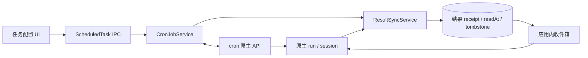
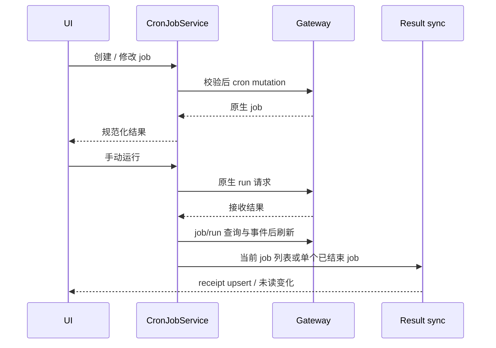
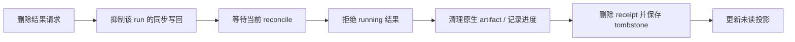

# 定时任务：原生调度与应用结果收件箱

本页按 CronJobService、ScheduledTaskResultSyncService、结果 Store 和 IPC 描述当前实现。系统由两个不同模型组成：原生 job/run 决定何时执行；产品 result receipt 决定用户如何发现和管理结果。

## 1. 两个生命周期

| 模型           | 权威                 | 持久内容                                              |
| -------------- | -------------------- | ----------------------------------------------------- |
| Job            | Gateway cron         | schedule、payload、owner、enabled、delivery、运行状态 |
| Run            | Gateway cron/session | 原生运行身份、结果和历史                              |
| Result receipt | 产品 SQLite          | task/run 映射、摘要、readAt、清理与 tombstone         |
| UI             | Redux/页面状态       | 列表、筛选、加载错误和未读投影                        |

暂停 job 不删除旧结果；删除结果也不等于删除 job。原生 transcript 不复制进结果表，打开详情时仍定位原生会话。

## 2. 配置写入与执行归属

产品编辑器的 schedule 合约为 at/every/cron，payload 区分 agentTurn 与 systemEvent。原生可能包含更多高级任务形态，adapter 需保留可识别但表单未建模的能力，不能保存一次普通编辑就静默抹掉。

新建 Agent-turn 默认由 main 执行，也可选择已有助手，使用隔离运行会话。外部或模型创建的 job 保留原 owner；列表、启停和手动运行不能偷偷接管。产品操作需验证可编辑性、时间与 payload，而非直接透传任意 cron JSON。

Agent-turn 创建和编辑表单可选择任务专用模型，使用应用模型列表和规范化的 OpenClaw `provider/model` 引用（含自定义提供商和套餐模型）。默认不设置任务模型覆盖，遵循 OpenClaw 原生模型选择规则，包括助手/应用默认、子代理模型配置及已有原生会话覆盖；systemEvent 不提供独立模型设置。编辑时保留列表外的现有模型引用及其他 payload 选项。选择“跟随默认配置”时，编辑输入的空字符串由 Main 转为原生 `cron.update` 的 `payload.model: null`，明确清除旧任务覆盖；省略字段仍表示保留现有配置。

应用新建 job 默认显式发送 delivery mode=none，不依赖上游省略值的默认行为。announce/webhook 是原生外发配置；应用收件箱不是一种外发 channel，是否进入本地收件箱不取决于是否发到 IM。

模型发起任务变更时由 automation-permission 根据原生 session mode 审批。无人值守不意味着自动 full，也不能用某个 Agent 名称绕开审批。

### 内置浏览器后台执行

浏览器模式继续读取“设置 → 浏览器”。选择 embedded 时，产品可编辑、isolated 的 agentTurn job 可使用同一个 `browser` 后台执行；Main 从原生 job API 核对形态，不向 systemEvent、脚本/命令、托管或高级任务自动开放。原生最终工具权限仍是前提，只读任务不因无人值守获得浏览器权限。

公开 prompt/tool hooks 及 V2 invocation guard 提供确切 jobId、runId、sessionKey、物理 sessionId、生命周期 revision 和工作区；模型参数不能建立这些绑定。Main 以完整原生运行身份创建后台 scope，强制 headless=true，不依赖打开详情或 Renderer ready ACK，显式 false 返回冲突。

页面归当前运行，登录存储与侧栏同 profile 共享；用户在侧栏登录后，定时任务按同 profile 新标签的语义使用 Cookie、localStorage、IndexedDB 等站点数据。任务之间共享该账号状态，但不继承侧栏标签控制权或 Chrome 扩展授权。

确切 whole-run lifecycle terminal 且 executionSettled:true 才产生最终轮末释放；原生工具代次的信号在成功清理时也会失效，单独 revoked 事件立即撤工具权限和 armed 效果、回收定时页，同时保留身份等待真实终态，不把它当作任务取消或完成。断连、停服和退出同样可终止自有页面，但不能代替运行结果证据。清理不清共享 Service Worker 或关闭 profile 连接，不能证明站点派生/已发请求已停止。

能力、限制及真实验证范围见[浏览器设置](../features/browser/browser-settings-design.md#内置浏览器的前台与后台执行)。

## 3. 创建、手动运行与轮询

### 写入和运行的正常链路

手动运行的请求返回不是完成通知。列表需要后续原生状态更新；重复查询可合并，写请求不能因轮询超时自行重试成第二次执行。shutdown 先停止 polling，避免依赖关闭后再产生后台工作。

### 启动与重启期间的页面门禁

Renderer 在首屏就绪后后台初始化定时任务服务，先订阅事件，再读取任务和结果。首次任务列表通过 Main 等待 Gateway 就绪，启动超时由 Main 的 Gateway 生命周期管理；Renderer 不另设 10 秒初始化超时，避免正常冷启动被误报为失败。等待不阻塞首屏，也不提前返回空的成功列表；Gateway 启动和 RPC 的实际失败仍通过 Main/IPC 现有错误路径处理。

普通启动提前开放工作界面后，定时任务页的任务／结果导航保持可用，原生内容在
Main 确认当前引擎的执行准备完成前显示等待状态；首次等待不加载系统任务设置、
运行历史或结果详情，不开放新建、修改、启停、手动运行与调度设置。进程 `running`
不能代替该准入。引擎就绪后只读加载任务与系统设置，任务读取中显示加载状态，
不能先显示空任务；明确失败显示顶部引擎状态入口的恢复指引。首次安装、迁移和
正常升级仍遵守原有启动门禁。

首次准入后保留已挂载内容和编辑草稿，引擎重启期间使页面内容暂不可交互，并在
恢复后重新读取任务、系统设置及已打开的运行历史。页面写操作同步检查就绪状态，
不会将启动阶段的用户操作排队到就绪后自动执行；已经提交的操作仍由原生回执确定
结果，不因页面等待而取消、重发或推断完成。

## 4. 首次同步：建立已读基线

结果同步器初次没有 baseline 时，抓取有界全局历史窗口，最多 200 条、每任务最多 20 条。初始化保存 baseline 时间及任务 watermark，已有历史作为基线，而不是突然产生大量新未读通知。

baseline 必须持久化，不能每次启动重新决定“什么算新结果”。成功提交后再发送 refreshed/unread 事件，UI 通知失败不能回滚已持久结果。

这些数值来自 `scheduledTaskResultSyncService.ts`，是同步窗口而非原生历史保留上限。

## 5. 增量对账和中断恢复

启动对账重新 upsert 最近最多 100 条，以修复映射并保留已有 readAt；随后按每任务 watermark 和 lastRunAtMs 决定是否 catch-up。分页大小为 50，追赶位置持久化，中断后从保存的进度继续。

旧 watermark 在本轮同步开始前捕获，不能先写最新结果再把它当追赶终点，导致跳过中间运行。结果按时间顺序 upsert，稳定原生身份去重。

单个 finished job 的快速同步不代表拿到了权威 job 列表，不能据此删除其他任务的 catch-up。普通 reconcile 用 single-flight 合并；forceGlobal 若遇正在同步则等待后再执行完整对账。

## 6. 结果读取、未读与跳转

ScheduledTaskResultStore 提供分页、未读计数及 readAt 更新。读状态属于产品，不依赖原生运行是否成功；失败任务同样可能有应查看结果。重复 upsert 不重置用户已经读过的结果。

打开结果先解析对应原生 session 身份，再复用聊天详情。失去原生 artifact 应给出不可用状态，不能创建空 transcript 假装结果恢复。系统管理任务的操作能力与普通用户任务区分展示。

### 原生历史与工具展示

历史运行继续按确切物理 sessionId 读取，保留归属复核与分块版本校验。公开 transcript SDK 返回的是脱敏消息，不是 `chat.history` 的显示投影；Runtime Services 只将完整、合法的 `openclaw.nested-tool.v1` 原生活动转换为成对的工具调用／结果显示块，保留 entry ID、run ID、父调用、输入、输出和错误状态。结果元数据仅保留受限浏览器路由及退出码／耗时等展示字段，不从任意诊断详情开放交互组件。

未知、格式不完整或已投影的 custom 消息保持原样。Renderer 因而可将最终正文前已结束的浏览器嵌套工具与 Thinking 一起收进“处理过程”，不再被不可见的空 custom 记录切断；折叠仍不建立执行结论，也不改写原生历史。

## 7. 删除是可恢复的跨边界事务

删除和同步有共享 barrier，避免刚删除又被正在进行的分页写回复活。清理失败保留结果及可重试记录；不能先删 receipt 再失去 artifact 身份。

响应丢失后再次删除，若 receipt 已不存在但 durable tombstone 证明删除完成，返回幂等成功。纯内存 suppression 只保护当前并发，跨重启防复活依赖持久 tombstone。

## 8. 失败与用户结果

| 故障                   | 应有行为                                           |
| ---------------------- | -------------------------------------------------- |
| Gateway 断开           | 列表显示连接/刷新失败，不用空数组推断所有 job 被删 |
| 单页历史查询失败       | 保留已持久结果与 catch-up 位置                     |
| 重复原生 run           | upsert 同一 receipt，保留 readAt                   |
| 原生结果被外部清理     | 结果条目可诊断，详情不伪造消息                     |
| 删除运行中结果         | 拒绝，先完成或停止原生执行                         |
| 部分 artifact 清理成功 | 按进度重试，不无限重复已完成步骤                   |

## 9. 系统任务与验证入口

### 技能库自动整理的系统任务

OpenClaw 按 Agent 投影每周整理任务，使用 `agentTurn` payload 和
`skill-collection-review:<agentId>` declaration key。Main 在 ScheduledTask 中透传
`declarationKey`，Renderer 按系统归属识别成员，不按可编辑的名称或 prompt 匹配。
所有成员合成一张“技能库自动整理”卡片；展开后仍用各原生 job ID 查看详情与历史，
保留真实 payload、Agent、运行状态及失败信息。聚合 ID 仅用于界面，不发送给 cron mutation。

统一开关通过 `config.patch` 修改 `skills.workshop.autonomous.mode`（开启 `auto`，关闭 `off`）。
原生禁止 cron 客户端删除这些系统监控任务；关闭后原生仍保留禁用的任务，界面继续聚合。
应用配置同步在未设置 mode 时显式写入 `off`，并保留已有显式选择，因此不依赖上游默认的 `auto`。
手动学习使用当前聊天的原生 `/learn`，应用不另建学习启动器，也不由该卡片创建学习会话。

技能页的工坊弹窗管理 main 的当前技能、保存版本与已生效变更；现行流程见[插件系统](07-plugin-system.md)，真实内网验收见[现行说明与验证边界](07-plugin-system.md)。

### 实现与回归

主要代码位于 `src/main/scheduler/`、`src/main/ipc/scheduledTask/`、`src/main/data/scheduledTaskResultStore.ts`、`src/shared/scheduledTask/` 和 Renderer scheduled-tasks feature。

回归需覆盖 schedule 与时区、原生 owner 保留、默认 delivery、基线不泛滥未读、超过一页的追赶、中断重启、readAt 保留、删除和 reconcile 竞争、tombstone 幂等及原生历史缺失。测试应验证用户看到的结果，不只比对请求对象字段。

内置无头浏览器另由 `scripts/test/verify-browser-cron.cjs` 验证真实 at timer 自动触发：使用隔离 Gateway 和本地合成模型，经认证插件事件、实际 job 查询与 Main/Electron 执行 browser open/text/screenshot，等待精确 whole-run 终态及同 job/session 的原生成功运行记录，检查页面回收和进程正常退出。

已在 Windows 冻结 v2026.10.7 原生产物配合当前 Main/插件源码通过；不调用 cron.run，不证明业务模型/SSO 或当前完整安装包已验收，详见[验证边界](../features/browser/browser-settings-design.md#内置浏览器的前台与后台执行)。
