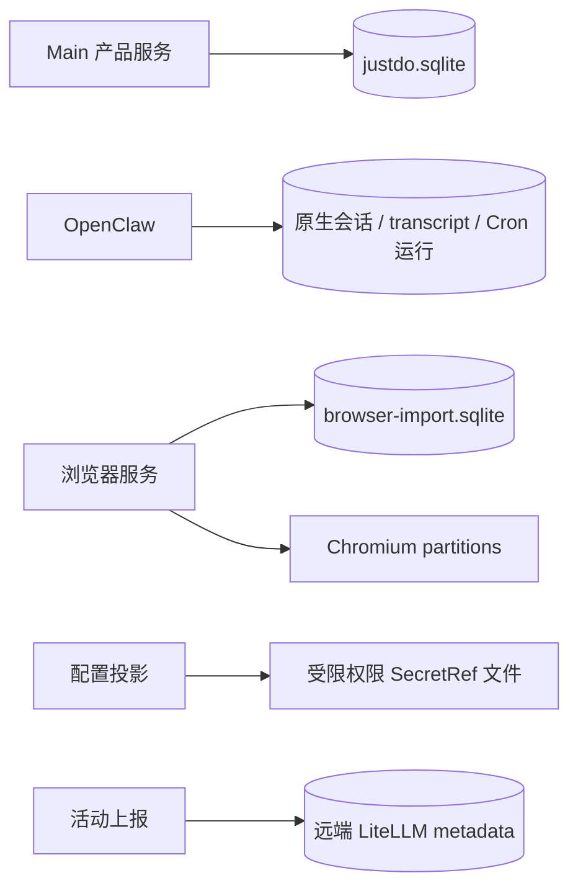
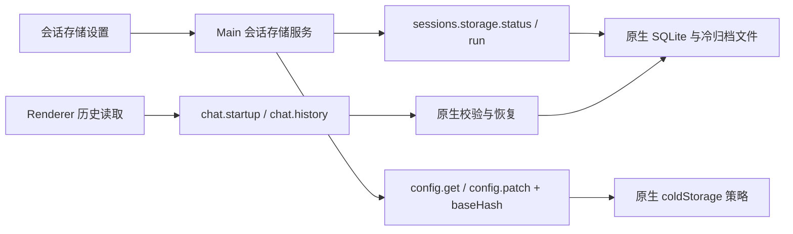

# 数据存储：权威、约束与恢复

桌面可选业务使用独立 Native/Main/Browser 插件包；通用 SDK、可信代码审核、冷包变更和历史清理所有权见 [应用插件宿主](../plugins/sdk/app-plugin-runtime.md)。

本文按 Core 的 SqliteStore、CoworkStore、ScheduledTaskResultStore，以及所属插件的领域 Store 组织。产品数据、原生 transcript、浏览器数据与服务端统计分别拥有独立生命周期，不能用“SQLite 中有数据”概括所有持久状态。

## 按问题定位

| 要核对的问题                                  | 维护位置                                                                     |
| --------------------------------------------- | ---------------------------------------------------------------------------- |
| 原生、产品、插件及浏览器各保存什么            | [存储边界](#1-存储边界)                                                      |
| 新库、历史导入、升级、WAL 和凭据文件如何处理  | [初始化与兼容](#2-初始化与兼容规则)                                          |
| 产品表、会话身份、运行回执和诊断在哪里        | [表清单](#3-核心产品表全表清单)、[会话与回执](#4-会话与运行回执)             |
| Plan、Goal、配置及助手信息由谁持久化          | [Plan / Goal](#5-plan-与-goal)、[配置](#6-配置与凭据)、[助手](#7-助手与协作) |
| 删除失败和结果收件箱如何恢复                  | [删除补偿](#8-删除补偿与结果收件箱)                                          |
| 网页回执、profile、浏览器索引和远端数据在哪里 | [浏览器与服务端数据](#9-浏览器与服务端数据)                                  |
| 插件 schema、事务和通用资源如何保存           | [插件持久化](#10-插件持久化)                                                 |
| 备份、冷归档和 schema 变更应验证什么          | [备份与修复](#11-备份修复与变更验收)、[验证边界](#12-当前验证边界)           |

## 1. 存储边界

| 存储             | 权威与寿命                      | 应用可保存什么                                  |
| ---------------- | ------------------------------- | ----------------------------------------------- |
| 原生会话存储     | Gateway transcript、run 与 cron | 产品索引和无正文回执，不能复制消息              |
| 产品 SQLite      | Main 连接和领域事务             | 会话元数据、配置、未读、诊断闭合值              |
| 插件业务存储     | 插件 schema / 独立数据库        | 房间、DAG、预算、持久操作身份                   |
| Chromium profile | 浏览器 Session                  | Cookie、站点存储和缓存，由 profile 生命周期管理 |
| 受限凭据文件     | Main 凭据 owner 与 SecretRef    | 受限派生引用，不能进入普通 Renderer 状态        |

产品数据库位于 app.getPath('userData') 下，默认 `<appData>/<productName>/justdo.sqlite`。内部文件名稳定，productName 改变时不自动迁移旧品牌目录。Gateway state 和项目目录不是该数据库的子表，备份和删除时需要分别处理。

`cowork_session_runs.automatic_error_retry` 是可空的无正文 JSON 关联，保存重试链、次数、
精确原生身份、前驱及呈现 disposition。旧产品库按缺列检查增加该列，不改变原有运行结果。
它只支持[错误自动重试](../features/execution/automatic-error-retry.md)的历史呈现，不从历史
重建执行；重启只沿用已确认后继的 Superseded 关联，候选、待定和未知关联不隐藏原生失败。

声明受管数据目录的 App 插件通过公开 SDK 访问 `<state>/plugin-data/<plugin-id>/`。默认可清理目录用于模型、私有组件及缓存，更新和停用保留，卸载可选择清理；执行恢复账本可声明保留策略，卸载也不清理。目录归属、策略及安全清理见[应用插件宿主](../plugins/sdk/app-plugin-runtime.md)。既有业务库和原生历史沿用各自的存储与删除规则。

应用插件的可写存储统一位于 `<state>/plugin-data/`：插件 ID 子目录保存私有数据，
保留子目录 `.host/` 保存宿主批准记录和不可变代码，写入时由各自存储入口按需创建。
备份和插件卸载时分别遵守宿主代码、私有数据与原生历史的归属。

## 2. 初始化与兼容规则

### 原生关闭与 WAL

原生 SQLite 连接退休时的 WAL checkpoint 不等待其他读取快照：仅在 close 回调内临时将 busy timeout 设为 0，并恢复原策略，避免 TRUNCATE 清理占住写锁、耗尽 Agent 会话写入的准入期限。仍有读取者时保留未完成 checkpoint 的事实与 WAL，不删除文件、不补造执行成功或重放未知请求；原生 close、lease 和后续维护继续拥有清理。普通事务及用户显式 checkpoint 的等待策略不变。

关闭前先由原生 `beginClose()` 停止新维护任务，异步 `stop()` 等待已经运行的任务退出，再执行 close；不移除该 join。接线和实际 SQLite 并发复现见[运行时补丁 025](../../scripts/patches/v2026.10.7/README.md)。

较早版本的并发复现保留其历史产物范围；当前10.7的重新执行与未验收项见
[本版验证](../openclaw-upgrades/v2026.10.7/validation.md)，不能只凭接线相同认定已通过。

### 备份和替换的成功证据

关闭未完成或出错时不得产生 clean integrity 回执。备份和更新通过原生验证快照取得已提交 WAL 数据，输出单文件副本；删除及更新替换仍需原生 maintenance owner、排他连接与精确代际。外部读者、外部维护 owner、过期代际或损坏快照必须保留源文件并拒绝操作，不能通过重试或把未完成关闭当作 clean 来放行。相关退出、强杀和新进程恢复回归见[生命周期验证](../../tests/openclaw/runtime/sqlite-retirement-lifecycle.native-smoke.mjs)；进程恢复证据不等同于断电或介质故障验证。

### MCP 配置事务与失败补偿

MCP 配置变更跨越 `mcp_servers` 与原生配置应用，不能用数据库事务包裹异步 Gateway reload。Main 在全局配置队列内串行执行变更并等待应用，阻止其他配置同步在提交前发现旧原生记录；失败时通过 `McpStore.restoreServer` 原样恢复原 ID、启用状态、配置及时间戳，再补偿同步。新增失败删除本次记录；删除成功后才移除市场安装身份。该恢复流程不新增表或迁移。

### 登录资料文件

账号模板不新增 SQLite 表或 Redux slice。LoginUserInfoStore 使用统一路径解析器，在
`<appData>/<productName>/<directoryName>/<userInfoFileName>` 原子保存 mtoken、账号、工具 Header 值、
可选显示资料和 Cookie 过期时间；默认与 userData 同目录，隔离开发 userData 下则不移动该文件。

目录名与用户信息文件名由 `src/config/loginStorage.ts` 的 `LOGIN_STORAGE_CONFIG` 分别
配置，实际名称以构建配置为准；更改后不自动迁移或回退读取旧文件。
历史迁移及中断恢复均排除 `directoryName` 配置的整个登录目录，保留原位及其中的所有文件。
Cookie 更新合并当前文件而保留长期 mtoken；账号替换先删除旧文件并完成退出刷新，
退出只删除用户信息文件，保留目录及其他文件。

SDK 派生 JWT 不回写，继续由原有私有凭据快照与 SecretRef 管理。
账号显示与服务同步状态只在 Main 内存中，重启从文件/SDK 恢复，不持久化原始 SDK 错误或凭据到产品库。

### 已发布 JSONL 历史导入

消息唯一持久权威是 OpenClaw 的原生 SQLite transcript。已发布 JSONL 用户先备份并建立全新产品库；旧缓存中的独有历史转换后交由原生导入，目标不建立 cowork_messages。Renderer 按原生历史恢复，不从 Main 或 Redux 寻找持久正文。见[启动与历史升级](../features/app/startup-and-history-upgrade.md)。

#### 历史状态与身份投影

旧历史导入只恢复 main；其他执行身份及关联记录仅保留在原备份，不映射到 main，
也不创建长期助手占位。历史 Doctor 显式选择 main，不使用全部 agent 的导入/检查范围。
所有 main 历史子会话在启动迁移输出中按用户选定的规则统一为 `status: done`（有任一原始成功记录）
或 `status: failed`（否则，包含无状态、未知、运行中、中断、停止和超时），不会保留待核实状态。

只有旧索引保有终态、精确 `lastRunId`、合法结束时间且没有当前运行 owner 时，才可恢复该真实运行元数据；
中断、停止和超时的快照按失败匹配。首次导入以公开原生读取器回读验证。
不从最后一条正文推定成功，不恢复活动执行或旧结果投递；已完成迁移库不自动回填旧终态。
同一旧规范键/物理会话/main 父关联的全部别名共用上述规则。只有所选结果对应唯一一致的完整
原生快照时才携带其真实运行 ID/时间；其余只写显示状态，不编造运行身份或结算回执。

该临时处理只在启动迁移模块内，复用现有原生状态展示，不新增 KV、产品表、IPC 或 Renderer 历史字段。
旧工具调用同样在启动迁移的待导入 JSONL 副本中统一关闭：缺结果和空 Yield 使用原生静态缺失结果补件，
保留已有输出及错误，不创建可执行调用或整轮结算证据。主文件、子会话、历史侧副本和压缩快照一并处理；
原备份字节保持不变，后续交由原生 Doctor 导入，不由 Main 改写活动原生数据库。

### 历史工作区初始化文件

项目根部遗留的 `openclaw-workspace-state.json` 仅保存旧工作区初始化状态。Main 在软件启动
加载当前工作目录后和切换工作目录时，自动删除该精确名称的普通文件，不导入其中的旧
初始化时间，不新增迁移记录。清理不涉及原生 SQLite、聊天历史、工作区确认标记或角色文件，
也不扫描项目子目录；详细触发与失败边界见[普通启动](../features/app/startup-and-history-upgrade.md#普通启动与执行准入)。

### 不支持的旧原生 SQLite 代际

当前应用不支持自动迁移未发布的 shared18／agent23 原生数据库，也不包含旧 SQLite 代际桥、独立启动门禁或构建资产。

原生 transcript 与数据库格式仍由 OpenClaw 管理，应用不读取或复制正文到产品表。该撤回仅指未发布的 SQLite→SQLite 兼容，不包含另行授权的已发布 JSONL 历史导入；后者使用当前原生 Doctor 和公开读取器，不添加原生 SQLite 迁移 SQL 或自动删库重建逻辑。

此前合成旧数据迁移演练仅保留为已撤回方案的历史证据，不属于现行能力或可复跑验收项。下文现有产品数据库初始化规则不在本次删除范围内；运行包仍须从 pristine 重建。

### 产品库初始化

通用本机 WebSocket app-server 的端口和 Bearer token 由 Main 单独保存到
`<userData>/app-server/connection.json`，不进入 SQLite KV 或 `app_config`。
令牌首次随机生成后跨重启保留，端口 `0` 表示自动分配，也可配置固定端口。
目录和文件使用受限权限（Windows ACL / Unix `700`、`600`），先保护临时文件再写入秘密，
同步落盘并原子替换；只有文件确实不存在才初始化，损坏、读写或权限错误不自动重置。
保存与重新生成令牌只更新下次 listener 启动配置，普通状态不返回秘密。
此文件使用权限保护，不宣称 OS 加密；连接及待生效语义见
[通用 app-server](../features/external-clients/app-server.md)。

产品设置只从当前 SQLite KV 读取，不再从根目录 `config.json` 导入旧 electron-store 数据。
新建、迁移和重开数据库均不读取该文件；已有 KV 设置保持原样，不增加导入开关或跳过标记。
迁移的必需归档项与可选项占用策略见
[启动与历史升级](../features/app/startup-and-history-upgrade.md)。

Windows 安装阶段不创建用户数据库、运行配置、Python 用户环境或更新缓存。Main 先读取轻量交付信息和启动记录；已有完成记录、OpenClaw 版本相同、版本顺序校验通过且没有未完成升级事务时，直接进入正常启动，打开已有产品 Store、加载必要配置并启动 Gateway，不先执行数据库预检、会话目录扫描、完整运行包哈希或离线会话规范校验。实际数据打开失败仍保留文件并显示错误；当前原生 schema 和会话准入交由 Gateway 处理。

首次采用、迁移、升级及恢复路径继续在打开 Store 前详细分类。迁移升级先得到包含已提交 WAL 的历史备份，再隔离旧环境、建立当前空产品库并恢复历史；正常升级保留全部现有数据，通过锁定原生维护 owner 检查、备份、更新并复验原生数据库，不能借正常启动快捷路径跳过未完成事务。

`startup-state.json` 记录稳定数据代际、事务阶段、目标和已完成的交付身份；缺少交付回执的当前用户进入保留全部数据的正常升级流程，旧展示标记缺失或写入失败不触发首次安装或历史迁移。未知、混合、损坏或不可读格式保留文件并显示原因。常规 Python、配置和 Gateway 可恢复问题继续允许进入设置；数据库维护或历史导入的身份/完整性错误则保留恢复阶段。完整顺序与恢复边界见[启动与历史升级](../features/app/startup-and-history-upgrade.md)。

含旧 `cowork_messages` 的发布版产品库即使同时留有原生 SQLite，也按旧历史迁移。
隔离前逐字节保存并校验旧 SQLite 文件族、共享库与历史归档，原件长期留在选择性备份；
不打开旧原生库、不将其恢复进新环境，也不新增旧 SQLite schema 兼容桥。
自动恢复仍限于 JSONL 与旧消息缓存，SQLite 独有记录仅保全原件。当前产品库中的活动
JSONL/SQLite 混合仍拒绝自动替换。

迁移中已完成的归档保留在 `backups/<transactionId>/retired/`，完成后暂不删除。
`openclaw/`、`outbound-header-proxy/`、`developer/` 及 `justdo.sqlite*` 必须归档成功；其余非控制项
尝试移动，遇到指定占用或权限错误时保留原位继续，新建与恢复事务使用同一规则。
启动早期会释放继承到必需归档目录内的进程 cwd，必要时尽力解析真实路径以识别目录别名；
解析失败不新增启动门禁。Windows 必需项移动支持有限的瞬时占用重试，
重试仍检查路径边界、禁止覆盖并复核选择性备份中的历史来源，持续失败不得进入初始化。
中断恢复、占用重试或来源变化后，从完整 `retired/` 原件重新取得一致性快照及导入计划，
校验完成后通过启动记录原子选择新快照；旧备份保留，过期快照不会造成永久恢复阻断。
`logs/` 及根目录的 `install-timing.log`、`install-resource.log` 明确排除，始终留在原位。

非必需项被重新生成而与旧归档重名时，另存 `retired-additions/` 或在占用时保留两处；
必需项的重名冲突仍拒绝覆盖。完整错误边界由[启动与历史升级](../features/app/startup-and-history-upgrade.md)定义。

仅应用版本升高或构建指纹变化，不单独触发正常升级。满足上述快捷路径条件时，
正常启动完成后仅更新 `lastOpenedIdentity`，供后续版本顺序与降级判断使用；
不把普通打开记录写成新的原生维护或规范校验完成证明，既有 `completedIdentity` 保留。
未完成事务按版本方向接续同版本修复或向前升级，不以构建指纹不同作为兼容拦截。

保留原事务、备份和恢复阶段；已有目标数据时，当前原生 owner 先只读检查，需要维护时持久记录
新目标和 `schemaPreparationPending` 后执行自带复验的维护；无需维护时直接记录新目标，不重复扫描。
未知结果保留标记，同目标重启也复验；早期检查
不代替初始化、历史恢复完成后的最终准备。Complete 残留目标身份的记录转为正常升级继续确认。

构建身份仍校验本次产物和子进程回执；降级及实际不支持的数据结构仍按所属规则处理，
细节见[启动与历史升级](../features/app/startup-and-history-upgrade.md)。

schema 就绪和原生会话规范校验是两项独立事实。首次采用、迁移、升级及恢复路径在
配置投影、历史恢复完成后，由受信 Node 子进程在 Gateway 启动前调用原生 canonical
certifier，避免校验的提交授权与同步插件加载争用 Gateway 事件循环。原生持久回执
绑定实际数据库文件代际；应用不解析、复制或伪造它，也不据此代替物理完整性校验。
正常启动不运行这项离线准备，不能把 `verifyNativeReady` 的快捷返回理解为已执行校验。

离线准备全程持有原生 Doctor 排他锁。需要规范校验时先在原生维护租约下确认完整原生
备份组，正常释放维护租约后由校验 Worker 获取自己的原生运行租约；维护租约不能跨线程
冒充 Worker 授权。全部 Worker 退休后重新取得维护租约，核对配置、文件身份、完整
清单、schema 和无待校验工作，再关闭子进程。失败和未知退出不提交完成身份；首次
安装可保留设置入口，但未获准入时任何入口都不能启动 Gateway。
原生备份按目标版本及整组文件身份确定，可复用首次原始快照；不覆盖已有备份，不承诺
每次准备都另存最新快照，备份组损坏即停止，也不自动回滚覆盖随后新增的数据。

跨版本升级由目标版本集中声明支持的来源 schema，并调用该目标的原生 owner，
不按相邻版本拼接应用 SQL。应用/runtime 任一版本降低时先暂停，提示用户并提供
“仍然启动”；确认只恢复本进程当前目标的正常检查，不产生永久兼容授权或就绪回执。
继续后实际数据仍须符合目标支持范围；不兼容或加载失败正常报错，保留文件。
版本无法可靠比较时保留数据并说明原因，不按降级确认自动放行。

左侧功能栏的固定偏好保存在 `kv.app_config.sidebarPinnedItems`，为可选功能 ID 的有序数组，缺省为空。Renderer 读取时过滤非法及重复项；固定和取消固定通过既有配置补丁 IPC 串行保存，保存失败保留已确认的偏好。扩展暂时关闭只隐藏对应入口，不删除其固定偏好。该设置不增加数据表，不修改原生插件配置或会话存储。

正式 Renderer 的 HTTP 静态宿主每次启动使用随机端口，不能把持久偏好绑定该 origin。
`kv['app.renderer-preferences.v1']` 通过既有 store preload 保存具名主题、宠物浮动位置、
定时任务结果过滤、聊天列表宽度（`shell.session-list-width`），以及尚未提交的 Goal 完成反馈状态。启动先恢复这份快照，再导入 App
和 Redux slice，确保初始过滤值和主题读取正确。

只接受四个固定键与 Goal 草稿命名空间，
最多 128 项、单值 64 KiB、总值 512 KiB；超额先淘汰最旧 Goal 草稿，固定偏好保留。
窗口首屏的只读外观快照由 Main 从既有 `app_config.theme` 和这里的 `justdo-theme-id` 提取，
通过受限同步 preload 读取提供，每次新文档及 reload 都取最新值；不另存主题副本、不依赖随机
HTTP origin、不在首次临时窗口提前打开数据库。

正式主界面只水合 Main KV 中的当前偏好，不再从旧 file 页面、当前 HTTP 或开发 origin 的
localStorage 搬迁数据；Main 尚无记录时使用当前默认值。初始 Main 读取失败时，后续保存
先恢复已知基线，再合并明确变化及删除，禁止用空快照覆盖未读数据。
偏好白名单不保存 transcript、失败节选或凭据；不新增表或数据库/原生 schema 迁移。
独立浏览器 demo 没有 privileged store 时继续使用本 origin 的浏览器偏好。

Agent 运行设置复用 `cowork_config` 中的 `agentRuntimeSettings:v1` JSON 记录，
外部 Agent 设置复用 `externalAgentSettings:v1`。已有对象必须通过完整当前字段及数值范围校验，
不再为早期 v1 记录逐字段补默认值，也不把退役的 MCP Apps `null` 偏好转换为布尔值。
完全无记录时创建当前默认对象；损坏 JSON 或整对象校验失败时整体恢复默认，不混合保留
旧字段与新默认。

写入及 IPC 仍校验完整对象，界面局部编辑先合并完整草稿再提交。
外部 Agent 目录变化继续按当前 build catalog 补充新增 Agent 的安全默认并丢弃已移除的 ID，
不因此放宽顶层执行及 bridge 偏好的必填校验。

Code Mode 为运行设置中的 `codeMode: { mode: "off" | "auto" | "on" }`；
当前完整记录中的显式 `auto` 值保留，界面暂不允许新选自动模式。
保存、配置同步和失败回滚沿用现有运行设置 IPC；
产品不新增数据表，也不持久化 JavaScript VM、工具中间结果或等待快照。

Code Mode 的显式 `store/load` JSON 值由原生会话 transcript 的
`openclaw.code-mode-store` custom entries 保存和恢复；完成的 cell 才提交，失败或
取消的未完成 cell 丢弃缓冲。Main/Redux 不复制这些值。覆盖/删除仅改变当前投影，
旧值仍可能存在原生历史和导出中；与产品偏好、普通 VM 变量及当轮 `results.save`
引用的生命周期分别管理。

原生行为与隔离验证入口见[引擎](05-agent-engine.md)。

SqliteStore.create 打开当前目标库、设置 PRAGMA，使用完整当前 `CREATE TABLE IF NOT EXISTS`
和索引定义初始化产品表，并调用领域 schema 初始化器。原生会话绑定、执行身份、助手删除
元数据和各类回执所需的列均在首次建表时声明。初始化只确保默认 main 助手存在，不从旧
`cowork_config.systemPrompt` 继承角色内容，不转换退役的 `container` / `auto` 执行模式，
也不扫描或改写 `app_config` 中的旧凭据。发现仍有旧消息缓存时拒绝打开，不在此删除唯一
历史；启动升级模块先处理旧代际。

| PRAGMA             | 值     | 影响                    |
| ------------------ | ------ | ----------------------- |
| foreign_keys       | ON     | 删除/引用约束生效       |
| journal_mode       | WAL    | 数据可能仍在 WAL 中     |
| synchronous        | NORMAL | 性能与掉电耐久性的折中  |
| cache_size         | -8000  | 以 KiB 表示页面缓存目标 |
| wal_autocheckpoint | 1000   | 自动 checkpoint 阈值    |

当前完整产品库可正常重开，既有数据、外键、索引和触发器保持原有行为。
不再通过 `ensureColumn`、缺列探测或 `ALTER TABLE` 支持旧中间 schema 的原地升级，
也不因缺列删除数据库、WAL/SHM 或已有表。未知结构由启动判定拒绝并保留；
历史升级直接建立当前新表并插入选定元数据，不修改旧产品库。
历史导入保留会话置顶布尔值，以及自定义分组名称和已准入会话的成员关系；空组及同名不同组仍保留。
旧分组 ID 仅作关联键，颜色与排序使用新库默认值，分组创建时间使用本次恢复时间。

旧字段/分组表缺失时采用未置顶、未分组默认值，悬空分组引用不创建虚构组。
历史标题、置顶、分组及映射的导入事务临时使用 `synchronous=FULL`，先插组再插会话，提交并确认完整 checkpoint 后才允许阶段记录落盘，
零会话也必须确认前序 schema 和默认值已落盘，
然后恢复原 PRAGMA。检查阶段恢复只读取不可变绑定，不重写已确认的用户元数据，也不重建用户已删除的组。

`history_session_bindings.defaults_applied` 记录历史会话是否已采用当前新会话默认配置。
该列在当前表中默认置 1；新导入行显式置 0，首次打开/运行准备时在同一产品事务内采用
当前默认权限、清空旧模型覆盖并置 1，此后保留用户主动选择。工作目录为空或不存在
不阻断迁移，结果页统计并在会话内提供选择目录入口。

当前 Plan handoff 表在首次创建时直接声明同会话 reset 所需约束；初始化不再删除旧双会话
Plan 的 segments 表，也不探测并销毁旧 handoff 表。旧环境由启动迁移归档保全。
产品数据库迁移与 OpenClaw 运行时补丁升级是两回事，后者必须从 pristine 包重建。

## 3. 核心产品表全表清单

产品表由 SqliteStore、会话诊断初始化器、App 插件资源保护账本及已安装插件的 schema 初始化器共同建立。下表列出现行产品表；插件扩展复用 Main 提供的连接，schema 实现在各自 owning domain，不从旧版固定表数推断完整性。独立 Swarm 流程库、浏览器数据库和原生 transcript 不属于此表。

| 表                                   | 责任与关键身份                                           |
| ------------------------------------ | -------------------------------------------------------- |
| `app_plugin_resources`               | owner/resource 唯一，绑定产物 hash 的通用删除保护        |
| `kv`                                 | JSON 设置与内部元数据，key 主键                          |
| `cowork_sessions`                    | 产品会话索引，id 主键                                    |
| `history_session_bindings`           | 历史产品会话、原生身份、原始外部映射及恢复事务；不存正文 |
| `cowork_session_runs`                | clientTurnId 唯一，映射原生 rootRunId                    |
| `cowork_external_sessions`           | source + externalSessionKey 唯一映射                     |
| `cowork_external_session_tombstones` | 外部会话删除防复活                                       |
| `cowork_plan_handoffs`               | planId、文件身份、实施接收状态                           |
| `cowork_config`                      | Cowork 设置和产品执行快照                                |
| `agents`                             | 助手档案、启用/默认状态及 deleted_at                     |
| `mcp_servers`                        | 用户 MCP 配置，name 唯一                                 |
| `openclaw_hooks`                     | Hook 开关及配置                                          |
| `session_groups`                     | 分组名称、颜色和排序                                     |
| `scheduled_task_run_receipts`        | 原生 run 对应的结果索引与 readAt                         |
| `scheduled_task_result_cleanup`      | 原生结果 artifact 清理进度                               |
| `scheduled_task_result_tombstones`   | 删除完成的 run 防同步复活                                |
| `cowork_run_diagnostic_coverage`     | 诊断采集起点、覆盖及裁剪计数                             |
| `cowork_run_diagnostic_events`       | 有界、闭合值的运行诊断元数据                             |

## 4. 会话与运行回执

通用 CLI、ACP 与 Codex app-server 入站会话共用 `cowork_external_sessions`，新建一律
使用 `source='cli'`。历史 `source='multica'` 仅保留已有映射、墓碑与原生身份，不转换
命名空间、不按裸 UUID 猜测旧 scope，也不再提供专用客户端后端。同一个产品会话
仍只有一个外部映射，新旧来源
都以只读会话投影到桌面，外部客户端只能提交已有外部映射的会话 ID，不能借此传入
任意原生 session key。创建、恢复与运行分别核对任务目录、产品助手和存活的产品行；
删除触发器为各来源写入原有 tombstone，恢复不会重新创建已删会话。

新建外部记录的 `external_session_key` 与 `cowork_session_id` 使用同一个应用会话 ID，
CLI、ACP 与 app-server 不再另生成外部 UUID。已有异值映射保留原样，只按原外部 ID 查询，
不扫描或改写历史，也不接受无对应外部映射的产品 ID。映射表继续保存来源、原生绑定和执行回执。

通用 app-server 的列表和元数据读取按同一 `source` 枚举外部映射，再核验存活的产品会话、
助手与真实目录；返回的外部 ID 不替换为原生身份。`thread/name/set` 通过现有
`cowork_sessions.title` 更新产品标题并广播列表变化，不新增字段或消息存储。
这些方法不启动 Gateway、不写客户端 `CODEX_HOME` 标记，也不从显示状态推断执行结算。

新外部会话先使用本地化占位标题；首次接收任务时，只在没有外部执行回执、产品运行记录或原生绑定，
且标题仍为占位时，截取首条消息的非空首行作为标题，纯图片使用本地化图片标题。
该更新与首次执行预留同步完成并复用列表通知；后续轮次、已有自定义标题和历史标题不自动覆盖。

通用 app-server 的显式历史读取复用当前认证 Gateway 的完整快照，不直接读取 transcript 文件。
读取前后核对外部映射、产品原生绑定、Gateway 连接代次和运行回执指纹；变化时有界重读或报错。
Turn／Item 是请求内投影，不落库、不新增 Main 正文缓存。历史游标绑定物理 incarnation 与
快照 revision；无法精确关联运行回执的可见旧消息保留在只读历史段，并标记结果未知。
历史正文、工具完成或 assistant final 均不能补写运行结算或解除 unknown 占用。
用户消息可按原生记录的完整输入幂等标识与精确回执关联，该关联只用于历史显示。
通用计时记录不自动生成空 Turn；无消息的轮次只能由外部映射的精确执行指针明确保留。
桌面单个／批量运行状态查询只观察这些外部会话，不创建、重开、绑定或结算其回执，
防止迟到状态被记成新的恢复执行；不通过此前生成的恢复行推断外部任务结果。

Chrome 与通用 app-server 共用上述历史读取、Turn／Item 投影及快照分页实现，
但浏览器普通产品计时回执不具备外部执行账本的独立结算权威。缺少本进程持有并重新核验的
精确原生整轮证据时，即使计时行记录 completed／ended_at，标准历史仍保留结果未知，
不补写数据库回执。另供富侧栏使用的 `thread.chrome.display` 只包含本地分组及显示项，
不包含合成的 completed 状态，不建立第二份 Main 正文缓存或持久执行账本。

标准 app-server 图片在准入时校验真实字节，交由原生附件通道持久化。
历史直接投影原生 content 或 `__openclaw.media` 的真实图片引用；只有内部受管路径时使用
标准 localImage.path，不读取媒体／transcript 文件补正文，也不把图片路径升级成执行身份。
文本与图片按原生实际接收的归一化形状呈现，不另存原始交错输入。原生返回多个无法精确关联的
图片载体时明确报错，不静默丢弃或重复图像；回传媒体引用不代表宿主已经读取该媒体文件。

命令会话授权是绑定连接 scope、原生 key、物理 SID、revision、客户端／连接代次与命令／环境
指纹的有界内存元数据，不进入产品 SQLite，不跨冷重启或新连接恢复。向原生提交 allow-once
明确成功、再次核验仍属于当前 owner 后才登记，未知 resolve 不落入缓存，也不重试决定。
同一 scope 可跨已结算 run 复用；关闭连接、审批 Cancel、scope 撤回或身份变化使旧缓存失效。
Chrome 退订关闭对应 scope，通用客户端空闲退订仅卸载观察，不清除仍属于该连接的 scope。
原生明确提供并由用户选择的 App 持久授权另由原生存储拥有，不复制到本缓存或产品表，
也不因连接结束自动回滚。

app-server 不将审批请求、客户端答案或秘密表单输入另存到产品 SQLite；原生审批回执和 App
持久授权仍由原生管理，不承诺原生层完全不持久化。prepared owner、ACK 等待、标准 live Item 和
响应前的图片事件缓冲只存在于有界内存；原生终态和交互 resolved 分别处理。纯图调用的
chat.send 没有 agent 的原生 revision CAS，前后身份围栏及 unknown 保留规则见
[执行引擎](05-agent-engine.md#输入模型与原生发送边界)，不能以产品计时行补足该原子性。

长最终正文补齐只在原生已确认结算后进行，普通 agent 读取同一 final RPC，纯图路径读取当前
认证 Gateway 的完整历史，并核对唯一精确 run、真实 final_answer 和 producer 截断快照。
结果是本次响应内的输出，不写回正文或替代历史。恢复失败保留原执行结论，不将执行改成失败
或解除未知执行占用。

CLI 执行在同一映射行增加可空的 `execution_run_id`、`native_session_id`、
`lifecycle_revision` 和 `execution_state`。旧库通过增列保持原映射及数据；没有正文、
工具结果或原生 transcript 副本。开始发送前先保存 run 意图，原生准备后保存精确
session key、SID 和 incarnation，再安装会话工具／审批归属。

执行状态按
`preparing → running → settled` 推进；传输中断或无法归属的原生 continuation
保留为 `unknown`，映射的显示状态仍为 running，继续占用会话。应用重启不把外部会话的
running／unknown 推断为已取消，也不会自动重发；再次执行明确拒绝并保留诊断身份。

已安装 ACP 会话工具或 ACP/app-server 审批 owner 时，Gateway 连接替换也进入 unknown，不自动转移
原连接的资源所有权；保留取消信号，后续 EOF／关闭仍可请求停止精确 run，停止 ACK
本身不会清除 unknown 或释放持久执行占用。
缺失原生 authority 或精确回执的核对窗口为 30 秒，单次读调用也受同一窗口限制；
超窗返回 unknown，而不推断失败或取消。

精确 pending／running 回执或同 SID／revision
的 `activeRunIds` 仍包含当前 run 时刷新窗口，不为正常长任务设置总时限。调用方取消只
撤销无界 `agent` RPC 等待并请求停止精确 run，随后仍须核对原生结算证据。

正常结算只接受精确原生 whole-run lifecycle（`executionSettled:true`）或精确
`agent.wait` 终态回执，并重新核对原生 SID／lifecycle revision。chat final、idle、
Stop ACK、新的 owner 和最新历史消息都不能替代结算证据。当前公共 API 不能证明
yield 后唤醒运行的前驱关系时，保留 unknown，而不从 run-ID 后缀推测归属。

扩展托管 MCP 的独立开关与连接参数覆盖只保存在原生 `openclaw.json` 的 `mcp.servers`，不写入 `mcp_servers`、`kv` 或另一份产品设置。原生扩展名称归属用于发现排除与配置同步保留；界面中的脱敏编辑草稿只存在当前窗口内存中，不增加产品表或迁移。

cowork_sessions 保存 title、status、pinned、cwd、execution_mode、permission_mode、active_skill_ids、agent_id、model_ref、group_id 及时间。status 是产品快照，不能替代原生 runtime 查询。列表索引服务 pinned/updated_at 排序和 Agent 范围查询。

普通已有会话更改工作目录复用 `cwd` 字段，不新增表或复制历史；原生确认空闲及
产品身份复核后保存期望值，后续消息／新终端的准备负责应用原生权限根。修改目录
不刷新活动时间，不迁移文件或助手角色目录。Worktree、外部来源、插件托管及未处理
计划等限制与并发准入见[会话权限](../features/execution/openclaw-permission-management.md#3-工作目录是权限的一部分)。

`updated_at` 表示最近对话活动时间。Main 在广播运行时活动事件前将时间单调写入会话索引，
确保继续历史会话后刷新列表或重启仍保留新时间。重命名、状态、模型、权限与分组等元数据
修改不刷新该时间；活动时间不参与原生身份、执行准入或终态判断，也不需要读取或保存正文。
原生 `sessions.changed(reason: send)` 表示输入已进入原生保管；即使待发输入尚未启动执行，
Main 也按事件时间更新活动。该投影先通过 `sessions.describe` 核对同一原生会话，异步返回时
再次检查连接世代、产品绑定及重置/删除边界；失败或过期的核验不更新时间，不创建运行回执。

可空 `source` 列记录创建入口，当前显式值为 `chrome-extension`。Chrome 扩展新建会话时随会话插入，
完整会话和摘要读回此值，Renderer 据此生成专用来源分组；不在 `session_groups` 创建记录。
此列由当前完整表定义声明；未显式记录来源的会话保持 NULL 和原列表归属，不读取原生正文来推断来源。
继续会话、重命名、置顶和用户分组变更均不修改创建入口。

读取只接受 NULL／缺省的桌面来源和当前声明的 Chrome 来源。其他非空或空字符串来源不降级为桌面会话：按 ID 读取返回不可用，目录、摘要及搜索统一过滤；按原生 key 命中此类既有映射时明确拒绝，避免原生采用流程据此重建普通会话。此边界不提供旧来源别名、不迁移或删除原行及执行回执，也不改变外部客户端另表保存的 origin。

原生可见 worktree 子会话被发现后，产品在 `cowork_sessions` 中增加一条导航记录。`native_session_key` 唯一绑定原生会话，`native_parent_session_id` 保留产品父会话关系；`cwd` 是原生实际执行目录。两列和原生 key 唯一索引由当前完整 schema 声明。发现和绑定在一个 SQLite 事务中完成，重启后按原生 key 去重。产品不复制 transcript 或 worktree 快照；OpenClaw 仍是会话内容与检出目录的权威。父会话存在产品侧原生子会话时，不允许先删除父会话。

用户勾选 Worktree 创建的主会话复用上述原生绑定，`native_parent_session_id` 为 NULL，`cwd` 在 Gateway 确认检出目录后更新。显示偏好 `showWorktreeCheckbox` 存在 `cowork_config` 中，缺省为 false；它控制入口可见性，不自动开启新任务的 worktree。

会话摘要包含可选 `nativeSessionKey`，供搜索使用原生 key 并限制尚未支持的复制操作；摘要仍不包含工作目录。涉及检出移除或删除所属会话的保护规则必须通过完整会话读取实际 `cwd`。原生 key 可从 SQLite 反查产品会话身份，不依赖运行时内存映射。

存储目录与文件系统加速属于 OpenClaw 全局配置，保存在原生 `openclaw.json` 的 `worktreeRoot` / `worktreeAcceleration`，不复制进 SQLite。设置保存使用 Gateway 配置版本进行并发校验；JustDo 配置同步保留其值。恢复默认目录会移除 `worktreeRoot` 覆盖，已有 worktree 记录及快照路径不迁移。

forked_from_* 保存原生分支来源，源会话删除时引用置空并保留标题快照。handoff_from_* 和 handoff_request_id 保留旧手动交接来源及幂等约束，当前 UI/IPC 已不提供该创建入口。

运行表保存 started_at、accepted_at、ended_at 与 state，区分用户提交、原生接收和结束。client_turn_id 全局唯一；每个 session 通过 ended_at IS NULL 的部分唯一索引限制一个未结束回执。终态和计时必须幂等结算，不能重启后重新开始计算同一已结束 run。

复制和分支都只继承目标原生历史中确实存在的已结束计时回执。Main 对新目标使用
有界 `chat.history` 分页，只提取 run 身份，不保存正文；每页核对物理 sessionId，
最后以首个 deltaCursor 确认历史未改变。扫描最多 40 页，读取失败、身份/游标变化
或超限时省略可选计时，不按时间或随机回执 ID 猜切点，也不复制 off-path 回执。
诊断事件、Goal 续跑状态和 Plan handoff 不随计时复制。

复制/分支在发送创建请求前，先将 `sessionBranchPending:<sessionId>` 标记写入现有
`cowork_config`，完整准备成功后清理。标记按存在性关闭准入，不解析内容授予权限；
详情与列表均投影 `branchCreationPending`。创建结果不明或后续准备失败时保留同一
目标，标为 error 供检查/删除；重启、状态刷新、模型/Plan 更改及普通 prepare 均不能
把它恢复为空会话。

仅创建 handler 使用 Main 内部 typed 选项完成其原请求的准备。
只有收到成功或明确拒绝响应、并确认原生 `session:null` 才撤销本地记录；未知请求的
暂时不存在不足以排除迟到提交。产品删除与隔离标记清理在同一 SQLite 事务中完成。

发送 ACK 丢失后，只有精确原生运行的 `agent.wait` 接纳／终态证据才能补写 root_run_id 和接纳核实时间，再结算该回执；恢复分支与正常 ACK 共用绑定方法。产品 idle、Stop ACK 或既有产品终态不能补写接纳证据。此核实时间可能晚于原生结束，不用于推断实际开始延迟。

外部 session 另存来源、原生 key、首次绑定的 agent/cwd 和运行状态。删除产品会话的 trigger 写外部 tombstone；外部客户端再次同步不能复活用户已删记录。

### 会话目录与按需摘要查询

CoworkStore.listSessionDirectory 批量关联产品会话、外部来源和历史绑定键，返回不含标题、正文或完整历史绑定的轻量元数据；readSessionSummaries 按有界 ID 集合查询摘要，listSessionSearchSummaries 仅在打开搜索时读取完整简单摘要。它们复用产品库及现有主键，不新增表或复制 OpenClaw transcript。历史绑定与外部来源使用批量 JOIN，取消列表读取中的逐条查询；临时 holding 身份在目录与摘要的同一投影中排除。

Renderer 持有完整目录和一个按需摘要实体集合。目录刷新才能裁剪失效会话的未读或展示资源；部分摘要响应不得复活已删除项。读取期间的活动、置顶及归组变化以当前目录为准，读取期间成功完成的重命名保留当前标题。单条完整会话详情保留 groupId，防止搜索或通知打开会话时丢失手动归组。

首条发送的临时会话只属于当前聊天状态，不进入完整目录、分组计数或摘要查询；确认创建后仅接纳真实产品会话。选择尚未加载摘要的会话时，详情响应也须保留完整目录中较新的活动时间。搜索范围按去重后的会话 ID 集合判定，后台活动仅改变目录排序时保留既有搜索快照、正文命中及已加载页。

### 诊断元数据与临时证据

会话诊断增加 `cowork_run_diagnostic_events` 和 `cowork_run_diagnostic_coverage`。两表通过产品 run 外键级联删除；前者只存闭合值运行元数据，后者保留采集起点和裁剪计数，不存正文或任意错误文本。每轮普通/关键事件分别限 200/32 条，全局 20,000 条、14 天；coverage 随既有 run 生命周期保留，事件裁剪不会抹掉丢失证据。

停止判断使用原生 lifecycle 的 `executionSettled`、`stopReason`、超时阶段及
终态回复类别，并可结合临时历史中的最后回复形状；不再采集自定义循环退出分支。
只有已结算的整轮结束事件用于整轮结果，中途尝试的退出不代表整轮结束。
没有新增表、消息缓存或历史回填。

查询按已校验会话和 run 关联，复制/fork 不复制诊断表。事件 JSON 可包含闭合系统错误码、有效 HTTP 错误状态及有限非负耗时；原生 `command_output` 结束事件投影为 `command` 类型，保存整数退出码和失败状态，不重复增加工具失败计数。终态还可保留闭合的超时阶段、空回复类别和回复 disposition，不保留 terminalReply 正文。旧记录不回填；诊断表不保存错误原文、工具名称、参数或输出。

Renderer 无持久诊断缓存，Main 仅保留最多 8 份、5 分钟的诊断快照。按需通过 `chat.history` 读取原生会话数据库，快照可以包含最多 40 条脱敏失败节选及工具名，每条正文最多 1600 字符，以及最后回复的内容种类布尔值和结束原因（用于识别 thinking-only/空响应）；不保存完整历史、不将节选或回复形状写入 SQLite。诊断不是 OpenClaw transcript 的第二份权威。

见[会话诊断](../features/execution/session-diagnostics.md)。

工具事件可额外保留闭合 `operation` 操作类别及 `toolValidationFailed` 布尔标记；后者只从上游固定参数校验摘要精确匹配生成，摘要原文不入库。新增可选字段沿用有界事件 JSON，不新增表或迁移。

事件 JSON 另可保存固定公开失败文案的闭合观察 `runtimeFailure: replay_admission_rejected`，
不保存该文案或私有版本/anchor。按需历史快照的失败回执可使用同值 `cause`；它仍是
短期证据，不写入产品诊断表。原生具体抛错点未公开，不通过新增表或历史回填推断。

按需诊断可以只读使用既有运行表的 `root_run_id` / `client_turn_id`，补足实时诊断
事件过期或尚未记录时的原生身份关联。别名必须重新核对其产品会话／运行归属；
复制或 fork 造成跨运行重复时，不将该标识授予新的精确诊断关联。这些别名仅作为
本次采集的私有输入，不回填事件或增加数据库字段。会话绑定或回执在采集期间变化
时撤回归属证据，显式导出不发布旧结果。40 条失败节选采用关联强度及末端故障优先
的有界保留；正文日志仅在本地导出内存与 ZIP 中存在，页面只收到导出数量、来源缺口
和采集时间。详见[会话诊断](../features/execution/session-diagnostics.md)。

### 首页预览会话的采用与清理

首页 MCP App 文件预览使用 Gateway 创建的原生会话；Main 预留普通产品会话 ID，
通过既有 canonical key 规则建立原生身份。
Main 仅在窗口内存中保留请求标识、工作区签名及原生创建回执；产品 `cowork_sessions`、
消息表和 KV 均不增加预览记录。原生身份与必要元数据仍由 Gateway 保存，Renderer 不读取
或缓存其 transcript。

用户发送首页首条消息时，以该预留 ID 一次性插入普通产品会话行，
沿用原生 sessionId、视图及模型上下文，并从预览清理所有权移除，不增加列、表或迁移。
未被采用的预览在切换工作区或窗口销毁后，通过原生删除接口并按创建时的精确
sessionId/lifecycleRevision 清理自有会话；拒绝或未知结果不扩大清理范围。
文件内容与插件文档库的所有权不变，见 [MCP Apps](../features/chat/mcp-apps.md)。

## 5. Plan 与 Goal

Plan handoff 保存创建时 workspace root、相对路径、SHA-256、字节长度、原生身份与阶段时间。状态为 presented → dispatching → admitted → resolved，失败用 failed；每 session 只允许一个 presented/dispatching/admitted handoff。

计划文件发布、SQLite 写入和 Gateway 准入跨三个系统。批准前与实施注入前复核文件身份，不能根据后改 cwd 重定位文件；原生接收后记录 admitted，避免恢复时把已发送实施当成未发送。

Goal 内容、预算、六种状态和已接纳的自动续跑累计次数由原生 session 持有。原生私有 `goalContinuationTerminal` 只记录精确整轮结算证据，`goalContinuationAccepted` 只保留最后接纳回执；后者与 `goal.continuationTurns` 在同一事务提交，不保存提示或消息正文。`sessions.describe` 显式投影这些事实，缺失证据不推断结算；当前原生回交阻塞由最终准入返回结构化拒绝原因。

`cowork_config` 的 `goalExecution:<sessionId>` 只保存 Main 阶段及原生次数投影等产品快照。读取校验 sessionId 和 phase，坏值不能触发自动运行；不从产品快照恢复一套计数或交接权威。usage_limited/budget_limited 保留原生语义，不归一化为 blocked。

## 6. 配置与凭据

### 语音配置与原生偏好

本地语音扩展模型偏好保存在既有 Main KV 的 `app_config.localSpeechExtensions`：
`sttMode` / `ttsMode` 决定本地或在线路径；`sttModelId` / `ttsModelId` 和 `ttsVoiceId`
保存本地选择，`onlineSttModelRef` / `onlineTtsModelRef` / `onlineTtsVoice` 引用模型页目录。

两种模式保留各自选择，与 `app_config.voice` 的麦克风/朗读模型、音色独立。
不新增表、旧版兼容或迁移；在线失效不能归一化为本地执行。
Main 对稀疏补丁校验固定模型目录及合并后模型的有效音色编号，并在同一配置队列中合并，避免两种模型同时
保存时互相覆盖；原有配置应用失败回滚继续生效。下载文件共用现有模型目录，
Gateway 只接收生成的命令参数或受管在线配置，不建立第二份下载或模型索引。
目录变更在同一队列中清理失效模型和音色引用，保留在线模式。

端点和密钥由 Main 从当前
目录解析；工具 STT、工具 TTS 和在线回复朗读分别通过现有受限 SecretRef 文件发布，
引用绑定端点和密钥版本。原生工具偏好与在线朗读偏好使用受支持的独立路径，由原生
拥有文件；产品不直接读取、迁移或重写这些偏好。回复朗读原生配置为
`plugins.entries.runtime-services.config.replySpeech`，独立于工具的 `tts` 配置。

### 凭据的保护范围

kv.app_config 是应用配置来源。当前 appConfigCredentials 是纯配置规范化：读写时清空
builtin provider 的 apiKey，以及选中 builtin 时或与 builtin key 相同的 API 快照 key，
防止内置凭据进入产品设置；其他用户自有凭据保持原值。它不识别旧内置占位符，
不解密早期 OS 密文，也不依赖 safeStorage。开库不再扫描、转换或截断 WAL 来清理旧凭据；
旧环境按启动迁移的归档和恢复范围处理。

因此不能宣称数据库已全库加密，也不能宣称所有自定义 key 都使用 safeStorage。内置模型的新访问凭据不保存在 SQLite，而是短期 JWT 的受限派生快照，原生使用 exec SecretRef；X-User-Account 不再投影到内置 provider 配置或 SecretRef 解析输出，Gateway 请求继续通过既有出站代理取得该身份头。私有快照仍保留已验证账号和到期时间。自定义 provider secret file 由产品配置派生，采用文件权限保护。

详情见[认证](../features/account/authentication-builtin-model-lifecycle.md)和[安全模型](11-security-model.md)。

内置模型换证的 deviceId 由 Main 公共网卡模块按调用时状态读取，使用去冒号的大写 MAC，不进入产品 SQLite，也不保存或读取 model-device.json。登录接入复用同一模块；没有可用 MAC 时明确失败，不生成 UUID 或其他替代标识。MAC 不是凭据或设备持有证明。

其他持久键包括更新偏好、结果 baseline/catch-up、市场安装身份与助手创建摘要。key prefix 是长期数据接口；改名要有明确迁移，不能让新旧模块各写一套。

## 7. 助手与协作

`cowork_config.allowMainAgentSwitch` 保存会话助手选择开关，缺失时为 `false`。关闭后新会话选择回到 main，已有 `cowork_sessions.agent_id` 和原生历史不变；该配置不需要 schema 迁移。

agents 的 model 为空表示继承；main 不以遗留档案 model 作为用户会话默认。角色文件归原生 agents.files，旧 system_prompt/identity 列不作为另一套编辑 backing store。

删除助手原子设置 deleted_at 并清除 enabled，保留名称及关联键。设置页隐藏、后续变更拒绝，历史图仍能显示身份。原生 agents.delete 会清索引，因此不用于这个保留历史的删除流程。同名重建使用新 ID。

模型创建的 `assistantCreation:<agentId>` KV 只保存参数摘要与 preparing/ready 阶段；准备档案先停用，原生配置和角色文件读回后启用。中断不自动派发任务。

可选插件的业务 schema、预算、派发及删除规则随插件维护；宿主仅提供同库事务与通用资源删除参与者。插件数据入口见[插件文档索引](../plugins/README.md)。

## 8. 删除补偿与结果收件箱

插件资源删除必须通过已注册参与者的预检与清理，外键级联不能代替原生资源清理。

结果收件箱以 run_id 为主键，保存摘要、状态、原生 session、投递结果和 read_at。按 started_at/run_id 分页，按 task_id 查询，未读有部分索引。upsert 保留 read_at；baseline 与追赶水位不放在 Renderer 内存中充当持久事实。

`scheduled_task_run_receipts.metadata_json` 保存有界原生回执元数据：整体完成状态、错误分类、
投递抑制原因、实际模型／提供商、有限非负 token 用量，以及白名单诊断摘要和条目。
诊断最多 32 条，每条消息最多 2048 字符、摘要最多 4096 字符，不复制 transcript、工具参数、
任意详情对象或工具输出历史。产品开库仅在该表缺列时增补默认 `{}` 的列，既有结果、read_at
和删除标记不变；这不是原生数据库迁移。部分同步省略元数据时保留已有事实，非法元数据不进入
Renderer。例行结果 SQL 过滤与共享规则一致：完成失败／未知、真实投递错误和警告／错误诊断
不会因摘要为 NO_REPLY 而隐藏或自动当作正常静默。

删除结果先抑制并发同步写回，清理原生 artifact，再移除 receipt 并写 tombstone。清理表记录已处理路径；失败保留可重试条目。两种删除都不是一个跨网络 SQLite transaction。

## 9. 浏览器与服务端数据

### 网页关联对话元数据

浏览器领域通过现有 SQLite KV 的 `chrome.web-launch.v1` 保存精确站点策略、文档租约与消费序号高水位、无正文 launch 回执、发送 owner/原生 ACK 绑定及结果消息引用/摘要。`prepare` 复用同一数据库连接的同步事务创建 `source: chrome-extension`、`ask` 权限的新产品会话并消费序号；回滚不发布会话或 KV 通知，提交后才通知当前扩展连接。领域事务不调用会立即发出变更的通用 KV setter。

不新增数据库、消息表或 transcript 缓存；prompt、页面上下文、最终正文、凭据和 URL/title 不进入此 KV。旧回执淘汰或用户放弃 unknown 观察后，文档高水位仍拒绝旧操作；容量不足拒绝新准入，不以 TTL 将未知执行结算或放行重发。Main 重启不重发持久请求，缺失精确原生证据的派发仍为 unknown。当前契约及验证限制见[网页入口](../plugins/chrome-extensions/chrome-assistant/website-launch.md)。

### Profile 共享和清理边界

内置浏览器的每会话标签页上限沿用 Main KV 的 `app_config.browserTabLimit`，
默认 20，可设置为 1–50 的整数。旧配置缺失时直接使用默认值，不新增表或迁移；
Main 与 Renderer 共用数值校验。它只控制新建准入，不持久化网页或回收已有标签。

内置后台页面与侧栏按 `browserPartitionForProfile(profile)` 使用同一 Chromium Session。
普通会话和定时任务共享该 profile 的 Cookie、localStorage、IndexedDB、HTTP 认证缓存及
站点 Service Worker；默认、导入和命名 profile 之间仍隔离，也不共享应用外壳或卡片登录。
不复制凭据或创建后台专属存储。页面仍按会话/精确运行管理，sessionStorage 和页面 JS
内存仍按标签隔离，与侧栏同 profile 新标签行为相同，并非所有站点都支持跨标签免登录。

任务清理只撤销自身工具与页面许可并销毁自己的 guest，不清 profile 的站点存储/worker，
不关闭共享连接，不影响侧栏及其他任务。站点 worker 无可证页面归属时沿用 profile 网络
政策；不能因任务结束推断站点派生请求或已发请求已停止，也不自动重试未知写入。

浏览器数据摘要和手动 Cookie／站点数据、缓存清理继续覆盖既有 profile 清单。
清理与后台页面创建共用 Main 准入门；后台 profile 正在创建、使用或等待 guest 销毁时，站点数据及缓存
类别报告既有清理失败，其他所选记录类别可继续。清理门直到所有已发起的 Chromium
清理结束后才释放，不以首个失败代替其他操作已经停止。

### 浏览器索引与站点图标

browser-import.sqlite 独立保存导入历史、safeStorage 加密密码、下载记录和命名 profile；浏览器 Cookie/storage/cache 在 Chromium partition。Renderer 不获取密码密文或下载真实路径，打开文件按记录 ID 经 Main 验证。

`imported_history.url` 同时记录 HTTP(S) 网页与浏览器实际访问的原生 `file://` 地址，保留文件名转义及非敏感 query/hash；本地记录同样支持检索、访问计数与删除。历史地址准入与网络图标地址准入分开，允许本地访问记录不授予 Main 任意本地图片读取。列表过滤旧预览服务的精确临时 token URL 形态，不删除底层旧行、不猜测 token 对应的原文件路径，也不排除普通 localhost 开发站点。表结构保持不变，重新访问本地文件后产生实际文件地址的记录。

`imported_history.favicon_url` 保存内置浏览器声明的 HTTP(S) 图标 URL，沿用历史 URL 的凭据移除与敏感参数脱敏；`favicon_data_url` 保存对应浏览器 session 已加载成功的受限图片，供最近访问直接复用。旧数据库只读查询可返回无图标或图片的记录，首次写入时补列并保留历史。图标和图片可在页面加载结束前或后到达，Main 单独更新，不增加访问次数或改动访问时间；缺失图标的再次访问保留已有图标和图片。

历史列表不批量携带图片正文；按已有页面 URL 的专用 IPC 单独读取，缺图记录在默认浏览器 partition 按浏览器网络设置补取声明图标及网站 favicon，并保存结果。接口不接受任意图标 URL，不为不存在或读取中已删除的历史记录创建条目。清理历史时图片随记录删除；清理缓存按访问时间清空图片列，保留访问记录和图标来源地址。无独立图标索引或缓存表。

### 清理与迟到回调

历史删除或图标缓存清理同时取消清理前开始的图片读取，并使已取得但尚未写回的图片失效，避免清理后被旧回调恢复。旧历史补取完成时比较来源和图片快照，保留并优先返回 native 浏览期间更新的图片，不覆盖新来源。

按时间清理历史记录与清空 Chromium 存储的能力不同，后者可能全量清除，UI 必须说明。删除下载记录不等于删除磁盘文件。

### 远端活动记录

LiteLLM 客户端活动通过 `POST /user/activity` 写入服务端 `LiteLLM_UserTable.metadata.user_activity`，不属于本地产品表。原生消费的 EndUser 归属继续保留，用于已有日志筛选；活动接口不创建或修改 EndUser。可扩展 metadata 仅在 user_activity 命名空间保存最新快照，不将客户端自报值计入原生账单；重复事件不倒退最新快照，接口不可用时不阻塞客户端主流程。客户端开关控制上报，JWT 负责身份校验；未收到活动不能证明用户没启动。服务端部署与字段保留见[认证专题](../features/account/authentication-builtin-model-lifecycle.md)。

Main KV `activity.reportingSchedule` 只保存北京时间日期、已预留窗口数、上次窗口时间、接口冷却截止、上次成功时间及无凭据的快照指纹，不保存报告正文、JWT 或会话明细。每客户端数据目录每天最多 3 个采集/上报窗口、间隔至少 6 小时；启动就绪至少 15 分钟后择空闲运行，预留失败就不采集。准备失败和无变化也消耗窗口，重启/退出/换账号不清配额和冷却。每窗口通过现有 Gateway 取一次近 7 天本机每日原生会话数和已记录 Token，只投影有界数字；没有第二份 transcript 或完整统计账本。每个新窗口重新采样，退出不等待网络。

## 10. 插件持久化

插件负责业务表、私有数据文件、持久回执及其恢复规则。宿主不在此重复维护插件表清单或业务状态机；它只负责提供同库事务、schema 初始化与通用资源保护。包被移走后，其业务存储说明应随包保留。

- [协作插件存储](../plugins/extensions/agent-team/persistence.md)。
- [工作流插件存储](../plugins/extensions/swarm-workflow/persistence.md)。

### 通用插件资源保护账本

应用资源保护账本 `app_plugin_resources` 位于同一产品库，以 owner ID 和 resource ID 唯一标识资源，并绑定 artifact hash，保存元数据身份和删除围栏，不保存消息。插件 schema 初始化使用相同数据库连接；失败不能放行受保护删除。跨 hash 采用必须显式确认旧完整集合，空投影不能擦除保护。外部应用代码批准及历史批准 hash 保存于 `<state>/plugin-data/.host/approvals.json`，不可变已批准代码保留于同一宿主目录的 `artifacts/`，只恢复账本引用的旧版本清理。

完整可信清单确认可选插件已移除时，仅按 `owner_id` 解除该插件的宿主资源关联，不按共享的 `resource_id` 清除其他插件保护。插件业务表、助手、产品会话、原生历史和未确认执行的安全回执均保留；装回插件后重新读取既有元数据并登记关联。坏包、整体库存未知和数据库读取失败不等同于明确卸载，不通过空投影推断资源或执行已完成。此行为不新增数据库表或 transcript 缓存。

## 11. 备份、修复与变更验收

### 会话冷归档

设置 → 统计与存储 → 会话存储直接查询 OpenClaw `sessions.storage.status`，按 Agent 展示数据库、WAL、外部冷归档字节数与冷热 transcript 数量。合计只累加 `databaseBytes + walBytes + archiveBytes`；`embeddedArchiveBytes` 已包含在数据库大小内，不再累加。该统计不涵盖浏览器缓存、项目、附件文件，也不等于产品会话列表数量。

`session.maintenance.coldStorage.enabled / afterDays` 由原生配置持久化，缺省展示关闭、30 天。归档设置单独保存，不写入产品运行时设置或新增 SQLite 表；普通启动、模型配置和最小配置同步保留已有 `coldStorage` 与非产品拥有的 maintenance 字段。保存携带用户读取到的配置 hash，冲突或响应不确定时重新读取，不自动重放写入。

`config.get` 必须返回有效快照，且 `configRevisionHash` 与 `appliedConfigHash` 一致，才把策略视为已生效；诊断快照、损坏字段和缺少生效版本不降级为默认策略。维护状态逐字段投影，原生错误仅转换为错误码，不向 Renderer 透传内部诊断或数据库路径。

`sessions.storage.run({})` 是所有配置存储范围的一轮后台维护，不支持单会话、单助手参数，且要求原生归档开关已启用。结果返回不等于归档完成，页面按维护状态展示本轮数量和错误。关闭页面只释放轮询，不取消原生任务；维护记录仅反映当前 Gateway 生命周期。

压缩、索引、活跃任务保护和恢复全部由 OpenClaw 管理。应用不直接改写原生数据库，也不更改 `cowork_sessions`、分组或助手历史归属。冷归档不是隐藏、删除或永久保留；既有 `pruneAfter: 365d`、`maxEntries: 500` 清理策略仍有效，本功能不修改它们。原生全文搜索会报告其可见冷历史范围，但不保证搜索归档正文，也不为搜索主动恢复全部历史。

聊天导出仍是当前已加载快照，不能充当全会话备份；历史读取失败或未完成时禁止导出。仅复制 `justdo.sqlite` 无法恢复原生历史，完整备份还需包含原生数据库和关联冷归档文件，并按需求包含角色文件、项目及附件。在线备份应使用原生快照或正确的 SQLite 备份流程，不能遗漏 WAL。归档文件引用存在不代表附件实体已被备份。

技能提炼提案及其草稿、支持文件、状态和 revisionHash 全部由 OpenClaw Workshop 持久化。
应用不新增提案表或历史正文缓存，也不另建学习会话。用户在当前聊天发起原生 `/learn`，
执行内容仍由该原生会话拥有；提案弹窗仅持有 main 的页面级快照，重启或重进页面通过
skills.proposals.* 恢复。审核写入绑定 proposalId 与 expectedRevisionHash，不改变全局学习策略。

正常备份先退出应用再复制产品数据；在线备份使用 SQLite backup/checkpoint 机制，不能只复制主文件忽略 WAL。原生 transcript、角色文件、模型派生凭据和项目文件要按需求另行纳入，不能把整套数据默认作为 issue 附件。

修改产品 schema 时验证新库一次完整建成、当前完整库重开后数据与约束保留、旧消息缓存
拒开库时原件不变，以及坏 JSON、部分操作中断和重试。旧中间 schema 的原地补列不再是
验收目标；已发布历史的备份与导入继续按独立启动迁移契约验证。同步事务内不等待网络；
写入前确定唯一键与查询索引，状态迁移使用 expected-state 约束。重点测试位于 sqliteStore、
coworkStore、collaborationStore 与 scheduledTaskResultStore 旁。

## 12. 当前验证边界

冷归档在最终锁定运行时中的正常/损坏归档读取，以及归档后重启、恢复附件引用并继续会话，尚未完成真实环境验收；关闭自动归档后的历史读取也不能视为已经验证。原生读取失败必须保留错误，禁止用空历史、正文缓存或盲目重试掩盖恢复问题。

原生状态由独立随包 Node 和原生会话 API 拥有；Node 版本由 `src/shared/openclaw/nodeRuntime.json` 锁定。产品 `better-sqlite3` 继续使用 Electron ABI，不能把两棵依赖或数据库句柄混用。不支持旧 SQLite 代际迁移桥、直接 transcript 读取或自动删库重建。Windows 验证缓存的路径别名由原生物理键承担。
