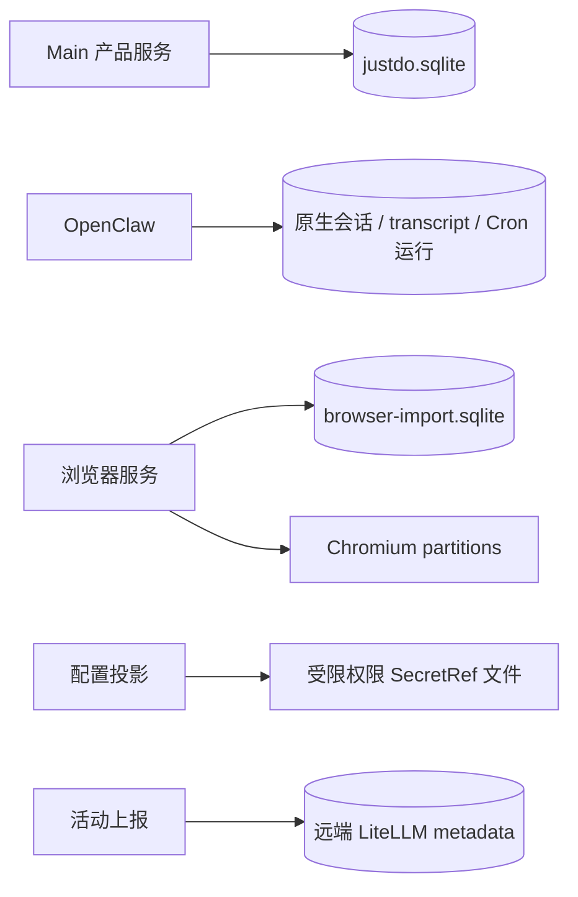
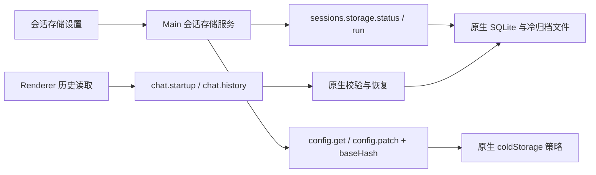

# 数据存储：权威、约束与恢复

本文按 SqliteStore、CoworkStore、CollaborationStore 和 ScheduledTaskResultStore 的当前实现组织。产品数据、原生 transcript、浏览器数据与服务端统计分别拥有独立生命周期，不能用“SQLite 中有数据”概括所有持久状态。

## 1. 存储边界

内置浏览器的每会话标签页上限沿用 Main KV 的 `app_config.browserTabLimit`，
默认 20，可设置为 1–50 的整数。旧配置缺失时直接使用默认值，不新增表或迁移；
Main 与 Renderer 共用数值校验。它只控制新建准入，不持久化网页或回收已有标签。

独立 `swarm-workflow` 扩展在 Gateway `stateDir/swarm-workflow/flows.sqlite` 保存流程目标、
已校验 DAG、阶段结果、修订号、启动意图和原生运行引用。它是插件调度状态，
不属于产品 SQLite 的消息表，也不复制原生 transcript。执行会话由插件拥有，
流程与主会话的关联是插件元数据，不写入主会话原生 ownership 或伪造 spawnedBy。
未知提交和未知最终投递不自动重试；恢复先核对已有运行。
主会话被删除后身份检查阻止下一次派发，原生工作历史与插件记录不会自动级联清除。
参见 [Swarm Workflow](../features/workflow/swarm-workflow.md)。

会话诊断增加 `cowork_run_diagnostic_events` 和 `cowork_run_diagnostic_coverage`。两表通过产品 run 外键级联删除；前者只存闭合值运行元数据，后者保留采集起点和裁剪计数，不存正文或任意错误文本。每轮普通/关键事件分别限 200/32 条，全局 20,000 条、14 天；coverage 随既有 run 生命周期保留，事件裁剪不会抹掉丢失证据。

原生运行时的循环退出分支及最后回复种类以 `loopExit` / `responseShape` 闭合枚举
投影到事件 JSON，并保留到导出。只有已结算的整轮结束事件用于最终原因；
中途尝试的退出不代表整轮结束。没有新增表、消息缓存或历史回填。

查询按已校验会话和 run 关联，复制/fork 不复制诊断表。事件 JSON 可包含闭合系统错误码、有效 HTTP 错误状态及有限非负耗时；原生 `command_output` 结束事件投影为 `command` 类型，保存整数退出码和失败状态，不重复增加工具失败计数。终态还可保留闭合的超时阶段、空回复类别和回复 disposition，不保留 terminalReply 正文。旧记录不回填；诊断表不保存错误原文、工具名称、参数或输出。Renderer 无持久诊断缓存，Main 仅保留最多 8 份、5 分钟的诊断快照。按需通过 `chat.history` 读取原生会话数据库，快照可以包含最多 40 条脱敏失败节选及工具名，每条正文最多 1600 字符，以及最后回复的内容种类布尔值和结束原因（用于识别 thinking-only/空响应）；不保存完整历史、不将节选或回复形状写入 SQLite。诊断不是 OpenClaw transcript 的第二份权威。见[会话诊断](../features/chat/session-diagnostics.md)。

工具事件可额外保留闭合 `operation` 操作类别及 `toolValidationFailed` 布尔标记；后者只从上游固定参数校验摘要精确匹配生成，摘要原文不入库。新增可选字段沿用有界事件 JSON，不新增表或迁移。

产品数据库位于 app.getPath('userData') 下，默认 `<appData>/<productName>/justdo.sqlite`。内部文件名稳定，productName 改变时不自动迁移旧品牌目录。Gateway state 和项目目录不是该数据库的子表，备份和删除时需要分别处理。

MCP 配置变更跨越 `mcp_servers` 与原生配置应用，不能用数据库事务包裹异步 Gateway reload。Main 在全局配置队列内串行执行变更并等待应用，阻止其他配置同步在提交前发现旧原生记录；失败时通过 `McpStore.restoreServer` 原样恢复原 ID、启用状态、配置及时间戳，再补偿同步。新增失败删除本次记录；删除成功后才移除市场安装身份。该恢复流程不新增表或迁移。

账号模板不新增 SQLite 表或 Redux slice。LoginUserInfoStore 使用统一路径解析器，在
`<appData>/<productName>/huawei/user_info.json` 原子保存 mtoken、账号、工具 Header 值、
可选显示资料和 Cookie 过期时间；默认与 userData 同目录，隔离开发 userData 下则不移动该文件。
Cookie 更新合并当前文件而保留长期 mtoken；账号替换先删除旧文件并完成退出刷新，
退出删除整个登录文件。SDK 派生 JWT 不回写，继续由原有私有凭据快照与 SecretRef 管理。
账号显示与服务同步状态只在 Main 内存中，重启从文件/SDK 恢复，不持久化原始 SDK 错误或凭据到产品库。

消息唯一持久权威是 OpenClaw 的原生 SQLite transcript。初始化删除旧 cowork_messages 缓存，不迁移其消息；Renderer 按原生历史恢复，不从 Main 或 Redux 寻找持久正文。

### 未发布 9.6 数据兼容已撤回

9.6 版本未发布。按用户要求，本次 9.8 升级新增的 9.6→9.8 原生 SQLite 兼容迁移已移除，包括应用维护桥接、启动门禁、专项测试和构建资产。当前应用不承诺自动升级该未发布版本的 shared18／agent23 数据。

原生 transcript 与数据库格式仍由 OpenClaw 管理，应用不读取或复制正文到产品表，也不为此次升级添加迁移 SQL、Doctor 修复或自动删库重建逻辑。

此前合成旧数据迁移演练仅保留为已撤回方案的历史证据，不属于现行能力或可复跑验收项。下文现有产品数据库初始化规则不在本次删除范围内；运行包仍须从 pristine 重建。

## 2. 初始化与兼容规则

Windows 安装阶段不创建用户数据库、运行配置、Python 用户环境或更新缓存；仅向 Roaming 产品目录追加安装日志，日志不可写时可在最终安装目录保留备用日志。首次运行创建真实用户目录并打开 SQLite，失败通过初始化首页显示原因。`.justdo-initialized` 是本地应用壳首次初始化的展示标记，写入失败只记日志，不改变 schema 或原生会话所有权。Python、配置同步和 Gateway 的可恢复故障允许用户进入设置处理，不成为额外的数据目录门槛。已有目录没有该标记时只展示一次初始化进度，不清空用户数据。

左侧功能栏的固定偏好保存在 `kv.app_config.sidebarPinnedItems`，为可选功能 ID 的有序数组，缺省为空。Renderer 读取时过滤非法及重复项；固定和取消固定通过既有配置补丁 IPC 串行保存，保存失败保留已确认的偏好。扩展暂时关闭只隐藏对应入口，不删除其固定偏好。该设置不增加数据表，不修改原生插件配置或会话存储。

正式 Renderer 的 HTTP 静态宿主每次启动使用随机端口，不能把持久偏好绑定该 origin。
`kv['app.renderer-preferences.v1']` 通过既有 store preload 保存具名主题、宠物浮动位置、
定时任务结果过滤，以及尚未提交的 Goal 完成反馈状态。启动先恢复这份快照，再导入 App
和 Redux slice，确保初始过滤值和主题读取正确。只接受三个固定键与 Goal 草稿命名空间，
最多 128 项、单值 64 KiB、总值 512 KiB；超额先淘汰最旧 Goal 草稿，固定偏好保留。
首次采用 HTTP 宿主且 Main 尚无该记录时，在相同 Chromium session 的隔离空白 file 页面
只读取上述有界 UI 键，再切换 HTTP 主页面；不加载旧 App 或旧 preload，不覆盖已有记录。
开发 origin 首次采用时也只导入同一白名单。初始 Main 读取失败时，后续保存先恢复已知
基线，再合并明确变化及删除，禁止用空快照覆盖未读数据。
这不是 localStorage 的通用复制器，不保存 transcript、失败节选或凭据；不新增表或数据库/原生 schema 迁移。
独立浏览器 demo 没有 privileged store 时继续使用本 origin 的浏览器偏好。

Code Mode 偏好复用 `cowork_config` 中的 `agentRuntimeSettings:v1` JSON 记录，新增
`codeMode: { mode: "off" | "auto" | "on" }`。读取旧记录时只为缺失字段补上 `off`，
已有显式 `auto` 值保留；界面暂不允许新选自动模式。
非法显式值由运行设置校验器拒绝。保存、配置同步和失败回滚沿用现有运行设置 IPC；
不新增数据表，也不持久化 JavaScript VM、工具中间结果或等待快照。

SqliteStore.create 先检查已知 legacy schema，再打开连接，设置 PRAGMA，初始化表及增量列/索引，调用协作 schema 初始化器，最后处理 app_config 中遗留凭据引用。

| PRAGMA             | 值     | 影响                    |
| ------------------ | ------ | ----------------------- |
| foreign_keys       | ON     | 删除/引用约束生效       |
| journal_mode       | WAL    | 数据可能仍在 WAL 中     |
| synchronous        | NORMAL | 性能与掉电耐久性的折中  |
| cache_size         | -8000  | 以 KiB 表示页面缓存目标 |
| wal_autocheckpoint | 1000   | 自动 checkpoint 阈值    |

已知 cowork_sessions 缺少必需列时，现有 legacy 检测会删除数据库及 WAL/SHM 后重建；检查本身失败则记录并保留文件。这是有损兼容分支，不能泛化为任何 schema 问题都可自动删库。新增正常字段使用 ensureColumn 等增量逻辑。

旧双会话 Plan 的 segments 与不符合当前约束的 handoff schema 有专门清理分支；该处理不适用于普通用户数据。产品数据库迁移与 OpenClaw 运行时补丁升级是两回事，后者必须从 pristine 包重建。

## 3. 核心产品表全表清单

产品表由 SqliteStore、会话诊断初始化器及 Agent Team 的协作/验收/群聊/待发初始化器共同建立。下表列出现行产品表；插件扩展复用 Main 提供的连接，schema 实现在各自 owning domain，不从旧版固定表数推断完整性。独立 Swarm 流程库、浏览器数据库和原生 transcript 不属于此表。

| 表                                   | 责任与关键身份                          |
| ------------------------------------ | --------------------------------------- |
| `kv`                                 | JSON 设置与内部元数据，key 主键         |
| `cowork_sessions`                    | 产品会话索引，id 主键                   |
| `cowork_session_runs`                | clientTurnId 唯一，映射原生 rootRunId   |
| `cowork_external_sessions`           | source + externalSessionKey 唯一映射    |
| `cowork_external_session_tombstones` | 外部会话删除防复活                      |
| `cowork_plan_handoffs`               | planId、文件身份、实施接收状态          |
| `cowork_config`                      | Cowork 设置和产品执行快照               |
| `agents`                             | 助手档案、启用/默认状态及 deleted_at    |
| `mcp_servers`                        | 用户 MCP 配置，name 唯一                |
| `openclaw_hooks`                     | Hook 开关及配置                         |
| `session_groups`                     | 分组名称、颜色和排序                    |
| `scheduled_task_run_receipts`        | 原生 run 对应的结果索引与 readAt        |
| `scheduled_task_result_cleanup`      | 原生结果 artifact 清理进度              |
| `scheduled_task_result_tombstones`   | 删除完成的 run 防同步复活               |
| `collaboration_rooms`                | 唯一 anchorSessionId                    |
| `collaboration_members`              | room 内唯一 agent；session/key 全局唯一 |
| `collaboration_rounds`               | 用户轮次及 stopped_at                   |
| `collaboration_deliveries`           | 路由、摘要哈希、原生接收和状态          |
| `collaboration_execution_receipts`   | 精确 sessionKey/runId 的 whole-run 终态 |
| `collaboration_reviews`              | 原生验收执行、封闭结论及对应批次        |
| `collaboration_review_deliveries`    | 验收报告到具体工作回执的关联            |
| `collaboration_deletions`            | 删除冻结记录                            |
| `collaboration_deleted_members`      | 已确认原生删除的成员                    |
| `cowork_run_diagnostic_coverage`     | 诊断采集起点、覆盖及裁剪计数            |
| `cowork_run_diagnostic_events`       | 有界、闭合值的运行诊断元数据            |
| `team_discussion_rooms`              | 固定成员、来源身份及房间状态            |
| `team_discussion_runs`               | 请求指纹、批次身份与汇总抑制            |
| `team_discussion_executions`         | 成员精确原生执行、结算和清理证据        |
| `team_discussion_summaries`          | 来源汇总的 outbox 与执行回执            |
| `team_discussion_task_links`         | 获准读取群历史的关联产品任务            |
| `team_discussion_deleted_rooms`      | 已删除房间的持久墓碑                    |
| `team_discussion_queue_control`      | 每群待发控制 generation                 |
| `team_discussion_pending_inputs`     | holding 引用、请求指纹与 FIFO 状态      |

## 4. 会话与运行回执

扩展托管 MCP 的独立开关与连接参数覆盖只保存在原生 `openclaw.json` 的 `mcp.servers`，不写入 `mcp_servers`、`kv` 或另一份产品设置。原生扩展名称归属用于发现排除与配置同步保留；界面中的脱敏编辑草稿只存在当前窗口内存中，不增加产品表或迁移。

cowork_sessions 保存 title、status、pinned、cwd、execution_mode、permission_mode、active_skill_ids、agent_id、model_ref、group_id 及时间。status 是产品快照，不能替代原生 runtime 查询。列表索引服务 pinned/updated_at 排序和 Agent 范围查询。

`updated_at` 表示最近对话活动时间。Main 在广播运行时活动事件前将时间单调写入会话索引，
确保继续历史会话后刷新列表或重启仍保留新时间。重命名、状态、模型、权限与分组等元数据
修改不刷新该时间；活动时间不参与原生身份、执行准入或终态判断，也不需要读取或保存正文。
原生 `sessions.changed(reason: send)` 表示输入已进入原生保管；即使待发输入尚未启动执行，
Main 也按事件时间更新活动。该投影先通过 `sessions.describe` 核对同一原生会话，异步返回时
再次检查连接世代、产品绑定及重置/删除边界；失败或过期的核验不更新时间，不创建运行回执。

可空 `source` 列记录创建入口，当前显式值为 `browser-extension`。Chrome 扩展新建会话时随会话插入，
完整会话和摘要读回此值，Renderer 据此生成专用来源分组；不在 `session_groups` 创建记录。
此列通过 `ensureColumn` 增量添加，已有会话为 NULL，保留原列表归属，不读取原生正文来推断来源。
继续会话、重命名、置顶和用户分组变更均不修改创建入口。

原生可见 worktree 子会话被发现后，产品在 `cowork_sessions` 中增加一条导航记录。`native_session_key` 唯一绑定原生会话，`native_parent_session_id` 保留产品父会话关系；`cwd` 是原生实际执行目录。两列通过增量 schema 初始化添加。发现和绑定在一个 SQLite 事务中完成，重启后按原生 key 去重。产品不复制 transcript 或 worktree 快照；OpenClaw 仍是会话内容与检出目录的权威。父会话存在产品侧原生子会话时，不允许先删除父会话。

用户勾选 Worktree 创建的主会话复用上述原生绑定，`native_parent_session_id` 为 NULL，`cwd` 在 Gateway 确认检出目录后更新。显示偏好 `showWorktreeCheckbox` 存在 `cowork_config` 中，缺省为 false；它控制入口可见性，不自动开启新任务的 worktree。

会话摘要包含可选 `nativeSessionKey`，供搜索使用原生 key 并限制尚未支持的复制操作；摘要仍不包含工作目录。涉及检出移除或删除所属会话的保护规则必须通过完整会话读取实际 `cwd`。原生 key 可从 SQLite 反查产品会话身份，不依赖运行时内存映射。

存储目录与文件系统加速属于 OpenClaw 全局配置，保存在原生 `openclaw.json` 的 `worktreeRoot` / `worktreeAcceleration`，不复制进 SQLite。设置保存使用 Gateway 配置版本进行并发校验；JustDo 配置同步保留其值。恢复默认目录会移除 `worktreeRoot` 覆盖，已有 worktree 记录及快照路径不迁移。

forked_from_* 保存原生分支来源，源会话删除时引用置空并保留标题快照。handoff_from_* 和 handoff_request_id 保留旧手动交接来源及幂等约束，当前 UI/IPC 已不提供该创建入口。

运行表保存 started_at、accepted_at、ended_at 与 state，区分用户提交、原生接收和结束。client_turn_id 全局唯一；每个 session 通过 ended_at IS NULL 的部分唯一索引限制一个未结束回执。终态和计时必须幂等结算，不能重启后重新开始计算同一已结束 run。

外部 session 另存来源、原生 key、首次绑定的 agent/cwd 和运行状态。删除产品会话的 trigger 写外部 tombstone；外部客户端再次同步不能复活用户已删记录。

## 5. Plan 与 Goal

Plan handoff 保存创建时 workspace root、相对路径、SHA-256、字节长度、原生身份与阶段时间。状态为 presented → dispatching → admitted → resolved，失败用 failed；每 session 只允许一个 presented/dispatching/admitted handoff。

计划文件发布、SQLite 写入和 Gateway 准入跨三个系统。批准前与实施注入前复核文件身份，不能根据后改 cwd 重定位文件；原生接收后记录 admitted，避免恢复时把已发送实施当成未发送。

Goal 内容、预算和六种状态由原生 session 持有。`cowork_config` 的 `goalExecution:<sessionId>` 只保存 Main 自动续跑阶段、次数及时间等产品快照。读取校验 sessionId 和 phase，坏值不能触发自动运行。usage_limited/budget_limited 保留原生语义，不归一化为 blocked。

## 6. 配置与凭据不等于全库加密

kv.app_config 是应用配置来源。当前 appConfigCredentials 转换清空 builtin apiKey 和旧内置引用，并能读取早期 `justdo-os-credential-v1` 记录；它不会把所有新的自定义凭据统一加密。读取旧加密记录要求可用 OS cipher，Linux basic_text/unknown 不作为安全 backend。

因此不能宣称数据库已全库加密，也不能宣称所有自定义 key 都使用 safeStorage。内置模型的新访问凭据不保存在 SQLite，而是短期 JWT 的受限派生快照，原生使用 exec SecretRef；自定义 provider secret file 则由产品配置派生，采用文件权限保护。详情见[认证](../features/integrations/authentication-builtin-model-lifecycle.md)和[安全模型](11-security-model.md)。

内置模型换证的 deviceId 由 Main 公共网卡模块按调用时状态读取，使用去冒号的大写 MAC，不进入产品 SQLite，也不保存或读取 model-device.json。登录接入复用同一模块；没有可用 MAC 时明确失败，不生成 UUID 或其他替代标识。MAC 不是凭据或设备持有证明。

其他持久键包括更新偏好、结果 baseline/catch-up、市场安装身份与助手创建摘要。key prefix 是长期数据接口；改名要有明确迁移，不能让新旧模块各写一套。

## 7. 助手与协作

agents 的 model 为空表示继承；main 不以遗留档案 model 作为用户会话默认。角色文件归原生 agents.files，旧 system_prompt/identity 列不作为另一套编辑 backing store。

删除助手原子设置 deleted_at 并清除 enabled，保留名称及关联键。设置页隐藏、后续变更拒绝，历史图仍能显示身份。原生 agents.delete 会清索引，因此不用于这个保留历史的删除流程。同名重建使用新 ID。

模型创建的 `assistantCreation:<agentId>` KV 只保存参数摘要与 preparing/ready 阶段；准备档案先停用，原生配置和角色文件读回后启用。中断不自动派发任务。

协作 delivery 唯一键为 room、发送人、sourceRunId、toolCallId，input_digest 检查重试参数冲突；表中没有正文。round 的 stopped_at 持久冻结旧轮次，预算包括失败尝试。重启恢复将 queued 转 failed、dispatching 转 unknown，不从元数据重造载荷。

## 8. 删除补偿与结果收件箱

协作整任务删除先写 freeze，停止全部成员，确认原生状态，再逐个删除原生 session 并保存进度，最后事务删除产品会话。外键级联不能代替前面的原生清理。

结果收件箱以 run_id 为主键，保存摘要、状态、原生 session、投递结果和 read_at。按 started_at/run_id 分页，按 task_id 查询，未读有部分索引。upsert 保留 read_at；baseline 与追赶水位不放在 Renderer 内存中充当持久事实。

删除结果先抑制并发同步写回，清理原生 artifact，再移除 receipt 并写 tombstone。清理表记录已处理路径；失败保留可重试条目。两种删除都不是一个跨网络 SQLite transaction。

## 9. 浏览器与服务端数据

browser-import.sqlite 独立保存导入历史、safeStorage 加密密码、下载记录和命名 profile；浏览器 Cookie/storage/cache 在 Chromium partition。Renderer 不获取密码密文或下载真实路径，打开文件按记录 ID 经 Main 验证。

`imported_history.favicon_url` 保存内置浏览器声明的 HTTP(S) 图标 URL，沿用历史 URL 的凭据移除与敏感参数脱敏；`favicon_data_url` 保存对应浏览器 session 已加载成功的受限图片，供最近访问直接复用。旧数据库只读查询可返回无图标或图片的记录，首次写入时补列并保留历史。图标和图片可在页面加载结束前或后到达，Main 单独更新，不增加访问次数或改动访问时间；缺失图标的再次访问保留已有图标和图片。历史列表不批量携带图片正文；按已有页面 URL 的专用 IPC 单独读取，缺图记录在默认浏览器 partition 按浏览器网络设置补取声明图标及网站 favicon，并保存结果。接口不接受任意图标 URL，不为不存在或读取中已删除的历史记录创建条目。清理历史时图片随记录删除；清理缓存按访问时间清空图片列，保留访问记录和图标来源地址。无独立图标索引或缓存表。

历史删除或图标缓存清理同时取消清理前开始的图片读取，并使已取得但尚未写回的图片失效，避免清理后被旧回调恢复。旧历史补取完成时比较来源和图片快照，保留并优先返回 native 浏览期间更新的图片，不覆盖新来源。

按时间清理历史记录与清空 Chromium 存储的能力不同，后者可能全量清除，UI 必须说明。删除下载记录不等于删除磁盘文件。

LiteLLM 活动记录是服务端 EndUser metadata，不属于本地产品表。客户端开关控制上报，JWT 负责身份校验；未收到活动不能证明用户没启动。服务端部署与字段保留见[认证专题](../features/integrations/authentication-builtin-model-lifecycle.md)。

## 10. 备份、修复与变更验收

### 会话冷归档

设置 → 统计与存储 → 会话存储直接查询 OpenClaw `sessions.storage.status`，按 Agent 展示数据库、WAL、外部冷归档字节数与冷热 transcript 数量。合计只累加 `databaseBytes + walBytes + archiveBytes`；`embeddedArchiveBytes` 已包含在数据库大小内，不再累加。该统计不涵盖浏览器缓存、项目、附件文件，也不等于产品会话列表数量。

`session.maintenance.coldStorage.enabled / afterDays` 由原生配置持久化，缺省展示关闭、30 天。归档设置单独保存，不写入产品运行时设置或新增 SQLite 表；普通启动、模型配置和最小配置同步保留已有 `coldStorage` 与非产品拥有的 maintenance 字段。保存携带用户读取到的配置 hash，冲突或响应不确定时重新读取，不自动重放写入。`config.get` 必须返回有效快照，且 `configRevisionHash` 与 `appliedConfigHash` 一致，才把策略视为已生效；诊断快照、损坏字段和缺少生效版本不降级为默认策略。维护状态逐字段投影，原生错误仅转换为错误码，不向 Renderer 透传内部诊断或数据库路径。

`sessions.storage.run({})` 是所有配置存储范围的一轮后台维护，不支持单会话、单助手参数，且要求原生归档开关已启用。结果返回不等于归档完成，页面按维护状态展示本轮数量和错误。关闭页面只释放轮询，不取消原生任务；维护记录仅反映当前 Gateway 生命周期。

压缩、索引、活跃任务保护和恢复全部由 OpenClaw 管理。应用不直接改写原生数据库，也不更改 `cowork_sessions`、分组或助手历史归属。冷归档不是隐藏、删除或永久保留；既有 `pruneAfter: 365d`、`maxEntries: 500` 清理策略仍有效，本功能不修改它们。原生全文搜索会报告其可见冷历史范围，但不保证搜索归档正文，也不为搜索主动恢复全部历史。

聊天导出仍是当前已加载快照，不能充当全会话备份；历史读取失败或未完成时禁止导出。仅复制 `justdo.sqlite` 无法恢复原生历史，完整备份还需包含原生数据库和关联冷归档文件，并按需求包含角色文件、项目及附件。在线备份应使用原生快照或正确的 SQLite 备份流程，不能遗漏 WAL。归档文件引用存在不代表附件实体已被备份。

技能提炼提案及其草稿、支持文件、状态和 revisionHash 全部由 OpenClaw Workshop 持久化。
应用不新增提案表或历史正文缓存，也不另建学习会话。用户在当前聊天发起原生 `/learn`，
执行内容仍由该原生会话拥有；提案弹窗仅持有 main 的页面级快照，重启或重进页面通过
skills.proposals.* 恢复。审核写入绑定 proposalId 与 expectedRevisionHash，不改变全局学习策略。

正常备份先退出应用再复制产品数据；在线备份使用 SQLite backup/checkpoint 机制，不能只复制主文件忽略 WAL。原生 transcript、角色文件、模型派生凭据和项目文件要按需求另行纳入，不能把整套数据默认作为 issue 附件。

修改 schema 时验证新库、旧库、重复启动、坏 JSON、部分操作中断和重试。同步事务内不等待网络；写入前确定唯一键与查询索引，状态迁移使用 expected-state 约束。重点测试位于 sqliteStore、coworkStore、collaborationStore 与 scheduledTaskResultStore 旁。

## 群组讨论元数据

新增 team_discussion_rooms（固定成员映射、cwd、只读/权限、revision、generation、状态及来源任务）、team_discussion_runs（requestId / fingerprint / active slot / 状态）、team_discussion_executions（discussionId、成员、精确 sessionKey / sessionId / lifecycleRevision / runId / outcome）、team_discussion_task_links 和 team_discussion_deleted_rooms。只有房间元数据，不存正文。部分删除记录在成员元数据，compare-and-delete 成功后逐一标记；删除墓碑阻止复用旧 roomId。原生扩展 stateDir 的 discussion-receipts 保存无正文 admission / close receipt；消息与公开 channel-final mirror 均属于 OpenClaw native transcript。

详见 [Agent Team 现行契约](../features/assistants/agent-team.md)。

team_discussion_runs 增加可空 initiator_agent_id，标识主助手通过工具发起的消息；正文仍从原生 transcript 读取。旧表通过缺列检测补充，用户请求指纹保持兼容。 详见[主会话组织团队](../features/assistants/agent-team.md)。

`cowork_config.allowMainAgentSwitch` stores the opt-in conversation assistant selector as `true`/`false`; a missing key is false. Disabling resets new conversation selection to main and does not change existing `cowork_sessions.agent_id` or native transcripts. No schema migration is needed for this key.

Swarm 节点派发前将实际发送的任务信封（message、createdAt）与运行意图一起保存到独立插件流程库，列表投影不携带信封，详情按会话归属及依赖边验证后按需读取。它是工作流执行输入，不是原生消息历史的镜像。节点详情复用 ChatMessageDisplay，通过独立 ChatController 直接读取 Gateway 原生历史与实时事件，不增加 Main 或 Redux transcript 缓存。连线只展示已保存的输入；缺失历史输入不重新生成。

### Swarm 节点提交记录

流程可选 `operations` 保存最多 512 个主会话控制操作的身份/动作，与状态在同一
revision 写入中提交，用于回复丢失及重启后重放去重；身份由原生
sessionKey/runId/toolCallId 与规范化动作派生，不保存主聊天消息。同一原生调用
重放返回已有回执；新的 toolCallId 为新请求，必须携带新的有效 revision。
节点补充沿用 `interventions` 去重。可选 `notices` 保存
最多 64 个阻塞指纹及 sending/sent/unconfirmed 投递状态，不存通知正文。发送前
保存意图，异步 ACK 在最新流程上合并；原生 `chat.inject` 没有持久幂等参数，
已保存意图不盲目重发。通知覆盖流程已 blocked、节点仍为 running 且带错误的
超时等待，以及父策略变化造成的执行拒绝。最终交付失败或未确认后停止流程保留结果与投递意图，
不重发结果。旧 payload 缺省为空，无新增表或历史数据迁移。

节点可选 `interventions` 保存显式用户输入（操作 ID、动作、文字、时间），每节点最多 30 条、每条最多 4000 字符。它们是工作流输入而非聊天历史副本；只通过归属验证后的详情读取，不进入图列表、Main 或 Redux 缓存。人工继续保留 sessionKey，新建 run ID 并归档旧执行身份/提交，重新执行使用新 sessionKey；两者共享三次执行上限。操作 ID 持久保留用于重发去重；节点的可选 `continuation` 标记与待派发状态一起保存，进程重启不会丢失已接受的继续意图。旧 payload 不需改写，不新增产品数据库表。

独立 `swarm-workflow` 插件的 `flows.sqlite` 保存有界阶段 JSON。节点包含本次提交记录（runId、总结、证据、验收结论、时间）及最多三次执行的身份/失败元数据。它们用于派发、验收和显式重试，不复制原生工具/Thinking/Content 聊天历史；原生会话键负责查看每次执行记录。不新增产品数据库表，不迁移或重写已保存节点；新节点依赖工具提交，旧节点按已派发的协议收敛。

批量执行在同一插件库中增加 `batch_items`、`execution_runs`、`execution_leases`、`scheduler_state`、`interventions`。输入清单、每次尝试和产物索引仍是业务元数据；输入快照与各尝试目录统一位于父项目 `.agent-tasks/swarm-workflow/<flow>/<batch>/`，不进入聊天存储。浏览器默认产物使用同一根目录下的 `browser-artifacts/`；最近工作目录识别将该根目录内的路径归回所属项目。重试仍使用同一批次目录，不提供旧 Swarm 目录的兼容或迁移。阶段快照不内联执行项或产物全文；调度读取有界活动工作集，项目列表每页 50 项，汇总索引每页最多 20 项且最多 32 KiB。stage/batch item/预约更新与流程 revision CAS 同事务；runId 全局精确唯一，历史 sessionKey 不做全表 UNIQUE，操作身份在全部项之间去重。重启先重建预约并核对原生执行，不因缓存消失释放未知槽位。

节点的私有 `submissionRepair` 保存当前修正 run ID、最多三轮的计数、有界修正指令、待派发标记及已结束 run 的身份/时间。服务先确认原生成功终态，再保存新 run 的启动意图，随后在原会话追加提交修正；启动结果未知时仍按原有规则核对，不能自动重放。重启后保留工具限制及预算；显式任务重试归档已结束的修正 run 身份并清除当前修正状态。列表投影不暴露该内部字段，原始连线派发消息不改写。具体错误从结束前钩子的原生投影即时提取；钩子被原生隔离结束路径跳过时，服务通过 `subagent.getSessionMessages` 按需读取本节点最后最多 64 条记录，仅形成最多 2000 字符的错误提示。读取前后重新校验归属与权限；返回的消息只在本次调用中存在，不保存原生消息、工具结果或 Thinking 历史副本。

### 团队结果与执行回执（2026-10-03）

`team_discussion_rooms.summary_source_json` 固定来源 agentId/sessionKey/sessionId/lifecycleRevision；borrowed-source 成员存在 members_json，只借用身份，群删除不删除来源。`team_discussion_runs.summary_suppressed` 持久阻止用户停止后的迟到汇总。新表 `team_discussion_summaries` 以 discussion_id 为主键，外键关联批次/房间，保存 pending/running/stopping/delivered/failed/cancelled/unknown、run_id、updated_at，并按状态/更新时间索引。终态与 outbox 插入同一事务；网络提交在事务外。每轮最多轮询 16 条未终态汇总，每次尝试（包括传输失败）都推进 updated_at，使旧异常记录不会长期占满窗口；推进时间不覆盖并发停止或终态。附件准备等发生在原生提交前的失败只记录批次失败，不创建汇总 outbox；已提交但响应丢失仍保持未知状态，待原生回执确定终态后再汇总，不自动重发。

`collaboration_rounds.closing_run_id` 记录显式 seal；seal 与新 delivery 注册事务互斥。`collaboration_execution_receipts` 按 `(room_id, session_key, run_id)` 保存 completed/failed/cancelled，房间删除级联；延迟接受回执可关联早到的 whole-run 证据。其数据不包含正文，不把接收状态改写为执行结果。

房间停止操作在同一事务内依据批次派生状态，只为 open/closing 批次写入 `stopped_at`。已经 settled/failed 的历史批次保持原终态与验收状态；重复停止及后续迟到回执不把旧历史改成停止，也不重新开放已 seal 的批次。

Gateway stateDir 中 summary-receipts 保存指纹、执行与可见输出 entryId；discussion-receipts 增加公开输出引用。群公开正文和最终总结始终在原生 transcript，Main 不存消息副本。列增补兼容旧房间，原有独立 main 会话不迁移。停止和 unknown 恢复边界见[实施记录](../features/assistants/agent-team.md)。

### 精确执行的独立验收（2026-10-04）

产品数据库初始化新增 `collaboration_reviews` 和 `collaboration_review_deliveries`，兼容没有验收表的已有产品数据库，重复初始化不改写历史；这与已撤回的历史运行时迁移无关。报告以房间、验收助手及原生 runId 唯一，保存批次、验收投递回执、`passed / changes_requested / unverified` 和时间；关联表以 `(review_id, delivery_id)` 唯一绑定 1–16 个工作回执。报告/回执/房间删除级联，`(room_id, round_id, created_at)` 索引服务当前批次显示。

写入在同步事务中验证：验收 run 是组织者向独立成员已登记的真实入站；待验工作在同房间同批次、已原生接受且具有成功 whole-run 回执；不能验自己或组织者。重复相同报告返回原记录，更改结论或范围必须使用新验收执行。报告状态通过验收 admission、确切 whole-run 终态和 stopped_at 派生；工具报告成功先是 pending，原生接受且整次验收成功才 confirmed，失败、取消和 unknown 不显示通过。

数据库不保存检查标准、交付物、证据、结论正文或文件版本；这些留在原生任务/验收历史。confirmed 是该助手对列出的确切执行报告完成，不是文件散列证明、全任务质量门禁或对后来返工的自动认可。丢失 whole-run 证据时保留待确认，不靠 chat final、空闲或重启猜测通过。

Agent Team 的表初始化、房间/投递/验收/待发输入及资源偏好事务由 `openclaw-extensions/agent-team/host/data/` 持有实现，Main 的原模块只转出稳定入口。实际 SQLite 连接及通用产品表仍由宿主提供；同一连接内的成员会话创建与团队记录写入保持原子事务。此归属调整不移动数据库或变更表、外键、持久化路径和恢复契约，也不创建插件 transcript 缓存。

### Agent Team 参数元数据

全局默认存储于 `kv` 键 `agentTeam.settings`，含 version、revision 和严格限定的数值/布尔值。`collaboration_rooms.settings_json` 与 `team_discussion_rooms.settings_json` 保存独立 revision 的团队覆盖；不改变 roster 的 revision。删除团队时随房间行清理。

`collaboration_rounds.message_budget` 在开始用户轮次时固定，旧行默认 16；所有已登记投递（包括 failed/unknown、回复与验收）计数，幂等重放先查同一摘要，不重复扣额度。`team_discussion_runs.resources_json` 保存 settingsRevision/maxRounds/maxTurns/maxConcurrent，`requested_rounds` 保存数值以处理模型省略参数的重放；原输入摘要继续区分请求。旧批次无快照使用原有默认，不按新的全局设置重算已接受请求。

这些列是产品表初始化，不是已移除的 OpenClaw 9.6→9.8 存储迁移。没有 prompt、消息正文、工具结果或新的 transcript 缓存。

精确原生 unknown 回执使用既有 interrupted 产品状态投影，保留 active_discussion_id 和 generation，占用不释放也不创建 summary。确认 running 可恢复显示，不能覆盖 stopping；已有记录 requested_rounds 为空时，同模型请求仍沿用旧 room.rounds 默认语义。

### Agent Team 结算证据与删除门禁

扩展的 identity-only receipt 增加 `settledRunIds` 和 `cleanupComplete`，只有全部已接纳 run 的精确 native whole-run 终态和 dispatcher 清理均确认后才写终态。owner 换代不推断 failed；旧 failed/completed/cancelled 无证据仍投影 unknown，`cancelled-before-admission` 的空执行 tombstone 单独保留。Main 不读取原生文件、不复制正文，也不对缺失证据做原生迁移。

`team_discussion_summaries(room_id,state)` 增加索引，准入和删除按全房间 pending/running/stopping/unknown 查询，独立于 worker 的 LIMIT 16。同请求幂等读原回执不受新准入阻断；新发送、成员参与变更、团队删除以及单个/批量来源删除均等待结算。普通 Stop 可以返回仍待核实，删除专用路径必须拒绝，borrowed source 永不作为群成员删除。

来源删除使用进程内计数 lease，在第一次异步操作之前冻结来源及团队成员准入，并关闭现有来源 run 的建立团队窗口。单删和批删的外层 lease 覆盖 standalone fallback；内层团队删除可嵌套，不提前解锁。停止后重读全部相关群聊，不仅依赖最初快照；异步准备、发送和成员变更提交前重新核对。lease 不写正文或新增数据库，删除失败后释放操作 lease，但不会复活已经关闭的旧 run。

### Agent Team 待发输入元数据

`team_discussion_queue_control` 按 room_id 保存独立 queue generation；它与房间执行 generation 分离，正常重启不取消已经保存的输入。`team_discussion_pending_inputs` 以 room_id/request_id 为主键，保存 generation、原请求及原生规范化指纹、附件内容摘要、房间/权限快照摘要、轮次/通知对象/资源快照、状态、native identity 和 entry_id。没有正文、文件名、附件路径或 transcript 内容。接收容量与 request 指纹检查在 SQLite 事务中完成；同群最多 3 条活动待发输入，unknown 和 blocked 不释放名额，也不允许后续输入绕过队头。

正文只进入常驻 Runtime Services 拥有的锁定 inert harness 原生 holding session，使用 custom-role/customType、`display:false` 与 `excludeFromContext:true`；native owner 标记在 `pluginExtensions.runtime-services.holding`。stateDir 的 holding-receipts 保存无正文 epoch、owner、接收和取消元数据；原生稳定 idempotencyKey 与精确 raw delta 读回用于确认 saved。正文保存/读取受 Agent Team 开关限制，关闭后的取消/清理由常驻真实 owner 完成。Main 挂起或接收 ACK 丢失变为 receiving_unknown，重启仅重新核对原生条目，不再 append；无法核对则保留未知。Renderer 按需读取当前面板投影，不建立 Redux 或 Main 正文缓存。

逐项取消写持久 tombstone，全量 Stop/明确禁用推进 queue generation。已经开始原生派发而未取得结算证据的输入保持 unknown，不能因取消请求推断未执行。Main disable lease 在改扩展开关前同步关闭接收/建群/派发并持久取消，离线原生清理失败也不使产品输入恢复；快速重新启用在同一配置 lane 排队。正常 runtime shutdown 保留 saved，不能等同于明确禁用。

附件复制为项目 `.agent-tasks/team-discussions/` 产物，原生 holding 条目保存稳定路径，产品只保存 SHA-256 摘要。启动前重新核对内容及当前权限；未知执行仍可能引用产物，取消 ACK 不授权删除。房间删除先关闭原生 holding admission，Main 按 exact sessionId/lifecycleRevision 归档，owning SDK 确认归档后解除锁，再由 Main `archivedOnly:true` 精确删除；确认全部 holding 身份缺失才清理产品待发行。已解锁后正常退出可能清除 native marker；只有持久 closed slot 的精确 key/SID/revision/harness/root 与 archived/unlocked 原生条目一致且没有冲突 marker，才允许补完删除，不放宽正文接收/读取。中途未知保留任务，不删除同 key 的替代 incarnation。详见[本轮实现及验证](../features/assistants/agent-team.md)。

### Agent Team 发起守卫元数据

Main KV 记录产品候选与提交边界；Runtime Services 的 `stateDir/runtime-services/agent-team-launch/` 以来源 key 的 SHA-256 文件保存 generation、来源 incarnation、clientTurnId、prompt SHA-256、owner、状态及精确 whole-run 元数据。两层均不保存正文。写入使用同步 fsync 和原子替换，在原生 namespace 镜像之前完成；读取失败、损坏和写入未知不能转为空状态。正常 SIGTERM 清理普通来源插件状态，故 `pluginExtensions.runtime-services.agent-team-launch` 不是跨重启权威。未 released 的旧 owner 冻结，released 保留代次 tombstone，下一次发起必须 CAS 精确前代；账本没有原生 transcript 直读或副本。

released tombstone 的历史身份在合法 reset/revision 后仍可核对，原 SID 或当前精确 SID 可读取前代 generation；身份变化后旧 whole-run proof 不转移到当前 incarnation。新候选必须绑定当前 SID/revision 且 CAS 下一代，不能复用旧 clientTurnId。未 released 的身份变化不作历史完成推断。
