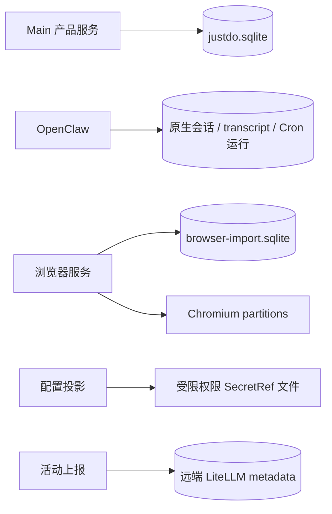
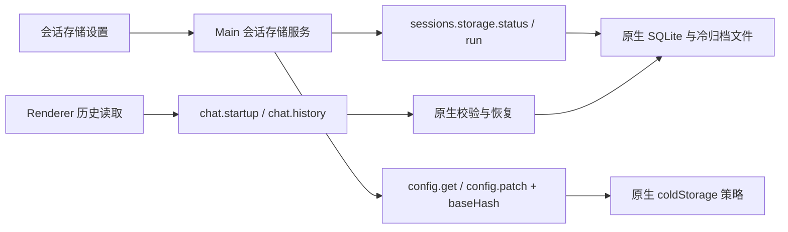

# 数据存储：权威、约束与恢复

桌面可选业务使用独立 Native/Main/Browser 插件包；通用 SDK、可信代码审核、冷包变更和历史清理所有权见 [应用插件宿主](17-app-plugin-host.md)。

本文按 SqliteStore、CoworkStore、CollaborationStore 和 ScheduledTaskResultStore 的当前实现组织。产品数据、原生 transcript、浏览器数据与服务端统计分别拥有独立生命周期，不能用“SQLite 中有数据”概括所有持久状态。

## 1. 存储边界

本地语音扩展模型偏好保存在既有 Main KV 的 `app_config.localSpeechExtensions`：
`sttMode` / `ttsMode` 决定本地或在线路径；`sttModelId` / `ttsModelId` 和 `ttsVoiceId`
保存本地选择，`onlineSttModelRef` / `onlineTtsModelRef` / `onlineTtsVoice` 引用模型页目录。
两种模式保留各自选择，与 `app_config.voice` 的麦克风/朗读模型、音色独立。
不新增表、旧版兼容或迁移；在线失效不能归一化为本地执行。
Main 对稀疏补丁校验固定模型目录及合并后模型的有效音色编号，并在同一配置队列中合并，避免两种模型同时
保存时互相覆盖；原有配置应用失败回滚继续生效。下载文件共用现有模型目录，
Gateway 只接收生成的命令参数或受管在线配置，不建立第二份下载或模型索引。
目录变更在同一队列中清理失效模型和音色引用，保留在线模式。端点和密钥由 Main 从当前
目录解析；工具 STT、工具 TTS 和在线回复朗读分别通过现有受限 SecretRef 文件发布，
引用绑定端点和密钥版本。原生工具偏好与在线朗读偏好使用受支持的独立路径，由原生
拥有文件；产品不直接读取、迁移或重写这些偏好。回复朗读原生配置为
`plugins.entries.runtime-services.config.replySpeech`，独立于工具的 `tts` 配置。

首页 MCP App 文件预览使用 Gateway 创建的原生会话；Main 预留普通产品会话 ID，
通过既有 canonical key 规则建立原生身份。
Main 仅在窗口内存中保留请求标识、工作区签名及原生创建回执；产品 `cowork_sessions`、
消息表和 KV 均不增加预览记录。原生身份与必要元数据仍由 Gateway 保存，Renderer 不读取
或缓存其 transcript。用户发送首页首条消息时，以该预留 ID 一次性插入普通产品会话行，
沿用原生 sessionId、视图及模型上下文，并从预览清理所有权移除，不增加列、表或迁移。
未被采用的预览在切换工作区或窗口销毁后，通过原生删除接口并按创建时的精确
sessionId/lifecycleRevision 清理自有会话；拒绝或未知结果不扩大清理范围。
文件内容与插件文档库的所有权不变，见 [MCP Apps](../features/chat/mcp-apps.md)。

内置浏览器的每会话标签页上限沿用 Main KV 的 `app_config.browserTabLimit`，
默认 20，可设置为 1–50 的整数。旧配置缺失时直接使用默认值，不新增表或迁移；
Main 与 Renderer 共用数值校验。它只控制新建准入，不持久化网页或回收已有标签。

内置后台页面与侧栏按 `browserPartitionForProfile(profile)` 使用同一 Chromium Session。
普通会话和定时任务共享该 profile 的 Cookie、localStorage、IndexedDB、HTTP 认证缓存及
站点 Service Worker；默认、导入和命名 profile 之间仍隔离，也不共享应用外壳或卡片登录。
不复制凭据或创建后台专属存储。页面仍按会话/精确运行管理，sessionStorage 和页面 JS
内存仍按标签隔离，与侧栏同 profile 新标签行为相同，并非所有站点都支持跨标签免登录。

任务清理只撤销自身工具与页面许可并销毁自己的 guest，不清 profile 的站点存储/worker，
不关闭共享连接，不影响侧栏及其他任务。站点 worker 无可证页面归属时沿用 profile 网络
政策；不能因任务结束推断站点派生请求或已发请求已停止，也不自动重试未知写入。

浏览器数据摘要和手动 Cookie／站点数据、缓存清理继续覆盖既有 profile 清单。
清理与后台页面创建共用 Main 准入门；后台 profile 正在创建、使用或等待 guest 销毁时，站点数据及缓存
类别报告既有清理失败，其他所选记录类别可继续。清理门直到所有已发起的 Chromium
清理结束后才释放，不以首个失败代替其他操作已经停止。

独立 `swarm-workflow` 扩展在 Gateway `stateDir/swarm-workflow/flows.sqlite` 保存流程目标、
已校验 DAG、阶段结果、修订号、启动意图和原生运行引用。它是插件调度状态，
不属于产品 SQLite 的消息表，也不复制原生 transcript。执行会话由插件拥有，
流程与主会话的关联是插件元数据，不写入主会话原生 ownership 或伪造 spawnedBy。
未知提交和未知最终投递不自动重试；恢复先核对已有运行。
主会话被删除后身份检查阻止下一次派发，原生工作历史与插件记录不会自动级联清除。
参见 [Swarm Workflow](../features/workflow/swarm-workflow.md)。

节点派发在既有插件 JSON 元数据中记录本次覆盖的补充条数，用于续跑及提交修正时保持同一输入快照，执行中新增的补充留待下一次任务尝试。只保存的补充说明由既有插件记录提供，每轮续跑重新装配系统上下文，不将临时系统提示当作已写入原生历史的证明。继续消息正文保留本次用户原文，原任务与会话历史仍由原生 transcript 提供；不新增表或消息缓存。

侧栏活动与摘要数量通过插件的 `activity` / `summary` 只读接口从既有 `flows`、`batch_items` 聚合，不 hydrate 完整流程或读取批次结果，不新增表或持久缓存。活动分页携带本次 Store 实例的随机代次和已提交变更版本；跨实例或版本不一致的页不拼接为空闲结论，Main 继续核对原生父 key 的精确产品归属。

会话诊断增加 `cowork_run_diagnostic_events` 和 `cowork_run_diagnostic_coverage`。两表通过产品 run 外键级联删除；前者只存闭合值运行元数据，后者保留采集起点和裁剪计数，不存正文或任意错误文本。每轮普通/关键事件分别限 200/32 条，全局 20,000 条、14 天；coverage 随既有 run 生命周期保留，事件裁剪不会抹掉丢失证据。

停止判断使用原生 lifecycle 的 `executionSettled`、`stopReason`、超时阶段及
终态回复类别，并可结合临时历史中的最后回复形状；不再采集自定义循环退出分支。
只有已结算的整轮结束事件用于整轮结果，中途尝试的退出不代表整轮结束。
没有新增表、消息缓存或历史回填。

查询按已校验会话和 run 关联，复制/fork 不复制诊断表。事件 JSON 可包含闭合系统错误码、有效 HTTP 错误状态及有限非负耗时；原生 `command_output` 结束事件投影为 `command` 类型，保存整数退出码和失败状态，不重复增加工具失败计数。终态还可保留闭合的超时阶段、空回复类别和回复 disposition，不保留 terminalReply 正文。旧记录不回填；诊断表不保存错误原文、工具名称、参数或输出。Renderer 无持久诊断缓存，Main 仅保留最多 8 份、5 分钟的诊断快照。按需通过 `chat.history` 读取原生会话数据库，快照可以包含最多 40 条脱敏失败节选及工具名，每条正文最多 1600 字符，以及最后回复的内容种类布尔值和结束原因（用于识别 thinking-only/空响应）；不保存完整历史、不将节选或回复形状写入 SQLite。诊断不是 OpenClaw transcript 的第二份权威。见[会话诊断](../features/chat/session-diagnostics.md)。

工具事件可额外保留闭合 `operation` 操作类别及 `toolValidationFailed` 布尔标记；后者只从上游固定参数校验摘要精确匹配生成，摘要原文不入库。新增可选字段沿用有界事件 JSON，不新增表或迁移。

事件 JSON 另可保存固定公开失败文案的闭合观察 `runtimeFailure: replay_admission_rejected`，
不保存该文案或私有版本/anchor。按需历史快照的失败回执可使用同值 `cause`；它仍是
短期证据，不写入产品诊断表。原生具体抛错点未公开，不通过新增表或历史回填推断。

按需诊断可以只读使用既有运行表的 `root_run_id` / `client_turn_id`，补足实时诊断
事件过期或尚未记录时的原生身份关联。别名必须重新核对其产品会话／运行归属；
复制或 fork 造成跨运行重复时，不将该标识授予新的精确诊断关联。这些别名仅作为
本次采集的私有输入，不回填事件或增加数据库字段。会话绑定或回执在采集期间变化
时撤回归属证据，显式导出不发布旧结果。40 条失败节选采用关联强度及末端故障优先
的有界保留；正文日志仅在本地导出内存与 ZIP 中存在，页面只收到导出数量、来源缺口
和采集时间。详见[会话诊断](../features/chat/session-diagnostics.md)。

产品数据库位于 app.getPath('userData') 下，默认 `<appData>/<productName>/justdo.sqlite`。内部文件名稳定，productName 改变时不自动迁移旧品牌目录。Gateway state 和项目目录不是该数据库的子表，备份和删除时需要分别处理。

原生 SQLite 连接退休时的 WAL checkpoint 不等待其他读取快照：仅在 close 回调内临时将 busy timeout 设为 0，并恢复原策略，避免 TRUNCATE 清理占住写锁、耗尽 Agent 会话写入的准入期限。仍有读取者时保留未完成 checkpoint 的事实与 WAL，不删除文件、不补造执行成功或重放未知请求；原生 close、lease 和后续维护继续拥有清理。普通事务及用户显式 checkpoint 的等待策略不变。关闭前先由原生 `beginClose()` 停止新维护任务，异步 `stop()` 等待已经运行的任务退出，再执行 close；不移除该 join。接线和实际 SQLite 并发复现见[运行时补丁 025](../../scripts/patches/v2026.10.7/README.md)。

较早版本的并发复现保留其历史产物范围；当前10.7的重新执行与未验收项见
[本版验证](../openclaw-upgrades/v2026.10.7/validation.md)，不能只凭接线相同认定已通过。

关闭未完成或出错时不得产生 clean integrity 回执。备份和更新通过原生验证快照取得已提交 WAL 数据，输出单文件副本；删除及更新替换仍需原生 maintenance owner、排他连接与精确代际。外部读者、外部维护 owner、过期代际或损坏快照必须保留源文件并拒绝操作，不能通过重试或把未完成关闭当作 clean 来放行。相关退出、强杀和新进程恢复回归见[生命周期验证](../../tests/openclaw/runtime/sqlite-retirement-lifecycle.native-smoke.mjs)；进程恢复证据不等同于断电或介质故障验证。

MCP 配置变更跨越 `mcp_servers` 与原生配置应用，不能用数据库事务包裹异步 Gateway reload。Main 在全局配置队列内串行执行变更并等待应用，阻止其他配置同步在提交前发现旧原生记录；失败时通过 `McpStore.restoreServer` 原样恢复原 ID、启用状态、配置及时间戳，再补偿同步。新增失败删除本次记录；删除成功后才移除市场安装身份。该恢复流程不新增表或迁移。

账号模板不新增 SQLite 表或 Redux slice。LoginUserInfoStore 使用统一路径解析器，在
`<appData>/<productName>/<directoryName>/<userInfoFileName>` 原子保存 mtoken、账号、工具 Header 值、
可选显示资料和 Cookie 过期时间；默认与 userData 同目录，隔离开发 userData 下则不移动该文件。
目录名与用户信息文件名由 `src/config/loginStorage.ts` 的 `LOGIN_STORAGE_CONFIG` 分别
配置，实际名称以构建配置为准；更改后不自动迁移或回退读取旧文件。
历史迁移及中断恢复均排除 `directoryName` 配置的整个登录目录，保留原位及其中的所有文件。
Cookie 更新合并当前文件而保留长期 mtoken；账号替换先删除旧文件并完成退出刷新，
退出只删除用户信息文件，保留目录及其他文件。SDK 派生 JWT 不回写，继续由原有私有凭据快照与 SecretRef 管理。
账号显示与服务同步状态只在 Main 内存中，重启从文件/SDK 恢复，不持久化原始 SDK 错误或凭据到产品库。

消息唯一持久权威是 OpenClaw 的原生 SQLite transcript。已发布 JSONL 用户先备份并建立全新产品库；旧缓存中的独有历史转换后交由原生导入，目标不建立 cowork_messages。Renderer 按原生历史恢复，不从 Main 或 Redux 寻找持久正文。见[启动与历史升级](../features/app/startup-and-history-upgrade.md)。

旧历史导入只恢复 main；其他执行身份及关联记录仅保留在原备份，不映射到 main，
也不创建长期助手占位。历史 Doctor 显式选择 main，不使用全部 agent 的导入/检查范围。
所有 main 历史子会话在启动迁移输出中按用户选定的规则统一为 `status: done`（有任一原始成功记录）
或 `status: failed`（否则，包含无状态、未知、运行中、中断、停止和超时），不会保留待核实状态。
只有旧索引保有终态、精确 `lastRunId`、合法结束时间且没有当前运行 owner 时，才可恢复该真实运行元数据；
中断、停止和超时的快照按失败匹配。首次导入以公开原生读取器回读验证。
不从最后一条正文推定成功，不恢复活动执行或旧结果投递；已完成迁移库不自动回填旧终态。
同一旧规范键/物理会话/main 父关联的全部别名共用上述规则。只有所选结果对应唯一一致的完整
原生快照时才携带其真实运行 ID/时间；其余只写显示状态，不编造运行身份或结算回执。
该临时处理只在启动迁移模块内，复用现有原生状态展示，不新增 KV、产品表、IPC 或 Renderer 历史字段。
旧工具调用同样在启动迁移的待导入 JSONL 副本中统一关闭：缺结果和空 Yield 使用原生静态缺失结果补件，
保留已有输出及错误，不创建可执行调用或整轮结算证据。主文件、子会话、历史侧副本和压缩快照一并处理；
原备份字节保持不变，后续交由原生 Doctor 导入，不由 Main 改写活动原生数据库。

### 未发布 9.6 数据兼容已撤回

9.6 版本未发布。按用户要求，本次 9.8 升级新增的 9.6→9.8 原生 SQLite 兼容迁移已移除，包括应用维护桥接、启动门禁、专项测试和构建资产。当前应用不承诺自动升级该未发布版本的 shared18／agent23 数据。

原生 transcript 与数据库格式仍由 OpenClaw 管理，应用不读取或复制正文到产品表。该撤回仅指未发布的 SQLite→SQLite 兼容，不包含另行授权的已发布 JSONL 历史导入；后者使用当前原生 Doctor 和公开读取器，不添加原生 SQLite 迁移 SQL 或自动删库重建逻辑。

此前合成旧数据迁移演练仅保留为已撤回方案的历史证据，不属于现行能力或可复跑验收项。下文现有产品数据库初始化规则不在本次删除范围内；运行包仍须从 pristine 重建。

## 2. 初始化与兼容规则

产品设置只从当前 SQLite KV 读取，不再从根目录 `config.json` 导入旧 electron-store 数据。
新建、迁移和重开数据库均不读取该文件；已有 KV 设置保持原样，不增加导入开关或跳过标记。
迁移的必需归档项与可选项占用策略见
[启动与历史升级](../features/app/startup-and-history-upgrade.md)。

Windows 安装阶段不创建用户数据库、运行配置、Python 用户环境或更新缓存。Main 先读取轻量交付信息和启动记录；已有完成记录、OpenClaw 版本相同、版本顺序校验通过且没有未完成升级事务时，直接进入正常启动，打开已有产品 Store、加载必要配置并启动 Gateway，不先执行数据库预检、会话目录扫描、完整运行包哈希或离线会话规范校验。实际数据打开失败仍保留文件并显示错误；当前原生 schema 和会话准入交由 Gateway 处理。

首次采用、迁移、升级及恢复路径继续在打开 Store 前详细分类。迁移升级先得到包含已提交 WAL 的历史备份，再隔离旧环境、建立当前空产品库并恢复历史；正常升级保留全部现有数据，通过锁定原生维护 owner 检查、备份、更新并复验原生数据库，不能借正常启动快捷路径跳过未完成事务。

`startup-state.json` 记录稳定数据代际、事务阶段、目标和已完成的交付身份；缺少交付回执的当前用户进入保留全部数据的正常升级流程，旧展示标记缺失或写入失败不触发首次安装或历史迁移。未知、混合、损坏或不可读格式保留文件并显示原因。常规 Python、配置和 Gateway 可恢复问题继续允许进入设置；数据库维护或历史导入的身份/完整性错误则保留恢复阶段。完整顺序与恢复边界见[启动与历史升级](../features/app/startup-and-history-upgrade.md)。

含旧 `cowork_messages` 的发布版产品库即使同时留有原生 SQLite，也按旧历史迁移。
隔离前逐字节保存并校验旧 SQLite 文件族、共享库与历史归档，原件长期留在选择性备份；
不打开旧原生库、不将其恢复进新环境，也不新增旧 SQLite schema 兼容桥。
自动恢复仍限于 JSONL 与旧消息缓存，SQLite 独有记录仅保全原件。当前产品库中的活动
JSONL/SQLite 混合仍拒绝自动替换。

迁移中已完成的归档保留在 `backups/<transactionId>/retired/`，完成后暂不删除。
`openclaw/`、`outbound-header-proxy/`、`developer/` 及 `justdo.sqlite*` 必须归档成功；其余非控制项
尝试移动，遇到指定占用或权限错误时保留原位继续，新建与恢复事务使用同一规则。
`logs/` 及根目录的 `install-timing.log`、`install-resource.log` 明确排除，始终留在原位。
非必需项被重新生成而与旧归档重名时，另存 `retired-additions/` 或在占用时保留两处；
必需项的重名冲突仍拒绝覆盖。完整错误边界由[启动与历史升级](../features/app/startup-and-history-upgrade.md)定义。

仅应用版本升高或构建指纹变化，不单独触发正常升级。满足上述快捷路径条件时，
正常启动完成后仅更新 `lastOpenedIdentity`，供后续版本顺序与降级判断使用；
不把普通打开记录写成新的原生维护或规范校验完成证明，既有 `completedIdentity` 保留。
未完成事务按版本方向接续同版本修复或向前升级，不以构建指纹不同作为兼容拦截。
保留原事务、备份和恢复阶段；已有目标数据时，当前原生 owner 先只读检查，需要维护时持久记录
新目标和 `schemaPreparationPending` 后执行自带复验的维护；无需维护时直接记录新目标，不重复扫描。
未知结果保留标记，同目标重启也复验；早期检查
不代替初始化、历史恢复完成后的最终准备。Complete 残留目标身份的记录转为正常升级继续确认。
构建身份仍校验本次产物和子进程回执；降级及实际不支持的数据结构仍按所属规则处理，
细节见[启动与历史升级](../features/app/startup-and-history-upgrade.md)。

schema 就绪和原生会话规范校验是两项独立事实。首次采用、迁移、升级及恢复路径在
配置投影、历史恢复完成后，由受信 Node 子进程在 Gateway 启动前调用原生 canonical
certifier，避免校验的提交授权与同步插件加载争用 Gateway 事件循环。原生持久回执
绑定实际数据库文件代际；应用不解析、复制或伪造它，也不据此代替物理完整性校验。
正常启动不运行这项离线准备，不能把 `verifyNativeReady` 的快捷返回理解为已执行校验。

离线准备全程持有原生 Doctor 排他锁。需要规范校验时先在原生维护租约下确认完整原生
备份组，正常释放维护租约后由校验 Worker 获取自己的原生运行租约；维护租约不能跨线程
冒充 Worker 授权。全部 Worker 退休后重新取得维护租约，核对配置、文件身份、完整
清单、schema 和无待校验工作，再关闭子进程。失败和未知退出不提交完成身份；首次
安装可保留设置入口，但未获准入时任何入口都不能启动 Gateway。
原生备份按目标版本及整组文件身份确定，可复用首次原始快照；不覆盖已有备份，不承诺
每次准备都另存最新快照，备份组损坏即停止，也不自动回滚覆盖随后新增的数据。

跨版本升级由目标版本集中声明支持的来源 schema，并调用该目标的原生 owner，
不按相邻版本拼接应用 SQL。应用/runtime 任一版本降低时先暂停，提示用户并提供
“仍然启动”；确认只恢复本进程当前目标的正常检查，不产生永久兼容授权或就绪回执。
继续后实际数据仍须符合目标支持范围；不兼容或加载失败正常报错，保留文件。
版本无法可靠比较时保留数据并说明原因，不按降级确认自动放行。

左侧功能栏的固定偏好保存在 `kv.app_config.sidebarPinnedItems`，为可选功能 ID 的有序数组，缺省为空。Renderer 读取时过滤非法及重复项；固定和取消固定通过既有配置补丁 IPC 串行保存，保存失败保留已确认的偏好。扩展暂时关闭只隐藏对应入口，不删除其固定偏好。该设置不增加数据表，不修改原生插件配置或会话存储。

正式 Renderer 的 HTTP 静态宿主每次启动使用随机端口，不能把持久偏好绑定该 origin。
`kv['app.renderer-preferences.v1']` 通过既有 store preload 保存具名主题、宠物浮动位置、
定时任务结果过滤、聊天列表宽度（`shell.session-list-width`），以及尚未提交的 Goal 完成反馈状态。启动先恢复这份快照，再导入 App
和 Redux slice，确保初始过滤值和主题读取正确。只接受四个固定键与 Goal 草稿命名空间，
最多 128 项、单值 64 KiB、总值 512 KiB；超额先淘汰最旧 Goal 草稿，固定偏好保留。
窗口首屏的只读外观快照由 Main 从既有 `app_config.theme` 和这里的 `justdo-theme-id` 提取，
通过受限同步 preload 读取提供，每次新文档及 reload 都取最新值；不另存主题副本、不依赖随机
HTTP origin、不在首次临时窗口提前打开数据库。
正式主界面只水合 Main KV 中的当前偏好，不再从旧 file 页面、当前 HTTP 或开发 origin 的
localStorage 搬迁数据；Main 尚无记录时使用当前默认值。初始 Main 读取失败时，后续保存
先恢复已知基线，再合并明确变化及删除，禁止用空快照覆盖未读数据。
偏好白名单不保存 transcript、失败节选或凭据；不新增表或数据库/原生 schema 迁移。
独立浏览器 demo 没有 privileged store 时继续使用本 origin 的浏览器偏好。

Agent 运行设置复用 `cowork_config` 中的 `agentRuntimeSettings:v1` JSON 记录，
外部 Agent 设置复用 `externalAgentSettings:v1`。已有对象必须通过完整当前字段及数值范围校验，
不再为早期 v1 记录逐字段补默认值，也不把退役的 MCP Apps `null` 偏好转换为布尔值。
完全无记录时创建当前默认对象；损坏 JSON 或整对象校验失败时整体恢复默认，不混合保留
旧字段与新默认。写入及 IPC 仍校验完整对象，界面局部编辑先合并完整草稿再提交。
外部 Agent 目录变化继续按当前 build catalog 补充新增 Agent 的安全默认并丢弃已移除的 ID，
不因此放宽顶层执行及 bridge 偏好的必填校验。

Code Mode 为运行设置中的 `codeMode: { mode: "off" | "auto" | "on" }`；
当前完整记录中的显式 `auto` 值保留，界面暂不允许新选自动模式。
保存、配置同步和失败回滚沿用现有运行设置 IPC；
产品不新增数据表，也不持久化 JavaScript VM、工具中间结果或等待快照。
Code Mode 的显式 `store/load` JSON 值由原生会话 transcript 的
`openclaw.code-mode-store` custom entries 保存和恢复；完成的 cell 才提交，失败或
取消的未完成 cell 丢弃缓冲。Main/Redux 不复制这些值。覆盖/删除仅改变当前投影，
旧值仍可能存在原生历史和导出中；与产品偏好、普通 VM 变量及当轮 `results.save`
引用的生命周期分别管理。原生行为与隔离验证入口见[引擎](05-agent-engine.md)。

SqliteStore.create 打开当前目标库、设置 PRAGMA，使用完整当前 `CREATE TABLE IF NOT EXISTS`
和索引定义初始化产品表，并调用领域 schema 初始化器。原生会话绑定、执行身份、助手删除
元数据和各类回执所需的列均在首次建表时声明。初始化只确保默认 main 助手存在，不从旧
`cowork_config.systemPrompt` 继承角色内容，不转换退役的 `container` / `auto` 执行模式，
也不扫描或改写 `app_config` 中的旧凭据。发现仍有旧消息缓存时拒绝打开，不在此删除唯一
历史；启动升级模块先处理旧代际。

| PRAGMA             | 值     | 影响                    |
| ------------------ | ------ | ----------------------- |
| foreign_keys       | ON     | 删除/引用约束生效       |
| journal_mode       | WAL    | 数据可能仍在 WAL 中     |
| synchronous        | NORMAL | 性能与掉电耐久性的折中  |
| cache_size         | -8000  | 以 KiB 表示页面缓存目标 |
| wal_autocheckpoint | 1000   | 自动 checkpoint 阈值    |

当前完整产品库可正常重开，既有数据、外键、索引和触发器保持原有行为。
不再通过 `ensureColumn`、缺列探测或 `ALTER TABLE` 支持旧中间 schema 的原地升级，
也不因缺列删除数据库、WAL/SHM 或已有表。未知结构由启动判定拒绝并保留；
历史升级直接建立当前新表并插入选定元数据，不修改旧产品库。
历史导入保留会话置顶布尔值，以及自定义分组名称和已准入会话的成员关系；空组及同名不同组仍保留。
旧分组 ID 仅作关联键，颜色与排序使用新库默认值，分组创建时间使用本次恢复时间。
旧字段/分组表缺失时采用未置顶、未分组默认值，悬空分组引用不创建虚构组。
历史标题、置顶、分组及映射的导入事务临时使用 `synchronous=FULL`，先插组再插会话，提交并确认完整 checkpoint 后才允许阶段记录落盘，
零会话也必须确认前序 schema 和默认值已落盘，
然后恢复原 PRAGMA。检查阶段恢复只读取不可变绑定，不重写已确认的用户元数据，也不重建用户已删除的组。
`history_session_bindings.defaults_applied` 记录历史会话是否已采用当前新会话默认配置。
该列在当前表中默认置 1；新导入行显式置 0，首次打开/运行准备时在同一产品事务内采用
当前默认权限、清空旧模型覆盖并置 1，此后保留用户主动选择。工作目录为空或不存在
不阻断迁移，结果页统计并在会话内提供选择目录入口。

当前 Plan handoff 表在首次创建时直接声明同会话 reset 所需约束；初始化不再删除旧双会话
Plan 的 segments 表，也不探测并销毁旧 handoff 表。旧环境由启动迁移归档保全。
产品数据库迁移与 OpenClaw 运行时补丁升级是两回事，后者必须从 pristine 包重建。

## 3. 核心产品表全表清单

产品表由 SqliteStore、会话诊断初始化器及 Agent Team 的协作/验收/群聊/待发初始化器共同建立。下表列出现行产品表；插件扩展复用 Main 提供的连接，schema 实现在各自 owning domain，不从旧版固定表数推断完整性。独立 Swarm 流程库、浏览器数据库和原生 transcript 不属于此表。

| 表                                   | 责任与关键身份                                           |
| ------------------------------------ | -------------------------------------------------------- |
| `kv`                                 | JSON 设置与内部元数据，key 主键                          |
| `cowork_sessions`                    | 产品会话索引，id 主键                                    |
| `history_session_bindings`           | 历史产品会话、原生身份、原始外部映射及恢复事务；不存正文 |
| `cowork_session_runs`                | clientTurnId 唯一，映射原生 rootRunId                    |
| `cowork_external_sessions`           | source + externalSessionKey 唯一映射                     |
| `cowork_external_session_tombstones` | 外部会话删除防复活                                       |
| `cowork_plan_handoffs`               | planId、文件身份、实施接收状态                           |
| `cowork_config`                      | Cowork 设置和产品执行快照                                |
| `agents`                             | 助手档案、启用/默认状态及 deleted_at                     |
| `mcp_servers`                        | 用户 MCP 配置，name 唯一                                 |
| `openclaw_hooks`                     | Hook 开关及配置                                          |
| `session_groups`                     | 分组名称、颜色和排序                                     |
| `scheduled_task_run_receipts`        | 原生 run 对应的结果索引与 readAt                         |
| `scheduled_task_result_cleanup`      | 原生结果 artifact 清理进度                               |
| `scheduled_task_result_tombstones`   | 删除完成的 run 防同步复活                                |
| `collaboration_rooms`                | 唯一 anchorSessionId                                     |
| `collaboration_members`              | room 内唯一 agent；session/key 全局唯一                  |
| `collaboration_rounds`               | 用户轮次及 stopped_at                                    |
| `collaboration_deliveries`           | 路由、摘要哈希、原生接收和状态                           |
| `collaboration_execution_receipts`   | 精确 sessionKey/runId 的 whole-run 终态                  |
| `collaboration_reviews`              | 原生验收执行、封闭结论及对应批次                         |
| `collaboration_review_deliveries`    | 验收报告到具体工作回执的关联                             |
| `collaboration_deletions`            | 删除冻结记录                                             |
| `collaboration_deleted_members`      | 已确认原生删除的成员                                     |
| `cowork_run_diagnostic_coverage`     | 诊断采集起点、覆盖及裁剪计数                             |
| `cowork_run_diagnostic_events`       | 有界、闭合值的运行诊断元数据                             |
| `team_discussion_rooms`              | 固定成员、来源身份及房间状态                             |
| `team_discussion_runs`               | 请求指纹、批次身份与汇总抑制                             |
| `team_discussion_executions`         | 成员精确原生执行、结算和清理证据                         |
| `team_discussion_summaries`          | 来源汇总的 outbox 与执行回执                             |
| `team_discussion_task_links`         | 获准读取群历史的关联产品任务                             |
| `team_discussion_deleted_rooms`      | 已删除房间的持久墓碑                                     |
| `team_discussion_queue_control`      | 每群待发控制 generation                                  |
| `team_discussion_pending_inputs`     | holding 引用、请求指纹与 FIFO 状态                       |

## 4. 会话与运行回执

通用 CLI、ACP 与 Codex app-server 入站会话共用 `cowork_external_sessions`，新建一律
使用 `source='cli'`。历史 `source='multica'` 仅保留已有映射、墓碑与原生身份，不转换
命名空间、不按裸 UUID 猜测旧 scope，也不再提供专用客户端后端。同一个产品会话
仍只有一个外部映射，新旧来源
都以只读会话投影到桌面，外部客户端只能提交不透明的产品外部 UUID，不能借此传入
任意原生 session key。创建、恢复与运行分别核对任务目录、产品助手和存活的产品行；
删除触发器为各来源写入原有 tombstone，恢复不会重新创建已删会话。

CLI 执行在同一映射行增加可空的 `execution_run_id`、`native_session_id`、
`lifecycle_revision` 和 `execution_state`。旧库通过增列保持原映射及数据；没有正文、
工具结果或原生 transcript 副本。开始发送前先保存 run 意图，原生准备后保存精确
session key、SID 和 incarnation，再安装会话工具／审批归属。执行状态按
`preparing → running → settled` 推进；传输中断或无法归属的原生 continuation
保留为 `unknown`，映射的显示状态仍为 running，继续占用会话。应用重启不把外部会话的
running／unknown 推断为已取消，也不会自动重发；再次执行明确拒绝并保留诊断身份。
已安装 ACP 会话工具或审批 owner 时，Gateway 连接替换也进入 unknown，不自动转移
原连接的资源所有权；保留取消信号，后续 EOF／关闭仍可请求停止精确 run，停止 ACK
本身不会清除 unknown 或释放持久执行占用。
缺失原生 authority 或精确回执的核对窗口为 30 秒，单次读调用也受同一窗口限制；
超窗返回 unknown，而不推断失败或取消。精确 pending／running 回执或同 SID／revision
的 `activeRunIds` 仍包含当前 run 时刷新窗口，不为正常长任务设置总时限。调用方取消只
撤销无界 `agent` RPC 等待并请求停止精确 run，随后仍须核对原生结算证据。

正常结算只接受精确原生 whole-run lifecycle（`executionSettled:true`）或精确
`agent.wait` 终态回执，并重新核对原生 SID／lifecycle revision。chat final、idle、
Stop ACK、新的 owner 和最新历史消息都不能替代结算证据。当前公共 API 不能证明
yield 后唤醒运行的前驱关系时，保留 unknown，而不从 run-ID 后缀推测归属。

扩展托管 MCP 的独立开关与连接参数覆盖只保存在原生 `openclaw.json` 的 `mcp.servers`，不写入 `mcp_servers`、`kv` 或另一份产品设置。原生扩展名称归属用于发现排除与配置同步保留；界面中的脱敏编辑草稿只存在当前窗口内存中，不增加产品表或迁移。

cowork_sessions 保存 title、status、pinned、cwd、execution_mode、permission_mode、active_skill_ids、agent_id、model_ref、group_id 及时间。status 是产品快照，不能替代原生 runtime 查询。列表索引服务 pinned/updated_at 排序和 Agent 范围查询。

`updated_at` 表示最近对话活动时间。Main 在广播运行时活动事件前将时间单调写入会话索引，
确保继续历史会话后刷新列表或重启仍保留新时间。重命名、状态、模型、权限与分组等元数据
修改不刷新该时间；活动时间不参与原生身份、执行准入或终态判断，也不需要读取或保存正文。
原生 `sessions.changed(reason: send)` 表示输入已进入原生保管；即使待发输入尚未启动执行，
Main 也按事件时间更新活动。该投影先通过 `sessions.describe` 核对同一原生会话，异步返回时
再次检查连接世代、产品绑定及重置/删除边界；失败或过期的核验不更新时间，不创建运行回执。

可空 `source` 列记录创建入口，当前显式值为 `browser-extension`。Chrome 扩展新建会话时随会话插入，
完整会话和摘要读回此值，Renderer 据此生成专用来源分组；不在 `session_groups` 创建记录。
此列由当前完整表定义声明；未显式记录来源的会话保持 NULL 和原列表归属，不读取原生正文来推断来源。
继续会话、重命名、置顶和用户分组变更均不修改创建入口。

原生可见 worktree 子会话被发现后，产品在 `cowork_sessions` 中增加一条导航记录。`native_session_key` 唯一绑定原生会话，`native_parent_session_id` 保留产品父会话关系；`cwd` 是原生实际执行目录。两列和原生 key 唯一索引由当前完整 schema 声明。发现和绑定在一个 SQLite 事务中完成，重启后按原生 key 去重。产品不复制 transcript 或 worktree 快照；OpenClaw 仍是会话内容与检出目录的权威。父会话存在产品侧原生子会话时，不允许先删除父会话。

用户勾选 Worktree 创建的主会话复用上述原生绑定，`native_parent_session_id` 为 NULL，`cwd` 在 Gateway 确认检出目录后更新。显示偏好 `showWorktreeCheckbox` 存在 `cowork_config` 中，缺省为 false；它控制入口可见性，不自动开启新任务的 worktree。

会话摘要包含可选 `nativeSessionKey`，供搜索使用原生 key 并限制尚未支持的复制操作；摘要仍不包含工作目录。涉及检出移除或删除所属会话的保护规则必须通过完整会话读取实际 `cwd`。原生 key 可从 SQLite 反查产品会话身份，不依赖运行时内存映射。

存储目录与文件系统加速属于 OpenClaw 全局配置，保存在原生 `openclaw.json` 的 `worktreeRoot` / `worktreeAcceleration`，不复制进 SQLite。设置保存使用 Gateway 配置版本进行并发校验；JustDo 配置同步保留其值。恢复默认目录会移除 `worktreeRoot` 覆盖，已有 worktree 记录及快照路径不迁移。

forked_from_* 保存原生分支来源，源会话删除时引用置空并保留标题快照。handoff_from_* 和 handoff_request_id 保留旧手动交接来源及幂等约束，当前 UI/IPC 已不提供该创建入口。

运行表保存 started_at、accepted_at、ended_at 与 state，区分用户提交、原生接收和结束。client_turn_id 全局唯一；每个 session 通过 ended_at IS NULL 的部分唯一索引限制一个未结束回执。终态和计时必须幂等结算，不能重启后重新开始计算同一已结束 run。

复制和分支都只继承目标原生历史中确实存在的已结束计时回执。Main 对新目标使用
有界 `chat.history` 分页，只提取 run 身份，不保存正文；每页核对物理 sessionId，
最后以首个 deltaCursor 确认历史未改变。扫描最多 40 页，读取失败、身份/游标变化
或超限时省略可选计时，不按时间或随机回执 ID 猜切点，也不复制 off-path 回执。
诊断事件、Goal 续跑状态和 Plan handoff 不随计时复制。

复制/分支在发送创建请求前，先将 `sessionBranchPending:<sessionId>` 标记写入现有
`cowork_config`，完整准备成功后清理。标记按存在性关闭准入，不解析内容授予权限；
详情与列表均投影 `branchCreationPending`。创建结果不明或后续准备失败时保留同一
目标，标为 error 供检查/删除；重启、状态刷新、模型/Plan 更改及普通 prepare 均不能
把它恢复为空会话。仅创建 handler 使用 Main 内部 typed 选项完成其原请求的准备。
只有收到成功或明确拒绝响应、并确认原生 `session:null` 才撤销本地记录；未知请求的
暂时不存在不足以排除迟到提交。产品删除与隔离标记清理在同一 SQLite 事务中完成。

发送 ACK 丢失后，只有精确原生运行的 `agent.wait` 接纳／终态证据才能补写 root_run_id 和接纳核实时间，再结算该回执；恢复分支与正常 ACK 共用绑定方法。产品 idle、Stop ACK 或既有产品终态不能补写接纳证据。此核实时间可能晚于原生结束，不用于推断实际开始延迟。

外部 session 另存来源、原生 key、首次绑定的 agent/cwd 和运行状态。删除产品会话的 trigger 写外部 tombstone；外部客户端再次同步不能复活用户已删记录。

## 5. Plan 与 Goal

Plan handoff 保存创建时 workspace root、相对路径、SHA-256、字节长度、原生身份与阶段时间。状态为 presented → dispatching → admitted → resolved，失败用 failed；每 session 只允许一个 presented/dispatching/admitted handoff。

计划文件发布、SQLite 写入和 Gateway 准入跨三个系统。批准前与实施注入前复核文件身份，不能根据后改 cwd 重定位文件；原生接收后记录 admitted，避免恢复时把已发送实施当成未发送。

Goal 内容、预算、六种状态和已接纳的自动续跑累计次数由原生 session 持有。原生私有 `goalContinuationTerminal` 只记录精确整轮结算证据，`goalContinuationAccepted` 只保留最后接纳回执；后者与 `goal.continuationTurns` 在同一事务提交，不保存提示或消息正文。`sessions.describe` 显式投影这些事实，缺失证据不推断结算；当前原生回交阻塞由最终准入返回结构化拒绝原因。`cowork_config` 的 `goalExecution:<sessionId>` 只保存 Main 阶段及原生次数投影等产品快照。读取校验 sessionId 和 phase，坏值不能触发自动运行；不从产品快照恢复一套计数或交接权威。usage_limited/budget_limited 保留原生语义，不归一化为 blocked。

## 6. 配置与凭据不等于全库加密

kv.app_config 是应用配置来源。当前 appConfigCredentials 是纯配置规范化：读写时清空
builtin provider 的 apiKey，以及选中 builtin 时或与 builtin key 相同的 API 快照 key，
防止内置凭据进入产品设置；其他用户自有凭据保持原值。它不识别旧内置占位符，
不解密早期 OS 密文，也不依赖 safeStorage。开库不再扫描、转换或截断 WAL 来清理旧凭据；
旧环境按启动迁移的归档和恢复范围处理。

因此不能宣称数据库已全库加密，也不能宣称所有自定义 key 都使用 safeStorage。内置模型的新访问凭据不保存在 SQLite，而是短期 JWT 的受限派生快照，原生使用 exec SecretRef；X-User-Account 不再投影到内置 provider 配置或 SecretRef 解析输出，Gateway 请求继续通过既有出站代理取得该身份头。私有快照仍保留已验证账号和到期时间。自定义 provider secret file 由产品配置派生，采用文件权限保护。详情见[认证](../features/integrations/authentication-builtin-model-lifecycle.md)和[安全模型](11-security-model.md)。

内置模型换证的 deviceId 由 Main 公共网卡模块按调用时状态读取，使用去冒号的大写 MAC，不进入产品 SQLite，也不保存或读取 model-device.json。登录接入复用同一模块；没有可用 MAC 时明确失败，不生成 UUID 或其他替代标识。MAC 不是凭据或设备持有证明。

其他持久键包括更新偏好、结果 baseline/catch-up、市场安装身份与助手创建摘要。key prefix 是长期数据接口；改名要有明确迁移，不能让新旧模块各写一套。

## 7. 助手与协作

agents 的 model 为空表示继承；main 不以遗留档案 model 作为用户会话默认。角色文件归原生 agents.files，旧 system_prompt/identity 列不作为另一套编辑 backing store。

删除助手原子设置 deleted_at 并清除 enabled，保留名称及关联键。设置页隐藏、后续变更拒绝，历史图仍能显示身份。原生 agents.delete 会清索引，因此不用于这个保留历史的删除流程。同名重建使用新 ID。

模型创建的 `assistantCreation:<agentId>` KV 只保存参数摘要与 preparing/ready 阶段；准备档案先停用，原生配置和角色文件读回后启用。中断不自动派发任务。

协作 delivery 唯一键为 room、发送人、sourceRunId、toolCallId，input_digest 检查重试参数冲突；表中没有正文。round 的 stopped_at 持久冻结旧轮次，预算包括失败尝试。重启恢复将 queued 转 failed、dispatching 转 unknown，不从元数据重造载荷。

## 8. 删除补偿与结果收件箱

协作整任务删除先写 freeze，停止全部成员，确认原生状态，再逐个删除原生 session 并保存进度，最后事务删除产品会话。外键级联不能代替前面的原生清理。

结果收件箱以 run_id 为主键，保存摘要、状态、原生 session、投递结果和 read_at。按 started_at/run_id 分页，按 task_id 查询，未读有部分索引。upsert 保留 read_at；baseline 与追赶水位不放在 Renderer 内存中充当持久事实。

删除结果先抑制并发同步写回，清理原生 artifact，再移除 receipt 并写 tombstone。清理表记录已处理路径；失败保留可重试条目。两种删除都不是一个跨网络 SQLite transaction。

## 9. 浏览器与服务端数据

browser-import.sqlite 独立保存导入历史、safeStorage 加密密码、下载记录和命名 profile；浏览器 Cookie/storage/cache 在 Chromium partition。Renderer 不获取密码密文或下载真实路径，打开文件按记录 ID 经 Main 验证。

`imported_history.url` 同时记录 HTTP(S) 网页与浏览器实际访问的原生 `file://` 地址，保留文件名转义及非敏感 query/hash；本地记录同样支持检索、访问计数与删除。历史地址准入与网络图标地址准入分开，允许本地访问记录不授予 Main 任意本地图片读取。列表过滤旧预览服务的精确临时 token URL 形态，不删除底层旧行、不猜测 token 对应的原文件路径，也不排除普通 localhost 开发站点。表结构保持不变，重新访问本地文件后产生实际文件地址的记录。

`imported_history.favicon_url` 保存内置浏览器声明的 HTTP(S) 图标 URL，沿用历史 URL 的凭据移除与敏感参数脱敏；`favicon_data_url` 保存对应浏览器 session 已加载成功的受限图片，供最近访问直接复用。旧数据库只读查询可返回无图标或图片的记录，首次写入时补列并保留历史。图标和图片可在页面加载结束前或后到达，Main 单独更新，不增加访问次数或改动访问时间；缺失图标的再次访问保留已有图标和图片。历史列表不批量携带图片正文；按已有页面 URL 的专用 IPC 单独读取，缺图记录在默认浏览器 partition 按浏览器网络设置补取声明图标及网站 favicon，并保存结果。接口不接受任意图标 URL，不为不存在或读取中已删除的历史记录创建条目。清理历史时图片随记录删除；清理缓存按访问时间清空图片列，保留访问记录和图标来源地址。无独立图标索引或缓存表。

历史删除或图标缓存清理同时取消清理前开始的图片读取，并使已取得但尚未写回的图片失效，避免清理后被旧回调恢复。旧历史补取完成时比较来源和图片快照，保留并优先返回 native 浏览期间更新的图片，不覆盖新来源。

按时间清理历史记录与清空 Chromium 存储的能力不同，后者可能全量清除，UI 必须说明。删除下载记录不等于删除磁盘文件。

LiteLLM 活动记录是服务端 EndUser metadata，不属于本地产品表。客户端开关控制上报，JWT 负责身份校验；未收到活动不能证明用户没启动。服务端部署与字段保留见[认证专题](../features/integrations/authentication-builtin-model-lifecycle.md)。

## 10. 备份、修复与变更验收

### 会话冷归档

设置 → 统计与存储 → 会话存储直接查询 OpenClaw `sessions.storage.status`，按 Agent 展示数据库、WAL、外部冷归档字节数与冷热 transcript 数量。合计只累加 `databaseBytes + walBytes + archiveBytes`；`embeddedArchiveBytes` 已包含在数据库大小内，不再累加。该统计不涵盖浏览器缓存、项目、附件文件，也不等于产品会话列表数量。

`session.maintenance.coldStorage.enabled / afterDays` 由原生配置持久化，缺省展示关闭、30 天。归档设置单独保存，不写入产品运行时设置或新增 SQLite 表；普通启动、模型配置和最小配置同步保留已有 `coldStorage` 与非产品拥有的 maintenance 字段。保存携带用户读取到的配置 hash，冲突或响应不确定时重新读取，不自动重放写入。`config.get` 必须返回有效快照，且 `configRevisionHash` 与 `appliedConfigHash` 一致，才把策略视为已生效；诊断快照、损坏字段和缺少生效版本不降级为默认策略。维护状态逐字段投影，原生错误仅转换为错误码，不向 Renderer 透传内部诊断或数据库路径。

`sessions.storage.run({})` 是所有配置存储范围的一轮后台维护，不支持单会话、单助手参数，且要求原生归档开关已启用。结果返回不等于归档完成，页面按维护状态展示本轮数量和错误。关闭页面只释放轮询，不取消原生任务；维护记录仅反映当前 Gateway 生命周期。

压缩、索引、活跃任务保护和恢复全部由 OpenClaw 管理。应用不直接改写原生数据库，也不更改 `cowork_sessions`、分组或助手历史归属。冷归档不是隐藏、删除或永久保留；既有 `pruneAfter: 365d`、`maxEntries: 500` 清理策略仍有效，本功能不修改它们。原生全文搜索会报告其可见冷历史范围，但不保证搜索归档正文，也不为搜索主动恢复全部历史。

聊天导出仍是当前已加载快照，不能充当全会话备份；历史读取失败或未完成时禁止导出。仅复制 `justdo.sqlite` 无法恢复原生历史，完整备份还需包含原生数据库和关联冷归档文件，并按需求包含角色文件、项目及附件。在线备份应使用原生快照或正确的 SQLite 备份流程，不能遗漏 WAL。归档文件引用存在不代表附件实体已被备份。

技能提炼提案及其草稿、支持文件、状态和 revisionHash 全部由 OpenClaw Workshop 持久化。
应用不新增提案表或历史正文缓存，也不另建学习会话。用户在当前聊天发起原生 `/learn`，
执行内容仍由该原生会话拥有；提案弹窗仅持有 main 的页面级快照，重启或重进页面通过
skills.proposals.* 恢复。审核写入绑定 proposalId 与 expectedRevisionHash，不改变全局学习策略。

正常备份先退出应用再复制产品数据；在线备份使用 SQLite backup/checkpoint 机制，不能只复制主文件忽略 WAL。原生 transcript、角色文件、模型派生凭据和项目文件要按需求另行纳入，不能把整套数据默认作为 issue 附件。

修改产品 schema 时验证新库一次完整建成、当前完整库重开后数据与约束保留、旧消息缓存
拒开库时原件不变，以及坏 JSON、部分操作中断和重试。旧中间 schema 的原地补列不再是
验收目标；已发布历史的备份与导入继续按独立启动迁移契约验证。同步事务内不等待网络；
写入前确定唯一键与查询索引，状态迁移使用 expected-state 约束。重点测试位于 sqliteStore、
coworkStore、collaborationStore 与 scheduledTaskResultStore 旁。

## 群组讨论元数据

新增 team_discussion_rooms（固定成员映射、cwd、只读/权限、revision、generation、状态及来源任务）、team_discussion_runs（requestId / fingerprint / active slot / 状态）、team_discussion_executions（discussionId、成员、精确 sessionKey / sessionId / lifecycleRevision / runId / outcome）、team_discussion_task_links 和 team_discussion_deleted_rooms。只有房间元数据，不存正文。部分删除记录在成员元数据，compare-and-delete 成功后逐一标记；删除墓碑阻止复用旧 roomId。原生扩展 stateDir 的 discussion-receipts 保存无正文 admission / close receipt；消息与公开 channel-final mirror 均属于 OpenClaw native transcript。

详见 [Agent Team 现行契约](../features/assistants/agent-team.md)。

team_discussion_runs 的可空 initiator_agent_id 标识主助手通过工具发起的消息；正文仍从原生 transcript 读取。该列由当前完整建表定义声明，不再通过缺列检测补充旧表；用户请求指纹继续按当前幂等规则核对。详见[主会话组织团队](../features/assistants/agent-team.md)。

`cowork_config.allowMainAgentSwitch` stores the opt-in conversation assistant selector as `true`/`false`; a missing key is false. Disabling resets new conversation selection to main and does not change existing `cowork_sessions.agent_id` or native transcripts. No schema migration is needed for this key.

Swarm 节点派发前将实际发送的任务信封（message、createdAt）与运行意图一起保存到独立插件流程库，列表投影不携带信封，详情按会话归属及依赖边验证后按需读取。它是工作流执行输入，不是原生消息历史的镜像。节点详情复用 ChatMessageDisplay，通过独立 ChatController 直接读取 Gateway 原生历史与实时事件，不增加 Main 或 Redux transcript 缓存。连线只展示已保存的输入；缺失历史输入不重新生成。

### Swarm 节点提交记录

流程可选 `operations` 保存最多 512 个主会话控制操作的身份/动作，与状态在同一
revision 写入中提交，用于回复丢失及重启后重放去重；身份由原生
sessionKey/runId/toolCallId 与规范化动作派生，不保存主聊天消息。同一原生调用
重放返回已有回执；新的 toolCallId 为新请求，必须携带新的有效 revision。
节点补充沿用 `interventions` 去重。可选 `notices` 保存
最多 64 个阻塞指纹及 sending/sent/unconfirmed 投递状态，不存通知正文。发送前
保存意图，异步 ACK 在最新流程上合并；原生 `chat.inject` 没有持久幂等参数，
已保存意图不盲目重发。通知覆盖流程已 blocked、节点仍为 running 且带错误的
超时等待，以及父策略变化造成的执行拒绝。最终交付失败或未确认后停止流程保留结果与投递意图，
不重发结果。旧 payload 缺省为空，无新增表或历史数据迁移。

节点可选 `interventions` 保存显式用户输入（操作 ID、动作、文字、时间），每节点最多 30 条、每条最多 4000 字符。它们是工作流输入而非聊天历史副本；只通过归属验证后的详情读取，不进入图列表、Main 或 Redux 缓存。人工继续保留 sessionKey，新建 run ID 并归档旧执行身份/提交，重新执行使用新 sessionKey；两者共享三次执行上限。操作 ID 持久保留用于重发去重；节点的可选 `continuation` 标记与待派发状态一起保存，进程重启不会丢失已接受的继续意图。旧 payload 不需改写，不新增产品数据库表。

独立 `swarm-workflow` 插件的 `flows.sqlite` 保存有界阶段 JSON。节点包含本次提交记录（runId、总结、证据、验收结论、时间）及最多三次执行的身份/失败元数据。它们用于派发、验收和显式重试，不复制原生工具/Thinking/Content 聊天历史；原生会话键负责查看每次执行记录。不新增产品数据库表，不迁移或重写已保存节点；新节点依赖工具提交，旧节点按已派发的协议收敛。

批量执行在同一插件库中增加 `batch_items`、`execution_runs`、`execution_leases`、`scheduler_state`、`interventions`。输入清单、每次尝试和产物索引仍是业务元数据；输入快照与各尝试目录统一位于父项目 `.agent-tasks/swarm-workflow/<flow>/<batch>/`，不进入聊天存储。浏览器默认产物使用同一根目录下的 `browser-artifacts/`；最近工作目录识别将该根目录内的路径归回所属项目。重试仍使用同一批次目录，不提供旧 Swarm 目录的兼容或迁移。阶段快照不内联执行项或产物全文；调度读取有界活动工作集，项目列表每页 50 项，汇总索引每页最多 20 项且最多 32 KiB。stage/batch item/预约更新与流程 revision CAS 同事务；runId 全局精确唯一，历史 sessionKey 不做全表 UNIQUE，操作身份在全部项之间去重。重启先重建预约并核对原生执行，不因缓存消失释放未知槽位。

节点的私有 `submissionRepair` 保存当前修正 run ID、最多三轮的计数、有界修正指令、待派发标记及已结束 run 的身份/时间。服务先确认原生成功终态，再保存新 run 的启动意图，随后在原会话追加提交修正；启动结果未知时仍按原有规则核对，不能自动重放。重启后保留工具限制及预算；显式任务重试归档已结束的修正 run 身份并清除当前修正状态。列表投影不暴露该内部字段，原始连线派发消息不改写。具体错误从结束前钩子的原生投影即时提取；钩子被原生隔离结束路径跳过时，服务通过 `subagent.getSessionMessages` 按需读取本节点最后最多 64 条记录，仅形成最多 2000 字符的错误提示。读取前后重新校验归属与权限；返回的消息只在本次调用中存在，不保存原生消息、工具结果或 Thinking 历史副本。

### 团队结果与执行回执（2026-10-03）

`team_discussion_rooms.summary_source_json` 固定来源 agentId/sessionKey/sessionId/lifecycleRevision；borrowed-source 成员存在 members_json，只借用身份，群删除不删除来源。`team_discussion_runs.summary_suppressed` 持久阻止用户停止后的迟到汇总。新表 `team_discussion_summaries` 以 discussion_id 为主键，外键关联批次/房间，保存 pending/running/stopping/delivered/failed/cancelled/unknown、run_id、updated_at，并按状态/更新时间索引。终态与 outbox 插入同一事务；网络提交在事务外。每轮最多轮询 16 条未终态汇总，每次尝试（包括传输失败）都推进 updated_at，使旧异常记录不会长期占满窗口；推进时间不覆盖并发停止或终态。附件准备等发生在原生提交前的失败只记录批次失败，不创建汇总 outbox；已提交但响应丢失仍保持未知状态，待原生回执确定终态后再汇总，不自动重发。

`collaboration_rounds.closing_run_id` 记录显式 seal；seal 与新 delivery 注册事务互斥。`collaboration_execution_receipts` 按 `(room_id, session_key, run_id)` 保存 completed/failed/cancelled，房间删除级联；延迟接受回执可关联早到的 whole-run 证据。其数据不包含正文，不把接收状态改写为执行结果。

房间停止操作在同一事务内依据批次派生状态，只为 open/closing 批次写入 `stopped_at`。已经 settled/failed 的历史批次保持原终态与验收状态；重复停止及后续迟到回执不把旧历史改成停止，也不重新开放已 seal 的批次。

Gateway stateDir 中 summary-receipts 保存指纹、执行与可见输出 entryId；discussion-receipts 增加公开输出引用。群公开正文和最终总结始终在原生 transcript，Main 不存消息副本。上述产品字段由当前完整 schema 声明，不再为旧中间房间补列；原有独立 main 会话不迁移。停止和 unknown 恢复边界见[实施记录](../features/assistants/agent-team.md)。

### 精确执行的独立验收（2026-10-04）

当前产品 schema 包含 `collaboration_reviews` 和 `collaboration_review_deliveries`，重复初始化不改写已有记录；这与已撤回的历史运行时迁移无关。报告以房间、验收助手及原生 runId 唯一，保存批次、验收投递回执、`passed / changes_requested / unverified` 和时间；关联表以 `(review_id, delivery_id)` 唯一绑定 1–16 个工作回执。报告/回执/房间删除级联，`(room_id, round_id, created_at)` 索引服务当前批次显示。

写入在同步事务中验证：验收 run 是组织者向独立成员已登记的真实入站；待验工作在同房间同批次、已原生接受且具有成功 whole-run 回执；不能验自己或组织者。重复相同报告返回原记录，更改结论或范围必须使用新验收执行。报告状态通过验收 admission、确切 whole-run 终态和 stopped_at 派生；工具报告成功先是 pending，原生接受且整次验收成功才 confirmed，失败、取消和 unknown 不显示通过。

数据库不保存检查标准、交付物、证据、结论正文或文件版本；这些留在原生任务/验收历史。confirmed 是该助手对列出的确切执行报告完成，不是文件散列证明、全任务质量门禁或对后来返工的自动认可。丢失 whole-run 证据时保留待确认，不靠 chat final、空闲或重启猜测通过。

Agent Team 的表初始化、房间/投递/验收/待发输入及资源偏好事务由 `plugins/extensions/agent-team/host/data/` 持有实现，通用桌面宿主按清单加载 schemas 与 Main 入口，不保留 Team 稳定门面。实际 SQLite 连接及通用产品表仍由宿主提供；同一连接内的成员会话创建与团队记录写入保持原子事务。此归属调整不移动数据库或变更表、外键、持久化路径和恢复契约，也不创建插件 transcript 缓存。

### Agent Team 参数元数据

全局默认存储于 `kv` 键 `agentTeam.settings`，含 version、revision 和严格限定的数值/布尔值。`collaboration_rooms.settings_json` 与 `team_discussion_rooms.settings_json` 保存独立 revision 的团队覆盖；不改变 roster 的 revision。删除团队时随房间行清理。

`collaboration_rounds.message_budget` 在开始用户轮次时固定，当前列默认 16；所有已登记投递（包括 failed/unknown、回复与验收）计数，幂等重放先查同一摘要，不重复扣额度。`team_discussion_runs.resources_json` 保存 settingsRevision/maxRounds/maxTurns/maxConcurrent，`requested_rounds` 保存数值以处理模型省略参数的重放；原输入摘要继续区分请求。没有资源快照的批次仍使用已保留的默认语义，不按新的全局设置重算已接受请求。

这些列与房间 `settings_json`、`summary_source_json`、批次 `summary_suppressed`、
协作轮次 `stopped_at` / `closing_run_id` 一起由 Agent Team 的完整 `CREATE TABLE`
定义声明，不再使用缺列探测和 `ALTER TABLE`。它们是当前产品 schema，不是已移除的
OpenClaw 9.6→9.8 存储迁移。没有 prompt、消息正文、工具结果或新的 transcript 缓存。

精确原生 unknown 回执使用既有 interrupted 产品状态投影，保留 active_discussion_id 和 generation，占用不释放也不创建 summary。确认 running 可恢复显示，不能覆盖 stopping；已有记录 requested_rounds 为空时，同模型请求仍沿用旧 room.rounds 默认语义。

### Agent Team 结算证据与删除门禁

扩展的 identity-only receipt 增加 `settledRunIds` 和 `cleanupComplete`，只有全部已接纳 run 的精确 native whole-run 终态和 dispatcher 清理均确认后才写终态。owner 换代不推断 failed；旧 failed/completed/cancelled 无证据仍投影 unknown，`cancelled-before-admission` 的空执行 tombstone 单独保留。Main 不读取原生文件、不复制正文，也不对缺失证据做原生迁移。

`team_discussion_summaries(room_id,state)` 增加索引，准入和删除按全房间 pending/running/stopping/unknown 查询，独立于 worker 的 LIMIT 16。同请求幂等读原回执不受新准入阻断；新发送、成员参与变更、团队删除以及单个/批量来源删除均等待结算。普通 Stop 可以返回仍待核实，删除专用路径必须拒绝，borrowed source 永不作为群成员删除。

来源删除使用进程内计数 lease，在第一次异步操作之前冻结来源及团队成员准入，并关闭现有来源 run 的建立团队窗口。单删和批删的外层 lease 覆盖 standalone fallback；内层团队删除可嵌套，不提前解锁。停止后重读全部相关群聊，不仅依赖最初快照；异步准备、发送和成员变更提交前重新核对。lease 不写正文或新增数据库，删除失败后释放操作 lease，但不会复活已经关闭的旧 run。

### Agent Team 待发输入元数据

`team_discussion_queue_control` 按 room_id 保存独立 queue generation；它与房间执行 generation 分离，正常重启不取消已经保存的输入。`team_discussion_pending_inputs` 以 room_id/request_id 为主键，保存 generation、原请求及原生规范化指纹、附件内容摘要、房间/权限快照摘要、轮次/通知对象/资源快照、状态、native identity 和 entry_id。没有正文、文件名、附件路径或 transcript 内容。接收容量与 request 指纹检查在 SQLite 事务中完成；同群最多 3 条活动待发输入，unknown 和 blocked 不释放名额，也不允许后续输入绕过队头。

正文只进入常驻 Runtime Services 拥有的锁定 inert harness 原生 holding session，使用 custom-role/customType、`display:false` 与 `excludeFromContext:true`；native owner 标记在 `pluginExtensions.runtime-services.holding`。stateDir 的 holding-receipts 保存无正文 epoch、owner、接收和取消元数据；原生稳定 idempotencyKey 与精确 raw delta 读回用于确认 saved。正文保存/读取受 Agent Team 开关限制，关闭后的取消/清理由常驻真实 owner 完成。Main 挂起或接收 ACK 丢失变为 receiving_unknown，重启仅重新核对原生条目，不再 append；无法核对则保留未知。Renderer 按需读取当前面板投影，不建立 Redux 或 Main 正文缓存。

逐项取消写持久 tombstone，全量 Stop/明确禁用推进 queue generation。已经开始原生派发而未取得结算证据的输入保持 unknown，不能因取消请求推断未执行。Main disable lease 在改扩展开关前同步关闭接收/建群/派发并持久取消，离线原生清理失败也不使产品输入恢复；快速重新启用在同一配置 lane 排队。正常 runtime shutdown 保留 saved，不能等同于明确禁用。

附件复制为项目 `.agent-tasks/team-discussions/` 产物，原生 holding 条目保存稳定路径，产品只保存 SHA-256 摘要。启动前重新核对内容及当前权限；未知执行仍可能引用产物，取消 ACK 不授权删除。房间删除先关闭原生 holding admission，Main 按 exact sessionId/lifecycleRevision 归档，owning SDK 确认归档后解除锁，再由 Main `archivedOnly:true` 精确删除；确认全部 holding 身份缺失才清理产品待发行。已解锁后正常退出可能清除 native marker；只有持久 closed slot 的精确 key/SID/revision/harness/root 与 archived/unlocked 原生条目一致且没有冲突 marker，才允许补完删除，不放宽正文接收/读取。中途未知保留任务，不删除同 key 的替代 incarnation。详见[本轮实现及验证](../features/assistants/agent-team.md)。

### Agent Team 发起守卫元数据

Main KV 记录产品候选与提交边界；Runtime Services 的 `stateDir/runtime-services/agent-team-launch/` 以来源 key 的 SHA-256 文件保存 generation、来源 incarnation、clientTurnId、prompt SHA-256、owner、状态及精确 whole-run 元数据。两层均不保存正文。写入使用同步 fsync 和原子替换，在原生 namespace 镜像之前完成；读取失败、损坏和写入未知不能转为空状态。正常 SIGTERM 清理普通来源插件状态，故 `pluginExtensions.runtime-services.agent-team-launch` 不是跨重启权威。未 released 的旧 owner 冻结，released 保留代次 tombstone，下一次发起必须 CAS 精确前代；账本没有原生 transcript 直读或副本。

released tombstone 的历史身份在合法 reset/revision 后仍可核对，原 SID 或当前精确 SID 可读取前代 generation；身份变化后旧 whole-run proof 不转移到当前 incarnation。新候选必须绑定当前 SID/revision 且 CAS 下一代，不能复用旧 clientTurnId。未 released 的身份变化不作历史完成推断。

应用资源保护账本 `app_plugin_resources` 位于同一产品库，以 owner ID 和 resource ID 唯一标识资源，并绑定 artifact hash，保存元数据身份和删除围栏，不保存消息。插件 schema 初始化使用相同数据库连接；失败不能放行受保护删除。跨 hash 采用必须显式确认旧完整集合，空投影不能擦除保护。外部应用代码批准及历史批准 hash 保存于 `app-plugins/approvals.json`，不可变已批准代码保留于 `app-plugins/artifacts/`，只恢复账本引用的旧版本清理。

## 当前验证边界

冷归档在最终锁定运行时中的正常/损坏归档读取，以及归档后重启、恢复附件引用并继续会话，尚未完成真实环境验收；关闭自动归档后的历史读取也不能视为已经验证。原生读取失败必须保留错误，禁止用空历史、正文缓存或盲目重试掩盖恢复问题。

OpenClaw v2026.10.7 的原生状态仍由独立随包 Node 24.22.1 及原生会话 API 拥有。产品 `better-sqlite3` 继续使用 Electron ABI，不能把两棵依赖或数据库句柄混用。本次不加入旧 SQLite 代际迁移桥、直接 transcript 读取或自动删库重建。Windows 验证缓存的路径别名统一由原生物理键承担，原 10.4 的 027 补丁退役。

### 会话目录与按需摘要查询

CoworkStore.listSessionDirectory 批量关联产品会话、外部来源和历史绑定键，返回不含标题、正文或完整历史绑定的轻量元数据；readSessionSummaries 按有界 ID 集合查询摘要，listSessionSearchSummaries 仅在打开搜索时读取完整简单摘要。它们复用产品库及现有主键，不新增表或复制 OpenClaw transcript。历史绑定与外部来源使用批量 JOIN，取消列表读取中的逐条查询；临时 holding 身份在目录与摘要的同一投影中排除。

Renderer 持有完整目录和一个按需摘要实体集合。目录刷新才能裁剪失效会话的未读或展示资源；部分摘要响应不得复活已删除项。读取期间的活动、置顶及归组变化以当前目录为准，读取期间成功完成的重命名保留当前标题。单条完整会话详情保留 groupId，防止搜索或通知打开会话时丢失手动归组。

首条发送的临时会话只属于当前聊天状态，不进入完整目录、分组计数或摘要查询；确认创建后仅接纳真实产品会话。选择尚未加载摘要的会话时，详情响应也须保留完整目录中较新的活动时间。搜索范围按去重后的会话 ID 集合判定，后台活动仅改变目录排序时保留既有搜索快照、正文命中及已加载页。
