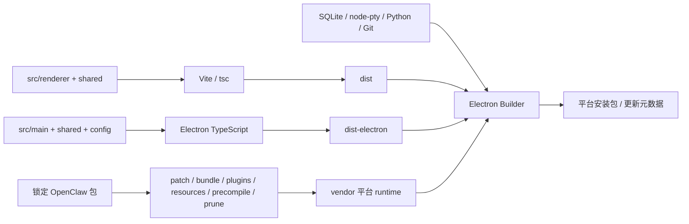

# 工程构建、运行时资源与发布

本文按“锁定输入 → 两套编译 → 运行时组装 → 平台打包 → 验证”的顺序解释构建输入如何变成可运行安装包，以及为什么 Renderer 构建通过不代表 Gateway、原生模块和平台资源都已可用。日常启动、打包与测试命令见[开发指南](../development.md)。

## 1. 版本与锁定来源

| 项目         | 维护入口                                                                                                | 解释                                                      |
| ------------ | ------------------------------------------------------------------------------------------------------- | --------------------------------------------------------- |
| 应用         | [`package.json.version`](../../package.json)                                                            | 应用发布身份                                              |
| 开发 Node    | [`.nvmrc`](../../.nvmrc) 与 `package.json.engines.node`                                                 | 开发工具与原生构建环境                                    |
| Gateway Node | [`nodeRuntime.json`](../../src/shared/openclaw/nodeRuntime.json)                                        | 随运行时交付的完整 Node/npm/npx，按目标平台锁定归档与哈希 |
| Electron     | `package.json.devDependencies.electron` 与实际安装解析结果                                              | 桌面运行时与 Electron ABI                                 |
| OpenClaw     | `package.json.openclaw.version` 与[当前 source lock](../../scripts/patches/v2026.10.7/source-lock.json) | 独立锁定的 pristine runtime                               |
| 包管理       | npm、根依赖声明及本地生成的 `package-lock.json`                                                         | 根 lock 未纳入版本控制；插件独立锁文件按所属包维护        |

根 `package-lock.json` 被 `.gitignore` 忽略，是本机 npm 安装产生的解析快照，不能作为仓库已交付的依赖锁定承诺，也不是应用发布版本的权威。部分原生扩展的独立锁文件由仓库显式跟踪，不能与根 lock 混同。排障和构建记录须区分 `package.json` 的范围、实际安装版本、原生 source lock 及最终 bundle manifest。运行时还有自己的依赖树；主应用 dependencies 列表不是全部随包工具清单。

## 2. 编译边界

Renderer 使用 React、Redux Toolkit、Lit、Tailwind、自有主题、Markdown-it/KaTeX/Mermaid/DOMPurify 及 Monaco。Main 使用 Electron、better-sqlite3、ws、网络代理、归档和系统工具库。

| 配置                   | 输入与目标                                                      | 关键限制                                    |
| ---------------------- | --------------------------------------------------------------- | ------------------------------------------- |
| tsconfig.json          | renderer + shared；ES2020、ESNext、bundler、DOM、strict、noEmit | 不导入 Main/Node 特权实现                   |
| electron-tsconfig.json | main + shared + config；CommonJS、ESNext、dist-electron         | noImplicitAny，排除测试                     |
| Vite                   | Renderer HTML、应用 bundle 和开发入口                           | 根目录在 src/renderer，环境配置仍从仓库读取 |
| Electron Builder       | 应用 bundle + 原生依赖 + 平台资源                               | 目标架构与资源预备必须匹配                  |

Shared 同时参与两套编译，不能靠某个 tsconfig 恰好提供的全局隐藏跨进程依赖。主题生成脚本在 scripts/theme，浏览器主题数据与运行时留在 Renderer。

仓库脚本按准备、打包、诊断和验证职责组织，入口及前置条件集中在 [脚本索引](../../scripts/README.md)。`scripts/openclaw/` 拥有原生运行包组装，`runtime/` 准备工具依赖，`plugins/` 组装宿主插件和技能；多资源归档归 `packaging/`，只读会话取证归 `diagnostics/`。显式验证入口按 `test/browser/`、`test/openclaw/`、`test/plugin-management/` 和 `test/plugin-host/` 分类。版本补丁目录保留来源及锁定关系，可选插件业务验证继续随插件维护，Core 模块检查不依赖可选插件的发送验收。

## 3. 构建产物不是一个目录

需要直接加载的 native 二进制必须位于可访问的文件系统位置；应用的 better-sqlite3 使用 `asarUnpack`，Gateway 的 node-pty 随独立运行时资源组装。Gateway bundle、扩展、运行时工具和本地语音资源通过额外资源规则进入目标包，不能仅检查 dist 存在。

## 4. 开发路径与原生 ABI

`dev` 仅启动 Vite；`electron:dev` 编译并启动桌面；`electron:dev:openclaw` 先准备 host runtime。隔离预览用独立 userData，不自动导入真实模型凭据。

better-sqlite3 必须对应执行它的 Node/Electron ABI。`npm test` 在 `build/test-dependencies/` 下为 Node 准备私有模块，通过测试环境变量注入主应用和插件测试，结束时清理私有目录，不替换应用的 Electron 二进制。已有 `SQLITE_TEST_MODULE` 时先验证其 Node 兼容性再复用；应用原生依赖需要修复时使用 `npm run rebuild:electron-native`。不要同时对应用依赖执行 native rebuild 和依赖 SQLite 的桌面预览。

Builder 显式 npmRebuild=false，是因为项目自己准备 SQLite，node-pty 使用预构建；它不表示无需原生二进制，也不能拿 host 架构产物跨平台打包。

## 5. OpenClaw 供应链

运行时从 source-lock 固定的 npm 包及完整性开始，验证 pristine contracts，再应用当前补丁。构建 recipe 变化会使冻结快照失效；同版本修改也需重建。历史/部分补丁形态明确拒绝，不做就地修补。

平台准备按依赖顺序完成：

1. 按 source lock 安装 pristine 输入并同步 `current`。
2. 构建 Gateway bundle，组装官方插件和产品资源。
3. 预编译扩展并按目标平台裁剪。
4. 对最终运行时及配套资源重新验证。

现行安装脚本将各平台冻结包写入 `vendor/openclaw-runtime/<target>/`，再同步开发及打包消费的 `current/`；EngineManager 在开发环境从该 `current/` 定位运行包，安装版从安装资源的既有 `cfmind/` 目录读取。`build/runtimes/` 承载 MinGit、Python、本地语音等准备产物，不表示 OpenClaw 的既有供应链已迁移到该目录。应按安装脚本、打包 hook 和 Manager 的实际映射核验最终包。

安装阶段同时准备并复制目标平台的完整 Node 分发包到 runtime 的 `node-runtime/`，不借用目标机器的系统 Node，也不在首次启动下载。必须对最终 bundle 验证能力，不能只验证邻近源码仓库。当前补丁职责、依赖和上游删除条件只维护在[版本目录](../../scripts/patches/v2026.10.7/README.md)。

## 6. 平台资源和安装器

### 工具运行时

Windows 准备 MinGit、便携 Python 和 hashed requirements，依赖装入 bundled-site-packages；Python 工具基线不等于系统装有 LibreOffice/Poppler 等外部程序。本地语音引擎与按需模型分开，不能把运行时 DLL 存在当模型已安装。

MXC 是 Windows 专属 OpenClaw 插件，SDK、执行器与提权 helper 有固定 hash 和签名验证。macOS/Linux 不携带或启用这个后端。

### 安装器

Windows 使用 NSIS，macOS 使用 DMG，Linux 使用 AppImage/deb。NSIS archive 固定 BCJ 过滤以兼容安装时解码器，包括 prepackaged 路径；不要删除这一构建约束后只验证 7za 本机能解压。具体安装故障处理见[安装器说明](../windows-installer.md)。

## 7. 品牌、更新与发布身份

Builder 从 productName 派生 executableName、appId、桌面显示和安装器名称，内部 justdo 协议保持稳定。productName 仅允许英文字母，安装路径和项目路径可含中文、空格；测试不应把品牌校验扩展成路径限制。

应用和 OpenClaw 发布版本共用启动兼容性检查的数字版本解析器：三段非负安全整数，
允许小写 `v` 前缀，不接受补零、空白或预发布/构建后缀。例如 `v2026.11.2` 合法，
`v2026.11.02` 非法。打包入口在资源准备和旧产物清理前校验
`package.json.version` 与 `package.json.openclaw.version`，Builder 配置加载时也校验，
覆盖直接调用及 `--prepackaged`。校验失败指出字段和原值，不自动改写发布身份；
更新元数据生成使用同一规则，仅去掉合法的小写 `v` 前缀。

Windows 更新使用 generic feed，发布元数据和 artifact hash 由专用脚本核对；verifyUpdateCodeSignature 当前关闭，不能宣称已建立发布者签名验证。自动安装前先完成应用 shutdown cleanup。

## 8. 命令和验证的实际范围

| 命令                            | 证明范围                                        |
| ------------------------------- | ----------------------------------------------- |
| validate:product-metadata       | 品牌声明、派生规则与应用/原生发布版本格式       |
| lint                            | 配置范围内的静态规则                            |
| build                           | Renderer 类型与 Vite 产物                       |
| compile:electron                | Main/shared/config 编译及 native 前置           |
| test                            | Vitest 及独立插件行为回归，使用私有 Node SQLite |
| openclaw:patches:verify         | 锁定运行时补丁/契约验证                         |
| pack                            | 当前资源组成的目录包                            |
| dist:win/mac/linux              | 平台预备流程和安装包构建                        |
| verify:windows-update-artifacts | Windows 更新产物的一致性                        |

通用 pack/dist 不自动等价于所有平台的资源预备。macOS 架构目标、签名配置与 Windows native 资源需按对应 script/hook 检查。一次 build 成功不能写成全平台发布通过。

## 9. CI 与发布验证

[CI 配置](../../.github/workflows/ci.yml)按路径过滤 renderer/main/skills/scripts/docs，并使用 `.nvmrc`。技能任务直接运行 `tests/plugins/host/sync-bundled-skills.test.ts`，验证内置技能源文件与同步，不再调用 `build:skills`。现有 workflow 仍使用 `npm install`，npm cache key 只 hash `package.json`。

CI 中的应用构建和单元测试不能替代目标平台的打包与真实安装验收。依赖升级需核对原生 ABI、目标架构、runtime freeze、插件预编译、license、安装器和更新产物，而不是只更新一个版本字符串。

仓库级测试按生产职责归入 `tests/packaging/`、`runtime/`、`tooling/`、`plugins/`、`browser/` 和 `openclaw/`；`build/` 只维护 Vite 与 npm 入口契约，跨源码依赖边界归 `architecture/`。应用单元测试与源码同行，纯插件测试和业务原生探针随插件分发，真实宿主边界仍在仓库测试域。默认 Vitest 发现、专用 SDK/源码 profile 和显式 Electron/Gateway 探针保持分离，目录归属及运行前置条件见 [测试索引](../../tests/README.md)。

## 10. 发布排障

先确定失败阶段：依赖安装 → TypeScript/Vite → native ABI → runtime 组装 → Builder 资源 → 安装解包 → 首次启动 → 自动更新。保留该阶段的脱敏日志与 manifest，避免为一个缺 DLL 的问题重写会话代码。

文档变更只做格式、链接和差异检查；行为或构建变更才运行相关测试。测试结果记录命令、目标平台与实际范围，不复制旧文档中的通过数量。
