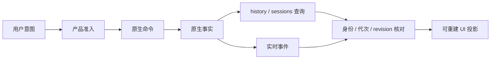

# 薄前端：可重建的显示状态

“薄前端”约束状态所有权，不限制界面复杂度。Renderer 可以拥有分页、动画、草稿、搜索和恢复逻辑；执行、消息持久化与工具授权仍由各自 owner 决定。本页用于实现和评审显示状态，组件分工见[系统架构](02-architecture.md)，消息协议见[聊天渲染](15-chat-rendering.md)。

## 1. 先判断状态的寿命

| 状态        | 例子                                          | 恢复方式     | 写入限制                      |
| ----------- | --------------------------------------------- | ------------ | ----------------------------- |
| 原生事实    | transcript entry、run、Goal、progress_card    | 查询 Gateway | 不凭 UI 值覆盖原生结果        |
| 产品事实    | 分组、权限期望、readAt、成员关系、run receipt | 产品 Store   | 需要身份、事务和删除语义      |
| UI 临时状态 | draft、展开、滚动锚点、乐观尾部               | 交互重建     | 不能成为第二份持久 transcript |

同一页面可以组合三类状态，但新增字段必须先回答：来源是谁、何时过期、丢失后怎么恢复。持久化“方便 UI”的消息副本会掩盖对账错误，不能作为恢复方案。完整持久化边界见[数据存储](10-data-storage.md)。

## 2. 一次操作怎样形成显示

命令、查询和事件提供不同证据：命令 ACK 证明接收，查询给出某个时点的快照，事件描述变化。ACK 不能证明完成；迟到快照不能覆盖较新事件；重复事件不能产生第二份消息。

实现中应依次完成：

1. 从用户草稿捕获本次提交身份，经 Main 准备模型、权限和原生 mode/root。
2. 发送一次命令，保留 accepted、明确拒绝和 unknown 的区别。未知结果保留可恢复身份，不悄悄重发。
3. 用 identity/revision/generation 合并查询与事件，确认响应仍属于当前会话和请求。
4. 由原生历史接管乐观尾部，继续允许工具输入、结果和正文分别补齐。

不能仅按文本相等去重；用户可以连续发送相同文字。Thinking、Tool 和 Content 属于有序 item，刷新不能把每页重新追加或整体重排。

## 3. 显示终态与执行终态分别收敛

显示 reducer 按精确 run 建立 terminal fence。停止确认可收敛对应 turn 的显示，即使 aborted stream 丢失，迟到 delta 也不能重新打开该 turn。显示停止不会补造 Main 的执行结果。

| 显示现象                  | 仍需核对的事实                         |
| ------------------------- | -------------------------------------- |
| 最后一条 assistant 已出现 | 主运行、活动后代和 Goal phase          |
| 工具卡失败                | 工具结果与整轮终态分别核对             |
| 停止按钮恢复              | 原生停止证据和未确认操作               |
| 协作边已出现              | delivery 接收状态与 whole-run outcome  |
| 计划卡已展示              | 持久 artifact、handoff、awaitingReview |
| 插件目录已存在            | inventory、eligibility 和操作能力      |

只有精确 whole-run `executionSettled:true` 建立执行结果；托管工具还要核对 cleanup。Renderer 不实现 required-child join、工具重试器或协作调度器。当前不支持已移除的 `tasks.*` 账本，产品 taskId 承载原生 session key。

## 4. 控制器持有唯一当前状态

ChatController 持有连接、canonical session、active turn、取消和订阅。拆出的 history/recovery/session/compaction/progress 模块使用显式上下文及 `propertyContext` 实时访问器读取状态。

异步分支在请求前记录身份，await 后重新比较 generation 再提交结果。不能用 `{ ...controllerState }` 保存长期副本，也不能让子模块创建第二套 currentSession。卸载清理读取与展示订阅，不因视图消失误杀后台任务。

集中式聊天 client/controller 可以通过 preload 取得本地连接信息并处理 wire、历史和聊天命令。普通 feature 不另建 socket、不保存 token、不导入 Main。文件、权限、配置、插件和 SQLite 操作继续走窄 preload；聊天直连同样先经过产品准入。

Chrome 侧栏使用产品 app-server，网页 guest 使用受控 bridge，两者都不继承桌面聊天 token。通道边界见[进程模型](03-process-model.md)。

## 5. 性能与失败都留在正确层

| 问题               | 合理处理                                        | 不能采用的捷径                        |
| ------------------ | ----------------------------------------------- | ------------------------------------- |
| 大历史和高频 delta | 有界 DOM、按帧合批、stream pacer、Markdown 缓存 | 截断 canonical 工具结果或删除原生历史 |
| 历史传输受限       | 原生 entry 身份补取、分块恢复、说明搜索范围     | 用“未加载”声称“没有内容”              |
| 查询失败           | 保留最后可信投影并显示刷新失败                  | 合成空成功或自行补出终态              |
| 权限应用失败       | 阻止发送并保留原因                              | 临时显示 full 或提升全局权限          |
| 发送结果未知       | 保留请求身份和草稿恢复保护                      | 清空后自动重发                        |

侧边 /btw 的内存历史在关闭后丢弃是其产品语义；浏览器录制是待审阅草稿。二者不因需要临时显示而写入主 transcript。

## 6. 评审与验证

逐字段检查 owner、恢复、过期和删除；逐异步请求检查发起身份、等待后的围栏及清理。新增产品持久投影还须说明为何它具有独立用户意义，而不是消息缓存。

代表性回归为会话切换、断线、重复/乱序事件、终态后迟到、同文重复提交和超大历史。聊天侧从 controller/reducer/reconciler 测试进入，产品侧从 handler/Store 测试进入；一次截图或正常发送不能证明这些边界。
