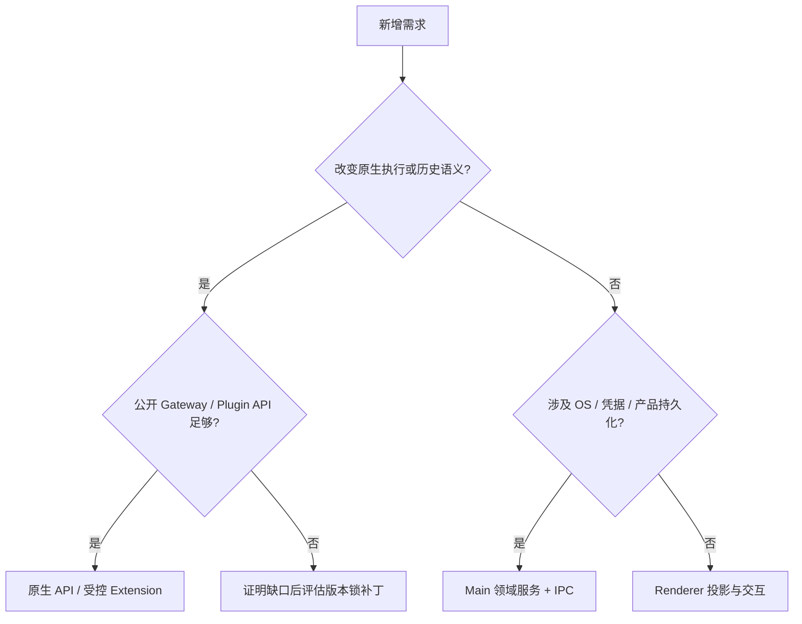

# 新能力的所有权与集成决策

本页用于决定需求应落在原生 API、Extension、Main 还是 Renderer，并检查一次跨边界写入是否可恢复。系统组合见[系统架构](02-architecture.md)，数据权威见[数据存储](10-data-storage.md)。不要把早期迁移路线或缺失页面当作重写原生执行的理由。

## 1. 先选择语义 owner

Shared 只承载跨进程合约和纯逻辑，不是第四个业务 owner。Main 也不默认接管缺失的 Gateway 能力；在那里重写原生行为同样会形成双重权威。

| 原生必须继续拥有                           | 产品可以增加                         |
| ------------------------------------------ | ------------------------------------ |
| transcript、history、rewind、reset         | 导航、UI 门禁、可见投影              |
| tool execution、queue、required-child join | 审批交互、子任务状态展示             |
| Goal 内容和预算、会话 mode/root            | 续跑阶段、产品期望与串行准备/回读    |
| Skill 赢家、角色文件、peer send、cron      | 文件事务、档案、成员准入、结果收件箱 |

App 插件的 Main/Browser 业务留在插件内，通过[通用宿主](17-app-plugin-host.md)提供的窄端口组合；不能以 SDK 接入为由把业务重新放回 Core。

## 2. 再定义产品投影

身份、状态摘要、回执和索引可以持久化，但必须有独立产品意义。session row 的 status 供列表快速显示，仍需与原生对账；GoalExecutionSnapshot 记录 Main 续跑阶段，不能覆盖原生目标；readAt 属于产品，不能代替 cron run history。

一份投影必须定义：

1. 对应的原生 identity 及创建者。
2. 哪些事实允许更新，哪些结果只能保持 unknown。
3. 过期与重连修复方式。
4. 删除及部分失败后的补偿责任。

不允许 `cowork_messages`、Main/Redux transcript cache、自建 task scheduler、凭模型文字生成协作边或从工具输入推断当前 progress_card。

## 3. 配置写入只覆盖受管范围

ConfigSync 管理产品声明拥有的字段，保留无关设置及可选 Extension 的显式关闭。产品数据库保存、原生配置发布和当前运行态应用是不同阶段，成功响应只承诺已确认阶段。

手动档案与模型创建的 `agents.create/update/files` 共用身份和一致性约束，不能并发覆盖受管 roster。MCP 发现只补缺失 name，删除后不从旧 config 复活；provider rename 通过稳定身份解析，名称相似不表示凭据来源相同。

## 4. 写操作必须能解释部分成功

| 操作           | 本地原子部分           | 外部部分                    | 失败后的识别依据               |
| -------------- | ---------------------- | --------------------------- | ------------------------------ |
| Plan 批准      | handoff expected-state | 文件、reset、chat admission | 文件摘要及 admitted 回执       |
| Extension 安装 | 安装身份               | 暂存、CLI、inventory        | reviewToken、清理及读回        |
| 结果删除       | receipt/tombstone      | 原生 artifact 清理          | durable cleanup 与同步 barrier |
| 协作任务删除   | room freeze 与进度     | 多个原生 session 停止/删除  | 精确成员和部分删除进度         |

外部调用不能包进同步 SQLite transaction 来声称全链路原子。尤其要说明“外部已执行、本地尚未确认”如何识别；超时不能直接重复执行。

## 5. Extension 与 patch 的选择

原生 tool、turn hook、session extension、scoped RPC/event 能表达需求时优先 Extension。它拥有运行时 pending 或 policy，Main 桥负责产品权限、文件/系统能力与 UI。

ask_user_question、Plan、automation permission、embedded browser、agent-team 和 stt-local-cli 各自保留寿命和授权，不共享全局 pending，也不借插件身份绕过沙盒或逐轮强制提示。

Extension 运行在 Gateway 信任域，manifest 和 sidecar 不隔离恶意第三方代码。需要更低信任级别时，应另行设计进程隔离及凭据边界。

引入 patch 前必须证明锁定 pristine 包缺少所需行为，且 adapter、配置与公开 API 无法正确实现。补丁需独立交叉评审、精确 anchor、原子写入、当前形态幂等、pristine contract、行为测试和上游移除条件。

历史/部分 marker 必须失败，不做旧修订原地转换。编号只代表当前构建顺序；唯一清单见[当前补丁总账](../../scripts/patches/v2026.10.7/README.md)。上游已有能力升级后要重新判断 owner，不因旧补丁曾实现就继续保留。

## 6. 交付前贯通一条链路

需求 → 原生能力核对 → shared 合约 → Main admission → 原生身份确认 → 产品回执 → Renderer 反馈 → 停止/重连/删除。

检查真实注册、消费方和失败路径，而非只有服务文件。每层只接收完成职责所需的数据；UI 若必须知道 Node 路径、secret 或内部实现名，应收窄接口。没有注册或消费方的实现只能称为基础设施。

最后回答五个问题：谁创建身份、谁确认成功、谁保存事实、谁在重启后恢复、谁负责删除。验证重复、乱序、取消和部分成功；协议测试、真实模型质量与不同平台隔离的结论分别记录。
