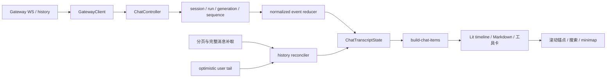
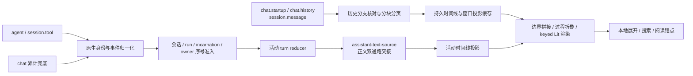
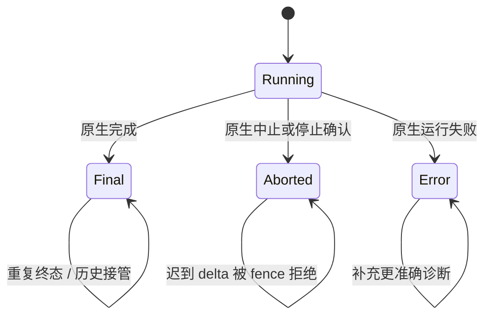
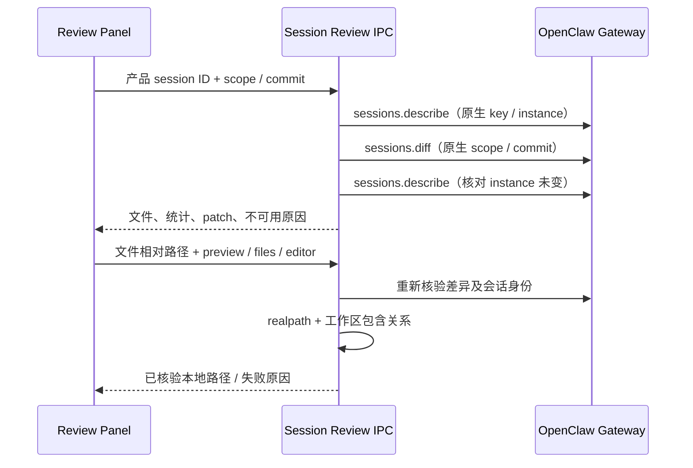

# 聊天渲染：原生历史、实时流与交互投影

MCP Apps 使用原生 MCP 结果准入、标准 AppBridge 和现有聊天连接的受限会话接口；HTML、工具、问题与模型上下文继续由 Gateway 所有。模型 App 默认内嵌，展开保持同一文档；手动/文件 App 从工作区文档创建，不跨文档搬动运行中的 iframe。问题通过 Main 的专用桥收集，业务工具与资源交互通过原生 `mcp.app.*`，不增加 MCP Apps 生命周期补丁。锁定版本的 030 仅修复手动 App 与模型执行的持久工作目录不一致，复用原生 ingress resolver 及准备 owner 检查。关闭只停止本地交互并尝试精确上下文清理；已发出的操作与视图回收沿用原生生命周期，不能把 DOM 消失当作取消成功。协议、权限、生命周期及现行限制见 [MCP Apps](../features/chat/mcp-apps.md)。

聊天由 React 工作区和 Lit `<justdo-chat>` 组合。MCP Apps 控件将已认证目录的发现入口、插件图标和操作回调交给侧边栏首页的“应用”区；消息控制器继续持有聊天的认证连接和原生会话绑定。旧目录回调在绑定变化或卸载后失效，首页不为列出应用创建产品会话或调用模型。本文按当前 controller、reducer、history protocol、pipeline 和组件组织，重点解释消息顺序、终态、防重复、恢复及性能，避免把功能迭代记录混入架构正文。

侧边栏首页手动 App 的加载、视图以及多入口选择/设置/搜索操作面板统一由 `useMcpAppTabs` 承载。
`McpAppsControls` 只在工作区提供的实际 DOM 容器中 portal 操作面板，不在聊天 DOM 中展开。
文件入口单独匹配当前文件，不干扰应用主入口的直接打开；普通启动预留侧栏 Tab 并按入口去重，
未知结果不自动重试。管理面板通过精确创建对象关闭，旧回调不能关闭后来替换的面板。
模型工具结果的消息渲染准入保持独立，不因手动菜单的展示位置改变而被隐藏或搬移。

已加载完成的工作区 App 在会话切换时暂停原生会话接口，保留同一个 iframe、SDK bridge、
未保存输入和撤销栈。暂停会中止本地等待、清除待确认操作及上下文显示，后台拒绝工具、
文件、下载、链接与关闭请求；旧响应即使在切回后到达，也须通过发送时 binding/revision 校验。
返回并选中标签后，仅在产品会话、client、generation、sessionKey、sessionId 和 agent 全部
吻合时采用新的受限绑定，不读取 view、不重建 iframe、不重放启动。仅按需读取原生模型上下文
元数据，不回灌旧选择。断线、身份替换、关闭及未完成启动继续沿原有失效与显式恢复规则。
后台存在 App 时保留工作区面板；首页使用纯渲染函数保持与会话页相同的工作区层级及标签容器。
MCP 容器在两种布局中都固定为面板的第一个直接子节点。仅保留 React key 不足以保留画布：
兄弟节点顺序改变仍可能移动同一 DOM 子树，Chromium 会重建其中 iframe 的文档，导致旧 bridge
失去连接。浏览器回归须检查内部文档、未保存输入和调用次数，不能只比较 iframe 元素身份。
已有聊天控制器在首页隐藏并暂停 Apps，返回时重新加载认证历史；冷首页不为此创建聊天控制器。

文件预览使用同一控件提供的受限文件打开回调：按当前已发现的唯一文件入口匹配扩展名，准入点击后立即创建并选中文件标签，`display/useMcpAppTabs` 持有标签内的加载、失败重试和本地等待。原生启动完成只填充原标签，不重新选中；文件启动不使用 composer 的操作状态。可选插件的 `mcp-app-files.open.<serverName>` RPC 可提供更大的工作区文件快照；携带精确原生 incarnation，只有明确的 unknown-method 非准入才回退 `mcp.app.launch`，失败/超时不重放。标签按会话和文件身份去重，绑定失效的视图可重新打开；异步结果受原生会话和精确标签等待校验保护，关闭、会话切换和卸载均拒绝迟到结果。没有可用处理器时沿用普通预览，文件解析/编辑属于可选插件，不进入 Renderer 通用文件读取或 Main 数据库。具体文件格式、容量及编辑能力由可选插件定义，宿主不依赖特定表格引擎。

首页的预览作用域没有聊天控制器。`useHomeFileApps` 在运行时已就绪、全局工作目录与助手明确后，
即使当前显示已有会话，也提前准备独立的预览上下文并发现目录。目录准备只返回只读发现结果，
可交互上下文、画布恢复和启动仍须首页当前可交互。打开侧边栏首页复用同一次等待和当前作用域目录；
加载时显示状态，失败提供显式重读，启动应用仍须点击真实入口。
`WorkspaceAppSessions` 通过现有 Main Gateway 客户端按当前设置创建并核对专用原生会话，
不写产品会话表、不读写 transcript 正文；原生 MCP Apps 不接受 incognito 会话，因而使用
预留的普通会话标识及既有 canonical key，并记录原生创建回执中的 sessionId/lifecycleRevision。
`McpWorkspaceSession` 为首页各文件共享一条受认证的 Renderer 连接和现有 `McpAppSession`，
发现真实 global/file 入口，不发送聊天或读取历史，不另建 MCP transport。文件和手动界面复用工作区标签和
标准桥；离开首页仅暂停已加载界面，同一作用域返回时保留已发现入口并重新核对。
连接恢复先等待当前代次的认证 hello，再刷新目录；不复用上一代已完成的连接等待。
配置上下文变化即时失效，迟到结果不能重建标签。清理只请求原生按精确创建身份删除自有
预览会话，不处理用户聊天或工作区文件，不把连接关闭当作已发出操作取消的证明。

首页首条发送前，宿主通过标准 App tools 发现带 `workspace/prepare-context: true` 元数据的
只读准备工具。draw.io 在同一内部编辑器提交当前文字、导出 XML 并等待原生模型上下文回执；
准备期间仅允许上下文更新，不开放其它工具、文件、消息、下载或链接操作。
Main 在实际首条发送准入中核对窗口、请求、助手、工作目录、权限和原生 sessionId 后，
以预留 ID 原子创建普通产品会话，停止预览删除所有权；不重建原生会话或复制 App 正文。
原生 describe 不投影 lifecycleRevision，视图生命周期在实际发送前的第二次认证准备中
由 Gateway 验证；初始发送另携捕获的 sessionId 只读准备，拒绝 incarnation 替换。
侧栏标签仅更新产品归属，保持同一个 App 元素、iframe、bridge 与连接。新首页使用新的
预览作用域，已采用的画布只在所属对话可交互；关闭窗口或释放旧预览不会删除该对话。

draw.io 连续编辑在普通与初始发送边界经标准 AppBridge 导出当前图，按注册时的物理会话、
client/generation、agent 和视图筛选；保留的旧聊天画布不会成为新聊天的准备项。插件认证
`drawio.chat.send` 将快照冻结到精确原生 run，再派发同一调用者的 `chat.send`；准备结束后
复核取消与绑定，不重试未知发送。插件自有模型工具与回执负责修改，成功原生工具结果投影为
紧凑当前图引用，唯一原编辑器保留。切换会话退休待应用资格，迟到准备不能重建绑定。
恢复使用原生可见的成功结果，没有 Main/Redux 图表正文存储或历史版本库。详细契约见
[当前画布连续编辑](../features/chat/drawio-current-canvas.md)。

“设置 / 外观”的消息区域宽度默认 60%，表示窗口最大化时对话正文和输入框占各自可用
显示区域的比例。普通窗口宽度不超过默认 1280px 时尽量展开，消息区与输入框两侧各
至少保留 48px，避免左侧 minimap 与助手头像重叠；从默认宽度放大到当前显示器工作区
宽度期间，目标比例从 100% 连续过渡到设置值，同时保持侧边留白。
输入框在相同宽度基准内左右各内收 44px（32px 头像列和 12px 间距），边框对齐
消息正文区域；底部布局通过不可见的原生细滚动条占位，匹配消息区实际占用的滚动条
宽度，避免两端出现平台或缩放相关的偏移。排队输入卡片与输入框使用同一正文宽度。
Renderer 在 resize 和原生窗口状态变化时更新临时布局系数，不改写已保存的外观偏好。
主聊天列通过所属窗口的 ResizeObserver 同时观察聊天列与聊天/工作区组合区域，按两者
宽度差扣除停靠侧边栏及分隔条占用，再计算展开比例。拖动、打开、收起或分离右侧
侧边栏都会实时调整消息区与输入框：聊天列越窄，占用比例越大，仍保留 minimap 留白
和头像列缩进；侧边栏恢复后回到窗口对应比例。悬浮覆盖但未压缩聊天列的侧边栏不计入
扣减，局部系数只作用于主聊天列，不改变工作区侧聊或已保存的宽度设置。
主窗口与初始化窗口从 shared 读取同一默认尺寸；独立工作区按自身窗口和显示器重新计算，
不继承主窗口的缩放系数。已有显式宽度偏好保留；full-width 面板仅在 minimap 可见时
同样预留侧边空间。minimap 默认宽度为 20px，横线保持短线，包括当前选中项；悬停或
键盘聚焦时展开至 28px 并加长横线，离开后收回，消息区和头像不随之位移。

交互式回答通过原生 `show_widget` 工具结果进入聊天：实时 Tool timeline 和真正 tool-role 历史记录解析严格 native descriptor，助手自行拼写的 shortcode/JSON 不授予文档读取。已验证 preview 对象绑定当前 client、连接 generation、sessionKey 和 docId，使用认证 `canvas.document.view` 获取原生 HTML 与独立 sandbox listener；不使用 descriptor URL 作为权限，不向 iframe URL 放 token，也不把 HTML 写入产品缓存。

组件的展示、隔离传输、草稿准入和失败重建集中在 `components/native-widget/`，
对应测试与实现同目录。消息 descriptor 投影留在 pipeline，首条发送留在 gateway，
React composer 仍负责消费用户确认的草稿；归组不改变这些层的所有权。

Widget Kit 的 `offline-html` 是原生注册内容类型：JSON 源明确声明需要的本地库，
组合器先放版本化 classic 脚本，再保留作者 HTML 片段。原生负责已注册资源的脚本
来源准入，Renderer 不替换 CDN 地址、拦截网络或注入全量运行库。各脚本通过现有独立
sandbox listener 的 public reader 读取，只含固定静态字节；连接、图片、草稿和身份
权限不变。KaTeX 字体用 FontFace 二进制源而非 URL，以适配双层 CSP。具体库、
源限制与使用方式见[交互式回答](../features/chat/interactive-answers.md#离线可视化库)。

主聊天的 `show_widget` 消息以 `native-widget-anchor` 提供布局锚点，独立的 widget
presentation manager 持有稳定 viewer。桌面在首次 iframe、webview 或桥连接创建前，
通过共享 `NativePresentationSurface` 为已准入卡片准备无应用 preload 的独立原生载体；
MCP App 的消息视图复用相同展示基础设施，各自的认证准入和协议保持独立。
侧边栏标签与其它内容使用 `display/` 的同一个 workspace portal。固定和移回消息只切换
载体的原生父视图与几何位置；分离和停靠由 Main 搬动完整侧栏 View 组，不搬动 DOM、
重读原生视图、重建 AppBridge 或改变运行实例。消息、侧栏、独立窗口及返回停靠之间
保留同一个内部文档、未保存输入、选择与本地状态。无原生表面 API 的浏览器仍使用
同 Document 的稳定布局容器。展示回执 ID 只管理承载资源，不替代原生 viewId / docId
或成为新会话、工具调用与执行回执。
实例按真实 client、连接 generation、原生会话身份、产品会话作用域与已准入 docId
隔离；保留实例通过确切聊天所有者刷新上下文，即使原历史行已离开窗口也不能保留旧权限。
草稿确认与消息滚动通过捕获的所有者回调路由，侧边栏滚动不控制消息；隐藏或遮挡时
清除建议并撤销草稿策略。侧栏视口适配与消息高度分别保留，布局报告继续核对代次。
该机制与 MCP App 展示分别持有各自的准入、传输与生命周期，不新增正文缓存或原生补丁。
独立历史查看器没有侧栏作用域，Widget 继续挂载在消息锚点内部，继承所属抽屉、
标签页的层叠、可见性和 inert 状态。主聊天保留标签在聊天 DOM 替换后，只能通过
新的真实历史准入及相同 client、generation、sessionKey、非空物理 sessionId 和 docId
恢复所属产品会话；原所有者已失效后才移交，重新认证读取，不恢复旧挂载的权限或输入。
等价上下文刷新只更新 viewer，不通知 React 标签订阅；只有可用性或标签状态变化才通知，
避免聊天与侧栏互相触发渲染。两类稳定容器的布局均跳过未变化的样式写入，避免彼此的
DOM 观察器在稳定几何状态下持续调度。几何计算、隐藏及遮挡以实际布局目标的文档为准，
原生裁切保留载体的完整逻辑视口，部分滚出消息区域不通过缩小文档视口来裁切。
侧栏窗口控制始终使用唯一工作区所有者，所有标签内容随侧栏一起分离、停靠。
MCP App 的侧栏展示模式请求由 manager 从实际目标转交，面板核对确切视图、固定状态
及目标归属后响应；不能通过任意 DOM 事件接管其它卡片。

工作区侧聊中的组件使用实际 `ownerDocument/defaultView` 接收沙箱消息、读取宿主
origin 与主题、观察主题和可见性；监听目标在连接时捕获，移植或卸载时在原目标解除。
shadow 样式使用文档本地 style，避免主窗口注册的构造样式表跨文档采用失败。
草稿的视口、焦点、瞬时用户激活与隐藏策略也以组件所在文档为准；不能借用主窗口
的激活或尺寸，隐藏时收到私有端口同样不公告草稿可用。窗口变化仍需通过当前
client/session/generation/docId 校验，不增加工作区窗口 preload 或权限。

桌面 `show_widget` 使用独立 webview，固定同源 `widget-viewer.html` 承载原生 sandbox
iframe；专用内存 session 复用 `browserProxy`，不共享浏览器 Cookie、profile 或工具能力。
webview 使用 flex 布局，让 Electron 内部的 guest iframe 填满实际外框；仅给 block
webview 设置高度会留下默认 150px 的内部视口，出现顶部画面和下方空白。尺寸验证须
核对外框、guest、原生 shell 与内层文档的实际视口，并覆盖放大、收起和窗口 resize。
放大视口由 `dialog:modal` 样式直接控制。viewer 以实际 frame 的 client 尺寸和模态状态
发布单调递增的布局代次，放大、收起和窗口调整都更新代次；尺寸应用前再次核对实际
外框。认证 HTML 仅在本次内存挂载时加入尺寸适配脚本，原生历史、CSP、资源和业务脚本
保持原内容，不增加运行时补丁。独立全屏画布页面若隐藏正文溢出、只有一个顶层容器、
画布直接填满该容器且控件为浮层，放大时临时将容器高度适配到全部可用视口，解除
原先 `70vh` 等高度与最小高度限制，让文档原有 ResizeObserver 重新绘制。收起恢复
原高度声明与优先级；容器保留 overflow 裁切，避免旧画布尺寸在重新绘制前撑高正文。
多面板、普通文档、嵌套画布和带正文流说明的图表保持原布局；业务脚本主动修改的属性
不会在恢复时被覆盖。适配不拉伸画布位图，不重新加载文档。脚本在 opaque 文档内等待自身视口吻合目标尺寸，
再报告正文高度、实测视口和代次；不以固定延迟猜测嵌套 frame 或 guest IPC 已完成。
宿主验证原 frame/source/origin、挂载随机身份、布局代次和视口尺寸；跨 guest 的高度
事件也携带代次，旧报告与原生无代次报告不能覆盖收起后的高度。动态内容仍按当前
代次测量；绑定替换和卸载断开观察器并销毁旧桥，不重载运行中的文档来恢复尺寸。
Main 在 attach 前核对固定 origin/path/mount，强制最小 preload、sandbox、contextIsolation
和无 Node，禁止导航、新窗口、下载和权限请求；guest 必须等待专用 session 代理就绪。
认证读取继续属于当前聊天 client，只传当前 HTML/沙箱 URL、主题与草稿策略，不传 token。
guest 内沿用 source/origin/renderId、私有 prompt port 和真实激活检查；封闭语义事件通过
当前 webview 回到聊天组件，再检查当前绑定、焦点、可见性和速率。加入草稿仍需用户确认。
HTTP(S) 链接使用挂载时最前置的内存脚本，在生成脚本之前捕获原生点击和 DOM 方法，
通过原生 shell 首个 `widget-bridge-port-offer` 转交独立私有端口，仅接收真实链接点击。
该通道不发送原生 dashboard ticket，也不授予工具或资源权限；原生 prompt 端口保持独立。
宿主核对 source/origin、单一端口及本次 linkId，激活时再查文档焦点、可见性、URL 和速率。
guest 只返回当前 mount 的链接语义事件，聊天再次核对 client/generation/session/docId。
主聊天以捕获的产品会话和原生 sessionKey 回调到自己的浏览器标签入口，不作全局事件广播，
不跟随 Chrome 偏好；旧回调、失效挂载与运行错误均撤销链接。放大卡片先收起，仍保留同一文档。
切会话、卸载或宿主导航销毁旧 guest；放大只提升原有 dialog，保留同一文档与本地输入。
Electron guest 失败显示现有恢复入口，不回退主 session iframe。普通浏览器继续原 iframe
路径。代理只影响原生策略已允许的请求，不放宽 CSP 或添加 OpenClaw patch。

`webview.send()` 返回 Promise；发送统一处理同步异常和异步拒绝。当前挂载的发送失败
进入既有失败恢复，不自动重发；已销毁挂载的迟到拒绝不改变新卡片。销毁 guest 直接
撤销桥和监听，不在移除 `guestInstanceId` 前追加一条异步策略发送，避免卸载时产生
无效 guest 调用。测试同时覆盖异步初始化/状态失败、迟到拒绝和真实 Electron 快速换卡。

发给沙箱的资源、主题、宿主状态和草稿策略必须从实际父窗口的 JavaScript realm
发起：跨文档调用 `postMessage` 会携带调用者的源窗口，不能仅替换监听目标。
工作区静态启动模块在自己的文档中安装只读、受限发送函数，完成后才发布 portal root；
组件按 frame 当前文档选择发送入口，限定已连接的原生组件 iframe、准确的沙箱路径与
origin、封闭的资源/主题/草稿/滚动/布局消息。未放宽原生 `source === parent`、CSP 或权限；入口缺失时资源
投递按失败处理。断开期间不创建文档绑定，重挂载主动更新并重新读取当前原生文档。

原生 Tool Search 可以通过 `tool_call` 调用 `show_widget`，历史保留外层工具结果及独立嵌套
过程记录。仅成功的真实外层 Tool 接受精确核心目录身份
`{ id: 'openclaw:core:show_widget', name: 'show_widget', source: 'openclaw' }`，
从其 `result.details` 读取相同 Canvas 契约，保留实际外层调用 ID。
不递归搜索任意 JSON，不接受 MCP/client/插件同名包装、失败结果或助手伪造数据；嵌套
过程记录仍只展示过程。内外层同时可见时按 document ID 只展示一次组件，两个执行记录
均保留；仅移除该已验证文档对应的相对 shortcode/结构化 fallback。

HTTP(S) 主聊天挂载原生 viewer 后，实际发送连接公告 `inline-widgets`。生产主页面使用本机只读静态宿主，保留隔离 preload；外层原生 shell 独立 origin、内层 opaque iframe，逐阶段校验 origin/source、sandboxUrl 的原生 csp/v 参数与 renderId。加载满 10 秒显示慢加载提示；认证文档读取与沙箱初始化各有 30 秒最终期限，超时或文档丢失后提供手动重试，不自动 wake。脚本运行错误保留当前 iframe 与本地输入，撤销草稿端口并显示恢复操作；主动重载才重置本地状态。切换会话、重连或卸载撤销旧绑定与端口，隐藏时关闭草稿可用策略；迟到结果丢弃。

原生滚动桥通过 `openclaw:widget-board-host` 接收本次挂载的独立 nonce，
仅用于未消费的滚轮/触摸像素转交，不授予 dashboard 能力。
宿主校验当前 client/session/generation、frame source/origin、nonce 和有限 delta，
沿实际文档的 shadow 边界找到所属聊天；先向既有滚动控制器投递滚动意图，
再移动视口，以保留阅读接管和向上分页行为。隐藏文档、旧挂载与跨会话消息无效。
主题同步包含颜色、实际聊天组件的计算字体、等宽字体、圆角和滚动条；字体优先从
viewer 元素读取，避免未设置字体的文档根节点覆盖正文样式；工作区仍从自身文档读取。
外层原生 shell 与锁定上游查看器一致，使用 `allow-scripts allow-same-origin allow-forms`，
使内层 HTML 的本地 submit 事件可执行；内层仍为 opaque origin，原生 CSP 的
`form-action 'none'` 阻止网络表单提交，不增加网络或执行授权。
加载期间 iframe 保持可布局与绘制，以紧凑覆盖层遮住未完成内容并设为 inert；
完成后解除覆盖和 inert，再采用原生尺寸。不能用 visibility 隐藏嵌套 frame，
否则 Chromium 的子视图可能停留在旧尺寸或空白状态；
不显示常驻后续流程说明，建议确认只占一处行内区域。

失败卡片还提供用户发起的重新生成入口：宿主可信点击生成可审阅建议，绑定当前
generation/session/docId/mount，加入草稿时再次核对。仅传封闭 load/runtime 类别与
受验证的身份，不转发原始错误，也不把原生 UNAVAILABLE 推断为文档已淘汰。
切换、断线、重试或卸载清除建议；不自动调用模型、不保存组件副本。

交互组件外框跟随消息正文的可用宽度，不设置独立的最大宽度；侧边栏中填满当前标签的可用区域。
高度直接跟随当前原生 sandbox 的 `openclaw:widget-size`，向上取整并限制在 48–8000 像素；
换文档或重新绑定时重置加载高度，旧 frame 的尺寸消息不能影响新文档。
原生协议只报告高度，外框宽度由应用布局控制；不读取跨域 DOM、不改写已保存的组件 HTML，
不为尺寸调整增加运行时 patch。组件内部的图表留白、标注和断点仍由该文档负责。

卡片标题只提供同文档放大。通过原位置 `dialog.showModal()` 进入顶层，不移动
iframe；内容使用扣除标题和建议后的剩余高度，随所属窗口视口伸缩。原生 shell 的
内层 iframe 随外层大小变化，文档沿原生 resize 重绘；宿主不读取或改写跨域文档。
放大期间不消费 `widget-size` 作为高度，避免继续使用聊天尺寸，也不将放大高度写回
聊天。收起保留原 iframe 并恢复聊天内高度，再接受当前沙箱的新尺寸；长文档在其
自身视口滚动，标题操作始终可见。不增加独立文档、原生窗口或组件窗口 IPC。

原生工作区视图高于 Renderer 的 CSS 与模态顶层。放大组件在实际 ownerDocument.body
中发布现有 `data-workspace-overlay="true"` 信号，标记保留布局矩形但不绘制或接收
输入；不能把标记只放在聊天 shadow root 中，主文档观察器无法穿透该边界。
`useWorkspacePortal` 沿既有阻塞策略隐藏停靠视图；收起、绑定失效和卸载移除本次
标记后恢复，不移动或重建原生工作区文档。侧聊内的放大标记只属于其实际文档，不能
误隐藏承载自己的原生视图。

原生私有 prompt port 只接收当前 frame 的真实用户激活，检查可见性、焦点、当前会话和长度/速率；拒绝 slash/执行前缀。草稿能力默认关闭，由当前 React consumer 的实时回调决定；只读会话或转录修改时撤销该能力、清除旧建议，并在私有消息、重建与加入草稿入口再次校验。能力切换保留原 iframe、端口与本地选择，不重新读取文档。建议以可读文字在紧凑行内区域展示供用户确认，可信「加入草稿」点击只追加当前 composer 文字，保留附件与已有草稿；发送仍由用户操作。没有 dashboard/MCP/tool/resource 权限。固定组件不访问外部网络，原生任意 HTML 类型仍沿用原生 CSP/CDN/media 边界，不承诺全类型断网。用户入口与限制见 [交互式回答](../features/chat/interactive-answers.md)，未完成验收见 [现行说明与验证边界](../features/chat/interactive-answers.md)。

消息中的普通网页 URL、Markdown 链接和 `MEDIA` 附件共享浏览器打开偏好，打开当前会话内置网页 Tab 或已安装的 Chrome。句子中的本地 HTML 路径和 Markdown HTML 链接转换为受控点击标记，主窗口不导航到 file URL；文件查找与 URL 查询参数、锚点分离，路径只解码一次，裸文件路径中的 `%`、`#` 保持原名。Main 校验 HTML 文件后，通过主窗口主 frame 专用 IPC 选择内置 browser guest 或 Chrome，以原生 file URL 打开；不再发布本地 HTTP 预览站点或附加目录范围与预览 CSP。已挂载的内置浏览器通过自身 handle 创建实际 Tab，容量拒绝时不插入外层虚假 Tab。该偏好只影响用户点击，不改变 Gateway 的 browser Tool 模式或原生消息所有权。详见[浏览器设置](../features/browser/browser-settings-design.md)。

右侧工作区支持整区分离，覆盖 agent-team、Swarm Workflow、临时侧聊、文件、浏览器、
终端及其他 Tab。其 React/Redux 与 Gateway 客户端仍属于主 Renderer；
`OwnerDocumentContext` 把 DOM 的焦点、菜单 portal、剪贴板、resize 和屏幕像素比
指向实际展示文档。应用事件、配置订阅和显式 IPC 继续使用源窗口，不能把
`window.electron` 改成无 preload 的子窗口 API。

工作区同步源根节点的 class、style、语言、方向和 data 属性，包括控制完整主题
token 的 `data-theme`。消息复制/引用菜单使用自身文档的视口限制位置；侧聊的
聚焦帧也使用该文档的动画调度，避免主窗口最小化时暂停可见独立窗口的 DOM 工作。

尺寸和可见性观察器同样从组件所在窗口构造。源文档的 ResizeObserver 即使观察
子文档元素，也会在源窗口最小化后暂停交付。终端、协作图、Swarm、浏览器标注、
PDF 与聊天滚动都由实际呈现窗口观察。Monaco 关闭内置 automaticLayout，使用
容器所属窗口的观察器和动画帧显式更新布局；编辑器销毁时解除观察，diff 实例
另外持有显式清理函数并在销毁前执行。弹窗拖动与焦点恢复也使用所在窗口的边界。

分离/收回只移动同一原生视图，不能改变 React portal 的目标或按分离状态重建
工具组件。工具的有效可见性是会话打开状态或整个工作区已分离；停靠占位仍只
使用会话打开状态。会话切换和工具保留沿用已有规则，不增加正文缓存。
Lit 自定义元素继续由源文档注册和创建；跨文档 shadow root 将构造样式表转换
为本地 style，避免跨文档 adoptedStyleSheets 限制。流渲染帧调度使用元素
ownerDocument 的窗口，窗口布局及审批同步使用不依赖主窗口 compositor 的
合并定时更新，确保主窗口最小化后独立窗口仍更新。

会话冷归档恢复继续使用 `chat.startup` / `chat.history`，由 Gateway 校验和恢复原生记录；Renderer 不解压文件、不建立正文缓存。首次读取期间显示加载说明，归档历史可能耗时更长，不推断冷状态或伪造进度。`initialHistoryReady` 表示首次读取流程已结束，不能单独证明读取成功；`historyReadFailed` 单独记录选中会话的读取失败。

主聊天通过会话 key 绑定读取就绪状态，首次读取未完成或恢复失败时禁止发送、侧聊和导出；失败后保留已显示正文，提供只读重试。只有快照实际提交成功才解除错误状态，被拒绝的空快照不能清除失败。断连使初始化和分页世代失效，同一个 client 重连也要等待新的权威历史；排队等待旧请求不等于读取完成。异步读取的成功和失败均核对 sessionKey、client 和历史 generation，旧连接的失败不能污染新连接。普通后台历史刷新不显示初次加载横幅。导出范围仍是当前聊天快照，不能代表完整原生备份。

例外是 Main 已完成原生会话准备、通过一次性委托派发的首轮输入：发送只等待当前
sessionKey 的连接及 `sessions.messages.subscribe` 确认，且不能存在待恢复的 suspended run。
该路径不复用导出快照的 loading 条件，也不等待 `chat.startup` / 历史分页；历史加载与
首轮执行可以并行，继续由原有身份和序号规则合并。普通续发、侧聊和导出的读取门禁不变。
本地“正在准备”占位不构成原生运行身份，不能触发 suspended-run 恢复。切换会话发起
退订时立即撤销旧订阅的就绪状态；迟到的旧订阅确认不得退订当前重新选择的同一会话。
委托发送通过会话前置校验后，在调用运输前绑定 Main 提供的精确幂等 ID；断线且回执
未知时据此恢复，不重发。停止控制回执也按该 ID 清理占位，不能清除后来的其他运行。

首次打开正在执行的持久会话（包括协作助手详情）时，实时事件可能先于历史读取到达。
同一物理会话、同一历史世代且 `inFlightRun` 匹配当前执行时，允许补入该运行之前的历史和已持久化的用户输入；
读取期间已接收的同一次 runId 原生消息按稳定身份保留，历史响应中的旧实时尾部不能覆盖这些消息；其他运行的并发更新仍拒绝接管。
边界使用原生 runId 或记录时间，未定身份／时间的快照继续拒绝。当前助手输出仍由实时投影拥有，迟到快照只能按原有序号规则补缺，不能覆盖较新的流内容。

原生 `chat.history.pendingInputs` 是已接收但尚未进入正式消息历史的输入，不能丢弃，也不能写入 transcript、Main 正文缓存或 Redux。主聊天保留仅当前 Renderer 会话的临时显示投影，按 `pendingBefore` 读取独立分页，并用 `inputRunIds` 的原生回执核对消费与撤回；会话、连接或历史世代变化后旧读取失效。`display:false` 不显示，保留的取消／中断输入显示对应状态，按 `acceptedAt` 与可见历史排列，不能执行正式历史的编辑或分叉操作。原生消费回执可能为空，退役输入后重新读取正式历史；使用原生输入身份、用户消息的 `idempotencyKey` 和 `__openclaw.id` 去重，不凭相同文字合并。截断输入只通过原生单条消息接口补全。

### 运行中的排队输入

普通主聊天在任务运行期间保留输入框：无可提交内容时显示红色停止按钮，
有可提交内容时同一个按钮临时切换为排队发送，发送成功清空草稿后恢复停止按钮。
快捷键沿用用户的发送配置，附件、引用和浏览器上下文沿用同一套提交准备流程。
Goal 模式禁止排队发送，输入文字不把运行控制切换成发送按钮，快捷键和提交入口同样受限。
Goal 自动续跑和重试等待也视为活动状态，不能在两轮之间通过普通发送绕过限制。
已有主会话必须先成功读取本次会话的 Goal 和执行状态才开放提交，读取期间或失败时保留草稿与停止控制，避免切换会话时绕过限制。失败读取按退避间隔重试，成功后恢复事件驱动更新；切换会话时取消重试。
Goal 暂停／等待输入后的既有恢复操作不变。
侧聊、新建会话、停止确认期间和需要用户回答的阻塞状态不开放此入口；运行期间的斜杠命令不排队。

OpenClaw **v2026.9.8 已原生提供**单次 `chat.send.queueMode: "followup"`、
`chat.history.pendingInputs` / `inputReceipts` 和 `chat.abort.discardPendingInput`。
本应用直接按当前物理 sessionId 提交 followup，并使用 `suppressCommandInterpretation` 防止排队正文中的指令立即执行。
原生 Gateway 负责接收、排序、消费和持久化；应用不创建执行队列或第二套消息数据库。
排队发送不覆盖当前 transcript、runId、流式回复或 Main 的单个活动运行记录；后继执行通过原生生命周期事件进入现有显示与状态恢复流程。
排队接收身份使用 `justdo-queue-` 前缀，其接收／取消事件不能被误认为当前 `justdo-` 暂定运行的身份绑定。

发送确认后清理对应草稿并刷新原生输入投影。排队输入以输入框正上方的紧凑卡片呈现：
卡片左右略内缩，顶部圆角，底部与输入框叠接；每行显示队列图标、单行正文和查看／删除操作，
数量提示仅供读屏使用，避免单条消息额外占用标题行。多条消息保持顺序并在固定高度内滚动。
原生 `state: queued` 也包含普通发送尚未持久化的输入，不能单独作为卡片判断依据。
仅原生 `queued: true` 或带本应用 `justdo-queue-` 接收身份的输入进入排队卡片、查看与撤回入口；
普通待处理输入留在用户消息时间线，不因历史刷新短暂闪入卡片，也不显示接收／等待处理提醒。
排队输入不进入聊天时间线；原生消费后卡片消失，正式用户消息按 Gateway 历史显示。
带持久消息 ID 和序号的原生 `session.message` 用户行立即进入时间线，保留排队接收身份的
`idempotencyKey`，不要求它匹配后继执行新建的 runId，也不等待回复结束。该追加仍核对会话 key
和物理 sessionId，按原生消息身份去重，并保留当前 Thinking／Tool／Content 的流式所有权。
React 仅接收当前会话的有界摘要，不向 Redux 或 Main 写入消息；切换会话后旧摘要不可见。
点击摘要或查看按钮可在卡片下方展开只读详情，复用聊天的用户消息渲染器和样式，保留引用、网页注释、录制步骤卡片及媒体附件的渲染与展开交互。
完整原生显示消息按需从当前会话投影读取，不降级为纯文本或复制进队列摘要；未完整加载时明确提示，输入消费或撤回后随卡片移除。详情复用当前会话工作目录解析附件，不提供正式历史的编辑或分叉操作。
原生待处理视图替换时发布版本号，即使摘要未变也更新已展开详情；富内容的图片预览、代码与引用展开等使用聊天共享的内容交互控制，并在详情关闭时清理。
待处理分页、回执和游标读取使用 sessionKey，并校验响应的物理 sessionId。9.8 的 chat.history 仅在 messageId 定位读取时接受 sessionId，不能将其附加到 pendingBefore、inputRunIds、offset 或 cursor 请求。

Chrome 侧栏的 Main 历史投影按 9.8 的返回形态校验身份：完整页读取顶层 `sessionId`，增量页读取 `sessionInfo.sessionId`。产品新会话尚无原生会话或 transcript 时，允许原生返回没有游标的空页；再次确认身份未变化、正式历史和待处理输入均为空后返回空历史，不发布正文快照。传输失败或不完整返回仍保持失败，不能用空历史掩盖。

首条输入已接收、尚未创建 transcript 时，允许同一物理会话返回不带游标的空正式历史与非空 `pendingInputs`。待处理分页和 `inputRunIds` 回执独立读取，确认每个待处理页的身份／状态／可见性与空正式历史稳定后返回请求内投影；取消或撤回旧页输入不一定改变总数，不能只校验第一页，也不能依赖必有 runId。输入消费、状态变化或 transcript 出现则重试完整快照，不发布无游标正文缓存。扩展的发送占位在流投影创建用户气泡时立即移除，运行确认后不再叠加第二份乐观输入。

Chrome 侧栏的浏览器构建适配器复用同一 transcript reducer 与 `run-progress` / `run-activity`
纯函数，把已准入的阶段、工具进度与观察时间交给扩展本地活动条。稀疏旧事件不倒退活动，
参数生成不创建运行工具，Chat final 不清除 whole-run 活动。扩展本地模块拥有 keyed 消息与
过程 DOM、独立 Thinking/Tool 披露、阅读锚点和中英文案，不反向导入应用源码。
未知提交保留原 clientTurnId，Stop 绑定确切运行；只有原生结算证据可退役活动，
连接失败或停止 ACK 不触发显示完成。详见[扩展侧聊](../features/browser/browser-extension-side-chat.md)。

已取消／中断输入继续使用原有历史状态提示。
传输结果不明时保留草稿和本次会话的临时请求身份，
原文重试复用 idempotencyKey；明确拒绝后允许修改重发。此临时重试信息不持久化，重启后应先检查原生待处理输入，
不能把保留的草稿视为未发送证据。切换会话不会把确认结果应用到新会话。
停止操作与在途排队发送共用会话提交栅栏，发送结束后再次请求会话停止。

待处理输入显示撤回操作，使用原生输入身份查回原生 runId，再调用精确的
`chat.abort { sessionKey, runId, discardPendingInput: true }`；不使用无 runId 的停止替代撤回。
Gateway 原子校验待处理状态，已消费的输入不能借此中止当前运行。
刷新和重连只恢复原生状态；Gateway 重启后保留的中断输入不由应用自动重新执行。

浏览器扩展侧栏通过 Main 的显式只读选项取得同类原生输入投影；待处理正文只存在于当次响应，正式历史仍使用已有游标增量读取。侧栏轮询比较完整显示投影的摘要，确保较早位置的取消／撤回也能刷新，不仅比较最后几条消息。

单条 pending 补全明确返回 `ok:false` 且 `not_found`／`not_visible` 时退役旧显示项，不能继续展示截断预览；`not_found` 同时触发正式历史追读，以承接分页期间已消费的输入。临时传输失败或超限不构成撤回证据，保留原生截断占位。已核实退役且身份匹配的乐观输入不能因后续回执读取失败重新出现。

## 1. 从原生事件到屏幕

Swarm 执行视图使用独立右侧 Tab，消息流仍按原有路径渲染。
输入框的本次协作选项经 Main 检查独立 Swarm Workflow 服务可用性后，通过 gatewayPrompt 携带精确请求标记；
显示和编辑投影仅移除产品标记，原生历史不改写。插件按当前原生输入身份创建持久化任务图。
图形 Tab 经产品会话身份绑定读取 `swarmWorkflow.list`，连线来自已校验 DAG；暂停、继续和停止携带修订号。
只保存阶段结果，不缓存 transcript。详见 [Swarm 图形视图](../features/workflow/swarm-workflow.md)。

Code Mode 继续使用相同的原生工具事件与历史投影。仅当工具为 `exec` 且输入包含字符串
`code` 时，摘要显示原生 `title`（缺省为工具编排说明），展开后按原始换行展示 JavaScript。
普通 shell `exec({ command })` 不按代码推断或重新解释。工具名称保持上游显示名称。
`wait` 和内部工具调用继续由原生事件驱动，不另建任务状态、等待轮询或结果缓存；
实时与刷新后的失败状态、输出及代码详情使用同一渲染路径。

运行中的时间线尾部使用现有 `runActivity` 展示启动、排队、准备、等待模型、思考、回复、工具和重试阶段，并复用每秒更新的界面时钟展示耗时；不另建计时器或猜测进度。带 runId 的状态只附着于匹配的当前运行，结束后移除动态指示，耗时回归终态页脚。明确重试立即提示，慢响应仍遵循已有静默时长与活动确认规则。常规运行中提示的星芒和文字流光始终保留动画，作为持续执行的状态反馈，不受系统 `prefers-reduced-motion` 影响；警告文字仍使用静态警告色，其余思考、阅读、等待及工具状态动画仍响应该偏好。读屏只播报阶段变化，不播报每秒计时。

原生 `run_status` 直接投影工作区准备、上下文准备、记忆整理、模型启动和模型重试；
重试次数、上限和倒计时只采用原生已给出的元数据，不发起额外重试。原生 `compaction`
显示上下文整理阶段；公开 `item:tool` 的 `progressText` 和已知运行工具的 `command_output`
补充当前工具说明、当前输出字符数及距最近更新的时间。输出可能为有界快照，不当作总量。

长工具参数通过普通 `item` 状态信封补充无正文活动：精确
`itemId:run-stream-progress`、`kind:status`、`phase:update`、`status:running`，嵌套 `progress`
只包含 `kind:model|tool-input`、UTF-16 字符数，以及工具输入的原生 toolCallId、name、complete。
参数块开始与结束即时更新，其余更新最多每 250ms 一次。原生既有通用 item 快照负责重连恢复，
同一运行复用一个状态 item，不增加 IPC、RPC、产品持久化或消息缓存。唯一原生出口及其公开
扩展替代审计见 [032 补丁说明](../../scripts/patches/v2026.10.6/README.md)。

参数未结束显示“正在生成工具参数”，块结束显示“正在准备调用工具”，只有真实 Tool start
才能显示执行状态；原生 `tool:input_delta` 是参数差异预览，不创建运行工具。所有活动先通过
现有 run/session/sessionId/lifecycleGeneration 与序列校验，稀疏重连快照可补正文而不能倒退较新
活动；切换会话时后台视图沿用同一活动投影规则。没有更多事件时只显示真实的更新时间及既有
慢响应提示，不伪造百分比、剩余时长或运行结局。星芒和流光节点在计数更新期间保留，阶段文字
与不参与 live announcement 的计数说明分开，避免持续打断读屏。

无正文进度不能唤醒可能最终返回 `NO_REPLY` 的静默通知；仍由原有公开内容准入决定显示。
重连恢复的是原生快照中最后保留的观察，沿用原时间戳。锁定版本在已有任意 `item` 后会省略
后续启动阶段，因此模型回退准备期间可能暂时恢复较早阶段；下次真实事件会更新。公开快照
没有暴露被省略阶段或完整序列水位，应用不能推断它们，也不为此增加快照补丁。

工具格式纠正沿用同一原生运行的 lifecycle progress，原因码为 `tool_call_format`。
仅接受成对的 `retryAttempt: 1 | 2` 与 `maxRetries: 2`；计数缺失或不合法时展示通用纠正提示。
进入其它阶段或重试原因即清理旧计数，显示状态不授予重试权限。
过程正文继续使用原生消息及分段身份，中间失败不替代整轮 execution-settled 终态；
不复制旧正文、不重发用户输入。恢复准入与收口契约见 [Agent Engine](05-agent-engine.md)。

实时及历史失败共用错误行：左侧错误头像承担状态图标，正文展示时移除开头重复的警告符号，原生诊断和完整复制内容保留。短错误直接显示，长或多行错误默认收起详情。首行摘要已完整显示时，展开只补充后续诊断；首行摘要被截短时，展开隐藏该摘要预览并显示完整诊断，避免同一错误重复出现。详情沿消息正文对齐，保持与错误提示一致的文字颜色和字号，以留白区分层级，不添加分隔线；展开入口使用文字与方向箭头，不显示原生列表标记或文字下划线。支持键盘展开与复制完整的显示诊断；不复制已移除的终端日志指令提示。

普通 `chat.history` 会移除原始错误字段。Renderer 通过已有
`runtimeServices.historyDetails`，按原生消息 ID 读取有界、脱敏的 `errorMessage`；
原生历史仍是权威，不直接访问 transcript 或日志、不新增错误缓存或运行时补丁。
生成的通用失败文案不能覆盖接口返回的具体原因；实际存在的部分回复继续保留。
错误详情仅说明对应模型消息的失败，不替代整轮执行终态或触发自动重试。
实时聊天流使用原生 `errorDetail` 的公开脱敏字段；无法提供具体原因时，
再由现有历史详情读取补齐。终结文案只在展示副本上追加同一 run、具有稳定原生
消息身份的诊断，已分类的错误指引保留并换行附加详情，不修改 controller 的运行状态
或原生终态。部分回复后的错误可独立
显示；仅思考或工具内容也保留失败详情，每条原生消息的详情在其最后一个可见分段后
展示一次，已有同轮错误行包含该详情时不重复展示。完整消息补全路径带回的错误同样
受展示长度限制。

失败消息的原生 `commentary` 正文即使已经入库，也可能在 `chat.history` 中与 Thinking
一起被替换成通用失败文案。聊天历史详情读取显式请求 `includeFailurePartialContent`，
Runtime Services 通过原生可见分支 SDK 按精确 entry ID 补充受限的 text/thinking 展示块，
逐块脱敏且不返回签名、工具参数或原始 provider diagnostics；不读取 transcript 文件或建立正文缓存。
补充仅接受整个源内容由 text/thinking 组成的失败助手消息；含原生 `openclawDisplayContent`
替代内容、混合工具／媒体、activity 或已附着工具／投递附件的显示行保持原生展示投影，
不因文本补全覆盖或删除这些产物；
隐藏消息、缺少原生 runId、查询期间发生会话替换时不返回正文。
恢复正文沿用原生控制回复的过滤语义，不展示 `NO_REPLY`、`ANNOUNCE_SKIP`、`REPLY_SKIP`
及其重复片段（包括跨文本块的片段）或正文后的控制后缀；Thinking 中讨论这些标记不按控制回复过滤。
原生流错误占位前缀不作为实际部分回复恢复；没有真实内容时按空失败记录处理。
每条最多 128 块／200,000 字符、每批最多 1,000,000 字符，截断同时保留现有历史截断元数据
和可见的 `...(truncated)...` 文本后缀；后缀也计入字符预算。
Renderer 再次核对同一消息 ID、runId 和当前历史世代，以一份完整源投影替换同源显示分段，
保留 `stopReason:error`，由现有错误行在部分内容后展示原因。实时运行仍独占自己的正文，
不会因补全历史再显示第二份 Content；这一展示补全不修复、不重放被拒绝的工具调用。

错误终态的实时投影仅在历史实际包含同一次 runId 且原因一致的失败记录后退役。
原生 `role: custom`、`customType: run-failed-before-reply` 的公开失败回执直接复用
终态错误行和红色错误头像；识别同时适用于直接消息与 `session.message` 解包后的消息，
不依赖本地错误缓存或英文正文。保留原生消息、身份和正文；相同精确 runId 的回执
阻止追加本地重复提示，并可在原因匹配时接管实时错误显示。该展示识别不建立整轮执行结论。
原生回执与实时终态原因不同且具备稳定原生身份时，两者均保持可见；运行中、乐观消息
和缺少原生身份的同轮提示不能借此绕过实时输出所有权。失败回执的耗时、结束时间、
模型选择及运行状态只采用精确 runId 匹配的产品计时，不借用前一用户轮次的计时。
`state_contention` 回执保留 Gateway 白名单公开的 `details.diagnostic`，经既有错误详情
限长及去重后追加；不读取私有 `details.error` 或其它 custom 类型的任意详情。
若公开终结错误与原生 provider 诊断不同，保留确定的整轮终结原因，并同时展示相同 runId、具有稳定原生身份的历史错误行。
原生 sessionInfo 的 failed/timeout 状态只能证明整轮结果，不能证明较早 attempt 的错误是最终原因；不据此退役实时错误投影。
助手部分正文仍由实时投影独占，无原生身份的本地提示不额外展示。
仅有部分助手输出、工具失败、同轮可恢复的模型错误或另一轮错误不能取代整轮失败原因；原生终态写入失败时，普通历史刷新仍保留当前 Renderer 中已收到的错误提示。
该投影不建立 Main／Redux 消息缓存，也不放宽会话切换、物理身份和历史世代的校验。

会话右键诊断同样遵循 2026.9.8 的历史展示契约：Main 按需读取 `chat.history`，
通过消息 `__openclaw.id` 和工具调用身份关联独立 `activity` 中的失败/阻止状态，
不能依赖已被展示投影移除的原始工具执行字段。回复前失败读取原生
`run-failed-before-reply` 公开回执。只将有界脱敏节选与闭合诊断字段交给 Renderer，
不建立消息缓存；步骤证据和全局 stability 背景都不能替代整轮 lifecycle 结论。
扫描缺口与建议的具体规则见 [会话诊断](../features/chat/session-diagnostics.md)。

运行提示的星芒使用固定尺寸 SVG，占用头像列，文字与消息正文左边缘对齐。阶段和慢响应/重连提醒复用同一个状态文本节点，恢复活动即替换提醒；耗时保持独立且不随提醒换行。后台工具历史补取刷新工具状态时保留较新的思考、回复或重试阶段。静默计时从最近模型活动或阶段切换中较晚者开始，明确排队/准备阶段不显示模型慢响应提醒。

等待提示优先反映可观测状态：断连与重连分别显示；明确重试按限流、超时、服务繁忙、认证失败或未知原因区分，且不被通用长等待文案覆盖。回复中途静默区别于尚未收到响应；只有近期 Gateway 确认运行仍活跃时才宣称任务仍在运行。收到新的模型内容后清除静默提醒，不凭等待时长猜测失败原因。

流式 Markdown 在代码围栏的语言行完整到达后即可渲染尚未闭合的普通代码块，复用最终态的解析和安全过滤，不向原始内容补写闭合标记；未闭合的 Mermaid 图表及其他不完整尾部仍按纯文本显示，避免提前隐藏源码或解析未完成的图表。用户向上滚动的输入意图立即暂停自动跟随，不等待原生 scroll 事件；手动滚动也会接管进行中的平滑定位。缩放手势、输入框内的光标移动及被工具详情内部容器消费的滚动不视为阅读历史。

Main 只提供连接准备、权限、产品生命周期和受限详情读取，不复制 Thinking/Tool/Content。Redux 也不保存 transcript。原生历史丢失时不能用产品消息缓存冒充恢复。

Composer 提交前只是草稿；Main 建立产品会话与 `clientTurnId`，并准备模型、权限和项目根目录。首轮由 Router 准备并委托当前聊天 client 一次发送（后台保留 Router 运输），后续回合由集中式聊天 client 发送。产品 receipt 只证明身份已建立，原生 admission 只证明执行已被接收，live final 也不能单独证明后代任务与 Goal 已全部结束。排障时先查原生 history 和完整 event，再查 admission、reducer 与渲染 pipeline；Main 的摘要日志缺少中间帧不能证明原生事件未发生。

## 2. 控制器和状态归属

ChatController 入口持有连接、canonical session、订阅、transcript 和对外命令。session/history/recovery/compaction/progress 模块通过明确上下文操作；propertyContext 使用实时访问器，await 后不读取拆分时复制的旧状态。

ChatTranscriptState 包含 session key/id、persistedMessages、historySource、historyGeneration、activeTurn、recentRuns、terminalRunIds 和 revision。historySource 只有 gateway 或 optimistic；后者是等待原生接管的暂态，不是另一个历史来源。

| Turn item | 稳定身份与内容                                     | 结束语义                               |
| --------- | -------------------------------------------------- | -------------------------------------- |
| Thinking  | run + item/sequence，reasoning 文本                | completed/failed/cancelled/interrupted |
| Tool      | toolCallId、name、input、output、error             | 单工具状态，不直接决定 run 终态        |
| Content   | 文本段、delta/snapshot/replaceable、preamble owner | completed 或 interrupted               |
| Terminal  | run 对应的中止/错误说明                            | 合并为同一终态行                       |

activeTurn 记录原生 run/session/lifecycle generation 与序列。最近 24 个 run 的详情保留 5 分钟，但 identity-only terminal fence 保留到当前 session projection reset；详情过期不能允许慢到 delta 重新创建已结束运行。

Main 的 lifecycle 完成兜底仅接受 `executionSettled:true` 的 `end`／`error`，随后才启动延迟收敛。attempt finishing 或没有整轮执行确认的 terminal 不能结束产品运行状态；压缩阶段继续暂停兜底计时。`chat.final` 的显示收敛与原生整轮执行结论保持区分。

会话列表的旋转图标汇总本会话的主运行、原生子任务、Agent Team 成员的当前执行和关联群聊，以及 Swarm 流程。协作历史投递缺少精确终态回执仅表示未结算，不单独构成运行证据；成员空闲后不因 round.pending 或 open／closing 状态持续旋转，也不将历史执行改为完成。该汇总只参与列表展示，不用于主输入框的发送准入。主输入框读取所选会话的 `sessionMainRuntimeActivity`（原生 `mainRunning`），并保留压缩、Goal 续跑和在途停止控制；只有后台 Team／Swarm／子任务活动时仍显示发送。结果未知的快照保留此前已知的主运行状态，不能据缺少确认收走停止入口。

Swarm 侧栏活动从插件的 `swarmWorkflow.activity` 有界汇总读取，Main 核验精确父 key 归属后投影产品会话，不在启动时逐个读取历史聊天的完整流程。摘要面板可见时通过 `swarmWorkflow.summary` 读取该聊天的流程数量；Workflow Tab 可见时才观察 `swarmWorkflow.list`。三种投影各自按变更事件和重连重新核验，暂时失败不清空已知活动；分页代次或版本不一致不能作为完整快照。隐藏 Tab 或窗口撤销完整列表、详情刷新及节点历史连接，后台执行恢复不依赖面板可见性。详见 [Swarm Workflow](../features/workflow/swarm-workflow.md)。

首轮 Renderer 发送将临时会话提升为正式身份时，先同步建立对应主运行活动再选择会话，避免异步列表刷新尚未到达而丢失停止入口。只有发送端明确确认未提交时才能清理该暂态；未知结果或取消 ACK 不代替执行核验。状态查询的响应排序与活动所有权分别计代：普通在途或 unknown 查询不能阻止未发送暂态清理；新的执行准入、活动变更或已确认的运行快照可以保护后续活动，避免旧失败清除主运行或后台子任务。压缩等即时进度按真实原生 session key 有界保存、只投影当前会话；切换后的 passive effect 不再覆盖控制器刚恢复的活动，旧会话清理也不能抹掉新会话进度。

会话列表的日期分组和组内排序使用最近对话活动时间，而非创建时间。继续历史会话后，
普通未置顶会话按本地日历移入「今天」并按活动时间降序排列；置顶、用户分组与来源分组
仍按既有规则展示。Main 先持久化活动时间再广播；Renderer 合并列表及完整会话读取时
保留较新的已知时间，避免较早发出的读取请求将会话移回旧分组。跨午夜及窗口恢复可见时
按当前本地日期重新分组，不修改会话创建时间或历史归属。
跨日执行中的会话接收新的待发输入时，同样以原生接收事件的时间移入「今天」，不等待
队列启动。Main 核对原生会话身份后仅发布普通活动元数据，不据此切换主执行状态、绑定
新的 run 或结束此前执行；重连后尚无本地 active turn 时也可独立完成身份核对。

## 3. 事件准入与顺序

连接 generation 防旧 socket，session 身份防切换串消息，run/lifecycle 防旧运行，sequence 防重复和乱序。不能只用时间戳或“当前页面是否忙”判断。

原生 Agent 事件与 Chat 持久消息事件可能交错。reducer 归一化 delta、累计 snapshot 和可替换段，不能把 snapshot 再 append 一遍，也不能用一个全局 latestSeq 拒绝另一个 owner 的缺口恢复。

Agent 正文优先按原生 `data.itemId` 绑定 Content owner。同一消息的累计更新即使被
Thinking 或 Tool 交错，也更新原 Content；不同原生消息不能因为相邻或文字相同而合并。
带原生 itemId 的空替换只撤回对应正文，不清除较新的回复或独立 preamble。
没有该身份时继续使用已有段序号和尾部规则，不根据相同文本猜测归属。
同一正文续写会结束相邻 Thinking；历史回填或跨工具修订不能据此结束当前 Thinking。

Completions 的正文预览可能在工具参数开始流入时被原生归类为 commentary，包括独立
reasoning、仅在 content 中包含 `<think>` 的旧格式和普通无 reasoning 正文。
Renderer 在同一条 preamble update 的归约中隐藏同源 assistant 预览，不能等到整段
模型响应结束才处理，否则两种 owner 会在参数生成期间重复显示。029 只补充
`assistantTextScope.id`：来自 transport 的单条原生消息身份，随 normalized partial
保留，并从具体 source message 捕获，不读取回调之后的当前消息状态。该身份在每条
Completions 消息创建时分配，与 `structuredTextStreaming` 能力标记分开；身份本身
不开放 strict 缓冲、durable partial/block 或私有 thinking 通道。assistant
itemId 与 commentary signature 本来属于两套身份，不能从 runId、相邻顺序或文字猜出关联。
原生 message_end 的空 assistant 替换继续清理 Chat buffer；即时显示交接属于 Renderer。
旧格式的累计正文在软件显示侧分离思考标签：提取、历史正文、流式正文与复制使用同一
规则，未闭合标签保持隐藏。复用已有 Markdown 词法器保护代码、转义和 HTML 属性；
不改写原生历史，不从标签或同文推断消息身份、工具执行或运行完成。
普通／inline-only 流在 error、abort 或不完整 EOF 后仍按原生规则保留已发布的部分正文；
消息身份不会把它提升为结构化预览，也不套用结构化预览的失败撤回规则。

模型也可能在最终 `stop` 时回滚临时工具调用，并移除临时 commentary signature。
029 在实际 message_end 的 delivery 中附上 `assistantTextScope.commentaryItemIds`，
表示该消息最终仍保留的原生 commentary IDs。只有真实消息完成且 content 数组完整
才附带集合；缺失表示未知，空数组表示确实没有保留项。text_end 或通用
`finalMessage` flush 不构成该依据。即使正文未变化，也发布这份完成事实。
这条真实完成投递使用完整 `replace:true` 正文，避免 Gateway 压缩为 delta 后，
与历史已补载的前缀产生重复追加或丢失后缀；普通流式更新仍走原生 delta 通路。
Renderer 仅隐藏同 scope 中未保留的 preamble，并恢复最终正文；合法混合说明、
其他消息及同文内容均保留。活动 turn 只记录身份／序号，最终展示层持续过滤已隐藏
owner，历史补载不能令其复活。消息完成不代表 whole-run 执行结算。
原生 publisher、回调、代次准入和订阅生命周期保持原契约，不增加发布回执表或队列。

收到 Agent 正文后，同轮非撤回 Chat 增量不再接管正文。原生 Chat 和 Agent 是独立的
节流／合并通路；Agent 合并增量只携带最后一个事件序号，可能包含已由 Chat 快照
展示的较早文字，因此“Chat 序号紧接 Agent”不能证明后续增量没有重叠。
前台、后台与侧聊使用同一来源规则；尚无 Agent 正文时保留 Chat 流式兜底，
空替换撤回及 final 仍沿用原有身份、序号和终态校验。绘制直接展示已准入正文，
不增加逐字播放或额外等待，也不推测 Gateway 尚未发布的文字。

Chat 先到时，兜底 Content 与 Agent 原生 owner 分开累积；前者不能成为后者的
增量基线。Chat 的 `sourceSeq` 是覆盖水位，Tool/item flush 也可发布该水位，不能
直接等同于正文 item 身份。兜底按已知水位定位，不提前推进 Agent 水位或切断
Thinking；待交接的原生正文暂不投影。只有完整基线的原生正文追上覆盖水位，才
原子移除兜底并展示原生 items，保留较长预览且不重复追加。

首个 Agent delta 缺少基线，或覆盖水位来自较晚的 flush 时，控制器沿现有认证
`chat.history` 读取该 run/owner 的 keyed `assistantTextSnapshot`。请求开始时固定
Chat 水位，较晚 Chat 不能被旧响应覆盖；按精确 turn、run、物理会话、生命周期、
history generation 和 client generation 拒绝过期响应。每 turn 单请求并最多尝试
3 次；缺正文的 metadata-only 快照或读取失败保留 Chat。初始空帧、Thinking 和
生命周期事件不能锁定正文来源。commentary、撤回、前后台与侧聊沿用同一交接规则；
不以相同字符串猜 owner，不新增正文缓存或执行终态来源。

已准入的正文直接使用当前 transcript 文本渲染，同一动画帧内的更新只合并绘制，
不再维护逐字播放队列或为播放保留终态副本。即使一次收到很长的快照，也在首次
绘制时完整显示；工具边界、撤回、停止和历史接管继续遵守原生事件身份与顺序。
工具 partial 的 80ms 绘制节流独立保留。此行为消除 Renderer 额外播放延迟，
不代表 Gateway 尚未发布的正文已经可用。

run、toolCallId、entry id、preamble owner 和 sequence 共同决定时间线归属；时间戳不能独自决定工具完成顺序。Thinking 来自原生 reasoning/redacted-thinking 投影，可能因模型能力或 provider 配置而缺失；UI 不推测模型未返回的内容。Thinking 与正文、工具前说明分别保留 item 和 owner。展开、折叠与平滑揭示只是本地显示状态，不能改变原生段边界或历史。

`replace: true` 优先于 delta 追加语义，包括空字符串撤回。累计 chat 空替换按原生源序号撤回覆盖范围内的 assistant 文本，并阻止尚未到达的旧 owner 复活；Thinking、Tool 和独立 preamble 不受此水位影响。文本更新序号独立于 Tool 关闭段时的边界序号。普通空快照仍不构成段边界。

运行恢复使用原生 `chat.history`：持久消息来自 `messages`；进行中的有身份正文、
工具、preamble 和 usage 来自 `inFlightRun.events`。
029 在现有有界／冻结快照中保留各 assistant owner 的最新正文和 scope 事实，
包括随后切换到普通模型的正文；preamble 也保留 scope。Renderer 回放这些 owner，
不再追加 run 累计的 `inFlightRun.text`，以免把已交给旁白的预览再次显示。
同一 scope 超出事件／字节预算时一起淘汰；单条正文超限时只保留身份和完成事实，
正文等待后续 live 或正式历史接管，不以无归属的累计文字补造。没有 owned snapshot
且没有已知 scope 的旧路径，仍使用原生 text 兜底：只有序号的 assistant 事件不代表
已有正文。已移除 017 分段恢复补丁，不承诺重现未持久化 thinking 的所有交错顺序。

029 的逐项分类、原版回滚事件缺口、保留与删除依据见
[会话诊断中的专项审查](../features/chat/session-diagnostics.md#029-逐项审查原生缺陷能力扩展与应用适配)。

工具的 `item(kind=tool, phase=update).progressText` 是独立的临时进度，并不保证同时有 `tool.partialResult`；直接更新运行中工具卡。临时进度序号阻止迟到 partial 令显示倒退，同时允许工具终态和缺失 input 补回。最终 Tool result 接管后清除进度，不为每个进度帧轮询历史。

in-flight recovery snapshot 是稀疏数据，不提升 live event fence。活动 owner 的序列分别跟踪；工具前 preamble、正文和 Thinking 保留独立 item 身份，避免多个段合并成一块再错误排序。

## 4. 历史加载与有界展示

### 流程边界与维护审查

Thinking、Tool、Content 的共同入口是认证事件，而不是可见文本。数据流如下：

Thinking 按原生 item/段序号更新；Tool 按 toolCallId 接收 start、partial/progress、
result，并可补齐先到结果缺失的 input；Content 按消息 owner 与 scope 处理正文、
commentary、替换和撤回。历史补缺使用 owner 自己的水位，不能抬高整条实时流的
水位。整个流程不从显示文字推断执行完成，执行结论仍只来自精确 whole-run 证据。

本次只删除已证明不可达的独立流式渲染分支：局部 Thinking/Tool/分段数组始终为
空、thinkingStream 始终为 null，其条件分支与唯一的 extractThinkingText 调用因而
不可执行。独立属性流式入口继续支持正文和等待状态。Chat 兜底、旧版无身份流、
稀疏 keyed snapshot、工具补缺和终态 fence 均有实际协议职责，不能因日常不触发
而删除。正文来源协调移入 `model/turn/assistant-text-source.ts`，事件准入仍在原
reducer；披露内容生命周期和动画分别归 `disclosure-content.ts` 与
`process-motion.css`。保持 controller 的连接、运行和历史所有权，不另建状态机。

### 千条历史的渲染开销

显示侧对可见窗口和全部已加载消息都要做 peer 过滤。两者必须按各自不可变输入
数组记忆结果；单个 last-source 缓存会在每帧两个来源之间失效，使持久时间线
重建。历史模板也按行和显示选项复用，流式 tick、活动时钟仅更新 live lane；搜索、
语音、编辑、头像、工作目录和操作准入变化使相应模板失效。Plan 实施边界按当前
历史建立一次 entry-id 集合，避免每个页脚重新扫描整个分支。工具和 compaction
的 owner 变化仍使历史投影失效，正文普通 delta 不使旧历史失效。

历史行 key 使用原生 entry 身份、commentary sidecar 的原生 itemId 与消息内部 block
位置，主投影保持 entry key；缺少 discriminator 的未知重复形状才用 occurrence 兜底，
不能据此承诺跨窗口恢复。投影 discriminator 不改变 fallback run owner。
Thinking/Tool 摘要、Plan 和进度回执使用对应原生过程 ID。不能把当前窗口中的全局
行序号放进 key，否则前插或裁剪旧页会重建保留区的 DOM，丢失交互状态。完整可见
block 未变化时复用原生消息对象，避免翻页使保留区的消息模板全部失效。

传输页保持 250 条，DOM 窗口最多 250 条、每次前后移动 64 条。超过七成的源消息
重叠，滚动通常先使用已加载分块；显示预算不限制已加载历史或原生历史保留量。
新增历史行由 `HistoryRenderScheduler` 按小批提交，并依据实际提交时间调整批量。
历史与流式正文复用同一个动画帧调度，每次调度只推进一小批历史；普通消息更新、
终态准入和文本内容保持现有语义，不能排队播放 token 或等待旧页完成才显示正文。
新导航替换未完成展示目标，旧 scope 的工作不得进入新的会话/物理身份/历史世代。
向上和向下的同向滚动分页均等待本次展示提交完成，防止连续裁剪仍在阅读的行；
待提交的窗口底部仍属暂停阅读，不提前恢复跟随。显式 entry 定位直接跳到已加载的
目标窗口；未加载时按原生传输页补取，不依赖滚动步长或固定窗口遍历次数。

每批增强 Markdown 控件之后再测量、恢复阅读锚点，避免一次提交先后强制两次布局。
聊天关闭浏览器自动滚动锚定，由 `ChatScrollController` 单独拥有跟随/暂停状态；
跨批保留 scrollTop 的小数舍入余量，避免多次恢复累计像素偏差。恢复锚点时使用
DOM 提交后的实际 scrollTop，兼容高度缩小导致的浏览器原生 clamp。
程序写入位置后的异步 scroll 通知不重新决定跟随状态；内容缩短引发的向上 clamp
也不恢复跟随。clamp 的 scroll 先于尺寸通知到达时剔除原生裁剪位移，只将同时发生
的真实手动滚动计入旧锚点偏移。用户向下滚到底部或显式返回最新消息时才恢复自动跟随。
原生滚动条按下即暂停跟随，拖动期间保持暂停，在底部释放对应指针后恢复；
释放、取消、失焦、重置和卸载撤销当前文档的指针监听，内层滚动条不接管外层聊天。
按住期间暂缓消息区 DOM 提交及滚动触发的历史窗口切换，保持原生滚动范围稳定；
消息接收和运行状态继续更新，释放、取消或失焦后提交当前内容；正常释放时按最后
拖动方向补做历史翻页。
延迟提交保留属性变更与历史展示等待，卸载释放等待，不重播流式增量。
锚点未移动时不重复写入相同 scrollTop，避免 Chromium 取消正在进行的原生滚动条拖动。
返回最新消息按钮以零额外布局高度悬浮，显隐不改变消息区滚动范围。
阅读锚点使用相对聊天视口的偏移；手动滚动立即更新已捕获的偏移，再在下一帧
更新可见行，防止异步尺寸变化撤销用户刚完成的滚动。消息区整体移动不改变阅读位置。
搜索命中与消息定位沿用原生 scrollIntoView，并统一交给滚动控制器暂停跟随。
普通消息保持平滑定位；目标位于内层滚动容器时使用原生即时定位，按实际外层位置
结束，不等待可能永远不会产生的外层 scrollend。平滑定位期间的输出不恢复旧锚点。
Thinking 在流式输出和已完成的过程详情中均按内容自然增高，不设置独立高度上限或内部纵向滚动。
Thinking 内的普通代码默认换行并自然增高，不再复用普通消息代码块的 640px 限高或工具文本的 420px 滚动区；表格和需要保留排版的图形仍可横向滚动。
输出跟随与向上阅读统一由外层 `ChatScrollController` 管理；过程展开/收起仍只改变本地展示状态。

Thinking 的正文由专用展示入口拥有，不交给全局 Markdown 增强器替换成工具输出卡片。
普通内容分开提交稳定 Markdown 前缀和正在生成的尾部，追加文字不重建未变化的前缀。
超过 40,000 字符的完整思考改用有界纯文本分段阅读，每段最多 16,000 字符，优先按换行切分并保留 UTF-16 代理对与 CRLF。
实时跟随显示最近的完整段及正在生成的末段，进入新段时保留前文，避免只剩一行的空页。
用户向上阅读或手动翻段后固定当前源范围；跨过长文本门槛时若已暂停，也保留原来的阅读范围与展示模式。
新内容只更新提示，明确选择跟随最新后才恢复实时尾部；历史思考的末尾导航只作用于该思考，不跳到整个聊天底部。
长文本上下均提供分段导航；手动选择新段后在同一次 Renderer 提交中定位到该段开头，避免从页尾翻段后仍停留在下一段末尾。
复制全部与下载始终使用当前完整原文，分页不截断原生内容。
阅读范围只作为 Renderer 展示元数据按准确过程身份有界保留，并随原生会话身份或历史 generation 重置，不保存另一份 transcript。
同一过程完成及重新挂载保留其阅读选择；无法证明原生身份连续时不按文本相似度继承。

2026-10-24 的本地合成 Edge 验证覆盖窄窗与宽窗、普通及未闭合代码、保留排版的图形、跨长文本门槛、流式追加、页尾翻段和历史末尾导航。
暂停追加和跨门槛样本中的可见源行位置偏移为 0px；代码仅使用外层消息区纵向滚动，普通短文本仍按内容收缩。
这些检查不连接真实 Gateway 或模型，不代表真实长会话、所有设备或所有 Markdown 组合均已验证。

过程展开/收起选择由 `HistoryDisclosureState` 按原生会话身份和历史 generation 保留，离开窗口后返回
恢复；批量展开设置仍覆盖个别选择。工具、代码阅读偏好沿同一 scope 保留；引用的
业务 sessionKey 独立传递，始终保留真实原生 key。窗口重叠区继续复用原有 DOM。
搜索与 minimap/entry 显式定位会补齐当前窗口的待展示行。
页首的部分过程在补齐更早内容后可能形成新的外层分组；只通过共享的原生源行/
过程 ID 传递展开选择，不用相似文字或工具名称猜测。同源分组的形状往返时采用
最近一次选择，避免旧形状的缓存覆盖用户后来的开关。原生 details 的 open 同步
改变、toggle 异步派发，提交前先保存真实工具展开值，避免流式刷新回写旧偏好。

关闭的已完成处理过程不解析其正文或创建工具 DOM；首次展开才挂载。关闭后保留
已挂载节点，供退出动画和阅读/编辑状态复用，后续隐藏更新延后到再展开。搜索与
原生 entry 定位会显式补齐嵌套披露内容，不额外读取历史、不修改 open 状态，随后
按原有定位路径展开。挂载后补做 Markdown、工具阅读器和图表增强；卸载撤销监听。
卸载后已排队的 Lit 更新不再渲染或重新创建资源；重新挂载恢复现有 controller 的
订阅，并触发新的展示提交。

`components/fixtures/chat-flow-audit.html` 使用 2,000 条合成消息、250 条原生分页、
250 条窗口和至少 120 帧正文更新，通过真实 Chromium DOM 验证；不连接真实 Gateway，
不调用模型或使用真实会话。2026-10-21 本机开发样本如下，数值不作为跨设备门槛：

开发服务器下打开 `/libs/openclaw-chat/components/fixtures/chat-flow-audit.html`，可分别
执行首次读取、加载旧页、稳态输出、运行中分页与过程动画检查。测量时避免并行构建
和测试争抢 CPU；计时包含浏览器 DOM 提交与下一绘制帧，不包含真实 Gateway I/O。

| 指标 | 缓存优化前 | 缓存优化后样本 |
| --- | --- | --- |
| 稳态输出帧间隔中位数 / P95 | 83.4 / 154.4 ms | 16.6 / 19.6 ms |
| 120 帧中旧历史重建次数 | 130 | 1（进入运行时） |
| 关闭的过程中的隐藏节点 | 6,183 | 0（尚未展开） |
| 初次 250 条加载至显示 | 185 ms | 约 100 ms |

此前 750 条窗口、一次移动 250 条的运行中分页样本，输出 P95 为 167.5ms、最大
255.6ms，120 帧中有 8 帧超过 50ms。当前夹具还逐次记录同一阅读行是否保留及其
像素偏差，流式输出持续到分页结束。不能据稳态帧率或一台设备的结果宣称所有
长历史全程 60fps；冷归档、大条目补取和真实 Gateway 磁盘/网络时延不在此合成基准内。

2026-10-22 的完整链路样本包含 500 条运行回执、原生 block 数组正文与消息操作按钮，
持续输出直至遍历全部 2,000 条历史：

| 指标 | 当前样本 |
| --- | --- |
| 原生读取 / 小步窗口移动 | 8 次 / 28 次 |
| 输出帧间隔中位数 / P95 / 最大 | 16.9 / 22.5 / 47.5 ms |
| 超过 50ms 的输出帧 | 0 / 670 |
| 分页中最长单次 DOM 提交 | 15.0 ms |
| 保留的阅读行 / 最大位置偏差 | 28 / 28，0.38 px |
| DOM 节点数 | 6,037（原 750 条样本为 17,682） |

每步全部补齐约 219–475ms，期间逐批展示并持续接收/显示流式正文；这个时长包含
等待后续绘制帧，不是一次主线程阻塞。Thinking、Tool 和外层处理过程离开窗口后
返回均恢复展开状态；动画检查确认高度、透明度、位移和 chevron 过渡生效。

已完成处理过程、Thinking/Tool 过程摘要和工具详情使用原生 details 的高度与透明度
过渡，关闭时不立即移除内容；chevron、工具状态和新工具/等待提示有轻量反馈。
过程入口使用统一按钮、强调色及层级导线；高度、透明度和位移共同过渡，关闭保留
原有节点。按产品要求，这些聊天执行反馈在 Windows 请求 reduced-motion 时仍生效。
普通正文立即显示准入文本，不播放积压文字、不对每个 token 重播动画。调度与滚动
仍使用实际 ownerDocument 所属窗口。

混合工具消息使用 OpenClaw 原生 commentary fallback 投影；commentary 可先于剩余
Thinking/Tool 块返回。Renderer 保留原生历史顺序，不要求重新加载后的块顺序与实时
事件完全一致，也不额外重排。当前运行时不再应用 018 顺序增强补丁。

chat-history-protocol 的初始及旧页大小为 250，字符预算 500000。分页使用原生 offset/nextOffset，hasMore=true 时必须有合法 cursor。UI DOM 窗口最多 250 条，每次前后移动 64；这些是传输/展示预算，不是原生历史保留上限。

超大行通过结构化 truncated 标记及原生 entry id 识别，使用 message get 或分块桥补取。当前完整消息请求与分块读取各有独立大小和并发限制，不能从一段“已截断”可见文本猜原文。

`chat.message.get` 返回显示投影，不能假定包含同 id 的所有 commentary。补取按显示身份匹配，保留独立 commentary；不能确认完整性的混合片段保留原投影，避免把省略内容误当成撤回。每次续取分块和领取并发任务前检查连接、会话和历史 generation，失效后停止剩余请求。子代理历史找到初始任务时，保留此前已加载的所有中间页，并通过原生身份去重。

工具 input、失败 detail、compaction detail 在有原生身份时受限补取。查询失败应保留已有消息和明确错误，不把 placeholder 当正式空结果永久存入投影。

Gateway 会为原生空失败记录生成带正文的 assistant 显示消息。失败 detail 同时返回原始内容是否为空；Renderer 据此恢复显示副本的失败形态，沿用 Gateway 安全文案并按 run 身份合并失败提示，避免普通助手头像下重复报错。原生记录已有部分正文或工具内容时保留原输出，不按错误文字猜测或清除正文。

## 5. Reconciliation 与乐观发送

每次 history 请求携带 session key/id 与 historyGeneration，返回后先拒绝过时结果。合并优先使用原生 transcript identity；文本/时间辅助匹配只用于受控场景，不能合并用户真实重复发送。

`activeLeafEntryId` 随普通追加也会变化。比较时纳入上次 history 之后 `session.message` 已展示的持久后继，不能只使用上次 RPC 的 leaf。新尾页同时包含当前已展示 leaf 和后继新 leaf 时可证明同分支延续，保留已加载旧页及分页深度；没有该连续性证据时仍按原有分支替换规则处理。带 `spawnedBy` 却没有明确选中会话身份的事件不能绑定主会话 provisional run；明确属于选中子会话的事件仍正常接入。

optimistic tail 在原生接收前显示用户输入；history 接管后移除对应临时项，避免双份用户消息。实时 active items 可被持久 entry 接管，但 history 窗口缺少某段不代表它从原生消失，不应清空仍有效的 live 数据。

当前 run 的持久输出在 live projection 退役前保持隐藏；该规则按精确 runId 判断，
不受后续用户输入已进入历史的影响，避免排队输入推进用户边界后同时显示两份正文。

历史插入导致数组下标变化时，滚动窗口按首个可见 entry 身份重定位；不能按旧 index 滚到另一条消息。搜索定位和分支切点也依赖原生身份。

「复制当前会话」通过 `sessions.create(parentSessionKey,fork:true)` 复制当前原生分支；
「从此处分支」通过受管目标 key 的 `sessions.fork(includeEntry:true)` 包含选中的完整
助手回复，后续消息不进入新分支，输入框为空。10.4 仍需要当前 012 补丁提供受管目标
key 与包含助手切点语义，不能用原生默认的用户消息前切断替代。
两者保留助手、工程、模型与权限选择；整会话复制保留 Plan 开关，消息分支退出 Plan，
都不继承活动 Goal。创建、权限准备与 Goal 核验必须指向同一物理会话，身份变化拒绝
成功。失败时返回的恢复记录只加入列表，不抢占当前会话，也不显示创建成功。
未完成目标的 `branchCreationPending` 随产品元数据持久恢复；输入区显示检查/删除
提示，Wrapper 用实时 ref 在普通发送、侧聊、排队、压缩及历史修改前统一检查。
旧的 imperative handle 也不能绕过；只读历史、定位和导出继续可用。Main 同时关闭
普通准备、运行登记、模型/Plan 修改及作为复制来源的准入，不自动重发创建。
Worktree 和受管协作会话继续遵守各自的复制限制。

## 6. 终态、停止与迟到 admission

普通会话的正文流由原生 Gateway 发布。10.4 的轮末修订保护按
[执行引擎的 attempt 准入](05-agent-engine.md#轮末修订与流式交付)冻结适用钩子；
非所属会话不再因全局注册的 Team/Workflow 钩子等待完整回复。Renderer 不通过缓存、
轮询历史或模拟分字补流。所属运行仍在修订决策前隐藏草稿；停止和结算分别遵循下述边界。

首次 `chat.startup` 和后续历史响应由原生 canonical 准备控制。Windows 路径别名与
pending frame 的发布修复见同一执行引擎文档；Renderer 不重复提交请求来推动准备，
也不把尚未完成读取时提前收到的响应视为另一次执行或新的授权。

停止成功回执通过 settleConfirmedRun 收敛当前 Renderer turn 的显示，不依赖 aborted stream 恰好送达。首个流事件尚未到达时只保存 fence，不制造空消息或结束别的 run。重复 receipt/abort/lifecycle 共用显示终态行及结束时间。这里的停止显示与 Main 的整轮执行结论分开：Stop ACK 不补造 execution outcome，后者仍要求匹配 run 的 `executionSettled:true` 生命周期证据。

普通 send 尚未获得原生 handle 时，取消需要等待迟到 admission；UI 等待有界，超时不能假装原生已空闲。后台继续处理原操作取消，同一操作重试共用取消任务，完成前保留发送隔离。

停止先同步关闭本地 Team 发起准入，并立即向 Gateway 发出原生停止；Team 守卫的异步清理和未知发送的取消意图回写不作为原生停止的前置等待。辅助回写失败仍保留未知操作与重试栅栏，不妨碍尝试停止主运行，也不补造原生终态。

手动压缩以客户端生成的 `operationId` 绑定一次 `sessions.compact` 提交。原生操作状态覆盖排队和准备阶段；`sessions.compaction.abort` 取消这个操作，`sessions.compaction.status` 用于重连核对。会话级 `no-active-run`、请求超时和断线都不是压缩终态，不能据此重发或解除发送隔离；只有匹配操作与会话的权威终态可收敛。Gateway 重启后未知结果不能伪装为成功或已取消：先建立迟到提交取消围栏，再明确提示无法确认原结果。原生记录只保存有界、无内容的操作状态，不建立另一份 transcript 或持久压缩账本。

## 7. Plan、Goal 与 progress card

聊天 Shadow DOM 的颜色槽通过主题基础样式继承当前完整调色板，Thinking、Tool、正文及用户消息随主题切换。过程记录仅为思考正文和工具参数／结果保留内层背景，标题及状态标记直接排列在时间线上，外层容器不添加背景或边框；工具行提供展开箭头与键盘焦点。

默认头像由 `chat-avatar.ts` 和同目录 `chat-avatar.css` 统一提供，主聊天 Lit 与 React 群聊适配器共用图形和样式。深色主题的用户、助手和错误头像采用 32px 圆角徽章，以中性、主题强调色和柔和红色区分角色，底色与细边缘跟随当前调色板；浅色主题保留圆形样式，头像列尺寸与消息对齐保持一致。除这三类主头像外，通用渲染器保留工具齿轮和未知角色问号兜底；协作成员使用按身份着色的姓名首字头像，原生运行提示的星芒属于活动指示，不是第四种角色头像。

「设置 / 外观」的消息样式默认采用文档模式；未保存消息样式或保存值无效时使用该默认值，已有的有效气泡模式或文档模式选择继续保留。

处理过程折叠只组织展示，不决定执行是否成功：以用户消息和执行阶段边界隔开分组，将历史中最后一个正文块之前的连续、已结束 Thinking、Tool 和中间正文默认收起，最后一个正文块整体保持可见。过程中的工具失败、取消或中断不切断这一分组，统一入口使用无背景、无边框的历史图标、文字和展开箭头，收起时显示「展开处理过程」，展开时显示「收起处理过程」，不展示汇总次数，不复用内部 Thinking／Tool 标题样式；展开后仍保留各项原始错误详情和状态，不据后续正文宣称错误已经恢复。不要求本地计时回执或各历史片段的 runId 一致；原生历史可能缺少 runId，此时过程项沿用自己的显示回退身份，不用这些身份推断或改写运行归属。展开时复用原项目、身份和顺序，不改写原生历史或产品回执。控制器的活动轮次、发送状态及最新本地运行中的记录保护末尾轮次，该保护状态也参与渲染缓存失效；明确失败／中断的整轮回复、审批、交互组件、媒体交付及未结束工具保持可见，并隔开可折叠区段。缺少本地完成记录的历史仍可按展示边界收拢，但不能据此建立整轮执行结论。展开状态只属于当前 Renderer 会话／历史世代；原生消息定位和搜索命中可展开对应区域。批量展开／收起过程详情同时作用于外层分组和内部过程项；关闭区域内的 Mermaid 延迟到可见时渲染，展开会触发可见性扫描，无需额外滚动。

行内代码保留等宽字体并跟随正文文字色，使用常规字重和较小内边距；深色底色不透明度为 14%，避免密集变量抢占阅读注意。完整代码块和整体调色板保持原有样式。

深色主题的用户消息采用四角一致的 20px 圆角，内边距为上下 10px、左右 16px；相邻正文段落间距为 16px，单行消息保持原有高度。经典深色的用户气泡使用柔和深蓝和偏白文字；其它主题沿用各自的颜色槽，浅色消息和助手正文排版保持原样。气泡继续按内容收缩并受消息列宽约束，附件、链接及消息操作沿用既有渲染路径。

已结束的 `progress_card` 进度更新工具回执也属于可折叠过程项，与前后的 Thinking、Tool 和中间正文合入同一个「展开处理过程」区域，展开后保留原有轻量进度回执样式、身份及顺序。正在更新的回执继续直接显示并作为分组边界；活动轮次保护、用户和阶段边界、最终正文及其后记录的可见性规则保持一致，不据进度更新建立执行结论。

实时轮次已进入 `final` 展示状态、发送状态结束且最新本地运行记录不再运行时，
即使仍在等待原生历史接管，也对持久前缀与保留的实时尾部统一应用过程折叠。
已结束的实时中间正文可纳入过程，最后正文保持可见；未完成正文、交互组件、
媒体交付及其他可见边界继续保留。此操作仅改变显示行，不提前清除 active turn、
生成历史消息或建立整轮执行结论；原生历史接管仍沿用原有身份与去重规则。

上下文压缩的原生历史标记、跳过标记，以及已完成／失败／取消／跳过的状态记录同样纳入处理过程，与相邻过程项保持一个折叠区域，不再因其 system 角色切断分组。展开后复用原压缩展示，保留 token 指标、摘要独立展开和终态原因；进行中或未确认状态仍直接显示并隔开可折叠区段。当前活动轮次、缺少后续最终正文的压缩和最终正文后的压缩记录保持可见，普通系统消息及用户／阶段边界仍隔开分组；折叠不改变原生状态或建立执行结论。

整轮运行回执为失败或中止时，不阻止此前已结束的过程折叠；这类回执也可能附在普通中间正文上，不能将其解释为该正文自身的错误。原生失败回复，以及明确携带 `stopReason` / `stop_reason` 为 `error` 或 `aborted` 的正文保持在折叠区外，作为前后过程的可见边界；最后正文仍整体可见。该规则适用于包含多次 Goal 续跑的历史，不改写回执或原生状态，也不从折叠推断执行成功或错误已恢复。

过程展开内容使用与外层消息列表相同的行布局、间距变量、正文宽度、字体和行高；折叠标题独立于内容布局，不再通过嵌套助手气泡、清零 gap 或移除头像栏压缩内容。头像始终由入口行显示，展开与收起时位置不变；内部原始头像栏保留尺寸与对齐，仅隐藏其图像，避免重复头像或改变原生行高。入口与内部列表之间使用现有消息间距变量，不引入紧凑阅读样式。

摘要使用当前主题的实色表面、边框与阴影，避免背景消息透过面板。深色主题使用更亮一级的浮层表面，并增强外边框、标题分隔线和条目悬停色，与主聊天背景拉开层次；进度说明的底部渐隐和展开按钮跟随面板底色。浅色主题沿用原有配色。分组标题和空态使用次级文字色，任务进度标题遵循同一颜色层级。面板以标题栏右侧操作区作为定位容器，右边缘始终对齐该区域，显示或隐藏「新建标签页」按钮不改变右侧对齐位置。

聊天右上角以「摘要」统一任务进度、子智能体、输出内容、来源、Swarm Workflow 和 Agent Team 的入口。子智能体显示运行中、已完成和失败数量，点击打开列表 Tab；列表的原生发现控制器持续挂载，展示内容通过 Portal 放入工作区，沿实际窗口观察和处理交互。关闭列表 Tab 不终止发现，也不影响单个子智能体的详情 Tab。摘要预览、子智能体列表与下级任务共用 24 种彩色几何图案，主色与辅色分别从 16 色中确定，辅色避开主色，共 5,760 种组合。以完整原生 session key 通过固定哈希及独立混合选择图案和配色，不依赖列表顺序或持久化分配，不随增删相邻任务、名称或执行状态变化；图案/色表顺序与混合常量保持稳定。组合仅用于减少重复，不保证不同身份绝不相同；图标仅表示身份，状态继续由分组与文字表达，不参与执行判定。Goal 文字直接来自输入框已有的原生目标读取 owner，只展示 objective，不可点击；摘要不展示 Plan 模式，现有计划审批保持独立。

任务进度在 Goal 后作为独立分组，直接复用 `SessionProgressCard`，标题为「任务进度」，与摘要其它分组使用一致的标题字号、颜色和左右对齐；去除卡片独立的外框、背景、阴影、入场动画与内部滚动区。标题右侧集中状态图标、完成数量、折叠与刷新操作，关闭统一由摘要提供。内容区保留原 Markdown、步骤文字的字体和颜色、步骤标记与间距及内容分隔线，不显示更新时间。移除右上角独立进度按钮和聊天上方的悬浮卡，进度状态仍由当前会话的原生 card 与 run state 提供，不复制或重建计划。完成卡仍保留在摘要内，不沿用旧悬浮卡的完成后自动隐藏计时。首次原生进度出现也参与摘要的一次自动展开，此后的 revision 和运行状态更新不重新打开已关闭的摘要。

进度说明由模型写入原生卡片的 Markdown，段落、表格和进度条均非固定业务模板；步骤列表独立来自结构化计划。Markdown 表格使用主题色的圆角细边框、浅色表头与统一行距，两列表格首列保留短标签所需的最小宽度，避免中文逐字断行；长内容正常换行，宽表仍在原有容器内横向滚动，不按字段名称识别或重写模型内容。

存在非空进度说明时，摘要面板宽度从 20rem 扩至 26rem，并始终以视口宽度减去两侧留白为上限；没有说明时保留原宽度。中间说明默认最多展示 279px（约十五行正文），只有实际内容超高时才显示「展开全部／收起」，短说明直接完整显示。切换按钮无边框，直接悬浮在说明内容的右下角，不预留按钮行或额外底部空白；「展开全部」保持可见，「收起」仅在鼠标悬停说明区域或键盘焦点可见时显示，鼠标点击留下的普通焦点不阻止移开后隐藏。限高只裁剪展示，不截断或改写原生 Markdown；步骤列表独立保留在说明下方，展开后仍由摘要面板统一纵向滚动。根据实际布局观测内容和宽度变化；同一说明组件的 revision 更新保留展开选择，切换会话或重新打开已卸载的卡片时恢复默认收起。键盘焦点进入说明内的链接等交互内容时自动展开，避免焦点停留在裁剪区域。

摘要的输出内容通过当前聊天的认证 Gateway client 调用 `artifacts.list(sessionKey, messageRole:'assistant')` 获取交付 metadata，不传只适用于 image 查询的分页参数；另补充助手消息明确交付的本地文件链接和站点描述。工具写文件的参数不作为交付证据。来源来自当前 Renderer 已加载原生 user 附件/文件引用、带有效 externalContent 归属的成功 web_search/web_fetch 结果，以及已确认的 browser 页面结果，覆盖搜索结果与 provider citations；普通助手网页链接和工作区所有被触及文件不冒充来源。没有独立 `sources.list` 接口，来源列表以已就绪的原生会话记录为依据，有实际条目时显示来源栏目。metadata 投影停留在 Renderer 内存，不引入 Main/Redux transcript 缓存或 SQLite 表。

网页来源同时读取顶层原生工具结果与 Gateway 投影的 `custom` / `openclaw.nested-tool.v1` 记录中的 `toolResult` block，覆盖 tool_call 和 Code Mode 的嵌套执行；外层调度结果即使被截断，也可使用已有的完整嵌套结果。搜索／抓取仅采纳成功且具备原生 externalContent 归属的结果，不采纳工具调用参数、助手/用户消息伪装的结果或任意 custom 记录中的链接；网页正文截断不影响已确认的原网页地址。

browser 来源覆盖内置侧栏浏览器，以及原生隔离、日常 Chrome 和扩展连接。Gateway 公共历史会裁掉任意工具 details，只保留白名单 `browserTab` 路由；Chrome 因此直接读取该路由中的完整 targetId、profile、host/node 身份、HTTP(S) 地址和可用标题，不要求已被裁掉的顶层 targetId。原生路由地址达到 2048 字符裁剪边界且没有完整页面地址证据时不采纳，避免把截短 URL 当成原网页。原始完整结果仍须校验路由与页面地址一致；成功且属于同一 targetId 的原生 `pageState` snapshot 可确认导航后的地址。

内置扩展仅为打开、导航、快照、正文、截图及交互的成功页面结果追加独立 `browser-page-source.v1` text block，包含动作、真实 targetId、HTTP(S) 地址和有界标题。专用前缀后使用完整的不可信网页内容边界包裹封闭 JSON，标题和地址仍是外部资料；序列化时以 JSON 转义保护 URL 中的媒体指令冒号，不能由内容净化器改写地址。其纯契约由扩展和 Renderer 共用，不借用 Chrome 路由，不携带正文或权限。该 block 经原生历史投影保留；Renderer 只在真实 browser 工具结果或受信嵌套结果中解码完整专用 block，普通网页边界、裸 JSON 和正文同名标记均不采纳。失败、关闭、下载、部分失败批次、标签清单、请求日志及 evaluate 返回的任意对象不产生页面元数据。原生投影集成测试覆盖顶层／嵌套的成功与失败结果。

旧版内置历史缺少该 block 时，仅为真实 `openclaw.nested-tool.v1` 中按精确调用 ID 配对的 browser `navigate`／`snapshot` 结果补读 Main 生成的固定快照头。调用必须没有非空查询且不是 ARIA；查询会过滤掉原生头部并使页面正文可能冒充头部，因此不能用同一路径处理。只读 Main 专有不可信内容边界后紧邻的 `title:`／`url:` 两行，不读取调用参数地址或正文链接。完整边界须匹配；原生显示裁剪移除结束边界时，先移除整个标准裁剪后缀（包括前导换行），再要求 URL 在原始保留片段中已有自己的换行，不能把截在地址中间的片段当作来源。被旧媒体指令净化改写的地址、未配对／重复调用、失败结果和无可靠头部的旧页面均省略；不修补外层已截断的工具调度 JSON。

来源只保存已有结果中的当前网页地址和可用标题，与搜索／抓取来源按去除 fragment 的身份去重，实际打开保留 fragment。网页正文中的链接不产生来源；不扫描浏览器全局历史、不额外抓取网页或保存正文。

原生显示裁剪若将 `web_fetch` 的 JSON 截在末尾 `text` 字符串中，仅在存在原生截断后缀时读取该字段之前可完整解析的 metadata；地址、HTTP 成功状态和 externalContent 归属仍须全部通过校验。正文中的链接、缺失或被截断的来源标记以及其它损坏 JSON 不用于补全来源，不修补正文或重新抓取网页。

摘要条目复用原有打开通路，不调用 `artifacts.download`，不下载、暂存或自动另存副本。原生 artifact metadata 按已有 attachment identity 或原生消息 seq 关联当前已加载的交付引用，优先使用附件明确指向的文件路径或网页地址；不透明引用仅在同条消息的原始 MEDIA 文件路径及附件名称均无歧义时关联，并与原文件条目去重。同一 seq 的名称匹配不能覆盖另一个明确的 artifact ID；不从文件名搜索其它消息或猜测磁盘路径。已有文件进入侧边栏预览，不支持预览的格式和过大文件直接用系统默认工具打开；网页打开浏览器 Tab，本地 HTML 通过原生 file URL 加载并明确在工作区展示。已加载内联图片直接复用图片预览，不落地；只有内联文档内容但没有原文件地址的条目显示不可打开提示。附件内容按点击从既有历史 owner 解析，不在摘要 metadata 中复制 base64；解析和预览绑定当前会话与导航 generation，切换会话后的旧读取不切换 Tab 或打开系统工具。列表仅展示 metadata，查询失败保留已确认条目并提示读取失败；用户重新打开摘要可重试。

摘要浮层按内容自然增高，正文以内容高度作为 flex 布局基础，不使用零基础高度压缩初始展示。最大高度按浮层实际顶部到当前视口底部的剩余空间计算，并保留 16px 底部留白；窗口最大化时可利用新增纵向空间。标题栏保持完整高度，只有正文超出可用高度或用户手动缩小面板时才在面板内滚动；内容更新、展开和收起时自然重排。
左下角手柄支持拖动调整宽高，右上角保持锚定；聚焦手柄后可用方向键以 16px 步长调整。
手动尺寸最小为 280×160px，并受当前视口边界限制；尺寸只在组件生命周期内保留，不写入偏好设置。
面板打开时观察所属窗口和祖先容器尺寸，侧栏布局变化或窗口缩小时重新限制可用宽高；视口不足最小尺寸时优先保持面板在边界内。

输出内容栏目始终保留，空列表在标题右侧以小字显示「暂无」；实际输出到达后移除空状态文字并显示正常列表，读取失败或大型输出省略时使用对应状态提示。其余栏目仅在有实际内容时显示，空状态本身不触发自动展开。

网页资源仅在去重身份中去掉 fragment，实际打开保留锚点和 SPA 路由。来源中的原生 `media://` 引用不能覆盖已水合的内联图片，只有确认原文件条目已覆盖同一附件时才去重。原生媒体的 artifact 名称通过同消息 seq 的原始 block 标题与附件 URL、类型和身份关联，不用显示名称猜测其它消息。

历史折叠已确认的 managed-media 伴生交付时，将 artifact ID、伴生 seq 与原交付路径的短小关联附在 Renderer 显示对象的私有 Symbol 上；截断消息补全时显式保留这份关联。它不进入 JSON 或持久化，不保留伴生正文，不改变原生消息对象。摘要解析沿该已确认关系复用原文件，并保留原生 artifact 标题。

输出内容与来源在摘要内分别最多展示前三条，超过三条时在栏目末尾显示「查看全部」。点击关闭摘要并打开对应的工作区列表 Tab，不在浮层内展开。列表展示全部已确认条目及已有文件路径或网页地址，复用同一会话的即时 metadata 投影和原有打开通路；新条目同步更新，读取失败保留已确认内容。列表 Tab 的打开、关闭与选中状态按会话隔离，并参与工作区后台 Tab 保留上限；不复制资源内容，也不新增历史读取或下载行为。

Workflow 按当前会话关联的流程数显示，Team 分别按真实协作批次和群聊房间计数；关闭详情 Tab 不清除入口，工作流暂时查询失败保留最后成功数量。摘要在本次界面生命周期内每个会话首次出现有意义条目时自动展开一次，不聚焦、不切走当前 Tab。手动关闭或点击条目后不会因状态轮询、新条目或切换回来再次自动打开，可随时点击摘要按钮重开。

Plan 规划和实施共用 canonical transcript，原生 reset 切断模型上下文但 display history 可跨边界。Renderer 不拼接多份 transcript，也不维护本地 segment 血缘。计划卡可重开持久计划预览，审核侧栏不是任意文件编辑器。

消息编辑/撤回仅绑定最后一个合法持久 user entry；分支入口绑定稳定、成功完成的助手 entry。Goal 存在、Plan reset 边界、sending、压缩、历史加载或缺少身份时限制操作，避免 rewind 与计划插件状态/文件副作用不同步。

Goal 卡保留六种原生状态，Main 只提供自动续跑阶段。progress_card 从原生 session 读取，不能扫描工具参数或模型文字重建“当前计划”。压缩进度与历史摘要也使用对应原生状态，不当作普通用户消息。

压缩事件区分完成、失败、取消和跳过；失败等终态原因直接显示并允许换行。溢出／预算／超时恢复压缩也发布独立的原生开始、进度和终态。普通历史标记自带 token 指标，缺少摘要时仅按原生 entry ID 经 Runtime Services 详情接口补取，不调用已移除的检查点列表或按位置猜测对应关系。成功压缩不一定新增摘要标记；`markerExpected:false` 的结果保留本轮成功提示，但不安排摘要标记补查、不制造持久摘要。手动 `/compact` 附加要求不受此 RPC 支持，界面明确拒绝，不能静默丢弃。

自动压缩的已准入 Agent 事件在当前 turn 的原生序号处保留独立展示项，结束前面的正文／思考显示段；后续正文从新段继续，压缩终态只更新原项，不将其挪到运行末尾。历史区域不重复展示该项的临时状态或精确匹配的原生标记；多次压缩分别保留位置。手动压缩没有活动 turn 时沿用历史末尾的状态展示，执行与取消权限仍由原 controller／Gateway 管理。

运行中的 `session.message` 若携带与当前压缩 itemId／operationId 和 run 身份匹配的原生标记，只补充该实时节点的 token 指标，并按其原生 entry ID 异步读取摘要；原生历史读取若先返回，也可补充相同展示项。不等待整轮结束，不替换运行中的 transcript 或放开通用历史刷新。详情返回前复核 client、逻辑及物理会话、历史世代和活动 turn；失效响应丢弃，读取失败保留节点及已确认信息，后续权威历史可再次补全。压缩提交与压缩操作终态保持区分，不据标记或详情提前结算执行。

`progressCard.changed` 携带 revision，Renderer 在 Gateway 声明读取能力后调用 `progressCard.get`，并核对 session 与连接 generation。当前卡只保留有界内存投影；原生返回 null、读取失败或 revision 失效时不能沿用旧卡冒充最新状态。关闭摘要和折叠进度属于 UI 状态，不删除原生卡。progress_card 是执行进度，PresentPlan 是待审核 artifact，Goal 是目标与预算；三者的生命周期不可混用。

用户点击刷新时，聊天 client 绕过本地缓存，只调用只读 `progressCard.get` 重新读取已保存进度，不调用会启动或引导模型回合的 `progressCard.refresh`。请求期间保留上次确认的卡片；读取结束即解除按钮加载状态，同一 revision 也视为刷新成功。暂时读取失败时明确提示失败并保留上次确认内容供重试；原生返回 null、权限被撤销或 revision 已失效时不能保留旧卡冒充当前状态。手动读取与原生变更事件共用加载 generation，切换会话、连接变化或更新读取后的迟到结果不能覆盖当前显示；刷新不修改输入草稿或 transcript，也不继续执行任务。

## 8. 模型、时长和用量

回复模型来自本轮原生 progress/final 与历史；Main run receipt 的 modelRef 是发送前选择，不证明实际模型。fallback 或运行中切换后，final 模型优先；provider/model 拼接保留 model 内部斜杠，不能因前缀相同擅自去重。

时长绑定当前 turn/run，重复终态不反复结算。子任务总 Token 使用原生 canonical usage，不能用 sessions.list 的上下文快照当累计消耗，也不要求各 breakdown 简单相加恰好等于 total。

输入框上下文占用来自 `chat.history.sessionInfo`、`sessions.changed` 与 `session.message` 的 Gateway 投影，`totalTokens` 是最近请求的 prompt 快照（不含输出 Token），不是会话累计消耗。分母优先使用 `contextBudgetStatus.promptBudgetBeforeReserve`，其次是原生 `contextTokens`，最后才是当前模型配置；最近请求预算在提示中单独标明，不能用 `remainingPromptBudgetTokens` 或预估 `estimatedPromptTokens` 替代这个口径。Gateway 负责过滤不匹配当前模型/窗口的预算。过期快照保留 `~` 与估算说明，使用中性色；明确未知用量隐藏占用，不能沿用旧准确值。仅生命周期且省略用量的事件不覆盖已有快照。更新须匹配当前 canonical session 与 native sessionId，并拒绝同一会话较旧的 updatedAt；预算变化也必须触发 UI 更新。这里只保存用量元数据，不增加 transcript 缓存或轮询。

原生压缩器可以在保持逻辑会话 key 的同时提交后继物理 sessionId。管理会话只把 `reason:compact`、`compacted:true` 且 key／sessionId 一致的完整 Gateway 快照作为补读通知，不直接采纳事件中的新身份；当前连接与历史世代仍有效、`chat.history` 的顶层及 `sessionInfo` 身份均确认后，才原子替换显示历史、分页与占用。旧占用立即退役，后继缺少用量时隐藏占用。正在执行的 turn 仅在权威快照的 `hasActiveRun` 和 `activeRunIds` 证明同一 run 继续拥有后继会话时保留并重绑；只有后继明确 `hasActiveRun:false` 才清理失效的 Renderer 发送与等待状态，不能据此认定 Main 整个 run 成功。重置、其他会话和旧连接的迟到结果不能接管。

### 子任务详情与嵌套导航

子任务列表与详情读取 2026.9.8 原生会话投影的状态、精确运行身份、模型、错误、耗时与累计用量。旧任务账本的等待原因、依赖数量、结果交付状态和 diffStat 不再由当前接口提供，UI 不据会话 idle 或执行成功伪造这些字段。会话用量属于可选补充，读取失败不能隐藏已经核实的身份和生命周期；执行完成也不证明父任务已消费结果。平级协作图的 accepted 只表示接收，其独立执行回执仍需整轮结算。

详情中的子任务入口按需读取当前层，每页最多 50 条，并提供返回父层的路径。现有 IPC 的 taskId/parentTaskId 名称保留，但值是稳定原生 session key，不是另一套任务账本 ID。已读取条目按身份去重；页读取失败保留已有结果，允许刷新或重试；祖先身份不能再次作为子节点形成导航循环。根列表仍遍历完整直接子会话，不能把视图分页描述成后端扫描成本已经消除。

当前操作只提供取消。Main 重新核对产品会话与原生 `spawnedBy` 控制树，再调用 `sessions.abort({key,clearQueued:true})`；导航关系 `parentSessionKey` 或展示标签不授予取消权限。原生结果重投递/忽略操作已移除，UI 不再显示这些按钮，也不自动重新 spawn。切换任务或会话使旧详情、分页及控制响应失效；取消失败或结果不明保留可诊断状态，不能据请求已发送认定执行完成。

## 9. Markdown 与输出安全

Markdown-it 处理列表、代码、表格、公式和链接，DOMPurify 统一清洗；工具输出、错误、Mermaid、KaTeX 也不能绕开同一可信边界。链接和本地文件动作经受限回调到 Main，不把任意字符串执行为系统操作。

消息正文采用聊天阅读排版：正文行高为 1.65，段落额外留白为 0.9em，随已有字号偏好缩放；
标题使用独立字号与行高，标题前留白大于标题后留白。列表条目、嵌套列表及引用内部使用较紧凑的间距，
表格与正文之间保留块级留白，首尾段落和标题不额外增加外边距。普通代码块继续使用独立的 1.5 行高。
段落样式只作用于 Markdown 已解析的结构：单次换行仍在同一段内，空行分隔段落，
不修改原始文本、流式分段或用户已保存的字号及消息密度偏好。

多行连续正文后紧接的三个及以上连续短横线（`---`）按分隔线展示，前文保留正文、
加粗及换行，不因 Setext 规则整体放大为二级标题。该规则在块解析后转换对应 token，
完整消息与流式稳定片段共用，不改写原文。同一容器内被上下短横线分隔线紧邻包围的
单行内容也按正文展示，保留加粗等行内格式及两条分隔线；不跨空行或容器借用前面的
分隔线。其他单行 Setext 标题、等号下划线标题、显式 `#` 标题、表格与代码内容保持
既有语义，引用和列表内的分隔线保留原容器归属。

流式 Markdown 以稳定边界增量渲染，未闭合代码/公式/链接不应导致整页反复跳变。缓存 key 包含真实内容及影响渲染的模式；工具 canonical output 保留完整，折叠和有界 DOM 控制成本，不能靠破坏原始内容优化性能。

普通代码块采用一体化圆角卡片，标题栏与正文共用中性底色；浅色主题使用 `#f1f2f4` 浅灰底色，
与正文形成柔和区分，字符串绿色微调为 `#008030` 以保持文字对比度。
左侧显示代码图标和规范语言名，右侧常驻复制图标。
未声明语言的围栏和缩进代码显示本地化「代码」，不把高亮猜测当成语言声明。
消息区与 Markdown 文件预览共用 `components/markdown/code-block.css`，深浅色主题分别提供语法配色，
仅改变展示，不改写代码原文或复制内容。消息阅读器将复制放在最右侧，换行、展开、JSON 树和下载
在悬停或键盘聚焦时显示；触屏保留全部操作。代码默认最多展示 640px 高度并在块内滚动，展开后
显示完整高度；标题栏位于滚动正文之外。Mermaid 图表和命令终端沿用各自阅读器。

视觉参考分清来源：[官方 UI 规范](https://developers.openai.com/plugins/concepts/ui-guidelines)
说明通用设计原则，[Apps SDK UI CodeBlock](https://openai.github.io/apps-sdk-ui/?path=/docs/components-codeblock--docs)
0.2.2 提供可核验的浅色语法色、系统等宽字体（14px / 21px）、32px 操作按钮及 1300ms
复制反馈时序。插件示例的深色配色与聊天区不同，深色聊天卡片按用户提供的 App 截图实测：
底色 `#2a2a2a`、边框 `#333333`、粉色关键字、绿色字符串、橙色数字、紫色函数与黄色属性。
卡片保留截图的 20px 圆角和独立标题栏；窄块让辅助操作换行，避免挤出语言和复制按钮。
这些是有来源的展示映射，不声称所有平台或版本的 ChatGPT 客户端使用同一套原生组件。

### MCP Apps 的消息锚点与侧栏引用

消息时间线只挂载 `mcp-app-anchor`，原生 descriptor 仍经过既有不可变准入。
主 Renderer 的 `presentations.ts` 管理稳定 App 容器、消息／侧栏位置、会话内序号及必要保活；
桌面在首次 iframe / bridge 创建前确定独立原生载体文档，历史行接管不重新创建已有实例。
普通未固定实例随最后锚点释放；固定及等待原消息返回的实例才保留。
产品会话删除和展示区域销毁清理所属实例，不引入转录或内容缓存。

workspace 的固定文档接收同一 `CoworkDisplayPanel` 与标签状态，普通组件树持续挂载。
选中引用 Tab 将原生载体纳入完整侧栏 View 组；返回消息则恢复原生父视图和布局，
原 App DOM、内部文档、bridge 与认证上下文不变。分离和停靠统一搬动侧栏组，
引用页直接显示原 App。浏览器回退仍在同一 Document 内调整稳定容器几何位置。
关闭引用页取消固定，标准 App 关闭仍真正关闭；普通应用和文件页签不走引用关闭分支。
消息布局目标与原生 workspace 共用遮挡判断，Modal／菜单阻塞期间同时拒绝交互 RPC。

`McpAppSessionView.sameNativeIdentity` 比较原 client、generation、agent、sessionKey 与物理 sessionId。
展示作用域、标题、序号、viewId 显示定位不授予新权限；保留实例的恢复不得换连接代次。
`JustDoChatWrapper` 提供同步当前上下文捕获，历史元素替换不能改变被保留 App 的身份。
标准 host context 与 AppBridge 继续负责尺寸、模式、工具及资源交互。

可选插件适配将可信业务身份／回执映射到纯 `McpAppContentReference`，时间线使用通用
`app-reference` 条目。投影核对真实工具和调用，已知原生 run 还须精确匹配；
正文不构成 descriptor 或授权。适配与恢复集中在 `native-app-reference.ts`／`plugin-content.ts`，
通用锚点、Tab、布局不解析插件正文。现行流程见 [MCP Apps](../features/chat/mcp-apps.md)，
插件增强契约见[引用接入](../features/plugins/mcp-app-references.md)。

## 10. 滚动、搜索与调度

stream-render-scheduler 合并 frame 更新，每帧直接展示已接收的最新正文并保留原生段边界。用户向上阅读后暂停自动跟随；新内容记录 unseen revision，不强拉到底部。恢复跟随是明确用户动作或仍处底部的规则。

Lit 的批量过程展开／收起先在 `willUpdate` 重置局部选择，实时与历史接管的摘要身份
在同一次渲染内完成同步；`updated` 恢复已提交 DOM 的焦点时禁止额外滚动，由滚动控制器
维护阅读锚点，不再回写响应式折叠状态。
滚动控制器根据渲染后的实际布局直接同步「回到最新消息」按钮的可见性，不为滚动模式、
可滚动范围或 unseen revision 重新渲染整条时间线，避免 `change-in-update` 警告和重复更新。

历史窗口移动、代码块高度变化、图片加载和 Mermaid 后处理都需要维护可见锚点。搜索/minimap 基于显示投影，跳转未加载范围需先取得相应历史。虚拟化不能破坏键盘导航、选择文本或展开工具详情的稳定性。

侧栏跨对话搜索沿用 Gateway `sessions.search`，将命中消息的原生 entry ID 与
session key / 物理 session ID 传给聊天 wrapper 的 `revealMessage`。wrapper 等待
初始历史就绪后逐页获取旧历史，Lit 按 entry 身份滚动并短暂高亮；产品导航变化、
物理身份不一致或历史读取失败时终止，避免迟到定位滚动到另一段对话。

## 11. 工作区附件与临时侧聊

终端页签复用现有 xterm、搜索、快捷键与 Windows 输入法处理，底层统一接入
Gateway 原生终端。页签在创建时记录产品会话归属，隐藏面板或切换聊天不重新
创建进程；聊天中的新终端可被该聊天助手的原生 `terminal` 工具发现和操作。
首页已有终端保持操作连接归属，不因首页转为聊天而隐式改变共享权限。
连接断开暂停输入；恢复通过原 PTY 的 buffer 和输出偏移重绘，重绘期间抑制
自动输入，未知输入结果不重发。关闭页签明确终止原 PTY。流程与权限边界见
[共享终端 IPC](03-process-model.md#共享终端-ipc)。

多个共享终端的标签名称和选中状态尚未传给助手，“当前选中的终端”不能可靠
对应到原生 PTY；现状与后续事项见
[多个终端的选择歧义](03-process-model.md#多个终端的选择歧义)。

侧边栏首次打开且没有工具或浏览器标签时，自动创建并选中一个“新标签页”，使用现有浏览器空白标签、地址栏和启动页工具入口与最近访问。页签栏加号直接新增并选中另一个“新标签页”，工具从页内选择，不再提供加号下拉菜单。关闭最后一个标签后侧栏自动收起，不创建替代空白标签；重新打开空侧栏时才初始化新标签页。页头入口只显示侧栏，已有标签不会因此新增。启动页工具替换所在空白标签并保留其位置；已有单例工具保留原位置。各类标签统一按打开顺序从左往右追加，顺序以稳定的侧栏运行实例标识隔离，首页转为会话时延续。已有标签、隐藏侧栏与创建中的空白标签不会重复创建。侧栏以 220ms 从右侧展开或收回，并遵守系统减少动态效果设置。临时会话沿用原有可用性约束；浏览器标签默认每个会话最多 20 个，可在浏览器设置中调整为 1–50，调低上限保留已有页面并只限制继续新建。工具网格按侧栏自身宽度切换一/两列，颜色沿用主题 token，快捷键提示读取应用配置并响应设置更新，不额外注册快捷键。无会话时只提供当前可用的文件、终端和浏览器入口；会话中的审阅和侧聊沿用既有可用性约束。

最近访问在启动页可见时通过 `browser.listHistory` 读取，选择最新四个不同的 HTTP(S) 页面，忽略非法地址及含 URL 账户凭据的记录。Main 保存原生图标来源及真实 browser session 已取得的受限图片；启动页按已有页面 URL 调用 `browser.loadHistoryFavicon`，只接收图片 data URL，不由主 Renderer 直接请求网站或图标 CDN。旧记录缺图时由 Main 沿浏览器代理与 Cookie 补取，解码失败至多再尝试一次站点 favicon，最终显示通用图标。清理使旧补取与写回失效，不使用第三方图标服务。启动页只保留挂载期间的显示投影，隐藏后旧读取失效，重开重新读取。无浏览器标签时通过当前会话 pending-tab 队列打开 URL；已有空白标签导航原 Tab，达到新标签上限仍可导航当前页。详细网络和清理契约见[浏览器设置](../features/browser/browser-settings-design.md)，用户入口见[侧栏首页](../features/workspace/sidebar-home.md)。

首页与会话页复用同一侧栏页签栏。页签栏采用主题浅层背景，当前页签以 8px 顶部圆角、顶部和两侧边框连接内容区；未选中页签之间显示短分隔线，当前项及悬停项相邻的分隔线隐藏。所有类型页签等宽，在 88–192px 之间按实际可用空间分配，标题省略但悬停保留全文，图标及关闭按钮保持可用。新建按钮紧邻页签组，全屏及收起入口固定在右侧。Renderer 使用 ResizeObserver 观察标签组和操作区，扣除固定操作宽度后计算页签宽度；达到下限后横向滚动，并展示“所有标签页”列表。溢出按列表按钮出现前的可用空间判断，避免临界宽度下按钮反复出现、消失。列表按原顺序展示图标、标题及当前标记，选择仍调用原有页签回调；浮层通过 portal 限制在窗口内，超长列表纵向滚动，短窗口初次布局及窗口高度变化后重新将聚焦项滚入列表可见区域，支持方向键、Home/End、Enter、Escape、点击外部关闭及焦点恢复。页签增减、切换、侧栏拖动及全屏变化后确保当前项可见；滚动及焦点调整仅作用于标签栏，关闭侧栏或外层页面隐藏时收起列表；锚点隐藏时不将焦点恢复到不可见按钮。没有新增持久化或 IPC，现有数量上限、关闭确认、右键操作及内容挂载规则保持原有行为。

“文件”入口会打开并选中一个“打开文件”页签，同时展示工作区文件树与选择提示；重复点击复用该页签。文件预览成功打开（含图片、已有预览及不支持类型的文件卡片）后，选中的文件页签替换“打开文件”，标题采用原有文件名规则，文件树保持可见；读取失败时保留选择页签。关闭最后一个文件预览且文件树仍可见时，恢复“打开文件”页签及文件选择提示；若当前选中其他工具页签，保留其选择。文件树收起时关闭预览不会自动展开，之后展开空文件树时恢复选择页签。选择页签随会话保留，并参与后台页签数量限制与关闭操作，不改动文件编辑授权或保存流程。

HTML（`.html`、`.htm`、`.xhtml`）与 Markdown 默认进入渲染预览，并在文件信息行提供预览／编辑切换。HTML 复用内置浏览器 guest 通过原生 `file://` 加载原文件，支持相对资源与页面脚本，不把 HTML 注入应用 Renderer，也不启动临时 HTTP 服务。编辑继续使用现有 Monaco、授权、冲突检测与关闭确认；HTML 有未保存修改时，渲染入口明确显示“保存并预览”，保存成功后才重新加载磁盘文件，失败保留源码草稿。切换文件页签只隐藏已挂载的预览；退出 HTML 渲染或关闭文件时释放 guest 与临时浏览器标签状态。打开文件默认保留文件树当前可见性，只有显式要求才收起，手动收起的文件树不会被强制展开。首页与聊天工作区共用此行为。

消息 `MEDIA` 附件、文件树和摘要中的本地 PDF 统一进入文件预览页签，复用 HTML 的原生浏览器承载与 Chromium PDF 查看器。`shell:readPreviewFile` 仅接受窗口主 frame 的有效路径参数；本地 PDF 经 Main 核对普通文件及真实路径后只返回 `kind:pdf`、原始文件地址与 `file://` URL，不解码正文、不创建编辑 grant，也不应用文本文件的 2 MiB 限制。PDF 保留文件路径、打开所在文件夹及文件树状态，不显示源码编辑；重复打开复用页签，切换会话或较新的打开请求会使旧准备结果失效。网页 PDF 继续使用现有浏览器 URL 打开通路，不下载副本或交给系统工具。

音视频复用同一准备接口与文件页签，返回 `kind:audio/video` 和原文件 URL；Renderer 通过既有 `localmedia:` 字节流和原生播放控件展示，不增加整文件 IPC 读取或 HTTP 服务。默认不自动播放，隐藏时暂停，关闭和换源释放媒体资源，解码失败可显式重试或交给系统应用。所有本地消息附件统一进入文件树路由，已发现的文件 App 也能处理 Office、图表等格式，未知格式保留操作卡片。完整格式及能力边界见[文件预览](../features/workspace/file-preview.md)。

文件树左边界可拖动，初始宽度为工作区的 42%，手动调整后保持所选宽度并随可用空间收敛，预览内容至少保留 180px。继续向右拖至 80px 收起阈值会关闭文件树；已有预览与页签保留，点击“文件”可重新展开。分隔条支持键盘左右调整，Home 收起、End 展开到最大宽度；拖动结束、取消、窗口失焦或组件卸载时释放全局拖动状态。

页签栏下方提供固定文件信息行，打开文件后展示当前文件路径；未选择文件时只显示紧凑的工作区标识，Windows 使用盘符，其余路径使用目录名，未知路径不显示占位图标，不显示铺满整行的灰色路径条或“文件”占位文字。工程内文件以工程目录名作为面包屑的第一级，后接工程内逐级目录和文件名，省略工程目录上方的盘符及其上级目录；工程根目录中的文件显示工程名和文件名，工程之外的文件展示盘符或根目录；Windows 路径按大小写不敏感的完整目录边界判断归属，不混淆名称相近的其他目录。显示区域按实测文本宽度和可用空间自适应：空间足够时展示全部层级，空间不足时保留第一级工程名或根目录、文件名以及尽可能多的末端目录，将中间目录收起为省略号，不再横向滚动。极窄时工程名可尾部省略，文件名中间省略并保留扩展名。切换文件、调整侧栏宽度及文件操作按钮变化后重新计算，扩大空间会恢复更多层级；悬停仍可查看完整绝对路径。省略号按钮可打开包含绝对路径与全部层级的可选择文本弹层，支持键盘打开、Escape 关闭并恢复焦点、Tab 离开和点击外部关闭；切换文件、隐藏侧栏或恢复全部层级时关闭弹层。文件路径优先使用预览数据中的完整路径，未单独传入时从当前文件页签身份中读取规范化路径，确保实际文件页签始终能显示路径。打开文件页签使用带加号的文档图标，打开所在文件夹保留文件夹图标，目录树切换使用层级树图标，避免多个文件夹图标混淆。文件树切换按钮始终位于该行右侧，收起后只更新可见性状态，不移动到页签栏、不创建或切换文件页签；文件信息行在当前文件预览、“打开文件”页签或文件树可见时展示，当前文件行不随目录树收起；收起文件树后切换到浏览器、终端等其他页签时移除该行。文件树历史挂载状态只用于保留筛选和目录展开，不决定非文件页签的工具栏可见性。嵌入式文本、图片及不支持预览的文件共用该信息行：文件名作为路径的最后一段显示，预览模式、保存与撤销、打开所在文件夹、图片重置和系统打开等操作按当前文件类型在同一行展示，不再叠加预览标题栏。各预览通过该行提供的操作挂载点渲染自身按钮，仅当前文件展示操作，编辑授权、草稿、保存和关闭确认仍由原预览组件持有，切换页签或收起文件树不重置这些状态。文件信息行不再显示重复的关闭按钮，统一通过页签的关闭入口关闭当前文件，并继续执行未保存修改确认；独立预览保留自身关闭入口。筛选框上方保留刷新与全部折叠工具。文件树首次打开才加载，收起时保持挂载以保留筛选和目录展开状态，同时设为 inert 并移交焦点；宽度与内容位移在 200ms 内滑动，拖动调整时即时响应，尊重系统减少动画设置。刷新重读根目录及已加载、已展开目录，按目录请求身份丢弃旧结果；全部折叠清除筛选并关闭目录，不影响文件预览。主聊和首页复用同一交互。

普通附件、浏览器标注和操作演示先在 Composer 草稿中等待用户发送。录制编辑使用右侧 Tab，带来源会话与序列，切换标签不会改变正文权威；发送后仍由原生历史持久化。录制隐私和内容边界见[操作演示](../features/browser/browser-operation-recording.md)。

拖拽或粘贴本地文件时，Composer 通过 preload 的 `dialog.getPathForFile` 调用 Electron
`webUtils.getPathForFile` 取得原始路径，并将附件加入当前草稿（新消息页为 `__home__`）。
不读取已移除的 `File.path`；只有无磁盘路径的文件才通过 `saveInlineFile` 暂存，避免本地文件
因被误当作内联数据而受 25 MB 暂存上限限制。

侧边 /btw 聊天各有独立内存 timeline 与 draft，切换会话、关闭标签或应用时丢弃，不写入主 transcript。它的临时性必须与普通任务历史清楚区分。

协作图基于产品投递元数据，正文按原生 receipt 读取；选择成员复用只读原生详情，不切换主输入收件人。后台任务的展示更新不应抢占用户当前工作区。

## 12. 实现入口与回归矩阵

`libs/openclaw-chat/model/` 按职责分组，测试与对应实现相邻。根层保留跨领域的
`chat-transcript-state.ts` 状态契约及 `chat-timeline-trace.ts` 诊断入口；各分组继续由
现有 ChatController 持有生命周期，不新增状态所有者或消息缓存。

| 分组 | 职责与主要入口 |
| ---- | -------------- |
| `turn/` | 原生事件归约、正文作用域、压缩与运行状态：agent-event-reducer、assistant-text-scope、compaction-item、run-activity、failed-run-message |
| `history/` | 历史身份、分块与窗口、乐观尾部和消息同步：transcript-identity、chunked-message-history、history-window、history-reconciler、optimistic-history-tail、session-message-apply |
| `timeline/` | 实时与历史时间线投影、过程折叠、展示缓存、页脚、minimap 及摘要资源 |
| `tools/` | 工具消息适配、生命周期与展示、文件差异及子任务跳转 |
| `input/` | 草稿恢复、待发送用户消息匹配及提示标记的显示投影 |
| `browser-extension/` | 浏览器扩展流的归约与显示适配，构建入口直接指向该分组 |

扩展的 `browser-extension-timeline` 将经过认证的历史和实时显示项适配为同类时间线行，
复用 `foldCompletedProcessRows`，再保留原始侧栏条目及顺序返回插件。其可选
`keepVisibleKeys` 只增加显示边界，不伪造原生停止原因、run state 或执行回执；
它不切分受保护的末尾轮次。Main 透传的最小 `display` 白名单保留错误、压缩、
阶段及原生显示来源，纯未支持交互只产生本地化可见占位。宿主构建适配复用桌面的
压缩展示器、样式和进度回执文案；插件不 import 应用 `src`。桌面与 Main 共用
`shared/openclaw/runFailureDisplay` 的原生失败识别及公共文本选择，私有错误报告不进入侧栏。
批量／单项折叠、活动保护及仍存在的物理历史作用域差异见[扩展侧栏](../features/browser/browser-extension-side-chat.md)。

`libs/openclaw-chat/gateway/` 根层保留 `chat-controller.ts`、`client.ts` 及对应入口测试，
`chat-controller-support.ts` 继续提供控制器共享类型和辅助。领域模块按下表组织，
仍通过显式实时上下文访问同一个 ChatController，不复制连接、会话或执行状态。

| 分组 | 职责与主要入口 |
| ---- | -------------- |
| `connection/` | 会话连接、切换、订阅与设备身份：chat-controller-session、device-identity |
| `history/` | 原生历史协议、加载、翻页、图片补取和摘要资源观察 |
| `execution/` | 实时事件、运行恢复、终态与 progress card：chat-controller-recovery、chat-controller-progress |
| `compaction/` | 手动与自动压缩、操作回执和断线后核验 |
| `input/` | 首轮委托发送、原生待发输入与队列发送 |
| `mcp-app/` | MCP App 会话准备、原生视图与工作区目录连接 |

`libs/openclaw-chat/components/` 根层保留聊天主组件 `justdo-chat.ts`、配套样式和入口测试，
其余展示模块与测试按职责相邻存放；已有 `native-widget/`、`mcp-app/` 和 `fixtures/` 保留。

| 分组 | 职责与主要入口 |
| ---- | -------------- |
| `message/` | 消息正文、媒体、头像、浏览器标注与录制、复制和内容交互 |
| `timeline/` | 活动轮次、已完成过程与压缩分隔的界面组合 |
| `markdown/` | Markdown 解析、路径识别、Mermaid、代码样式及代码／表格阅读控件 |
| `tools/` | 工具展示、输出分页、终端文本与 Monaco 差异展示 |

Cowork 的工作区组合由 `components/display/` 负责，文件展示由 `preview/` 负责，终端与差异审核分别由同层 `terminal/` 和 `review/` 负责；计划审核界面位于 `approvals/`。共享文档样式和工具栏上下文只承担展示协作，不改变 Gateway 消息、终端或审核状态的所有权。

| 范围              | 代码 / 测试入口                                                         |
| ----------------- | ----------------------------------------------------------------------- |
| 连接和生命周期    | gateway/client、chat-controller 及 session-lifecycle/terminal tests     |
| 分页及大消息      | gateway/history、model/history/chunked-message-history                 |
| 去重和段顺序      | model/turn/agent-event-reducer、model/history、gateway/execution         |
| timeline 与工具卡 | components/timeline、components/tools、pipeline/build-chat-items        |
| 安全与视觉更新    | components/markdown、components/justdo-chat、controllers                |

至少验证：同文重复提交、重连时 live/history 交错、工具前后多段正文、终态后迟到 delta、取消早于 admission、超大工具结果、Plan reset 后 rewind 门禁、Goal 操作 fence、后台会话停止、历史窗口移位与滚动锚点。领域测试与真实模型交互检查分别记录，不以一次截图替代协议验证。

## 13. 工作区审阅（T03）

侧面板启动入口和“+ → 审阅”打开按会话保留的只读 Tab；主聊天 edit
卡通过带产品 session ID 的事件定位文件。其他历史/子任务消息面不显示
无所属会话的跳转按钮。审阅是当前 checkout 差异，不是工具入参的拼接，也
不代表所有修改都来自当前 Agent；人工和其他任务的修改同样可能出现。

直接沿用 OpenClaw v2026.9.8 原生行为：会话执行前由原生采集文件指纹基线，
`all`/`uncommitted` 隐藏与有效基线指纹相同的文件；再次变化的文件显示相对
Git 基准的完整 patch，不逐行扣除旧修改。`commit` 不应用会话过滤；基线缺失时
保留原生 checkout 结果。无需用户手动提交，但目录必须是 Git 仓库。产品不新增
快照或采集逻辑，也不修改原生会话基线；共享目录仍无法准确归属修改者。

组件快照仅是临时展示状态，不写入 Main/SQLite/Redux，也不缓存 transcript。
首次打开和显式刷新加载；已成功读取的标签切回时直接保留当前快照，不重复扫描工作区，
刷新按钮悬浮说明和更多菜单中的范围说明提示手动刷新以查看最新修改，不常驻普通快照提示条。隐藏时取消结果消费，不轮询；同一组件、同一查询及
刷新版本的未完成请求在切回时复用。关闭标签或切换会话卸载后释放展示状态，重新打开
仍重新读取。运行结束仅提示刷新。
请求绑定 session、范围、commit、generation；改范围立即隐藏旧范围，迟到响应
丢弃，同范围刷新失败保留并标注旧快照。Main 同时核对客户端、映射及原生
instance，reset/reconnect/deletion 后不接收旧身份结果。

文件支持过滤和逐文件展开、统一/并排、行号、语法着色、hunk 边界和自动换行。
默认只呈现一份折叠的文件列表，点击文件行在原位置展开差异。原生路径含 `.agent-tasks/`
目录段的运行文件集中放在列表末尾的“任务运行文件”组，默认收起并显示项目数；不删除或改写原生差异，
总变更统计仍包含这些项目。普通文件与运行文件分别分页，内部项目不会占满普通文件的首屏。
搜索匹配内部路径或从聊天定位内部文件时自动展开组；定位可揭示对应分页并保留原始路径与文件操作。
搜索自动展开也覆盖迟到的读取结果，以及保留筛选词后的范围切换和刷新。用户主动折叠后，
同一范围和筛选词的刷新保持折叠；重新输入搜索或切换范围后重新应用自动展开。
工具栏只保留范围、统计、文件夹、刷新、搜索与更多；搜索框按需展开，非空筛选保留可见。
文件树开关、统一/并排布局、自动换行和范围说明位于更多菜单。文件树默认关闭，宽度变化不会自动开启。
用户启用文件树且面板宽度达到 760px 时，右侧变更文件树及其筛选框共用可调整宽度，初始为 240px。
拖动左侧分隔线或使用键盘左右、Home/End 调整，文件树至少保留 160px，差异正文
至少保留 320px；可用空间缩小时收敛宽度，标签切回时保留所选宽度。窄面板启用的
文件树置于正文上方并限制高度，筛选框留在正文上方。拖动结束、取消、窗口失焦、关闭文件树、标签隐藏或卸载时释放拖动状态。
文件行保留文件图标、路径、轻量变更类型、行数与操作菜单；未跟踪状态合并到变更类型的悬浮说明。
正文滚动同步目录选中项，文件标题在长 Diff 中吸顶。并排模式共用整块横向
滚动区域，不为每行创建滚动条；语法高亮按 patch、显示行数与语言缓存。
复制反馈在对应按钮显示两秒，切换会话或范围后忽略迟到的反馈。
默认显示 100 个文件、每个展开文件 200 行，可逐步展开；单 patch 最多渲染
2000 行、每行 4000 字符，并明确提示显示限制。复制原始 Diff 不使用显示截断
内容。原生截断、二进制、未跟踪、无 patch、非 Git、未知提交及工作区停止
分别说明。提交候选最多为原生返回的 50 项，不视为完整历史。
原生 Git 可能将嵌套仓库返回为以路径分隔符结尾的目录项。审阅按目录显示其名称、
文件夹图标和完整变更状态，按父目录分组；保留原生路径用于定位和复制。目录项说明
内部文件未展开，不显示空文件名、虚假的行数或读取上限原因，也不提供文件预览/编辑动作。

“在文件中显示”展开 Files 的父目录并定位；“打开预览”继续走既有预览事件，
保持版本校验和未保存草稿保护。Windows“选择编辑器”复用系统 Open With
选择器，不自动执行文件关联；其他平台保留预览/Files。远程无 root 和已删除
文件不允许本地动作。路径复制保留相对路径中的中文、空格及原始字符。

## 2026-09 消息阅读与工具展示投影

工具展示继续消费同一套原生事件和历史，不增加 transcript、Main 或 Redux 消息缓存。
`ToolItem.presentation` 只保存展示所需的可选字段：原生 title、parentToolCallId、activity
分类标记、结果退出码、结果 entry identity 与截断标记。实时 tool/item 和持久 toolResult
使用同一投影函数；`chat.history.activity` 按 messageId 绑定。旧记录缺字段时显示工具名和
有界参数摘要，不调用模型补标题。工具名后的预览优先取命令、路径等具体输入，
其他工具回退完整参数的有界预览；原生 title 不覆盖输入，action 不单独遮蔽其余参数。
Browser 提取动作、元素与输入文字，tool_call 提取目标工具，read 保留 offset/limit。
长工具名限制宽度，名称和预览提供悬停提示。非零退出码沿用执行结果原文，
不在参数上方额外插入退出码提示，避免可选展示字段变化导致重复提示闪现；受阻提示仅放在展开详情。

过程组沿用 Thinking / Tool 数量摘要，避免未覆盖的工具都显示为“其它操作”。
工具状态由原有指示灯和无障碍标签表达，不重复显示状态文字。
非零退出码、受阻、取消与结果未知是展示结果，不改写执行状态。嵌套仅使用同 run 明确父
身份，缺父、重复、循环或超深链回退平级；用缩进表达关系，保持原生段顺序。工具展开状态
按调用身份保留，过程组仍使用原有 takeover tracker。

普通工具保持直接展开输入、输出的原文布局，edit 保留 Monaco Diff。共享阅读器对短内容
仅在内容气泡右上角显示复制图标，保留键盘操作和复制反馈；长内容或部分输出增加下载/分页/补取操作。分页优先沿换行边界，
不拆分 UTF-16 代理对或 CRLF，每页最多 16,000 字符。空参数与等待参数单独提示。复制/下载使用已取得的
完整字符串；部分输出明确标记并禁用完整下载。按需补取复用 `chat.message.get` 和现有
有界 historyMessage 路径，仅接受唯一匹配的 toolResult，验证 entry/run/call identity。
会话、连接、读者身份变化或关闭详情使请求失效；失败允许重试。无法恢复的原生 capture
截断不会伪装为完整输出。edit 的 Monaco Diff 来自调用参数，不代表实际 checkout Diff。
Exec/命令工具结果在两种应用主题中均使用深灰底的 Monokai 风格终端卡片，左上角三个
红黄绿装饰点不提供窗口操作，右上角保留复制图标。ANSI 16 色和语义高亮统一配色，
等宽终端阅读样式保留列对齐并横向滚动。基础 ANSI 前景色和加粗
转换为安全文本 span，OSC/其他 CSI 控制序列不执行；无 ANSI 样式时对 Windows 路径、
表头/分隔线、日期时间及 PowerShell 文件行做主题适配高亮。分页基于显示文本，复制/下载保留原文。

代码块的展开、换行、下载，表格 TSV/放大查看，JSON 树/原文和 Mermaid 复制/放大/缩放
由 `RichMessageControls` 在共享 Lit 消息面上增强。状态以会话和消息内块 identity 为界。
JSON 树保存原文范围，保留重复键、数字拼写和转义，节点分批展开；非法、过深或过大 JSON
回退原文。TSV 对包含 tab/newline/双引号的单元格加双引号，并将内部双引号重复。
扩大视图里的链接关闭弹层后复用原链接动作。大段纯文本回退也使用分页阅读器。
Mermaid 保持 strict 模式，限制源码、行数和边数，禁止外部图片/点击指令/初始化覆盖，
主题变化后重绘。所有增强只改变阅读 UI，不改变原 Markdown 复制内容。

选文引用只在主聊天显式传入 `onMessageQuote` 时启用，来源为助手正文；原生 entry ID 可暂缺。
引用的 sessionKey/entryId/选区文本进入按 composer key 分隔的 `draftMessageQuotes`，
属于可删除的待发送草稿，不是 transcript 缓存。点击按钮不发送；侧聊按钮只创建临时侧聊
并放入引用。用户评论在输入框编辑，主聊正文保留纯引用块，并通过原生格式文本附件发送来源信息，侧聊使用下述
原生预填格式；成功后只清除本次引用，失败保留。不把旧 entry 解释成当前分支的
导航目标。子任务及协作只读消费者不获得发送回调。

原始斜杠命令不附加引用，也不消费引用草稿。恢复目标时引用以引用块加入 note 并计入
长度上限，只有恢复成功才清除本次引用。

消息选区操作使用右键菜单（复制、加入输入框、在侧聊中提问），不再在松开鼠标时插入操作条。
复制保留完整选区；引用仍限制原生助手消息及可写入口，沿用引用长度限制。菜单支持方向键、Esc、外部点击和滚动关闭。

用户气泡对旧版本生成的中英文引用包装做显示投影：历史主聊引用及侧聊 JSON 引用呈现为
引用块，隐藏 sessionKey/entryId。发送内容与原生历史保持不变，普通 JSON 不做转换。

引用发送对齐锁定的 OpenClaw 2026.9.8 Control UI 实现：

- `control-ui-boot-shared-DKAI-I6P.js` 的 `uC/dC`：侧聊预填 `Regarding "…": `，
  折叠空白并将选中文字限制到 300 UTF-16 单元，不发送 sessionKey/entryId JSON。
- `control-ui-boot-shared-DJHdUjIH.js` 的 `PN`：主聊创建 `selection-comment.txt`，
  含 Selected text、Source session/entry、文本长度及已知 DOM range，通过现有附件桥传递。
  本应用仍使用自己的引用草稿 UI；不引入原生 Control UI 的附件状态缓存。
  引用正文同时以纯 Markdown 引用块加入实际 Gateway prompt，使乐观气泡和原生历史一致；
  来源身份仍只在附件中。模型可能同时从正文和附件读取同一段选文，沿用每段 12,000 字符、
  最多 8 段的草稿限制。只含引用也可作为主聊消息发送，完成目标反馈仍要求用户输入正文。
- 历史 JSON 引用的显示投影保留，但移除额外标题；用户问题与引用正文保持独立。
  右键菜单按原生 entry 范围验证选区，不再要求点击落在同一个正文节点；右键按下和菜单
  点击保留选区，避免跨段落、代码块或点击气泡边缘时丢失选中文字。

实时及已完成的最新助手正文都标记为可引用区域，不以历史 entryId 作为菜单显示门槛。
尚无原生 entryId 的引用仅发送已知会话和选区信息，附件省略 Source entry，禁止构造假 ID。

历史消息选区允许终点落在消息外层容器：按 Range 边界裁剪到唯一来源，不以端点节点
contains 判定替代文本归属。Shadow DOM 优先使用 getComposedRanges，避免宿主重定位。
`components/fixtures/history-selection.html` 使用真实历史渲染组件，已在 Chrome 验证最后
一段选中后右键显示三个选项，加入输入框回调取得正确文字（合成会话，无 Gateway）。

Mermaid 卡片使用复制、放大查看、下载三个图标操作，提供 title/aria-label。
放大弹窗仅显示右上角关闭图标；滚轮按鼠标锚点缩放（0.2–5 倍），指针捕获支持拖动平移，
释放/取消拖动清理状态，Esc 与关闭按钮恢复既有焦点。

历史加载提示在消息区域水平居中。独立运行记录早于 Gateway 正文抵达时不渲染孤立的
时间/运行时长页脚；时间线出现内容后才显示对应元数据。

### 本地媒体与文件工具阅读（2026-09-28）

消息和 Tool 返回的显式媒体共用 `message-media.ts`：原生 audio/video 控件，不自动播放，失败可重新加载。消息卸载停止播放并释放资源，同步 DOM 移动不重置播放。既有图片使用 `localfile:`；音视频使用独立的 `localmedia://local/` 标准流式协议，Main 在 ready 前注册，在 handler 中支持单段字节 Range（206/416）、本地 MIME 与按范围读取，不改写消息或重新调用工具。CSP 仅为媒体增加本地协议与内联媒体来源。未扩展远程节点或平台能力。

`file-tool-presentation.ts` 仅适配 Read、Write、Apply Patch 及可确认的原生包装身份。Read/Write 复用分页原文 reader 做代码高亮；Read 始终对原始输出直接高亮，不以 details.content 替换正文，不重复显示路径或“原始结果”；仅使用原生 details.kind 判断结果类型，不猜测文件正文 JSON 的业务含义。实际 write/edit diff 在已完成时优先显示。Apply Patch 按文件呈现输入补丁，明确新增、修改、删除和移动，不重建不存在的旧文件版本；未知或不完整 patch 回退原文。保留原始参数/结果入口，不增加 JSON 树、文件定位或会话跳转。

### 子任务启动入口

子任务列表从原生 `sessions.list/describe` 的 `swarmGroupId` 投影 Swarm 归属，经共享子任务契约传到 Renderer，不另建持久化关系表。列表在各状态区及当前展示范围内将同组成员相邻呈现，普通子任务独立显示；下级任务与两处详情入口同样显示归属。归属随原生快照更新并遵守现有快照新旧顺序，不从聊天正文、普通 `groupId` 或父子关系推断 Swarm。

历史子任务通过分页读取 `sessions.list(archived: 'all')` 并按返回行的 `spawnedBy` 精确筛选。原生请求参数 `spawnedBy` 使用有保留期限的运行控制关系，不能用于完整历史发现，否则已完成任务会在控制关系过期后从面板消失。直属任务与后代遍历每次读取一份原生会话清单；下级分页跳过无匹配项的原生页面。这里只处理会话元数据，不读取或缓存消息正文，原生删除仍会使任务从下一份完整快照中消失。

sessions_spawn 保留通用参数和结果展示，仅在成功回执包含 childSessionKey 时在标题旁显示右上箭头（含 core tool_call 包装）。点击通过 getSubTaskStatus 刷新当前会话的子任务列表，按 childSessionKey 匹配完整原生任务（含任务 ID），再复用现有子任务详情 Tab，不从参数猜测目标，不改变执行流程；查询失败显示提示，离开当前会话后的旧查询不会打开 Tab。sessions_yield 保留通用展示。

### 输入框功能标签

附件按钮左侧的加号菜单提供 Swarm 入口。FeatureTextarea 保留原生 textarea 的正文、粘贴和快捷键，首行用独立原子标签显示本次功能选择；标签不写入正文或聊天历史。正文开头退格、选中标签后删除、全选替换均取消本次选择，中文输入法组合阶段不误删。CoworkPromptInput 仍在提交时检查可用性并生成原生发起标记；发送成功才清除选择，失败保留草稿。

`useComposerFeatureDraft` 保存按聊天分隔的功能选项，不接管正文或附件。选择绑定
所属插件的关闭版本；快速关闭再开启即使合并成一次 React 更新，也不会恢复旧
选择。异步准备发起标记前后均核对当前选项身份，取消标签、改选或切换聊天后
拒绝旧发送；接收成功只清理相同选项快照，不覆盖后来新选的功能。

加号入口由独立的 `ComposerFeatureMenu.tsx` 承载，只接收功能项列表和已翻译的菜单标题，不导入 Swarm 类型或提交逻辑。各功能适配器提供稳定 ID、名称、图标、选中/禁用状态、选择动作及可选的所属插件 ID；`composerFeatures.tsx` 统一过滤尚未确认启用的插件，两种输入框共用同一列表。`useExtensionEnablement` 使用一次目录读取和一个订阅观察全部插件，按 ID 保留在途读取期间的开关，互不干扰。菜单统一处理多项键盘导航、禁用跳过、入口移除后的焦点恢复及空列表隐藏；`FeatureTextarea` 接收适配器图标。具体功能继续拥有自己的草稿及执行逻辑，Swarm 参数和展示定义在 `swarmWorkflowComposerFeature.tsx`。详见[通用输入框功能菜单契约](../features/chat/composer-feature-menu.md)。

Swarm 节点派发前将实际发送的任务信封（message、createdAt）与运行意图一起保存到独立插件流程库，列表投影不携带信封，详情按会话归属及依赖边验证后按需读取。它是工作流执行输入，不是原生消息历史的镜像。节点详情复用 ChatMessageDisplay，通过独立 ChatController 直接读取 Gateway 原生历史与实时事件，不增加 Main 或 Redux transcript 缓存。连线只展示已保存的输入；缺失历史输入不重新生成。

## 群组讨论时间线

群组讨论在独立组件中渲染单一公开时间线，展示成员身份、引用、Markdown 和按需成员抽屉。只投影 native channel-final mirror 与当前 discussion 的原生用户入站；过滤工具过程、thinking 和普通成员内部消息。每页最多 20 个 discussion，原生 source identity 去重；加载前页保持阅读位置，导出读取所有页。正文只驻留在当前挂载的视图中，不新增 Redux / Main transcript cache。草稿保存用户输入、附件路径和引用 ID，引用原文在发送前重新读取校验。用户入站附件从原生 __openclaw.media 的 path/url 投影，公开回复镜像保留 openclawDelivery.mediaUrls；仅在既有房间、批次和消息角色校验后合并去重，不读取附件文件或另存正文。Markdown 导出同时保留正文与附件定位文本，不下载或嵌入文件。仅定向借用来源助手时，在执行前将公开提问以幂等镜像写入群拥有的原生会话，确保中途取消或后续邀请其他成员不会丢失提问；不复制来源会话内部消息。

详见 [Agent Team 现行契约](../features/assistants/agent-team.md)。

AgentTeamPanel 组合任务 Graph 与关联群聊页签。群消息与成员列表的头像均打开共享 CollaborationMemberHistory；成员列表按该成员的原生会话定位，未准备或已删除成员不提供跳转，进入详情时关闭成员浮层，返回群聊保留输入草稿。组织者消息按元数据归属到助手，用户输入仍显示在右侧。公开消息与成员内部原生历史分开显示。 详见[主会话组织团队](../features/assistants/agent-team.md)。

成员内部视角在时间线分组前排除明确的群公开回复镜像：同时核对原生 assistant、openclaw / delivery-mirror、channel-final、有效 speakerAgentId 及完整群批次输出定位。保留原始模型正文、Thinking 和 Tool，避免将公开镜像当作最后正文而把同一回复折入“处理过程”；承载借用来源发言的成员会话也排除该公开镜像。不按正文相等去重，身份不完整及其他通道的记录继续保留；此投影适用于已有历史，不改写原生记录、群公开时间线或导出。

群聊草稿同时保留结构化收件人、轮数和未确认提交的 requestId / payload；切换 Graph 与群聊不会把定向草稿变成广播。不确定提交先按相同身份查询或重试，确认成功后统一清空已提交字段，迟到确认不得清空后续草稿。首次打开讨论采用房间轮数，随后保留用户选择。草稿只保存用户输入及引用标识，不保存读取的原生正文。

侧栏讨论导航沿用文件预览的未保存修改保护，并在加载后校验导航请求与当前会话。来源任务删除后讨论历史独立保留，侧栏回退独立讨论页面；原生历史和房间删除仍走原有讨论接口。

群面板分开显示组织者、讨论终态和汇总状态；成员设置可空闲开启来源参与。查看已交付总结不依赖可选扩展启用或群历史可用。生成汇总/执行请求先校验来源和确切批次，使用可取消 `cowork:append-draft` 交给已挂载主输入框；输入框以最新本地值追加，未挂载才回退 Redux 草稿。保留正文、附件和失效 @，不自动发送。

Graph 单独显示 admission 与 executionOutcome，只有显式 seal 且相关 whole-run/组织者收尾执行结算后显示本批执行结束。原生事件缺失显示未确认，不使用视觉流结束推断完成。见[最新交互](../features/assistants/agent-team.md)。

群公开消息提供“回复该助手”：选中该消息所属的确切当前成员，并加入 messageId/discussionId 引用；保留输入、附件及已有引用，聚焦输入框，不自动发送。历史已退出成员不提供定向回复，运行中或提交结果未知时锁定草稿；超过五条引用不能丢弃旧引用。普通用户消息仍可引用，用户右侧、助手左侧和头像内部执行入口保持一致。

群顶部显示当前批次的原生运行成员或等待反馈，展示的是用户设置的最多轮数，不伪造实际轮数/进度。仅待答的 structured question 且完整 room key 与当前成员匹配时显示“需要你回应”；回答仍走原生问题窗口。自由文本 `@用户`、其他房间、删除成员和来源普通会话不推断为群提问；借用来源的提问仍由来源会话处理。

Graph 在所选批次显示验收助手、报告状态与覆盖执行数。pending/unconfirmed/failed/cancelled 不显示 reported verdict 通过；confirmed 才显示 passed/changes_requested/unverified。点击报告打开该验收投递的原生执行历史。旧批次报告不应用到新批次；验收区限制高度并滚动，Graph 和消息时间线保留可用空间。检查标准及证据不进入 Redux 或 Main 正文缓存。

团队面板仅为当前会话实际关联的记录生成页签：每个协作批次和每个群聊房间各占一项，不保留空的“任务协作/群组讨论”模式页签。同一来源继续复用协作成员原生会话，各批次按稳定 roomId/roundId 区分；Graph 的连线、执行状态及验收记录按所选批次筛选，头像保留完整已注册团队，不把两个批次伪装成两个独立原生团队。实际已准备且尚未派发的协作房间保留一项，创建首批后由该批次取代。列表由 Main 在原有 collaboration.list 中投影真实批次元数据，不增加数据库表或正文缓存。选择已删除时回退到剩余真实记录，无团队时仅显示说明；切换页签清除旧成员详情，群聊草稿仍按房间保存。默认查看最新协作批次，指定群聊入口优先查看该群。

主会话标题栏「摘要」中的 Agent Team 项按实际记录显示「协作 × m，群聊 × n」，省略数量为 0 的模式。数量与右侧页签共用身份生成器，按当前会话过滤，以协作批次和群聊房间分别计数，不把协作房间数误当作批次数。点击关闭摘要，直接打开团队 Tab；带版本的默认选择请求清除旧成员详情，定位最新协作批次，没有协作则定位第一个关联群聊。摘要不展开第二层团队列表；具体团队在右侧实际页签中选择。摘要不提供「全部团队记录」历史按钮，当前会话没有团队时隐藏整行，其他会话的记录不产生摘要入口或计数。插件启用时，扩展卡片及详情页提供独立的全局历史入口。关闭插件隐藏摘要、全局记录、团队导航与参数入口，并关闭已打开的历史／设置弹窗；Team 历史 RPC 随插件停用，重新启用恢复保留记录读取。选择记录沿现有保护导航定位精确团队，页面或设置切换撤销旧导航。打开这些入口不创建房间、不派发、不发送，也不丢弃群聊草稿。

标题栏选择通过带版本的导航请求覆盖面板内的手动选择，面板实例只按来源会话区分。重复选择当前团队保留已挂载视图及群聊草稿，不通过强制重建面板来重新定位。停止后续协作只停止 open/closing 批次，历史 settled/failed 批次及其验收状态保留。

群聊的“引用到主会话”独立于自动汇总。关联讨论结束后仍由后台向原主会话生成总结；按钮直接在原主会话输入框加入可删除的讨论引用卡片并聚焦输入框，不另开编辑器、不复制最近消息、不预填执行指令。用户在原输入框补充要求并手动发送，原有文字和附件保留。

引用草稿只保存群名、roomId 和精确 discussionId，不缓存讨论正文。同一讨论批次去重，与已有消息引用共用最多 8 条的限制；发送时序列化为 `team_discussion` 的精确批次读取引用，由模型按需读取。讨论引用不伪装成原生文本选择附件。发送失败保留卡片，原始斜杠命令不携带或清除引用。没有原生讨论批次时禁用入口，来源会话不可用时不创建替代任务。独立群的“引用到新任务”创建关联任务并放入同类卡片，仍需用户手动发送。

独立群的关联任务仅通过 Main 持久化的 linkedTaskIds 获得讨论读取权限；发送、停止及配置仍由原始来源会话控制。任务加载失败保留群聊并显示错误；离开视图后完成的异步创建不触发导航。团队导航在异步读取完成、选中会话之前检查来源是否仍有效；来源引用在受保护的同步选中阶段写入，避免正常页面卸载丢失卡片。独立展示的来源群聊同样提供引用回调，卡片上限等失败由 App 层提示，来源已删除则禁用入口。

按批次查看 Graph 时，成员节点状态取本批次最后一条对应接收或原生执行回执，不投影成员会话当前的全局 running 状态；旧批次不会因为同一助手在处理新工作而重新显示运行。批次整体状态仍由收束和精确 whole-run 结算判定。

导航只列出已有投递或已收束的协作批次，查询/准备过程产生但没有实际工作的空批次不额外占用页签；已准备房间在没有这些批次时仍保留一个真实团队入口。

### 输入框的 Agent Team 功能选择

“+”菜单的添加分组提供文件和文件夹，插件分组提供 Swarm 与 Agent Team → 群组讨论 / 任务协作二级选择，复用 FeatureTextarea 原子标签。选择只设置当前草稿下一次发送的模式；原生团队仍由 main 在收到明确模式指令后创建。发送前检查扩展状态，并拒绝与 Plan、斜杠命令或活动目标流程混用。失败保留模式，接受发送后清除，引用与附件处理保持原有契约。未选择模式的普通发送不额外核验 Team 扩展。两种插件选项互斥，选择其中一种清除另一种草稿标签。保留消息排队和异步剪贴板操作的草稿身份检查。

模式草稿由现有 cowork slice 按 draftKey 保存，包含模式和选择 ID；组件重新挂载不丢失，接受发送只清理对应选择。模式指令位于 Gateway 消息末尾的严格应用包裹中，避免破坏浏览器上下文前导结构；历史显示、编辑恢复和乐观消息去重投影只剥离精确的应用指令后缀，不修改原生记录，不隐藏普通用户标签文本。ComposerFeatureMenu 与 Swarm 共用平级 API，并提供可选二级 children。

Team 适配器通过 extensionId 接入通用插件启用过滤。关闭时清除 Team 模式草稿，保留正文、附件及引用；快速关闭/开启也使旧模式和在途发送失效。二级菜单按当前注册项解析路径，插件关闭或成员选项变化后不能调用旧回调；附件入口及其他插件仍可操作。主输入框的菜单样式和分组沿用 dev 的通用入口，详见[输入框功能菜单](../features/chat/composer-feature-menu.md)。

### 群聊输入框的 @ 选择

输入区不再常驻列出所有助手按钮。用户输入 @ 后显示可用群成员下拉列表，按姓名或 ID 筛选；支持中文前缀、上下键、Enter/Tab 选择、Esc 关闭及输入法组合。选择后将查询转换为可删除的通知对象标签，实际路由仍保存稳定成员 ID，不依靠同名文本匹配。已选成员去重，已删除成员不再建议；未知或未绑定的 @ 不会悄悄退回全组通知。点击消息的“回复该助手”继续填入同类通知标签和引用。通知标签与既有草稿一起恢复，清除标签不会改写正文。

群聊语音入口直接复用主会话 LocalSpeechInputButton，其显示遵循同一语音输入开关和服务可用性。识别结果按当前光标写入房间草稿，不触发发送，不改变通知对象与引用。顶部仅显示需要操作的执行/汇总状态，组织者说明不再常驻占据时间线空间。

### Agent Team 设置交互

扩展卡片的设置按钮打开专用表单；两种团队的更多菜单提供“本团队设置”，不在主输入框或标题加入参数工具栏。资源变更在下次发送生效；组织者参与仍复用现有成员面板且只允许空闲时修改。群聊轮次下拉受全局轮次上限限制，已选但变为超限的草稿值保留并要求用户调整，不静默修改发送意图。

全局表单与团队表单保持本地草稿，取消不保存；恢复默认/继承也需点击保存。冲突保留表单并要求重新打开查看最新值；保存不清空聊天草稿、@、附件、引用或麦克风。当前团队设置显示继承来源与有效数值；响应预算不足以覆盖首轮时给出短提示。配置入口可前往既有全局 Agent 并发页面，不复制全局并发配置。

待确认发送显示 pending 固定的轮次，不随默认设置变化；重试使用同一输入身份和参数。未确认终态显示为正在核对执行状态，保留停止入口并阻止新发送。

### 协作引用与未结算输入

成员详情外组合紧凑引用入口，通用原生历史组件保持只读。来源头像只聚焦主输入框；受管 peer 的入口重读产品身份，校验房间、实际来源、完整成员 tuple 和可选旧 delivery 后，将 `collaboration` 类型定位卡片加入来源草稿。卡片只保存成员/房间/批次身份及名称标签，不保存内部正文或 run output；序列化为历史资料而非不存在的工具调用，不生成 selection-comment 附件，不把旧 delivery 填成 `inReplyTo`。

正式发送后，聊天记录将严格匹配的协作定位引用投影为当前语言的紧凑助手/原批次标签，不展示内部 IDs 或 sessionKey；原生历史与发给模型的安全说明、定位数据保持不变。用户相似文本、无效 JSON 和围栏中的示例不作隐藏处理。

异步核对后来源或详情变化、引用超过 8 条、房间删除时不追加；成功不改正文、附件、引用或 Team/Swarm 选项，不自动发送或宣布新阶段已启动。正式发送继续经过主输入框既有 Plan/goal/完成反馈/模式校验。显式 Team 遇到执行忙碌时保留草稿而不进入原生 followup；只有精确正常来源提交进入受限发起守卫，不以隐藏模式说明充当授权。守卫跨重启状态来自 Runtime Services 无正文账本；原生镜像缺失不能在 UI 或 Main 中解除未确认候选，旧 owner 或未知代次仍冻结。

### 群聊待发与详情补充

群聊执行或正常汇总期间，输入框可保存下一批输入，同群最多 3 条活动待发。UI 区分接收中、待派发、接收待核实、执行待核实和阻塞，提供未派发输入的取消入口；unknown/blocked 计入名额，不能把接收 ACK 显示为助手执行或跳过不确定队头。未结算来源汇总阻止实际新批次派发，READY 不覆盖这项门禁。Stop/明确禁用后的迟到确认不清空新草稿或恢复旧待发。正文从精确原生 holding entry 按需投影，Redux 不保存历史或待发正文。

受管 peer 详情组合独立成员输入，沿用附件/图片/语音处理，来源头像仍聚焦主会话。Main 准备核对当前来源、完整成员身份、目标原生 sessionId、插件和全队 idle，以及来源与目标的 Plan/Goal；慢附件处理后再次核验。原生历史组件向面板提供当前成员已就绪的 ChatController，面板把它显式传入成员发送路径；历史读取失败、断线或切换详情后不能借用主会话 controller。权限准备、用户 run timing、原生 chat.send 与 run binding 均归目标成员，消息正文不附加来源转发提示。历史回执详情需要发送时也连接同一成员的原生历史。

该输入不消费主输入框正文、附件、引用及 Team/Swarm 选择。Main 准备回执的房间控制代次在全队停止和删除准入时同步失效；慢附件后、权限与运行登记后均携原代次重核，拒绝停止完成后恢复的旧发送。接纳显示来自实际目标 ACK；未知发送保留同一请求，后续仅凭该成员精确 clientTurnId 的 native acceptedAt 恢复，Main 的精确原生终态恢复也先补齐接纳绑定。不能靠来源 ACK、旧 delivery、idle 或产品终态解除。成员自己的执行结果仍需精确 whole-run 证据；既有封闭批次与独立验收记录不变。引用和目标定位不复制内部消息。真实 Gateway/UI 与外部并发验收边界见[Agent Team](../features/assistants/agent-team.md)。

活动成员的用户运行沿用现有后台回执核对，即使成员没有侧栏会话列表行，也按 mounted runtimeActivity 纳入轮询；不把成员插入主任务列表，不新增原生消息缓存。原生接纳或终态核实后更新成员自己的运行元数据，精确待核实请求据此解除冻结。

“未发送”包括发送前的停止、权限／附件校验及原生明确拒绝；与“正在确认是否发送成功”分开。普通消息在传输层通过 `requestSent:false` 明确证明消息未发出时，正常结束本地发送占位、保留可编辑草稿，不登记未知接纳。只有已发出后丢失回执或无法确认发送边界时保留原请求身份等待核实，不凭超时自动补发。

完整消息补取在 v2026.10.6 的 `chat.message.get` 携已由当前历史/准入确认的物理 `sessionId`。Renderer 的全文/工具展开及 Main/Renderer pending 补取继续核对各自 generation；缺少已知身份时不编造 SID。Runtime Services 的有界补取只接受合法可选 SID，当前 incarnation 不匹配即返回 `not_found`，防止 reset 后用新会话内容补旧结果。
