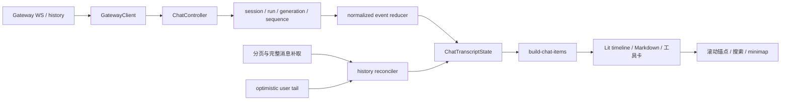
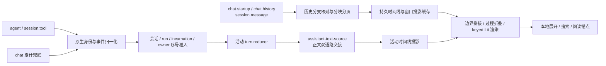
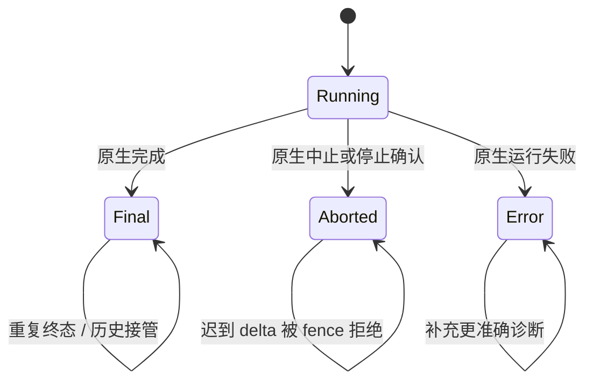

# 聊天渲染：原生历史、实时流与交互投影

本页说明消息如何从原生历史和实时事件形成可重建的聊天状态，重点是身份、顺序、接管、发送与恢复。Renderer 不建立第二份 transcript；Main 和 Redux 只保留各自产品状态。

阅读顺序：先看数据流和状态归属，再看事件准入、历史读取及发送，最后查看终态、交互与回归入口。三个独立专题分别维护[运行与内容呈现](chat-runtime-presentation.md)、[交互展示载体](chat-interactive-surfaces.md)和[工作区审阅](chat-workspace-review.md)，避免把卡片/UI细节混进消息协议。

## 1. 从原生事件到屏幕

Main 只提供连接准备、权限、产品生命周期和受限详情读取，不复制 Thinking/Tool/Content。Redux 也不保存 transcript。原生历史丢失时不能用产品消息缓存冒充恢复。

原生后台命令完成后的续跑输入虽然使用 `user` 角色，但带有
`provenance.kind: internal_system` 和 `sourceTool: exec`。显示投影在历史读取及
实时消息接收时隐藏这类内部输入，保留原生执行与历史记录；不按 `Exec completed`
或模型状态等正文前缀过滤，用户引用相同文字及助手的实际结果仍正常展示。

Composer 提交前只是草稿；Main 建立产品会话与 `clientTurnId`，并准备模型、权限和项目根目录。首轮由 Router 准备并委托当前聊天 client 一次发送（后台保留 Router 运输），后续回合由集中式聊天 client 发送。产品 receipt 只证明身份已建立，原生 admission 只证明执行已被接收，live final 也不能单独证明后代任务与 Goal 已全部结束。排障时先查原生 history 和完整 event，再查 admission、reducer 与渲染 pipeline；Main 的摘要日志缺少中间帧不能证明原生事件未发生。

## 2. 控制器和状态归属

Renderer 只持有当前显示所需的状态。以下分别说明 controller、transcript、产品活动投影；列表汇总不能反过来授权发送。

### 产品元数据刷新

窗口重新获得焦点时，只为当前已持久化且仍运行的会话刷新产品元数据。
首次发送前的 `temp-` 会话仅属于乐观界面，不通过 `cowork:session:get` 查库；
切换、关闭或卸载后，旧焦点读取的选择资格立即失效，不能覆盖新会话或新临时草稿。
该读取不加载原生正文、不重建缺失会话。Main 查不到产品记录时明确返回失败，
Renderer 保留现有选择，诊断包含请求的会话 ID 与非空原因；过期失败不再报告为当前错误。
产品会话缺失不证明原生历史已删除，也不触发关联讨论或原生会话清理。

### Controller 生命周期

ChatController 入口持有连接、canonical session、订阅、transcript 和对外命令。session/history/recovery/compaction/progress 模块通过明确上下文操作；propertyContext 使用实时访问器，await 后不读取拆分时复制的旧状态。

### Transcript 与终态 fence

ChatTranscriptState 包含 session key/id、persistedMessages、historySource、historyGeneration、activeTurn、recentRuns、terminalRunIds 和 revision。historySource 只有 gateway 或 optimistic；后者是等待原生接管的暂态，不是另一个历史来源。

| Turn item | 稳定身份与内容                                     | 结束语义                               |
| --------- | -------------------------------------------------- | -------------------------------------- |
| Thinking  | run + item/sequence，reasoning 文本                | completed/failed/cancelled/interrupted |
| Tool      | toolCallId、name、input、output、error             | 单工具状态，不直接决定 run 终态        |
| Content   | 文本段、delta/snapshot/replaceable、preamble owner | completed 或 interrupted               |
| Terminal  | run 对应的中止/错误说明                            | 合并为同一终态行                       |

activeTurn 记录原生 run/session/lifecycle generation 与序列。最近 24 个 run 的详情保留 5 分钟，但 identity-only terminal fence 保留到当前 session projection reset；详情过期不能允许慢到 delta 重新创建已结束运行。

Main 的 lifecycle 完成兜底仅接受 `executionSettled:true` 的 `end`／`error`，随后才启动延迟收敛。attempt finishing 或没有整轮执行确认的 terminal 不能结束产品运行状态；压缩阶段继续暂停兜底计时。`chat.final` 的显示收敛与原生整轮执行结论保持区分。

### 主运行与后台活动投影

会话列表的旋转图标汇总本会话的主运行、原生子任务、Agent Team 成员的当前执行和关联群聊，以及 Swarm 流程。协作历史投递缺少精确终态回执仅表示未结算，不单独构成运行证据；成员空闲后不因 round.pending 或 open／closing 状态持续旋转，也不将历史执行改为完成。该汇总只参与列表展示，不用于主输入框的发送准入。主输入框读取所选会话的 `sessionMainRuntimeActivity`（原生 `mainRunning`），并保留压缩、Goal 续跑和在途停止控制；只有后台 Team／Swarm／子任务活动时仍显示发送。结果未知的快照保留此前已知的主运行状态，不能据缺少确认收走停止入口。

Swarm 侧栏活动从插件的 `swarmWorkflow.activity` 有界汇总读取，Main 核验精确父 key 归属后投影产品会话，不在启动时逐个读取历史聊天的完整流程。摘要面板可见时通过 `swarmWorkflow.summary` 读取该聊天的流程数量；Workflow Tab 可见时才观察 `swarmWorkflow.list`。三种投影各自按变更事件和重连重新核验，暂时失败不清空已知活动；分页代次或版本不一致不能作为完整快照。

隐藏 Tab 或窗口撤销完整列表、详情刷新及节点历史连接，后台执行恢复不依赖面板可见性。详见 [Swarm Workflow](../features/workflow/swarm-workflow.md)。

### 首条发送的活动建立

首轮 Renderer 发送将临时会话提升为正式身份时，先同步建立对应主运行活动再选择会话，避免异步列表刷新尚未到达而丢失停止入口。只有发送端明确确认未提交时才能清理该暂态；未知结果或取消 ACK 不代替执行核验。状态查询的响应排序与活动所有权分别计代：普通在途或 unknown 查询不能阻止未发送暂态清理；新的执行准入、活动变更或已确认的运行快照可以保护后续活动，避免旧失败清除主运行或后台子任务。压缩等即时进度按真实原生 session key 有界保存、只投影当前会话；切换后的 passive effect 不再覆盖控制器刚恢复的活动，旧会话清理也不能抹掉新会话进度。

### 活动时间和列表归属

会话列表的日期分组和组内排序使用最近对话活动时间，而非创建时间。继续历史会话后，
普通未置顶会话按本地日历移入「今天」并按活动时间降序排列；置顶、用户分组与来源分组
仍按既有规则展示。Main 先持久化活动时间再广播；Renderer 合并列表及完整会话读取时
保留较新的已知时间，避免较早发出的读取请求将会话移回旧分组。跨午夜及窗口恢复可见时
按当前本地日期重新分组，不修改会话创建时间或历史归属。
跨日执行中的会话接收新的待发输入时，同样以原生接收事件的时间移入「今天」，不等待
队列启动。

Main 核对原生会话身份后仅发布普通活动元数据，不据此切换主执行状态、绑定
新的 run 或结束此前执行；重连后尚无本地 active turn 时也可独立完成身份核对。

## 3. 事件准入与顺序

连接 generation 防旧 socket，session 身份防切换串消息，run/lifecycle 防旧运行，sequence 防重复和乱序。不能只用时间戳或“当前页面是否忙”判断。

原生 Agent 事件与 Chat 持久消息事件可能交错。reducer 归一化 delta、累计 snapshot 和可替换段，不能把 snapshot 再 append 一遍，也不能用一个全局 latestSeq 拒绝另一个 owner 的缺口恢复。

Agent 正文优先按原生 `data.itemId` 绑定 Content owner。同一消息的累计更新即使被
Thinking 或 Tool 交错，也更新原 Content；不同原生消息不能因为相邻或文字相同而合并。
带原生 itemId 的空替换只撤回对应正文，不清除较新的回复或独立 preamble。
没有该身份时继续使用已有段序号和尾部规则，不根据相同文本猜测归属。
同一正文续写会结束相邻 Thinking；历史回填或跨工具修订不能据此结束当前 Thinking。

Completions 的正文预览可能在工具参数开始流入时被原生归类为 commentary，包括独立
reasoning、仅在 content 中包含 `<think>` 的旧格式和普通无 reasoning 正文。
Renderer 在同一条 preamble update 的归约中隐藏同源 assistant 预览，不能等到整段
模型响应结束才处理，否则两种 owner 会在参数生成期间重复显示。

当前 reasoning 流式补丁 028 只补充
`assistantTextScope.id`：来自 transport 的单条原生消息身份，随 normalized partial
保留，并从具体 source message 捕获，不读取回调之后的当前消息状态。该身份在每条
Completions 消息创建时分配，与 `structuredTextStreaming` 能力标记分开；身份本身
不开放 strict 缓冲、durable partial/block 或私有 thinking 通道。

assistant
itemId 与 commentary signature 本来属于两套身份，不能从 runId、相邻顺序或文字猜出关联。
原生 message_end 的空 assistant 替换继续清理 Chat buffer；即时显示交接属于 Renderer。
旧格式的累计正文在软件显示侧分离思考标签：提取、历史正文、流式正文与复制使用同一
规则，未闭合标签保持隐藏。复用已有 Markdown 词法器保护代码、转义和 HTML 属性；
不改写原生历史，不从标签或同文推断消息身份、工具执行或运行完成。

普通／inline-only 流在 error、abort 或不完整 EOF 后仍按原生规则保留已发布的部分正文；
消息身份不会把它提升为结构化预览，也不套用结构化预览的失败撤回规则。

模型也可能在最终 `stop` 时回滚临时工具调用，并移除临时 commentary signature。
028 在实际 message_end 的 delivery 中附上 `assistantTextScope.commentaryItemIds`，
表示该消息最终仍保留的原生 commentary IDs。只有真实消息完成且 content 数组完整
才附带集合；缺失表示未知，空数组表示确实没有保留项。text_end 或通用
`finalMessage` flush 不构成该依据。

即使正文未变化，也发布这份完成事实。
这条真实完成投递使用完整 `replace:true` 正文，避免 Gateway 压缩为 delta 后，
与历史已补载的前缀产生重复追加或丢失后缀；普通流式更新仍走原生 delta 通路。
Renderer 仅隐藏同 scope 中未保留的 preamble，并恢复最终正文；合法混合说明、
其他消息及同文内容均保留。活动 turn 只记录身份／序号，最终展示层持续过滤已隐藏
owner，历史补载不能令其复活。消息完成不代表 whole-run 执行结算。

原生 publisher、回调、代次准入和订阅生命周期保持原契约，不增加发布回执表或队列。

收到 Agent 正文后，同轮非撤回 Chat 增量不再接管正文。原生 Chat 和 Agent 是独立的
节流／合并通路；Agent 合并增量只携带最后一个事件序号，可能包含已由 Chat 快照
展示的较早文字，因此“Chat 序号紧接 Agent”不能证明后续增量没有重叠。
前台、后台与侧聊使用同一来源规则；尚无 Agent 正文时保留 Chat 流式兜底，
空替换撤回及 final 仍沿用原有身份、序号和终态校验。绘制直接展示已准入正文，
不增加逐字播放或额外等待，也不推测 Gateway 尚未发布的文字。

Chat 先到时，兜底 Content 与 Agent 原生 owner 分开累积；前者不能成为后者的
增量基线。Chat 的 `sourceSeq` 是覆盖水位，Tool/item flush 也可发布该水位，不能
直接等同于正文 item 身份。兜底按已知水位定位，不提前推进 Agent 水位或切断
Thinking；待交接的原生正文暂不投影。只有完整基线的原生正文追上覆盖水位，才
原子移除兜底并展示原生 items，保留较长预览且不重复追加。

首个 Agent delta 缺少基线，或覆盖水位来自较晚的 flush 时，控制器沿现有认证
`chat.history` 读取该 run/owner 的 keyed `assistantTextSnapshot`。请求开始时固定
Chat 水位，较晚 Chat 不能被旧响应覆盖；按精确 turn、run、物理会话、生命周期、
history generation 和 client generation 拒绝过期响应。

每 turn 单请求并最多尝试
3 次；缺正文的 metadata-only 快照或读取失败保留 Chat。初始空帧、Thinking 和
生命周期事件不能锁定正文来源。commentary、撤回、前后台与侧聊沿用同一交接规则；
不以相同字符串猜 owner，不新增正文缓存或执行终态来源。

已准入的正文直接使用当前 transcript 文本渲染，同一动画帧内的更新只合并绘制，
不再维护逐字播放队列或为播放保留终态副本。即使一次收到很长的快照，也在首次
绘制时完整显示；工具边界、撤回、停止和历史接管继续遵守原生事件身份与顺序。
工具 partial 的 80ms 绘制节流独立保留。此行为消除 Renderer 额外播放延迟，
不代表 Gateway 尚未发布的正文已经可用。

run、toolCallId、entry id、preamble owner 和 sequence 共同决定时间线归属；时间戳不能独自决定工具完成顺序。Thinking 来自原生 reasoning/redacted-thinking 投影，可能因模型能力或 provider 配置而缺失；UI 不推测模型未返回的内容。Thinking 与正文、工具前说明分别保留 item 和 owner。展开、折叠与平滑揭示只是本地显示状态，不能改变原生段边界或历史。

`replace: true` 优先于 delta 追加语义，包括空字符串撤回。累计 chat 空替换按原生源序号撤回覆盖范围内的 assistant 文本，并阻止尚未到达的旧 owner 复活；Thinking、Tool 和独立 preamble 不受此水位影响。文本更新序号独立于 Tool 关闭段时的边界序号。普通空快照仍不构成段边界。

同一个模型消息的 scope 可以包含多个独立 preamble 和最终答复，不能仅凭 scope
合并。通用原生 publisher 可能以最新签名 ID 发布整条消息的累计 commentary；
034 对具有明确原生消息身份的非 Responses commentary，在现有 delivery 入口统一
使用完整 source message 的原生 commentary 提取结果，并明确标记
`assistantTextScope.commentarySnapshot: 'message'`。

整消息清洗保持完整上下文，不能
拆块清洗：隐藏标记、代码围栏及字面 XML 都可能跨原生 block。
028 仅在既有 scope 中传递这一事实；完成集合、原生 ID 和执行生命周期不变。
Renderer 保留各原生 item 及正文，仅在同 scope 的明确整消息快照中，按最后正文
事件序号选择一份显示。工具推进的边界序号不能改变选择；真实完成集合撤销的 ID
不参与选择。独立 preamble、Responses 的活动块、缺少消息身份的旧路径和最终答复
不受此规则合并。

不比较字符串前缀或裁剪重叠正文，不增加发布回执表或转录缓存。

运行恢复使用原生 `chat.history`：持久消息来自 `messages`；进行中的有身份正文、
工具、preamble 和 usage 来自 `inFlightRun.events`。
028 在现有有界／冻结快照中保留各 assistant owner 的最新正文和 scope 事实，
包括随后切换到普通模型的正文；preamble 也保留 scope。Renderer 回放这些 owner，
不再追加 run 累计的 `inFlightRun.text`，以免把已交给旁白的预览再次显示。

同一 scope 超出事件／字节预算时一起淘汰；单条正文超限时只保留身份和完成事实，
正文等待后续 live 或正式历史接管，不以无归属的累计文字补造。没有 owned snapshot
且没有已知 scope 的旧路径，仍使用原生 text 兜底：只有序号的 assistant 事件不代表
已有正文。已移除 017 分段恢复补丁，不承诺重现未持久化 thinking 的所有交错顺序。

当前 display-history 的能力缺口、补丁保留依据与移除条件统一见[补丁总账](../../scripts/patches/v2026.10.7/README.md#capability-gaps-and-removal-conditions)。

工具的 `item(kind=tool, phase=update).progressText` 是独立的临时进度，并不保证同时有 `tool.partialResult`；直接更新运行中工具卡。临时进度序号阻止迟到 partial 令显示倒退，同时允许工具终态和缺失 input 补回。最终 Tool result 接管后清除进度，不为每个进度帧轮询历史。

in-flight recovery snapshot 是稀疏数据，不提升 live event fence。活动 owner 的序列分别跟踪；工具前 preamble、正文和 Thinking 保留独立 item 身份，避免多个段合并成一块再错误排序。

## 4. 历史加载与有界展示

### 首次读取、连接和发送门禁

会话产品元数据读取成功后立即选中并挂载历史读取器，模型查询在后台沿既有代次与用户确认校验更新。普通首次读取使用 `chat.history`，不等待未消费的模型／账户启动元数据；挂起运行恢复继续使用 `chat.startup`。Gateway 校验和恢复原生记录，Renderer 不解压文件、不建立正文缓存。选中后的连接准备和首次读取期间立即显示加载动画，已有正文与乐观输入继续保留；归档历史可能耗时更长，不推断冷状态或伪造进度。`initialHistoryReady` 表示首次读取流程已结束，不能单独证明读取成功；`historyReadFailed` 单独记录选中会话的读取失败。

主聊天通过会话 key 绑定读取就绪状态，首次读取未完成或恢复失败时禁止发送、侧聊和导出；失败后保留已显示正文，提供只读重试。只有快照实际提交成功才解除错误状态，被拒绝的空快照不能清除失败。断连使初始化和分页世代失效，同一个 client 重连也要等待新的权威历史；排队等待旧请求不等于读取完成。异步读取的成功和失败均核对 sessionKey、client 和历史 generation，旧连接的失败不能污染新连接。普通后台历史刷新不显示初次加载横幅。导出范围仍是当前聊天快照，不能代表完整原生备份。

例外是 Main 已完成原生会话准备、通过一次性委托派发的首轮输入：发送只等待当前
sessionKey 的连接及 `sessions.messages.subscribe` 确认，且不能存在待恢复的 suspended run。
该路径不复用导出快照的 loading 条件，也不等待 `chat.startup` / 历史分页；历史加载与
首轮执行可以并行，继续由原有身份和序号规则合并。普通续发、侧聊和导出的读取门禁不变。
本地“正在准备”占位不构成原生运行身份，不能触发 suspended-run 恢复。

先发订阅后即读取历史，不额外等待确认；迟到的当前代次确认触发补读，发送仍等待订阅确认。
切换会话发起退订时立即撤销旧订阅的就绪状态；迟到的旧订阅确认不得退订当前重新选择的同一会话。
委托发送通过会话前置校验后，在调用运输前绑定 Main 提供的精确幂等 ID；断线且回执
未知时据此恢复，不重发。停止控制回执也按该 ID 清理占位，不能清除后来的其他运行。

首次打开正在执行的持久会话（包括协作助手详情）时，实时事件可能先于历史读取到达。
同一物理会话、同一历史世代且 `inFlightRun` 匹配当前执行时，允许补入该运行之前的历史和已持久化的用户输入；
读取期间已接收的同一次 runId 原生消息按稳定身份保留，历史响应中的旧实时尾部不能覆盖这些消息；其他运行的并发更新仍拒绝接管。
边界使用原生 runId 或记录时间，未定身份／时间的快照继续拒绝。当前助手输出仍由实时投影拥有，迟到快照只能按原有序号规则补缺，不能覆盖较新的流内容。

原生 `chat.history.pendingInputs` 是已接收但尚未进入正式消息历史的输入，不能丢弃，也不能写入 transcript、Main 正文缓存或 Redux。主聊天保留仅当前 Renderer 会话的临时显示投影，按 `pendingBefore` 读取独立分页，并用 `inputRunIds` 的原生回执核对消费与撤回；会话、连接或历史世代变化后旧读取失效。

`display:false` 不显示，保留的取消／中断输入显示对应状态，按 `acceptedAt` 与可见历史排列，不能执行正式历史的编辑或分叉操作。原生消费回执可能为空，退役输入后重新读取正式历史；使用原生输入身份、用户消息的 `idempotencyKey` 和 `__openclaw.id` 去重，不凭相同文字合并。截断输入只通过原生单条消息接口补全。

### 分页和窗口

Gateway 的监听、`hello-ok` 和全局 ready 不代表目标 Agent 的原生会话库已经取得读取准入。
打开已有对话时，仅认证 RPC 的 `UNAVAILABLE`、`retryable: true` 且
`details.code: agent-database-inspection-pending` 与当前 Agent 匹配，才进入准备等待；
不能根据英文错误文本、任意 Agent 的恢复日志或普通断连推断目标已就绪。

同一次历史加载保留已有消息和 loading，在其单一所有权内以 1/2/4/8 秒封顶退避重读
原来的 `chat.history` / `chat.startup`，从首次明确准备拒绝起观察最多 120 秒；并发刷新通知
合并，不连续刷错误。
只有目标原生历史成功返回并通过原有身份、分页和时间线协调后才完成加载。
准备期也可能拒绝 `sessions.messages.subscribe`。明确进入准备等待后，后续读取先重新取得
该目标的真实订阅 ACK，再取快照关闭通知间隙；不能用历史读取成功代替订阅回执。

等待与只读请求绑定客户端、连接代次、目标 session key 和历史代次。切换对话、重连、
卸载或销毁撤销旧等待，A→B→A 也不能采用旧请求或让旧请求清理后继加载。预算耗尽保留
未确认状态及显式重试入口；原生 `agent-database-inspection-failed`、权限拒绝、协议错误等
仍显示真实错误，不自动重复。该恢复只重读历史，不重发聊天、执行修复或建立正文缓存。
主聊天和子任务、协作成员、工作流详情读取同一目标控制器的准备事实，准备期间不触发
各自较短的初始读取超时。

缓存内容可以继续展示，但不能建立读取就绪或发送授权；
底层发送及排队入口同样拒绝准备中或已超时的历史状态。只有错误字符串的独立收据接口
不套用这条自动等待规则，仍保留原有显式重试。
子任务首次历史的任务边界必须来自本次原生快照、旧页读取或真实持久任务事件；
外层初始化结束和缓存中的旧任务不能代替该读取就绪证据。

### 流水线与边界拼接

Thinking、Tool、Content 的共同入口是认证事件，而不是可见文本。数据流如下：

Thinking 按原生 item/段序号更新；Tool 按 toolCallId 接收 start、partial/progress、
result，并可补齐先到结果缺失的 input；Content 按消息 owner 与 scope 处理正文、
commentary、替换和撤回。历史补缺使用 owner 自己的水位，不能抬高整条实时流的
水位。整个流程不从显示文字推断执行完成，执行结论仍只来自精确 whole-run 证据。

独立属性流式入口只支持正文和等待状态。Thinking/Tool 的正式路径统一由已准入的原生事件驱动，不保留恒空的局部分段数组或独立 thinkingStream 分支。Chat 兜底、旧版无身份流、
稀疏 keyed snapshot、工具补缺和终态 fence 均有实际协议职责，不能因日常不触发
而删除。

正文来源协调移入 `model/turn/assistant-text-source.ts`，事件准入仍在原
reducer；披露内容生命周期归 `disclosure-content.ts`，自动折叠的短暂展示准备归
`completed-process-motion.ts`，实际过渡复用 `process-motion.css`。
保持 controller 的连接、运行和历史所有权，不另建执行状态机。

### 投影缓存和稳定行身份

显示侧对可见窗口和全部已加载消息都要做 peer 过滤。两者必须按各自不可变输入
数组记忆结果；单个 last-source 缓存会在每帧两个来源之间失效，使持久时间线
重建。历史模板也按行和显示选项复用，流式 tick、活动时钟仅更新 live lane；搜索、
语音、编辑、头像、工作目录和操作准入变化使相应模板失效。Plan 实施边界按当前
历史建立一次 entry-id 集合，避免每个页脚重新扫描整个分支。工具和 compaction
的 owner 变化仍使历史投影失效，正文普通 delta 不使旧历史失效。

历史行 key 使用原生 entry 身份、commentary sidecar 的原生 itemId 与消息内部 block
位置，主投影保持 entry key；缺少 discriminator 的未知重复形状才用 occurrence 兜底，
不能据此承诺跨窗口恢复。投影 discriminator 不改变 fallback run owner。
Thinking/Tool 摘要、Plan 和进度回执使用对应原生过程 ID。不能把当前窗口中的全局
行序号放进 key，否则前插或裁剪旧页会重建保留区的 DOM，丢失交互状态。完整可见
block 未变化时复用原生消息对象，避免翻页使保留区的消息模板全部失效。

### 展示窗口和增量调度

传输页保持 250 条。历史先基于当前 Renderer 已加载的原生分块完成投影与折叠，
再按实际视口选择显示行；不再先裁出 250 条原生记录再决定过程组与末尾正文。
原生记录窗口继续供历史定位使用，不控制聊天 DOM 的自动滚动裁剪。
普通滚动每个展示列表最多挂载 250 行，并保留视口上下的预留区域；超长已完成过程
及 Thinking/Tool 列表使用相同的内部展示窗口。

实际可见行、键盘焦点和非折叠选区
始终保留，必要时额外保留已有焦点或选区的相离区段；区段之间的未挂载范围仍以
高度占位，不因焦点或跨占位选区而创建整段历史 DOM，复制保留原选区文字。
离屏内容以按精确显示身份保存的实测高度占位，未测量行使用估计高度；高度索引
不保存另一份正文，换 client generation、原生会话身份或历史 generation 时失效。
滚动只查询高度索引与已挂载节点，不重新投影整段历史；新增原生历史时才更新缓存。
显示预算不限制已加载历史或原生历史保留量。

新增历史行由 `HistoryRenderScheduler` 按小批提交，并依据实际提交时间调整批量。
历史与流式正文复用同一个动画帧调度，每次调度只推进一小批历史；普通消息更新、
终态准入和文本内容保持现有语义，不能排队播放 token 或等待旧页完成才显示正文。
新导航替换未完成展示目标，旧 scope 的工作不得进入新的会话/物理身份/历史世代。
接近已加载历史顶部时按原生页补取，并等待本次展示提交完成；向下滚动直接使用
已加载的显示投影，不再按固定条数替换消息。待提交期间保持暂停阅读，不提前恢复
跟随。

显式 entry 与 minimap 定位先挂载目标显示行及所属披露，再沿原有入口定位；
未加载时按原生传输页补取，不依赖滚动步长或固定窗口遍历次数。

### 阅读锚点和原生滚动条

每批增强 Markdown 控件之后再测量、恢复阅读锚点，避免一次提交先后强制两次布局。
聊天关闭浏览器自动滚动锚定，由 `ChatScrollController` 单独拥有跟随/暂停状态；
跨批保留 scrollTop 的小数舍入余量，避免多次恢复累计像素偏差。恢复锚点时使用
DOM 提交后的实际 scrollTop，兼容高度缩小导致的浏览器原生 clamp。
程序写入位置后的异步 scroll 通知不重新决定跟随状态；内容缩短引发的向上 clamp
也不恢复跟随。

clamp 的 scroll 先于尺寸通知到达时剔除原生裁剪位移，只将同时发生
的真实手动滚动计入旧锚点偏移。用户向下滚到底部或显式返回最新消息时才恢复自动跟随。
原生滚动条按下即暂停跟随，拖动期间保持暂停，在底部释放对应指针后恢复；
释放、取消、失焦、重置和卸载撤销当前文档的指针监听，内层滚动条不接管外层聊天。
按住期间暂缓消息区 DOM 提交及滚动触发的历史窗口切换，保持原生滚动范围稳定；
消息接收和运行状态继续更新，释放、取消或失焦后提交当前内容；正常释放时按最后
拖动方向补做历史翻页。

延迟提交保留属性变更与历史展示等待，卸载释放等待，不重播流式增量。
锚点未移动时不重复写入相同 scrollTop，避免 Chromium 取消正在进行的原生滚动条拖动。
返回最新消息按钮以零额外布局高度悬浮，显隐不改变消息区滚动范围。
阅读锚点使用相对聊天视口的偏移；手动滚动立即更新已捕获的偏移，再在下一帧
更新可见行，防止异步尺寸变化撤销用户刚完成的滚动。消息区整体移动不改变阅读位置。
搜索命中与消息定位沿用原生 scrollIntoView，并统一交给滚动控制器暂停跟随。

普通消息保持平滑定位；目标位于内层滚动容器时使用原生即时定位，按实际外层位置
结束，不等待可能永远不会产生的外层 scrollend。平滑定位期间的输出不恢复旧锚点。

### 披露状态与挂载寿命

过程展开/收起选择由 `HistoryDisclosureState` 按原生会话身份和历史 generation 保留，离开窗口后返回
恢复；批量展开设置仍覆盖个别选择。工具、代码阅读偏好沿同一 scope 保留；引用的
业务 sessionKey 独立传递，始终保留真实原生 key。窗口重叠区继续复用原有 DOM。
搜索与 minimap/entry 显式定位会补齐当前窗口的待展示行。

页首的部分过程补齐更早内容时，外层组以保留尾项确定身份，Thinking/Tool 摘要只
通过共享的准确原生过程类型与 ID 延续显示身份；相同 runId、文字或工具名称不能
合并分组。缺少结果的历史工具在折叠阶段转成摘要后，合并摘要也以最后一项的准确
原生类型与 ID 确定显示 key；补加载旧页或同一调用的真实结果到达不能重建内外披露。
该 key 不参与工具或运行状态判断。只通过共享的原生源行/过程 ID 传递展开选择。
同源分组的形状往返时采用
最近一次选择，避免旧形状的缓存覆盖用户后来的开关。

原生 details 的 open 同步
改变、toggle 异步派发，提交前先保存真实工具展开值，避免流式刷新回写旧偏好。

关闭的已完成处理过程不解析其正文或创建工具 DOM；首次展开才挂载。关闭后保留
已挂载节点，供退出动画和阅读/编辑状态复用，后续隐藏更新延后到再展开。
任一祖先披露收起时，内层展示视口暂停滚动和尺寸变化触发的测量、回收；通过实际
文档中祖先披露的 toggle 恢复，跨 Shadow DOM 的外层披露同样受保护。显式搜索与
原生 entry 定位会显式补齐嵌套披露内容，不额外读取历史、不修改 open 状态，随后
按原有定位路径展开。挂载后补做 Markdown、工具阅读器和图表增强；卸载撤销监听。
卸载后已排队的 Lit 更新不再渲染或重新创建资源；重新挂载恢复现有 controller 的
订阅，并触发新的展示提交。

### 性能回归的证据范围

开发夹具 `components/fixtures/chat-flow-audit.html` 使用合成历史、250 条原生分页与有界视口，支持首次读取、加载旧页、稳态输出、运行中分页、搜索和过程动画检查。它记录真实 DOM 提交、阅读行是否保留及像素偏差，但模拟 Gateway，不包含真实原生磁盘/网络与冷归档 I/O。

测量时区分单帧提交、逐批全部展示和真实数据读取，不以旧设备样本承诺长历史全程 60fps。高度索引/焦点/选区的大规模回归也不等于同等条数原生历史的完整投影压测；安装版 Monaco Worker 装配须另验。

混合工具消息使用 OpenClaw 原生 commentary fallback 投影；commentary 可先于剩余
Thinking/Tool 块返回。Renderer 保留原生历史顺序，不要求重新加载后的块顺序与实时
事件完全一致，也不额外重排。当前运行时不再应用 018 顺序增强补丁。

### 传输分页与完整消息补取

chat-history-protocol 的初始及旧页大小为 250，字符预算 500000。分页使用原生 offset/nextOffset，hasMore=true 时必须有合法 cursor。UI 在折叠后按实测视口选择显示行，每个展示列表通常最多 250 行；可见行、焦点和选区的临时例外见上文。这些是传输/展示预算，不是原生历史保留上限。

超大行通过结构化 truncated 标记及原生 entry id 识别，使用 message get 或分块桥补取。当前完整消息请求与分块读取各有独立大小和并发限制，不能从一段“已截断”可见文本猜原文。

`chat.message.get` 返回显示投影，不能假定包含同 id 的所有 commentary。补取按显示身份匹配，保留独立 commentary；不能确认完整性的混合片段保留原投影，避免把省略内容误当成撤回。每次续取分块和领取并发任务前检查连接、会话和历史 generation，失效后停止剩余请求。子代理历史找到初始任务时，保留此前已加载的所有中间页，并通过原生身份去重。

工具 input、失败 detail、compaction detail 在有原生身份时受限补取。查询失败应保留已有消息和明确错误，不把 placeholder 当正式空结果永久存入投影。

Gateway 会为原生空失败记录生成带正文的 assistant 显示消息。失败 detail 同时返回原始内容是否为空；Renderer 据此恢复显示副本的失败形态，沿用 Gateway 安全文案并按 run 身份合并失败提示，避免普通助手头像下重复报错。原生记录已有部分正文或工具内容时保留原输出，不按错误文字猜测或清除正文。

## 5. Reconciliation 与乐观发送

### 原生待处理输入与排队发送

#### 运行中的排队输入

普通主聊天在任务运行期间保留输入框：无可提交内容时显示红色停止按钮，
有可提交内容时同一个按钮临时切换为排队发送，发送成功清空草稿后恢复停止按钮。
快捷键沿用用户的发送配置，附件、引用和浏览器上下文沿用同一套提交准备流程。
Goal 模式禁止排队发送，输入文字不把运行控制切换成发送按钮，快捷键和提交入口同样受限。
Goal 自动续跑和重试等待也视为活动状态，不能在两轮之间通过普通发送绕过限制。

已有主会话必须先成功读取本次会话的 Goal 和执行状态才开放提交，读取期间或失败时保留草稿与停止控制，避免切换会话时绕过限制。失败读取按退避间隔重试，成功后恢复事件驱动更新；切换会话时取消重试。
Goal 暂停／等待输入后的既有恢复操作不变。
侧聊、新建会话、停止确认期间和需要用户回答的阻塞状态不开放此入口；运行期间的斜杠命令不排队。

OpenClaw 原生提供单次 `chat.send.queueMode: "followup"`、
`chat.history.pendingInputs` / `inputReceipts` 和 `chat.abort.discardPendingInput`。
本应用直接按当前物理 sessionId 提交 followup，并使用 `suppressCommandInterpretation` 防止排队正文中的指令立即执行。

原生 Gateway 负责接收、排序、消费和持久化；应用不创建执行队列或第二套消息数据库。
排队发送不覆盖当前 transcript、runId、流式回复或 Main 的单个活动运行记录；后继执行通过原生生命周期事件进入现有显示与状态恢复流程。
排队接收身份使用 `justdo-queue-` 前缀，其接收／取消事件不能被误认为当前 `justdo-` 暂定运行的身份绑定。

发送确认后清理对应草稿并刷新原生输入投影。排队输入以输入框正上方的紧凑卡片呈现：
卡片左右略内缩，顶部圆角，底部与输入框叠接；每行显示队列图标、单行正文和查看／删除操作，
数量提示仅供读屏使用，避免单条消息额外占用标题行。多条消息保持顺序并在固定高度内滚动。
原生 `state: queued` 也包含普通发送尚未持久化的输入，不能单独作为卡片判断依据。

仅原生 `queued: true` 或带本应用 `justdo-queue-` 接收身份的输入进入排队卡片、查看与撤回入口；
普通待处理输入留在用户消息时间线，不因历史刷新短暂闪入卡片，也不显示接收／等待处理提醒。
排队输入不进入聊天时间线；原生消费后卡片消失，正式用户消息按 Gateway 历史显示。
带持久消息 ID 和序号的原生 `session.message` 用户行立即进入时间线，保留排队接收身份的
`idempotencyKey`，不要求它匹配后继执行新建的 runId，也不等待回复结束。

该追加仍核对会话 key
和物理 sessionId，按原生消息身份去重，并保留当前 Thinking／Tool／Content 的流式所有权。
React 仅接收当前会话的有界摘要，不向 Redux 或 Main 写入消息；切换会话后旧摘要不可见。
点击摘要或查看按钮可在卡片下方展开只读详情，复用聊天的用户消息渲染器和样式，保留引用、网页注释、录制步骤卡片及媒体附件的渲染与展开交互。
完整原生显示消息按需从当前会话投影读取，不降级为纯文本或复制进队列摘要；未完整加载时明确提示，输入消费或撤回后随卡片移除。

详情复用当前会话工作目录解析附件，不提供正式历史的编辑或分叉操作。
原生待处理视图替换时发布版本号，即使摘要未变也更新已展开详情；富内容的图片预览、代码与引用展开等使用聊天共享的内容交互控制，并在详情关闭时清理。
待处理分页、回执和游标读取使用 sessionKey，并校验响应的物理 sessionId。当前 `chat.history` 仅在 messageId 定位读取时接受 sessionId，不能将其附加到 pendingBefore、inputRunIds、offset 或 cursor 请求。

#### Chrome 空历史和待处理输入

Chrome 侧栏的 Main 历史投影按当前返回形态校验身份：完整页读取顶层 `sessionId`，增量页读取 `sessionInfo.sessionId`。产品新会话尚无原生会话或 transcript 时，允许原生返回没有游标的空页；再次确认身份未变化、正式历史和待处理输入均为空后返回空历史，不发布正文快照。传输失败或不完整返回仍保持失败，不能用空历史掩盖。

首条输入已接收、尚未创建 transcript 时，允许同一物理会话返回不带游标的空正式历史与非空 `pendingInputs`。待处理分页和 `inputRunIds` 回执独立读取，确认每个待处理页的身份／状态／可见性与空正式历史稳定后返回请求内投影；取消或撤回旧页输入不一定改变总数，不能只校验第一页，也不能依赖必有 runId。输入消费、状态变化或 transcript 出现则重试完整快照，不发布无游标正文缓存。扩展的发送占位在流投影创建用户气泡时立即移除，运行确认后不再叠加第二份乐观输入。

Chrome 侧栏的浏览器构建适配器复用同一 transcript reducer 与 `run-progress` / `run-activity`
纯函数，把已准入的阶段、工具进度与观察时间交给扩展本地活动条。稀疏旧事件不倒退活动，
参数生成不创建运行工具，Chat final 不清除 whole-run 活动。扩展本地模块拥有 keyed 消息与
过程 DOM、独立 Thinking/Tool 披露、阅读锚点和中英文案，不反向导入应用源码。

未知提交保留原 clientTurnId，Stop 绑定确切运行；只有原生结算证据可退役活动，
连接失败或停止 ACK 不触发显示完成。详见[扩展侧聊](../features/browser/browser-extension-side-chat.md)。

#### 未知提交与精确撤回

已取消／中断输入继续使用原有历史状态提示。
传输结果不明时保留草稿和本次会话的临时请求身份，
原文重试复用 idempotencyKey；明确拒绝后允许修改重发。此临时重试信息不持久化，重启后应先检查原生待处理输入，
不能把保留的草稿视为未发送证据。切换会话不会把确认结果应用到新会话。
停止操作与在途排队发送共用会话提交栅栏，发送结束后再次请求会话停止。

待处理输入显示撤回操作，使用原生输入身份查回原生 runId，再调用精确的
`chat.abort { sessionKey, runId, discardPendingInput: true }`；不使用无 runId 的停止替代撤回。
Gateway 原子校验待处理状态，已消费的输入不能借此中止当前运行。
刷新和重连只恢复原生状态；Gateway 重启后保留的中断输入不由应用自动重新执行。

浏览器扩展侧栏通过 Main 的显式只读选项取得同类原生输入投影；待处理正文只存在于当次响应，正式历史仍使用已有游标增量读取。侧栏轮询比较完整显示投影的摘要，确保较早位置的取消／撤回也能刷新，不仅比较最后几条消息。

#### 待处理输入的退役

单条 pending 补全明确返回 `ok:false` 且 `not_found`／`not_visible` 时退役旧显示项，不能继续展示截断预览；`not_found` 同时触发正式历史追读，以承接分页期间已消费的输入。临时传输失败或超限不构成撤回证据，保留原生截断占位。已核实退役且身份匹配的乐观输入不能因后续回执读取失败重新出现。

### 乐观消息接管

每次 history 请求携带 session key/id 与 historyGeneration，返回后先拒绝过时结果。合并优先使用原生 transcript identity；文本/时间辅助匹配只用于受控场景，不能合并用户真实重复发送。

`activeLeafEntryId` 随普通追加也会变化。比较时纳入上次 history 之后 `session.message` 已展示的持久后继，不能只使用上次 RPC 的 leaf。新尾页同时包含当前已展示 leaf 和后继新 leaf 时可证明同分支延续，保留已加载旧页及分页深度；没有该连续性证据时仍按原有分支替换规则处理。带 `spawnedBy` 却没有明确选中会话身份的事件不能绑定主会话 provisional run；明确属于选中子会话的事件仍正常接入。

optimistic tail 在原生接收前显示用户输入；history 接管后移除对应临时项，避免双份用户消息。实时 active items 可被持久 entry 接管，但 history 窗口缺少某段不代表它从原生消失，不应清空仍有效的 live 数据。

首条输入在实际传输调用前，由当前发送 owner 把已知请求键绑定为预期原生用户输入的 `idempotencyKey`；后续发送的 optimistic 用户行保存相同格式的输入键。历史中的用户输入键与本地精确比较：相同键可跨媒体补全、地址及 MIME 变化接管，不同键即使正文和附件相同也分别保留。ACK 改变执行 runId 不改写输入键；不从收到的键后缀反推执行身份或授权。

首条 pending 与后续 optimistic history tail 共用用户消息匹配规则。任一方包含媒体块、原生 `__openclaw.media` 或兼容媒体路径，且没有共同输入身份时，保留待匹配输入，不凭正文、时间、文件名、MIME 或 URL 合并。无媒体的受控内容匹配优先读取结构化 `content`，以纯文本 `text` 兜底；浏览器录制比较稳定步骤身份，页面标注比较有序卡片 ID，兼容原始上下文和展示块，卡片身份缺失时保留临时项。相同正文或空正文不能让不同输入覆盖不相关的历史行。助手输出的原有终态接管规则保持独立。

当前 run 的持久输出在 live projection 退役前保持隐藏；该规则按精确 runId 判断，
不受后续用户输入已进入历史的影响，避免排队输入推进用户边界后同时显示两份正文。

`chat.final` 的正文可能来自整轮累计 Chat buffer，不等于最后一条持久助手消息。
已准入的完整原生最终记录先于结束通知到达时，前台与后台在归约之前核对原生消息
ID／seq 或助手幂等键；缺少这些字段时，只允许最新可见 Agent 正文的精确 scope 与
最新原生记录的 `messageScopeId` 对应。仅同一 runId、相似正文或较早的最终记录不能
建立该对应；后续工具／压缩也会阻止借用旧 scope。commentary、工具调用、中断／错误、
截断及临时记录不参与。

确认后的原生正文不再被累计文本覆盖或降级为临时历史，
末尾通知仍按原规则结算显示状态，并有界读取正式历史完成整条时间线的接管。
媒体补全只更新附件，不单独退役活动投影或代替该次正式历史读取。

历史插入导致数组下标变化时，滚动窗口按首个可见 entry 身份重定位；不能按旧 index 滚到另一条消息。搜索定位和分支切点也依赖原生身份。

「复制当前会话」通过 `sessions.create(parentSessionKey,fork:true)` 复制当前原生分支；
「从此处分支」通过受管目标 key 的 `sessions.fork(includeEntry:true)` 包含选中的完整
助手回复，后续消息不进入新分支，输入框为空。10.4 仍需要当前 012 补丁提供受管目标
key 与包含助手切点语义，不能用原生默认的用户消息前切断替代。

两者保留助手、工程、模型与权限选择；整会话复制保留 Plan 开关，消息分支退出 Plan，
都不继承活动 Goal。创建、权限准备与 Goal 核验必须指向同一物理会话，身份变化拒绝
成功。失败时返回的恢复记录只加入列表，不抢占当前会话，也不显示创建成功。
未完成目标的 `branchCreationPending` 随产品元数据持久恢复；输入区显示检查/删除
提示，Wrapper 用实时 ref 在普通发送、侧聊、排队、压缩及历史修改前统一检查。

旧的 imperative handle 也不能绕过；只读历史、定位和导出继续可用。Main 同时关闭
普通准备、运行登记、模型/Plan 修改及作为复制来源的准入，不自动重发创建。
Worktree 和受管协作会话继续遵守各自的复制限制。

## 6. 终态、停止与迟到 admission

普通会话的正文流由原生 Gateway 发布。10.4 的轮末修订保护按
[执行引擎的 attempt 准入](05-agent-engine.md#轮末修订与流式交付)冻结适用钩子；
非所属会话不再因全局注册的 Team/Workflow 钩子等待完整回复。Renderer 不通过缓存、
轮询历史或模拟分字补流。所属运行仍在修订决策前隐藏草稿；停止和结算分别遵循下述边界。

首次 `chat.startup` 和后续历史响应由原生 canonical 准备控制。Windows 路径别名与
pending frame 的发布修复见同一执行引擎文档；Renderer 不重复提交请求来推动准备，
也不把尚未完成读取时提前收到的响应视为另一次执行或新的授权。

停止成功回执通过 settleConfirmedRun 收敛当前 Renderer turn 的显示，不依赖 aborted stream 恰好送达。首个流事件尚未到达时只保存 fence，不制造空消息或结束别的 run。重复 receipt/abort/lifecycle 共用显示终态行及结束时间。这里的停止显示与 Main 的整轮执行结论分开：Stop ACK 不补造 execution outcome，后者仍要求匹配 run 的 `executionSettled:true` 生命周期证据。

普通 send 尚未获得原生 handle 时，取消需要等待迟到 admission；UI 等待有界，超时不能假装原生已空闲。后台继续处理原操作取消，同一操作重试共用取消任务，完成前保留发送隔离。

停止先同步关闭本地 Team 发起准入，并立即向 Gateway 发出原生停止；Team 守卫的异步清理和未知发送的取消意图回写不作为原生停止的前置等待。辅助回写失败仍保留未知操作与重试栅栏，不妨碍尝试停止主运行，也不补造原生终态。

手动压缩以客户端生成的 `operationId` 绑定一次 `sessions.compact` 提交。原生操作状态覆盖排队和准备阶段；`sessions.compaction.abort` 取消这个操作，`sessions.compaction.status` 用于重连核对。会话级 `no-active-run`、请求超时和断线都不是压缩终态，不能据此重发或解除发送隔离；只有匹配操作与会话的权威终态可收敛。Gateway 重启后未知结果不能伪装为成功或已取消：先建立迟到提交取消围栏，再明确提示无法确认原结果。原生记录只保存有界、无内容的操作状态，不建立另一份 transcript 或持久压缩账本。

## 7. Plan、Goal 与 progress card

聊天 Shadow DOM 的颜色槽通过主题基础样式继承当前完整调色板，Thinking、Tool、正文及用户消息随主题切换。过程记录仅为思考正文和工具参数／结果保留内层背景，标题及状态标记直接排列在时间线上，外层容器不添加背景或边框；工具行提供展开箭头与键盘焦点。

默认头像由 `chat-avatar.ts` 和同目录 `chat-avatar.css` 统一提供，主聊天 Lit 与 React 群聊适配器共用图形和样式。深色主题的用户、助手和错误头像采用 32px 圆角徽章，以中性、主题强调色和柔和红色区分角色，底色与细边缘跟随当前调色板；浅色主题保留圆形样式，头像列尺寸与消息对齐保持一致。除这三类主头像外，通用渲染器保留工具齿轮和未知角色问号兜底；协作成员使用按身份着色的姓名首字头像，原生运行提示的星芒属于活动指示，不是第四种角色头像。

「设置 / 外观」的消息样式默认采用文档模式；未保存消息样式或保存值无效时使用该默认值，已有的有效气泡模式或文档模式选择继续保留。

处理过程折叠只组织展示，不决定执行是否成功：以用户消息和执行阶段边界隔开分组，将历史中最后一个正文块之前的连续、已结束 Thinking、Tool 和中间正文默认收起，最后一个正文块整体保持可见。过程中的工具失败、取消或中断不切断这一分组，统一入口使用无背景、无边框的历史图标、文字和展开箭头，收起时显示「展开处理过程」，展开时显示「收起处理过程」，不展示汇总次数，不复用内部 Thinking／Tool 标题样式；展开后仍保留各项原始错误详情和状态，不据后续正文宣称错误已经恢复。

不要求本地计时回执或各历史片段的 runId 一致；原生历史可能缺少 runId，此时过程项沿用自己的显示回退身份，不用这些身份推断或改写运行归属。展开时复用原项目、身份和顺序，不改写原生历史或产品回执。控制器的活动轮次、发送状态及最新本地运行中的记录保护末尾轮次，该保护状态也参与渲染缓存失效；明确失败／中断的整轮回复、审批、交互组件、媒体交付及未结束工具保持可见，并隔开可折叠区段。缺少本地完成记录的历史仍可按展示边界收拢，但不能据此建立整轮执行结论。

展开状态只属于当前 Renderer 会话／历史世代；原生消息定位和搜索命中可展开对应区域。批量展开／收起过程详情同时作用于外层分组和内部过程项；关闭区域内的 Mermaid 延迟到可见时渲染，展开会触发可见性扫描，无需额外滚动。

主聊天对任意版本的持久消息中缺失工具回执采用通用展示归档：离开活动保护且后续已有普通助手正文时，
`sessions_yield` 或其它缺回执工具可与相邻 Thinking／Tool 合入同一个过程摘要及「展开处理过程」。
已有原生阻断、跳过、取消或失败显示结果保持原样；仅对仍显示运行中的缺回执工具克隆展示项并复用既有的 `outcome: unknown`，
移除持续运行的蓝色呼吸提示；原始工具状态、原生历史和运行回执均不改写，
不能据此认定执行成功、失败或中断。

announce、Gateway 注入消息和投递镜像不单独触发此归档；
真实活动末尾、交互和媒体边界继续保护。该规则不读取启动或迁移标识，不增加版本兼容状态。
展示选项及活动保护共同参与缓存失效；主聊天启用此宿主能力，浏览器侧聊默认不启用。

行内代码保留等宽字体并跟随正文文字色，使用常规字重和较小内边距；深色底色不透明度为 14%，避免密集变量抢占阅读注意。完整代码块和整体调色板保持原有样式。

深色主题的用户消息采用四角一致的 20px 圆角，内边距为上下 10px、左右 16px；相邻正文段落间距为 16px，单行消息保持原有高度。经典深色的用户气泡使用柔和深蓝和偏白文字；其它主题沿用各自的颜色槽，浅色消息和助手正文排版保持原样。普通气泡按内容收缩并受消息列宽约束；包含普通代码块的用户气泡展开到既有最大可用宽度，避免代码卡片的内联尺寸隔离使气泡错误收缩。代码长行仍在卡片内横向滚动，行内代码与 Mermaid 保持原尺寸规则；附件、链接及消息操作沿用既有渲染路径。

已结束的 `progress_card` 进度更新工具回执也属于可折叠过程项，与前后的 Thinking、Tool 和中间正文合入同一个「展开处理过程」区域，展开后保留原有轻量进度回执样式、身份及顺序。正在更新的回执继续直接显示并作为分组边界；活动轮次保护、用户和阶段边界、最终正文及其后记录的可见性规则保持一致，不据进度更新建立执行结论。

`ask_user_question` 使用插件自有的结构化结果（版本、题目快照和实际响应），
工具的唯一 text 块是完整 JSON envelope，包含 `askUserQuestion` 和模型可读 `summary`；实时结果同时提供 `details.askUserQuestion`。
原生历史会过滤自定义 details，故历史恢复读取同一 text envelope，不依赖该字段留存或新增原生白名单。
在实时与历史中投影为同一种问答过程项，不解析模型可见的英文摘要。

人类提交显示引用原问题的右侧回答气泡，
保留多选、选项补充、其他文字和跳过；超时自动采用默认值时显示每道原问题及实际默认答案，并注明系统自动选择。
超时未采用默认值和取消均保留原问题与未答状态，不生成用户回答。收集答案继续使用现有弹窗，等待过程只有紧凑状态。
问答项是活动轮次保护的显式展示例外：即使尚无最终正文，也复用「展开处理过程」默认折叠；有最终正文时与邻接已结束过程合组，
不添加第二层处理过程，也不收起其它活动工具、审批或交付内容。原生角色、toolCallId、历史顺序与执行状态不变，不发送合成用户消息。

只有精确工具名、合法问题输入或已完成的合法结构化结果进入专用展示；取消、中断与失败保留明确状态和原始错误文字，仍默认折叠，不显示为等待或用户回答。
已完成的旧文本结果和畸形问题输入保留通用工具详情，不猜测答案。

实时轮次已进入 `final` 展示状态、发送状态结束且最新本地运行记录不再运行时，
即使仍在等待原生历史接管，也对持久前缀与保留的实时尾部统一应用过程折叠。
已结束的实时中间正文可纳入过程，最后正文保持可见；未完成正文、交互组件、
媒体交付及其他可见边界继续保留。此操作仅改变显示行，不提前清除 active turn、
生成历史消息或建立整轮执行结论；原生历史接管仍沿用原有身份与去重规则。

自动收起处理过程时，仅对同一原生会话、历史世代和连接代际中刚才确实可见、未分组的精确源行
准备一次展开布局，再复用手动收起的原生高度、淡出和箭头过渡；最终正文立即显示，不等待动画。
临时展开不作为用户选择写入披露偏好。用户点击、显式定位或批量展开优先于待执行的自动关闭；
切换作用域和卸载撤销回调。首次加载历史、离屏分组和窗口重新挂载继续直接收起并保持内容惰性，
不因历史刷新重播动画。动画继续在系统减少动态效果时运行；不支持现有原生 details 过渡的环境沿用直接收起。

最后正文按实际非空 text 选择，纯媒体、空白助手记录和无正文的原生交付伴生记录
不能使前面的最终答复进入折叠区；这些记录自身仍保留原位和媒体可见性。末尾正在
追加的非空正文继续保护本轮，不因搜索正文候选而提前按已结束处理。

上下文压缩的原生历史标记、跳过标记，以及已完成／失败／取消／跳过的状态记录同样纳入处理过程，与相邻过程项保持一个折叠区域，不再因其 system 角色切断分组。展开后复用原压缩展示，保留 token 指标、摘要独立展开和终态原因；进行中或未确认状态仍直接显示并隔开可折叠区段。当前活动轮次、缺少后续最终正文的压缩和最终正文后的压缩记录保持可见，普通系统消息及用户／阶段边界仍隔开分组；折叠不改变原生状态或建立执行结论。

整轮运行回执为失败或中止时，不阻止此前已结束的过程折叠；这类回执也可能附在普通中间正文上，不能将其解释为该正文自身的错误。原生失败回复，以及明确携带 `stopReason` / `stop_reason` 为 `error` 或 `aborted` 的正文保持在折叠区外，作为前后过程的可见边界；最后正文仍整体可见。该规则适用于包含多次 Goal 续跑的历史，不改写回执或原生状态，也不从折叠推断执行成功或错误已恢复。

过程展开内容使用与外层消息列表相同的行布局、间距变量、正文宽度、字体和行高；折叠标题独立于内容布局，不再通过嵌套助手气泡、清零 gap 或移除头像栏压缩内容。头像始终由入口行显示，展开与收起时位置不变；内部原始头像栏保留尺寸与对齐，仅隐藏其图像，避免重复头像或改变原生行高。入口与内部列表之间使用现有消息间距变量，不引入紧凑阅读样式。

历史展示窗口的外层行容器同样保留过程摘要与前后正文、连续正文之间的间距，覆盖持久历史、实时尾部及展开的处理过程，并继续跟随消息密度和文档／气泡模式；历史窗口末尾的占位元素与直接渲染的实时新增行之间也遵循相同规则，避免原生历史接管前后间距变化。Thinking／Tool 摘要标题框的默认内边距为上下 2px、左右 7px，圆角 6px，独立于消息行间距；外层处理过程入口保留原尺寸。

摘要使用当前主题的实色表面、边框与阴影，避免背景消息透过面板。深色主题使用更亮一级的浮层表面，并增强外边框、标题分隔线和条目悬停色，与主聊天背景拉开层次；进度说明的底部渐隐和展开按钮跟随面板底色。浅色主题沿用原有配色。分组标题和空态使用次级文字色，任务进度标题遵循同一颜色层级。面板以标题栏右侧操作区作为定位容器，右边缘始终对齐该区域，显示或隐藏「新建标签页」按钮不改变右侧对齐位置。

聊天右上角以「摘要」统一任务进度、子智能体、输出内容、来源、Swarm Workflow 和 Agent Team 的入口。子智能体显示运行中、已完成和失败数量，点击打开列表 Tab；列表的原生发现控制器持续挂载，展示内容通过 Portal 放入工作区，沿实际窗口观察和处理交互。关闭列表 Tab 不终止发现，也不影响单个子智能体的详情 Tab。摘要预览、子智能体列表与下级任务共用 24 种彩色几何图案，主色与辅色分别从 16 色中确定，辅色避开主色，共 5,760 种组合。

以完整原生 session key 通过固定哈希及独立混合选择图案和配色，不依赖列表顺序或持久化分配，不随增删相邻任务、名称或执行状态变化；图案/色表顺序与混合常量保持稳定。组合仅用于减少重复，不保证不同身份绝不相同；图标仅表示身份，状态继续由分组与文字表达，不参与执行判定。Goal 文字直接来自输入框已有的原生目标读取 owner，只展示 objective，不可点击；摘要不展示 Plan 模式，现有计划审批保持独立。

任务进度在 Goal 后作为独立分组，直接复用 `SessionProgressCard`，标题为「任务进度」，与摘要其它分组使用一致的标题字号、颜色和左右对齐；去除卡片独立的外框、背景、阴影、入场动画与内部滚动区。标题右侧集中状态图标、完成数量、折叠与刷新操作，关闭统一由摘要提供。内容区保留原 Markdown、步骤文字的字体和颜色、步骤标记与间距及内容分隔线，不显示更新时间。移除右上角独立进度按钮和聊天上方的悬浮卡，进度状态仍由当前会话的原生 card 与 run state 提供，不复制或重建计划。

完成卡仍保留在摘要内，不沿用旧悬浮卡的完成后自动隐藏计时。首次原生进度出现也参与摘要的一次自动展开，此后的 revision 和运行状态更新不重新打开已关闭的摘要。

进度说明由模型写入原生卡片的 Markdown，段落、表格和进度条均非固定业务模板；步骤列表独立来自结构化计划。Markdown 表格使用主题色的圆角细边框、浅色表头与统一行距，两列表格首列保留短标签所需的最小宽度，避免中文逐字断行；长内容正常换行，宽表仍在原有容器内横向滚动，不按字段名称识别或重写模型内容。

存在非空进度说明时，摘要面板宽度从 20rem 扩至 26rem，并始终以视口宽度减去两侧留白为上限；没有说明时保留原宽度。中间说明默认最多展示 279px（约十五行正文），只有实际内容超高时才显示「展开全部／收起」，短说明直接完整显示。切换按钮无边框，直接悬浮在说明内容的右下角，不预留按钮行或额外底部空白；「展开全部」保持可见，「收起」仅在鼠标悬停说明区域或键盘焦点可见时显示，鼠标点击留下的普通焦点不阻止移开后隐藏。

限高只裁剪展示，不截断或改写原生 Markdown；步骤列表独立保留在说明下方，展开后仍由摘要面板统一纵向滚动。根据实际布局观测内容和宽度变化；同一说明组件的 revision 更新保留展开选择，切换会话或重新打开已卸载的卡片时恢复默认收起。键盘焦点进入说明内的链接等交互内容时自动展开，避免焦点停留在裁剪区域。

摘要的输出内容通过当前聊天的认证 Gateway client 调用 `artifacts.list(sessionKey, messageRole:'assistant')` 获取交付 metadata，不传只适用于 image 查询的分页参数；另补充助手消息明确交付的本地文件链接和站点描述。工具写文件的参数不作为交付证据。

来源来自当前 Renderer 已加载原生 user 附件/文件引用、带有效 externalContent 归属的成功 web_search/web_fetch 结果，以及已确认的 browser 页面结果，覆盖搜索结果与 provider citations；普通助手网页链接和工作区所有被触及文件不冒充来源。没有独立 `sources.list` 接口，来源列表以已就绪的原生会话记录为依据，有实际条目时显示来源栏目。

metadata 投影停留在 Renderer 内存，不引入 Main/Redux transcript 缓存或 SQLite 表。

网页来源同时读取顶层原生工具结果与 Gateway 投影的 `custom` / `openclaw.nested-tool.v1` 记录中的 `toolResult` block，覆盖 tool_call 和 Code Mode 的嵌套执行；外层调度结果即使被截断，也可使用已有的完整嵌套结果。搜索／抓取仅采纳成功且具备原生 externalContent 归属的结果，不采纳工具调用参数、助手/用户消息伪装的结果或任意 custom 记录中的链接；网页正文截断不影响已确认的原网页地址。

browser 来源覆盖内置侧栏浏览器，以及原生隔离、日常 Chrome 和扩展连接。Gateway 公共历史会裁掉任意工具 details，只保留白名单 `browserTab` 路由；Chrome 因此直接读取该路由中的完整 targetId、profile、host/node 身份、HTTP(S) 地址和可用标题，不要求已被裁掉的顶层 targetId。原生路由地址达到 2048 字符裁剪边界且没有完整页面地址证据时不采纳，避免把截短 URL 当成原网页。原始完整结果仍须校验路由与页面地址一致；成功且属于同一 targetId 的原生 `pageState` snapshot 可确认导航后的地址。

内置扩展仅为打开、导航、快照、正文、截图及交互的成功页面结果追加独立 `browser-page-source.v1` text block，包含动作、真实 targetId、HTTP(S) 地址和有界标题。专用前缀后使用完整的不可信网页内容边界包裹封闭 JSON，标题和地址仍是外部资料；序列化时以 JSON 转义保护 URL 中的媒体指令冒号，不能由内容净化器改写地址。其纯契约由扩展和 Renderer 共用，不借用 Chrome 路由，不携带正文或权限。

该 block 经原生历史投影保留；Renderer 只在真实 browser 工具结果或受信嵌套结果中解码完整专用 block，普通网页边界、裸 JSON 和正文同名标记均不采纳。失败、关闭、下载、部分失败批次、标签清单、请求日志及 evaluate 返回的任意对象不产生页面元数据。原生投影集成测试覆盖顶层／嵌套的成功与失败结果。

旧版内置历史缺少该 block 时，仅为真实 `openclaw.nested-tool.v1` 中按精确调用 ID 配对的 browser `navigate`／`snapshot` 结果补读 Main 生成的固定快照头。调用必须没有非空查询且不是 ARIA；查询会过滤掉原生头部并使页面正文可能冒充头部，因此不能用同一路径处理。只读 Main 专有不可信内容边界后紧邻的 `title:`／`url:` 两行，不读取调用参数地址或正文链接。

完整边界须匹配；原生显示裁剪移除结束边界时，先移除整个标准裁剪后缀（包括前导换行），再要求 URL 在原始保留片段中已有自己的换行，不能把截在地址中间的片段当作来源。被旧媒体指令净化改写的地址、未配对／重复调用、失败结果和无可靠头部的旧页面均省略；不修补外层已截断的工具调度 JSON。

来源只保存已有结果中的当前网页地址和可用标题，与搜索／抓取来源按去除 fragment 的身份去重，实际打开保留 fragment。网页正文中的链接不产生来源；不扫描浏览器全局历史、不额外抓取网页或保存正文。

原生显示裁剪若将 `web_fetch` 的 JSON 截在末尾 `text` 字符串中，仅在存在原生截断后缀时读取该字段之前可完整解析的 metadata；地址、HTTP 成功状态和 externalContent 归属仍须全部通过校验。正文中的链接、缺失或被截断的来源标记以及其它损坏 JSON 不用于补全来源，不修补正文或重新抓取网页。

摘要条目复用原有打开通路，不调用 `artifacts.download`，不下载、暂存或自动另存副本。原生 artifact metadata 按已有 attachment identity 或原生消息 seq 关联当前已加载的交付引用，优先使用附件明确指向的文件路径或网页地址；不透明引用仅在同条消息的原始 MEDIA 文件路径及附件名称均无歧义时关联，并与原文件条目去重。同一 seq 的名称匹配不能覆盖另一个明确的 artifact ID；不从文件名搜索其它消息或猜测磁盘路径。

已有文件进入侧边栏预览，不支持预览的格式和过大文件直接用系统默认工具打开；网页打开浏览器 Tab，本地 HTML 通过原生 file URL 加载并明确在工作区展示。已加载内联图片直接复用图片预览，不落地；只有内联文档内容但没有原文件地址的条目显示不可打开提示。附件内容按点击从既有历史 owner 解析，不在摘要 metadata 中复制 base64；解析和预览绑定当前会话与导航 generation，切换会话后的旧读取不切换 Tab 或打开系统工具。

列表仅展示 metadata，查询失败保留已确认条目并提示读取失败；用户重新打开摘要可重试。

摘要浮层按内容自然增高，正文以内容高度作为 flex 布局基础，不使用零基础高度压缩初始展示。最大高度按浮层实际顶部到当前视口底部的剩余空间计算，并保留 16px 底部留白；窗口最大化时可利用新增纵向空间。标题栏保持完整高度，只有正文超出可用高度或用户手动缩小面板时才在面板内滚动；内容更新、展开和收起时自然重排。
左下角手柄支持拖动调整宽高，右上角保持锚定；聚焦手柄后可用方向键以 16px 步长调整。
手动尺寸最小为 280×160px，并受当前视口边界限制；尺寸只在组件生命周期内保留，不写入偏好设置。
面板打开时观察所属窗口和祖先容器尺寸，侧栏布局变化或窗口缩小时重新限制可用宽高；视口不足最小尺寸时优先保持面板在边界内。

输出内容栏目始终保留，空列表在标题右侧以小字显示「暂无」；实际输出到达后移除空状态文字并显示正常列表，读取失败或大型输出省略时使用对应状态提示。其余栏目仅在有实际内容时显示，空状态本身不触发自动展开。

网页资源仅在去重身份中去掉 fragment，实际打开保留锚点和 SPA 路由。来源中的原生 `media://` 引用不能覆盖已水合的内联图片，只有确认原文件条目已覆盖同一附件时才去重。原生媒体的 artifact 名称通过同消息 seq 的原始 block 标题与附件 URL、类型和身份关联，不用显示名称猜测其它消息。

历史折叠已确认的 managed-media 伴生交付时，将 artifact ID、伴生 seq 与原交付路径的短小关联附在 Renderer 显示对象的私有 Symbol 上；截断消息补全时显式保留这份关联。它不进入 JSON 或持久化，不保留伴生正文，不改变原生消息对象。摘要解析沿该已确认关系复用原文件，并保留原生 artifact 标题。

输出内容与来源在摘要内分别最多展示前三条，超过三条时在栏目末尾显示「查看全部」。点击关闭摘要并打开对应的工作区列表 Tab，不在浮层内展开。列表展示全部已确认条目及已有文件路径或网页地址，复用同一会话的即时 metadata 投影和原有打开通路；新条目同步更新，读取失败保留已确认内容。列表 Tab 的打开、关闭与选中状态按会话隔离，并参与工作区后台 Tab 保留上限；不复制资源内容，也不新增历史读取或下载行为。

Workflow 按当前会话关联的流程数显示，Team 分别按真实协作批次和群聊房间计数；关闭详情 Tab 不清除入口，工作流暂时查询失败保留最后成功数量。摘要在本次界面生命周期内每个会话首次出现有意义条目时自动展开一次，不聚焦、不切走当前 Tab。手动关闭或点击条目后不会因状态轮询、新条目或切换回来再次自动打开，可随时点击摘要按钮重开。

Plan 规划和实施共用 canonical transcript，原生 reset 切断模型上下文但 display history 可跨边界。Renderer 不拼接多份 transcript，也不维护本地 segment 血缘。计划卡可重开持久计划预览，审核侧栏不是任意文件编辑器。

消息编辑/撤回仅绑定最后一个合法持久 user entry；分支入口绑定稳定、成功完成的助手 entry。Goal 存在、Plan reset 边界、sending、压缩、历史加载或缺少身份时限制操作，避免 rewind 与计划插件状态/文件副作用不同步。

Goal 卡保留六种原生状态，Main 只提供自动续跑阶段。progress_card 从原生 session 读取，不能扫描工具参数或模型文字重建“当前计划”。压缩进度与历史摘要也使用对应原生状态，不当作普通用户消息。

压缩事件区分完成、失败、取消和跳过；失败等终态原因直接显示并允许换行。溢出／预算／超时恢复压缩也发布独立的原生开始、进度和终态。普通历史标记自带 token 指标，缺少摘要时仅按原生 entry ID 经 Runtime Services 详情接口补取，不调用已移除的检查点列表或按位置猜测对应关系。成功压缩不一定新增摘要标记；`markerExpected:false` 的结果保留本轮成功提示，但不安排摘要标记补查、不制造持久摘要。手动 `/compact` 附加要求不受此 RPC 支持，界面明确拒绝，不能静默丢弃。

自动压缩的已准入 Agent 事件在当前 turn 的原生序号处保留独立展示项，结束前面的正文／思考显示段；后续正文从新段继续，压缩终态只更新原项，不将其挪到运行末尾。历史区域不重复展示该项的临时状态或精确匹配的原生标记；多次压缩分别保留位置。手动压缩没有活动 turn 时沿用历史末尾的状态展示，执行与取消权限仍由原 controller／Gateway 管理。

运行中的 `session.message` 若携带与当前压缩 itemId／operationId 和 run 身份匹配的原生标记，只补充该实时节点的 token 指标，并按其原生 entry ID 异步读取摘要；原生历史读取若先返回，也可补充相同展示项。不等待整轮结束，不替换运行中的 transcript 或放开通用历史刷新。详情返回前复核 client、逻辑及物理会话、历史世代和活动 turn；失效响应丢弃，读取失败保留节点及已确认信息，后续权威历史可再次补全。压缩提交与压缩操作终态保持区分，不据标记或详情提前结算执行。

`progressCard.changed` 携带 revision，Renderer 在 Gateway 声明读取能力后调用 `progressCard.get`，并核对 session 与连接 generation。当前卡只保留有界内存投影；原生返回 null、读取失败或 revision 失效时不能沿用旧卡冒充最新状态。关闭摘要和折叠进度属于 UI 状态，不删除原生卡。progress_card 是执行进度，present_plan 是待审核 artifact，Goal 是目标与预算；三者的生命周期不可混用。

用户点击刷新时，聊天 client 绕过本地缓存，只调用只读 `progressCard.get` 重新读取已保存进度，不调用会启动或引导模型回合的 `progressCard.refresh`。请求期间保留上次确认的卡片；读取结束即解除按钮加载状态，同一 revision 也视为刷新成功。暂时读取失败时明确提示失败并保留上次确认内容供重试；原生返回 null、权限被撤销或 revision 已失效时不能保留旧卡冒充当前状态。手动读取与原生变更事件共用加载 generation，切换会话、连接变化或更新读取后的迟到结果不能覆盖当前显示；刷新不修改输入草稿或 transcript，也不继续执行任务。

## 8. 模型、时长和用量

运行阶段、重试/慢响应提示及错误详情的展示统一见[运行与内容呈现](chat-runtime-presentation.md)。这些显示投影不建立执行终态。

回复模型来自本轮原生 progress/final 与历史；Main run receipt 的 modelRef 是发送前选择，不证明实际模型。fallback 或运行中切换后，final 模型优先；provider/model 拼接保留 model 内部斜杠，不能因前缀相同擅自去重。

时长绑定当前 turn/run，重复终态不反复结算。子任务总 Token 使用原生 canonical usage，不能用 sessions.list 的上下文快照当累计消耗，也不要求各 breakdown 简单相加恰好等于 total。

输入框上下文占用来自 `chat.history.sessionInfo`、`sessions.changed` 与 `session.message` 的 Gateway 投影，`totalTokens` 是最近请求的 prompt 快照（不含输出 Token），不是会话累计消耗。

分母优先使用 `contextBudgetStatus.promptBudgetBeforeReserve`，其次是原生 `contextTokens`，最后才是当前模型配置；最近请求预算在提示中单独标明，不能用 `remainingPromptBudgetTokens` 或预估 `estimatedPromptTokens` 替代这个口径。Gateway 负责过滤不匹配当前模型/窗口的预算。过期快照保留 `~` 与估算说明，使用中性色；明确未知用量隐藏占用，不能沿用旧准确值。

仅生命周期且省略用量的事件不覆盖已有快照。更新须匹配当前 canonical session 与 native sessionId，并拒绝同一会话较旧的 updatedAt；预算变化也必须触发 UI 更新。这里只保存用量元数据，不增加 transcript 缓存或轮询。

原生压缩器可以在保持逻辑会话 key 的同时提交后继物理 sessionId。管理会话只把 `reason:compact`、`compacted:true` 且 key／sessionId 一致的完整 Gateway 快照作为补读通知，不直接采纳事件中的新身份；当前连接与历史世代仍有效、`chat.history` 的顶层及 `sessionInfo` 身份均确认后，才原子替换显示历史、分页与占用。旧占用立即退役，后继缺少用量时隐藏占用。

正在执行的 turn 仅在权威快照的 `hasActiveRun` 和 `activeRunIds` 证明同一 run 继续拥有后继会话时保留并重绑；只有后继明确 `hasActiveRun:false` 才清理失效的 Renderer 发送与等待状态，不能据此认定 Main 整个 run 成功。重置、其他会话和旧连接的迟到结果不能接管。

### 子任务详情与嵌套导航

子任务列表与详情读取 2026.9.8 原生会话投影的状态、精确运行身份、模型、错误、耗时与累计用量。旧任务账本的等待原因、依赖数量、结果交付状态和 diffStat 不再由当前接口提供，UI 不据会话 idle 或执行成功伪造这些字段。会话用量属于可选补充，读取失败不能隐藏已经核实的身份和生命周期；执行完成也不证明父任务已消费结果。平级协作图的 accepted 只表示接收，其独立执行回执仍需整轮结算。

详情中的子任务入口按需读取当前层，每页最多 50 条，并提供返回父层的路径。现有 IPC 的 taskId/parentTaskId 名称保留，但值是稳定原生 session key，不是另一套任务账本 ID。已读取条目按身份去重；页读取失败保留已有结果，允许刷新或重试；祖先身份不能再次作为子节点形成导航循环。根列表仍遍历完整直接子会话，不能把视图分页描述成后端扫描成本已经消除。

当前操作只提供取消。Main 重新核对产品会话与原生 `spawnedBy` 控制树，再调用 `sessions.abort({key,clearQueued:true})`；导航关系 `parentSessionKey` 或展示标签不授予取消权限。原生结果重投递/忽略操作已移除，UI 不再显示这些按钮，也不自动重新 spawn。切换任务或会话使旧详情、分页及控制响应失效；取消失败或结果不明保留可诊断状态，不能据请求已发送认定执行完成。

## 9. Markdown 与输出安全

消息中的普通网页 URL、Markdown 链接和 `MEDIA` 附件共享浏览器打开偏好，打开当前会话内置网页 Tab 或已安装的 Chrome。句子中的本地 HTML 路径和 Markdown HTML 链接转换为受控点击标记，主窗口不导航到 file URL；文件查找与 URL 查询参数、锚点分离，路径只解码一次，裸文件路径中的 `%`、`#` 保持原名。

Main 校验 HTML 文件后，通过主窗口主 frame 专用 IPC 选择内置 browser guest 或 Chrome，以原生 file URL 打开；不再发布本地 HTTP 预览站点或附加目录范围与预览 CSP。已挂载的内置浏览器通过自身 handle 创建实际 Tab，容量拒绝时不插入外层虚假 Tab。该偏好只影响用户点击，不改变 Gateway 的 browser Tool 模式或原生消息所有权。

详见[浏览器设置](../features/browser/browser-settings-design.md)。

工具、媒体及富内容控件见[运行与内容呈现](chat-runtime-presentation.md)，Widget/MCP Apps 的认证和稳定承载见[交互展示载体](chat-interactive-surfaces.md)。

Markdown-it 处理列表、代码、表格、公式和链接，DOMPurify 统一清洗；工具输出、错误、Mermaid、KaTeX 也不能绕开同一可信边界。链接和本地文件动作经受限回调到 Main，不把任意字符串执行为系统操作。

消息正文采用聊天阅读排版：正文行高为 1.65，段落额外留白为 0.9em，随已有字号偏好缩放；
标题使用独立字号与行高，标题前留白大于标题后留白。列表条目、嵌套列表及引用内部使用较紧凑的间距，
表格与正文之间保留块级留白，首尾段落和标题不额外增加外边距。普通代码块继续使用独立的 1.5 行高。
段落样式只作用于 Markdown 已解析的结构：单次换行仍在同一段内，空行分隔段落，
不修改原始文本、流式分段或用户已保存的字号及消息密度偏好。

多行连续正文后紧接的三个及以上连续短横线（`---`）按分隔线展示，前文保留正文、
加粗及换行，不因 Setext 规则整体放大为二级标题。该规则在块解析后转换对应 token，
完整消息与流式稳定片段共用，不改写原文。同一容器内被上下短横线分隔线紧邻包围的
单行内容也按正文展示，保留加粗等行内格式及两条分隔线；不跨空行或容器借用前面的
分隔线。其他单行 Setext 标题、等号下划线标题、显式 `#` 标题、表格与代码内容保持
既有语义，引用和列表内的分隔线保留原容器归属。

流式 Markdown 以稳定边界增量渲染，未闭合代码/公式/链接不应导致整页反复跳变。缓存 key 包含真实内容及影响渲染的模式；工具 canonical output 保留完整，折叠和有界 DOM 控制成本，不能靠破坏原始内容优化性能。

普通代码块采用一体化圆角卡片，标题栏与正文共用中性底色；浅色主题使用 `#f1f2f4` 浅灰底色，
与正文形成柔和区分，字符串绿色微调为 `#008030` 以保持文字对比度。
左侧显示代码图标和规范语言名，右侧常驻复制图标。
未声明语言的围栏和缩进代码显示本地化「代码」，不把高亮猜测当成语言声明。
消息区与 Markdown 文件预览共用 `components/markdown/code-block.css`，深浅色主题分别提供语法配色，
仅改变展示，不改写代码原文或复制内容。

消息阅读器将复制放在最右侧，换行、展开、JSON 树和下载
在悬停或键盘聚焦时显示；触屏保留全部操作。代码默认最多展示 640px 高度并在块内滚动，展开后
显示完整高度；标题栏位于滚动正文之外。Mermaid 图表和命令终端沿用各自阅读器。

视觉参考分清来源：[官方 UI 规范](https://developers.openai.com/plugins/concepts/ui-guidelines)
说明通用设计原则，[Apps SDK UI CodeBlock](https://openai.github.io/apps-sdk-ui/?path=/docs/components-codeblock--docs)
0.2.2 提供可核验的浅色语法色、系统等宽字体（14px / 21px）、32px 操作按钮及 1300ms
复制反馈时序。

插件示例的深色配色与聊天区不同，深色聊天卡片按用户提供的 App 截图实测：
底色 `#2a2a2a`、边框 `#333333`、粉色关键字、绿色字符串、橙色数字、紫色函数与黄色属性。
卡片保留截图的 20px 圆角和独立标题栏；窄块让辅助操作换行，避免挤出语言和复制按钮。
这些是有来源的展示映射，不声称所有平台或版本的 ChatGPT 客户端使用同一套原生组件。

### MCP Apps 的消息锚点与侧栏引用

消息时间线只挂载 `mcp-app-anchor`，原生 descriptor 仍经过既有不可变准入。
主 Renderer 的 `presentations.ts` 管理稳定 App 容器、消息／侧栏位置、会话内序号及必要保活；
桌面在首次 iframe / bridge 创建前确定独立原生载体文档，历史行接管不重新创建已有实例。
普通未固定实例随最后锚点释放；固定及等待原消息返回的实例才保留。
产品会话删除和展示区域销毁清理所属实例，不引入转录或内容缓存。

workspace 的固定文档接收同一 `CoworkDisplayPanel` 与标签状态，普通组件树持续挂载。
选中引用 Tab 将原生载体纳入完整侧栏 View 组；返回消息则恢复原生父视图和布局，
原 App DOM、内部文档、bridge 与认证上下文不变。分离和停靠统一搬动侧栏组，
引用页直接显示原 App。浏览器回退仍在同一 Document 内调整稳定容器几何位置。
关闭引用页取消固定，标准 App 关闭仍真正关闭；普通应用和文件页签不走引用关闭分支。
消息布局目标与原生 workspace 共用遮挡判断，Modal／菜单阻塞期间同时拒绝交互 RPC。

`McpAppSessionView.sameNativeIdentity` 比较原 client、generation、agent、sessionKey 与物理 sessionId。
展示作用域、标题、序号、viewId 显示定位不授予新权限；保留实例的恢复不得换连接代次。
`JustDoChatWrapper` 提供同步当前上下文捕获，历史元素替换不能改变被保留 App 的身份。
标准 host context 与 AppBridge 继续负责尺寸、模式、工具及资源交互。

可选插件适配将可信业务身份／回执映射到纯 `McpAppContentReference`，时间线使用通用
`app-reference` 条目。投影核对真实工具和调用，已知原生 run 还须精确匹配；
正文不构成 descriptor 或授权。适配与恢复集中在 `native-app-reference.ts`／`plugin-content.ts`，
通用锚点、Tab、布局不解析插件正文。现行流程见 [MCP Apps](../features/chat/mcp-apps.md)，
插件增强契约见[引用接入](../features/plugins/mcp-app-references.md)。

## 10. 滚动、搜索与调度

### 流式内容与用户阅读接管

流式 Markdown 在代码围栏的语言行完整到达后即可渲染尚未闭合的普通代码块，复用最终态的解析和安全过滤，不向原始内容补写闭合标记；未闭合的 Mermaid 图表及其他不完整尾部仍按纯文本显示，避免提前隐藏源码或解析未完成的图表。用户向上滚动的输入意图立即暂停自动跟随，不等待原生 scroll 事件；手动滚动也会接管进行中的平滑定位。缩放手势、输入框内的光标移动及被工具详情内部容器消费的滚动不视为阅读历史。

### 布局宽度

“设置 / 外观”的消息区域宽度默认 60%，表示窗口最大化时对话正文和输入框占各自可用
显示区域的比例。普通窗口宽度不超过默认 1280px 时尽量展开，消息区与输入框两侧各
至少保留 48px，避免左侧 minimap 与助手头像重叠；从默认宽度放大到当前显示器工作区
宽度期间，目标比例从 100% 连续过渡到设置值，同时保持侧边留白。

输入框在相同宽度基准内左右各内收 44px（32px 头像列和 12px 间距），边框对齐
消息正文区域；底部布局通过不可见的原生细滚动条占位，匹配消息区实际占用的滚动条
宽度，避免两端出现平台或缩放相关的偏移。排队输入卡片与输入框使用同一正文宽度。
Renderer 在 resize 和原生窗口状态变化时更新临时布局系数，不改写已保存的外观偏好。
主聊天列通过所属窗口的 ResizeObserver 同时观察聊天列与聊天/工作区组合区域，按两者
宽度差扣除停靠侧边栏及分隔条占用，再计算展开比例。

拖动、打开、收起或分离右侧
侧边栏都会实时调整消息区与输入框：聊天列越窄，占用比例越大，仍保留 minimap 留白
和头像列缩进；侧边栏恢复后回到窗口对应比例。悬浮覆盖但未压缩聊天列的侧边栏不计入
扣减，局部系数只作用于主聊天列，不改变工作区侧聊或已保存的宽度设置。
主窗口与初始化窗口从 shared 读取同一默认尺寸；独立工作区按自身窗口和显示器重新计算，
不继承主窗口的缩放系数。已有显式宽度偏好保留；full-width 面板仅在 minimap 可见时
同样预留侧边空间。

minimap 默认宽度为 20px，横线保持短线，包括当前选中项；悬停或
键盘聚焦时展开至 28px 并加长横线，离开后收回，消息区和头像不随之位移。

### 滚动与搜索

stream-render-scheduler 合并 frame 更新，每帧直接展示已接收的最新正文并保留原生段边界。用户向上阅读后暂停自动跟随；新内容记录 unseen revision，不强拉到底部。恢复跟随是明确用户动作或仍处底部的规则。

Lit 的批量过程展开／收起先在 `willUpdate` 重置局部选择，实时与历史接管的摘要身份
在同一次渲染内完成同步；`updated` 恢复已提交 DOM 的焦点时禁止额外滚动，由滚动控制器
维护阅读锚点，不再回写响应式折叠状态。
滚动控制器根据渲染后的实际布局直接同步「回到最新消息」按钮的可见性，不为滚动模式、
可滚动范围或 unseen revision 重新渲染整条时间线，避免 `change-in-update` 警告和重复更新。

历史窗口移动、代码块高度变化、图片加载和 Mermaid 后处理都需要维护可见锚点。
搜索按已加载显示源建立本地索引，导航时仅挂载命中的行及所属过程；空查询不解析
关闭过程。跨 Markdown 行内节点的命中保留原格式，移除高亮也不丢失格式。
原样显示的 HTML 源码参与文本搜索；原生预览的 HTML 和身份元数据不进入正文索引。
工具按实际展示的输入、代码和输出建立索引，摘要与界面标签不重复计数；后续输出页
按命中位置准备有界文本，首次挂载、跨页及跨页边界的命中保持与完整源一致的顺序。

清除搜索、手动翻页或源内容替换时撤销临时文本范围；阅读器更新前先还原高亮节点，
避免旧标记或上一页的文字残留在新内容中。
已挂载的代码差异编辑器使用原生选区定位；统一模式的删除行临时显示当前有界 HTML
差异片段，保留编辑器实例和用户选择的模式，清除或切换命中后恢复。首次搜索先显示
可见片段，编辑器就绪后只承接仍匹配当前视图数据的定位，不把旧搜索带入新数据。
问题与进度只索引当前卡片实际显示的原生文字，不索引隐藏选项、问题 ID 或计划预览正文。

minimap 基于已加载投影，在当前阅读位置附近最多展示 250 个入口；跳转未加载范围
需先取得相应历史。虚拟化不能破坏键盘导航、选择文本或展开工具详情的稳定性。

侧栏跨对话搜索沿用 Gateway `sessions.search`，将命中消息的原生 entry ID 与
session key / 物理 session ID 传给聊天 wrapper 的 `revealMessage`。wrapper 等待
初始历史就绪后逐页获取旧历史，Lit 按 entry 身份滚动并短暂高亮；产品导航变化、
物理身份不一致或历史读取失败时终止，避免迟到定位滚动到另一段对话。

## 11. 草稿、引用与可选业务

### 附件与临时侧聊

普通附件、浏览器标注和操作演示先在 Composer 草稿中等待用户发送。录制编辑使用右侧 Tab，带来源会话与序列，切换标签不会改变正文权威；发送后仍由原生历史持久化。录制隐私和内容边界见[操作演示](../features/browser/browser-operation-recording.md)。

拖拽或粘贴本地文件时，Composer 通过 preload 的 `dialog.getPathForFile` 调用 Electron
`webUtils.getPathForFile` 取得原始路径，并将附件加入当前草稿（新消息页为 `__home__`）。
不读取已移除的 `File.path`；只有无磁盘路径的文件才通过 `saveInlineFile` 暂存，避免本地文件
因被误当作内联数据而受 25 MB 暂存上限限制。

侧边 /btw 聊天各有独立内存 timeline 与 draft，切换会话、关闭标签或应用时丢弃，不写入主 transcript。它的临时性必须与普通任务历史清楚区分。

协作图基于产品投递元数据，正文按原生 receipt 读取；选择成员复用只读原生详情，不切换主输入收件人。后台任务的展示更新不应抢占用户当前工作区。

### 选文引用

选文引用只在主聊天显式传入 `onMessageQuote` 时启用，来源为助手正文；原生 entry ID 可暂缺。
引用的 sessionKey/entryId/选区文本进入按 composer key 分隔的 `draftMessageQuotes`，
属于可删除的待发送草稿，不是 transcript 缓存。点击按钮不发送；侧聊按钮只创建临时侧聊
并放入引用。用户评论在输入框编辑，主聊正文保留纯引用块，并通过原生格式文本附件发送来源信息，侧聊使用下述
原生预填格式；成功后只清除本次引用，失败保留。不把旧 entry 解释成当前分支的
导航目标。子任务及协作只读消费者不获得发送回调。

原始斜杠命令不附加引用，也不消费引用草稿。恢复目标时引用以引用块加入 note 并计入
长度上限，只有恢复成功才清除本次引用。

消息选区操作使用右键菜单（复制、加入输入框、在侧聊中提问），不再在松开鼠标时插入操作条。
复制保留完整选区；引用仍限制原生助手消息及可写入口，沿用引用长度限制。菜单支持方向键、Esc、外部点击和滚动关闭。

用户气泡对旧版本生成的中英文引用包装做显示投影：历史主聊引用及侧聊 JSON 引用呈现为
引用块，隐藏 sessionKey/entryId。发送内容与原生历史保持不变，普通 JSON 不做转换。

引用发送沿用原生 Control UI 的交互约定，当前产品实现位于
[`messageQuote.ts`](../../src/renderer/features/cowork/components/composer/draft/messageQuote.ts)：

- 侧聊预填 `Regarding "…": `，
  折叠空白并将选中文字限制到 300 UTF-16 单元，不发送 sessionKey/entryId JSON。
- 主聊创建 `selection-comment.txt`，
  含 Selected text、Source session/entry、文本长度及已知 DOM range，通过现有附件桥传递。
  本应用仍使用自己的引用草稿 UI；不引入原生 Control UI 的附件状态缓存。
  引用正文同时以纯 Markdown 引用块加入实际 Gateway prompt，使乐观气泡和原生历史一致；
  来源身份仍只在附件中。模型可能同时从正文和附件读取同一段选文，沿用每段 12,000 字符、
  最多 8 段的草稿限制。只含引用也可作为主聊消息发送，完成目标反馈仍要求用户输入正文。
- 历史 JSON 引用的显示投影保留，但移除额外标题；用户问题与引用正文保持独立。
  右键菜单按原生 entry 范围验证选区，不再要求点击落在同一个正文节点；右键按下和菜单
  点击保留选区，避免跨段落、代码块或点击气泡边缘时丢失选中文字。

实时及已完成的最新助手正文都标记为可引用区域，不以历史 entryId 作为菜单显示门槛。
尚无原生 entryId 的引用仅发送已知会话和选区信息，附件省略 Source entry，禁止构造假 ID。

历史消息选区允许终点落在消息外层容器：按 Range 边界裁剪到唯一来源，不以端点节点
contains 判定替代文本归属。Shadow DOM 优先使用 getComposedRanges，避免宿主重定位。
`components/fixtures/history-selection.html` 使用真实历史渲染组件，已在 Chrome 验证最后
一段选中后右键显示三个选项，加入输入框回调取得正确文字（合成会话，无 Gateway）。

### 输入框功能标签

通用 `ComposerFeatureMenu`、`FeatureTextarea` 及功能草稿 owner 接受插件注册贡献，不导入 Team/Workflow 业务类型。选择绑定草稿身份、所属插件和关闭代次；异步准备与提交前后重新核验，成功仅清理本次选择，失败保留草稿。关闭撤回贡献并使旧选择失效，正文与附件继续归输入框。交互、互斥及键盘规则统一见[输入框功能菜单](../features/chat/composer-feature-menu.md)。

### 插件展示和原生补取

Team/Workflow 的业务面板、功能草稿、引用、时间线及资源设置由所属插件的 Browser 入口提供。Core 只组合通用插槽和原生历史组件，不维护插件专属组件或第二份 transcript。业务关闭即撤回交互；已安装产物的纯历史展示贡献按当前 hash 租约保留，卸载或换包后旧规则及异步结果失效。详见[应用插件宿主](17-app-plugin-host.md)。

团队视图及协作引用规则统一见[Agent Team](../features/assistants/agent-team.md)，节点详情、图和批次展示见[Workflow](../features/workflow/swarm-workflow.md)与[批次](../features/workflow/swarm-workflow-batches.md)。这些视图不能依据 final、idle 或界面卸载建立执行终态。

普通消息在传输层通过 `requestSent:false` 明确证明未发出时，结束本地发送占位并保留可编辑草稿；已发出但回执丢失时保留请求身份等待核实，不能凭超时补发。全文与工具补取通过 `chat.message.get` 携带当前历史/准入确认的物理 `sessionId`，Main/Renderer 各自核对 generation。Runtime Services 的有界补取只接受合法 SID，incarnation 不匹配返回 `not_found`，不以新会话内容补旧结果。

## 12. 实现入口与回归矩阵

`libs/openclaw-chat/model/` 按职责分组，测试与对应实现相邻。根层保留跨领域的
`chat-transcript-state.ts` 状态契约及 `chat-timeline-trace.ts` 诊断入口；各分组继续由
现有 ChatController 持有生命周期，不新增状态所有者或消息缓存。

| 分组                 | 职责与主要入口                                                                                                                                                             |
| -------------------- | -------------------------------------------------------------------------------------------------------------------------------------------------------------------------- |
| `turn/`              | 原生事件归约、正文作用域、压缩与运行状态：agent-event-reducer、assistant-text-scope、compaction-item、run-activity、failed-run-message                                     |
| `history/`           | 历史身份、分块与窗口、乐观尾部和消息同步：transcript-identity、chunked-message-history、history-window、history-reconciler、optimistic-history-tail、session-message-apply |
| `timeline/`          | 实时与历史时间线投影、过程折叠、展示缓存、页脚、minimap 及摘要资源                                                                                                         |
| `tools/`             | 工具消息适配、生命周期与展示、文件差异及子任务跳转                                                                                                                         |
| `input/`             | 草稿恢复、待发送用户消息匹配及提示标记的显示投影                                                                                                                           |
| `browser-extension/` | 浏览器扩展流的归约与显示适配，构建入口直接指向该分组                                                                                                                       |

扩展的 `browser-extension-timeline` 将经过认证的历史和实时显示项适配为同类时间线行，
复用 `foldCompletedProcessRows`，再保留原始侧栏条目及顺序返回插件。其可选
`keepVisibleKeys` 只增加显示边界，不伪造原生停止原因、run state 或执行回执；
它不切分受保护的末尾轮次。Main 透传的最小 `display` 白名单保留错误、压缩、
阶段及原生显示来源，纯未支持交互只产生本地化可见占位。

宿主构建适配复用桌面的
压缩展示器、样式和进度回执文案；插件不 import 应用 `src`。桌面与 Main 共用
`shared/openclaw/runFailureDisplay` 的原生失败识别及公共文本选择，私有错误报告不进入侧栏。
批量／单项折叠、活动保护及仍存在的物理历史作用域差异见[扩展侧栏](../features/browser/browser-extension-side-chat.md)。

`libs/openclaw-chat/gateway/` 根层保留 `chat-controller.ts`、`client.ts` 及对应入口测试，
`chat-controller-support.ts` 继续提供控制器共享类型和辅助。领域模块按下表组织，
仍通过显式实时上下文访问同一个 ChatController，不复制连接、会话或执行状态。

| 分组          | 职责与主要入口                                                                               |
| ------------- | -------------------------------------------------------------------------------------------- |
| `connection/` | 会话连接、切换、订阅与设备身份：chat-controller-session、device-identity                     |
| `history/`    | 原生历史协议、加载、翻页、图片补取和摘要资源观察                                             |
| `execution/`  | 实时事件、运行恢复、终态与 progress card：chat-controller-recovery、chat-controller-progress |
| `compaction/` | 手动与自动压缩、操作回执和断线后核验                                                         |
| `input/`      | 首轮委托发送、原生待发输入与队列发送                                                         |
| `mcp-app/`    | MCP App 会话准备、原生视图与工作区目录连接                                                   |

`libs/openclaw-chat/components/` 根层保留聊天主组件 `justdo-chat.ts`、配套样式和入口测试，
其余展示模块与测试按职责相邻存放；已有 `native-widget/`、`mcp-app/` 和 `fixtures/` 保留。

| 分组        | 职责与主要入口                                                 |
| ----------- | -------------------------------------------------------------- |
| `message/`  | 消息正文、媒体、头像、浏览器标注与录制、复制和内容交互         |
| `timeline/` | 活动轮次、已完成过程与压缩分隔的界面组合                       |
| `markdown/` | Markdown 解析、路径识别、Mermaid、代码样式及代码／表格阅读控件 |
| `tools/`    | 工具展示、输出分页、终端文本与 Monaco 差异展示                 |

Cowork 的工作区组合由 `components/display/` 负责，文件展示由 `preview/` 负责，终端与差异审核分别由同层 `terminal/` 和 `review/` 负责；计划审核界面位于 `approvals/`。共享文档样式和工具栏上下文只承担展示协作，不改变 Gateway 消息、终端或审核状态的所有权。

| 范围              | 代码 / 测试入口                                                     |
| ----------------- | ------------------------------------------------------------------- |
| 连接和生命周期    | gateway/client、chat-controller 及 session-lifecycle/terminal tests |
| 分页及大消息      | gateway/history、model/history/chunked-message-history              |
| 去重和段顺序      | model/turn/agent-event-reducer、model/history、gateway/execution    |
| timeline 与工具卡 | components/timeline、components/tools、pipeline/build-chat-items    |
| 安全与视觉更新    | components/markdown、components/justdo-chat、controllers            |

至少验证：同文重复提交、重连时 live/history 交错、工具前后多段正文、终态后迟到 delta、取消早于 admission、超大工具结果、Plan reset 后 rewind 门禁、Goal 操作 fence、后台会话停止、历史窗口移位与滚动锚点。领域测试与真实模型交互检查分别记录，不以一次截图替代协议验证。
