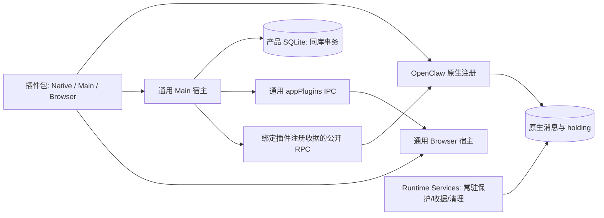

# 应用插件宿主（SDK v1）

Agent Team 和 Swarm Workflow 的原生执行、Main 协调、数据规则、界面、设置、历史入口及翻译分别归插件包。应用按清单发现和加载独立构建产物，不再通过业务 `import` 或专属 IPC 组装它们。用户可以只修改和重建插件；通过授权的本地包管理与代码审核流程后，宿主停止并重新启动后台 Gateway，同时在原应用进程中重新准入 Main/UI，**不要求退出或重启软件**。插件机制不新增 OpenClaw patch，也不导入原生私有模块；新增底层能力仍需扩展公共 SDK。当前随软件内置交付，是否开放安装、卸载属于单独的产品策略。

## 所有权与运行边界



`packages/app-plugin-sdk/` 是无应用源码依赖的公开契约。`src/main/plugins/app/` 只负责可信代码发现、产物校验和保留、生命周期、数据库端口、配置贡献、提交/删除参与者、代码审核和资源发布。`src/renderer/features/plugins/app/` 只负责 React 宿主、声明式插槽、模式选择、只读投影与资源生命周期。Core 保留产品会话、窗口、权限、执行连接、普通聊天和草稿；业务不再由 Core 识别 Team 或 Workflow。

Browser 视图和输入模式可提供自己的 React 图标，宿主保留通用缺省图标，不按插件 ID 选择业务图标。Main 的运行时 Goal 投影只读返回 `goalId`、`phase`、`identityPending` 等原生执行状态；插件据此区分普通会话的中性快照与实际 Goal，不能用投影建立终态或扩大权限。

Browser utility CSS 使用宿主完整 Tailwind 主题，禁用重复 preflight，并限定到本插件的 `data-ui-style-scope` 祖先。通用 Registry 给视图、模式选项及图标提供不产生布局盒的边界；SDK Portal 和 Core Modal 保留该上下文并在真实目标 DOM 中补齐边界。这样独立面板的 utility 不会改变宿主菜单，也不会被另一个插件的同名 shorthand 覆盖。插件手写 CSS 仍须使用自己的命名空间；这是当前独立 HTML 贡献面的样式约束，不是恶意 CSS 沙箱或任意嵌套插件、SVG/table 贡献的完整隔离。

Main SDK 的 execution facade 按真实路由实例复用，不能每次创建新的包装对象，否则插件自己的 `getRouter() === capturedRouter` 围栏会误拒绝同一实例。底层路由替换后旧 facade 失效。响应上下文只暴露 `isCurrent()`，同时核对原生响应上下文、当前运行时引用和插件 epoch；定向状态查询原样传递预期 session ID 与 lifecycle revision，不用空闲投影代替精确身份或终态。

Agent Team 的 `host/` 持有协调器、队列、附件和产品数据库事务；`host/app.ts` 注册 Main，`app/` 持有应用契约及完整 React UI；既有 `browser/` 保留与原生入口无关的纯浏览器辅助。Workflow 的 `host/` 和 `app/browser/` 分别持有 Main 注册与完整 UI，`browser/` 保留纯辅助。两者自己的配置投影、沙箱工具声明和技能声明通过注册返回。Core 对贡献 ID 统一合并用户配置、保留显式开关，按技能声明处理同步和发现重启，没有 Team/Workflow 特例。它们均不导入应用 `src`。原生 `index.ts` 不导入应用入口。

Runtime Services 只保留缺少可选插件时仍必须存在的发送保护、holding custody、执行收据、取消/清理，以及通用执行、文件系统和 FIFO。插件握手与请求转发归每个插件的公开 SDK 接入，不再经过 Runtime Services。它不加载可选插件 Main/UI，不提供关闭后的 Team 历史入口或参数入口。

## 清单、构建与授权

每个插件有 `openclaw.plugin.json` 和 `app.plugin.json`。应用清单固定 `manifestVersion:1`、`apiVersion:1`，声明相同的应用/原生 ID、版本、Main/Browser 文件、能力、命令与插槽；`package.json.app` 指向源码入口。清单 `native.defaultEnabled` 和 `native.userToggleable` 声明捆绑默认策略；宿主在 Main/schema 激活之前独立验证可信捆绑产物元数据，外部包不能凭这两个字段自动启用。构建脚本按文件发现清单，不维护业务入口列表。

可选 `entries.presentation` 对应独立的纯历史展示入口，源码由 `package.json.app.presentation` 指定，仅导出 `presentation`。它可提供文本清洗、原生输入身份展示、精确镜像识别和双语词典，不取得 Browser host、React、命令、导航、数据或发送端口。构建与模块图校验拒绝其引用 Main、Browser 入口或 Browser runtime；普通 Browser 图也拒绝引用 Main 入口。独立浏览器模块与 `new URL('./worker.mjs', import.meta.url)` 的本地资源边继续验证和发布，Main 私有图不作为 HTTP 资源根。

`npm run plugins:app:build` 独立构建 SDK 和插件。产物为 `build/app-plugins/<id>/<hash>`；可安装完整包位于其 `packages/<id>/<hash>`，包含单文件原生 ESM、技能及 `app/`。Main 的 npm 依赖进入自己的 ESM 包；Browser 的 React/ReactDOM 指向宿主真实单例，插件自行编译 CSS/Tailwind。产物逐文件 SHA-256 和清单共同生成身份，限制路径、链接、文件数、大小及可解析模块图。保留目录复制后再校验，防止从可变安装目录执行 Main 代码。作者操作见 [SDK 说明](../../packages/app-plugin-sdk/README.md)。

安装、删除与原生能力审核继续使用原生扩展流程。外部 Main/UI 代码另有绑定精确产物 hash 的审核，不复用原生 review token。审批文件位于产品数据的 `app-plugins/approvals.json`，只保存当前 hash 和有界历史批准；保留的不可变产物位于 `app-plugins/artifacts/<id>/<hash>`。损坏或不匹配的记录不能授权执行。安装目录同 ID 的自定义插件覆盖捆绑候选，不会退回执行另一个同名版本。

首版运行可信 Main 进程内代码和同页面浏览器模块。contextIsolation 保护 preload 边界，不能隔离同页面插件。模块图和 SDK 门禁防止过期调用和格式错误，**不是恶意 JavaScript 沙箱**。新窗口种类、执行原语或不受 SDK 支持的宿主行为仍需要 SDK/宿主变更。

## 公开原生接口、注册收据与代码准入

`@app-plugin/sdk/native` 通过 OpenClaw 的公开 `registerGatewayMethod`、`api.lifecycle` 和 `openclaw/plugin-sdk/gateway-method-runtime` 接入。通用构建器自动包装 Native 入口，并在产物清单加入 `contracts.gatewayMethodDispatch: ["authenticated-request"]`；插件作者不需要修改宿主源码。Agent Team 和 Workflow 的源码入口也显式登记同一幂等 helper，以支持原有原生资源构建路径。原生入口不导入 Main/Browser。

每次 Native 注册产生独立的随机注册 ID，公开 `<plugin-id>.app.handshake` 返回插件 ID、注册 ID、实际进程 PID、canonical Native 入口、注册时固定的源码摘要，以及本实例自有 RPC 的绑定入口。Main 同时核对配置、所管理 Gateway 的 PID/进程代次、已批准产物中的 `native.binding.json`、入口路径和磁盘字节；等待握手时跨过进程代次或失效事件的结果不能激活插件。配置未知、来源不符或握手失败均撤回业务。该收据是应用与插件注册之间的关联，**不是原生私有 instance/generation 权限，也不是实际 ESM namespace 执行字节证明**。

Gateway 的 HELLO 和健康检查不证明配置重载已经稳定。Main 对握手做有界的只读重查，并订阅原生公开的 `plugins.changed` / `config.changed` 重新核对注册；新代次、包变更和宿主释放都会撤销旧定时器。此机制只恢复可见性和准入，不重试业务命令或发送请求。

支持 `single-file-v1`：业务依赖打包，只允许静态、字面量公开 OpenClaw SDK 模块和支持的 Node 内建导入，拒绝替代 loader。Main/UI 使用保留目录内按 hash 定址的产物。改变 Native 或伴随代码必须先确认旧 Gateway 退出，再验证包并启动新进程；不在运行中的相同路径覆盖代码后热采纳新 hash。注册摘要不会随磁盘修改更新，运行时发现字节变化即撤回准入。不支持利用预热 namespace、自定义 loader 或私自原地改包获得新版本准入；代码审核与目录检查不是恶意本地代码隔离。

开发运行时的 `vendor/openclaw-runtime/current` 可以是指向平台运行时目录的符号链接或 Windows 目录联接。发现捆绑插件时先解析并固定该受管运行时根目录的真实路径，再拼接 `dist/extensions/<id>`；插件包内部的目录或入口链接仍拒绝，Native 字节摘要及注册握手检查保持不变。产物验证同时覆盖真实 Main/SQLite 通过 `current` 目录联接加载 Team 与 Workflow，防止开发布局被误拒绝后丢失设置、历史等界面贡献。

SDK 用代理 API 观察插件的公开 `registerGatewayMethod` 登记，为插件自有 RPC 同时登记绑定本次注册 ID/PID 的直接入口。原参数保持原样，保留原方法的 scope、profileAccess、sessionAccess 及保留名称的权限要求；原 handler 看到的 `req.method` 仍为业务方法名。握手通过公开 handler context 的只读 Gateway 方法描述符核对原方法和绑定入口的实际 owner 与权限，原登记冲突或元数据不一致均不能发布映射。不读取其中的 opaque 插件 registry，不导入原生私有 registry/instance 模块。

Main 的 canonical Gateway client 用 `AsyncLocalStorage` 保留当前业务注册收据。自有 RPC 走收据中的直接入口，Core RPC 才转换为 `<plugin-id>.app.dispatch` 的普通参数并调用公开 `dispatchGatewayMethod`；不扩展 `RequestFrameSchema` 或客户端协议。Native helper 核对注册 ID、PID、后台客户端、真实注册生命周期、请求取消和调用者权限。原生继续持有真实实例、会话 incarnation/generation、原始调用者与 profile/device 权限，并在授权等待及提交边界检查；应用注册收据不代替这些权威。清理请求不借用新业务注册，仍受插件清理方法和参数 predicate 约束。

全局 `isConfigReloadSettled()` 不属于插件注册或请求的寿命证明，不作为握手、派发或响应的额外门禁。`agents.create/update` 等公开方法会写配置并自行确认应用；其成功响应可能早于全局重载收尾。只要真实注册和调用者仍有效，SDK 原样传递该响应，Main 重新核对同一注册收据时保持业务 epoch。实际关闭、调用者撤权、取消、实例更换或源码身份变化继续按既有围栏撤回，未知副作用不自动重发。

直接入口使真实 Native handler 的完整 Promise 归属实际外层请求：像讨论启动这样先返回受理结果、再等待后台任务的接口，不会因一次嵌套派发已取得首帧结果而提前释放 work-admission root。SDK 不把受理结果当执行完成，也不通过脱离调用者权限的后台上下文绕过这项约束。

这不替代 handler 自己的提交围栏。Native 是否提供 session mutation commit guard 取决于原方法的公开准入声明，不能假设每个自定义 RPC 都具有该 guard；插件仍须在异步等待后的副作用前检查实际调用者权限，并在 Native 提供 commit guard 时保留相应检查。绑定入口保持这些字段、getter 与权限上下文，不给原方法增加系统权限。

派发前的拒绝保持明确错误；派发后超时、取消或撤销可能已经产生副作用，helper 返回严格关联插件、注册、进程和方法的未知结果标记。Main 只对完整匹配当前调用的标记转换为既有 `CLIENT_TIMEOUT` / `requestSent: true` 未知结果，保留发送围栏并核对原生收据。原生明确返回的错误原样保留。任何路径都不自动重发未知操作，不以重启、空闲或 owner 更换建立执行终态。

## 启停、替换与恢复

`register`、`activate`、`onEnable` 和 Browser 注册为同步契约。无效 thenable 会被处理并阻止激活；同步 activation 的清理 lease 在返回时撤销，异步尾部无法继续删除或写数据库。`activate` 每实例一次；`onEnable` 每业务 epoch 一次并返回 disposer。异步工作通过命令、合法清理参与者和预检执行。

可选 Main `maintenance` 在实例激活后运行，不依赖业务启用状态。宿主每次给予新的、仅本次 Promise 有效的清理 lease，串行执行，释放实例时撤销；只能使用已声明且参数符合 predicate 的清理能力，不能恢复业务注册、启动 Gateway 或发起新执行。旧资源 owner 可保留维护，不能因此发布旧版本界面。Team 利用它核对既有精确运行收据及持久取消任务；热关开复用同一协调器，不重新执行进程恢复或推进房间代次。

清理 RPC 的参数 predicate 也必须同步返回严格 `true`，其临时权限在返回时撤销。配置投影同步运行于只读作用域，不继承调用方的业务或清理权限。Gateway 离线时，保存成功的配置开关与实际原生运行证明分别记录；就绪后可以恢复业务，配置结果未知或运行身份未确认时拒绝业务调用。

关闭插件先撤回业务 epoch，围栏待发输入，保存必要元数据，再修改原生状态。Browser 移除业务插槽、历史/设置入口、打开的对话框、模式、样式和旧请求。重新启用产生新 epoch，不重开旧对话框、不重放未知发送。原生 transcript 保留，只在可选插件再次启用后恢复其业务历史入口。

当前已安装且获批产物的纯历史展示入口按插件 ID/hash 单独租用，关闭或临时断线不撤销，已挂载消息也会随展示规则变化刷新；不读取额外历史或赋予业务权限。真正卸载、选定包替换或清单身份未知会撤回旧展示，旧异步加载及 disposer 不能污染新版本。仅为清理保留的历史 owner 不发布展示。快照 `installed` 只表示当前已批准 UI 产物收据，不能证明 Native 安装、启用或运行。`presentationEntry` 只有验证后的同源不可变资源 URL，不接受安装目录直链。

用户停止产品会话时，先同步发起各插件的本地取消围栏，再立即执行原生 Stop，不等待插件的远端 guard 清理完成。清理失败不能阻塞来源停止，也不构成执行已结算或资源可删除的证据。侧栏相关活动通过插件自己的 `session.presentation` 投影，Team 的未结算投递收据不能推断成员仍在执行，Workflow 使用全历史运行摘要而非截断列表推断空闲。

插件通过 `publishSessionActivity` 发布成功读取的完整活动 ID 集合。通用 Browser 宿主仅保留各插件最后确认的活动正证据，关闭时继续显示运行提示；旧 resolver、历史、设置和导航全部撤回。新 epoch 的初始空状态、读取中或失败不能清除旧证据，只有当前插件取得完整成功快照后才替换其集合；多个插件分别维护，不互相清除。Team 需两份完整团队列表均读取成功，Workflow 使用完整原生活动快照。这是界面提示，不建立执行终态、发送许可或历史权威。

安装、更新、审核、删除等改变 Native 包身份的操作仍使用 Gateway 冷流程：先撤回所有已准入应用插件，检查业务及历史清理 owner，停止实际 Gateway，并阻止并发启动；只有确认原进程退出才改变包。停止超时保留活进程引用并阻止后续启动/替换。普通预检否决且未触碰原生变更时恢复旧业务；资源清单、schema 或清理失败的安全阻塞继续保留。操作后只读取一次真实清单，不重试未知变更；变更的 Main 模块通过新的不可变 hash 路径加载，旧业务、样式、资源 URL、UI 和 epoch 立即失效。必要历史清理 owner 按原 hash 保留，非必要旧实例释放。新 schemas 在原产品库中初始化，仍使用同一数据库端口。

冷操作 lease 释放后，原先存在的 Gateway 在后台重新启动并重连，软件窗口、Core 和主进程保持运行；原本离线且无 Gateway 的应用不因只读审核准备而启动运行时。只有新进程握手通过才重新发布业务 UI。同包启停独立于改包流程，必须通过公开管理 API 在现有 Gateway 内热应用，不能触发 Gateway 重启。关闭后立即隐藏历史和设置入口，重新启用不恢复旧对话框或重放请求。

捆绑及已批准的外部应用插件统一调用原生 `plugins.setEnabled`，保留其能力审核与运行态回执；不使用 CLI 作为失败后的替代路径，不使用 9.8 的 Skill 发现重启规避。附属 Skill 经 `skills.update` 同步后，只读核对 `config.get` 中技能开关及 `configRevisionHash === appliedConfigHash`，等待配置实际应用，避免紧接着的插件操作与尚在执行的配置监听争用 lease。热更新只使用已连接的 Gateway 客户端，每一步核对原连接、进程和代次；断线或身份变化直接失败，不进入通用请求的自动恢复流程。原生要求重启或热更新无法确认时明确返回失败，宿主不会自动停启 Gateway。Main/UI 只在当前 Native 注册握手通过后发布。

非应用扩展的离线恢复同时核对用户安装包及实际捆绑目录、清单身份和配置策略，不能把用户安装目录中没有条目等同于内置插件未安装。其管理 API 超时或断线后，也只有明确的未派发证明才允许命令行恢复；已发送或结果不明的启停保留待确认结果，不重发、不凭配置布尔值推断原生重载已完成。应用插件启停不使用这条 CLI 恢复路径。

热启停的收尾通知及 Renderer 列表重读同样只用现有连接，不调用通用自动恢复入口或 `plugins.refresh`。连接不可用时保留错误与最近确认的清单，不退回遗漏内置插件的局部目录；连接就绪后，只对先前不可用的读取补读，避免一次断线隐藏卡片或间接启动 Gateway。

参数保存不改变 Native/Main/Browser 的代码身份，不进入包替换的冷操作 lease。声明热配置的字段沿原生配置服务更新和确认，保留字段权限、进度及未确认结果；Swarm 的数值配置不能因套用包变更流程而停止 Gateway，或因缺少应用 ACK 自动重启。

失去启停响应形成可恢复的业务围栏，与永久 schema/资源清理失败分别记录。后续只读刷新取得新的、完整且当前有效的 Native 绑定证明后，才恢复业务准入；配置布尔值、同一份旧证明或未确认状态均不能解除围栏，也不把原请求的未知结果改写为成功。资源与清理失败继续阻塞。

应用启动先完成历史保护和用户数据准备，再打开并赋值 Core Store，随后发现插件、初始化插件 schema，最后启动开发资源服务和主窗口。插件发现需要读取受管运行时目录，不能早于 Core Store 的访问门禁；发现与 schema 准备不启动 Gateway，也不提前准入 Native 业务。初始化进度窗口仍按原流程显示，Browser 偏好加载和历史恢复门禁继续约束后续激活。

Store 打开后和插件异步准备后都重新核对退出状态，退出期间不因发现插件而构造新的运行时服务。普通启动可以先开放工作区、在后台准备引擎；插件业务贡献仍须等待当前 Native 注册证明。扩展目录发现不持有应用配置队列，发现完成后的同步配置投影才进入该队列，避免等待引擎的目录读取反过来阻塞启动配置。

开发启动先构建伴随包，再在没有相关活 Gateway 的前提下准备同批 Native/Main/UI 产物，防止新清单与旧 Native 包不匹配时默默丢失入口；已有匹配产物不写运行时。Vite 会给变量动态导入附加 `?import`，代理仅剥离这个固定标记后向私有 Main 资源服务转发已验证路径，拒绝其它查询串；Main、binding、清单及私有 token 的保护不变。真实开发验证入口为 `node scripts/test/plugin-host/verify-development-application.mjs`。

临时目录清单读取/加载失败形成独立的包准入围栏。修复文件后，下一次显式包操作先在确认停止的 Gateway 下重读、验证和恢复当前清单，再恢复连接并执行正常资源预检；不重放前次未知操作。该恢复不能清除数据库资源账本、schema 错误或历史 owner 不明的永久保护。未完成的多包准入保留新 schemas 的待初始化集合，避免部分失败后跳过初始化。

原 hash 的资源被显式采用或最后一项删除后，宿主释放不再有引用的本地清理实例及收据/停止订阅。重复切换同一 hash 也不能覆盖并遗失旧 disposer。释放必须等该精确实例的变更 lease 和删除 lease 都归还；从其他 registry 借入的 owner 仍由原 registry 在自己的清理上下文释放。

Gateway 关闭只有真实正常 close/exit 才证明退休。异常、超时、信号或非零退出保留本进程的关闭失败围栏，后来的退出观测不能重新准入或启动替代 Gateway；包变更 lease 及其他资源保护也继续独立生效。普通插件热启停不进入这条关闭流程。

旧批准产物只在产品资源账本引用其精确 hash 时恢复清理。顺序是发现候选、当前 schemas/账本初始化、实际 runtime 建立，再激活旧清理 owner；不扫描目录以推断信任，不重跑旧 schema/adoption，不发布旧 UI 或业务命令。旧文件缺失、初始化失败或身份无法核实保留删除/包变更围栏。

## 提交、数据和界面契约

Composer 插件返回 `{prompt,input?}`，宿主填入 pluginId、epoch、mode 的有界结构化原生 envelope；提交者和 native 侧只接受当前精确 owner。宿主在真实发送边界重查当前草稿、选择、模式、普通 turn 与原生身份。取消和失败不能清空新草稿，也不能自动重放未知发送。

模型选择等异步准备之前捕获当前模式选择，等待结束及实际提交前再次校验。等待期间插件关闭、epoch 变化或用户切换模式均撤回原提交，不能因准备函数被替换而把原插件消息降为普通消息发送。

提交参与者的临时准入映射只绑定发送前守卫及当次 epoch；全部参与者成功完成 `markSubmissionStarted` 后回收同一映射，失败或未知仍保留，不能因历史会话累积耗尽新请求名额。精确确认删除后回收对应会话集合。该回收不推断发送或执行结果；持久收据、Native 身份及清理围栏继续由原参与者持有。

Browser `uiState.get/set` 提供当前插件 ID/hash 隔离的有界内存 plain-data 草稿，克隆读写并拒绝函数、访问器、循环和活对象。关闭、断线或可恢复的业务围栏保留正文、附件路径和未知请求定位；真正卸载或更换 hash 后清除。它不保存控制器、插件模式、回调、原生授权或 transcript，也不在重新启用后自动发送。Team 恢复准备时，本地保存的 attempt 锁必须仍匹配当前草稿；只有读取同一 `draftId` 房间明确为 `ready/prepare_failed` 且没有冻结的待发送请求，才解除准备锁。原生 metadata 不保存该 UI attempt ID；缺失、断线和发送结果未知仍保持冻结。

插件资源参与者扩展删除集合至固定点；先获取所有删除 lease，再完成所有预检，最后删除。全部参与者冲突、失败或未知均否决删除，避免只清理一半。产品库新增 `app_plugin_resources` 保存 resource ID、owner ID 与 artifact hash；空投影不能删除旧保护记录，跨版本采用必须显式确认完整集合。插件使用同一个实际 SQLite 连接的受控端口，同库原子事务不拆分；产品表和插件原有表位置不变。

产品会话删除与包变更互斥，包括没有插件资源的普通会话。删除在任何插件回调前同步取得 lease，直到整个删除事务结束才归还；包变更从预检、库存修复、停止 Gateway 到最终重连期间拒绝新的删除。删除预检即使异步等待，也不能被换包切换到未取得本次 fence、未参与预检的新资源 owner。准入失败和操作异常均归还临时互斥 lease，既有未知结果和资源保护围栏继续独立生效。

Browser 可声明 workspace、composer、plugin settings/history、chat action、session summary/details/presentation、application page 和 message/interaction presentation。主输入、普通详情和扩展列表只组合插槽。视图可声明有限数值 `order`，同序保留注册顺序；摘要保留 Workflow → Team、右侧计数和原有焦点样式。摘要容器用单列自然高度轨道和 gap，避免无布局盒的样式边界吞掉旧子元素 margin 或压缩滚动内容。SDK 暴露只读产品元数据和显式草稿/导航/文件效果。原生历史由 Core ChatController/Gateway 维护挂载投影；插件获得视图、状态及绑定当前挂载会话的受控发送端口，不获得控制器或新的 transcript 缓存。发送端口保留权限准备、原生身份与重连核验、运行计时及未知回执，旧挂载或插件 epoch 不能继续使用。Team 的成员独立发送通过该端口完成，业务准备和停止代次核验归插件。资源通过宿主同源 hash/epoch URL 发布；不发布 Main 或 binding。开发代理使用本机私有 token 和有界专用路径。

工作区面板保持挂载以保留草稿，实际可见性通过 `AppViewContext.active` 传给插件。
来源会话的摘要、历史及首次创建 Team 均通过 `workspace.tab` 进入右侧原有 Tab。
每次明确打开增加 `selectionRevision`，使默认打开可以清除上次成员/子视图，普通切换 Tab 则保留状态。
没有有效来源的 Team 记录沿用主内容页，`application.page` 的常驻控制器通过 epoch 绑定的 `page.setVisible` 请求显示，不能改为大弹窗。设置页临时遮住主内容但保留页面草稿；普通导航撤回页面和旧异步请求，插件关闭则卸载贡献。
Team 群聊只在可见时持有当前房间焦点；切换标签或关闭视图释放该视图自己的焦点，
不能清除后来打开的其他房间。隐藏面板不参与“当前可见群聊”的提问判断，重新显示
时恢复焦点与原草稿。MCP App 面板仅由宿主的稳定容器挂载一次，避免重复 iframe
注册和初始化。

`session.details` 可声明 `append`、`replace` 或 `hidden`；只有真实 Team 锚点替换普通详情。成员详情通过宿主重新读取实际会话 ID，保留 Native 身份、统计及返回，不导航到聊天或工作区；插件贡献失效后不能提交旧读取。插件设置的运行时参数链接通过通用导航服务打开原设置页。历史弹窗使用 SDK `OwnerDocumentProvider` 跟随点击窗口，关闭窗口或变更导航即撤销旧请求，不能把 Portal 固定到主文档。

Browser SDK 的完整会话目录只含轻量元数据，不含标题或正文；历史入口按该目录判断来源和锚点是否存在，再经有界 `ensureSummaries` 按需读取标题，不能用分页摘要判定历史不存在。通用 Native 历史视图保留控制器的准备中与准备超时状态，准备中不显示空历史或开放发送，重试仍交给原控制器。Team 公开镜像的精确定位判断属于 Team 的纯消息展示贡献；宿主只组合通用 `replyMirror`，按当前已批准产物的展示租约维护，不改写原生消息或建立执行结论。

摘要记录发现不依赖摘要是否已经展开。插件在常驻 `application.page` observer 中读取元数据，并通过 `session.presentation.summaryAvailable` 与上下文变更通知报告当前会话存在摘要内容；Core 仅用这一通用提示执行原有的单次自动展开。Team 自己保留当前聊天首次新建协作/讨论时打开 Team Tab 的行为，既有基线、后台会话和已关闭记录不会重复触发；Workflow 自己发现流程并显示摘要入口，不主动重开已关闭图形 Tab。

插件 Main 可发布有界、瞬时元数据事件；通用桥填入 owner、产物 hash 和业务 epoch，Browser 仅投递给当前同版本插件，关闭或重启后旧监听立即失效。Workflow 自己校验原生变更和父会话身份，发布 revision 通知，列表订阅后读取并合并在途变更，不恢复轮询或专用宿主 IPC。Gateway 重连撤回旧业务 epoch，重新准入后视图重新读取权威状态。

## 验证与剩余验收

改造前后的逐项功能对照、已修复差异、真实探针与测试设施的边界见[功能审核记录](app-plugin-functional-audit.md)。

隔离 probe 使用构建后的真实 Main/UI 产物、Electron/Chromium、真实 SQLite 和锁定 OpenClaw，验证单例 React、关闭/重开、旧 epoch、清理恢复、Gateway 停止/重连及公开请求桥。App 插件不向既有运行时补丁集合新增任何补丁。各 probe 明确 Gateway、模型、平台与应用端口 fixture 的范围，不替代生产业务和完整安装包验收。具体范围及未完成验证如下。

### 本轮 dev 同步与验证（2026-10-29）

从 `ed2eb48c0` 同步至 `3f3bcc360`，纳入 93 个 dev 提交，应用插件功能仍为基线之上的一个提交。运行时版本随 `package.json.openclaw`，本轮目标为 `v2026.10.7`；相对 dev 的原生补丁目录没有新增或改写。公开请求分发接口保持兼容；新 read-sharing 元数据保留原生包装语义，不比较原生为不同注册生成的 callback 引用，也不读取私有 registry。

独立多 Agent 复核覆盖 SDK、Main 启动与热配置、Renderer 生命周期和追加的历史/日志变更。修复了显式模型路径遗留的业务变量、退出期间过早发现插件、参数保存误走包冷变更，以及模型准备期间插件撤回后降为普通消息的竞态；同时保留完整轻量目录、Native 历史准备、镜像定位及新版连续滚动。

分批定向回归按每个文件的最终执行汇总为 141 个文件、2,762 项通过、1 项条件跳过，无剩余失败。跳过项依赖 worktree 相邻 OpenClaw 浏览器源码，不能计为通过；原始失败报告与修复复测分别保留。完整应用构建、独立插件类型检查、Main/Renderer 类型检查及 lint 通过。测试使用独立 Node 和隔离的同版本 SQLite 测试依赖，共享 Electron 原生依赖保持原样。

本轮未运行全量 `npm test`、安装/冷启动演练或真实 Gateway/模型验收，没有将历史 `v2026.10.4` 实机结果作为新运行时的通过证据；本节仅记录上述接口、定向行为及构建验证。

### 本轮界面回归修复与验证（2026-10-29）

以 `594cc79da` 的改造前菜单工厂和界面结构对照，恢复菜单排序、子菜单、标签/删除/返回文案、输入焦点、Team 右侧 Tab、独立主内容页、成员详情返回、设置及历史窗口归属。独立复核还修复了摘要行样式、计数位置、顺序，以及样式边界导致的段间距丢失。功能仍保留为一个提交，验证完成后未重新 pick 到 dev。

46 个定向测试文件、419 项测试全部通过；lint、独立插件类型检查、Main 类型检查和完整应用构建通过。`verify-ui-parity.mjs` 在隔离 Chromium 加载真实 Core 菜单、摘要及侧栏和独立构建的两插件 CSS/Browser：验证菜单对照、标签结构/尺寸、两种 CSS 加载顺序、插件独有 utility、摘要两处 16px 间距和自然行高、右侧 Tab 几何位置、设置 Portal 及关闭撤回。旧阴影规则的负例确实产生差异；宿主 CSS 不含被测的插件独有 utility，避免掩盖覆盖问题。

浏览器探针通过 `workspace.open` 驱动真实侧栏，摘要/历史的点击路由另由定向测试覆盖；它不代表整套产品页面的端到端验收。标签 SVG 仅按原结构和尺寸对照，其中原 Team 标签图标尺寸为零，不能据此宣称可见图标绘制通过。本轮没有启动 Gateway、访问用户数据或重建共享原生依赖，没有把历史运行时实机结果重新计作本轮验证。

### 助手创建超时回归（2026-10-29）

实测失败日志显示，助手配置写入后，旧 SDK 将仍在收尾的全局热重载误判为插件失效，把 `agents.create` 的成功响应改成 unknown。随后的握手暂失败又撤回 Main epoch，旧协作请求无法回填 `collaboration.resolve`，最终表现为宿主处理超时。修复仅移除这项错误的全局门禁，并在最终角色文件读回校验后、启用产品档案前再次核对 Main 权限；没有增加超时、业务重试或原生补丁。

旧代码在新增绑定链回归中准确失败于 `Native dispatch outcome is unknown: agents.create`；修复后 5 个文件、135 项定向测试通过，覆盖同注册握手、Core 派发、结果回填、撤权和失效负例，以及配置/角色验证结果未知时保留 preparing 身份、不重放操作。独立多 Agent 复核、lint、Main 类型检查、独立插件类型检查及完整应用构建通过。

使用当前锁定版本的已准备 Gateway bundle 执行：

```bash
node scripts/test/plugin-host/verify-native-gateway-bridge.mjs <prepared-runtime> --gateway-bundle --assistant-config-reload --block-public-network
```

隔离探针以最小插件和产品元数据 fixture 调用真实 Main manager、助手创建适配器、请求绑定、公开 SDK 及原生配置/角色文件接口。三个并发请求经配置串行队列各完成一次 create、update 和角色写入/读回；业务 epoch、Native 注册 ID 及 Gateway PID 保持不变，未发生公网访问。该结果不代替完整 Team 工具、真实模型或安装版 UI 验收。

### 尚未完成的生产验证

- 当前内置交付保持安装、卸载入口策略。未来开放外部安装前，在正式 Windows 安装包完成 install → 应用代码审核 → 后台 Gateway 重新加载 → 启用 → 关闭 → 自定义新版替换 → 后台 Gateway 重新加载 → 卸载，整个过程软件保持打开。隔离公开 SDK/产物探针不等同于完整安装包验收。

- 用实际产品 UI 和真实模型完成 Team 协作、公开讨论、holding FIFO、成员续写、Workflow DAG/批量、取消、来源删除及关闭重启恢复。构建产物 smoke tests 的应用与模型端口 fixture 只证明插件接入。

- 验证签名安装包、macOS/Linux、升级后的持久化保留，以及长时间运行/反复启停的内存和监听器释放。Windows 开发代理的实际 Electron→Vite→Main 路径及同一 Gateway 中的启停已有专项覆盖，正式安装包与其它平台仍需分别验收。

- 在默认被动配置监听下继续验证任意配置文件改动与显式启停交错。插件和附属 Skill 的连续启停已通过实际 Gateway 验证，并以原生已应用配置修订确认收敛；任意外部改文件、跨窗口并发及长时间压力仍需单独验收。未知请求不自动重试。

- 复核 Windows MCP 进程树清理在负载下的确认：此前完整回归出现一次 `uncertain`，独立的 5 项握手/清理测试通过；保留原生严格判断，继续验证确认过程的稳定性。

- 若未来接入嵌入 worker/备用客户端，必须经同一公开插件请求桥及未知结果分类；当前 App Main 业务通过 canonical client，未宣称任意旁路客户端具有插件收据绑定。

- 独立设计低信任进程/iframe 隔离及免 Gateway 重启的 Native 二进制替换；当前只接受可信插件与 Gateway 冷包变更，软件无需重启。不将源码摘要称为原生执行字节证明。
