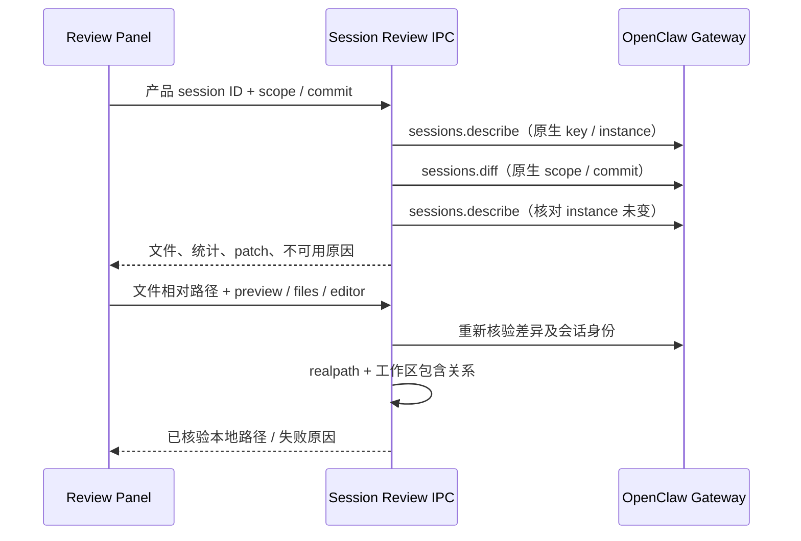

# 工作区变更审阅

审阅展示当前原生 checkout 差异，属于只读工作区工具；它既不是工具参数记录，也不是修改者审计。核心消息身份见[聊天渲染](15-chat-rendering.md)，文件动作边界见[安全模型](11-security-model.md)。

## 1. 入口与原生读取链路

侧面板启动入口和“+ → 审阅”打开按会话保留的只读 Tab；主聊天 edit
卡通过带产品 session ID 的事件定位文件。其他历史/子任务消息面不显示
无所属会话的跳转按钮。审阅是当前 checkout 差异，不是工具入参的拼接，也
不代表所有修改都来自当前 Agent；人工和其他任务的修改同样可能出现。

### 原生基线与范围

沿用当前 OpenClaw 原生行为：会话执行前由原生采集文件指纹基线，
`all`/`uncommitted` 隐藏与有效基线指纹相同的文件；再次变化的文件显示相对
Git 基准的完整 patch，不逐行扣除旧修改。`commit` 不应用会话过滤；基线缺失时
保留原生 checkout 结果。无需用户手动提交，但目录必须是 Git 仓库。产品不新增
快照或采集逻辑，也不修改原生会话基线；共享目录仍无法准确归属修改者。

## 2. 快照寿命与失败恢复

组件快照仅是临时展示状态，不写入 Main/SQLite/Redux，也不缓存 transcript。
首次打开和显式刷新加载；已成功读取的标签切回时直接保留当前快照，不重复扫描工作区，
刷新按钮悬浮说明和更多菜单中的范围说明提示手动刷新以查看最新修改，不常驻普通快照提示条。隐藏时取消结果消费，不轮询；同一组件、同一查询及
刷新版本的未完成请求在切回时复用。关闭标签或切换会话卸载后释放展示状态，重新打开
仍重新读取。运行结束仅提示刷新。

请求绑定 session、范围、commit、generation；改范围立即隐藏旧范围，迟到响应
丢弃，同范围刷新失败保留并标注旧快照。Main 同时核对客户端、映射及原生
instance，reset/reconnect/deletion 后不接收旧身份结果。

## 3. 文件列表与差异阅读

文件支持过滤和逐文件展开、统一/并排、行号、语法着色、hunk 边界和自动换行。
默认只呈现一份折叠的文件列表，点击文件行在原位置展开差异。原生路径含 `.agent-tasks/`
目录段的运行文件集中放在列表末尾的“任务运行文件”组，默认收起并显示项目数；不删除或改写原生差异，
总变更统计仍包含这些项目。普通文件与运行文件分别分页，内部项目不会占满普通文件的首屏。
搜索匹配内部路径或从聊天定位内部文件时自动展开组；定位可揭示对应分页并保留原始路径与文件操作。

搜索自动展开也覆盖迟到的读取结果，以及保留筛选词后的范围切换和刷新。用户主动折叠后，
同一范围和筛选词的刷新保持折叠；重新输入搜索或切换范围后重新应用自动展开。
工具栏只保留范围、统计、文件夹、刷新、搜索与更多；搜索框按需展开，非空筛选保留可见。
文件树开关、统一/并排布局、自动换行和范围说明位于更多菜单。文件树默认关闭，宽度变化不会自动开启。
用户启用文件树且面板宽度达到 760px 时，右侧变更文件树及其筛选框共用可调整宽度，初始为 240px。

拖动左侧分隔线或使用键盘左右、Home/End 调整，文件树至少保留 160px，差异正文
至少保留 320px；可用空间缩小时收敛宽度，标签切回时保留所选宽度。窄面板启用的
文件树置于正文上方并限制高度，筛选框留在正文上方。拖动结束、取消、窗口失焦、关闭文件树、标签隐藏或卸载时释放拖动状态。
文件行保留文件图标、路径、轻量变更类型、行数与操作菜单；未跟踪状态合并到变更类型的悬浮说明。
正文滚动同步目录选中项，文件标题在长 Diff 中吸顶。

并排模式共用整块横向
滚动区域，不为每行创建滚动条；语法高亮按 patch、显示行数与语言缓存。
复制反馈在对应按钮显示两秒，切换会话或范围后忽略迟到的反馈。
默认显示 100 个文件、每个展开文件 200 行，可逐步展开；单 patch 最多渲染
2000 行、每行 4000 字符，并明确提示显示限制。复制原始 Diff 不使用显示截断
内容。原生截断、二进制、未跟踪、无 patch、非 Git、未知提交及工作区停止
分别说明。提交候选最多为原生返回的 50 项，不视为完整历史。

原生 Git 可能将嵌套仓库返回为以路径分隔符结尾的目录项。审阅按目录显示其名称、
文件夹图标和完整变更状态，按父目录分组；保留原生路径用于定位和复制。目录项说明
内部文件未展开，不显示空文件名、虚假的行数或读取上限原因，也不提供文件预览/编辑动作。

## 4. 本地文件动作

“在文件中显示”展开 Files 的父目录并定位；“打开预览”继续走既有预览事件，
保持版本校验和未保存草稿保护。Windows“选择编辑器”复用系统 Open With
选择器，不自动执行文件关联；其他平台保留预览/Files。远程无 root 和已删除
文件不允许本地动作。路径复制保留相对路径中的中文、空格及原始字符。

## 5. 实现与验证

Main 请求链位于 `src/main/ipc/cowork/` 的 session review 处理器及原生适配器；Renderer 由 `src/renderer/features/cowork/components/review/` 持有快照和阅读状态。验证切换范围/会话后的迟到结果、同范围失败保留、身份变更、本地路径越界和已删除文件。只读差异成功不授予写入或证明某一 Agent 对文件负责。
