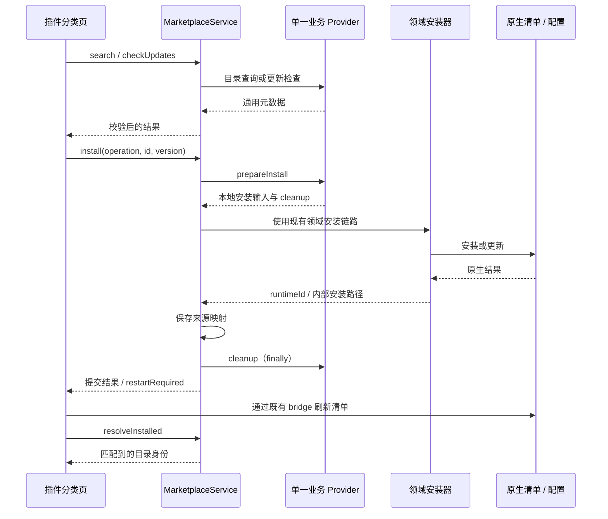

# 插件市场接入指南

本文面向接入企业插件目录或公司 SDK 的开发者。产品只接入**一个插件市场**，支持扩展（`extension`）、技能（`skill`）、MCP（`mcp`）。Hook 只在本地管理，不进入市场搜索、安装或更新接口。

仓库默认不注册业务 Provider，因此当前没有真实联网目录。UI、IPC、安装器和来源映射已经就绪；接入业务 SDK 后，不需要另做一套卡片、安装按钮或启停逻辑。

## 1. 接入位置与进程边界

在 `src/main/plugins/marketplace/` 下新增业务适配器，实现 `types.ts` 中的 `PluginMarketplaceProvider`。SDK 的认证、目录访问和下载全部在 Main 进程完成。Renderer 只通过显式 preload API 访问市场，不能直接使用 SDK、下载地址或认证对象。

工厂 `createPluginMarketplaceService(installationService, getStore?, provider?)` 的第三个参数接受一个 Provider。生产装配点在 `src/main/main.ts` 创建 `PluginManager` 的位置：保留现有安装服务和持久化 store 回调，只注入一个业务 Provider。不要新建第二个市场服务实例，否则会丢失既有安装身份映射。

```ts
const marketplace = createPluginMarketplaceService(
  pluginInstallationService,
  getMarketplaceStore, // 沿用当前装配点的 store 回调
  createEnterpriseMarketplaceProvider(companySdk),
);
const pluginManager = new PluginManager(marketplace);
```

上例中的 `companySdk`、`getMarketplaceStore`、`createEnterpriseMarketplaceProvider` 是接入方提供的变量/适配器示意，不是仓库内置 SDK。不要将示例另行粘贴成一套重复启动流程。

### 应用代理与 SDK 网络接入

市场的认证、搜索、分类、详情、更新检查和安装包下载应遵循设置页的**应用代理**（不使用代理、系统代理、自定义代理）。**浏览器代理**只控制内置浏览器，不作为市场 SDK 的配置来源。当前 Provider 接口只定义业务方法，不会自动接管 SDK 的网络客户端；注册 Provider 本身不代表代理已经接通。

目录请求优先复用 `src/main/core/network/mainProcessFetch.ts` 中的 `mainProcessFetch`：它在每次调用时解析当前应用代理，自定义代理使用配置的地址，系统代理按目标 URL 解析，未配置代理时调用原生 `fetch`。该方法不自动注入模型请求的出站身份头，市场认证由业务 Provider 提供。不要使用标题生成或 MCP 探测专用请求方法来访问市场。

接入真实 SDK 前，先确认它是否允许注入请求函数、网络客户端或代理 Agent，并确认认证与下载是否使用另一套客户端。可注入请求函数时，将目录请求接到统一传输；SDK 自行联网时，需要显式适配当前应用代理，不能仅依赖 `HTTP_PROXY` / `HTTPS_PROXY` 环境变量。不要在 SDK 初始化时永久缓存代理地址；保存设置后，后续请求应使用新配置，已经发出的请求不自动重放。代理失败应返回错误，不静默改为直连。

`mainProcessFetch` 目前不是完整的标准 Fetch 替代实现：代理模式只接受字符串或 typed-array 请求体，会将响应全部读入内存，并直接返回重定向响应；直连模式沿用原生 Fetch 的重定向行为。其 `maxResponseBytes` 也只在代理分支生效。因此不能在未适配这些差异时，直接把它作为任意 SDK 的 Fetch 实现或大安装包下载器。

下载适配应结合真实 SDK 的接口完成：支持流式写入本次临时目录、超时和取消，并在直连与代理模式下统一处理响应大小及重定向。每个重定向目标都要按当前应用设置解析代理，跨域跳转不得沿用原请求的市场认证信息。SDK 在返回 `prepareInstall` 前负责清理失败下载，交付后的清理继续遵循第 4 节约定。只有目录请求与下载请求都完成实际验证，才可宣称市场遵循应用代理。



## 2. Provider 接口

类型定义以 `src/main/plugins/marketplace/types.ts` 和 `src/shared/plugins/marketplace.ts` 为准。

| 接口                      | 必需 | 输入与输出                                                               | UI 行为                            |
| ------------------------- | ---- | ------------------------------------------------------------------------ | ---------------------------------- |
| `source`                  | 是   | 固定 `id`、名称、`supportedKinds`                                        | 单一来源，不显示市场选择器         |
| `search(query)`           | 是   | `kind/query/categoryId/limit/cursor/sourceId` → `{ items, nextCursor? }` | 搜索与默认推荐                     |
| `prepareInstall(request)` | 是   | `sourceId/pluginId/kind/version/operation` → `{ payload, cleanup? }`     | 安装及更新共用                     |
| `checkUpdates(request)`   | 建议 | `kind/installed[]` → 更新候选数组                                        | 进入页面和手动检查，不依赖搜索命中 |
| `listCategories(request)` | 否   | `sourceId/kind` → 分类数组                                               | 仅默认推荐显示分类                 |
| `getDetail(request)`      | 否   | `sourceId/pluginId/kind` → 详情或 `null`                                 | 缺失接口时不打开空详情             |

`supportsDetail`、`supportsCategories`、`supportsUpdates` 由 Main 根据实现的方法投影，不必由 SDK 伪造能力。最小接入只需搜索和下载。没有 `checkUpdates` 时，UI 仍可使用搜索结果中明确标注的 `update-available`；不会声称已全面检查更新。

`source.id` 和目录 ID 应长期稳定。虽然协议保留 `sourceId`，本产品不提供多市场聚合、选择或切换功能。

## 3. 搜索与元数据约定

每个 `MarketplacePlugin` 必须含 `id`、`kind`、`name`、`description`、`sourceId`。可选字段包括 `runtimeId`、`version`、`author`、`tags`、`category`、`homepage`、`iconUrl`、`downloadCount`、`installState`、`installedVersion`。只返回这些协议字段，不透传 SDK 原始响应。

```ts
const item: MarketplacePlugin = {
  id: 'catalog-document-writer',
  runtimeId: 'document-writer',
  sourceId: 'enterprise-marketplace',
  kind: PluginKind.SKILL,
  name: 'Document writer',
  description: 'Create and revise documents',
  version: '2.1.0',
};
```

- 空 `query` 是市场推荐，不是空结果；推荐排序由业务目录负责。
- 查询限额默认 20、最大 100。页面推荐通常请求 8 条，搜索与后续页请求 60 条；Provider 必须尊重传入限额。
- `cursor` 是不透明分页值，不能把一页结果当成完整目录。即使当前页全部已安装、在发现区被去重，UI 也保留加载更多入口。
- 分类返回稳定 `id`，不可把展示名称当协议 ID。开始关键词搜索后，UI 清除分类条件。
- 关键词只搜索当前分类。本地结果立即显示；市场查询延迟约 300 毫秒，并丢弃过期响应。
- 目录与已安装清单合并后，同一市场安装仅显示一次。目录描述命中关键词时，即使本地描述未命中，也显示原已安装卡片及其启停/配置操作。

Main 校验 kind、来源、字段长度、分页和响应结构，并将 Provider 异常转为受控错误。请在 SDK 层设置合理请求超时；不要在日志或异常中输出凭据、下载签名或认证响应。

## 4. 下载与安装输入

`prepareInstall` 必须完成下载，返回现有安装器能够处理的输入。它不自行写运行时安装目录、不直接改启用状态、不维护第二份安装清单。

```ts
// Skill / Extension：kind 按本次请求选择。
return {
  payload: { kind: PluginKind.SKILL, sourcePath: download.localPath },
  cleanup: () => download.dispose(),
};

// MCP：将目录配置转换为结构化配置，不传任意可执行的“安装脚本”。
return {
  payload: {
    kind: PluginKind.MCP,
    config: {
      name: 'Example MCP',
      transportType: 'stdio',
      command: 'example-mcp',
      args: [],
    },
  },
};
```

`download` 是 SDK 下载结果的示意。`sourcePath` 可以是领域导入器支持的本地目录/归档；格式与路径校验继续由既有导入器负责。Extension 必须提供可被原生安装器识别的插件格式，不要假定任意第三方 bundle 已有转换支持。

成功返回 `prepareInstall` 后，Main 在 `finally` 调用 `cleanup`，安装成功或失败都执行。如果 SDK 在返回之前下载失败，SDK 自己清理未交付的临时文件。清理函数只处理本次下载目录，不能删除正式安装文件。

Extension 的市场来源目前进入既有 `trustMarketplaceSource` 安装分支，并使用原生能力接受参数。因此该接入点适用于产品认可的受信目录；不能把任意用户 URL 当作同等市场来源。自定义导入的能力审查与原生校验保持原有流程，Provider 不能改写这些策略。

MCP 更新由应用按市场目录 ID 找到现有记录，忽略 Provider 提供的本地 `targetId`。更新配置只提供需要改变的字段；不要用空凭据覆盖用户配置。启用状态仍由本地管理操作决定。

Extension 更新传递原生 `--no-enable`，保留已有启停、允许/拒绝列表和独占槽选择；离线安装后的应用 allowlist 补充也不用于更新。首次安装继续使用既有安装流程。Skill 更新沿用原生技能配置。

## 5. 安装身份与更新

三个身份不能混用：

| 身份                                        | 示例                               | 用途                  |
| ------------------------------------------- | ---------------------------------- | --------------------- |
| 市场来源 `sourceId`                         | `enterprise-marketplace`           | 找到唯一业务 Provider |
| 目录 ID `pluginId` / `MarketplacePlugin.id` | `catalog-document-writer`          | 查询、下载与版本选择  |
| 原生 ID `runtimeId`                         | `document-writer` 或 MCP 生成的 ID | 已安装清单与启停操作  |

安装成功后，Main 将来源、目录 ID、原生 ID、版本和必要的安装路径保存在现有 KV registry。Extension 安装器提供内部正式安装路径；Skill 使用 managed 安装目录。路径不随安装结果或身份响应导出给 Renderer。

页面通过 `resolveInstalled({ kind, installed: [{ id, installPath? }] })` 对账。输入中的路径来自已经读取的本地清单；技能从 `SKILL.md` 路径取目录。Main 只比较身份，不读取 Renderer 指定的文件，返回 `{ runtimeId, sourceId, pluginId }`。一次最多 200 项，页面按批次调用。

文件类安装必须同时匹配原生 ID 和已记录的正式目录；MCP 使用真实记录 ID。记录存在但清单缺失、项目同名技能覆盖了 managed 技能、缺少路径或身份歧义，都不能当作已确认的市场安装。内置项始终不开放市场更新；本地导入的同名项显示冲突提示，不把“安装”变成覆盖操作。

用户通过本地导入成功覆盖 Extension 或 managed Skill 时，Main 清除该安装的旧市场归属；Extension 原生安装已提交、但后续重启或策略刷新失败时也清除旧归属，安装前失败则保留。Skill 清理同时核对 managed 路径，不误删同名项目层的映射。

`checkUpdates` 收到的是已映射安装的目录 ID、原生 ID 和版本。返回候选必须有 `installState: UPDATE_AVAILABLE`，且只能对应请求中的安装项；候选的 `version` 用于最终下载。业务版本不必是 semver，由 Provider 判断是否存在可用更新，UI 不自行比较版本字符串。

完整候选在分类页共享，所以推荐结果未包含该插件时，已安装卡片仍能直接更新。更新后刷新真实清单；市场的 `installed` 提示不是安装状态权威。不要通过扫描聊天记录或新增数据库表维护插件状态。

## 6. 用户反馈与故障处理

- 默认页展示已安装和“发现更多”；搜索结果去重。筛选提供全部、已安装、可更新。
- 未安装卡片显示“＋安装”；已安装卡片使用原启停/配置操作；有更新时在开关旁增加可点击的更新按钮。
- 同一项目操作期间阻止重复提交及卡片上的冲突操作。新安装成功后保持结果位置，复用真实已安装卡片；切换搜索后恢复正常归类。
- 分类切换或离开插件页不会释放进行中的操作锁；返回后继续展示结果并刷新当前清单。此状态只在当前 Renderer 会话内保留，不新增安装清单或数据库缓存。
- 安装失败保留对应卡片和重试操作。市场不可用不隐藏本地清单。
- 安装提交成功但清单刷新失败，显示状态待确认和“刷新状态”，不再次调用安装接口。
- 可更新筛选中的成功反馈在清单刷新完成后保留片刻；刷新失败或需要重启的提示持续保留，避免卡片提前消失。身份重新对账中断更新检查时，仍可重新检查。
- `restartRequired: true` 显示重启后生效，不能将其当作已经启用。
- 更新检测失败与没有已知更新分别提示；未实现批量更新接口时不声称“全部最新”。

当前不提供自动更新、全部更新、跨分类搜索或市场账号设置界面。真实 SDK 的账号获取方式由业务适配器接入现有认证边界。

## 7. 接入验证

先用本地模拟 Provider 验证协议，再用真实业务 SDK 验证认证、下载与安装。至少覆盖：

1. 不注册 Provider：本地搜索、启停和配置仍可用。
2. 最小 Provider：空查询推荐、关键词查询、分页、无详情能力、无分类能力。
3. 市场搜索与本地结果合并，目录 ID 不同于原生 ID，同名本地导入不可更新。
4. Extension、Skill、MCP 各完成一次安装；重新打开页面后仍能识别来源。
5. 不依赖搜索结果的更新检查、实际目标版本下载、已禁用项更新后仍禁用。
6. 项目技能覆盖同名 managed 技能时不得更新错误对象；内置项不得显示市场更新按钮。
7. SDK 超时、失败更新、安装后清单刷新失败、重启后生效，以及临时文件清理。
8. 快速连续搜索、重复点击、所有首屏结果均已安装时的后续分页。
9. 应用代理三种模式分别验证目录请求和安装包下载；浏览器代理变更不改变市场路由。
10. 保存应用代理设置后，下一次市场请求使用新配置；代理连接失败、认证失败或超时时不静默直连，不重放已提交安装。
11. SDK 的独立认证/下载客户端、下载重定向、流式写入、响应大小限制和取消清理；直连与代理模式保持一致，跨域跳转不泄漏市场认证信息。

相关测试位于 `src/main/plugins/marketplace/`、`src/main/ipc/plugins/marketplace.test.ts` 和 `src/renderer/features/plugins/marketplace/`。真实业务认证与运行时安装验收不能由模拟测试代替。

架构与状态归属见 [插件市场适配架构](../architecture/16-skill-marketplace-adapter.md)。
