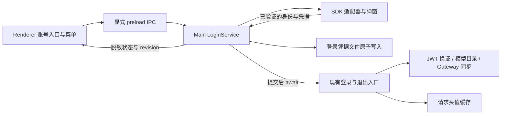

# 登录 SDK 接入模板

本页维护账号入口、Main 登录事务和 SDK 适配器。真实 SDK 尚未接入；模型 JWT 的换证、轮换和服务端授权见[内置模型认证](authentication-builtin-model-lifecycle.md)。接 SDK 先读适配器合同，接续期再读 credential lease，手工联调见末尾步骤。

## 范围与当前行为

左侧窄导航栏底部提供账号入口，设置齿轮保留在其下方。首次读取账号状态时显示旋转加载环，
读取完成后根据账号状态显示“登录”或头像。未登录时常驻显示“登录”文字，
采用 12px 常规字重、36×36px 点击区域和透明背景，颜色与悬停反馈沿用导航栏样式。
收起主页聊天列表或切换功能页时，账号入口仍可使用；账号菜单通过 Portal 展示在导航栏右侧，
避免被聊天列表或外壳裁切。未登录时点击“登录”
直接调用 SDK 登录入口。需要提醒时使用应用内提示，账号菜单由用户主动打开。
弹窗阶段保留“登录”文字，按钮边框以主题色轻微呼吸。确认提交并隐藏弹窗后，入口切换为旋转加载环，
直到 Main 提交已验证的账号。两段期间按钮保持原尺寸并防止重复点击，Windows 关闭动画时仍显示动效。
登录成功或导入本地账号后，入口显示 24px 的主题色渐变圆形徽标，按 grapheme 提取用户名首个可见字符；
用户名为空时使用账号首字符，
不使用 SDK 的头像图片。已登录点击徽标打开账号菜单，可退出或重试服务更新。
点击“退出登录”时收起账号菜单，入口显示退出图标与旋转加载环。入口在本地凭据清理、服务更新和
SDK 会话清理期间保持该状态。退出完成后恢复“登录”，服务同步失败时可手动打开账号菜单重试。
登录弹窗由 SDK 适配器拥有。当前仓库没有真实登录 SDK，默认适配器明确返回不可用，
界面提示登录组件尚未接入；不生成临时账号、模拟凭据或自制登录表单。

### 已实现与待接入

模板已实现账号状态投影、可信 SDK 结果的提交、凭据原子写入、登录/退出后的服务更新、
取消与迟到结果保护、失败重试、Cookie 自动续期调度，以及 Cookie 更新与 mtoken 轮换的 Main 内部接入点。
真实登录 UI、身份服务、远端撤销与续期请求由 SDK 适配器接入。

## 所有权与数据流



Main 是账号流程的权威。Renderer 只可查询状态、发起登录、退出和重试服务同步。
新接口只允许主应用窗口的 main frame；Browser guest、SDK 页面和其他窗口不获得账号 IPC。
登录凭据、SDK 原始结果、Cookie、JWT 和请求头值不进入 Renderer、Redux 或产品数据库。
Main 注入现有 `refreshAfterLogin`、`refreshAfterLogout` 和请求头值刷新回调；领域模块不反向导入 `main.ts`。

## 状态与失败语义

账号身份、当前操作和服务同步是三个不同状态；不能用“账号已登录”代表模型可用。

| 状态                                 | 含义                                                   |
| ------------------------------------ | ------------------------------------------------------ |
| `signed-out`                         | 当前未登录                                             |
| `local-credentials`                  | 文件有 mtoken 与账号；SDK 尚未确认会话，不代表模型就绪 |
| `signed-in`                          | SDK 已确认登录或恢复                                   |
| 服务 `idle/pending/completed/failed` | 独立的后续同步阶段；completed 仅表示已有入口正常返回   |

模型凭据、目录和运行时可用性继续由各自模块判断。
登录操作通过现有账号状态通知附带 `loginPhase`。`dialog` 从发起 SDK 弹窗开始，
`completing` 从 SDK 确认提交并隐藏弹窗开始，或在未收到该通知时从 SDK 返回已验证身份开始。
账号提交、取消或失败时清除该阶段，账号提交后的服务同步由 `syncStatus` 表示。
本地登录或退出已经提交后，Gateway 同步失败仍保留账号操作结果，界面以非阻塞提示显示同步失败。

| 操作结果                         | 账号/文件          | 后续动作                                             |
| -------------------------------- | ------------------ | ---------------------------------------------------- |
| 取消登录                         | 不修改             | 不执行登录刷新                                       |
| 写入凭据失败                     | 未提交登录         | 不执行登录刷新                                       |
| 登录已提交，换证或运行时同步失败 | 保留账号与文件     | 允许重试服务同步                                     |
| 退出                             | 先删除整个登录文件 | 更新请求头与模型状态；清理失败仍保持退出，可重试清理 |
| SDK 远端退出失败                 | 不恢复本地凭据     | 保留失败反馈                                         |

### 并发与迟到结果

多个登录点击共享一个弹窗；退出和应用销毁立即取消待提交登录。账号文件修改与服务回调使用
同一个串行队列。SDK 即使忽略 AbortSignal，旧结果也不能写入。替换账号先删除旧文件并完成
退出刷新，再写入新账号，避免继承旧目录和工具 Header。

## SDK 适配器合同

替换 `src/main/core/app/auth/loginSdkAdapter.ts` 的 `createLoginSdkAdapter`，保留以下边界：

- `available`：真实 SDK 是否已安装并配置。
- `login({ signal, onDialogSubmitted })`：用注入的 `getParentWindow()` 为 SDK 弹窗指定父窗口。
  用户确认提交、弹窗实际隐藏后调用 `onDialogSubmitted()`，即使身份验证仍在等待也应立即通知。
  用户取消或关闭弹窗时返回 canceled。完成可信身份验证后返回 authenticated 与 Main-only session。
  abort 时关闭弹窗、清除监听器，并拒绝后续回调。
- `restoreSession({ signal, profile })`：可选；使用 SDK 自己的会话验证能力确认身份。
  不可仅根据传入的显示资料返回 true。
- `logout({ signal })`：可选；清理 SDK 自己的会话/远端会话。本地凭据清理由产品负责。
- `refreshCredentials({ signal })`：可选；提供后由 Main 调度。调用 SDK 的续期能力，在 `headerValues` 中返回 `X-Cookie`，
  取消时应结束请求，凭据提交由 Main 负责。SDK 自行调度时不提供此方法，使用下文的租约接口提交。
- `dispose()`：可选；应用退出时取消 SDK 自己的续期任务并移除会话监听器。

### SDK 结果与设备标识

SDK session 必须提供 `account` 与长期 `mtoken`，可提供 `displayName`、HTTP(S) `avatarUrl`、
`headerValues`（Cookie 使用 `X-Cookie` 源字段）。产品映射为
`X-User-Account`、`mtoken`、`userName`、`avatarUrl` 和对应 Header 字段，并记录 loginTime。
Header 值不允许控制字符；SDK 不能通过 headerValues 覆盖账号、mtoken、Authorization、派生 JWT 或登录元数据。
如果 SDK 只能在 Renderer 运行，后续开发者必须在 Main 交换或验证其结果；不得新增接受
`loggedIn: true` 或任意凭据对象即启用模型的接口。

SDK 登录需要设备标识时，应与模型换证共用 Main 的 `src/main/core/network/macAddress.ts`
导出的 `getMacAddress()`：返回去冒号的大写 MAC；没有可用 MAC 时处理失败，不生成 UUID，
不保存设备 ID 文件，也不在 Renderer 或 shared 中读取系统网卡。

## Cookie 与 mtoken 更新

Cookie、长期 mtoken 与模型 JWT 分别管理。JWT 由已有模型凭据监控器续期，Cookie 由登录 SDK 刷新。
每次自动续期开始前，`LoginService` 捕获 credential lease，收到 SDK 结果后使用同一个租约提交。
SDK 自行调度时，同样必须在异步请求之前捕获租约，取得结果后提交：

```ts
const lease = service.captureCredentialLease();
if (!lease) return;
const update = await renewThroughSdk({ signal }); // SDK 自行调度的请求
await service.updateCredentials(lease, update);
```

Cookie 更新合并当前文件并保留 mtoken、账号和其他工具字段。原子写入后直接用已提交的值刷新请求头缓存。
mtoken 改变则重新执行完整登录刷新以换取新 JWT。lease 同时绑定账号 generation、mtoken/账号身份
和完整文件内容的版本散列（仅 Main 可见）。退出、重新登录、Cookie 提交、mtoken 轮换或文件内容
被外部更新会使旧 lease 失效；每次续期须重新捕获，过时的结果不改文件或界面。
SDK 确认会话失效时可调用 `expireSession(lease)`；队列执行时会重新检查 lease 和磁盘版本后才删除
凭据，避免清理等待期间替换的文件。不能把一次网络失败当成退出。

### Main 自动续期

SDK 确认登录或恢复会话，且已保存 Cookie 并提供 `refreshCredentials` 时，Main 使用 `src/config/loginStorage.ts` 中的
`cookieRefreshIntervalMs` 固定周期续期。默认半小时，启动恢复确认后立即补查一次。续期结果包含非空的
`headerValues['X-Cookie']` 即可，Cookie 字符串可以与上次相同。

系统唤醒时按当前时间核对计划。账号切换和退出会取消旧请求，退出清理失败后恢复原账号的调度，应用销毁时停止。
请求使用 15 秒取消信号，适配器需响应取消并结束请求。同一会话一次只发一个续期请求，失败从 5 秒退避，最长 5 分钟。
续期失败时保留上次已提交的 Cookie 值。续期成功后写入登录文件，再直接发布已提交的请求头值。
SDK 未确认的手工导入会话仅恢复显示，应用不自行获取 Cookie。

## 手工凭据联调

无需为了手动导入新增开发入口。现有启动流程继续读取由 `resolveOutboundHeaderUserInfoPath()`
解析的文件、换取 JWT、发现模型、同步 Gateway 并启动模型凭据监控。Main 初始化账号服务时读取同一文件，
首次界面查询即可取得本地账号状态。SDK 会话验证在模型凭据监控启动后进行，确认会话后可安排 Cookie 续期。

文件路径是 `<app.getPath('appData')>/<productName>/<directoryName>/<userInfoFileName>`，
目录名与用户信息文件名分别来自 `src/config/loginStorage.ts` 的 `LOGIN_STORAGE_CONFIG`，
实际名称以构建配置为准；Windows 路径为
`%APPDATA%/<productName>/<directoryName>/<userInfoFileName>`。更改名称需重启开发进程或重新打包，
旧文件不会自动迁移或回退读取，见[登录信息目录配置](../../../src/config/README.md#登录信息目录)。
隔离开发模式也使用这个固定产品路径，
产品数据库仍属于各自 userData；模型换证的 deviceId 每次由 Main 公共模块读取当前 MAC，
不读写 `model-device.json`。

联调顺序：

1. 配置真实 `tokenExchangeUrl`、JWT 生命周期上限和内置模型 baseUrl。
2. 完全退出应用，将同一账号的 mtoken、X-User-Account 和有效 Cookie 写入上述登录文件。
3. 为需要 Header 的服务配置 `outbound-header-proxy/config.json`，再启动应用。
4. 分别验证模型目录和实际消息调用；目录出现不等于消息认证通过。

手动更新 Cookie 后完整重启以更新值缓存；设置页刷新模型不保证更新 Cookie。
这些配置修改需要重启 Electron 开发进程或重新构建安装包，文件中的真实凭据不能提交。

## 验收

自动测试覆盖 SDK 缺失、手工导入、取消、原子写入失败、登录后刷新失败与重试、退出清理失败、
账号替换、重复点击、迟到回调、Cookie 固定周期续期、唤醒补查、退出失败后的续期恢复、
Cookie 保留 mtoken、mtoken 轮换、过时 lease、应用销毁、
状态脱敏、IPC 来源限制、界面 revision 竞态和登录阶段切换。真实 SDK 接入后另验弹窗父子关系、
提交并隐藏弹窗时的阶段通知、远端身份验证、
abort 清理、会话恢复、续期周期与休眠唤醒调度。现阶段不承诺真实服务已联调。
