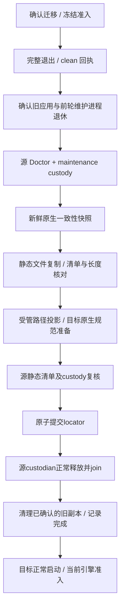

# 数据目录位置与离线迁移

## 入口与范围

「设置 → 会话存储」与「使用统计」独立。Windows 安装版提供「更改位置」。用户选择一个空文件夹作为完整目标路径，确认页展示该路径。应用直接迁入该文件夹，盘符根目录不能作为数据根。再次迁移从当前活动数据目录出发。确认前只检查目标，取消时保留用户选中的文件夹。

主要数据库、`openclaw/`、本地语音模型和 Chromium 持久数据迁入新根。目录按用途迁移。固定 `<appData>/<productName>` 保留引导定位、恢复记录、登录目录和出站头策略。迁移跳过顶层 `backups/`、`outbound-header-proxy/`、`chrome-extension/`、`external-agent/` 和顶层浏览器缓存。应用启动后按需在新位置生成代理证书、连接信息及缓存。已有工程、工具、外置模型和附件保持可访问。目标实际启用后自动清理已确认的旧副本。

新增普通目录默认随数据根迁移。需要留在原处、在新位置重建或清理旧副本的顶层条目，在 [迁移范围](../../../src/main/storage/relocationScope.ts) 中统一维护。OpenClaw 的子目录处理由其迁移流程负责。

位置区仅显示「配置路径」与「数据路径」两行，采用等宽灰底路径框，右上角提供打开对应文件夹与复制完整路径的图标，数据路径旁提供「更改」；实际路径由 Main 返回。较长路径省略显示并可悬停查看完整路径。空间统计中，带提示图标的分类可悬停查看实际目录范围；「插件与技能」汇总当前数据根 `openclaw/state/` 下的 `extensions/`、`skills/` 和 `plugin-data/`，含 `.host/` 中的宿主批准记录与保留代码。这些文件不重复计入「会话与运行数据」，安装资源和数据根外的插件不计入。

迁移发起和离线维护仅对 Windows 安装版开放，开发版不执行这些操作。目标需为空，迁移时会将其设置为应用私有数据目录。普通源文件按内容复制，生成联接由原生处理，复制过程不跟随目录联接。

## 启动与唯一活动根

`main.ts` 进入 storage bootstrap，确定路由后加载普通应用 `application.ts`。Windows 安装版和默认开发版在固定 bootstrap 根取得单实例锁，再读取已有定位和迁移记录，设置活动 `userData` 与 `sessionData` 后加载 Logger、Store 和 Gateway。从未建立控制记录的旧环境及其他平台沿用原启动路径。数据位置暂不可用时，安装版进入隔离恢复维护，开发版直接退出。

显式 `JUSTDO_DEV_USER_DATA_DIR` 仍可选择独立开发目录，CLI 显式 profile 优先于该变量。候选目录等于当前 locator 目标或与生产 profile 相同时，仍跟随生产 locator 和固定锁，不能用旧根绕过定位。只读 locator metadata 仅用于识别候选路径，不能代替目标存在及身份准入；即使目标 marker 丢失也不能重新创建空环境。共享定位后不再按旧开发变量创建目录或设置旧根内的默认工程；独立开发目录保留原工程隔离行为。

| 控制文件 | 内容与权威 |
| --- | --- |
| `storage-location.json` | `version/profileId/revision/activeRoot/activeRootId`，唯一活动位置 |
| `storage-root.json` | 根目录 profile/root 身份，不是执行结果 |
| `storage-location.initializing.json` | 首次确认期间的临时绑定记录，供启动恢复半写入状态 |
| `storage-relocation/active.json` | 迁移请求、源/目标身份、停机与启用状态 |

控制记录严格校验 schema/体积；临时文件先保护权限、文件 fsync 后原子替换。定位错误、丢盘、身份不符或未完成迁移进入恢复页，不自动在 C 盘新建空环境，不根据修改时间寻找旧副本。恢复页和启动弹窗单独标注数据路径和出错位置。只有通过格式校验的定位记录提供数据路径，记录缺失或损坏时显示「暂无法确认」。

离线维护进程在目标准备完成、定位切换、源进程退出和旧副本清理结束后，将事务标记为 `Activated`，再重启到新位置。普通启动直接使用已完成迁移的目标。

CLI 默认入口读取同一 locator，同 profile 的历史命令转向当前根，维护时拒绝新请求。开发版默认启动器固定在工程的 `.agent-tasks/external-agent/development/`，只在明确指定独立 profile 时使用各自的子目录。显式独立 profile 保留隔离。协议、自启与手工双击经过同一早期路由。

## 请求、退出与维护

选择目标时检查所选文件夹是否为空。确认时再次读取文件夹内容，写入迁移标记并绑定首次迁移的源位置。进程在首次绑定期间退出时，下次启动以临时绑定记录恢复原数据位置。

确认后登记迁移请求并进入正常退出流程。应用停止接收新工作，刷新持久 Session/Cookies，等待已发起的存储清理和插件写入收尾，并由 OpenClaw 的正常退出流程停止 Gateway。正在进行的工作可能中断。所有写入者退出后关闭产品 Store。启动和升级相关的写入者也由退出流程收尾。

正常退出最多等待 60 秒。清理成功时写入正常退出回执。超时时旧主进程记录已识别的受管进程，按进程身份强制结束，再进入维护重启。用户单独打开的程序继续由占用诊断处理。维护模式确认旧进程均已退出后才复制。请求记录仍存活的 Gateway 的 PID 和系统创建时间。清理回执合并请求时与清理末尾的进程身份，维护进程再由系统确认这些进程已退出。维护入口使用隔离 profile、随包只读 HTTP 页面、immutable/CSP/导航保护和单独最小 preload，不启动 Gateway、聊天或业务执行。

## 原生快照与复制

源 Gateway 退出后，原生维护 worker 持有源库租约，并生成本次迁移的 SQLite 一致性快照。租约仍可能写 WAL，应用只复制快照，SQL 和租约由 OpenClaw 管理。快照与原生临时目录都创建在目标盘，成功后清理本次产生的中间文件。

复制前确认目标目录只有本次迁移标记。普通文件复制到受保护的目标目录，核对目标清单和长度，切换前复核源清单及租约。目标 worker 在新位置完成原生规范准备后退出。维护 worker 在打开资料前记录 PID 和系统创建时间。重新启动应用前确认维护 worker 已退出。维护窗口显示等待退出、准备数据、复制数据、准备新位置和切换与清理五个阶段。阶段状态仅保存在本次维护进程内。

## 取消与恢复

| 情况 | 行为 |
| --- | --- |
| 旧应用退出失败或缺 clean 回执 | 不复制；核验原进程退休后可取消请求，由原位置正常恢复 |
| 复制/目标准备失败、磁盘满 | worker 退出后可返回原位置；再次从设置选择空文件夹，从头复制 |
| locator 已替换且迁移未结束 | 确认前轮 worker 已退出后，继续清理剩余旧副本，再启动目标 |
| 提交后源进程退出或旧副本清理失败 | 目标仍是唯一权威，留在维护页重试收尾 |
| 丢盘或控制记录损坏 | 错误处理自身失败关闭，保留所有文件，不转入空环境初始化 |

复制失败或取消时，活动数据位置保持原样，已有的目标文件留在原处。返回原位置只清除本次迁移请求。用户可以在同一盘重新选择空文件夹。locator 是唯一的切换依据，写入后始终继续使用目标。

出现可能与文件占用有关的错误时，维护页只查询本次报错的文件或目录本身。能查到时显示程序名和 PID，标明应用相关进程；检测不完整时提示暂无法确认。旧应用或前轮维护进程仍在退出时，显示已确认的进程并等待其退出。页面提示正常关闭外部程序。复制失败时，用户可返回应用并在设置中重新迁移。

## 路径与插件

OpenClaw 配置、应用登记的工作区和下载记录中，已识别的旧 `openclaw/` 内路径转向新根。树外的项目、工具和文件保持原地址。历史会话中的正文、路径和链接保留原值。普通文件硬链接按内容复制。OpenClaw 在目标重建生成的技能和运行时依赖联接。生成技能目录中如有普通数据，迁到目标的 `openclaw/retained-plugin-skills/` 下，供用户取回。

插件代码、数据、批准记录及私有 SQLite 文件族随目录复制，保留原有内容和身份。迁移不加载插件业务或解释收据。旧批准产物中的 `entries.relocation` 只作为原有 hash 元数据保留。

## 本地语音模型统计

`local-speech-models/` 位于当前 `userData` 顶层，随整个数据根复制，无需单独迁移。统计将其全部普通文件逻辑大小单列为「本地语音模型」，包含已安装模型、`.downloads` 下载暂存和 `.install-*` 解压暂存，不再计入「配置与其他数据」。只有已统计字节数大于零时展示该分类的行与柱状图色块；数据根外的开发或安装包模型不计入。统一扫描上限、链接跳过与不完整结果提示仍适用。

## 删除一次性升级备份

「升级备份」统计和删除固定配置目录下的 `backups/`。备份不存在或完整统计为零时隐藏这一项。独立开发资料使用自己的备份目录。迁移和旧副本清理跳过该目录，其他盘已有的备份可在原处手动处理。

删除由可信主窗口请求，Main 的系统确认框展示确切路径，默认取消。删除期间在备份行显示忙碌状态。备份删除和缓存清理的行内成功提示在三秒后消失，手动重新统计时立即清除。应用需已完成启动且无进行中的迁移或指向备份的已登记工作目录。确认后核对目录身份并逐项删除，链接只移除入口。操作与缓存清理和迁移互斥，退出会等已开始的删除完成。删除完成后立即移除备份行和对应占用，再刷新统计。

## 清理浏览器缓存

「浏览器缓存」行右侧的扫帚图标打开确认框。确认后展示检查、清理、重新统计和结果。清理范围为当前数据根和受管 Chromium profile 中的 HTTP、代码及着色器缓存，保留 Cookie、登录、站点存储、历史及下载。

Main 核对目录边界和 Session 身份，使用各 Session 的原生缓存清理 API。清理与后台浏览器占用、备份删除和迁移互斥，退出等待已经发起的调用。失败后刷新实际占用，缓存可能随使用重新生成。

## 清理迁移旧副本

切换路径后，维护进程等待源数据库进程退出，将旧 `openclaw/` 改名隔离，再按本次收据删除整树。清理不跟随联接。旧产品数据库、本地语音模型、日志和受管浏览器资料继续按已确认副本清单清理。工作区和下载文件引用从目标数据库只读取得。清理结束后才重启应用。升级备份由用户手动删除。

固定引导、登录和出站策略留在配置目录。`openclaw/` 之外的已登记工作目录、审批计划路径和下载文件按原地址保留。逐项清理只删除清单中身份仍匹配的文件和相应空目录，数据库的任一成员有新增或改动时保留整组。锁定版跨盘合成样本覆盖离线整目录移除和目标历史回读。

## 卸载与验证边界

普通卸载保留自定义数据；现有 AppData 清理不遍历自定义根，本版不把 locator 字符串交给卸载器递归删除。安装/维护仍遵守运行进程保护。不支持不认识 locator 的旧版本直接使用已迁移 profile。

未勾选删除用户数据时，固定 `<appData>/<productName>` 中的 `storage-location.json`、根身份和恢复记录也会保留。它们不属于安装目录；同一 Windows 账户重装同产品后，即使安装目录改变，启动仍先读取这份定位配置并继续使用原活动数据根。

显式跨盘回归在 `tests/openclaw/runtime/storage-relocation.native-smoke.mjs`。使用锁定的随包 Node 执行 `transaction` 模式，可用 `STORAGE_RELOCATION_TARGET_PARENT` 选目标盘父目录，用 `STORAGE_RELOCATION_PLUGIN_FIXTURES=1` 验证插件、技能联接和保留项目。探针退出时清理本次创建的测试目录，成功时在仓库 `build/` 保留验证结果。合成测试覆盖原生历史回读、旧库和缓存清理以及受保护路径保留。冷归档回读、真实断电和完整安装版的历史及附件验收仍是独立验证项。
