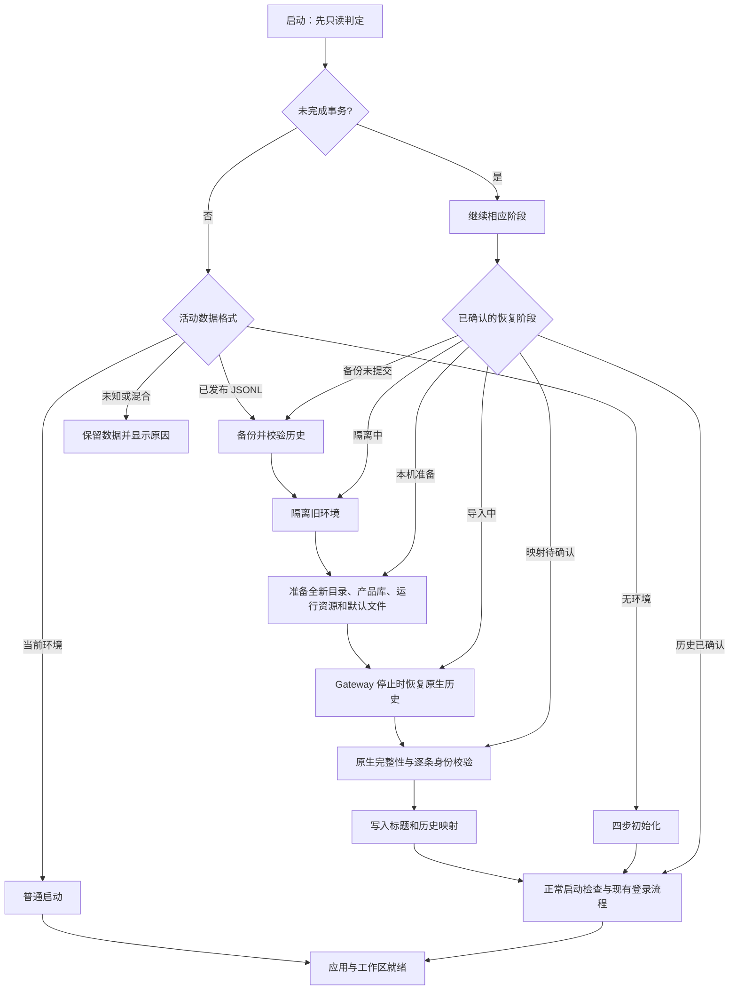

# 启动分流与历史会话升级

## 所有权与模块

Main 和 Renderer 各自以 `startup/` 为启动模块，下面分为三个子模块：

| 子模块           | Main                                                   | Renderer                                     |
| ---------------- | ------------------------------------------------------ | -------------------------------------------- |
| `routing`        | 只读安装判定、持久阶段记录、升级事务                   | 固定启动模式、就绪门禁、实际活动上报         |
| `history`        | 一致性备份、历史投影、原生导入与身份校验、缺失目录恢复 | 正文缺失提示、选择新的工作目录               |
| `initialization` | 初始化进度与错误、初始化 IPC                           | 共用准备引导、普通启动页、柔光汇聚动画、诊断 |

Main 的实现位于 `src/main/startup/`，Renderer 位于
`src/renderer/app/shell/startup/`；原有 core/app 和 IPC 入口保留为薄转发。
窗口工厂仍负责安全窗口创建，preload 只传递 Main 冻结的模式、时钟和显式 IPC。
产品 SQLite 保存标题、索引与映射回执；正文由 OpenClaw 原生存储持有。

## 三类启动

判定发生在产品 Store、配置投影和 Gateway 打开旧环境之前，不比较安装包版本。

| 事实                                                     | 路由                  | 行为                                           |
| -------------------------------------------------------- | --------------------- | ---------------------------------------------- |
| 无活动产品环境                                           | 首次安装              | 当前四步初始化                                 |
| 已发布版本的活动 JSONL 索引或旧 `cowork_messages` 产品库 | 需迁移升级            | 选择性备份、新环境准备、历史恢复、启动检查     |
| 当前产品结构，且无活动旧历史格式                         | 普通启动/普通覆盖升级 | 保留现有数据和设置，显示普通启动页             |
| 有未完成的阶段记录                                       | 继续上次流程          | 恢复当前阶段；已确认的备份、目标环境不重复替换 |
| 格式未知、损坏、活动 JSONL/SQLite 混合或读取失败         | 恢复错误页            | 保留数据，拒绝自动清空重建                     |

`startup-state.json` 使用稳定的数据代际 `native-sqlite`，不是每个应用版本一个标记。
已有当前版本用户缺少该文件时，先只读识别并采用当前环境；缺少
`.justdo-initialized` 不会迫使普通覆盖安装重新进入引导。旧展示标记写入失败也不改变路由。
备份、原生导入归档和已删除 JSONL 不算活动旧环境。不自动寻找其他品牌的目录。
存在活动 JSONL 但缺少产品标题/会话索引时，在隔离前停止，不能以空会话列表宣布升级成功。

本功能只处理已发布 JSONL 代际，未恢复已撤回的未发布 9.6→9.8 原生 SQLite 兼容桥。

## 备份与恢复边界

备份位于 `<userData>/backups/<transactionId>/history/`：

- `justdo.sqlite` 的一致性快照，包含已提交 WAL；不能只复制主文件。
- `openclaw/state/agents/*/sessions/sessions.json` 和原生历史 JSONL。
- `openclaw/state/media/` 历史附件。
- 校验清单、导入计划与不含正文的原生身份校验回执。

不复制轨迹日志、技能提示缓存、插件、定时任务、原生配置和凭据文件到新环境。
旧产品快照只作恢复来源，其中原有的设置不进入新活动库。
源文件变化、链接路径、校验失败或身份冲突都停止升级，不覆盖备份。
事务记录通过临时文件、文件同步和原子替换提交；备份清单全部校验通过后才隔离旧目录。
若中断发生在备份阶段提交之前，保留原候选快照并重新采集活动旧数据，避免遗漏中断后新增的历史。
此阶段若活动环境已变成当前代际则拒绝覆盖，不沿用过期的迁移判定。
临时隔离使用同卷重命名，完成后移除隔离的旧设置，长期保留选择性历史备份。
日志、备份自身和当前进程的 OS 锁文件不参与目录替换。

新目标直接建立当前产品表。旧产品库以只读连接提取
ID、标题、归属、时间和关联，不在旧库上删表或升级 schema。
普通版本升级继续使用当前库，不执行这里的环境替换。

### 原生历史

使用安装包中锁定 OpenClaw 的 `doctor --session-sqlite import` 和 `inspect`。
只投影历史身份、时间、压缩历史、标签与父子关系；不带入模型覆盖、技能快照、
权限、Goal、待输入、待投递或插件运行状态。只定位备份中的文件，不跟随旧机器绝对路径。
压缩快照引用重新指向目标副本，原始 transcript 字节保持不变。
原 `sessionFile` 只用于定位备份目录内的 basename；topic 和其他合法文件名保留，
重新指向当前目录，不假定正文总是 `<sessionId>.jsonl`。

导入发生在最终规范 state 路径，Gateway 与外部聊天入口在此之前不能启动。
导入后以原生 SDK 的公开 `getSessionEntry` 逐条校验原生 session ID 和 `spawnedBy`，
身份/关联缺失时不提交产品映射。Main 不用 SQL 读取或修复原生 transcript。
退出时等待导入子进程退休，未知结果保持当前阶段，重启交由原生导入器核对。

重复规范键只接受精确的原生 owner 证明，不按“较新时间”挑选。
已知旧产品/Multica 命名空间遵循原生规范键折叠规则，原始大小写另存回执；
不把该规则推广到 Matrix、Signal 等不透明外部身份。

### 旧消息缓存与映射

原生正文缺失但仍有旧缓存的会话，先转换为一次性的原生导入输入，再由原生工具写入 SQLite。
存在原生索引时继续使用原生 session ID 与父子关联，不另建身份替代它。
保留文本、Thinking、时间，以及工具名称、参数、结果等历史证据；工具记录以静态历史文本呈现，
不生成可执行 tool call、授权、待处理请求或运行终态。目标不创建 `cowork_messages`。

`history_session_bindings` 保留产品会话、精确原生 key/session ID、原始外部映射和恢复事务。
标题与绑定的迁移事务临时使用 SQLite `synchronous=FULL`，提交并确认完整 checkpoint 后恢复原策略，
再持久化检查阶段，防止独立阶段记录先于映射落盘。即使没有会话，也必须确认新 schema 和默认值落盘。
检查阶段恢复只核验不可变身份回执，
不覆盖中断前合法更新的标题、目录和活动时间。
外部历史可以作为当前产品会话继续，不重新激活旧外部入口，也不标为旧实时同步的只读会话。
历史绑定独立于原生 worktree 绑定；发送准备核对原生身份和连接代次，并应用当前工作边界及权限。
单条和批量删除共用精确原生身份核对；批量仅删除已确认项，失败项保留，
丢失确认时必须得到明确的原生不存在回执。真正 worktree 仍需逐条删除。
有效历史 owner 只建立空角色/模型的身份占位，使用新版默认运行配置，不恢复旧角色文件。
历史身份投影失败时保留检查阶段并停止 Gateway 准入，下次启动重试当前投影。
无原生正文且旧 owner 无法表示的记录保留原始映射回执，在默认助手下建立新的空历史入口。

原始正文已经缺失时保留标题并明确提示，不推测正文。
原工作目录不存在时，用户可选择现存目录；Main 核对调用窗口、会话身份和未运行状态，
选择期间身份或运行状态变化则拒绝更新。不自动重建旧项目目录。
空目录字段按未绑定目录处理，和不存在的目录一样只计入结果提醒，不阻断历史迁移。
用户选择将项目放在旧应用数据目录内部时，沿用旧环境清理范围，不额外备份或保留其中的项目文件。
跨品牌来源识别及其他附件位置的扩展不属于本次补充范围。

历史会话首次打开或首次准备运行时，使用当前新会话默认权限，并保持无旧模型覆盖，
由当前助手/应用默认模型解析；不恢复旧权限、角色模型选择和审批状态。
产品绑定的 `defaults_applied` 标记使该初始化只发生一次，用户之后选择的模型和权限不会在重开时被重置。
为已使用当前结构的历史绑定补列时默认视为已应用，保留用户已有选择。

### 失败处理与迁移结果

磁盘空间不足、文件占用、访问被拒绝和旧版仍在写入分别显示处理建议，保留真实错误与恢复阶段。
用户可打开数据目录；Windows 文件占用/访问问题可打开任务管理器，手动核对并结束属于旧版应用的占用进程。
应用不猜测占用者、不自动结束进程。处理后通过“重新启动并重试”沿用已确认阶段，未提交的备份重新采集。
磁盘提示说明备份、新数据库和临时文件都需要额外空间，不设置未经验证的固定预留阈值。

Main 与首个工作区实际就绪后，共用引导停留在迁移结果页，显示恢复会话数、正文缺失数、
需要重新选择目录的会话数和备份位置。用户点击“进入应用”后播放原有揭幕动画；首次安装和普通启动继续自动进入。
结果页等待和揭幕期间的新错误都保持首页不可交互。
打开备份、数据目录和任务管理器使用独立、带调用窗口校验的 IPC；Renderer 只传动作，目标路径由 Main 决定。

## 共用引导与柔光汇聚

首次安装显示四步；需迁移升级显示六步：
“备份历史 → 创建用户目录 → 检查运行资源 → 准备本机文件 → 恢复会话 → 完成启动检查”。
两者共用品牌、步骤栏、当前操作、用时、进度和折叠诊断。
普通启动显示紧凑品牌与当前操作，不出现初始化步骤列表。
恢复流程沿用已确认的进度，不回退到未完成的备份步骤；常规本机就绪检查仍会执行。

“柔光汇聚”使用本地图片、渐变、transform 和 opacity：中心标志可见，柔光汇聚后移动至品牌位置，
内容与步骤依次进入，入场时长 1280ms。Main 提供同一时钟，跨临时窗口、主窗口、
HTML 与 React 交接继续，不重播入场。动画不推进任何后台步骤或伪造百分比。

Main、App 和首个工作区实际就绪后，640ms 双层幕布揭示首页；完成前首页保持 inert 与 aria-hidden。
错误立即停止入场或揭幕并恢复错误页，迟到的动画完成不能打开首页。
沿用现行产品的 Windows 动画策略，不因系统减弱动画设置切换流程。
全部资源随安装包交付，不需要公共网络、字体 CDN 或首次下载。

## 初始化错误

App 向门禁传递真实 Error，诊断保留错误码、堆栈和 cause；友好文案与诊断分开。
设置、主题、语言、模型和会话各自报告真实活动，操作开始时同步上报，避免同一事件循环中的错误
被错误记在上一个步骤。关键配置读取失败不再当作“没有配置”，也不以默认值覆盖未读设置。

语言文案本地提供。系统语言读取有本地回退，语言偏好写入继续使用原配置队列，但不阻塞界面就绪。
已初始化的非法语言值回退到英语并异步修复，不能将不支持的字典键传给界面。
不再因语言偏好等待超过五秒而要求用户手动重载；真实不可恢复错误仍有重载/重启和诊断入口。

## 验证与实际限制

隔离的旧资料副本演练覆盖 291 条产品会话，其中 53 条仅有旧缓存、3 条原正文缺失。
公开原生读取器逐条确认 581 条目标记录与 287 条父子关联。
当前产品适配器验证普通历史、压缩历史、旧缓存、外部历史和缺失正文入口的发送准备；
使用本机模拟模型继续对话，并检查精确原生 whole-run settled 终态及重启后的消息持久性。
受认证的当前子任务适配器列出全部 287 条关联，未丢失或改写身份。
实际 Electron 窗口覆盖三类启动、浅深两种主题与三种尺寸共 18 种布局；
逐帧检查中心标志与柔光处于当前展示层，并验证揭幕期间报错仍保持首页不可交互。

补充自动化覆盖空/缺失工作目录、备份空间不足或文件占用后的重试、原生子进程错误分类，
以及历史默认模型/权限只应用一次。迁移结果页另覆盖两种主题、三种尺寸及中英文共 12 种布局，
检查显式进入、备份动作及等待/揭幕期间的错误阻断。支持按钮已验证 Main 目标解析和 IPC 调用；
真实系统目录、任务管理器的打开效果仍需现场验收。

这些验证不等同于真实企业账号、客户现场覆盖安装、断电或磁盘故障验收。
剩余现场项目见[现行说明与验证边界](#当前验证边界)。

## 当前验证边界

真实企业 JSONL 用户覆盖安装、客户现场、无缓存且公网阻断的冷启动，以及持久阶段中断、磁盘不足/占用故障仍未完成现场验收。客户原始异常日志尚缺，受控环境复现与修复不能证明已确定客户问题的唯一根因。
