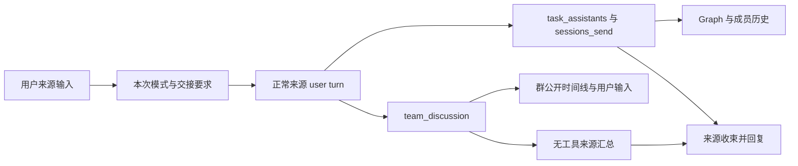
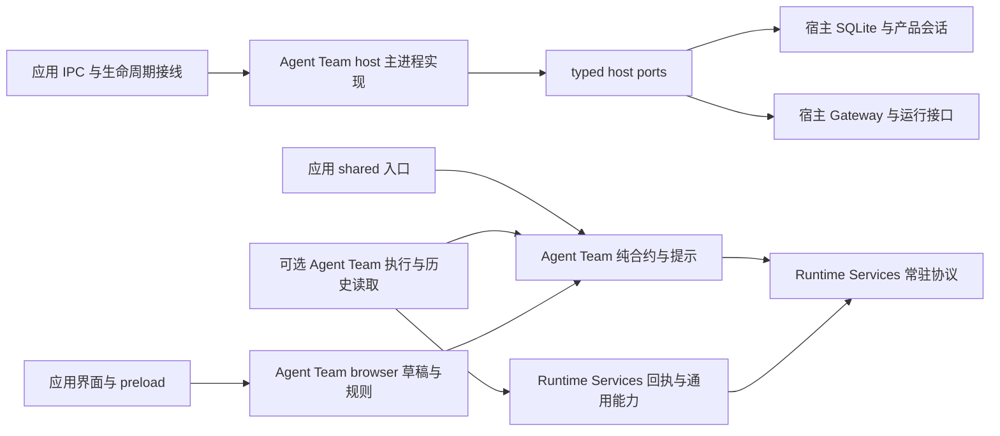

# Agent Team：任务协作与群组讨论

Agent Team 是默认关闭、用户可切换的可选扩展。任务协作保留持久助手之间的分工和消息投递；群组讨论提供公开讨论时间线，用户可直接参与。两种模式共享助手档案和来源任务导航，各自拥有执行、权限和结束契约，不转换已有会话历史。

本说明维护当前实现。长期助手档案、角色文件与原生 SubAgent 的区别见[长期助手与任务内协作](assistants-and-collaboration.md)；跨进程及存储所有权见 [Cowork](../../architecture/04-cowork-system.md)、[插件系统](../../architecture/07-plugin-system.md)及[数据存储](../../architecture/10-data-storage.md)。未完成的真实业务验收与候选能力见[Agent Team 验收与后续候选](../../plans/agent-team-acceptance.md)。

## 用户入口与两种模式

先在「插件 → 扩展」启用 Agent Team。主输入框的“+”菜单中选择 Agent Team，再选择「任务协作」或「群组讨论」；模式标签只代表下一次提交。发送前不创建团队，取消标签不删除已有团队，切换模式不搬迁、重写或拼接原生历史。Team 与 Swarm 的本次模式选择互斥，各自插件和已有执行独立。

Agent Team 的插件开关先通过原生 API 同步插件和技能配置，再走现有安全 Gateway 重启流程，使技能发现按新配置重新开始。OpenClaw 9.8 的热替换会保留部分旧技能发现配置；后续文件刷新可按启用前的关闭状态删除 `state/plugin-skills/agent-team` 生成链接，而技能目录缓存仍宣称它可用。隔离 Gateway 已复现这一删除链路，安全重启后重复刷新可保留链接。重启由原生协调器等待活动执行结束，不强行中断其他任务；离线设置不启动 Gateway。技能文件及目录链接仍由 OpenClaw 发布，应用不复制到生成目录、不改写模型的读取参数、不注入读取兜底，也不新增运行时补丁。

用户也可在普通主会话明确要求来源助手组织团队。显式选择模式时，应用在实际来源消息中附加组织说明与自包含交接要求；隐藏提示使用不带产品品牌的 `<agent-team-request>` 标签，继续协作使用 `<collaboration-continuation>`，不保留旧标签或旧提示格式的处理分支。显示和编辑投影仅隐藏精确的当前应用后缀，原生正文不被改写。来源模型使用真实工具组织团队，工具结果才证明创建或接纳，正文宣称不能充当回执。

来源助手按任务发现已启用助手、准备成员并分工；用户无需手工构建 Graph 或预先组群。关闭插件会清除 Team 模式草稿并撤销旧回调，正文、附件及引用保留。普通对话不每轮注入 roster 或协作说明。

其他成员执行期间，用户仍可在左侧继续给来源助手发送普通消息；来源自身忙碌时按正常原生消息队列处理。普通发送会尝试核对旧 Team 发起请求的清理，但未完成或不可核实不会阻止发送，也不会因此取消或放宽其守卫。只有再次显式选择 Team 模式发起新请求时，才要求旧请求的精确终态和清理完成。停止中、未确认的消息准入、会话删除、权限和原生工具政策仍分别校验；新的普通消息不自动广播给成员。

来源会话列表的运行图标包含成员原生运行及关联群聊的准备／提交／运行／停止状态。协作批次的 pending 计数表示尚缺精确执行终态回执，open／closing 也不能单独证明当前仍在运行；成员全部空闲后收起旋转图标，保留未收束批次、投递和未知结果，不据空闲补造完成回执。主输入框仅消费来源自身的主运行状态，后台成员和群聊不把发送按钮切换为停止。用户停止来源时先同步关闭发起准入，原生停止不等待守卫取消 RPC 返回；发起回执的精确清理仍由原协调器完成。

主会话标题栏「摘要」中的 Agent Team 项按本会话实际记录显示「协作 × m，群聊 × n」，数量为 0 的模式不显示。点击直接打开右侧团队 Tab，不在摘要内展开列表；有两个协作和三个群聊就显示「协作 × 2，群聊 × 3」，右侧对应五项真实页签。每次打开清除旧成员详情并定位默认团队，随后可在右侧切换具体批次或群聊。左侧会话列表不单独展示群聊分区。打开面板不创建房间；独立侧栏沿用 dev 的工作区窗口和可见性机制。

Agent Team 启用时，「插件 → 扩展 → Agent Team」卡片的历史图标及详情页的「全部团队记录」提供独立的全局入口，统一列出保留的协作批次和群聊，按类型筛选或搜索团队及成员；独立群聊和来源已删除的群聊也在这里。摘要仅展示当前会话关联的 Agent Team；当前会话没有团队时整项隐藏，其他会话的历史记录不产生入口或计数。关闭插件隐藏摘要、全局记录、团队导航和参数设置入口，并关闭已打开的历史／设置弹窗；过期导航事件不能重新打开。重新启用后按保留记录恢复入口。列表只按需读取房间元数据，选择后定位精确协作批次或群聊，不创建房间或启用插件。摘要不再提供全局历史按钮；全部记录统一从插件进入。来源会话删除仍会清理协作团队，群聊保留自己的原生历史，本入口不改变删除策略。

Renderer 的功能入口和团队 Tab 共用当前窗口已确认的扩展启用状态；打开或切换 Tab 不重置为未启用，也不重复读取扩展目录。首次状态未知时隐藏入口并禁止发送，群聊页仅在确认关闭后显示未启用提示；读取暂时失败保留已观测状态。禁用通知立即更新全部订阅者，并保留关闭版本以使快速关开间的旧界面失效；窗口重新聚焦仍刷新权威目录，最后一个订阅者卸载后释放监听并丢弃快照。

| 模式     | 右侧视图                                           | 用户参与                                                        | 结果回到来源                                               |
| -------- | -------------------------------------------------- | --------------------------------------------------------------- | ---------------------------------------------------------- |
| 任务协作 | 真实消息投递 Graph；点击节点或连线查看对应原生历史 | 来源主会话正常输入；peer 详情可直接向当前助手发送消息                   | 来源助手收取结果、安排检查、seal 收束，再回复用户          |
| 群组讨论 | 单列气泡：各助手头像和消息在左侧，用户消息在右侧   | 底部输入框，附件、引用、轮次和 @ 自动补全；启用语音时可用麦克风 | 有固定来源的模型建群在讨论结束后自动汇总，无需手工发送结果 |

点击助手头像打开该成员的内部执行历史，公开讨论与 Thinking/工具过程分开显示。用户消息气泡沿用主聊天的主题背景、前景配色及圆角和内边距，正文、链接与附件地址继承气泡文字颜色，随明暗主题切换。群聊输入区沿用主输入框风格；顶部保留标题、紧凑状态和必要操作，次要操作收在更多菜单，不展示大段组织者说明、独占一行的查看主会话汇总或关联任务按钮。侧栏移到独立窗口后，设置弹窗、菜单、提及与输入焦点跟随实际窗口；IPC 和应用事件仍由原 Renderer 持有。

群聊和成员详情的补充输入框沿用主输入框的发送快捷键设置，默认 Enter 发送、Shift+Enter 换行。输入法组词期间的 Enter 不发送；@ 候选打开时优先确认成员。键盘发送与发送按钮使用相同准入条件，群聊忙碌时按现有规则加入待发队列。

协作 Graph 始终显示团队当前已加入的全部成员，未收到任务或未发言的成员仍保留节点；发送消息不依据回执删减成员。不同批次复用团队成员会话，切换批次只筛选该批次的连线、投递／执行状态和验收记录，不把其他批次的执行状态带入所选批次。

“根据讨论执行”仅将精确讨论引用卡片追加到来源主输入框，保留现有正文、附件和其他引用，不另开补充弹窗、不自动提交或扩大权限。用户决定下一次实际执行。引用是定位器；需要正文时按原生身份和当前权限读取，不用快照冒充最新完整上下文。

## 团队、权限与主助手

组织者是实际来源助手，不以固定 main 字符串代替身份。来源的产品 session、native session key、sessionId/lifecycleRevision、项目和有效权限都需核验，跨来源请求不能借用其他任务的资格。成员共享项目目录不等于共享上下文或文件写入隔离；交接要包含目标、必要材料、约束、产物位置、依赖与检查标准。

任务协作的组织者就是来源原生会话，承担邀请、派发、收取结果和收束。peer 是独立任务成员会话，创建时按来源当前可支持的权限准备，后续实际投递仍重新准入；权限不是一个随来源 UI 永远同步的布尔开关。不能用受限来源创建权限更大的成员或绕过原生审批。

群聊绑定固定 `summarySource`。组织者默认不参与公开讨论，即使不参与仍负责发起与最终汇总。创建工具省略 `organizerParticipates` 时采用用户设置；明确用户要求可以覆盖参与偏好，选择群聊本身不强制覆盖。参与时借用左侧同一个来源原生实例，占助手名额，不复制出另一个 main。用户不占助手成员名额。

自动汇总的输入是插件发起的内部交接，不是用户发言。原生历史保留这条输入及 `inter_session / justdo-team / team_discussion` 来源标记，普通成员的 channel dispatch 和 borrowed 来源的 direct dispatch 都显式携带该标记。Renderer 同时识别原生 `__openclaw.transport.channel=justdo-team`，使缺少 provenance 的已有群聊输入也按真实通道归属。主会话在组成可见消息前排除这类 user 输入，仅展示来源助手生成的汇总结果；成员执行详情保留这类输入，以“群聊调度”的专用头像和名字显示轮次提示及上下文。协作交接继续显示真实来源助手的身份，本成员自己的输出仍使用本成员头像。识别不依赖英文提示词或正文前缀；用户自己发送相同文字、其他来源消息和真正的 assistant 输出仍正常显示，不修改原生历史或增加正文缓存。

普通群成员在创建后固定。闲置并且前批、汇总及清理均结算后可切换组织者参与；容量、源身份或权限不满足时拒绝，不静默移除成员。来源参与执行使用只读工具政策，来源正常任务的全局权限不被改写；来源忙碌时不能把排队接纳或空闲快照描述成原子独占。

模型建立的关联群聊固定只读，来源项目和权限由 Main 推导。当前只读执行路径拒绝未验证的 ACP/harness/runtime、Plan/Goal 及不可继承的细粒度限制。旧独立群保留自身入口和权限语义，其权限选项不是模型建群放宽权限的通道。borrowed source 永远不作为房间自有成员删除。

## 协作执行与独立验收

协作流程标题栏提供“停止整个协作”，沿用来源会话的全队停止契约，关闭当前协作准入并停止成员和来源关联讨论。助手工作详情在“正在工作”旁提供“停止当前助手”，仅取消当前成员的精确 native run 及其原生受控子任务，不触发全队停止，不关闭其他成员的准入或清空后续输入；新的协作消息仍可启动该成员。该入口仅在协作成员实时执行详情中出现，历史消息回执和群聊详情不提供此按钮。Main 重新核对房间、成员、原生会话 incarnation 与活动 run，再调用原生 `sessions.abort({key,runId})`；ACK 不补造 execution outcome，详情及 Graph 继续等待原生生命周期证据。停止失败显示提示并保留运行状态。

`task_assistants` 发现助手、准备持久 peer 会话，不发送任务正文。原生 `sessions_send` 的前置 hook 将可信来源和精确目标交给 Main；Main 验证房间、轮次、权限、停止状态、幂等和预算后登记 delivery，扩展收到原生结果后记录接纳身份。模型自报 room/run/tool 身份不能授权。

成员准备与助手创建、群聊准备共用 60 秒的宿主处理上限，外层 Gateway RPC 等待 75 秒，覆盖原生会话冷创建和权限准备；成员列表及普通投递准入仍使用 8 秒上限。超时不自动重发；Main 在原生准备返回后重新检查期限、停止和删除状态，过期成员执行清理而不加入房间或发起工作，迟到回执不能恢复已过期请求。

平级发送只支持省略模式或 followup；steer、notify、resume 在登记和扣预算前拒绝，原生 SubAgent/ACP 继续由自己的原生契约控制。成员可使用已有成员关系，不能自行扩大房间或权限。普通 Team 不是 Swarm DAG，不提供统一的协作运行池或公平自动排队。

投递状态与执行结果分开：accepted 是原生接纳；只有精确 run 的 whole-run `executionSettled:true` end/error 才确定执行结果。可见 final、一次模型 attempt 结束、Stop ACK 或 session idle 不能补造终态。快速 peer 回复可能早于 after-tool 回执，使用有界身份匹配等待；执行事件丢失保持未确认，不自动重放未知投递。

`task_assistants({seal:true})` 只允许组织者关闭当前批次的协作准入。`closing_run_id` 和 `collaboration_execution_receipts` 将组织者收尾与工作助手执行分别核对；相关执行未结算时不显示整批结束，也不重复发起一个总结 run。新的用户阶段采用新轮次和新证据，旧回复不会重开封闭阶段。

独立检查通过 `task_assistants({review:{deliveryIds,verdict}})` 报告，verdict 为 passed、changes_requested 或 unverified。只允许组织者已派发的独立验收 peer run 检查同房间同批次成功工作回执；自验、验组织者、跨批、伪造执行及混合操作拒绝。一次最多覆盖 16 个回执，验收执行的范围与结论不可改写。

报告先等待执行确认；验收 run 真实 accepted 且 whole-run 成功后才 confirmed。数据库只存 IDs、封闭结论和时间，标准、发现与证据在原生历史。返工产生新工作与新验收，旧报告只覆盖确切 deliveryIds，不证明后来文件版本或整个任务质量。来源模型仍需综合检查与结果，没有产品强制质量门禁。

## 群聊执行与自动汇总

`team_discussion` 提供 create/send/read/stop。Main 从来源绑定推导项目，固定 `summarySource` 和成员；Gateway 使用公开 `justdo-team` Channel/broadcast SDK 派发。来源加入时由公开 group-thread 和 buffered dispatcher 保持原 canonical delivery、精确 pin 及只读边界。

输入 @ 后下拉当前助手名称，没有常驻的一排 @ 按钮。未指定收件人时，全组由原生规则评估是否发言；@ 指定首轮路由，后续成员仍可能根据原生提及规则进入讨论。成员可 NO_REPLY，不能把 N 人 × R 轮描述成一定产生 N×R 条可见回复。“回复”选中精确收件人、引用并聚焦，保留其他草稿，不自动发送。输入框上方的引用卡片分别显示引用标签、发言者与最多两行的消息预览，只通过独立的移除按钮删除引用；多条引用在限高区域滚动，保留输入框空间。预览只使用当前面板中身份匹配的消息，未加载时显示提示，不把正文复制进草稿存储。

配置同步在 `surfaces.justdo-team.silentReply.group` 启用原生 `allow`；正常、最小及登录／登出同步均保留该策略和其他通道设置。回复准备读取运行时接纳的配置，临时 Channel 配置投影不能代替此设置。缺少该策略时，成员的 `NO_REPLY` 会触发空回复修复并要求再次回答。主会话与最终汇总仍使用各自回复要求；不修改全局静默策略或插件开关，不增加补丁。原生群组调度在整轮无公开发言时提前结束。

群消息发言身份来自元数据，用户在右、助手在左。来源公开发言 mirror 在 room-owned 的原生历史中，仍保留实际来源 speaker 身份；原生来源会话保存其模型执行。仅 @ 来源时也保留完整公开问题，删除来源历史后仍可读取群公开发言。普通来源消息不复制进群。

群聊标题栏合并名称和紧凑状态；响应成员、汇总说明及待回答问题的详情放在状态提示中，不重复占据说明行。引用、成员及停止使用小图标；成员列表使用带独立关闭按钮和成员数量的紧凑浮层，不挤压聊天区域，也不占满空白高度。成员卡片显示与群消息一致的头像和原生执行状态，主助手参与开关单独展示；内容超出可用高度时只滚动面板正文。设置、导出、删除和自动汇总失败后的补救入口收进“更多”，成功自动汇总不显示补救操作。头像打开原生内部执行记录，返回、引用及停止整个讨论也在详情标题栏；群聊详情不提供协作成员的单独停止。停止覆盖当前讨论、汇总和待发输入，仍等待精确原生终态；失败保持可见。准备中和准备失败分别显示，只有失败时提供重试。输入框继续复用主会话背景、阴影和尺寸；保留附件、按语音开关显示的麦克风、@ 下拉、轮次和小发送按钮。

无内容变化的历史轮询不触发自动滚动；新增或更新末尾内容时，仅在用户接近底部时跟随。用户向上查看历史保持当前位置。

讨论与汇总分别拥有真实 native run 回执。许可池对 owned 与 borrowed 成员使用同一批次资源快照；必须同时有精确 whole-run 终态和 dispatcher cleanupComplete 才释放许可。工具接受、可见回复、owner 变化和原生 Stop ACK 都不能建立终态。未知成员执行或汇总继续占用准入。

讨论完成后 Main 创建元数据-only `team_discussion_summaries` outbox，固定来源 incarnation、批次及输出定位。来源汇总完全禁用工具；来源忙碌时通过公开 buffered dispatcher 等待原生 owner，等待期间仍占用汇总准入，不把 followup 排队返回当作执行结束。只按精确原生 receipt 与可见输出 entry 判定已反馈，NO_REPLY 或无输出不显示成功。停止先持久化 `summary_suppressed`，再取消执行，迟到结果不能恢复汇总；中断或 ACK 丢失保留 unknown，不跨崩溃盲重跑。

公开结果超过当前 80KB 汇总边界或引用不完整时明确失败，不静默截断后声称完整总结。用户可显式要求来源读取精确批次。结构化问题通过已有提问窗口处理，只有匹配的 native room 身份才显示“需要你回应”；正文里的 @用户 不制造问题状态。

## 资源设置

启用插件后，默认设置入口是「插件 → 扩展 → Agent Team → 设置」，团队更多菜单提供「本团队设置」；关闭时两类入口均隐藏。无需新增 Settings 一级页面或主输入框参数栏。插件保持启用时，保存默认值可离线进行，不自动启用插件或重启 Gateway。

| 设置               | 默认 | 用户范围        | 含义                                                  |
| ------------------ | ---- | --------------- | ----------------------------------------------------- |
| 协作成员上限       | 12   | 整数 2–12       | 含组织者；人数是上限，不是必须凑满                    |
| 协作每轮消息预算   | 16   | 整数 4–16       | 包括分工、成员回复和验收投递；失败/未知登记不自动返还 |
| 群聊成员上限       | 6    | 整数 2–6        | 含参与的组织者，用户不占位                            |
| 群聊默认轮次       | 2    | 整数 1–4        | 下一次发送的偏好；用户/工具可明确传值                 |
| 群聊轮次上限       | 4    | 整数 1–4        | 默认轮次不得高于此上限；越界明确请求拒绝              |
| 群聊响应执行上限   | 自动 | 自动或整数 1–24 | participant turn 总量；自动为成员数 × 当前轮次        |
| 群聊并发响应数     | 自动 | 自动或整数 1–6  | 当前批次的原生派发许可；自动不表示无限                |
| 群聊默认组织者参与 | 关闭 | 开/关           | 新房间偏好；逐群参与设置仍需身份、容量和 idle 校验    |

产品硬边界与原生上限不是同一个参数。实际 turn 预算是成员数 × 本次轮次与用户上限的较小值，实际并发取人数与配置的较小值；原生全局队列、模型限速和审批可能进一步降低同时执行数。初始用户输入和来源总结不计群聊 participant turn，Thinking/工具事件也不各算一次。

全局设置唯一权威为 `kv.agentTeam.settings`，以 revision CAS 保存。团队仅覆盖协作 messageBudget，或群聊 defaultRounds/maxTurns/maxConcurrent，采用 room 的 `settings_json` 与 revision CAS；资源约束只能收紧全局上限，偏好不是权限授予。轮次保存 budget 快照，群运行保存 resources_json/requested_rounds；执行中不追改旧快照。

降低上限不删除历史或成员；既有超限团队仍可查看，但扩员和下一次准入按当前限制处理。非法值、跨字段矛盾和显式越界请求返回错误，不静默改成其他数字。群聊活动待发条目最多 3 条是当前固定安全边界，不是可调并发设置。协作独立 peer 队列可能互相等待，当前不开放“全队运行池 + 公平自动队列”。

## 待发输入、来源补充与发起保护

### 群聊待发输入与 FIFO

群聊输入可在前批执行或汇总期间保存为下一批输入。同群最多保留 **3 条活动待发输入**；receiving、receiving_unknown、queued、dispatching、unknown 和 blocked 均计入名额。接收预留与容量检查在 SQLite 事务中完成，以 roomId/requestId 和规范化指纹区分重放与冲突。请求重放读取原回执，不再次保存正文或启动讨论；不同窗口不能用并行请求突破容量。

Main 的 queue generation 与房间执行 generation 分离。普通重启不会撤销已保存输入；Stop、明确禁用和关闭房间先同步写取消边界。逐项取消对未派发输入写 tombstone，全量取消推进 queue generation。迟到的保存 ACK 不能将 cancelled 恢复为 queued；接收或执行结果不确定时保持 receiving_unknown/unknown，不能跳过队头或以新身份重发。

同群按接收顺序派发，前批及来源汇总没有结算前不认领下一条。可见最终文字、模型 attempt 结束和 Stop ACK 不构成释放条件；群批次仍要求所有已接纳 native run 的精确 whole-run `executionSettled:true` 与 dispatcher cleanupComplete。来源汇总也必须终态及清理均确认。Main FIFO 是讨论批次接纳顺序，原生批次许可池仍按资源快照控制成员并发；这不是覆盖所有 Agent、协作和普通聊天的统一公平队列。

派发前重新核对房间 revision、实际来源和成员的 native sessionId/lifecycleRevision、项目及权限快照，重新读取精确原生待发条目，并校验规范化内容指纹、附件内容 SHA-256 和当前资源上限。成员或权限变化、资料不可读、资源收紧及不确定原生身份使队头阻塞，用户需要明确处理；不静默改投、删附件或改预算。附件先复制到项目 `.agent-tasks/team-discussions/` 的独立待发目录，启动时再形成批次产物；它们是用户项目文件，不是 Main 或 Redux 正文缓存。未知执行可能仍引用文件，不能依据取消 ACK 擅自删除产物。

### 原生 holding 的身份、隔离与删除

常驻 Runtime Services 拥有 `justdo-team-holding` inert harness、service 和 RPC，native `pluginExtensions.runtime-services.holding` 保存真实 owner 的绑定标记；每个 room/queue generation 使用独立原生 holding 会话。Prepare/Save/Read/Status 仍核对可选 Agent Team 启用状态，Cancel/Close 和 owning SDK 解锁允许禁用后的合法清理。保存只调用公开 transcript append，不调用模型或执行入口。原生条目使用自有 custom-role/customType，`display:false` 且 `excludeFromContext:true`；只有按精确 native identity、requestId、entryId、稳定 idempotencyKey 和指纹核对后才确认 saved。保存前的同步提交 guard 再检查取消代次和 owner，公开 raw delta 读回仅查目标条目，不复制 transcript。

holding 会话固定模型锁。主动调用执行入口可能先收到 ACK，然后产生精确 whole-run error。产品关闭 Agent Team 时常驻 custodian 仍保留 inert harness 和执行阻断；harness 缺失时模型锁也不能回退普通模型。普通聊天历史及公开会话搜索不展示 custom 待发正文，产品会话导入、列表、搜索和状态投影排除保留的 holding key；原生分页仍按原始页面推进，避免过滤后漏扫普通会话。

Main SQLite 的 `team_discussion_queue_control` 与 `team_discussion_pending_inputs` 只保存 generation、请求指纹、参数/权限快照、状态、原生身份和 entry 定位。Runtime Services 的 holding receipt ledger 也只保存上述生命周期元数据。正文、附件路径和回复引用正文只在用户草稿、项目文件及 OpenClaw 原生存储内存在；读取待发正文只生成当前面板的临时投影。没有持久 Main 正文、Redux transcript 或原生文件直读。

关闭与删除遵守不同公开接口的归属：HoldingClose 先持久关闭房间并收齐迟到创建的身份，Main 的正常 operator 客户端按 exact sessionId/lifecycleRevision 归档；owning harness SDK 只在已归档且身份吻合时解除模型锁；Main 再执行 exact `archivedOnly:true` 原生删除，并确认所有 holding 身份缺失。plugin-owned Gateway 请求不能冒充 operator 删除 harness 创建的会话，也不能补造 pluginOwnerId。归档 ACK 丢失时必须重新取得 owner 验证的已归档事实后继续；任一步未知或 incarnation 改变均保留清理任务。实际归档不保证改变 lifecycleRevision，以公开返回的最新身份为准。

正常 SIGTERM 存在另一清理窗口：已归档并解锁、尚未删除的 holding 不再享有 locked-harness 退休保留规则，owner namespace 会被清除。此时只允许已持久关闭的房间，以 durable slot 的精确 key、agent、SID/revision、harness 和 sessionRoot 核对仍 archived/unlocked 的同一 incarnation，继续完成删除；冲突 marker、恢复归档、身份/修订变化均拒绝。Prepare/Save/Read/Status 的 marker、模型锁和正常准入要求未放宽。保存和聊天执行入口在这种恢复清理状态仍保持拒绝。

### 明确禁用与重启

产品扩展 IPC 在修改 Agent Team 开关前取得 Main disable lease：先关闭新接收、建群及派发准入，再在产品数据库取消活动待发输入并推进代次，随后请求已连接 Gateway 取消原生 holding receipts，最后修改扩展配置。lease 在配置操作完成的 finally 中释放；同插件快速关闭/重开串行执行，不能让重开越过未完成的关闭。

离线时产品 tombstone 仍有效，后续 prepare 使用最新 queue generation 与原生存储对齐，不恢复旧待发输入。正常 Gateway shutdown 保留 saved；明确禁用与正常 shutdown 不混为一种取消。热替换时旧 service.stop 可能仍看到旧启用配置，公开 stop 上下文没有可靠关闭原因，因此扩展自己的 stop 检查仅作补充，不能替代 Main 前置 fence。这里保证的是产品开关流程；任意外部或离线修改原生配置不被描述为已经完成产品取消事务。

### 协作详情的成员消息

受管 peer 详情的独立输入框将用户消息直接提交到当前成员的原生会话。来源头像仍回主会话，引用卡片仍由用户明确选择加入主草稿；成员消息不调用主聊天发送，不附加请求主助手转发的提示，也不消耗主输入框正文、附件、引用或 Team/Swarm 选择。

Main 在准备时核对真实来源、完整成员身份、当前原生 sessionId、可选历史 delivery、插件健康和全队完整 idle 状态；来源与目标的 Plan/Goal、停止/删除、无法核实的活动或 queued/dispatching/unknown 投递均拒绝。附件准备后重新核验准入。Renderer 只使用当前成员已连接、历史读取成功的 ChatController 发送，按该成员核对权限和登记/bind 用户运行；切换详情、原生实例变化、重连或插件关闭使旧提交失效。文本、文件、图片和语音附件均归当前成员，图片能力按目标模型判断。

准备回执携带 Main 当前房间的临时控制代次；全队停止或删除准入同步换代。附件准备后以及权限核对、运行登记后，发送者都携原代次重新核验，再调用成员原生发送。停止完成后旧点击不能复活；用户新的显式发送重新取得当前代次。控制代次不保存正文或执行结果，不代替原生接纳与整轮终态证据。

发送接纳只表示当前助手收到消息，不表示执行完成；ACK 丢失保留精确请求并冻结重发，只能用该成员同一 clientTurnId 的原生接纳证据恢复状态。历史 accepted 投递缺少 whole-run 终态时仍不根据 idle 补造结果，不重发旧消息或重开旧批次。新的成员用户运行及其真实 peer 投递按现有身份规则形成新批次。公开 chat.send 没有通用 reject-if-busy，外部客户端的竞争不被描述为原子独占；运行中指导仍不在该输入入口开放。

### 受限发起守卫

当前将显式 Team 发起守卫限定到可验证精确当前输入的正常来源提交。Main 记录无正文候选及 native identity；常驻 Runtime Services 拥有工具政策和生命周期保护，可选 Agent Team 的关闭不能卸载保护。守卫仅收紧该候选的可用工具，不能由正文标记、assertActive、工具名或未知输入猜测授权。缺少精确用户事实、execution lineage、历史读取或当前插件可用性的证据时保守阻断；Code Mode 外壳与内部实际工具分别按公开上下文核对。

协作工具与显式发起门禁均读取原生 `plan-mode/state`：扩展通过 `pluginExtensions['plan-mode'].state` 读取，Main 使用 `sessions.describe` 返回的对应命名空间。`planMode` 槽投影及旧产品槽不参与判断；投影与原生状态不一致时，以原生状态为准。开启规划或尚有待审批计划时仍拒绝发起。

轮末修订的交付等待通过原生补丁 026 的 `appliesToAgentRun` 声明。先确认当前原生 SID；
仅已确认无发起账本、已 released，或原发起整轮已精确结算后的不同 run 可解除该钩子的
等待。未知/损坏账本、退役实例及身份异常继续保护。选择在 prompt build 后冻结，
不以正文标记或后续工具调用补选；原有 live ledger、权限及修订检查继续执行，
解除等待本身不证明授权或完成。

OpenClaw 9.8 的紧凑工具目录通过 `tool_search`、`tool_describe` 和 `tool_call` 发现及调用团队工具。精确当前提交完成验证后，守卫允许这些原生入口；`tool_call` 的实际目标仍由原生执行器再次接受可信工具政策检查，入口本身不能证明团队已启动，也不能放行另一模式的工具、写文件或执行命令。

原生 queued/followup 的通用提交/执行绑定仍未成立，显式 Team 在忙碌或已有未确认队列时保留草稿并拒绝普通 followup。有限纠正最多使用两次原生 revise，只能在精确阶段、尚无已确认或不确定副作用时执行；副作用已发生后不回退。此能力不保证建群成功，也不扩大工具权限。完整业务建群的剩余验收见[验收清单](../../plans/agent-team-acceptance.md)。

Main 候选回执通过 KV CAS 保存原生 generation、来源 incarnation、clientTurnId、prompt SHA-256 和提交边界，没有正文。指纹按原生普通 `chat.send` 入库规则先 NFC、拒绝 NUL、移除禁止的控制字符再 trim；保持原生消息及普通聊天发送不变，避免合法组合字符导致精确绑定错误。正常 release 需要 native inspect 的精确 whole-run proof，以及 fresh fullScan 和 chat.history 的无活动/无队列事实；Stop、产品终态或空历史本身都不能释放。register ACK 丢失而从未发送的候选可通过原生 abandon 核对同一 client:user 确实缺失、来源空闲及 generation 后写 released tombstone，防止旧 register 迟到复活。

冷重启边界：Gateway 正常 SIGTERM 在没有后继 registry 时按 disable 退役插件，会清除普通来源会话的 `pluginExtensions.runtime-services`。`sessions.pluginPatch` 的 namespace 因此不能作为跨进程守卫的唯一权威。常驻 Runtime Services 另以 `stateDir/runtime-services/agent-team-launch/` 的无正文账本保存精确来源、generation、owner、状态、输入指纹和 whole-run 元数据；原生 namespace 只作镜像。账本先同步写入并 fsync、原子替换，再更新镜像；同一 stateDir/来源的注册实例共用串行 CAS。损坏、不可读、写入结果不明或旧进程未 released 的 owner 保持 unknown，不凭缺失镜像恢复为空，也不复制原生正文。只有精确 released 回执才能接纳下一代；失联 owner 不能自动重放。每次持久写入前重核当前客户端和退役状态，历史读取中的迟到续体不能释放或改写旧候选。正常 SIGTERM 后仍须保留 released 代次、执行下一代 CAS，冻结旧 owner 并拒绝迟到旧请求。

本地 markSubmissionStarted 的 IPC ACK 丢失不等于用户输入已发送，也不能凭一次空历史撤销提交边界。只有已经不可恢复地关闭发送续体、实际未调用 native send 的 owning sender，才能调用 `TeamSubmissionAbortedBeforeSend`。Main 的 abortBeforeSend 再拒绝已接纳、已有 whole-run 或已 launched 的候选，并通过独立 native absence/idle/代次 tombstone 完成释放。已调用 native send 的未知结果不会走此入口，不自动重发；Renderer 与 Main adapter 分别在实际调用边界记录 issued，失败前关闭发送续体。

首条消息沿用 dev 的窗口/frame-bound viewer 委托：Main 完成准备并登记发起边界，再将同一 chat.send 交给实际展示的 Renderer，不回退双发。viewer 明确返回 requestSent:false 才执行未发送候选的释放核验；委托失联、超时及已发送未知均保留保护。执行前 Team 资格被撤销时不交给 viewer。

已经 released 的历史候选不阻断同 key 的合法 reset/revision 后续发起：inspect 仅接受其原 SID 或原生当前精确 SID，保留旧身份与 generation，但 identity 变化后不返回旧 whole-run proof。下一代 register 仍必须绑定当前 SID/revision 并 CAS 前代，新代不继承旧终态。未 released 候选的 identity 漂移仍保持冻结；不能用 reset 把未确认执行伪装成完成。

## 数据、禁用与删除的所有权

OpenClaw 保存长期 transcript、公开群消息、成员执行、汇总及待发正文。Main SQLite 只保存产品房间/成员/轮次、来源身份、权限与资源快照、参数指纹、定位和执行/取消/删除回执；Runtime Services 的账本同样不保存正文。Renderer 只维护当前挂载面板的投影，不新增 Main、Redux 或持久化 transcript 缓存。

协作的 execution/review 表与群聊的 rooms/runs/executions/task_links/summaries/deleted_rooms、queue_control/pending_inputs 分别承担真实查询和恢复契约。原生幂等先于新预算扣除；未知不换 requestId 重发。旧独立群不迁移为 borrowed source，不引入已取消的 OpenClaw 9.6→9.8 数据桥。

关闭扩展保留已有团队和原生 transcript，应用隐藏历史和参数入口；协作消息详情与群聊历史 RPC 随可选 Agent Team 停用，重新启用后恢复原有记录读取。Runtime Services 保持受管 peer send 阻断、holding custodian、离线回执核对与发起保护。产品显式关闭先取得准入 lease、写取消代次再改配置；正常 Gateway shutdown 保留已保存待发输入，不能当成明确禁用。扩展开关由配置同步保留用户选择。

停止、删除和恢复各有身份边界。停止与显式禁用先同步撤销在途准入；同一房间的并发停止全部完成前不开放新发送，旧校验与准备续体不能借恢复后的空闲状态重新启动。未知汇总阻止新发送、组织者参与变化及全部来源删除路径，包括批量删除。删除来源先取消绑定讨论与汇总；删除房间只处理自有成员及精确 holding，绝不删除 borrowed source。部分失败持久化补偿任务，确认原生身份缺失后才清理产品记录，长期助手档案及项目目录不随房间删除。

## 模块边界

代码按执行职责和进程划分，测试跟随所属模块。协作与群聊共享产品身份和设置合约，各自保留原生执行和界面边界。

| 模块                                                                           | 职责                                                                                |
| ------------------------------------------------------------------------------ | ----------------------------------------------------------------------------------- |
| `openclaw-extensions/agent-team/contracts/`、`prompt/`                         | 协作规则、群聊业务合约、资源设置校验和本次发起／补充提示；纯代码供应用复用          |
| `src/shared/cowork/agent-team/`                                                | 应用跨进程入口，转出插件纯合约和 Graph 投影；仅保留 Electron IPC 名称               |
| `src/main/cowork/agent-team/`                                                  | 主进程稳定入口的薄桥接；唯一 coordinator 的创建和事件接线由 Main 保持               |
| `src/main/ipc/cowork/agent-team/`                                              | Electron handler 注册、请求／结果桥接和原生事件接线，不承载业务协调器               |
| `src/main/data/agent-team/`                                                    | 元数据模块的稳定薄桥接；实际实现由插件 host/data 持有，SQLite 连接由 Main 提供      |
| `openclaw-extensions/agent-team/host/`                                         | 主进程团队协调、队列、用户附件及元数据/settings 事务；通过 typed ports 现读宿主资源 |
| `openclaw-extensions/agent-team/browser/`                                      | Renderer 内的草稿、继续协作证据、待发规则、提及解析与导出；不依赖应用实现           |
| `openclaw-extensions/agent-team/collaboration/`、`discussion/`                 | 可选插件的协作、群聊执行及各自历史读取；根入口组合注册并保留原生插件身份            |
| `openclaw-extensions/runtime-services/agent-team/`                             | 禁用后的成员发送保护、离线控制、holding 托管、无正文回执与发起守卫；不依赖可选插件  |
| Runtime Services `agent-team/contracts/`、`contracts/`、`concurrency/`         | 托管和执行共用的身份／输入协议、权限映射与通用 FIFO 许可；无应用或可选执行依赖      |
| Renderer `components/collaboration/`、`discussions/`                           | 分别承担 Graph/成员详情/补充请求与群消息/提及/群输入；共享配色放在 `shared/`        |
| Renderer `components/display/`、`chat/`、`composer/`                           | 分别承担真实团队 Tab 组合、主标题栏入口和本次发送模式选择                           |
| `tests/openclaw/extensions/agent-team/`、`scripts/{openclaw,test}/agent-team/` | 按能力集中原生行为回归与隔离探针，插件公开入口与 npm 命令保持稳定                   |

协作消息详情 `collaboration.messages` 和公开群聊历史 `teamDiscussion.history` 归可选 Agent Team 的对应执行域，只在插件启用时读取原生正文。Runtime Services 按 `collaboration/`、`discussion/`、`launch/` 分域，分别持有禁用后的成员发送保护、离线控制／托管／回执和发起保护；这些职责必须在可选插件停用后继续注册，由常驻域入口组合。`teamDiscussion.offlineControl` 只核对无正文执行身份、停止和关闭准入，不承担历史展示。常驻协议只保留 holding 的输入解析、规范序列化及身份核验；公开群 session-key、消息/来源类型、历史批次解析和可选 RPC 名称归 Agent Team；可选群聊执行使用这些合约及无正文回执账本。通用 FIFO 只提供容量和显式释放，是否满足 dispatcher cleanup 与 whole-run 终态仍由 Agent Team 判断。

两个插件及 Team 的 host/browser 实现均不导入 `src`，常驻插件不导入可选 Agent Team。应用 shared 只导入纯合约／提示，Main 通过薄入口加载 plugin host 实现，Renderer 通过薄入口加载 browser 模块；两者都不加载原生注册或 SDK。host/ports 只定义所需资源的结构化能力，每次调用仍现读原来的 store/router，不复制宿主状态。原 SQLite 连接、同库创建事务、唯一协调器、显式禁用 lease 与后台核对保持；可选扩展关闭后，Main 仍静态持有 host 实现以完成合法取消、删除和回执核对。草稿只留在 Renderer 内存，不进入 Gateway 或持久正文缓存。实际 Electron/Redux/preload、主输入框和界面组合仍由宿主接线；动态宿主与 UI 插件装载框架尚未建立，不能将代码归属迁移表述为所有模块已支持动态卸载。Gateway 的可选插件根入口绝不导入 host/browser。模块边界回归分别检查原生包、Main 实现和 browser 构建，防止进程能力交叉。目录调整不改变 Gateway 方法名、IPC、表结构、持久化目录或团队身份。

## 维护与验证边界

原生调用失败按 `collaboration.bind` / `collaboration.dispatch` 等实际阶段报告封闭的原因码和错误引用；日志不记录消息正文、工具参数或原始异常内容。模型得到明确的停止重复尝试提示。绑定失败不会进入发送或投递预留；后续阶段的不确定结果仍按既有回执与 unknown 契约处理，不自动重试。单文件 Gateway 与动态 SDK 共享原生授权及私有会话绑定所有者，保持 host-issued 校验及撤销有效；真实 webchat 来源的多级转发须单独验证，不能仅用后台连接的成功结果代替。该链路已在隔离确定性模型及 Electron 环境中验证三个原生 accepted 投递、各执行的 whole-run terminal 和最后回传来源 main；这不替代真实业务模型及完整 Main room 流程验收。

既有能力在 v2026.9.8 使用公开 Gateway/SDK 和当时补丁集完成接入，没有为上述 Team 功能新增运行时 patch。真实 holding、冷/热禁用、精确清理、guard/QuickJS、原生输入规范化和附件绑定已有隔离确定性模型验证；正式回归覆盖容量事务、FIFO/汇总结算、ACK 丢失、停止/迟到返回、权限漂移、独立补充草稿与可信发起身份。

这些证据不等于完整生产 Main/room/业务模型、麦克风点击、系统级故障或讨论质量已验收。尚未运行的 dreaming、其他原生管理/channel 恢复路径不被概括为全部隔离。真实模型内容质量、完整 UI、多窗口与权限竞争验收继续见[验收清单](../../plans/agent-team-acceptance.md)。

修改时应同时核对 shared 合约、Main IPC/store/coordinator、扩展 service/guard、preload 和 Renderer，运行对应行为回归。不要只以文件存在或注册成功宣称功能完整；也不要将这份现行说明恢复成已完成计划和逐轮审查流水。

当前 v2026.10.4 的 owned-run registry 接线通过原生 immutable actor 发布，Team 不接管该事务。目标版本的实际通过范围见[升级记录](../../openclaw-upgrades/v2026.10.4/README.md)，上述历史验证不自动延续为本版真实模型验收。
