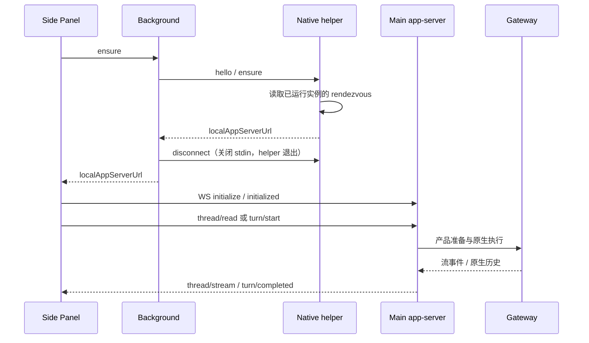

# Chrome 扩展侧栏对话

侧栏对话已接入产品会话、模型/权限选择、附件、页面上下文和停止。本文说明当前 JustDo 行为，不再以其他产品某个已安装版本的静态观察作为功能承诺。逐字段规范见[Chrome 接口](../../app-server-api/browser/README.md)。

## 1. 用户入口与范围

工具栏按钮打开 Side Panel，对话区可新建或继续扩展创建的会话。输入区提供文字、附件、权限、模型和发送/停止；设置入口打开扩展 options，那里继续管理 OpenClaw relay 配对与 Tab 授权。侧栏不列出或接管由桌面、CLI 等其他入口创建的会话。

扩展图标复用应用图标。设置页独立于上游 relay 基线，固定使用英文，分为 Automatic connection、Manual connection、Tab Access 和 Background color；界面品牌由产品元数据注入。颜色选择自动保存并同步到设置页和已打开的侧栏。

两条连接独立：自动化 relay 控制已授权网页，聊天 app-server 管理产品会话。自动发现聊天服务不等于已配对自动化；重新配对 relay 也不能修复 Native host 发现失败。

聊天与 CLI、通用本机 WebSocket app-server 共用 `main/appServer/AppServerConnection` 的请求解析、握手、方法路由、错误与通知出口。Chrome 与通用入口也复用 `AppServerWebSocketServer` 传输实现，保留独立的凭据和能力 binding；Chrome 仍用自动发现及固定扩展 Origin，通用原生客户端使用设置页复制的 Bearer 配置。浏览器服务只拥有鉴权和生命周期；历史投影、订阅共享与运行校准由浏览器能力 binding 提供。客户端请求不能改变绑定的能力或会话范围。分层及能力矩阵见[统一 app-server](../integrations/app-server.md)。

Automatic connection 通过同一个产品 Native host 发现 app-server，再经独立的 `browser/extension/pair` 方法取得锁定运行时生成的本地 Gateway 配对信息。它复用发现与鉴权，不调用聊天 Controller，也不新建线程或发送消息。配对仍由上游原生状态机应用，Disconnect 可撤销迟到结果，手动配对不能被自动结果覆盖。

## 2. 建连和生命周期

Native helper 只负责 framing 和实例发现，Electron GUI 不直接承担 Chrome stdin/stdout。app-server 每次启动随机 loopback 端口和 capability；退出清理发现信息，客户端重连重新取得地址，不能长期缓存旧 URL。

每次发现独立创建 Native Messaging 连接，在同一条连接完成 `hello / ensure`。
成功、协议或地址校验失败、断连和超时均释放该连接，helper 在 stdin 关闭后退出；
并发侧栏和自动配对的发现互不影响。取得地址后，侧栏和自动配对直接连接 Main 的
WebSocket，不保留 helper 作为后台常驻进程；再次发现由 Chrome 按需启动。
helper 文件名为 `<productName>-browser-extension-native-host.exe`，保留产品名但不含协议版本号。

开发版和安装版统一仅连接用户已经启动的实例；实例未运行或收到扩展重启请求时返回提示，
不会启动应用、重启 app-server 或删除已有发现信息。连续连接失败只重新发现和连接，
不会升级为重启请求。开发态运行日志保留在启动终端，安装版日志写入应用日志目录。
应用尚未运行的结构化错误映射为原生可重试配对结果，避免进入需要人工重置的永久失败状态；
用户稍后启动应用后，watchdog 可继续发现实例并完成自动配对。

侧栏连接按发现、WebSocket 打开、协议初始化分别设置期限；打开前断连也必须释放等待。
每次尝试有独立代次，旧 socket、迟到发现和已销毁面板的响应不能接管新连接。
原生错误码保留到侧栏，用可操作的中英文提示区分 host 缺失、应用未启动、连接超时和初始化失败。
扩展声明必需的 `http://127.0.0.1/*` 本机访问权限；网页上下文的广域权限仍按用户操作单独申请。
固定 extension Origin 和随机 capability 继续是 app-server 的准入条件，端口可达不代表授权。

## 3. 当前协议子集

初始化后支持 thread/list/read/start/unsubscribe、composer/options、turn/start/interrupt；通知包括 thread/started/updated/stream 与 turn/started/completed。采用 request/result/error 和 notification 形态，但不宣称实现其他产品全部私有 API。

Main 复用 Cowork 身份、权限、模型和原生历史。流直接转发原生生成事件，历史轮询只用于快照校准和终态确认；扩展本身不建立另一份持久 transcript。

扩展通过 thread/start 或首条 turn/start 新建的产品会话保存 `source: browser-extension`。
桌面会话列表按此来源自动归入“Chrome”分组，默认收起、显示会话数量，
选中其中的会话时自动展开；组内按最近活动排序，置顶仍保留在来源分组内。
该分组由列表投影生成，不写入用户分组表，也不提供改名、删除或移出操作。
扩展会话仍可在桌面继续、重命名、删除和搜索。扩展的列表、历史、图片、订阅、模型/权限选择、发送与停止均在 Main 按产品会话的 `source: browser-extension` 核验；传入其他来源的产品 ID 也不能接管会话。
来源在重启后保留。此前未记录来源的会话保持原有列表归属，不依据标题或消息正文推断来源。

新建产品会话可能尚未创建原生会话或 transcript，此时 `chat.history` 合法返回不带游标的空页，甚至没有 `sessionId`。Main 再次读取并确认空页和身份未变化后返回空历史，不发布正文快照；读取失败、非空但缺少身份/游标、待处理输入不完整时仍报错，不能当作新会话。已有历史的完整页使用顶层 `sessionId`，增量页使用 `sessionInfo.sessionId`；分页、回执和最终确认均校验同一物理身份。

首条输入已接收但尚未创建 transcript 时，正式历史也没有游标，`pendingInputs` 可以非空。Main 在同一物理会话内读取待处理分页并用不带游标的 `inputRunIds` 请求核对回执，确认正式历史仍为空、每个待处理页的身份、状态及可见性未变化后返回临时投影。取消或撤回旧页输入也可能不改变总数，不能只确认第一页。若期间输入已消费、状态改变或正式历史出现，则重新读取完整快照；待处理正文仍不进入 Main 历史快照。

## 4. 页面上下文的明确授权

用户显式勾选并授权读取时，在发送时采集当前页标题、URL、选中文字及有界可见正文。当前是最多 24000 字符的快照，不是模型稍后按需读取整页的工具通道。

Main 将上下文放入仅限认证本地客户端的 justdoUntrustedContext，原生只加入本轮 Agent 输入；持久用户消息保留原始文字，不需 Renderer 用正则隐藏注入前缀。网页可含 prompt injection，不能将其当用户命令。

关闭开关就不采集。切换会话清除未发送附件，防止跨任务误发；页面自身导航后旧快照不能被当作当前页面实时事实。

## 5. 模型、权限与附件

composer/options 读取真实配置模型目录，已保存会话/助手模型仅作为启动重连期间兜底，不能把已分配助手的模型当完整目录。选项未就绪时禁用操作，提升 Full access 使用产品确认。

附件和文本有大小/数量限制，当前附件最多 5 个、原始总量 4 MiB，入站 WS 最大 8 MiB。Main 再次验证，不能只依靠浏览器表单。发送成功是原生接收，完成另由运行事件确认。

## 6. 展示和中止

Markdown 使用扩展离线 bundle，关闭原始 HTML，安全链接在外部 Tab 打开，不从 CDN 动态载入脚本。
消息展示分为三个独立的浏览器模块：`sidepanel-messages` 拥有稳定 DOM、披露与阅读位置，
`sidepanel-activity` 拥有运行活动条和界面时钟，`sidepanel-i18n` 提供中英文案；
`sidepanel.js` 继续拥有连接、发送、停止和会话订阅，不另建执行控制器。

侧栏通过宿主构建适配导出的 `foldBrowserExtensionEntries` 复用桌面的
`foldCompletedProcessRows`，不在插件中复制历史收拢规则。以用户消息和明确阶段边界分段，
将最后正文前连续的已结束 Thinking、Tool、中间正文、压缩标记和进度回执合入同一历史过程区域，
最后正文整体保持可见；缺少最终正文、正文后的过程、未结束或状态未知的工具继续直接显示。
明确的原生失败回复、`stopReason:error/aborted`、媒体与交互内容保留为可见边界，
工具失败、取消或中断本身不阻止其它已结束过程收拢。

结构化 `ask_user_question` 与桌面使用同一个只读问答组件。等待、已回答、超时默认及取消／中断／失败
均归入现有「展开处理过程」默认折叠，即使末尾轮次受保护或缺少最终正文，也仅收起问答项。
最终正文与其它活动工具继续遵循原规则。有最终正文后，问答与邻接过程合成一组，不叠加处理过程入口。
人工提交右侧展示原问题与回答；超时默认逐题显示实际答案及系统归属，未采用默认值时不编造答案。

外层区域使用与桌面相同的历史图标和“展开处理过程／收起处理过程”入口，无汇总次数、
背景或边框。内部连续 Thinking/Tool 使用过程摘要，默认一次只展开一个摘要；
展开后 Thinking 正文直接可读，不增加第三层 Thinking 披露。原始工具 Input/Output
仍可独立展开。活动 Thinking 直接可见，工具活动保持独立，不等待整轮结算才显示。
关闭的历史区域首次打开才挂载正文；已挂载项目在活动、摘要、历史外组之间移动时复用
可核对身份的节点，保留焦点、工具内部阅读位置及用户选择。
偏好按产品会话保留在最多八个临时作用域中，不写入原生历史或产品数据库。

标题栏提供与桌面同图标、同文案的“展开所有过程详情／折叠所有过程详情”按钮，
同时更新 `title`、读屏名称和 `aria-pressed`。批量操作同步展开历史外组和内部过程摘要，
并覆盖此前的过程单项选择；之后仍可单独展开或折叠，后续流和历史更新保留该选择。
批量展开后可同时打开多个摘要，也可逐项关闭。再次批量折叠时历史过程收起，
当前活动 Thinking 和工具反馈继续可见；
原始工具 Input/Output 详情保留独立选择，不因批量操作自动打开或关闭。
切换会话将批量模式恢复为默认收起，不把上一会话的批量展开带入另一会话。

提交等待、发送结果未知、已接纳但未结算、停止等待及尚有活动流的末尾轮次受保护，
不会因 Chat final、Stop ACK、idle 或某个工具完成而被包入历史外组；较早轮次仍可收拢。
该保护只控制展示，不产生或替代执行终态。

Main 仅透传经过白名单筛选的 `display` 信息，保留原生失败、停止原因、压缩和阶段边界。
问答另透传经插件纯契约验证的 `questionResult`（题目快照与实际响应）；认证原生历史的完整 JSON
工具结果正文可在自定义 details 被过滤后恢复该投影，不解析英文、不增加正文缓存或改写原生角色。
原生 `sourceId`、同消息 `sourceIndex` 与 commentary `sourceSegmentId` 用于区分显示来源；
未知重复形状另保留局部 occurrence，不把它升级为原生身份。实时到历史已有可靠对应的行
使用有界、仅保存 ID 的本地显示映射；没有真实对应时不按重复正文猜测另一条消息的身份。

压缩内容直接复用桌面展示器和样式，保留原生 token 指标、摘要独立展开及终态原因；
`progress_card` 回执复用桌面的轻量文案投影。实时压缩只有在原生提供实际 marker/message
时才显示对应记录；没有正文的压缩占位继续由执行活动条反馈，不制造摘要或完成状态。
纯未支持的交互内容只保留“此内容请在桌面应用中查看”的可见边界，不加载未知 HTML，
不为 Widget、MCP App 或审批伪造准入和交互能力。

消息入场、折叠高度/透明度及工具状态采用本地 CSS 动画，以持续星芒与文字流光反馈运行。
Windows 关闭系统动画或请求 `prefers-reduced-motion: reduce` 时仍保留这些效果。
正文直接绘制最新准入文本，不排队逐字播放。

输入框上方的活动条显示真实启动、工作区准备、等待模型、思考、回复、工具参数生成、
工具执行、压缩及重试阶段，并显示观察耗时。阶段和原生计数复用桌面聊天的纯投影：
工具进度文本与输出字符数独立于最终结果，只有原生提供的计数才展示，不计算完成百分比或剩余时间。
活动先通过同一 run、物理会话、generation 与序号准入；旧快照可补工具正文而不能倒退阶段。
每秒时钟更新不重建活动节点，读屏只播报阶段变化，不反复播报耗时与计数。

用户向上滚动、触摸或使用阅读按键时立即暂停输出跟随；工具内部已经消费的滚动不接管外层。
后续更新保留阅读锚点，用户回到底部或点击悬浮的“返回最新消息”才恢复跟随。

工具参数的流式预览和无正文进度状态不创建执行中的 Tool 卡片；收到真实工具 start 后才显示执行卡，随后由原生结果更新完成状态。

发送时只保留一份乐观用户气泡：会话创建和页面上下文采集期间使用临时占位，会话准备好后立即交给流投影并移除占位。后续运行确认、流事件和正式历史更新不会再次追加它；历史读取失败仍保留流中的用户输入与回复。连续发送相同文字仍分别显示。

每次提交在侧栏预先生成 `clientTurnId`，服务端保存同一输入身份；成功接收、发送结果未知及明确未发送分别处理。
提交等待期间最多暂存 64 个流事件、100 万 UTF-16 字符，取得显式 `nativeRunId` 后才通过原 reducer
投影该运行的帧；同会话迟到的旧运行不能抢占新输入。超限丢弃整条临时缓冲，本轮余下展示只读取权威历史校准，
不显示缺前缀的 delta；被动查看已有会话仍沿原生历史和流准入，不为此建立发送绑定。
未知提交保留原消息投影与身份，冻结该会话的再次发送，恢复连接后仅通过 `thread/read(turnId)` 核对。
只有明确 `requestSent:false` 才撤回乐观输入并恢复可编辑草稿；不自动重发请求。
运行层确认该输入的发送 owner 已关闭且未发出原生消息时，准备失败或取消也归入明确未发送，
清理本次输入的待接纳状态；前序未知运行和停止等待仍由原有保护约束。

停止绑定当前 turn 与确切原生运行，不因面板切换取消另一会话。Stop ACK 只进入停止等待；
idle、Chat final、读取失败和轮询超时均不结束运行。只有同一执行的原生 whole-run 结算证据
才能产生 `executionSettled:true` 完成通知。断线保留已知身份并暂停操作，重新发现、初始化与读取原生历史后核对。

公共原生事件有意省略内部 `lifecycleGeneration`，不能把该字段设为收到整轮回执的前提；
同一原生 run、物理 session、原生序列和 Main 连接代次仍须精确匹配，出现显式代次时继续拒绝冲突。
明确 timeout 保留为失败，不能把模型超时触发的机械 abort 当作用户停止；yield 继续等待核对。

若错过 live 终态，Main 仅在仍持有本进程发送准备的原生身份绑定时，补查该 run 的
`agent.wait(timeoutMs:0)`；前后会话描述、当前连接代次、原生 run 映射与来源须保持一致。
合法整轮终态必须有有限 `endedAt`，超时但没有结束时间、运行中、yield 或身份变化都保持未知。
已核验结果保留为最多 100 项无正文的终态元数据，连续轮询及替换面板仍重新核对身份，
不会因原生短期回执过期而把已确认结算改回未知。冷重启后没有原发送绑定的旧运行仍不能靠当前描述、
正文回复或 idle 证明完成；刷新只核对，不自动重发消息。

## 7. 安全边界

Native manifest 只允许固定公钥派生的扩展 ID。app-server 校验 capability、精确 extension Origin、path 和消息大小；Gateway token 和 relay key 不返回 Side Panel。Origin 不是单独凭据，随机 URL capability 也不能写日志。

页面内容、附件和协议 payload 都要验证。新增方法必须明确 owner、取消、权限和消息持久化边界，而不是把 Gateway RPC 通配透传给扩展。

## 8. 维护、测试和未交付范围

源码包位于 `plugins/browser-extensions/browser-assistant/`，其中 `openclaw/` 保留锁定的上游 relay 基线，`conversation-overlay/` 保存产品侧栏及浏览器模块，`scripts/` 与 `tests/` 保存自身组装脚本、Markdown 源码和独立单元测试。它由 Chrome 加载，与 Gateway 的 OpenClaw Extension 安装、发现和启停流程独立。桌面聊天渲染及流的构建适配、Native Messaging helper 和注册继续归 `scripts/browser/`；跨宿主边界的测试保留在根 `tests/`。`browser-extension:prepare` 从该包生成 `build/browser-extension/chrome-extension/`，安装包继续交付到 `resources/browser-extension/chrome-extension/`，显示名称从产品元数据注入，扩展 ID 与配对身份保持既有值。详见[源码包说明](../../../plugins/browser-extensions/browser-assistant/README.md)。

日常 UI 修改在 conversation-overlay，relay 基线由锁定 OpenClaw 版本更新，构建接缝单独审查。回归包括 Native host 未安装、实例未运行、禁止启动与重启、旧 rendezvous、非法 Origin/token、初始化前调用、流与历史重合、停止、超限附件和页面上下文分离。

安装连接验收分开验证实际编译的 Native host framing/发现链和隔离 Chrome 的 loopback
WebSocket/侧栏流程；中文和空格路径、无公网依赖、冷连接失败后恢复也必须覆盖。
fixture 和本开发机通过不代表已复现用户安装现场；真正安装器、Chrome 安装与内部模型的整链验收仍需使用最终发布包执行。

共享聊天解析或 stream reducer 变化时，先运行 `browser-extension:build-markdown` 与 `browser-extension:build-stream`，提交对应生成物，再执行 `browser-extension:prepare`。后者只组装已有模块，不替代前两项生成；侧栏 DOM 回归直接加载提交的模块，必须验证参数流不会提前显示 Tool 卡片。

当前不能将手动 Chrome 加载验证扩展为所有 Chromium 浏览器/商店发布承诺。右键提问、YouTube transcript、tab mention 等未接通能力不列作现有功能；新增时需同步[兼容规范](../../app-server-api/browser/compatibility.md)。

折叠的分组和主要操作复用桌面规则，仍有协议能力差异：当前没有完整的原生物理会话／
历史 generation 显示作用域，不能承诺所有无可靠来源 ID 的历史更换都保留节点和选择；
明确 reset 会隔开过程，但尚未复用桌面在非计划 reset 时清除旧显示前缀的完整投影。
侧栏也不提供桌面 Widget、MCP App、计划审批、Monaco 工具差异和完整历史定位能力。

## 上游 relay 基线

v2026.10.6 对齐 tag `fe06181dc5ecc01cf8904abbfc26925925efefbc` 的原始浏览器扩展；`prepare.cjs` 锁定 29 项源码/资源校验。新增串行队列及 relay URL query 校验模块，与原生 Tab 授权、内部导航和恢复清理一起完整同步；产品 app-server、配对 transport、Side Panel 和固定扩展身份仍经既有 overlay 组合。构建校验不能代替安装版 Chrome Native Messaging/relay 实机验收。
