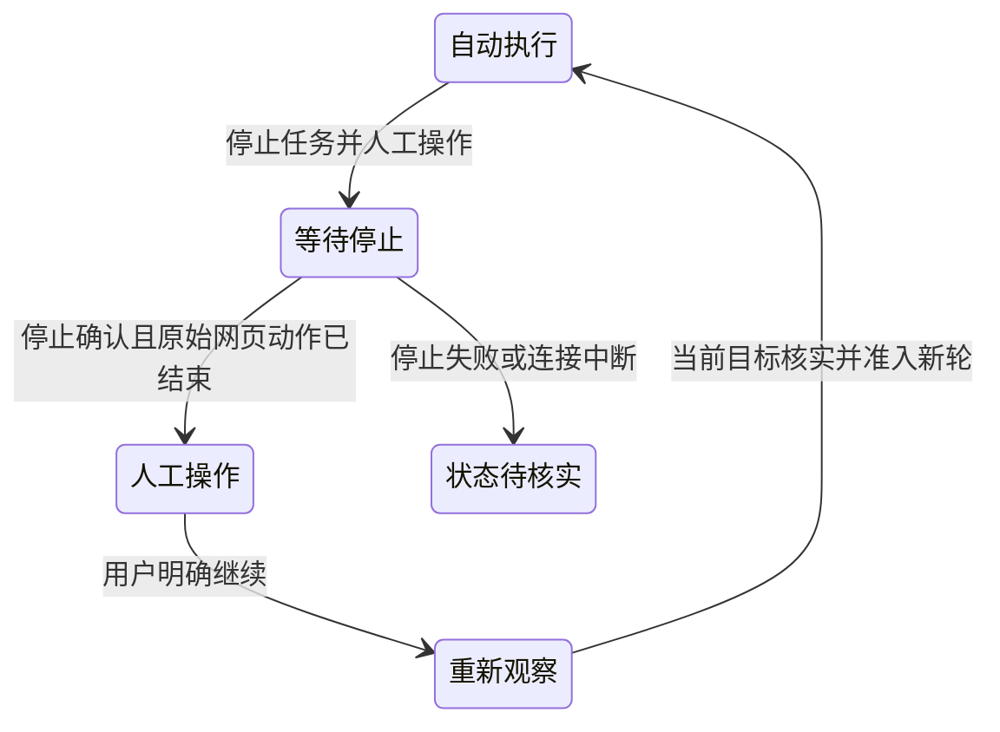

# 内置浏览器操作与人工介入

人工介入在当前会话的真实网页中完成：停止本次自动操作，手动登录、验证或修改，然后由用户明确发起下一轮。应用保留页面和登录状态，不建立镜像 Tab，也不恢复模型执行栈。真实模型与企业页面的端到端验收仍未完成。

## 用户流程

1. Agent 正在操作当前网页时，从浏览器工具栏选择“停止任务并人工操作”。
2. 等待界面进入“人工操作中”，再输入、登录或修改。停止失败、断线或结果未知时保持网页保护。
3. 可填写补充说明，再点击“我已完成，继续任务”。继续走正常聊天发送路径，模型先核实目标并重新观察页面。

首页临时网页不提供任务介入。会话中的空白页或空闲网页不主动显示停止入口；已有介入状态仍由挂载的会话控制器恢复。切换或关闭原网页后可以继续，但模型须先枚举现有标签，不能假设原目标仍存在。

## 入口、页面与状态归属

停止入口依据 BrowserAgentBridge 当前页面的操作 lease，或当前任务打开/切换页面的面板级 lease；不依据会话级 `sessionRuntimeActivity`。模型思考、文件操作和其他会话或标签页的动作，不使当前网页出现停止入口。

没有浏览器操作且没有介入状态时隐藏操作栏，网页照常可用。普通状态查询不取得网页锁；用户已发起但未确认的介入、停止等待和继续待核实才维持保护。空白页缺少 guest 的查询失败不能造成永久等待光标。

已建立的介入不随一次网页动作结束而消失。状态和多行说明放在网页范围内的可拖动悬浮框，工具栏只保留图标入口，不挤占网页高度。切换或重开面板后恢复原 token 的状态，旧页面、旧操作及旧窗口结果不能确认新的介入。

## 停止确认与动作排空

Main 的 `BrowserIntervention` 按产品 sessionId 关闭新的 browser 调用并取消已有调用，同时撤销已预设的上传、对话框和 Agent 下载。排空跟踪原始操作 Promise；超时包装器提前返回或取消 ACK 不代表原始动作结束。

Renderer 复用任务停止流程，核对包含子代理的权威运行状态和待发送输入。`stopping` 时每两秒重新核对；状态确认后携原 token 提交 `confirmStop`，不重复发送停止命令。Main 分别记录 `stopConfirmed` 与本地原始动作是否排空，两项都满足后才进入人工操作。停止已确认后不再反复请求 Gateway，只等待本地收尾。

当前 Renderer 的停止核对使用已知非运行状态及无待提交输入；这是介入控制确认，不是原生整轮执行结果。`stopConfirmed`、idle、Stop ACK 都不能生成成功、失败或已结算的执行回执。批量动作、子代理和其他执行者是否均已停止，以及全局独占保证，仍需真实生命周期验收，不能用本地状态测试代替。

连接异常时保留网页交互保护和当前 token，恢复后继续核对并清除过期错误，不自动继续任务。

## 继续与未知发送

Main 消费本次介入 token、清除旧快照/元素引用，再进入 `resuming`。正常发送取得接收确认后结束介入；发送失败重新建立保护。继续是新一轮任务，不重放旧表单、旧坐标或未确认提交，重复点击也不能产生第二次发送。

发送结果未知或 Renderer 重载中断时保留原请求，用户须先停止并核对，不能自动重发。关闭面板、切会话或 Renderer 重载不释放 Main 的人工保护；应用进程退出时真实页面随之销毁，下次启动不自动恢复执行。

## 权限与保护范围

网页可见不等于 Agent 有浏览器权限。工具指导随本轮有效权限生成；默认沙箱策略不提供宿主 browser，用户自行在“设置 → 沙箱与隔离 → 任务执行方式”选择执行环境。

介入仅覆盖当前任务通过应用内置 browser bridge 发出的操作，不暂停操作系统、其他任务的独立页面、外部 Chrome 或网页自身脚本。外部模式继续沿用各自能力，不提供截图镜像控制或独立“查看任务页面”。后台离屏页不能直接套用前台同页接管流程，现行限制见[浏览器设置](browser-settings-design.md#内置浏览器的前台与后台执行)。

Agent 新标签请求必须在已挂载面板创建真实 guest，保留 targetId/profile；重复 ID 不重复建页，容量拒绝不创建虚假 Tab。目标已关闭或创建失败时显示具体原因，不用空白页或泛化超时冒充有效现场。

## 验证与剩余限制

维护入口为 `src/main/browser/agent/browserIntervention.ts`、`src/renderer/features/browser/intervention/` 及同目录行为测试。`node scripts/test/browser-intervention-smoke.cjs` 使用独立 Electron profile、真实 guest 与 IPC，验证取消收敛、人工阶段拒绝自动调用、原网页输入保留和重复继续拒绝；不连接 Gateway 或模型。

回归还覆盖空白页/关闭最后网页后的恢复、旧窗口销毁后的受限接管、清理异常仍结束 drain、在途普通提交不被短暂 idle 绕过、停止确认延迟、断线、过期确认、跨窗口请求及原始动作晚于取消 ACK。全量测试使用当前 `npm test` 的 ABI 切换/恢复包装。

真实企业登录、多页面和后台任务的目标隔离、模型端到端、停止排空、断线后未知操作不重发、继续前重新观察，以及平台设备仍需实际环境证据。合成状态、源码与 Electron fixture 均不能声明这些场景已经验收。
