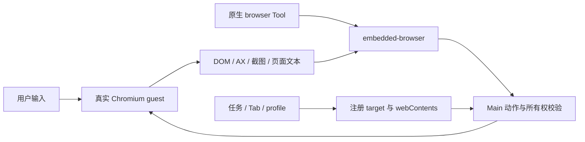

# 浏览器：四种模式、实时工作区与控制权

浏览器设置选择 Agent 使用哪个 browser Tool；右侧工作区提供用户可操作的真实网页。前台继续使用 Electron webview guest，内置后台页面由 Main 的隐藏离屏 BrowserWindow 承载。统一 WebContentsView 与同页前后台接管仍是后续迁移候选。

源码保持两侧各自的生命周期入口：Main 的 `browser/browserAgentBridge.ts` 持有内置 guest、连接和操作上下文，辅助能力归 `agent`、`downloads`、`history`、`data`、`recording`、`pdf` 和 `preview`；Renderer 的 `features/browser/BrowserPanel.tsx` 持有网页面板，标注、录制、人工介入、数据对话框与 PDF 分别归对应领域目录。Chrome 扩展接入、Native Messaging 和设置动作由独立的 `src/main/chrome/` 维护，专属共享合同位于 `src/shared/chrome/`。测试与实现相邻；原生 OpenClaw 的 browser Tool、配对接口及通用页面标注/录制格式保留原生名称。

## 1. 模式和提供方

| 模式       | 持久值    | 提供方                       | 用途                              |
| ---------- | --------- | ---------------------------- | --------------------------------- |
| 隔离浏览器 | isolated  | OpenClaw 原生 Browser        | 独立受管资料                      |
| 用户浏览器 | user      | 原生 existing-session driver | 连接用户 Chrome                   |
| 浏览器扩展 | extension | 原生 extension driver        | 用户授权的已登录 Chrome Tab       |
| 内置浏览器 | embedded  | embedded-browser Extension   | 用户与 Agent 共用桌面侧栏实时网页 |

新配置以及缺失、未知的模式值默认使用 embedded；已保存的 isolated、user 或 extension 选择保持不变。写入 IPC 严格拒绝未知值。切换同时更新产品 app_config 和原生配置，失败恢复原模式。原生 Browser 和 embedded-browser 互斥，任何时刻只有一个名为 browser 的 Tool；插件页与 Main 都禁止绕过模式开关单独启停。

### 日常 Chrome 的授权

日常 Chrome 的“测试连接并触发授权”通过 Gateway 原生 `browser.request` 查询 user profile 的 Tab，实际连接由 Chrome MCP 发起；Chrome 自己展示并处理授权。Windows 由 Main 的配置投影选择 `chrome-mcp.cmd`，启动器显式使用随包锁定 Node 并启动随包 Chrome MCP；003 补丁已移除。原生在其他模式也会生成 user profile，配置投影为这个缺失的隐式 profile 同样补齐启动器，保留所选 default profile、已有自定义 launcher 和其它 profile。

首次 full/minimal 写入、后续更新和认证刷新均经过投影；合法原生配置缺少 browser 根时仅补齐 user 启动器，不指定原生默认选择。原生参数、调用方环境及连接授权继续由 native 持有。握手失败会发生在授权提示之前；本地端口可达只代表可以尝试连接，不代表已经授权。历史补丁运行时必须从锁定 pristine 包重建，不能原地修补。

### 设置页的环境与连接方式

Chrome 扩展安装入口作为独立区域始终显示，位于浏览器选择上方，使用与其他设置卡片一致的灰色标题栏，扩展管理页和文件夹入口放在标题右侧。正文常显用途说明，区分 Chrome 侧栏对话及可选网页上下文、扩展连接方式下操作已授权共享的网页；安装说明默认收起。通过“应用名称 / Chrome”下拉框选择环境，应用名称从 package.json.productName 读取，再显示对应的连接内容。浏览器选择和连接内容合并在同一区域；Chrome 下用紧凑选项保留隔离、日常和扩展三种连接方式，只显示所选方式的说明。同一次打开设置期间切回 Chrome 会恢复上次选择的连接方式，未选择过时使用 isolated。搜索、历史和下载设置始终显示。

环境与连接方式切换均遵循现有任务检查、应用进度和失败回退。切换进度复用标题下方的固定高度说明行，使用简短状态与图标；下拉框按最长选项自适应宽度，长名称受窗口宽度限制；保留右侧锚点，状态变化和选项切换不改变布局，不追加提示行。

### 扩展包版本与连接状态

Chrome 扩展标题旁显示“扩展版本”，由 Main 读取实际开发组装或安装资源中的 `manifest.version`，表示当前扩展包自身的版本，不代表 Chrome 已安装版本。应用发布版本不注入扩展的 `version_name`，读取时也不使用该显示别名替代实际版本；读取失败显示版本暂不可用，不影响浏览器设置。元数据通过既有 `BrowserStatusResult.bundledExtensionVersion` 返回，即使 Chrome 状态检测失败也保留；Renderer 按刷新请求代次接纳。版本悬停说明、正文短提示和默认收起的“安装或更新”说明均指出，已安装版本可在 Chrome 扩展管理页 → 详情 → 版本核对。

应用升级后若无法连接，先重新加载，仍失败时从当前应用附带目录重新安装；不能仅凭版本相同认定连接正常，也不根据版本差异推断协议不兼容。

前三种属于原生浏览器部署形态，第四种由产品 guest bridge 承载。内置模式固定 host，不暴露远程 node/container 拓扑，也不偷偷切外部 Chrome 补缺能力。

## 2. 内置浏览器的资源模型

“内置浏览器设置”包含“允许消息内嵌外部网页”开关，读取并条件更新原生
`gateway.controlUi.allowExternalEmbedUrls`，默认开启，切换后立即保存。配置同步仅为缺失项
补齐开启值，保留已明确关闭的设置。已有手工配置值
照常显示，不由打开设置或保存代理草稿覆盖。设置查询和保存仅使用当前已连接引擎；
断线、冲突或无法确认保存时保留显示值并禁用编辑，刷新读取后才能再次修改。
网页卡片继续使用本页的浏览器代理，助手生成的托管页面不受外链开关影响；具体加载
和授权契约见[消息中的独立网页](../chat/webpage-embeds.md)。

### 标签容量与资源归属

每个会话的内置浏览器标签页上限由 `app_config.browserTabLimit` 保存，默认 20，
可在浏览器设置的“内置浏览器设置”中调整为 1–50 的整数，输入框失焦或按 Enter 后即时保存。
空白“新标签页”计入上限；首页、会话侧栏、消息链接、弹出网页和 Agent 创建入口
共用 `shared/browser/browserTabLimit.ts` 的默认值与边界校验。Main 的 Agent bridge
每次新建时读取最新配置，并合计同一会话所有 profile 的存活标签与待创建请求；
profile 的标签查询与操作仍保持隔离。Renderer 通过现有 `config-updated` 通知刷新按钮状态，
无需重启。

缺失或非法配置使用默认值；合法数值取整并限制在上述范围内。
调低上限不关闭或裁剪已有标签，超过上限时仍可切换、导航和关闭已有页面，
只拒绝继续新建。标签越多，Chromium guest 的内存占用越高。

#### 容量不足时的提醒与恢复

用户入口在容量已满时仍可点击，通过浏览器领域的会话级容量事件打开统一对话框；
临时会话等真正不可用的入口继续禁用。覆盖首页/会话加号、快捷键、启动页地址与最近访问、
消息链接、本地 HTML、网页弹窗、复制、新建右侧及恢复关闭页。对话框由当前工作区挂载，
继承所属 document，因此拆出窗口也能看到；重复拒绝合并，切换会话关闭旧提示。
尚未挂载工作区时使用说明同一处理办法的浮动提示。Agent 的程序创建失败及后台保留面板
不会弹出用户对话框。

迟到的旧会话容量拒绝只报告其原始归属，不调用旧活动会话的显示回调或改变当前会话的
保留策略。浏览器面板尚未挂载时，同一提交前的连续消息打开请求临时计数，待显示状态
提交后清零，保证被拒绝的后续请求仍有提示；不增加 Main 配额或原生执行权威。
容量对话框内的键盘输入不触发底层工作区快捷键；网站认证等已有模态对话框优先，
容量提醒退回浮动提示。新模态取得焦点时关闭容量对话框，保留登录输入焦点。

对话框说明当前上限与关闭页面会丢失未提交内容，列出当前侧栏浏览器页面，允许选择页面
或沿原有关闭回调逐个关闭。系统不自动关闭页面，也不保存或重放被拒绝的新建请求；用户
清理后重新发起操作。恢复关闭页只在创建成功后移除恢复记录，容量拒绝不会消费记录。

Agent 的容量错误保留工具失败语义，并返回当前上限、占用数量及处理办法：先用 `tabs`
检查，优先复用匹配页并 `navigate`；仅对确认不再需要且获准关闭的页面使用
`close` 与具体 `targetId`，随后重试创建。总容量跨 profile 计算，查询和关闭仍按 profile
隔离，因此指引包含 `profiles` 及指定 `profile` 的查询方式。页面状态或关闭授权不明确时
应询问用户，不能盲目重试或关闭未知页面。工具说明与扩展自带浏览器技能保持相同指引。

当前 Renderer 的创建检查仍只统计侧栏页面及本地待创建队列，Main 的 Agent 创建检查统计
全部 profile、前台/无头页与待创建请求；本次未新增 Main 统一预留接口，对话框列表不是
全部容量占用清单。后台标签保留数量限制及其自动回收策略独立于本节，不因容量提醒改变。

每个 Tab 绑定任务、profile、UI target 与真实 webContents。Main 复核主窗口归属、webview 类型、合法 partition 与真实存储路径，每次动作都不能只信前一次注册。

默认 embedded、导入 imported 及合法命名 profile 使用隔离持久 partition。弹窗、复制、恢复和派生 Tab 继承来源 profile，不能意外共享应用壳 Cookie 或认证。后台任务可创建自身 Tab，但不抢用户当前工作区。

浏览器 profile 在创建首个页面前，由共享 Session 策略将 Electron 默认 User-Agent 中的应用与 Electron 标记移除，保留当前运行时真实 Chromium 版本和平台。侧栏、后台页以及共用 profile 的网页采用相同配置；应用主界面与独立 Widget Session 不受影响。Client Hints 继续由 Chromium 生成，语言及已有设备模拟覆盖保持原有行为，不改写站点登录参数或请求签名。页面、iframe 和普通 Worker 使用此配置；独立 Service Worker 仍可能使用 Electron 的全局原生 UA，不为此扩大为全应用覆写。该配置修复客户端标识的兼容性，不保证站点短信、验证码或风控放行；第三方登录仍需在实际环境手工验证。

### 内置浏览器的前台与后台执行

内置模式仍只注册一个 `browser` 工具，新增可选布尔参数 `headless`；不新增 Chrome 适配或 OpenClaw patch，不改变四种模式的互斥配置。

| 使用场景                                   | 创建新页面的行为                           |
| ------------------------------------------ | ------------------------------------------ |
| 普通会话省略 headless，或显式 false        | 打开当前会话的侧栏浏览器                   |
| 普通会话中用户明确要求无头/后台，传入 true | Main 创建隐藏页面，不显示侧栏或聚焦窗口    |
| 支持的内置浏览器定时任务                   | 受信运行绑定固定 true；显式 false 返回冲突 |

`headless` 只决定内置页面展示。普通入口由 Main 处理默认 false；模型仅在用户明确要求时传 true，关闭侧栏本身不改变执行方式。start 或新建页面的明确模式可在同一受信原生轮次延续；下一轮新建上下文重新默认 false。已有 target 沿用其创建模式，省略参数不会切换；显式冲突需新建页面，不能重建同名 target 冒充原页面状态。

前台沿用 Renderer 注册与交互遮罩。后台只接受 Main 私有 registry 登记，复核实际 WebContents、作用域、profile 和 target；Renderer 不能注册后台窗口。前后台页面与待创建请求共用会话标签上限。后台输入使用 CDP，不依赖窗口焦点，focus 只更新逻辑活动页；截图保留图像内容及原有不可信封装。“无头”表示 Electron 不显示窗口的离屏执行，仍有脚本、布局和绘制。

#### profile 共享与回收

前后台按 profile 共用同一个持久 Session：普通会话、定时任务和侧栏可实时使用相同的 Cookie（含 HttpOnly）、localStorage、IndexedDB、HTTP 认证缓存和站点 worker，不做 Cookie 快照或凭据复制。用户可在侧栏登录或登出；无头后续请求直接使用该 profile 的当前状态。默认、导入、命名 profile 之间仍隔离。共享语义等同同 profile 新标签：sessionStorage 和页面内存仍按标签隔离，不能保证仅把登录放在这些位置的站点跨标签免登录。

共享 Session 的网络、权限和下载处理器由 Main 单一所有者安装，侧栏仅登记当前 UI 回调，后台只登记真实页面所有权。后台关闭时立即撤销该页面准入，异步 DNS 回来后复核原页面身份；销毁真实 guest 后释放自身存储占用。不按任务清除共享 Service Worker、缓存、登录数据或关闭 profile 连接，因此侧栏及其他任务可继续工作。无法归属页面的 worker 请求按 profile 网络政策处理，不获得工具或工作区权限；取消不代表站点派生或已发请求已经停止。

手动数据清理在存在待创建、存活或待销毁后台页时报告相冲突类别失败，见[数据存储](../../architecture/10-data-storage.md)。后台不弹站点权限、网站 HTTP 认证或导入界面；匹配的浏览器代理认证和 profile 现有认证缓存继续可用。后台下载必须绑定真实存活页面并由 Agent 操作认领，否则取消；无页面归属的 worker 下载也取消，不能进入保存对话框。后台 PDF 不触发侧栏通知，window.open 被拒绝，新页面应使用 browser.open。主窗释放只移除自身 UI 回调和下载，不卸载共享保护或取消别的任务下载。

#### 原生运行准入

公开 V2 factory、最终工具权限 hook 和 exact toolCall 共同准入，绑定原生 sessionId/lifecycleRevision、runId、jobId 与工作区；模型参数、key 形状或提示词不能授予权限。原生禁止 host-control、仅允许 sandbox 或提供不同文件根时拒绝执行。workspace-only 下上传/输出继续受 canonical 工作区约束，工具拒绝本地 file 文档及执行中的 file 跳转；用户手动侧栏浏览不因此改变。

Main 将普通会话的 canonical key 映射到产品会话时，先查询显式原生／历史绑定，再按共享会话键合约查询普通会话 ID；普通会话不要求另存一份 native key。映射必须同时符合当前助手归属和完整有效 key，已重绑会话不能通过旧 key 回退。该映射只确定产品页面归属，后续仍核验工作区和历史绑定的原生 sessionId，不替代上述原生运行准入。

#### 撤权、终态与页面回收

普通后台页在正常轮末保留，后续调用需新许可；失败或取消的确切终态销毁该会话自有后台页。原生工具信号在正常工具代次清理时也会 abort，不能把信号失效推断成整轮取消。任一原始信号失效先发布独立 revoked 事件，立即阻断当前工具代次、取消 pending，并撤销已经返回 armed 的上传、对话框和 Agent 下载；保留确切运行身份，直到 whole-run end/error 且 executionSettled:true 才发布最终 released。普通页此时按真实终态决定保留或销毁，定时临时页在权限退役或最终释放时均回收。清理不代替原生运行结果证据，也不能撤回已经发出的站点请求。

模型服务失败后的原生重试可以沿用同一 runId，但必须重新经过最终工具权限 hook：只有当前原生 authority 仍有效、browser 仍被允许且 sessionId/lifecycleRevision、触发类型及工作区完全一致，插件才建立新的准入对象。插件自有的 `admissionRevision` 随之递增，并在 requested/cancelled/revoked 事件顶层传给 Main；它不改变原生运行身份，也不构成执行结果。Main 保留当前代次水位，撤销旧 controller 和 armed 效果，仅接受新代次请求。旧调用 ID 在 prepare 后即占用，跨重试不可重放；旧调用引用、取消信号、低代次事件和异步准备的迟到结果不能影响新代次。没有新原生授权、整轮终态、会话身份变化或服务停止时继续拒绝，不能通过重试提示词重新授权。

服务停用/替换、断连、原生 incarnation 改变、会话删除和应用退出撤销相应资源，不重试未知写入。

#### 当前限制与分层验证

当前通过截图、工具结果和文件观察后台过程，不支持同一后台原页面挂回侧栏、直接人工接管或原地切换前后台。运行 `node scripts/test/browser/verify-background-browser.cjs` 可使用独立数据目录和 localhost 合成页面复验；验证包括实际 webview 与后台并发共享 Cookie/localStorage/IndexedDB、登录状态变更、profile 隔离及任务释放不影响侧栏 worker/连接。保留输入、截图、工作区上传/PDF/下载和实际 Main 执行链检查；该入口的身份、会话/job 查询、前台 UI 回调及 resolve 传输使用合成边界。

共享 profile 不再采用此前独立 partition 的“清所有 worker、无迟到 POST”验收标准，页面销毁不能证明共享站点活动已排空。

另有真实原生定时入口 `scripts/test/browser/verify-browser-cron.cjs`，使用选定运行时的随包 Node 并传入 `--runtime-dir <runtime>`。Windows 隔离验证已通过冻结的 v2026.10.7 Gateway、当前源码的插件和 Main/Electron：只创建一次 at job，等待原生 timer 自动触发，通过认证 SDK 接收原始插件事件、实际 cron.get 和产品 mapper 准入；模型省略 headless，连续打开、读取网页和截图均实际执行，图像返回本地合成模型。

核对同一原生运行的精确成功 executionSettled 终态、后续 settled release、cron.runs 成功记录、自有页面回收和两个进程正常退出，不调用 cron.run 冒充定时触发。测试关闭隔离目录的可选 Node 编译缓存，避免其退出时序列化拖延，不改变任务或工具授权。

两种入口及边界见[隔离验证说明](../../../tests/browser-background-electron/README.md)。真实定时验证使用已校验完整性的冻结原生产物，报告明确 `strictCurrentSourceProof:false`：它不验证按当前完整源码重新组装的安装包。公司实际模型、业务站点/SSO、锁屏/睡眠和 macOS/Linux 尚未验收。

模型重试另有 `scripts/test/browser/verify-browser-retry.cjs --runtime-dir <runtime>` 入口，使用选定运行时的随包 Node。冻结 Gateway、当前浏览器插件与真实 Main 事件桥连接本地合成模型，验证 open 成功后一次 HTTP 503 触发原生重试，随后同一原生运行的 status 重新准入并成功返回。旧代码对照稳定返回缺少执行授权，修复后通过；旧效果撤销和精确成功终态分别核验。该入口只模拟 Main 的网页执行结果，不启动 Electron 或访问公司服务，不代表完整安装包、真实页面或 SSO 验收，详见上述隔离验证说明。

## 3. 工具动作与观察

事件桥对齐锁定 Browser Tool 的生命周期、Tab、观察、页面/文件与 act 能力。查询状态不预建空 Tab，首次 open/navigate 在对应任务创建真实页面。目标可用稳定 tN、label、完整 ID 或唯一前缀，歧义必须拒绝。

同一 guest 动作串行。DOM eN ref 绑定快照和文档；部分无导航输入后节点仍有效可继续使用，点击/脚本/批量变化等会主动失效。AX 引用在同文档且节点仍存在时可自解析，导航或移除后失效。模型不提交内部 snapshot ID。

快照递归同源 frame/open Shadow DOM，合并可获得的跨域 AX 语义，连续兼容快照可标记新增节点。截图是私有观察结果，不替换网页承载；带标签图在离屏副本绘制，不改页面 DOM。evaluate 只在无 Node/Electron 权限的 isolated world 执行，输入输出有界。

页面文本、日志、脚本结果均按 network 不可信内容返回；诊断不收集 header/POST body，清理链接凭据和敏感 URL。完整原生 schema 对齐以 bridge/contract tests 为准，不能用“类似支持”返回伪造结果。

### 条件等待与提交核验

`act` 的嵌套 `request.kind=wait` 已支持正文出现／消失、可见 CSS selector、URL 子串、
loadState 和有界 `fn` 条件；同时提供的条件须全部满足。动态页面优先等待当前页面的
实际结果，再重新取得快照。可见元素不等于已启用；需要时用短小、只读的 DOM 条件核验
控件状态。`fn` 会反复执行，不得在条件中点击、提交、发请求或修改状态。

固定延迟、文档 load 和网络空闲不能证明搜索、上传或报表已完成；持续轮询页面尤其不应
只等 networkidle。该选择参考 [Playwright 导航说明](https://playwright.dev/docs/navigations)
及其 [load-state 限制](https://playwright.dev/docs/api/class-page#page-wait-for-load-state)。
内置工具已有可见、禁用和遮挡检查，但不宣称具备
[Playwright locator 的完整自动等待](https://playwright.dev/docs/actionability)；`requests`／
`errors` 用于诊断，不能冒充 [Puppeteer 的响应条件等待](https://pptr.dev/api/puppeteer.page.waitforresponse)。

浏览器 `ok:true` 只确认工具动作，不证明网站业务成功。保存、发送、提交或上传后超时／
断连时，先检查当前页面、回执或站点历史，不盲目重放。只有明确在发送输入前被拒绝的
stale-ref 动作，才能刷新同一 target 的快照后重试一次；批量动作还须核对已执行项及
`aborted`／`skipped`，不能重跑整批。

### 聊天来源引用

聊天「摘要 → 来源」复用当前会话真实 browser 工具访问结果，覆盖内置和 Chrome。Chrome 使用原生公共历史保留的 `browserTab`；内置工具仅从成功页面结果追加有界、独立的页面引用 JSON，使地址与可用标题能经过历史投影。来源按网页地址去重，不读取全局浏览历史、不额外请求页面；失败、下载、标签清单和正文内链接不作为来源。元数据准入与历史投影契约见[聊天渲染](../../architecture/15-chat-rendering.md)。

## 4. 用户与 Agent 不能同时破坏现场

Agent 控制同一页面期间，Renderer 使用交互遮罩；用户画笔、框选、元素检查、评论和录制期间，反向 lease 阻止 Agent 导航、输入、切 Tab 或关闭。允许的观察不应改变页面。

profile 管理动作在修改 Renderer 前取得 scope lease。无 Tab 时可先挂载空面板完成遮罩 ACK，但不预造隐藏 guest；并发 readiness 共享，单个等待取消不能让其他调用失败。

暂停/停止录制要确认 guest 最后输入已提交，再释放保护。窗口销毁、导航、取消和 Gateway 停止清理请求与 lease。操作演示内容仍在 guest/Renderer，Main 不增建正文存储，见[录制说明](browser-operation-recording.md)。

## 5. 导航、权限和认证

内置浏览器地址栏未聚焦时以圆角胶囊样式居中显示 HTTP(S) 域名，省略协议、开头的 `www.`、路径与查询参数，保留其他子域名和非默认端口；悬停仍可查看完整地址。首次点击、键盘聚焦或地址栏快捷键进入编辑时，显示并全选完整网址，后续点击可定位光标或选择部分文字。Enter 提交并退出编辑，Escape 放弃草稿、恢复当前页面地址；未提交的草稿失焦后继续保留原文。本地文件继续显示真实路径，不缩成域名。简略展示仅属于 Renderer，不改变真实导航地址、复制链接或历史记录。

地址栏和侧栏首页搜索框共用地址识别规则：没有协议的纯数字（如 `11`、`2026`）按搜索词交给当前选择的搜索引擎，不让 URL 解析器改写为 IPv4 地址；明确的 HTTP(S) 地址、域名、IPv4／IPv6 地址及本机端口仍按原规则导航。

### 消息链接的打开位置

“消息链接打开位置”和“内置浏览器设置”分为两个独立区域，均使用紧凑单列列表，不再嵌套子卡片或留双栏空白。网页链接与本地 HTML 文件的打开位置下拉框使用同样的应用名称 / Chrome 标签，分别对应内置浏览器与 Chrome，不改变 AI 的 browser Tool 模式，也不重启 Gateway。搜索、历史与下载设置归入内置浏览器，始终显示；下载目录保留路径和完整路径悬停提示，简短标签配合无障碍说明保留字段含义。消息气泡、展开的用户消息和媒体附件在点击时读取当前偏好；网页链接与本地 HTML 均默认内置，缺失或无效配置也使用此默认值，已保存的 Chrome 选择保持不变。

内置链接打开当前会话的真实网页 Tab；Chrome 通过 Main 专用 IPC 校验主窗口主 frame、网页 URL 或实际存在的本地 HTML，再将 URL 作为独立参数启动已安装的 Google Chrome，不依赖系统默认浏览器。HTML 在两种模式下都校验实际文件并直接打开原生 file URL；失败显示提示，不自动切换浏览器。

普通 HTTP(S) URL、Markdown 链接和 `MEDIA` 中的网页／HTML 附件都走上述偏好。在线 `.html` 按网页设置处理。本地 HTML URL 的 query/hash 与文件路径分开传递，在校验后的预览地址上设置 search/hash，不能改变预览的 origin 或 pathname；裸原生路径中的文件名字符保持原样。句子前缀不能阻止裸 HTML 路径识别，代码和现有链接中的路径不重新链接。内置浏览器已挂载时必须调用 panel handle 创建实际 Tab，并保留相同 targetId 和 HTML 来源元数据；容量拒绝不新增外层 Tab，未挂载时才用初始 Tab 状态。异步预览保留点击时的会话和浏览器选择。

### 本地 HTML 的浏览器边界

本地 HTML 直接由 Chromium 以原生 `file://` 加载，不再使用独立预览服务器、目录 token、资源扩展名白名单或应用注入的预览 CSP。相对路径与父目录资源、网络依赖、链接跳转、重定向、表单和内嵌页面由浏览器自身规则处理，不按初始 HTML 所在目录额外限制。地址栏支持原生文件 URL 与绝对文件路径，导航后显示实际目标路径或网页地址；`rootPath`/`previewRootUrl` 仅保留为现有 IPC 的路径元数据。

内置 browser 工具的 `open` / `navigate` 同样支持指向实际存在的 `.html`、`.htm`、`.xhtml` 文件的 `file:///` URL，保留查询参数与片段；前台和后台共用校验，加载后沿用页面文本、快照、截图与交互能力。仅工作区文件策略仍拒绝本地文件页面，并在创建或导航前检查目标；手动侧栏浏览保持原有行为。工具不把本地页面登记为 HTTP(S) 网页引用来源。

保留 `webSecurity`、沙箱、context isolation、无 Node/完整应用 bridge，以及通用网络请求的元数据地址防护；本地 ES module、fetch 和跨来源读取仍可能受 Chromium 原生文件来源规则与 CORS 限制，不通过关闭浏览器保护来绕过。联网依赖来自所打开文档，应用自身的运行资源仍须随安装包提供；内网或离线使用的 HTML 应使用本地依赖或可达的内部服务。

### guest 权限与认证

Main 强制固定 guest preload、sandbox、context isolation、无 Node/嵌套 webview；guest 支持 HTTP(S)、原生 file 和浏览器生成的 data/Blob/about 文档，应用私有协议不开放给 guest。主窗口仍只能停留应用范围。

低风险聚焦全屏和净化剪贴板按明确规则授权；摄像头、麦克风、定位和通知经 Main 来源确认，audio/video 分开。授权绑定 guest、frame origin 和能力，非同文档导航失效，不能用旧页面确认批准新页面。

HTTP auth challenge 绑定随机 request 与 guest，只有主窗口主 frame 可回应。导航、关闭、取消或期限结束统一清理；迟到响应忽略。凭据不写应用密码库和日志，Chromium 自身的 session 缓存另有生命周期。

### JavaScript 对话框、弹窗与人工登录

`dialog` 回应当前 target 的待处理 alert／confirm／prompt，可带当前 `dialogId`；没有待处理项时
只准备下一次对话框响应，`armed:true` 不证明已出现或已接受。预设响应须限于已知、已获授权的
决策；原生文件、打印和保存窗口不属于该接口。JavaScript 模态框会阻塞页面执行，处理语义
参考 [Playwright 对话框说明](https://playwright.dev/docs/dialogs)。

前台普通 HTTP(S) 新窗口链接可交给应用侧栏新 Tab，继续前须通过 `tabs` 确认新 target 和
profile；携带 POST 的弹窗被拒绝，后台 `window.open` 也被拒绝。显式 `open` 适用于已观察到的
普通地址，不能视为恢复原弹窗的 opener、POST 或标签内登录状态。SSO 依赖这些状态时使用
站点提供的同标签方式或人工登录；不能重建认证请求、搬运凭据或换外部浏览器兜底。
[Playwright 也将 popup 视作独立页面身份](https://playwright.dev/docs/pages#handling-popups)，
此处沿用本应用既有弹窗与 profile 边界，不增加 popup 接管能力。

## 6. 文件、下载与 PDF

人工下载遵循询问/目录设置。Agent 上传必须是真实任务工作区文件；download/pdf 只写工作区并拒绝覆盖，以真实父目录形成 canonical reservation 防并发冲突。未指定输出路径的 PDF、等待下载及普通操作触发的下载默认保存至工作区 `.agent-tasks/browser-artifacts/`，与 Swarm 使用同一通用任务根目录。下载事件还需匹配具体 guest 与等待请求；失败或取消终止下载并清理部分文件。

`download` 必须指定工作区输出 `path`，并且恰好提供一种触发源：当前页面观察到的 HTTP(S)
文件／图片直链 `url`，或真正发起下载的控件 `ref`。直链通过当前 guest 的
`downloadURL` 发起，沿用原 profile Session 的代理、登录态和网络限制，不导航当前页面；
不接受 URL 凭据、元数据服务地址或其它协议。普通图片预览／链接点击不保证触发下载，
超时后应检查页面取得实际资源地址，不能反复点击同一非下载控件。缺少／冲突的触发参数
在创建输出路径、登记等待和发出请求前失败；直链解析后再次核验当前执行许可。
`waitfordownload` 仅观察将来的下载，不会主动保存当前页面。结果包含真实 `state` 和字节数，
仅 `completed` 返回已保存路径，`cancelled`／`interrupted` 标记工具失败，不能作为成功文件。

### 异步导出与结果证据

下载控件包含异步生成或 Blob 下载时，应直接以 `download(ref, path, timeoutMs)` 在触发前
建立等待，再由同次调用点击；不能先点击、再用 `waitfordownload` 补接可能已经发生的事件。
此顺序参考 [Playwright 下载说明](https://playwright.dev/docs/downloads)和
[事件等待方式](https://playwright.dev/docs/events)。若网站先创建报表任务、随后才显示下载
入口，则创建任务一次，条件等待其结果、刷新快照，再下载最终控件或已观察到的 HTTP(S) 直链。

普通 `act` 只有短暂自动下载捕获窗口，不是长时间导出订阅。动作结果中的 `downloads` 数组
逐项保留真实 `state`、MIME 和字节数，仅 `completed` 项含工作区路径；失败项不能冒充已保存，
也不能吞掉同次已完成项。结果正文同时提供不可信封装的下载 JSON，供只读取正文的调用方核验。
动作已经发出而下载失败时，保留页面动作结果与失败证据，不据此自动重放点击或网站提交。
下载缺失也不能证明网站没有开始工作；文件内容和实际 MIME 仍须与请求的交付类型核对。
原生下载尚未取得终态、但保存路径或捕获设置失败时，单独返回 `downloadErrors`，不伪造
下载终态或保存路径，并保留同次已完成文件。取消、撤权和会话身份变化仍使调用拒绝。

`mimeType`、`receivedBytes` 和 `totalBytes` 来自当前 Chromium 下载对象；MIME 可能由站点
或 Blob 提供，不能替代文件头／内容验证。`totalBytes:0` 可能表示总长度未知，不据此判定
空文件或下载失败。这些字段和完成状态采用 [Electron DownloadItem](https://www.electronjs.org/docs/latest/api/download-item)
的语义；传输成功不等于网站交付了所需文件，例如登录 HTML 仍可能被保存为 `.jpg`。

### 上传：定位输入或等待选择器

上传按当前页面机制选择入口：网页菜单、来源选择和上传面板先通过普通网页动作展开；已有文件输入可用 `inputRef`、`ref` 或 `element` 直接指定（包括隐藏输入及受支持子 frame），三种定位不能混用。最终直接打开文件选择器的控件可用新快照的 `ref` 同次准备拦截、点击并等待真实选文件完成，也支持点击后动态创建输入。该最终控件没有可用 ref 时，只有 paths 的调用可先准备下一次文件选择，返回 `armed:true, completed:false` 与等待期限，再在同一 target 通过坐标点击等受支持动作触发；不能据 `ok:true` 宣称文件已附加。

实际填入后返回 `armed:false, completed:true`，也只证明已设置文件输入，不证明网站接收或提交，后续仍须核验网页。普通点击已打开的系统选择窗口不能由之后的 upload 补填，`dialog` 只处理 JavaScript 对话框。仅拖放、剪贴板或其他自定义机制不能默认套用文件选择器流程，须按实际机制和工具能力处理。

### 选择器阻塞、取消与人工操作

Agent 的 `act` 在真实 guest 操作 lease 内先开启原生选择器拦截，允许先点击、后提供文件。未预设文件的选择请求不显示系统模态窗口，而是保存精确 guest、产品会话／profile／target、原生 run、文档代次、输入 backendNodeId 和来源取消许可，最多等待现有 30 秒交互期限。动作结果与后续快照附带 `blockedByFileChooser`、`fileChooser.pending/mode/timeoutMs`；同 target 的无定位 `upload(paths)` 重新校验工作区并一次性完成原请求，不再次点击。等待期间保留页面交互 lease，允许快照和有界 wait，其他变更暂停，batch 在选择请求后停止。

单选只接受一个文件，多选沿原生 mode；不从页面猜测输入。

前台输入返回后保留短暂事件处理窗口，待 CDP 屏障和即时事件交付后再恢复拦截。取消、期限结束、主／子 frame 导航、debugger 断开、目标注销、原生 run 变化、停止或断连退休旧请求，释放前恢复手动浏览；清理不向原输入写入空文件列表。人工浏览和录制不主动启用此拦截，仍使用原生选择窗口。此能力续接 Agent 已触发的选择请求；已经真实显示的人工系统窗口仍无 Electron/CDP 公开接管接口，不能据逻辑 pending 测试宣称能控制该窗口。跨进程 frame 无可归属 backendNodeId、目录或非 HTML 文件选择器仍按现有能力报告限制。

### 人工下载与保存框

消息 `MEDIA` 下载链接复用内置浏览器的同一下载入口。询问保存位置时，Main 在
`will-download` 同步回调内设置原生保存框的默认路径，由 Electron 展示一次保存框并处理
选择或取消，不再叠加应用自己的异步保存框。自动保存和 Agent 下载仍在该同步回调内设置
确切路径；原生进度与完成事件读取实际保存路径，包含用户改名以及没有进度事件的直接完成。

### PDF 检测与查看

本地和在线 PDF 统一使用 Chromium 原生查看器，不再维护自建查看器、专用 PDF 正文读取接口或 PDF.js 打包资源。内部 PDF 扩展的特殊子 frame 流导航有精确放行条件，不能为修白屏允许任意 chrome-extension 页面。打印使用原生 PDF 自带入口，避免打印外层空白页。

侧栏的 PDF 操作状态统一由 Main 对顶层文档响应 `Content-Type: application/pdf` 的检测通知驱动。Renderer 只接受与当前标签文档地址匹配的检测结果，匹配时忽略页码等 fragment，同一文档内跳转保留已确认的 PDF 标记，不根据域名、路径或 `.pdf` 后缀预判；新文档开始加载时清除旧标记，等待该次响应重新确认。

文件树、消息 `MEDIA` 和摘要里的本地 PDF 使用同一文件预览页签，通过原生 `file://` 地址加载，不启动本地 HTTP 服务。Main 只准备文件地址，原生查看器读取 PDF 正文；文本预览的 2 MiB 上限与编辑授权不适用于 PDF。文件树保持当前可见性，重复点击复用已打开的文件页签。

## 7. 数据导入与清理

设置支持从 Chromium 系资料导入允许的数据，密码经 safeStorage 保存于独立 browser-import.sqlite，Renderer 不读取密文。导入默认目标与工具 importprofile 目标分开，命名 profile 保持自己的 partition。

下载记录保存安全展示字段，Main-only 路径只经记录 ID 进行打开/定位。删除记录不删磁盘文件。按时间删历史/记录与 Chromium Cookie/storage/cache 全量清理区别披露；清理需涵盖已持久化命名 profile，不能仅处理默认两个 partition。

## 8. Chrome 配对与侧栏聊天是两条链

Chrome 专属桌面操作通过 `window.electron.chrome` 调用：`openUrl`、`openRemoteDebugging`、`openExtensionManagement`、`revealExtension`、`copyExtensionPairing` 和 `testExtensionConnection`。它们使用独立的 `chrome:*` IPC，由 Main 的 Chrome handler 校验调用来自应用主框架；不保留 `window.electron.browser` 下的旧入口。内置浏览器模式、guest、文件预览、历史和录制仍使用 browser 能力，原生 `browser.request` 与 profile 合同不改。

手动自动化配对由锁定 OpenClaw CLI 生成 relay pairing，只写剪贴板，不返回 Renderer 或日志。Automatic connection 复用产品 Native Messaging host 发现本机 app-server，初始化并鉴权后调用 `chrome/extension/pair`；Main 准备 Gateway，再通过同一锁定 CLI 的 `--local-gateway` 生成原生 `/browser/extension` 唤醒入口。配对信息仅返回扩展后台，不进入桌面 Renderer、发现文件或日志，不安装或调用另一套上游 Native host。原生 relay 仍负责授权 Tab 和自动化。

### 聊天发现与自动化配对

侧栏聊天通过固定扩展 ID 的 Native Messaging 发现 Main app-server，不依赖手工 relay 配对，也不取得 Gateway token。详见[扩展侧聊](../../plugins/chrome-extensions/chrome-assistant/side-panel.md)和[Chrome 接口](../../plugins/chrome-extensions/chrome-assistant/protocol/README.md)。

聊天当前使用标准模型目录、文本／图片输入和独立审批面板；原生模型没有声明视觉能力时拒绝图片，
不以已保存模型或自动化配对成功代替模型能力。工具审批、命令会话授权及原生 App 持久授权
与 relay 的 Tab 授权分别管理。具体用户行为见[侧栏模型、权限与附件](../../plugins/chrome-extensions/chrome-assistant/side-panel.md#5-模型权限与附件)，
字段和输入限制以[通用规范](../../app-server-api/external-clients.md#turnstart)为准。

Automatic connection 点击后立即显示连接进度，失败提示允许重试。设置页状态轮询只读取原生控制器状态，不能隐式启动配对；自动重试仍由原生 watchdog 负责。Main 合并进行中的配对请求，完成或失败即释放，不缓存配对凭据；Gateway 配置与权限检查保持执行。

单次 app-server 配对等待上限为 30 秒。开发时首次冷启动准备可能更长，此时扩展显示失败并由 watchdog 重试，后续请求复用 Main 尚未完成的准备任务；不承诺首次冷连接在 30 秒内完成。

### CLI 交付与上游接缝

配对使用公共 CLI 入口，不使用 Gateway bundle 代替。`src/shared/openclaw/cliRuntimeFiles.json` 记录锁定版本的完整根目录启动依赖；安装时验证并打入 gateway.asar，开发提取和各平台最终打包均核验完整清单。Main 仅选择依赖齐全的 CLI 根目录。Gateway 可启动不能证明 CLI 可用；修改打包后须通过桌面实际入口验证自动和手动配对。缺失依赖的开发运行时从锁定 pristine 包整体重建，不补写自制 helper。

资源分别位于 chrome-extension/openclaw 基线与 conversation-overlay。升级先整体更新对应版本的 pristine relay 基线，再审查 manifest/background/options 显式接缝，最后组合 overlay；不能从 build 混合产物反向覆盖源码。

自动配对的构建接缝仅为原生 bootstrap controller 增加可注入请求函数，并由 background 注入产品发现／配对传输。默认上游传输、原生去重、手动配对优先、Disconnect 的迟到响应撤销与旧任务保护保持不变；产品桥不读取或控制 Tab，也不创建聊天会话。失败仍由原生状态机决定重试或提示手动连接，不能将请求已发出显示成配对成功。

### 扩展设置页

扩展设置页由应用自己的 conversation-overlay/options.html、options.css、options.js 和文案字典维护，组装时覆盖上游设置页，不修改 pristine 基线。页面按用户要求固定使用英文，不随浏览器语言切换；四块标题为 Automatic connection、Manual connection、Tab Access、Background color，操作尽量沿用 Use local、Pair manually、Disconnect 等原有用词。自动和手动操作使用同一原生连接，两处 Disconnect 均调用原生 unpair，断开并停用自动重连。

保留原生旧任务保护、连接状态轮询和标签授权语义；配对内容仅在成功后清空，失败时保留输入，界面不显示原始诊断命令或凭据。

桌面“设置 → 浏览器”的扩展配对说明优先引导保持桌面应用与 Chrome 运行，等待扩展自动发现并完成配对，再选择 Tab Access。原生后台在安装、Chrome 启动及 worker 加载时尝试自动配对，watchdog 负责后续重试；Use local 仅用于自动连接已停用时重新启用或主动重试。自动配对说明、实际连接状态和测试按钮合并为一行，复制配对信息与 Manual connection → Pair manually 放在默认收起的备用说明中。连接状态文案对齐扩展的 Connected，完成状态来自实际连接验证，不能由复制配对信息成功代替。

构建从 resources/icons/png 的应用图标复制 16、32、48、128 像素版本，覆盖生成产物中的上游图标；品牌文字继续由 package.json.productName 注入。背景颜色使用已有持久化偏好，同时应用到设置页和已打开的对话侧栏。源布局、基线校验和、生成文件一致性与回归测试共同防止升级丢失界面定制。

## 9. 故障与后续范围

Agent 请求新标签时，`AgentEnsureTab` 在当前任务已挂载的 `BrowserPanel` 上调用 `openTab`，保留 Main 分配的 targetId 与 profile。`initialTabs` 只初始化空面板；已挂载面板不能靠修改外层标签列表创建 guest。重复 targetId 不重复创建，容量限制拒绝时也不改变外层选择和目标列表，否则 Main 会等待不存在的目标注册直到超时。

| 症状                          | 优先核对                                      |
| ----------------------------- | --------------------------------------------- |
| 模型找不到 browser 或出现两个 | 模式配置与互斥提供方                          |
| 已有 Tab 无法操作             | 任务归属、profile、真实 webContents、lease    |
| stale ref                     | 文档导航或快照失效，不盲目复用                |
| 下载不结束                    | guest 匹配、路径 reservation、取消/超时       |
| PDF 空白                      | 原生内部流导航与文件／网络加载结果            |
| 侧栏连不上但自动化可用        | Native host/app-server，不重配 relay 冒充修复 |

WebContentsView 迁移需单独验证 DPI/bounds、焦点、输入、实时标注、profile 和销毁，不能退化成截图遥控。当前验证重点包括 bridge action/schema、页面安全、lease 竞争、文件边界、PDF 和扩展组装测试；真实浏览器与平台验收另行记录。

停止、人工操作与继续使用内置浏览器真实网页，当前交互、保护范围与剩余验收见[人工介入](browser-intervention.md)。统一浏览器运行时与后台任务的未实施需求见[浏览器计划](../../plans/browser-runtime-and-background-tasks.md)。

## 独立浏览器代理

### 网页与 Widget 的会话边界

消息中的网页 embed 也沿用此偏好。普通 URL 使用无 preload 的顶层 webview，与默认侧栏
浏览器共享 Cookie、同源 localStorage/IndexedDB 和站点 worker；sessionStorage/页面内存、
导入和命名 profile、用户 Chrome 仍隔离。托管 ref 保留独立内存 session 与固定 shell/iframe，
Widget Cookie 继续独立。它在代理切换 pending/failed 时暂停新的页面/资源/API/WebSocket 请求，
当前代次 setProxy 与旧连接关闭均成功才开放；无效 CUSTOM 不回退直连。代理重试只重做
网络准备，保留原页面和输入，不重放表单。

普通 URL 关闭只撤销自身页面准入，不清共享
登录、worker 或 profile 连接。只有纯代理路由可将本机无法解析的域名交
配置代理处理，DIRECT/fallback 仍须本地 DNS 校验。安全与验证边界见[独立网页](../chat/webpage-embeds.md)。

### 代理偏好与保存

“设置 → 浏览器 → 浏览器代理”保存 `app_config.browserProxy`，默认使用系统代理；可独立选择不使用代理或自定义 HTTP/HTTPS 代理。作用于应用持有的 Electron 浏览器 guest session（默认、导入和任务隔离 profile）以及聊天 `show_widget` 的专用 guest session。Widget 卡片只复用代理偏好，使用独立内存 partition，不共享浏览器 Cookie、登录或历史。用户 Chrome、扩展及 OpenClaw 管理的独立 Chrome 仍使用各自浏览器的代理配置。

Widget 卡片专用会话先完成代理配置，再装载原生 sandbox。代理切换可关闭卡片中的现有网络连接，但不触及主 Renderer、其他嵌入内容或聊天 Gateway 连接。代理不扩大原生 CSP、资源 allowlist 或网络授权；被原生策略禁止的请求仍失败。普通浏览器中的 WebChat 没有 Electron session 控制，继续使用浏览器自身网络配置。

浏览器代理草稿由设置页统一持有，切换标签页不丢失。浏览器页仅在代理区域提供“保存”，并在该按钮显示保存进度和成功反馈；页底保留“取消”，丢弃尚未保存的代理修改。代理区域仍使用设置页统一的提交与校验流程，其他标签页的“保存”也可提交该草稿。自定义代理必须有有效的主机和端口；保存失败保留草稿供修改或重试。

主聊天 `show_widget` 卡片的真实 HTTP(S) 链接点击固定进入当前会话的侧边栏浏览器新标签，
复用现有标签容量和工作区窗口逻辑，不跟随消息正文的 Chrome 打开偏好。卡片仍在隔离
session 中，点击只交出 URL，不共享卡片 Cookie、存储或沙箱权限。详见[交互式回答](../chat/interactive-answers.md)。

### 浏览器代理与模型代理的区别

原有“设置 → 通用 → 代理设置”继续保存 `app_config.proxy` / `useSystemProxy`，默认不使用代理，仅用于 Main、默认 Electron session、Gateway 和继承其代理配置的非浏览器客户端。两类设置不互相继承；已有配置没有 `browserProxy` 时也使用新的浏览器系统代理默认值，不复制已有模型抓包配置。

### 生效、重试与认证

Main 分别应用两个偏好：非浏览器代理变化更新默认 session、进程环境和 outbound-header 的上游选择。当前 Gateway 子进程已经使用同一活动本地代理，且 capability、CA、NO_PROXY 等启动环境仍匹配时，后续新请求动态选择上游，无需重启；未使用该路由时仍在空闲时完整重启刷新继承环境。既有流式请求和 CONNECT 隧道不强制中断。浏览器代理变化只更新 guest sessions 并关闭旧连接，不修改进程环境、不重启 Gateway。后续创建的 profile 在同一浏览器配置队列中应用当前偏好。浏览器代理认证只读取 `browserProxy` 中与挑战 host/port 匹配的凭据。

模型调试可采用“非浏览器自定义抓包代理 + 浏览器系统代理”，也可针对需要直连公司 IP 的浏览器设置不使用代理。系统模式沿用 OS 的代理与绕过规则，不新增应用自动 IP 分流。outbound-header 仍是 Gateway 的第一跳注入代理，第二跳由非浏览器设置决定；浏览器网页不进入 Header 注入数据面。

### 浏览器网络故障日志

Main 观察普通侧边栏 guest 的 HTTP(S) 主文档加载失败，忽略取消导航、子 frame 和本地文件。
日志使用固定前缀 `[BrowserNetworkDiagnostics]` 与紧凑 JSON，每条仅占一行，可直接按前缀
筛选；写入现有 Main 日志并随“导出日志”打包，不新增文件、IPC 或 Renderer 权限。
`load-failed` 立即记录关联 ID、guest ID、目标 origin、数字错误码、规范化错误名，以及浏览器
代理模式、Session 配置代次和准备状态；不记录目标路径、查询参数、fragment、URL 凭据、
原始错误正文或堆栈。每个 guest 最多每 10 秒记录一次，检查受限时保留 busy/cooldown 原因。

`proxy-check` 从故障 guest 的真实 Session 对完整失败 URL 重新调用 `resolveProxy()`，只输出
严格解析后的代理 scheme、host、port 或 DIRECT；未知路由仅计数，不输出原始字符串。
这是失败后观察到的候选路由，不能认定就是失败连接实际使用的端点。日志保留相同关联 ID。
只有代理连接失败（`ERR_PROXY_CONNECTION_FAILED`）且 Session 代理准备成功时，才额外检查
最多两个候选代理，每个最多两个 IP；固定 IP 跳过 DNS，域名使用该 Session 的 `resolveHost()`。
元数据地址与非法解析结果不进入连接检查。Main 仅建立并立即关闭到代理 IP/端口的 TCP
连接，不发送 HTTP、TLS、认证或业务请求，不连接 DIRECT 的目标网站，不刷新代理或重试导航。
TCP 成功只证明 Main 进程到代理的传输层可达，不能证明 Chromium 请求、CONNECT 或认证成功。

同一 Session 最多每 30 秒启动一次检查，全局同时最多两个，单次期限 5 秒、单个 TCP 连接
期限 1.5 秒。持久 Session 按存储身份共享限流，最多保留 64 个尚在冷却或检查中的记录，
额度不足时仅记录 busy。超时或解析失败记录当前检查阶段。新主导航、guest 销毁或代理配置
换代取消检查、关闭 socket 并丢弃迟到结果。
原生代理和 DNS 解析不能真正取消，超时后仍占用并发额度直到实际结束，避免后台调用积累。
这些期限、限流和测试只验证诊断边界，不代替用户现场公司代理与安全软件的连接验收。

## 浏览历史与站点图标

网页 Tab 图标由 Main 监听真实 guest 的原生 favicon 事件，通过该 guest 的 session 读取，沿用浏览器代理和 Cookie；主窗口 Renderer 只接收有大小限制的图片 data URL，不再从默认 session 重复请求网站图标。读取受 10 秒期限、256 KiB 网络图片体积、候选与重定向次数限制；内联 data URL 最长为 512 × 1024 个字符。逐跳执行网络图标 URL 校验，并继续经过 session 的网络请求保护，不提供任意本地文件读取。

需要代理认证且 session 尚未建立认证缓存时，仅对代理认证失败回退同 session 的原生 GET 请求；只向与当前配置 host/port 精确匹配的代理挑战提供一次凭据，不给源站认证或主动注入认证 Header。主文档导航和 guest 销毁取消旧请求，更新按 guest ID 与当前页面匹配；缺少或失败的图标依次尝试网站候选和 `/favicon.ico`，最终显示通用网页图标。

主文档导航开始时解除旧图标请求的去重状态；候选地址保留到新文档提交。导航被停止或失败、当前文档未替换时，后续原生图标事件或加载结束可重新读取当前文档的候选，迟到的已取消请求不发布结果。手动打开和 Agent 打开的标签共用此流程。

同一 HTTP(S) origin 内刷新或跳转时，保留该 guest 已成功加载的站点图标，等待新文档的图标读取成功后替换，避免先清空再读取导致图标短暂显示后消失。跨 origin、进入空白页或原图标缓存已失效时清空保留值；保留通知携带原缓存信号，不能将已清理的历史图片重新写回。

最近访问复用历史记录中的已加载图片，重启或离线也不需要主界面重新请求网站图标。历史列表只返回元数据；主窗口主 frame 通过按已有页面 URL 的专用接口读取单张图片。旧记录缺图时，Main 在默认内置浏览器 partition 使用浏览器代理和该 partition 的 Cookie 补取记录地址及网站 favicon，成功后保存；其他 profile 浏览时已取得的图片由对应真实 guest 直接写入历史。重复补取合并，最多四项并行，其余在受限队列中等待。迟到的旧补取不能覆盖已更新的图片或来源；历史删除和缓存清理使此前开始的读取失效，清理后的新读取仍可正常保存。Tab 显示独立于图片缓存写入，数据库写入失败不会隐藏已取得的图标。

加载和解码期间始终显示通用图标，图片解码成功后才切换；解码失败最多重新尝试一次网站 favicon，隐藏或关闭页面后忽略迟到结果。删除历史或清理缓存同时处理这些图片，详见[数据存储](../../architecture/10-data-storage.md)。

最近访问与浏览历史同时支持原生本地文件：记录和再次打开实际 `file://` 地址，使用页面标题或文件名展示，悬停与历史详情显示解码后的真实文件路径。本地条目使用通用图标，不通过网络图标接口读取磁盘。旧预览服务的临时 token 地址从列表过滤，普通 localhost 开发站点照常显示；无法从旧 token 恢复文件路径，重新访问后记录真实文件地址。

## 上游基线与验证边界

浏览器扩展 pristine 基线、锁定校验和与产品 overlay 分开维护；升级时整体核对
`plugins/chrome-extensions/chrome-assistant/` 中的来源记录和组装测试，不能以旧版人工
通过推定当前运行时仍然通过。当前产物的实际重验范围和未验收项见
[锁定版本验证记录](../../openclaw-upgrades/v2026.10.7/validation.md)。

真实 Chrome 自动/手动配对、Tab Access、企业认证与代理，以及 WebContentsView 的
DPI、焦点、输入和销毁仍应分别验收。四种工具模式不因原生新增其他浏览器后端而自动改变。
