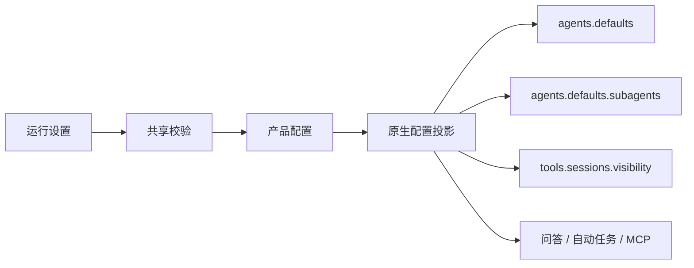

# Agent 运行参数

设置使用版本化 AgentRuntimeSettings，保存在产品配置中再投影到原生配置。本文按 shared/agents/agentRuntimeSettings.ts 说明当前默认值；UI 文案不能把 null、0 与固定值混为一谈。

## 1. 配置分组

| 分组                               | 默认    | 含义                                      |
| ---------------------------------- | ------- | ----------------------------------------- |
| 主 Agent thinking                  | null    | 保留继承/未指定语义                       |
| 主 Agent run timeout               | 0       | 未设置正向运行时限，不是立刻超时          |
| 主 Agent 并发                      | null    | 不强制产品覆盖                            |
| AskUserQuestion                    | 10 分钟 | 默认启用超时；必须回答时显式关闭          |
| automation approval                | 2 分钟  | 允许 2/5/10 三档                          |
| MCP request timeout                | 60 秒   | 用户 server 的默认请求等待                |
| MCP Apps                           | true    | 交互界面宿主开关，投影到 mcp.apps.enabled |
| session visibility                 | tree    | 原生跨会话可见范围                        |
| Subagent model/thinking/delegation | null    | 继承或未指定                              |
| Subagent 并发                      | 3       | 原生全局并发限制                          |
| 每 Agent children                  | 5       | 子任务容量                                |
| Subagent run timeout               | 7200 秒 | 原生运行时限                              |
| spawn depth                        | 1       | 嵌套深度                                  |
| archiveAfterMinutes                | 0       | 不提供正向自动归档期限                    |
| Code Mode                          | off     | 原生工具编排；显式 auto/on 与关闭分别保存 |
| 原生 Swarm enabled                 | true    | 批量委派容量开关，不是 Workflow 插件开关  |
| Swarm maxConcurrent                | 8       | 当前原生组并发，范围 1–64                 |
| Swarm maxChildrenPerGroup          | 50      | 组内存活子任务容量，范围 1–200            |
| Swarm maxTotalPerGroup             | 200     | 组内累计子任务容量，范围 1–1000           |

同页还有两个产品设置，不属于 AgentRuntimeSettings 原生配置投影：后台侧栏标签保留
上限默认 30、范围 0–200；Goal 自动续跑回合上限默认 25、范围 0–1000，0 表示不允许
自动追加续跑，用户仍可显式手动继续，并非无限续跑。它们沿现有 Cowork 配置保存，
不能将标签隐藏/淘汰解释为停止原生任务。

Goal 次数按当前目标在原生持久接纳的自动回合累计，准备、提交前拒绝和手动继续不增加；
重连、清理 Main 内存及手动继续不清零。原生最终准入同时检查额度和回交责任，见
[Goal 模式](goal-mode.md)。

## 2. 验证与旧值

版本必须匹配共享合约，枚举、整数、范围和模型引用长度由 Main/shared 校验。部分 v1 早期字段缺失时填充受管默认，尤其 visibility=tree，避免升级后默默扩大访问。

主 Agent／Subagent 并发范围均为 1–16（主 Agent 另允许 null），children 为 1–20，depth 为 1–5；正向 run timeout 为 60–86400 秒，0 的特殊意义按字段校验。AskUserQuestion 为 1–1440 分钟，MCP request timeout 为 1–86400 秒，archiveAfterMinutes 为 0–525600 分钟。不要在 Renderer 自己 clamp 后让 Main 接受任意数据。

MCP Apps 当前只保存布尔值，旧记录的缺失值或 null 补为 true，明确的 false 保留；界面不再提供继承选项。该开关不负责安装插件或创建手动应用入口。

## 3. 保存链路

配置 mutation 串行执行。需应用原生设置的失败不能仅显示本地保存成功；回滚或待恢复遵循对应配置服务契约。参数改变不代表已运行任务被追溯修改。

## 4. 容量、排队和超时

原生负责子任务 admission、队列、运行开始与 timeout。JustDo 不维护另一套 pending FIFO，也不通过循环调用 subagents list 消耗模型工具回合。子任务查询使用原生 sessions.list/describe 投影及 sessions.changed 事件，不再使用已移除的 tasks 账本。

排队等待与真正 running 的计时不同；queued 没有 startedAt 时不显示虚构运行时长。限制达到应呈现原生拒绝/排队状态，而不是 UI 暗中放宽容量。

### AskUserQuestion 的等待策略

结构化问答默认启用超时。工具调用省略 `timeoutEnabled` 或传入 `true` 时，按
`timeoutMinutes` 等待，默认 10 分钟。只有确实必须获得用户明确回答、缺少回答无法
安全推进时，才显式传入 `timeoutEnabled: false`，使用 `required` 持续等待回答或
明确取消。普通聊天和 Goal 模式遵循同一规则；超时模式显示倒计时，明确关闭后显示必须等待回答。

所有问题都定义有效 `defaultOptionIds` 时，超时自动使用这些默认项，工具结果先说明用户没有响应、
默认项由系统自动选择，再列出问题和选择；否则返回
`No answer arrived before the timeout; proceed with best judgment.`。
这是当前工具调用的结果，不是新用户消息或另一轮发送。

超时会清除插件的待回答请求并发布 resolved 事件，Main 据此关闭问答界面。
原生执行继续消费工具结果；Goal 后继轮仍必须等待当前运行的精确整轮结算，
工具说明要求超时后继续推进，不再等待已过期问题，也不能仅以问答超时为由暂停或阻塞目标。
不能把问答超时当成运行超时或已经完成。完整续跑条件见[Goal 模式](goal-mode.md)。

## 5. 权限不要与调优混淆

visibility 的 self/tree/agent/all 是原生访问配置，不等于文件权限；sandbox 的有效 clamp 可能进一步收窄。增加并发、修改 delegation 或选择助手模型不会自动授予跨 Agent 发送或 spawn allowlist。

MCP request timeout 是已连接 server 的请求时限，不是连接建立超时，也不自动覆盖 Extension 托管 server。

Code Mode 保存 off/auto/on，并投影到 `tools.codeMode.enabled=false/"auto"/true`，
executor 为 QuickJS。当前表单保留但禁选 auto，新配置缺字段补 off；已有显式 auto
保留并如实展示，是否启用取决于原生模型的 compat.codeMode，不按模型名推断。
worker/WASM、exec/wait、取消与内部工具审批由原生管理，执行器缺失不降级到 Node VM。
实际运行与产物入口见[引擎](../../architecture/05-agent-engine.md#code-mode-工具编排)。

## 6. 修改与验证

参数新增需同步共享默认/校验、产品持久化、ConfigSync、设置页面、双语文案及原生消费测试。重点检查缺字段升级、0/null、边界值、配置失败和运行中变更。不要仅根据 Gateway 能接受的字段就把所有选项暴露为已支持产品能力。

## 实现核对入口

[共享默认和校验](../../../src/shared/agents/agentRuntimeSettings.ts)；[原生 Agent/Subagent 投影](../../../src/main/openclaw/config/agents/agentProjection.ts)；[MCP Apps 投影](../../../src/main/openclaw/config/plugins/mcpAppsConfig.ts)。这些入口用于核对当前实现，测试文件列出回归场景，不表示本轮文档维护重新执行了相应测试。
