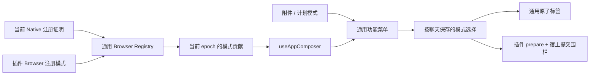

# 输入框功能菜单

消息输入框下方的“+”菜单是通用功能入口。“文件和文件夹”复用原有附件选择动作；
计划模式作为内置入口，Swarm Workflow 和 Agent Team 等已准入插件显示在“插件”分组。
菜单不持有插件业务参数或执行逻辑。两种输入框布局共用注册项，没有可见功能时隐藏加号。

## 接入契约

插件通过 `AppBrowserHost.registerMode` 声明 `AppComposerMode`，包含稳定 ID、翻译键、
图标和 `prepare`。可选 `order`、`group` 描述排序、父级图标和返回文案；
`selectionLabelKey`、`removeLabelKey`、`selectionCaret` 描述标签及选择后的输入焦点。
名称、说明和操作文案保留中英文翻译，宿主不按业务 ID 选择图标或排序。
贡献只在当前插件精确 epoch 有效，未知、关闭或未准入的插件不显示入口。

`useAppComposer` 将模式转为通用 `ComposerFeatureItem`，再与附件和计划模式组装。
无需在 `CoworkPromptInput` 增加插件业务 import。旧版业务适配器及独立启用快照已由
Browser Registry 替代，Native/Main/Browser 准入流程见[应用插件宿主](../../architecture/17-app-plugin-host.md)。

展示顺序保留原版：Swarm Workflow、Agent Team；Team 二级项为群组讨论、任务协作。
父级按任一子项选中而高亮，子菜单不重复显示“插件”分组标题，返回文案由插件提供。
菜单保留圆角、阴影、紧凑单行项及说明，宿主样式不受后加载插件的 Tailwind utility 覆盖。
方向键左右进入/返回二级菜单，Escape 返回触发按钮；菜单路径只保存稳定 ID，
每次渲染读取当前注册项和回调。

## 状态与交互

`FeatureTextarea` 接收标签名称、图标和删除文案，统一处理正文、输入法与可访问性。
Team 标签保留 `Agent Team · 子项`，再次选相同模式建立新的选择快照；通过删除按钮
或光标位于正文开头时的退格取消选择。选择后恢复输入焦点，Workflow 将光标置于开头，Team 保留位置。
标签不写入正文或原生历史。

Team 与 Workflow 选择互斥，按聊天保留草稿；关闭插件清理自己的旧选择，保留正文、
附件和引用，不清理其他插件。即使关闭和重开被 React 合并，旧 epoch 的选择也失效。
重新启用不自动弹出菜单、重建旧选择或重放发送。菜单项消失后按现有规则转移焦点；
全部入口消失时关闭菜单。

取消、替换标签、切换聊天或关闭插件后，异步准备完成的旧发送必须再次核对选择、
草稿及 epoch。失败不清理正文，已接受发送只清理对应快照，不能删除后来的新选择。
模型准备前捕获模式，实际发送前重查，不能因插件撤回而把原插件请求降为普通消息。
通用显示过滤不能代替 Main/Gateway 的执行权限校验。

附件不依赖插件状态；计划模式仍由既有 Core 保存，保存中禁止重复切换。
运行中允许排队时仍可添加附件，插件模式继续受输入框的运行和排队条件约束；已有计划模式可关闭，
新开启继续受运行状态约束。插件模式的默认参数和执行准备归插件。

群聊指令省略 `organizerParticipates` 时沿用用户设置；选择模式不覆盖它。
Team 与 Workflow 的目标和上下文明确时优先发起所选工具；存在实质歧义或缺失必要
上下文时先读取和分析，再回到发起。选择不增加执行权限，准备不等于创建成功，
正式执行、来源身份、停止与接纳回执按各插件契约核验。

## 回归验证

定向测试覆盖菜单顺序、子项、父级选择、标签和删除文案、两种输入框焦点、退格、
跨聊天快照及 epoch 失效；同时覆盖工作区入口归属、插件关闭和旧异步操作。

`node plugins/extensions/agent-team/scripts/test/verify-paired-ui-parity.mjs` 使用隔离 Chromium、真实 Core 菜单和
侧栏以及独立构建的两插件 Browser/CSS，对照固定的改造前菜单工厂，检查实际样式、
子菜单、标签、右侧 Team Tab、Portal 设置弹窗及关闭撤回。探针不启动 Gateway、
不读取用户数据，也不代表完整产品 UI 或真实模型业务验收。

## 实现核对入口

[菜单](../../../src/renderer/features/cowork/components/composer/ComposerFeatureMenu.tsx)、
[模式组装与选择](../../../src/renderer/features/plugins/app/useAppComposer.tsx)、
[输入框](../../../src/renderer/features/cowork/components/composer/CoworkPromptInput.tsx)、
[Team 模式](../../../plugins/extensions/agent-team/app/browser/index.tsx)、
[Workflow 模式](../../../plugins/extensions/swarm-workflow/app/browser/index.tsx)。
