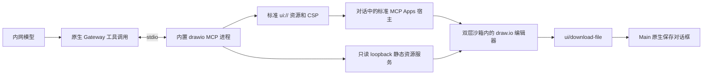

# draw.io 离线绘图

draw.io 是默认启用的系统内置扩展，提供标准 MCP Apps 工具 `create_diagram`。它使用锁定的 Apache-2.0 draw.io Web 编辑器和本地 MCP 适配器；不使用公网 MCP 端点或 draw.io Desktop 的 Electron 外壳。

## 使用

在普通对话中输入，例如“用 draw.io 画一张采购审批流程图，可以直接编辑”。模型通过已有工具发现机制获取绘图工具，提交 XML 后，图表出现在对应工具结果下方。修改文字、移动图形、连线、形状库、页面、缩放、布局均由本地 draw.io 编辑器处理。

也可直接说“画一张请假审批流程图”，无需点选应用或写出工具名称。插件的
`skills/drawio-diagrams/SKILL.md` 由原生技能发现机制按需提供：流程图、架构图、
UML、ER 和网络图使用实际可用的绘图 MCP 工具；先搜索目录，再按返回的真实工具
身份调用。原生紧凑工具目录不展开 MCP 工具说明，不能假定模型已经看到
`create_diagram`。写出 `.drawio` / HTML 文件不等于成功展示交互界面。
这份指导随插件启停，不向应用公共提示或运行时加入 patch，也不扩大工具权限。

消息外框的默认标题显示服务名称，保留原生提供的自定义标题，避免向用户展示工具标识与 `UI` 后缀。

右上角提供保存 `.drawio`、PNG 和 SVG。保存源文件时实时读取当前编辑器；原生保存对话框选择本机目标路径。编辑器自身的导出菜单也走同一通道，隐藏未适配的网页发布、直接下载、PDF 和联网帮助入口。PNG/SVG 导出当前页面，源文件保存全部页面。展开/返回在同一文档完成，保留当前编辑和撤销状态；主题变化更新当前编辑器，不重建 iframe。

放大后的右上角“×”只返回消息，不关闭编辑器；可反复展开、返回并继续编辑和导出。
在消息内主动关闭应用后，标题栏保留重新打开图标，通过原生视图读取恢复原始图表。

顶部保存和导出先向当前编辑器提交正在编辑的单元格文字，再按同一请求 ID 接收确认并执行序列化；不要求用户先按 Enter 或点击画布。过期或重复确认不会触发另一次导出。

编辑改变通过原生模型上下文接口提供给后续对话（宿主公告支持时）。该上下文归原生视图所有，不能替代文件保存。离开会话、关闭应用或原生视图过期后，不承诺恢复未保存的本地编辑；保存后的文件仍由用户持有。

重启后打开历史消息，恢复的是该次工具创建的原始图表，仍可本地编辑和保存/导出。
对于 OpenClaw 2026.10.4 尚未覆盖的 ToolSearch 历史格式，插件使用公开 SDK 读取
当前分支的原始调用结果并创建新原生视图，不重新调用模型或绘图工具。
恢复视图没有工具授权，不恢复旧上下文；原始结果已被截断或插件关闭时不猜测内容。

在“插件 → MCP → 系统内置”管理 drawio 的启停和连接测试。名称旁的小界面图标表示支持交互界面；该标识不等于在线或已连接。用户明确关闭扩展或 MCP Apps 宿主时，配置同步不会重新打开。

已有会话点开输入框“+”，在与“插件”并列的“应用”分组选择 draw.io，可直接打开空白画布，无需发消息或调用模型。
这是插件的 `open_editor` 工具声明的 global 手动入口；工具仅向 App 开放，不进入
模型绘图目录。空白画布和模型生成的图表使用同一离线编辑器、保存/导出和沙箱。
手动打开的编辑器进入工作区标签；标签栏下方仅保留一行图表标题和保存/导出工具栏，关闭和放大使用标签栏已有操作，不重复显示宿主标题栏。首页继续不显示通用应用按钮。

“MCP Apps 交互界面”是宿主能力开关，不负责安装应用或创建目录入口。
“沿用原生设置”保留显式原生选择，未配置时开启；改成“启用”并不必然带来界面变化。

## 运行边界

Gateway 拥有 MCP 进程、工具目录、执行、权限和原生视图。Main 不再连接第二个绘图 MCP，Renderer 不获得 Node 或文件系统权限。原生 `mcpServers` 声明使用相对资源路径，由原生插件加载器转换为当前安装路径，支持包含空格和中文的目录。

`restore.ts` 仅提供已有图表的恢复，`restore-result.ts` 核对原生子调用证据；恢复
通过公开的 `prepareHarnessNativeMcpAppPreview` 复用同一标准沙箱。它与正常 MCP
服务共用 `editor-resource.mjs` 的离线资源生成器，不创建额外 MCP client 或消息存储。

HTML 资源保持在原生 2 MiB 上限内，绘图脚本不塞入工具结果或消息缓存。每个 MCP 进程在 `127.0.0.1` 随机端口提供打包资源，URL 含随机能力路径；仅允许 GET/HEAD、精确 Host 和根目录内真实文件。不存在文件写入、代理、配置读取或图表内容 HTTP 接口。

编辑器、形状库、布局、数学公式资源和字体文件随构建产物提供。HTTP CSP 限制脚本、样式、字体、图片、worker 和连接为本机资源（必要的 data/blob 除外）；云存储、插件加载、在线图标和更新流程关闭。外部图片、远程字体等内容不会由代理或公网 fallback 补齐，图表应使用内置形状、本机字体或内嵌图片。编辑器 iframe 的消息只接受精确发送窗口；Opaque sandbox 下的 `*` 目标用于与自己创建的父/子窗口通信，不替代宿主 AppBridge 的来源检查。

## 构建和验证

下载源、固定提交、归档 SHA-256、缓存/输出路径和准备命令统一见[离线资源准备](../../offline-downloads.md#5-drawio-离线编辑器)。适配器源码位于 `openclaw-extensions/drawio/`，生成资源不提交 Git；安装包携带完整生成目录和许可证，首次运行不下载、不安装包、不检查公网版本。

插件专属资源准备、打包校验脚本位于该目录的 `scripts/`，单元测试与 XML 样例位于 `tests/`。目录职责见[插件说明](../../../openclaw-extensions/drawio/README.md)。主工程仅保留通用宿主能力和必要接入；`tests/drawio/` 验证与真实宿主、运行时及打包器的集成，不属于插件运行依赖。

准备脚本先验证归档哈希，再构建 MCP 服务和标准 App SDK bundle，生成每个文件的 SHA-256 清单并保留第三方许可证。组装和打包同时检查源码指纹、缺失文件、多余文件和逐文件内容。未准备、陈旧或不完整的资源使构建失败，不能退回在线版本。适配器、来源锁定与构建脚本进入 OpenClaw build recipe。

- `openclaw-extensions/drawio/tests/server.test.ts` 覆盖 XML、DTD、体积限制、HTTP 路径和 CSP；同目录的 `assets.test.ts` 覆盖资源损坏与缺失。
- `node tests/drawio/native-smoke.mjs` 使用隔离状态及实际组装的原生运行时，验证插件发现、标准工具元数据、正常工具物化和原生 App 准入，不请求模型。
- `node tests/mcp-apps/gateway-smoke.cjs --drawio` 使用隔离 Gateway 验证实际绘图服务的手动入口发现、原生启动和视图读取，确认对话仍为空，不发起模型请求。
- `node tests/drawio/offline-smoke.cjs --runtime` 使用全新 Chromium profile、实际产品视图及原生双层沙箱，拦截公网，验证源文件/PNG/SVG 导出、展开、主题和窄窗口。该 UI 探针只替代 Gateway 身份接口和原生保存对话框；Main 文件保存另有权限与取消测试。
- `node tests/drawio/offline-smoke.cjs --blank` 验证新手动入口返回的空白画布能够加载和保存，界面不请求公网。
- `node tests/drawio/packaged-smoke.cjs` 使用实际 Windows tar/zstd 打包器与发布后的解包校验器验证整个资源集合及许可证；macOS/Linux 使用独立资源复制，避免通用裁剪规则破坏哈希集合。
- `node tests/drawio/offline-smoke.cjs --serve` 提供隔离的本地交互预览；这是测试页面，不读取用户会话、配置或凭据。
- `node tests/drawio/real-model-smoke.mjs` 是需明确授权后手动执行的真实模型验证，不进入 `npm test`。它读取已配置模型的文件 SecretRef 和应用代理设置，向独立原生会话发送普通的虚构审批流程需求，不点名 draw.io、不提示工具选择，不读取已有聊天或工作区内容、不配置模型 fallback。保留应用正常工具策略、完整冻结插件集和当前插件技能；没有绘图专用 allowlist、强制工具选择或精简工具目录，并核验本轮至少 50 项工具可用。要求精确的运行终态、历史中的实际模型身份和原生绘图工具结果，再由真实 `ChatController` 通过认证连接读取历史，让产品消息时间线自动创建 MCP Apps 界面。冷启动浏览器阻断公网，实际修改单元格并确认源文件保存该修改，验证 PNG/SVG 导出和展开；仅替代原生保存目的地。`DIAGRAM_TEST_PROMPT` 可指定另一个自然语言绘图需求；可加 `--serve` 保留半小时的隔离预览，截图与证明写入忽略的 `.agent-tasks/drawio/`。模型请求按已有网络配置运行，编辑器零公网请求与模型服务联网是两项独立检查。

Windows 安装包、企业模型的具体工具调用能力和企业安全软件策略仍按发布流程验收。绘图功能不会为模型配置公网 fallback。

2026-10-18 使用已配置的 MiMo `mimo-v2.6-flash` 验证普通请假流程图和内网知识库
架构图需求，均未点名 draw.io、指定工具或缩减工具白名单。隔离环境使用正常产品
会话标识、完整随包插件及应用工具策略，实际工具目录为 50 项；私有安装的插件和
用户工作区未复制。两例均经技能读取、工具搜索和真实 MCP 调用生成界面，原生终态
明确 `executionSettled: true`。产品消息时间线加载、实际节点修改、保留修改的
`.drawio` 保存、PNG/SVG 导出及编辑器零公网请求均通过；最终展示另检查不存在
同一应用的重复不可用预览。验证记录仅含合成会话，保留在忽略的任务产物目录。

同日新增真实重启验收：在全部 50 项工具可用的普通 MiMo 会话生成图表后，终止并
重启隔离 Gateway，保留同一原生状态；全新浏览器从同一历史消息恢复图表，确认
采用新原生 viewId，实际编辑、三种导出和零公网请求再次通过。原 sessionId 与
工具调用保持不变，恢复不产生新的模型调用或绘图工具执行。插件恢复适配还通过
用户所报会话的认证只读诊断确认：原始图表结果仍在且满足恢复条件；未改写该会话。
