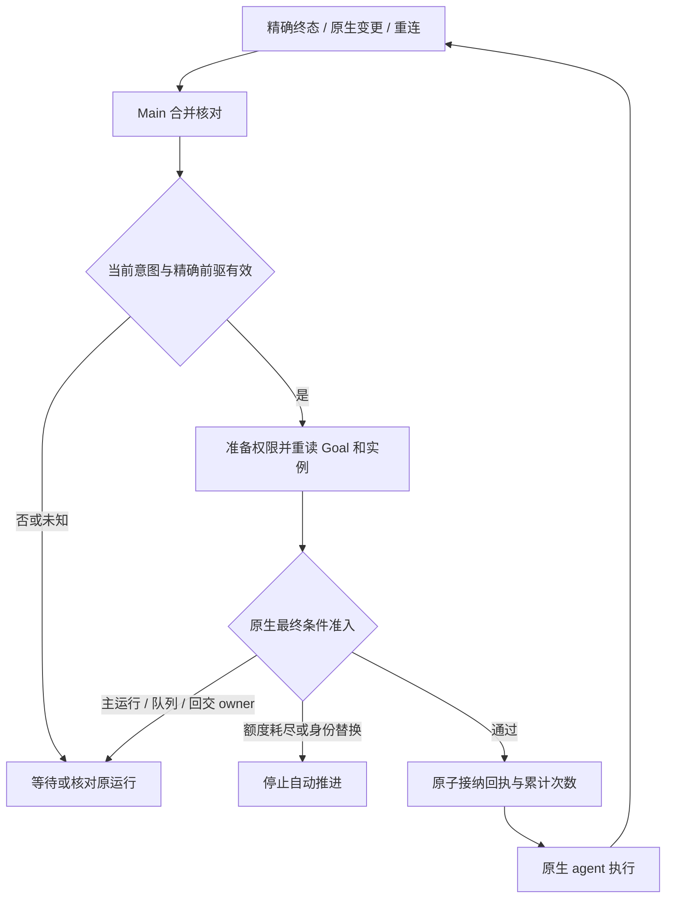

# Goal 模式

Goal 的 objective、token 预算和六种状态由 OpenClaw 原生会话持有。
Main 的 GoalContinuationCoordinator 只协调续跑、等待和停止，不保存消息正文或重造执行器。
自动续跑上限见[运行参数](agent-runtime-settings.md)，权限仍遵循[权限管理](openclaw-permission-management.md)。

## 续跑与不确定发送

只有精确原生整轮 `executionSettled: true` 终态才允许安排下一轮；chat final、单次
attempt 结束、Stop ACK 或空闲投影不能替代执行结算。目标仍 active、没有停止锁时，
Main 准备权限并再次读取原生 Goal，核对 goalId、状态和会话 sessionId/lifecycleRevision。

准备期间暂停、完成或预算耗尽时不发送；准备期间目标身份或原生会话身份被替换时停止自动续跑，等待用户
重新审视。相同 goalId 的文字编辑使用准备后的最新 objective。

续跑使用 backend `agent` RPC，携带原生 expectedExistingSessionId 和
expectedExistingSessionLifecycleRevision，在原生准入时继续限制会话身份。
合成续跑提示不写入原生用户消息历史。ACK 必须包含原运行 ID 和 accepted/in_flight 状态。

### 原生最终接纳与累计额度

自动请求还携带闭合的 `goalContinuation` 条件：goalId、精确 predecessorRunId、
automatic=true 和当前 maxAutomaticContinuations。补丁 031 在原生最后接纳位置重新核对
相同前驱的整轮结算、Goal、原生实例、主运行、排队输入及原生子任务回交 owner。

普通主回合直接 final 也可能仍有回交，因此不能仅检查 yielded 或 hasActiveSubagentRun。
待提交的 requester settle wake 也占有回交责任；回交转为新主运行期间不能出现准入空窗。

### 明确延后与退避

明确的 GOAL_CONTINUATION_DEFERRED 是提交前拒绝，释放候选运行。暂态拒绝显示 Waiting，
原生变更或既有 2/5/10/30/60 秒封顶退避触发再次核对；清理 lease 释放可能没有额外通知。
每次仍携带原前驱和实例条件走完整最终准入，定时器不能替代原生授权；额度耗尽停止自动推进，Goal 非 active 则按原生状态显示。它不属于未知发送，不能按网络超时
处理。原生在同一会话写事务中记录最后接纳回执并增加 goal.continuationTurns；相同候选重放
保留原生幂等响应，已完成运行可返回 status=ok 的终态结果，精确接纳回执可从
sessions.describe 的 lastAccepted 核对，不重复执行或累计；相同前驱不能接纳另一候选。
Main 使用已接纳的累计次数，权限准备、拒绝、重连
或内存清理均不重置或增加额度。0 表示禁止自动追加，显式手动继续沿用原有用户操作语义。

### 发送结果未知

发送后超时、回执失配等结果不明确的情况保留同一 runId 和 Main 跟踪，标记
identityPending，不清理运行、不生成新 ID 重发。现有恢复链通过精确 `agent.wait` 核对；
缺失/失配 runId、无终态时间的 timeout 和读取失败都保留未知状态。

确认整轮结算后才按
最新 Goal 决定是否另起一轮。明确未发送或原生提交前拒绝仍可按原有退避重试；停止锁和
连接代次变化始终使迟到结果失效。
终态触发的重试始终携带该终态的原生 sessionId，以及该运行已知的 lifecycleRevision；
查询失败、重复退避和停止失败后的恢复都保留这些约束。

原生 reset 可沿用 sessionId，
因此已知 revision 不能被重试时的新查询结果覆盖。

### 工具超时后的后继轮

原生 `tool_execution` 工具超时可能将原生会话投影为 `interrupted`。
同一 active Goal 在精确整轮结算后仍按既有退避自动续跑，无需人工继续；它创建带上述
条件的新后继 run，不重放原 run 或未知工具输入。后继轮提示先核对权威状态和现有结果，
不得盲目重复可能产生副作用的调用。

超时阶段与 interrupted 展示本身均不授权续跑，也
不能证明工具副作用已回滚。原生 `safeToolsRequired` 的专用恢复路径不等同于普通 Goal
后继轮，不能宣称这里自动具备只读工具限制；实际模型能否正确核对结果仍需端到端验收。

## 问答等待与超时

ask_user_question 默认启用 10 分钟超时，实际时长沿用运行参数配置；只有确实必须
获得用户明确回答时，才显式传入 `timeoutEnabled: false`。超时后，插件清除待回答
请求并将自动默认项或最佳判断提示作为原工具结果返回，当前原生运行继续消费结果。
工具说明要求继续推进任务，不再等待过期问题，不能仅以问答超时为由暂停或阻塞 Goal。

点击问答弹窗或多题向导的 × 会取消本次提问；开启和关闭超时两种策略都立即解除等待，
返回 `The question was cancelled; proceed with best judgment.`，不提交未确认答案或自动默认项。
取消会清理计时器并关闭问答界面，不触发 Stop 或 Goal 暂停；原生当前轮继续消费工具结果。

问答超时本身不是整轮终态，不会抢先创建后继运行。当前轮精确结算后，仍为 active
的同一 Goal 沿既有身份、额度与原生准入条件自动续跑。明确关闭超时的必要问题仍然
等待用户，Stop、暂停、目标完成和预算限制继续按各自原生语义生效。

## 等待子任务与恢复

精确 `end + executionSettled:true + yielded:true + livenessState:paused + stopReason:end_turn`
且没有失败、取消或超时，表示当前主 run 结算并等待原生交接，Main 显示 Waiting。

error/aborted/cancelled/timed_out/timeoutPhase 不能借由残留 yielded 标记变成正常等待。
子任务仍活动时不伪造主 run 的 Running；原生完成通知和实际主 run 接纳继续由 OpenClaw 持有。

`collect:true` 的子任务不自动通知主会话，结果由原生 agents_wait 重复可读。
没有主 run、排队输入或其他原生回交 owner 时，允许经过相同准入的后继回合读取原任务；
不重新创建子任务，也不新增“已消费结果”账本。Code Mode 的 awaitResults、同 run wait 和
取消规则保持原生语义，本修复不增加跨回合 JavaScript VM 接管或重放。

重连恢复和 sessions.changed 共用合并核对。同一连接代次可以再次检查后续变更，
不会因为第一次只发现子任务而永远停住。sessions.describe 的 goalContinuation 观察只投影
原生结算前驱和最后接纳回执；缺少精确前驱证据时保持 Waiting，idle/list 活动位不授权启动。

用户输入在 pendingTurnStarts 登记时立即递增会话决策 epoch；每次异步返回、catch 和 finally
都校验原 owner，旧退避不能覆盖新输入，也不能释放后继决策的 lane。

## 原生事件准入

Goal 在主聊天 UI 结束后仍需接收迟到的工具和生命周期事件，因此保留独立的、有界于当前
受管会话的运行身份记录。事件必须匹配原生 sessionKey、sessionId、runId 和单调递增的
原生 agent sequence；WS frame 序号或本地补出的序号不能授权
Goal 变更。

Main 拥有精确后继运行时才可替换记录；chat final 后只接受已准入运行的后续
事件。旧会话、旧代次、其他运行、重复事件和身份缺失事件不得改变 Goal 或触发续跑。
当前锁定 OpenClaw 的内部 lifecycleGeneration 不序列化到公共事件，不能将其作为必填字段；提供该字段时仍检查一致性。连接回调核对当前 client、Main 连接代次和停止标记，拒绝
旧连接迟到事件；清除/删除会话及连接清理同时淘汰运行身份记录。

## 用户操作与回执恢复

编辑、暂停、继续和清除使用原生结构化 Goal RPC，绑定 goalId、原生 sessionId、
operationId 和原始 issuedAtMs。不明确的响应及失配回执保留原操作身份；另一操作必须
先核对该操作，不能跳过未知提交。

INVALID_REQUEST 结合结构化 details.reason 分类。receipt-invalid 和未知 Goal 原因保留
未知语义；expired 将操作退役，不能重发过期请求。下一次显式操作只刷新原生现状并通知
界面，不提交变更；读取失败继续保留退役记录。用户审视刷新结果后再次明确操作，才创建
新身份。operation-conflict、session-rebound、goal-rebound、capacity、invalid 等明确
提交前拒绝可释放原操作。

## 暂停后继续补丁与验证

运行中暂停先停止执行，再修改原生 Goal 为 paused。停止留下 abortedLastRun 标记；
当前补丁 [006](../../../scripts/patches/v2026.10.7/006-goal-resume-after-pause.cjs)
只允许明确 resume 请求通过该标记检查，仍保留空闲、历史、身份、执行归属和排队准入
限制。上游支持同等语义并通过原生回归前保留此补丁。

自动化覆盖发送后 ACK 丢失、失配回执、暂停/替换准备竞态、原生事件隔离、迟到完成回执
和过期操作恢复。

## 当前验证边界

合成模型和协议测试不替代真实模型下的 subagent/yield、collector/Code Mode 等待、新输入与 Stop/reset 竞争，以及断连、ACK 丢失和应用/Gateway 双重启组合验收；最终安装包的内网冷启动尚需实际环境证据。

## 实现核对入口

[续跑协调与身份检查](../../../src/main/openclaw/goals/goalContinuationCoordinator.ts)；[共享状态与回执合约](../../../src/shared/cowork/sessionGoal.ts)；[协调回归用例](../../../src/main/openclaw/goals/goalContinuationCoordinator.test.ts)；[10.7 工具超时自动续跑](../../../src/main/openclaw/goals/goalContinuationCoordinator.toolTimeout.test.ts)。工具超时用例接入真实事件准入，覆盖新条件后继、未结算/旧身份/重复终态拒绝及未知 ACK 不重发；锁定产物的执行结果以[验证记录](../../openclaw-upgrades/v2026.10.7/validation.md)为准。
