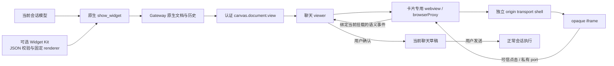

# 交互式回答

聊天可通过 OpenClaw 原生 `show_widget` 展示交互卡片。模型可使用原生 HTML；需要统一
表格、比较、图表、表单和分步解释时，可使用默认开启的 Widget Kit 扩展。该功能借鉴
Intelligent UI 的呈现方式，使用本地 OpenClaw 合约，不接入 ChatGPT 私有界面服务。
真实模型效果与安装包的平台验收仍见 [待办清单](../../plans/interactive-answers-acceptance.md)。

## 入口与使用

**Widget Kit** 默认开启，可在扩展设置中启用或禁用。配置同步保留用户明确的
开关；关闭不删除原生历史文档，也不自动重建其中的组件。模型只在实际工具 schema
公布对应类型时使用它，不靠提示词猜测工具是否可用。
插件目录、ID 和资源已统一为 Widget Kit 命名；新 ID `widget-kit` 默认开启，
不沿用旧 ID `interactive-ui` 的开关。构建只清理包名和 manifest ID 均匹配的旧随包产物，
避免新旧组件重复注册；历史文档不改写，引用旧资源的卡片需重新生成。

| 标识                      | 用途                                                |
| ------------------------- | --------------------------------------------------- |
| 插件 `widget-kit`     | 注册组件类型、只读资源与按需技能                    |
| 技能 `visualize`          | 指导原生 show_widget 静态可视化及按需交互           |
| 卡片 `interactive-answer` | 一个文档组合 table / compare / chart / form / steps |

插件 ID 与卡片类型是独立注册项，原生记录为 `pluginId:kind`，允许两者同名；
重复的卡片类型或公共资源路径会被拒绝。组件公共资源为 `/__widget_kit__/ui.js`。
原生历史文档不可变，类型和资源命名调整后应重新生成卡片，不自动改写旧历史。

插件只提供一个按需技能 `visualize`，围绕原生 `show_widget` 的发现、调用、
HTML/SVG 编写、静态可视化、本地交互与交付指导模型。形式由用户问题决定，可用于
关系图、数据探索、自定义计算、模拟、时间线和界面原型。静态图解与图表本身即可完成
请求，不要求表单、按钮或“继续分析”；本地交互和向会话准备建议分别按需添加。
`interactive-answer` 仍是可选固定组件类型的标识，不再用作通用技能名称。
简单问题仍用文字，数据不足时澄清或说明假设。团队测算的技能、组件注册和专属资源
均已删除；原生历史不被清理或改写，旧测算卡片需要重新生成为当前支持的文档。
插件不在每轮注入长提示，也不改变八个内置技能。
HTML 按需参考提供主题字体、间距、控件、焦点与响应式布局基础；固定组件 schema
和五类示例移入独立参考，只在选择该类型时读取。要求按实际控件描述操作，成功后不重复界面内容；输入错误
只在相关失败时显示并保留已填值。这些是模型生成指导，不是宿主向认证 HTML 注入
全局样式或过滤助手文字，不能据此保证每次生成都满足视觉规范。
原生 `kind: "html"` 的 `widget_code` 是 HTML/SVG 片段，可含内联样式和脚本；注册的
固定组件类型才使用经过校验的 JSON 字符串。技能要求生成内容使用内联资源、系统字体
和本地绘制，在无公网环境中工作，不依赖 CDN 或远程 API；这不是对原生全部 HTML 的
网络策略改写。完整 schema 和实际工具 payload 在
[插件说明](../../../openclaw-extensions/widget-kit/README.md)及技能参考中维护。

## 当前交互

| 组件    | 本地行为与限制                                               |
| ------- | ------------------------------------------------------------ |
| table   | 全量搜索、稳定排序、每页五行；长值可查看完整行               |
| compare | 同一组指标下选择方案；选择不等于模型已有推荐依据             |
| chart   | 折线或柱状图、系列开关、同源数据表；保留负值、零线和空态     |
| form    | 多行文本、数字、单选、多选和勾选；必填与范围校验，不计算任意表达式 |
| steps   | 可键盘展开的分步解释，同组一次展开一项                       |

一个文档最多八个组件，按钮切换当前面板时保留输入。搜索、排序、选择和表单值只
存在当前 iframe 内存；重载或重新挂载后恢复原文档默认值。完整选择可在卡片内
查看与复制，不声称跨重启保存。

表单多选允许选择零到多个选项；必选组为空时定位首个复选框并提示至少选择一项。
选择在本地即时更新，切换面板保留；草稿以各选项的“是/否”记录，不自动发送。
多选仍受已有 3600 字符摘要预算和显式省略规则约束，完整值可在本地查看与复制。
通用表单不是任意计算引擎；自由计算或模拟使用原生 HTML 与本地脚本。
固定组件使用本地 renderer，不请求外部服务；任意 HTML 仍沿用原生 CSP/media 规则。

卡片在消息区域水平居中，最大宽度 840 CSS 像素，窄窗口按可用宽度收缩。高度
跟随当前原生 sandbox 内文档的尺寸报告，并限制在 48–8000 像素；旧文档的尺寸事件不能改变新
卡片。应用不读取跨域 DOM 来猜宽度，组件内部的图表布局仍由对应文档负责。

卡片标题右上角提供“放大查看”。放大使用当前文档的模态顶层，再次点击右上角按钮
收起，保留同一个 iframe、输入和选择；标题与收起按钮始终可见。宿主获得焦点时也
支持 Esc，组件内部按键仍由组件自身处理，不提供独立窗口入口。

放大后的内容视口填满扣除标题、提示及草稿建议后的剩余高度，随窗口调整和最大化
同步变化，不继续使用聊天内的固定高度。原生沙箱与内层文档自然收到 resize，按视口
布局的画布可以重新绘制；长文档在自身视口内滚动。放大期间的尺寸报告不覆盖聊天内
高度，收起后恢复原高度并保留同一个文档。独立全屏画布页面只有一个顶层容器、画布
直接填满容器且控件为浮层时，放大自动将容器填满可用高度，解决 `70vh` 等内部高度
留下底部空区的问题；画布通过文档原来的尺寸监听重新绘制。收起恢复原高度声明，
并裁切重绘前的旧画布溢出，避免卡片被临时撑高。普通文档、多面板和嵌套图表仍遵循
自身布局，适配不会拉伸位图或覆盖业务脚本主动修改的样式。
视口高度直接随 dialog 的模态状态切换。每次放大、收起及窗口调整都有独立的布局
代次；文档实际视口吻合后才回报当前代次的高度。迟到的放大报告无法覆盖收起后的
高度；收起后内容仍可自适应增高，不冻结尺寸，也不重新加载文档或重置输入。
主聊天放大时沿用现有阻塞弹层策略，暂停停靠的右侧原生工作区视图，避免它盖住放大
内容；收起、切换会话或卸载后恢复侧边栏，保留原有标签、终端和浏览器状态。

固定组件沿用宿主字体、颜色和控件层级，每张卡片只有一个“继续分析”主动作。
固定组件在聊天内只显示宿主标题，文档自己的摘要标题保留用于独立展示，
多组件的分组名称由切换按钮表达；
表格行详情使用带无障碍名称的紧凑入口，图表数据、完整选择及对比表按需展开。
常规浏览不展示 JSON、复制教学或发送流程说明。完整选择展开后提供可读文字复制和
重载会重置选择的简短说明；表单直接校验定位错误，不新增提交、审阅或确认选择步骤。
桥接失败允许用户再次点击，成功仅代表建议已投递，不能显示模型已执行。
图表按原生 iframe 的实际可用宽度重绘坐标，窄窗口不将整张大图等比例缩小。

## 继续分析与失败恢复

“继续分析”通过原生私有 prompt port 产生建议。表单无效时阻止继续并定位
错误字段；只读会话、转录修改或缺少当前草稿能力时禁用入口。通用组件以可读文字生成选择摘要，
最终限制为 3600 UTF-16 code units，为有选择数据的组件保留基本状态，省略和缩短明确标记；
完整交互值仍可本地复制。

宿主只在一处紧凑行内区域展示可读建议和“加入草稿 / 取消”，不另开审阅弹窗。
用户确认“加入草稿”后追加到当前输入框，保留已有文字和附件；
发送仍由用户操作。私有桥检查当前 frame、真实用户激活、可见性、焦点、会话身份、
长度和速率，拒绝 slash/执行前缀。隐藏、断线、切会话或卸载会撤销旧建议，不能将
旧卡片的内容带进新会话；草稿能力变化保留 iframe 和当前本地选择。

加载满 10 秒显示等待较慢提示，不立即移除组件；认证文档读取和沙箱初始化各有
30 秒最终超时。加载失败或文档不可用提供手动重新加载及“请重新生成”建议。
脚本运行错误保留已渲染界面和本地输入，禁用后续分析入口；主动重新加载会重置输入。
加载期间使用紧凑占位，不常驻显示流程说明；出错时只显示简短反馈和恢复入口。
组件同步实际聊天字体、颜色、圆角和滚动条。原生 HTML 支持本地表单 submit 事件，
事件需阻止默认提交并使用现有 prompt 桥，原生 CSP 仍禁止网络表单提交。
组件内无法继续消费的滚轮/触摸滚动
转交所属聊天，保留阅读位置控制与向上加载历史。
重建建议只包含受验证身份和封闭 `load|runtime` 类别，依据原对话重新调用工具，
不转发 HTML、token、路径或原始日志，不自动 wake、发消息或修补原生文件。
原生 `UNAVAILABLE` 不能区分被淘汰和暂时失败，界面不猜测具体原因。
原生每会话保留 32 份文档，淘汰后历史 descriptor 可能仍在，重新加载不能找回
不存在的文档；重新生成会产生新的文档。

## 数据与权限所有权

只有真实成功的 `show_widget` Tool 结果可产生已验证的预览；原生 Tool Search 的核心
目录包装也按精确身份验证，按文档去重并保留执行记录。助手自己写出的 shortcode、
JSON、相对 URL 或普通 HTML 文件不能授予原生文档读取。读取绑定当前 Gateway client、
连接代际、sessionKey 和 docId，使用认证 RPC，不把凭据放入 iframe URL。

Main 保留产品配置与执行生命周期；当前用户发起的首条消息委托已绑定的 Renderer
发送，只有实际 viewer 连接才公告 `inline-widgets`。后台/headless 执行保留原路径，
不伪造 viewer capability；不确定的提交只恢复原生状态，不自动补发。

安装版页面由 Main 的本机只读 HTTP 静态宿主提供，使原生隔离页面能够验证 HTTP(S)
父来源。静态宿主限制入口、方法、Host、文件清单、realpath 与内容哈希，不能读取
配置、凭据或任意磁盘文件；主页面保留 contextIsolation/sandbox 与显式 preload。
工作区 `workspace.html` 同源且不继承 preload，沿用 dev 的窗口标题栏、主题、菜单
及 generation/frameName 校验。原生设备身份和界面偏好使用既有 Main KV，避免随机
端口导致重新配对或偏好丢失，不增加 transcript/document 缓存。

Gateway 拥有原生 HTML、文档保留及 transcript；Renderer 直接消费实时和历史投影。
外层独立 origin、内层 opaque sandbox，消息逐阶段检查 source/origin/renderId。
桌面卡片使用固定 `widget-viewer.html?mount=<UUID>` 与独立内存 session，跟随浏览器代理，
不修改默认 session、Main 或 Gateway 的代理。Main 只给当前应用 origin 的固定页面装配
最小 preload；等待代理就绪后才装载原生 sandbox，不向生成 HTML 暴露该桥。
认证 HTML 仍由现有聊天控制器读取，只在内存传给 guest；不传 Gateway 凭据。
工作区组件以实际 ownerDocument/defaultView 处理主题、可见性与当前绑定；可信点击和
私有 port 的准入在 guest 自身文档核对激活、焦点和可见性，外部聊天再次核对当前
client/session/generation/docId、可见 webview 与文本限制，保留“加入草稿 / 取消”。
失败不回退到未配置代理的主 Renderer iframe。普通浏览器 WebChat 仍使用 iframe 和浏览器
自身网络。原生 CSP 与资源规则不变，代理不能让被禁止的纹理、CDN 或 fetch 获得权限。
该链路不授予 dashboard、MCP、tool
或 resource 执行权限，不新增产品数据库、Redux slice 或运行时补丁。

跨进程和窗口生命周期见 [进程模型](../../architecture/03-process-model.md)，
认证投影、私有桥和卸载约束见 [聊天渲染](../../architecture/15-chat-rendering.md)，
类型注册和启用管理见 [插件系统](../../architecture/07-plugin-system.md)。
这三篇维护架构契约，本页维护用户行为与限制；旧原型和阶段审查不作为独立现行入口。
