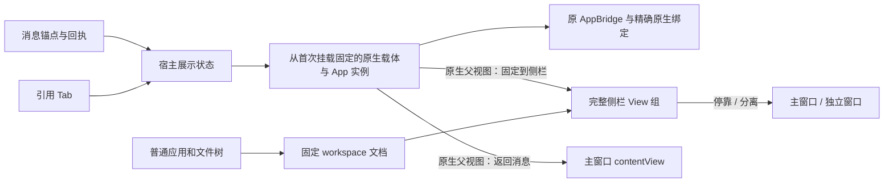
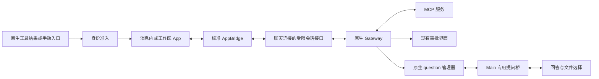

# MCP Apps 桌面宿主

MCP Apps 显示 MCP 服务提供的 `ui://` 界面，并允许界面通过标准 AppBridge 调用当前原生会话授权的工具、读取资源和更新上下文。它与 `show_widget` 生成的交互式回答并存，准入和运行时均不混用。

## 用户流程

在执行设置的 MCP 区域选择应用界面的“启用”或“关闭”，默认启用，以支持内置 draw.io。不再提供“沿用原生设置”选项；旧设置中的空值或缺失值按启用处理，已保存的明确关闭继续保留。完整、最小、登录和退出配置同步将这一选择投影到原生 `mcp.apps.enabled`，并保留其他原生 Apps 参数及无关 MCP 权限。

内置 [draw.io 离线绘图](drawio-offline.md) 默认启用。用户在对话中要求绘图，模型调用工具后显示编辑器；无需配置服务器、账号或公网服务。

draw.io 的[连续编辑](drawio-current-canvas.md)在插件内实现：标准 AppBridge 取得当前画布，认证插件 RPC 将准备绑定到确切原生 run，独立插件工具在实际应用回执后返回成功。修改结果投影成可定位当前画布的紧凑引用，不伪造 MCP descriptor，也不扩大通用预览隐藏规则。保留唯一承载未保存输入的 iframe；活动侧栏目标优先，切换会话退休旧候选，首发取消在准备结束后仍可阻止真正发送。此路径不增加生命周期补丁、正文缓存或旧工具授权；原生会话目录缺口由下述 030 独立修复。

外部 MCP Apps 由用户或内网市场另行安装，其源码和交付包由插件仓库维护。
交付目录或 `.tgz` 可从“插件 → 扩展”按现有审查流程导入，
启用父扩展后自动附带 MCP，使用相同的消息内展示和侧边栏手动入口协议，无需手工配置服务器。
已有会话可在侧边栏首页的“应用”区选择 draw.io 打开空白编辑器；该入口由插件的 App-only 工具声明，沿原生发现和启动流程进入工作区，不发送模型请求。

- 模型产生的 App 默认显示在对应工具结果后，历史只读提示与应用标题同行展示。展开在原文档中完成；放大层右上角“×”返回消息，保留同一 iframe、输入和当前交互，不执行 App teardown 或重读原生视图。
- 侧边栏首页在“工具”和“最近访问”之间展示“应用”，输入框“+”菜单不再包含应用列表。原生发现的实际手动入口、服务设置、资源搜索或安装引导直接列于该区，单一手动入口直接打开侧栏 Tab；文件处理器不计入手动入口数量，没有当前匹配文件时不出现在入口选择中。多入口、设置、资源搜索和安装引导也只在侧栏 Tab 展示，不向消息区或输入框上方插入应用操作面板。普通会话目录未知或为空时隐藏整个应用区；模型调用产生的消息内 App 不受此限制。入口图标优先采用原生目录中的工具 `icons`，其次服务 `icons`；插件随目录提供内嵌图片，可分别声明 light/dark，缺图或解码失败显示应用名称缩写，不发起公网图标请求。draw.io 的图标由自身 MCP 服务声明，宿主不按插件名映射图标。
- 首页目录在运行时就绪、全局工作目录与助手明确后后台预热，当前显示已有会话时也可准备受管原生预览会话，发现真实 global 入口；
  预热不开放首页画布交互或执行应用。侧边栏首页复用正在进行的请求与已有目录，已验证目录不因反复打开首页重新读取，加载期间显示状态，失败提供重新读取入口。
  读取期间以独立状态区域显示持续旋转图标和光扫骨架，不把“正在读取应用列表”作为灰色禁用应用按钮。骨架仅作装饰，不表示已发现的应用数量、下载进度或可用入口；原生目录返回后才显示插件声明的名称、图标和操作。Windows 关闭动画或 `prefers-reduced-motion: reduce` 时仍保留这两种等待动效。读取失败停止动效并保留手动重新读取，不自动循环重试、不重放应用启动。
  首次认证前，底层 socket 的一次关闭不等于目录请求失败：同一有效请求仍在有界连接等待或原生工作区准备中时，持续显示加载状态。普通连接等待上限为 15 秒；首次认证前明确收到 `1013 / gateway starting` 时，沿用同一客户端的自动重连，将当前等待一次性延长到从原始连接等待开始计算的最多 60 秒，期间保留旋转与骨架动画，就绪后自动读取目录。重复启动拒绝不重置该截止时间，认证后的重连也不获得这项延期。首次认证历史随该目录 owner 保留，切换首页订阅或客户端退休不重置；认证后的断线继续撤销旧目录和交互，恢复后的准备等待重新显示加载。真实超时、已认证连接断开或准备拒绝时显示通栏错误提示及完整文字的重新读取按钮；点击沿用同一 owner 和 Main 的创建回执，不重新派发未知的会话创建。
  同一作用域往返首页保留已核验目录，MCP 配置、扩展状态变化或认证连接恢复后重新发现；不自动重放应用启动。
  点击 draw.io 后才执行一次启动并打开侧栏，不创建产品聊天或发送模型请求。
- 首页文件树也支持已安装 App 声明的文件预览，保持首页和输入框草稿，只在侧栏打开文件标签。
  预取目录与明确点击文件共享 Main 按当前工作目录、助手和权限准备的专用原生预览会话；
  不创建产品聊天记录，不发模型请求。首页复用一条认证连接和标准 AppBridge，
  文件入口继续由原生发现，不硬编码 Univer 或扩展名；没有匹配入口时保留普通文件预览。
  离开首页暂停已加载的界面并保留编辑，回来核对原生身份后继续；切换目录/助手/权限或窗口销毁后撤销旧绑定，清理时只删除本窗口拥有、
  sessionId 与创建时 lifecycleRevision 精确匹配的原生预览会话。原生拒绝清理或结果未知时，
  不扩大删除范围、不重放 App 工具。首页已打开的 App 随用户的首条消息归属新对话，
  沿用同一个原生会话和视图，不复制上下文、不重放启动，也不重建编辑器。
  发送前及实际原生发送边界分别等待 App 完成上下文准备；draw.io 会提交正在编辑的
  节点文字并上报当前 XML，因此快速发送也包含未保存修改。准备失败保留草稿和画布，
  明确未发送；启动已创建产品会话后失败则保留该会话及其画布，不退回首页重新启动。
  接管后切换聊天或取消启动仍完成画布归属更新，后台结果不会改变用户当前选中的聊天。
  首次启动结果确认前，同一目录、助手及权限下暂停首页新的 App 启动，目录发现仍可预热；
  失败时可安全恢复原画布。新的首页按原生预览来源区分文件页签，再次打开同一文件不会替换旧对话的编辑器。
  当前画布不能随首条消息改绑到另一工作树；启用工作树选项时提示先关闭该选项再发送。
- 首页预览沿用全局工具审批，但尚未接入原生 elicitation 问答表单。
  需要这类提问的第三方文件 App 应在已有会话中使用；当前两个外部插件不依赖它。
  首页问答须先补齐窗口所有权、精确预览身份和回答/预览/上传的独立准入，
  见[现行说明与验证边界](#当前验证边界)，不能用伪造产品会话 ID 代替。
- 手动 App 和文件编辑器从工作区创建，使用现有标签、隐藏、全屏和独立窗口机制。工作区标签栏承担标题、关闭和放大操作，活动 App 隐藏重复的宿主标题栏，直接展示应用自己的工具栏和内容；App 主动关闭后仍提供重新打开入口。隐藏保留本地界面；关闭停止本地交互，并尝试清理已知上下文。原生视图按自身租约回收。

手动启动在原生准备前先预留以应用名称命名的侧栏 Tab，加载和错误保留在该 Tab。
同一入口的重复点击只聚焦已有或正在加载的 Tab；关闭后迟到结果不得恢复界面。
手动工具失败或结果未知不提供重放式重试按钮，再次选择同一入口仍聚焦原错误标签，
不重新启动工具；已有 App 的界面加载失败也只允许重新读取视图。设置/搜索等 React 操作面板只 portal 到
工作区实际文档，标签栏负责标题与关闭；关闭、切换会话或原生绑定变化会撤销旧面板及本地等待。
该规则由宿主通用入口路由执行，不按插件名称区分；模型真实工具结果仍按原生证据嵌入消息。

首页上下文的并发清理共享一次原生删除请求，未知结果不重试。原生上下文已不存在时，
并发准备只创建一个替代上下文；旧回调只有仍持有相同 entry/map 时才能移除所有权记录，
防止迟到清理遗失新预览的窗口销毁回收。

Gateway 已连接不代表各助手的数据库已完成后台准入。新首页上下文先预留自有 key，
通过原生只读 `sessions.describe` 等待该助手准备；只有返回明确的空记录才提交创建，
同 key 已有记录则拒绝碰撞，不借用其身份。只读阶段的明确 inspection-pending 负响应，
还须由当前 Main 原生客户端的相关响应证据、精确助手和窗口/requestId/配置作用域共同确认，
才释放未派发创建的失败准备；之后用户显式重新读取才可再试，不自动循环重发。
创建一经派发，其 inspection-pending、超时、断线或其他错误仍保留原结果未知边界，
不能仅凭相同错误码认定没有写入。已创建后的只读失败保留已知原生身份；初次并发等待者
不能越过连接换代，后续显式准备则可用新连接只读复核该身份。Main 在真正发送前再次核对
service/router/adapter/manager、客户端代次和窗口作用域，关闭及迟到回调不得删除后继上下文。

首页预热前，Main 等待准备应用拥有的默认项目目录，使用与 `CoworkStore` 相同的
`getDefaultWorkingDirectory`：普通启动为 `~/<产品小写名>/project`，开发隔离 profile 使用
其绝对 `JUSTDO_DEV_WORKSPACE_DIR`。非开发模式或相对 override 不改变默认路径。
此初始化不读取已保存的自定义工作目录来创建文件夹；失效的自选目录仍由用户处理。
已有默认目录内容保留，创建失败沿用可继续启动的 optional-task 错误记录，不在 `sessions.create`
失败后重试或临时创建传入的任意 cwd。原生会话创建仍只检查真实目录，不替宿主创建目录。

文件预览也消费该发现目录：只有一个当前有效的文件入口匹配扩展名时，点击文件立即创建并选中以文件名命名的工作区标签，再准备原生会话及启动 App。加载指示和失败后的手动重新读取均留在该标签内，不占用输入框上方的应用操作状态。重复点击复用正在加载或已经打开的同文件标签；完成后仅填充原标签，不再次切换焦点。文件导航请求只准入当前点击；已准入标签的后台结果还须通过原生绑定、产品会话及该标签等待的精确校验。关闭标签、切换会话或卸载中止本地等待，迟到结果不能重建标签，也不自动重放启动。目录未知/无匹配/多重匹配时保留普通预览；显式使用系统工具打开仍沿原路径。Renderer 不读取文件字节，不新增 Main 文件权限或 IPC。

文件插件通过 App-only 工具的 `file` 入口声明支持的扩展名。宿主先调用扩展约定
`mcp-app-files.open.<serverName>`，携带当前 sessionKey/sessionId/agentId 及文件路径；
只在原生路由明确拒绝未知方法时回退 `mcp.app.launch`，不对未知结果、授权失败或超时重试。
扩展负责使用公开 SDK 校验会话 incarnation/lifecycleRevision、当前工作区和 MCP 所属，
并限制文件访问边界、大小及快照生命周期。文件内容沿原生 view 的 App-only 工具和资源
通道传递，Renderer 不接收字节；原生 `openclaw-file://` 入口仍兼容。
具体格式、容量、源文件读写及导出能力由对应插件定义，主工程不内置表格引擎。

当前发现目录中的唯一文件入口也为工作区文件树与文件页签提供类型图标，优先使用
入口 `icons`，其次服务 `icons`，遵循已有内嵌图片和主题规则。图标作用域随首页／
会话目录更新，不按插件名硬编码扩展名映射；无匹配、多重匹配、无可用图标或加载
失败时使用内置文件图标。详见[工作区文件预览](../workspace/file-preview.md)。

可选文件插件还可实现 `mcp-app-files.resource.<serverName>`。仅对当前认证视图中
`/workspace-file/<opaque-token>` 的文件入口查询 `describe`；明确缺少该方法时保留原有只读通道。
成功返回的 `app-file://` URI 精确绑定当前视图和服务，标准 AppBridge 的资源读取与
`openai/resources/write` 分别转发 `read`/`write`，不接收 App 指定的服务、会话或本机路径。
历史视图、失效绑定和后台界面不能写入；插件仍须逐次核验原生视图、会话身份、工作区、
生命周期及自身 MCP 归属，并通过原生 MCP 写工具审批准入这一次保存。
冲突、ETag 和保存结果原样返回；未知结果不自动重试。没有实现该约定的插件不获得写权限。
Univer 的源文件保存、备份和格式兼容范围由独立插件说明维护，不增加 Main 文件权限或 OpenClaw patch。

- App 请求的后续消息显示明确确认。当前目标加入既有草稿；新会话目标加入首页草稿及现有附件。两者均由用户发送。资源搜索选择保留完整资源描述，不把资源 URI 当宿主命令执行。
- 应用选区继续通过标准协议更新 Gateway 上下文，输入框上方不显示应用标签或独立加载行；关闭视图仍按精确 `updateId` 清理已知上下文。HTML、工具结果和上下文正文不写入产品消息缓存或数据库。
- 服务设置按原生 schema 展示布尔、枚举、文本、数值和布局操作；只提交改变的值。安装引导需要显式点击和确认，由原生 onboarding 接口发起正常对话。

应用入口在侧边栏首页按图标与名称展示，支持 Tab 导航、键盘激活和焦点提示；服务操作面板使用紧凑图标，搜索按需展开。Escape 关闭操作标签后，在其实际工作区文档内聚焦当前选中标签；没有标签时聚焦首页可用的应用入口，不返回主聊天窗口或已卸载的入口。设置提供保存/取消，提问校验必选项并聚焦缺失字段。目录与表单在侧栏内滚动。消息 App 的展开、返回、关闭使用图标按钮；放大时只保留返回消息的“×”，避免两个等效返回按钮。主动关闭消息内 App 或接受 SDK 关闭请求时，才拆除界面并拒绝待确认草稿；标题栏保留“重新打开”图标。重新打开等待已有关闭完成，以当前会话重读原生视图，不重新执行工具；未保存的本地输入不属于这次重新打开的持久数据。

## 消息应用的侧栏引用

长对话中，用户可点击消息 App 标题栏的“在侧边栏打开”，将同一个应用固定在侧栏。
这是通用宿主展示能力，普通图表、表格、看板或查询 App 无须实现专用编辑协议。
使用按钮入口；尚未实现拖拽、跨会话编辑接管或跨重启保存固定偏好。

消息内 MCP App 与 `show_widget` 均跟随文字正文列的可用宽度，不包含两侧头像及其间距，
不设置独立的最大宽度；侧边栏中填满当前标签的可用区域。

| 入口       | 实例复用                                 | 关闭行为           |
| ---------- | ---------------------------------------- | ------------------ |
| 侧栏“应用” | 当前作用域内同一真实入口复用             | 沿用应用关闭       |
| 文件       | 当前作用域内完整文件路径相同才复用       | 沿用文件编辑器关闭 |
| 消息引用   | 同一已准入视图；可选可信适配关联同一内容 | 移回消息，保留应用 |

“本地图表 · 可继续修改”是辅助说明，不再常驻标题栏或单独占行。必要的只读、错误及用户确认状态仍按原规则展示。

内嵌 App 可选择接入 `ui/shared-header` 展示扩展：图标和内容标题在左，必要提醒、
App 自身操作、在侧栏打开／展开／关闭在右，共用一行 44px 标题栏。App 的按钮仍由
原 iframe 渲染并执行，宿主仅覆盖自己占用的左右区域，不复制插件 DOM 或代理业务操作。
插件通过标准 App capabilities 的 `experimental['ui/shared-header'] = { version: 1 }`
明确支持该布局；宿主通过同名 host context 提供 `{ height, left, right }` 像素值，未合并时
显式传 `null`。App 隐藏自身重复标题，仅对顶部工具栏避让这些区域；画布不增加左右留白。
此扩展是本宿主的可选展示约定，不属于 MCP Apps 标准，也不改变来源、权限或展示模式。
未接入的 App 保留独立工具栏，不能根据插件名称、HTML 或截图猜测隐藏。draw.io 已接入；
固定到侧栏后宿主标题栏隐藏，App 自动恢复自己的标题与正常工具栏，保持同一 iframe。

固定后，原消息变为单行轻量卡片：插件图标、内容标题、次级状态“已在侧边栏”和“查看 ↗”。
卡片使用紧凑留白和轻量状态标签，长标题省略，状态与操作保持同行。
有真实成功回执时显示“已更新 · 已在侧边栏”；位置状态本身不代表业务操作成功。
侧栏 Tab 使用相同标题及侧边栏图标，不再显示“引用”文字；图标的悬浮提示与无障碍名称
为“来自消息，关闭标签可移回消息”，关闭提示为“移回消息”。`show_widget` 的侧栏标签
使用相同标记及关闭语义，具体准入与生命周期保持[交互式回答](interactive-answers.md)的独立契约。
消息卡片以及引用、应用直开、文件打开三类 App Tab 都使用插件通过原生目录声明的图标：
已准入视图按真实服务、工具及资源身份匹配入口图标，再回退到该服务图标；加载中的 Tab
使用所点击入口的图标。目录沿用已有发现读取，不为渲染图标额外请求或启动插件。
深浅主题、内嵌图片限制和解码失败回退共用同一规则；无可用图标时显示通用应用图标，
不根据标题、插件名称或文件扩展名推测其他插件的身份。图标是展示信息，不参与来源、权限或实例判断。
侧边栏标记只描述显示位置，原先可以编辑的内容仍可编辑。
长标题截断并提供完整提示，定位按钮提供包含标题的无障碍名称。

同一目标的所有卡片共享固定状态，只产生一个引用 Tab。固定后只显示“查看”，
反复点击仅定位原实例。不同标题不能证明身份，相同标题也不能证明是同一内容。
同一原生会话、服务下有多个实例时，标题附辅助序号 `· #2`；同一目标重挂历史行、
取消固定再固定不会变号，删除其他实例不重排或复用编号。编号只在当前展示会话中维护，
不持久化，不参与业务路由或权限校验。

关闭引用 Tab 不执行 SDK teardown、`closeApp`、保存或业务工具。消息锚点仍在时，
原位置继续展示同一应用；锚点不在已加载历史中时保留隐藏实例，等待原位置返回，
不强制滚动或加载旧页。App 自己通过标准协议请求关闭，仍真正关闭原应用。
侧栏已有目标的普通应用／文件 Tab 时，可信回执定位该 Tab，不新建引用副本，
也不改变其原有来源与关闭语义。后台更新只修改目标，不抢占当前标签。

### 稳定实例与统一侧栏归属

消息用 `McpAppAnchor` 提供位置。桌面 `presentations.ts` 在原 `McpAppView` 首次连接、
创建 iframe 或 AppBridge 前，经共享展示基础设施准备独立原生载体。载体使用同源被动
`workspace.html`，没有应用 preload、独立 store 或 Gateway 连接；组件、原生绑定和
交互权限继续由所属聊天持有。载体文档首次确定后不再改变，消息与侧栏之间只改变
原生父视图、裁切和布局锚点，不搬动 iframe、不重新读取视图、不重建 AppBridge，
保留未保存输入、选择、撤销栈和插件本地状态。展示回执 ID 仅标识 Main 的承载资源，
与原生 viewId、工具调用及内容回执分开，不是新的 App 身份。无原生表面 API 的浏览器
环境使用同 Document 的固定容器，不迁移运行中的 iframe。
尺寸和主题仍沿标准 host context 更新，不新增 `sidebar` displayMode。
App 的标准全屏请求经原 manager 转交当前侧栏目标；面板验证精确实例、固定状态和
目标归属后接收，回到消息时恢复其支持的消息展示模式。

引用内容与普通 App、文件、浏览器和终端共用同一 workspace portal，普通组件树始终保留。
Main 的通用原生 View 组拥有工作区 WebContentsView 和固定卡片的载体；“独立窗口”及
返回停靠移动同一组，不按 App / Widget 类型分支，不创建替代运行实例。独立窗口直接
显示原 App，消息、侧栏和窗口变化均保留同一个载体文档、iframe、bridge 及本地输入。
裁切只改变外层可见范围及内层偏移，部分滚出视口时不改变 App 的逻辑宽高。
键盘切换和关闭后焦点交给实际可见的标签栏。主窗口 Modal 及相交菜单／列表继续遮挡界面，
遮挡时同时拒绝 App 的交互 RPC。

实例保活独立于 `fillContainer`。普通未固定实例在最后一个消息锚点消失后释放；
仅固定实例和取消固定后等待原锚点返回的实例跨历史窗口保留。
删除所属会话或销毁整个展示区域清理相应实例，不将所有历史 App 常驻。
切换会话暂停交互，返回时只允许原 client、generation、agent、sessionKey、物理 sessionId
精确匹配的绑定恢复；新连接代次沿原有显式重读规则处理，不能用当前位置接管旧授权。

### 内容关联与历史回执

基础展示只复用同一原生视图。跨消息的稳定内容关联、成功回执和只读恢复是可选插件增强，
接入要求见[插件引用接入](../plugins/mcp-app-references.md)。宿主不推测业务 ID，
不要求普通查看器实现快照、撤销、AI 修改或版本数据库。

原生 App descriptor 准入与正常预览规则保持原路径。可选回执仅在真实工具、精确调用、
来源及已知 run 身份核实后投影为通用 `app-reference`。失败、冲突、未知操作、
助手示例 JSON 或任意链接均不能创建成功引用，也不能导致正常预览被隐藏。
恢复只沿插件已有认证读取能力，不重放创建／保存／更新，不恢复旧消息、上下文或文件权限。
本地引用状态和序号不写 Main／SQLite；通用展示 IPC 只管理原生载体与位置，
不传业务正文或授权，不增加原生运行时补丁或第二份业务正文缓存。

## 权限和数据流

Gateway 保持 MCP transport、catalog、会话、工具许可、原生历史、问题、文件资源和视图租约的唯一所有权。Renderer 使用现有聊天连接，新增功能不接收 token、任意 Gateway request 或第二个 MCP client。

原生分支创建结果待确认时，保留历史只读查看，MCP Apps 的准备、启动、工具交互、安装引导及问题操作沿用现有会话门禁；Main 和 Renderer 均校验当前状态，旧回调不能绕过后来生效的限制。

共享契约在 `src/shared/plugins/mcpApps.ts`。数据面在 `libs/openclaw-chat/gateway/mcp-app/mcp-app-session.ts`，标准 SDK 桥和视图在 `components/mcp-app/`，产品入口在 Cowork 的 `mcpApps/` 与 `display/useMcpAppTabs.tsx`。Main 提问处理在 `ipc/plugins/mcpApps.ts`，preload 仅公开对应方法。

模型 App 只从完成的原生 MCP 工具事件、原生工具角色历史或 ToolSearch 的实际 MCP 结果准入；不递归搜索文本、代码围栏、HTML 属性或 assistant JSON。手动启动和问题预览分别来自认证 RPC 与专用 Main 桥。模型与手动入口在准入时核对服务、工具、资源与工具调用身份。问题预览只接收 Main 从原生 `formResource` 得到的 view 引用及原生选项标题，不伪造工具 descriptor。Renderer 随后以捕获的会话和 viewId 重读 `mcp.app.view`，由 Gateway 核验当前会话、请求者及运行时归属；HTML 只来自该认证响应，不依赖本地补丁扩展字段。

原生历史把 App 描述保留在工具角色记录的独立 `details.mcpAppPreview`，业务 `content` 不包含完整工具结果。恢复时读取该原生投影并核对 MCP 工具名称与精确 `toolCallId`；保留了服务／工具字段的完整结果还必须一致。Gateway 的公开历史投影省略这些字段时，后续认证视图读取仍须通过 Gateway 的当前会话、请求者和运行时校验。

同一个 App 已通过真实工具结果准入时，消息只显示一次交互界面。原生历史附带的
无 URL Canvas 占位须与已准入视图的完整 MCP 身份一致才会隐藏。原生工具结果明确
失败时，也按相同身份核对移除该次调用的无 URL 占位和短码，避免显示没有内容的
不可用预览；失败详情继续保留在处理过程，后续成功调用独立展示。失败证据只来自
原生工具角色记录，或调用、run、父调用均吻合的 ToolSearch 原生活动，不授予视图
读取或恢复权限。外部 URL（包括同时带有相同 ref 的短码）、其他调用及无法核对的
未准入预览保留。实时与历史中
同一已准入视图的短码也会去重，但保留普通正文和代码示例。此处理不从助手正文
准入 App，也不增加文档读取权限。

ToolSearch 的实际目标在实时流中提供独立 MCP 工具事件，历史中保存为原生 `openclaw.nested-tool.v1` 活动。只从该精确容器中匹配调用 ID、工具名称、run 和父调用的工具角色结果恢复 App；外层 `tool_call` 的模型可见文本和 assistant 内嵌工具块不能替代这份原生证据。

App 运行在 Gateway 的专属 HTTP(S) sandbox listener，继续使用原生双层 iframe、CSP 和导航约束。宿主消息同时检查发送窗口、精确 origin、当前文档和 SDK 消息 schema；没有 `postMessage('*')` 宿主通道。当前桌面实现接受配置的 Gateway 主机上的专属 listener；其他自定义 sandbox origin 保留配置但拒绝加载，不放宽共享 widget 导航规则。

Chromium 将已运行 iframe 跨 Document 移动会重载。消息 App 因此在首次 iframe / bridge
创建前进入固定原生载体，之后仅搬原生父视图；手动与文件 App 继续从工作区文档创建。
整个侧栏分离使用同一 View 组及原 WebContents，不因展示位置变化重读、恢复或替换 App。
消息发送器在实际 iframe 父文档注册，并继续核对精确 source、origin 与 SDK schema。
载体本身意外销毁才沿显式重试重新认证读取，不重放创建、保存或工具操作。
首页与会话页的 MCP 容器还须保持固定的首个子节点位置，避免 React 虽复用同一元素，却因兄弟顺序变化移动其 iframe 子树而触发内部文档重载。

标准工具、资源和资源模板分页、工具调用、资源读取、模型上下文，以及 OpenAI 文件写入、订阅、打开和富消息扩展映射到原生 `mcp.app.*`。文件写入的 ETag、冲突和更新通知保持原生结果，宿主不自行覆盖或重试。文件打开先经 Gateway 核验用户确认的绝对路径，再交给现有桌面预览；原生响应中的工作区相对展示路径不能被当作桌面绝对路径。

标准 `ui/download-file` 仅接收一个内嵌 text/blob 资源，不按资源链接下载网络内容。当前可见视图通过专用 preload 请求 Main；Main 再次校验 MIME、文件名、Base64 和 25 MiB 上限，并使用所属窗口的原生保存对话框选择路径。App 无法指定写入路径，取消不写入文件。允许的数据格式由 `shared/plugins/mcpAppDownload.ts` 声明，沙箱不开放直接下载权限。
其中 XLSX 导出须使用标准 spreadsheetml MIME 和 `.xlsx` 后缀，保留二进制原样；
该许可不包含 `.xlsm`、可执行文件或不匹配的 MIME/后缀组合，也不绕过保存位置选择。

工具审批复用现有 Plugin 审批；Main 连接明确公告 `exec-approvals` 与 `plugin-approvals`，让 Gateway 将对应请求投递到实际渲染审批的宿主，而不是仅依赖 operator scope。“允许当前应用内调用”仅在原生 `bundle-mcp` 记录明确提供对应 action 时出现，提交前重读记录与 Gateway 代次，授权范围和失效仍由原生 view 持有。

## 提问、生命周期和恢复

原生 `question.requested/resolved` 在 Main 仅广播无正文的刷新提示。Renderer 按产品会话读取未过期问题。Main 检查发送者为主 frame、产品会话可写、原生 sessionKey/agent 匹配、问题仍 pending；回答只接受问题自身字段，secretStore 主机策略取自原生记录。表单处理选择、默认值、多选、逐行文本、其他回答、秘密输入、URL 入口和拒绝。

文件/目录由 Main 原生选择框获取；不接受 Renderer/App 提供的上传本机路径。上传检查目录边界、符号链接、打开文件身份、大小和读前后变化，限制 64 个文件、8 层目录、5 MiB，再由原生 formResource 校验类型、问题归属和上传权限。预览通过同一原生问题身份读取，可展示文本、受限栅格图像或原生 App；问题结束后清空表单，不保存秘密答案。

连接、原生 incarnation、会话、呈现代次任一失效都会使旧接口失效。消息内 App 沿原有
卸载规则；已加载完成的工作区 App 切换会话时暂停原生接口，保留同一个 iframe 和 SDK bridge，
因此画布修改、输入和撤销栈不会因聊天切换而重置。暂停会终止本地等待、拒绝待确认操作和
后台交互；已接收的原生操作仍可能继续，未知结果不重试。

切回并选中工作区标签后，等待认证历史就绪；仅在原产品会话、client、generation、sessionKey、
物理 sessionId、agent 和原视图身份一致时取得新绑定，继续使用原编辑器，不读取 view 或
执行启动/文件打开工具。请求捕获发送时绑定和本地 revision，旧响应不能在切回后恢复有效。
清除的模型上下文只通过认证读取同步，不把保留的本地选择重新声明为原生状态。
首页与聊天共享稳定工作区层级；已有聊天控制器在首页隐藏、暂停，并在返回时重新验证历史。
仍在启动、结果未知或已关闭的 App 不自动恢复。连接或原生身份变化沿显式恢复规则，
不承诺跨运行时重启保存本地输入。用户主动重新打开文件仍是新的显式文件动作。

关闭时停止资源订阅，并通过原生 `mcp.app.removeModelContext` 尝试清理已知的精确 `updateId`。清理只使用捕获的原连接和会话，不经替换后的连接代次重放，也不会移除更新后的选择。清理失败只提示上下文未确认，不能宣称原生视图已释放。迟到后台操作仍可能更新原生状态，完整回收由原生负责。

2026-10-18 经源码审计和用户确认移除原 MCP Apps 生命周期补丁 `030-mcp-app-operation-lifecycle.cjs`（下文简称原 030），MCP Apps 不再增加生命周期补丁。当前原生 WebSocket 没有精确请求取消和显式视图释放接口；视图、临时工具授权与部分订阅按原生固定租约到期清理，最长为创建后约十分钟。关闭界面、SDK teardown 或本地 AbortSignal 都不构成后台取消、授权撤销或副作用回滚的证明。

手动 App 与后续模型执行必须使用相同的原生会话工作目录。当前锁定 2026.10.7 的手动准备仍遗漏 `spawnedCwd`，会在角色 home 与项目目录不同时替换 MCP runtime，撤销仍显示中的旧视图交互并关闭其资源服务。`030-mcp-app-session-workspace.cjs` 仅将手动准备接至模型已有的 ingress workspace resolver，并把持久工作目录事实纳入准备 fingerprint；不改变授权、租约、取消或释放语义。宿主不能通过 App 参数自选目录或替换会话 owner。复现和验收见 [draw.io 当前画布](drawio-current-canvas.md#6-必须通过的验证)；较早版本的通过记录不替代[本版验证](../../openclaw-upgrades/v2026.10.7/validation.md)。

断线和未知结果不自动重试启动、工具调用、设置写入或文件写入。重新读取界面优先读取 `mcp.app.view`；仅下述已核验的插件恢复适配可在明确过期后读取原始结果。原生历史重建的只读视图不恢复工具授权。对于提交工单等写入操作，须核对实际结果，不能因界面关闭而重复提交。

OpenClaw 2026.10.4 的视图重建只识别顶层工具角色记录，无法从 ToolSearch 的
`openclaw.nested-tool.v1` 记录恢复。内置 draw.io 为此提供插件拥有的只读恢复 RPC：
仅在原生明确报告 `MCP_APP_VIEW_EXPIRED` 后尝试，从原生 SDK 的当前可见历史读取
原 viewId 对应的实际子调用结果，核对物理 sessionId、agent、来源会话、服务、工具、
调用身份及成功状态。客户端不提交 XML，不重试 `create_diagram`，不改写历史。
插件通过公开 `prepareHarnessNativeMcpAppPreview` 和自身离线资源创建新的原生视图，
随后沿原认证调用者派发 `mcp.app.view`；工具清单与授权为空，上下文恢复关闭。
Renderer 只在当前绑定内采用新 viewId，后续操作和事件均使用该身份。此适配不导入
OpenClaw 私有模块，不添加 patch、不建立第二个 MCP transport 或消息缓存。
其他静态 MCP 服务在原生明确报告过期后，可使用 Runtime Services 的
`runtimeServices.mcpAppHistoryView` 恢复同类嵌套记录。RPC 通过原认证调用者检查会话
可见性和精确 sessionId/lifecycleRevision，从 SDK 当前可见历史核对原 view/子调用，
再由公开 `materializeStaticMcpToolsForHarnessRun` 借用原生 MCP manager 的
`resources_read` 工具读取这一份 UI 资源，应用当前配置和会话工具限制。
不执行原业务工具、不创建第二套 MCP client、不改写历史或保存 HTML 副本。
恢复视图仅提供原始结果和界面本地操作，不恢复工具、模型上下文或宿主文件授权；
原生身份、会话策略或配置权限变化后失效。请求者专属连接暂不走此静态恢复适配。
结果缺失、元数据不完整、历史分支不匹配、资源读取被禁用或插件关闭时拒绝恢复。

部分 App（如 cohort-heatmap）挂载时通过 `tools/call` 取数，而不消费初始工具结果。
此类历史视图的 SDK 桥将请求送到 `runtimeServices.mcpAppHistoryTool`，重新核对当前
可见历史、会话身份及工具策略，只返回原调用已经保存的结果。工具名称和参数必须匹配；
原输入省略的缺省值允许按当前公开工具 schema 补齐，其他指标、周期或新增参数拒绝。
读取 schema 保留原审批门禁，执行回调始终拒绝；不会实际执行业务工具、刷新数据、
恢复旧授权或把结果放入 Renderer 正文缓存。关闭或绑定失效后停止本地等待，迟到结果丢弃。

历史尚未绑定完成时 App 等待当前聊天的绑定通知，不提前 bind、不产生未处理异常，
也不为等待而创建会话或发送模型消息。

文件 App 主动关闭后，再次点击文件会重新打开文件编辑器，不把关闭的界面当作活动编辑器聚焦。
文件 App 的“重新读取”是用户明确重新打开当前文件：重新准备同一会话绑定，核对
当前唯一文件处理器并取得新的原生文件视图，不用旧的已过期 viewId 循环读取。
会话或权限改变则拒绝采用结果；不会自动执行这条重新打开路径。再次点击文件也不会
只聚焦已经失败的旧标签，明确的新视图可替换相同文件的失败标签。

过期视图的恢复 RPC 同样登记为所属会话的本地等待；会话失效立即中止等待并拒绝迟到结果。
App 确认打开文件后，认证请求返回时还须复核可见性、交互权限、绑定和取消状态；
隐藏或关闭后返回的确认不能再打开预览或切换标签。

App 内容及其后代 iframe 继承原生 opaque origin。外部插件内部的嵌套编辑器需要
自行适配该环境、确切核对父/子 WindowProxy，并提供可用的存储方案；
这不改变宿主的精确 origin/source 校验、CSP 或沙箱标志。

### 原生接口与插件替代审计

这里的原 030 专指已移除的 MCP Apps 生命周期补丁，与 dev 后续已有的 `030-tool-call-format-recovery.cjs` 无关；后者不由本功能新增或移除。

2026-10-18 复核锁定的 OpenClaw 2026.10.4 源码（`383c124cc32ffee3f8e56f549b88da94d269a4af`）：标准 MCP Apps 的显示、工具、资源和扩展能力继续使用原生接口；已移除的 030 曾补充宿主的请求取消和展示回收保证；这些不是 MCP Apps 协议或内置 draw.io 的必需条件。采用原生生命周期保留正常工具、资源、审批、提问、文件、上下文及交互能力。

| 替代路径             | 可复用能力                                            | 生命周期边界                                                                      |
| -------------------- | ----------------------------------------------------- | --------------------------------------------------------------------------------- |
| 原生 WebSocket       | 现有完整 App 操作、审批、提问、文件和上下文           | 没有公开的精确取消与展示释放 RPC；关闭连接不会为 `mcp.app.*` 建立请求取消         |
| 原生 standalone HTTP | 五种基础工具/资源方法，以及断开 HTTP 请求时的原生取消 | 缺少上下文、宿主文件读写/ETag/订阅、完整审批/提问路径和最终视图释放；不能整体换用 |
| 公开插件 SDK         | 新增 RPC，并以原认证调用者派发现有原生方法            | 未公开原生 view disposer 或既有请求的取消控制器；不能通过新增方法创造这些权限     |

关键源码证据（均指上述固定提交）：

- [WebSocket 请求派发](https://github.com/openclaw/openclaw/blob/383c124cc32ffee3f8e56f549b88da94d269a4af/src/gateway/server/ws-connection/authenticated-request-dispatch.ts#L357) 只为特定方法建立断线取消控制器，不包含 `mcp.app.*`。不能用关闭聊天连接代替取消单个 App 请求，更不能调用 `chat.abort` 扩大停止范围。
- [Standalone HTTP](https://github.com/openclaw/openclaw/blob/383c124cc32ffee3f8e56f549b88da94d269a4af/src/gateway/mcp-app-standalone.ts#L386) 直接执行基础操作，不传认证 request；[操作实现](https://github.com/openclaw/openclaw/blob/383c124cc32ffee3f8e56f549b88da94d269a4af/src/gateway/mcp-app-operations.ts#L425) 会拒绝需要 `prepareToolCall` 的手动/文件视图，模型视图也不能等同于带 request 的审批和 elicitation 分支。HTTP parser 只接受 `tools/call`、`tools/list`、`resources/list`、`resources/templates/list`、`resources/read`。
- [Standalone 关闭](https://github.com/openclaw/openclaw/blob/383c124cc32ffee3f8e56f549b88da94d269a4af/src/gateway/mcp-app-standalone-host.ts#L107) 仅取消 fetch 和移除 frame；没有释放 HTTP API。真正清除临时授权、上下文、订阅及 runtime lease 的 [view disposer](https://github.com/openclaw/openclaw/blob/383c124cc32ffee3f8e56f549b88da94d269a4af/src/agents/mcp-ui-resource.ts#L130) 属于原生内部实现，未向普通插件导出；等待原生十分钟 TTL 与关闭确认不同。
- [插件注册器](https://github.com/openclaw/openclaw/blob/383c124cc32ffee3f8e56f549b88da94d269a4af/src/plugins/registry-registrars-network.ts#L93) 拒绝覆盖核心方法。[公开认证派发 SDK](https://github.com/openclaw/openclaw/blob/383c124cc32ffee3f8e56f549b88da94d269a4af/src/plugin-sdk/gateway-method-runtime.ts#L24) 保留调用者，但只继承原请求的 signal；其选项没有单独的取消 signal。`api.runtime.gateway.request` 使用 synthetic client，也不能作为原连接的展示所有者。
- `prepareHarnessNativeMcpAppPreview` 仅返回 preview。`createHarnessMcpFormResourceContext` 的 disposer 只管理该表单资源及其子预览，不能释放普通模型或手动 App。插件 HTTP 的请求 scope signal 来自 operator access authority，不能据此假设它自动随 HTTP 请求断开。

已删除的 `appIdentity` 和 `hostLeaseId` 都是本地响应扩展，不是上游已有字段；宿主已改用原生响应和认证来源准入。访问私有全局 view store、深层导入 dist 内部模块、强制直调只读 registry 中的 handler，或者把同等修改藏入其他补丁，都不作为移除 030 的方案。

后续每次升级按[升级检查清单](../../upgrade-checklist/checklist.md#21-mcp-apps-原生生命周期)重新核对：上游是否公开精确请求取消、可确认的最终视图释放、多窗口展示隔离，以及原生 TTL/审批/提问的实际语义。若新增能力，先核验调用者、会话和连接身份，再用公开接口接入；同时检查取消传播、其他窗口不受影响、未知结果不重试。当前不为此保留补丁，也不改用能力较少的 standalone HTTP。

## 验证

`node tests/mcp-apps/reference-smoke.cjs` 使用隔离 Electron profile、生产 workspace manager、
锁定原生 sandbox 和不包含 draw.io 字段的标准 App。验证同一 iframe／内部文档、输入及选择保留，
普通 workspace App 不重挂，多锚点去重、历史移除／返回、取消固定、会话暂停／精确恢复，
以及 SDK 全屏、Modal／菜单阻塞和跨 Document 标签焦点；不增加业务调用或原生视图读取。
`node tests/drawio/offline-smoke.cjs --editing --reference` 另验证真实编辑器的未提交节点文字、
往返固定、连续修改和多页撤销。`editing-native-smoke.cjs` 对实际原生历史做紧凑回执投影验证。
这些隔离探针不替代安装版、企业服务或分离窗口复杂桌面环境的人工验收。

协议测试使用真实 `@modelcontextprotocol/ext-apps` App 与 AppBridge，覆盖握手、工具、资源 ETag、上下文、未确认消息和 SDK 取消到本地等待的传播。Main 测试覆盖 frame、会话、字段、过期和秘密策略。会话测试覆盖旧绑定失效、本地取消与迟到响应拒绝、精确上下文清理及未知结果不重试。

`node tests/mcp-apps/ui-smoke.cjs` 和加 `--workspace` 的版本使用隔离 Electron profile、锁定原生 sandbox shell、真实 App SDK 与内存 Gateway facade，已验证 iframe 握手、初始结果、一次工具调用、伪造来源拒绝、展开保留输入、主题同步、标准 teardown 和关闭后的本地失效，以及会话往返保留同一 iframe 和未保存输入、没有增加 view 读取或启动，原生 view 响应没有本地扩展字段。真实 draw.io 的离线 UI 验证也检查切换后保留已修改文字并将其导出到源文件。输出在 `.agent-tasks/mcp-apps/ui-smoke/` 与 `.agent-tasks/drawio/ui/`。

`node tests/mcp-apps/product-ui-smoke.cjs` 在 `npm run build` 后使用实际产品样式和 React 控件，验证侧边栏首页应用区与插件图标、输入框菜单分离、目录、设置、提问、主题过渡完成后的颜色及窄窗口无横向溢出，截图在 `.agent-tasks/mcp-apps/product-ui/`。探针仅使用合成数据，不读取用户配置、历史或凭据。

`node tests/mcp-apps/home-navigation-smoke.cjs` 使用真实首页布局、工作区面板、React 标签、
首页预览连接、Gateway 客户端和标准 App SDK，验证首页画布往返已有会话时内部文档与未保存
输入保持不变，且不重新启动或读取视图。探针使用隔离内存 Gateway 和原生 sandbox，
输出在 `.agent-tasks/mcp-apps/home-navigation/`；`--baseline` 在内存中恢复旧兄弟顺序作为应失败的负对照。

`node tests/mcp-apps/gateway-smoke.cjs --history-recovery` 通过隔离原生 Gateway 验证
嵌套历史恢复、挂载取数的原始结果读取、默认参数匹配、身份拒绝及业务调用计数不增加。
文件入口、即时标签、去重和本地等待取消由宿主的相关组件测试覆盖；真实表格引擎
的解析与保存验收由外部插件自身维护。

`node tests/mcp-apps/gateway-smoke.cjs` 使用完整重建的原生 launcher、独立配置/状态/工作区/端口与合成 stdio MCP 服务，不发起模型请求。已验证发现与手动启动、视图内授权与拒绝、本地取消后后台仍可完成、原生 elicitation、设置读写、资源搜索、上下文移除、文件读写与 ETag 冲突、订阅通知、文件越界拒绝和跨会话拒绝。

安装版、企业服务与代理网络、富表单预览/上传/秘密存储组合，以及真实独立窗口下主窗口最小化等人工验收保留在[现行说明与验证边界](#当前验证边界)。合成 Gateway 与 Chromium 探针不替代这些场景。

## 当前验证边界

本节保留10.6升级的隔离桌面与原生探针历史证据；当前10.7产物的重新验证和未验收项见
[本版验证记录](../../openclaw-upgrades/v2026.10.7/validation.md)，不能由以下旧版通过结果替代。

升级补查执行了当前 Main 原生客户端发现/加载/响应捕获函数，并在严格冻结产物中验证
所选 constructor 与公共 facade 严格相同、共享原生响应相关性 WeakSet；未相关的同形错误
仍被拒绝。受控请求验证只读 pending 后显式重试、创建后 pending 不重发及各所有权围栏。
另外直接执行目标原生 pre-dispatch 与 describe handler 的当前函数，验证等待准备和空记录
合同；这些用例的依赖端口受控，不是实际 Gateway 启动或 draw.io 操作。桌面升级日志曾在
后台准备完成前出现一次 `sessions.create` 被拒绝，但没有调用方参数，不能据此认定它一定
来自首页 Apps。该恢复窗口的真实桌面目录/应用打开仍需单独验证。

后续隔离 Fresh 桌面已验证只读 preflight 成功，但创建因 `<开发 profile>/project` 不存在
而失败。源码确认开发默认 cwd 与 Main 原硬编码创建的 home 默认路径不一致；已统一复用
上述 resolver。`coworkStore.defaultWorkspace.test.ts` 执行实际 Main 初始化块及真实临时目录，
覆盖中文路径、开发/生产选择、相对 override、既有内容、自定义路径不自动创建及 await
顺序；不构造 SQLite 或启动 Gateway。修复后隔离 Fresh 桌面已实际进入首页，原生
describe/create/describe 成功；尚未发起模型任务或验收 draw.io 打开，其他路由的桌面结果
统一见[10.6历史验证](../../openclaw-upgrades/v2026.10.6/validation.md)。

窗口销毁的预览 release 当前是 best-effort，Main 未显式 join 该 owner，可能与 Gateway
关闭竞争。本轮 Fresh 退出时一次原生 delete 在归档登记阶段返回 UNAVAILABLE；日志缺少
参数，不能唯一归因于此入口。原生删除与后续归档记录可能分阶段完成，既不能认定完整
删除成功，也不能因负响应认定没有变更。实际进程退出 0 不替代该请求的完成证据；此处
保留临时预览清理未知的限制，不重发未知写入或扩大已有历史删除权限。

首页文件 App 尚未接入原生问题入口；接入必须绑定窗口、精确预览 requestId 和自有原生会话，回答、资源预览及上传分别校验授权。已有会话中的原生问答能力不代表首页已支持。

最终安装版、企业服务/代理、富表单预览/上传/秘密存储组合，以及独立窗口下主窗口最小化等仍未完成人工验收。隔离 Gateway 与 Chromium 探针不替代这些结果，也不能证明空缓存且公网阻断时无首启下载依赖。
