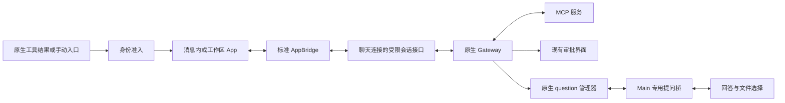

# MCP Apps 桌面宿主

MCP Apps 显示 MCP 服务提供的 `ui://` 界面，并允许界面通过标准 AppBridge 调用当前原生会话授权的工具、读取资源和更新上下文。它与 `show_widget` 生成的交互式回答并存，准入和运行时均不混用。

## 用户流程

在执行设置的 MCP 区域选择应用界面的“启用”或“关闭”，默认启用，以支持内置 draw.io。不再提供“沿用原生设置”选项；旧设置中的空值或缺失值按启用处理，已保存的明确关闭继续保留。完整、最小、登录和退出配置同步将这一选择投影到原生 `mcp.apps.enabled`，并保留其他原生 Apps 参数及无关 MCP 权限。

内置 [draw.io 离线绘图](drawio-offline.md) 默认启用。用户在对话中要求绘图，模型调用工具后显示编辑器；无需配置服务器、账号或公网服务。

外部 MCP Apps 由用户或内网市场另行安装，其源码和交付包由插件仓库维护。
交付目录或 `.tgz` 可从“插件 → 扩展”按现有审查流程导入，
启用父扩展后自动附带 MCP，使用相同的消息内展示和“+”手动入口协议，无需手工配置服务器。
已有会话也可点开输入框“+”，在“应用”分组选择 draw.io 打开空白编辑器；该入口由插件的 App-only 工具声明，沿原生发现和启动流程进入工作区，不发送模型请求。

- 模型产生的 App 默认显示在对应工具结果后，历史只读提示与应用标题同行展示。展开在原文档中完成；放大层右上角“×”返回消息，保留同一 iframe、输入和当前交互，不执行 App teardown 或重读原生视图。
- 输入框“+”菜单仅在原生发现了实际手动入口、服务设置、资源搜索或安装引导时显示“应用”分组，与“插件”分组并列，不显示独立应用按钮或应用二级菜单。应用直接列在分组标题下，单一手动入口直接打开侧栏 Tab；文件处理器不计入手动入口数量，没有当前匹配文件时不出现在菜单或入口选择中。多入口、设置、资源搜索和安装引导也只在侧栏 Tab 展示，不向消息区或输入框上方插入应用操作面板。目录未知或为空时隐藏整个分组；模型调用产生的消息内 App 不受此限制。
- 首页不显示通用“打开应用”按钮，也不为发现目录创建空会话。
- 首页文件树也支持已安装 App 声明的文件预览，保持首页和输入框草稿，只在侧栏打开文件标签。
  首次明确点击文件时，Main 按当前工作目录、助手和权限准备专用原生预览会话；
  不创建产品聊天记录，不发模型请求，不显示应用列表。首页复用一条认证连接和标准 AppBridge，
  文件入口继续由原生发现，不硬编码 Univer 或扩展名；没有匹配入口时保留普通文件预览。
  离开首页、切换目录/助手/权限或窗口销毁后撤销旧绑定，清理时只删除本窗口拥有、
  sessionId 与创建时 lifecycleRevision 精确匹配的原生预览会话。原生拒绝清理或结果未知时，
  不扩大删除范围、不重放 App 工具。首页预览的原生上下文不自动迁移到随后创建的普通对话。
- 首页预览沿用全局工具审批，但尚未接入原生 elicitation 问答表单。
  需要这类提问的第三方文件 App 应在已有会话中使用；当前两个外部插件不依赖它。
  首页问答须先补齐窗口所有权、精确预览身份和回答/预览/上传的独立准入，
  见[接入验收](../../plans/mcp-apps-integration-plan.md)，不能用伪造产品会话 ID 代替。
- 手动 App 和文件编辑器从工作区创建，使用现有标签、隐藏、全屏和独立窗口机制。工作区标签栏承担标题、关闭和放大操作，活动 App 隐藏重复的宿主标题栏，直接展示应用自己的工具栏和内容；App 主动关闭后仍提供重新打开入口。隐藏保留本地界面；关闭停止本地交互，并尝试清理已知上下文。原生视图按自身租约回收。

手动启动在原生准备前先预留以应用名称命名的侧栏 Tab，加载和错误保留在该 Tab。
同一入口的重复点击只聚焦已有或正在加载的 Tab；关闭后迟到结果不得恢复界面。
手动工具失败或结果未知不提供重放式重试按钮，再次选择同一入口仍聚焦原错误标签，
不重新启动工具；已有 App 的界面加载失败也只允许重新读取视图。设置/搜索等 React 操作面板只 portal 到
工作区实际文档，标签栏负责标题与关闭；关闭、切换会话或原生绑定变化会撤销旧面板及本地等待。
该规则由宿主通用入口路由执行，不按插件名称区分；模型真实工具结果仍按原生证据嵌入消息。

首页上下文的并发清理共享一次原生删除请求，未知结果不重试。原生上下文已不存在时，
并发准备只创建一个替代上下文；旧回调只有仍持有相同 entry/map 时才能移除所有权记录，
防止迟到清理遗失新预览的窗口销毁回收。

文件预览也消费该发现目录：只有一个当前有效的文件入口匹配扩展名时，点击文件立即创建并选中以文件名命名的工作区标签，再准备原生会话及启动 App。加载指示和失败后的手动重新读取均留在该标签内，不占用输入框上方的应用操作状态。重复点击复用正在加载或已经打开的同文件标签；完成后仅填充原标签，不再次切换焦点。文件导航请求只准入当前点击；已准入标签的后台结果还须通过原生绑定、产品会话及该标签等待的精确校验。关闭标签、切换会话或卸载中止本地等待，迟到结果不能重建标签，也不自动重放启动。目录未知/无匹配/多重匹配时保留普通预览；显式使用系统工具打开仍沿原路径。Renderer 不读取文件字节，不新增 Main 文件权限或 IPC。

文件插件通过 App-only 工具的 `file` 入口声明支持的扩展名。宿主先调用扩展约定
`mcp-app-files.open.<serverName>`，携带当前 sessionKey/sessionId/agentId 及文件路径；
只在原生路由明确拒绝未知方法时回退 `mcp.app.launch`，不对未知结果、授权失败或超时重试。
扩展负责使用公开 SDK 校验会话 incarnation/lifecycleRevision、当前工作区和 MCP 所属，
并限制文件访问边界、大小及快照生命周期。文件内容沿原生 view 的 App-only 工具和资源
通道传递，Renderer 不接收字节；原生 `openclaw-file://` 入口仍兼容。
具体格式、容量、源文件读写及导出能力由对应插件定义，主工程不内置表格引擎。

可选文件插件还可实现 `mcp-app-files.resource.<serverName>`。仅对当前认证视图中
`/workspace-file/<opaque-token>` 的文件入口查询 `describe`；明确缺少该方法时保留原有只读通道。
成功返回的 `app-file://` URI 精确绑定当前视图和服务，标准 AppBridge 的资源读取与
`openai/resources/write` 分别转发 `read`/`write`，不接收 App 指定的服务、会话或本机路径。
历史视图、失效绑定和后台界面不能写入；插件仍须逐次核验原生视图、会话身份、工作区、
生命周期及自身 MCP 归属，并通过原生 MCP 写工具审批准入这一次保存。
冲突、ETag 和保存结果原样返回；未知结果不自动重试。没有实现该约定的插件不获得写权限。
Univer 的源文件保存、备份和格式兼容范围由独立插件说明维护，不增加 Main 文件权限或 OpenClaw patch。

- App 请求的后续消息显示明确确认。当前目标加入既有草稿；新会话目标加入首页草稿及现有附件。两者均由用户发送。资源搜索选择保留完整资源描述，不把资源 URI 当宿主命令执行。
- 应用选区继续通过标准协议更新 Gateway 上下文，输入框上方不显示应用标签或独立加载行；关闭视图仍按精确 `updateId` 清理已知上下文。HTML、工具结果和上下文正文不写入产品消息缓存或数据库。
- 服务设置按原生 schema 展示布尔、枚举、文本、数值和布局操作；只提交改变的值。安装引导需要显式点击和确认，由原生 onboarding 接口发起正常对话。

入口沿用“+”菜单的图标、分组样式和键盘导航；服务操作面板使用紧凑图标，搜索按需展开，Escape 收起并将焦点返回“+”。设置提供保存/取消，提问校验必选项并聚焦缺失字段。目录与表单共用高度上限，窄窗口内滚动，避免挤出输入框。消息 App 的展开、返回、关闭使用图标按钮；放大时只保留返回消息的“×”，避免两个等效返回按钮。主动关闭消息内 App 或接受 SDK 关闭请求时，才拆除界面并拒绝待确认草稿；标题栏保留“重新打开”图标。重新打开等待已有关闭完成，以当前会话重读原生视图，不重新执行工具；未保存的本地输入不属于这次重新打开的持久数据。

## 权限和数据流

Gateway 保持 MCP transport、catalog、会话、工具许可、原生历史、问题、文件资源和视图租约的唯一所有权。Renderer 使用现有聊天连接，新增功能不接收 token、任意 Gateway request 或第二个 MCP client。

原生分支创建结果待确认时，保留历史只读查看，MCP Apps 的准备、启动、工具交互、安装引导及问题操作沿用现有会话门禁；Main 和 Renderer 均校验当前状态，旧回调不能绕过后来生效的限制。

共享契约在 `src/shared/plugins/mcpApps.ts`。数据面在 `libs/openclaw-chat/gateway/mcp-app-session.ts`，标准 SDK 桥和视图在 `components/mcp-app/`，产品入口在 Cowork 的 `mcpApps/` 与 `display/useMcpAppTabs.tsx`。Main 提问处理在 `ipc/plugins/mcpApps.ts`，preload 仅公开对应方法。

模型 App 只从完成的原生 MCP 工具事件、原生工具角色历史或 ToolSearch 的实际 MCP 结果准入；不递归搜索文本、代码围栏、HTML 属性或 assistant JSON。手动启动和问题预览分别来自认证 RPC 与专用 Main 桥。模型与手动入口在准入时核对服务、工具、资源与工具调用身份。问题预览只接收 Main 从原生 `formResource` 得到的 view 引用及原生选项标题，不伪造工具 descriptor。Renderer 随后以捕获的会话和 viewId 重读 `mcp.app.view`，由 Gateway 核验当前会话、请求者及运行时归属；HTML 只来自该认证响应，不依赖本地补丁扩展字段。

原生历史把 App 描述保留在工具角色记录的独立 `details.mcpAppPreview`，业务 `content` 不包含完整工具结果。恢复时读取该原生投影并核对 MCP 工具名称与精确 `toolCallId`；保留了服务／工具字段的完整结果还必须一致。Gateway 的公开历史投影省略这些字段时，后续认证视图读取仍须通过 Gateway 的当前会话、请求者和运行时校验。

同一个 App 已通过真实工具结果准入时，消息只显示一次交互界面。原生历史附带的
无 URL Canvas 占位须与已准入视图的完整 MCP 身份一致才会隐藏；外部 URL、其他
调用和未准入预览保留。实时与历史中的同一视图短码也会去重，但保留普通正文和
代码示例。此处理不从助手正文准入 App，也不增加文档读取权限。

ToolSearch 的实际目标在实时流中提供独立 MCP 工具事件，历史中保存为原生 `openclaw.nested-tool.v1` 活动。只从该精确容器中匹配调用 ID、工具名称、run 和父调用的工具角色结果恢复 App；外层 `tool_call` 的模型可见文本和 assistant 内嵌工具块不能替代这份原生证据。

App 运行在 Gateway 的专属 HTTP(S) sandbox listener，继续使用原生双层 iframe、CSP 和导航约束。宿主消息同时检查发送窗口、精确 origin、当前文档和 SDK 消息 schema；没有 `postMessage('*')` 宿主通道。当前桌面实现接受配置的 Gateway 主机上的专属 listener；其他自定义 sandbox origin 保留配置但拒绝加载，不放宽共享 widget 导航规则。

Chromium 将已运行 iframe 跨文档移动时会重载，不能承诺保留草稿。因此消息 App 不搬到工作区：它在消息所属文档内展开；工作区 App 在创建 iframe 前进入工作区文档，之后保持文档身份。工作区自身的原生窗口分离继续沿用同一 WebContents。工作区消息发送器在其实际父文档注册。

标准工具、资源和资源模板分页、工具调用、资源读取、模型上下文，以及 OpenAI 文件写入、订阅、打开和富消息扩展映射到原生 `mcp.app.*`。文件写入的 ETag、冲突和更新通知保持原生结果，宿主不自行覆盖或重试。文件打开先经 Gateway 核验用户确认的绝对路径，再交给现有桌面预览；原生响应中的工作区相对展示路径不能被当作桌面绝对路径。

标准 `ui/download-file` 仅接收一个内嵌 text/blob 资源，不按资源链接下载网络内容。当前可见视图通过专用 preload 请求 Main；Main 再次校验 MIME、文件名、Base64 和 25 MiB 上限，并使用所属窗口的原生保存对话框选择路径。App 无法指定写入路径，取消不写入文件。允许的数据格式由 `shared/plugins/mcpAppDownload.ts` 声明，沙箱不开放直接下载权限。
其中 XLSX 导出须使用标准 spreadsheetml MIME 和 `.xlsx` 后缀，保留二进制原样；
该许可不包含 `.xlsm`、可执行文件或不匹配的 MIME/后缀组合，也不绕过保存位置选择。

工具审批复用现有 Plugin 审批；Main 连接明确公告 `exec-approvals` 与 `plugin-approvals`，让 Gateway 将对应请求投递到实际渲染审批的宿主，而不是仅依赖 operator scope。“允许当前应用内调用”仅在原生 `bundle-mcp` 记录明确提供对应 action 时出现，提交前重读记录与 Gateway 代次，授权范围和失效仍由原生 view 持有。

## 提问、生命周期和恢复

原生 `question.requested/resolved` 在 Main 仅广播无正文的刷新提示。Renderer 按产品会话读取未过期问题。Main 检查发送者为主 frame、产品会话可写、原生 sessionKey/agent 匹配、问题仍 pending；回答只接受问题自身字段，secretStore 主机策略取自原生记录。表单处理选择、默认值、多选、逐行文本、其他回答、秘密输入、URL 入口和拒绝。

文件/目录由 Main 原生选择框获取；不接受 Renderer/App 提供的上传本机路径。上传检查目录边界、符号链接、打开文件身份、大小和读前后变化，限制 64 个文件、8 层目录、5 MiB，再由原生 formResource 校验类型、问题归属和上传权限。预览通过同一原生问题身份读取，可展示文本、受限栅格图像或原生 App；问题结束后清空表单，不保存秘密答案。

连接、原生 incarnation、会话、呈现代次任一失效都会使旧接口失效；切走再切回同一会话也不能恢复旧绑定。会话切换和关闭会终止本地等待、拒绝迟到响应、拆除桥和事件监听；原生已接收的操作可能继续执行。操作等待采用原生审批/提问时限，不因通用 90 秒客户端期限重发业务操作。隐藏工作区标签保留界面；切换会话撤销旧界面及本地输入。

关闭时停止资源订阅，并通过原生 `mcp.app.removeModelContext` 尝试清理已知的精确 `updateId`。清理只使用捕获的原连接和会话，不经替换后的连接代次重放，也不会移除更新后的选择。清理失败只提示上下文未确认，不能宣称原生视图已释放。迟到后台操作仍可能更新原生状态，完整回收由原生负责。

2026-10-18 经源码审计和用户确认移除原 MCP Apps 生命周期补丁 `030-mcp-app-operation-lifecycle.cjs`（下文简称原 030），MCP Apps 不再增加运行时补丁。当前原生 WebSocket 没有精确请求取消和显式视图释放接口；视图、临时工具授权与部分订阅按原生固定租约到期清理，最长为创建后约十分钟。关闭界面、SDK teardown 或本地 AbortSignal 都不构成后台取消、授权撤销或副作用回滚的证明。

断线和未知结果不自动重试启动、工具调用、设置写入或文件写入。重新读取界面优先读取 `mcp.app.view`；仅下述已核验的插件恢复适配可在明确过期后读取原始结果。原生历史重建的只读视图不恢复工具授权。对于提交工单等写入操作，须核对实际结果，不能因界面关闭而重复提交。

OpenClaw 2026.10.4 的视图重建只识别顶层工具角色记录，无法从 ToolSearch 的
`openclaw.nested-tool.v1` 记录恢复。内置 draw.io 为此提供插件拥有的只读恢复 RPC：
仅在原生明确报告 `MCP_APP_VIEW_EXPIRED` 后尝试，从原生 SDK 的当前可见历史读取
原 viewId 对应的实际子调用结果，核对物理 sessionId、agent、来源会话、服务、工具、
调用身份及成功状态。客户端不提交 XML，不重试 `create_diagram`，不改写历史。
插件通过公开 `prepareHarnessNativeMcpAppPreview` 和自身离线资源创建新的原生视图，
随后沿原认证调用者派发 `mcp.app.view`；工具清单与授权为空，上下文恢复关闭。
Renderer 只在当前绑定内采用新 viewId，后续操作和事件均使用该身份。此适配不导入
OpenClaw 私有模块，不添加 patch、不建立第二个 MCP transport 或消息缓存。
其他静态 MCP 服务在原生明确报告过期后，可使用 Runtime Services 的
`runtimeServices.mcpAppHistoryView` 恢复同类嵌套记录。RPC 通过原认证调用者检查会话
可见性和精确 sessionId/lifecycleRevision，从 SDK 当前可见历史核对原 view/子调用，
再由公开 `materializeStaticMcpToolsForHarnessRun` 借用原生 MCP manager 的
`resources_read` 工具读取这一份 UI 资源，应用当前配置和会话工具限制。
不执行原业务工具、不创建第二套 MCP client、不改写历史或保存 HTML 副本。
恢复视图仅提供原始结果和界面本地操作，不恢复工具、模型上下文或宿主文件授权；
原生身份、会话策略或配置权限变化后失效。请求者专属连接暂不走此静态恢复适配。
结果缺失、元数据不完整、历史分支不匹配、资源读取被禁用或插件关闭时拒绝恢复。

部分 App（如 cohort-heatmap）挂载时通过 `tools/call` 取数，而不消费初始工具结果。
此类历史视图的 SDK 桥将请求送到 `runtimeServices.mcpAppHistoryTool`，重新核对当前
可见历史、会话身份及工具策略，只返回原调用已经保存的结果。工具名称和参数必须匹配；
原输入省略的缺省值允许按当前公开工具 schema 补齐，其他指标、周期或新增参数拒绝。
读取 schema 保留原审批门禁，执行回调始终拒绝；不会实际执行业务工具、刷新数据、
恢复旧授权或把结果放入 Renderer 正文缓存。关闭或绑定失效后停止本地等待，迟到结果丢弃。

历史尚未绑定完成时 App 等待当前聊天的绑定通知，不提前 bind、不产生未处理异常，
也不为等待而创建会话或发送模型消息。

文件 App 主动关闭后，再次点击文件会重新打开文件编辑器，不把关闭的界面当作活动编辑器聚焦。
文件 App 的“重新读取”是用户明确重新打开当前文件：重新准备同一会话绑定，核对
当前唯一文件处理器并取得新的原生文件视图，不用旧的已过期 viewId 循环读取。
会话或权限改变则拒绝采用结果；不会自动执行这条重新打开路径。再次点击文件也不会
只聚焦已经失败的旧标签，明确的新视图可替换相同文件的失败标签。

过期视图的恢复 RPC 同样登记为所属会话的本地等待；会话失效立即中止等待并拒绝迟到结果。
App 确认打开文件后，认证请求返回时还须复核可见性、交互权限、绑定和取消状态；
隐藏或关闭后返回的确认不能再打开预览或切换标签。

App 内容及其后代 iframe 继承原生 opaque origin。外部插件内部的嵌套编辑器需要
自行适配该环境、确切核对父/子 WindowProxy，并提供可用的存储方案；
这不改变宿主的精确 origin/source 校验、CSP 或沙箱标志。

### 原生接口与插件替代审计

这里的原 030 专指已移除的 MCP Apps 生命周期补丁，与 dev 后续已有的 `030-tool-call-format-recovery.cjs` 无关；后者不由本功能新增或移除。

2026-10-18 复核锁定的 OpenClaw 2026.10.4 源码（`383c124cc32ffee3f8e56f549b88da94d269a4af`）：标准 MCP Apps 的显示、工具、资源和扩展能力继续使用原生接口；已移除的 030 曾补充宿主的请求取消和展示回收保证；这些不是 MCP Apps 协议或内置 draw.io 的必需条件。采用原生生命周期保留正常工具、资源、审批、提问、文件、上下文及交互能力。

| 替代路径             | 可复用能力                                            | 生命周期边界                                                                      |
| -------------------- | ----------------------------------------------------- | --------------------------------------------------------------------------------- |
| 原生 WebSocket       | 现有完整 App 操作、审批、提问、文件和上下文           | 没有公开的精确取消与展示释放 RPC；关闭连接不会为 `mcp.app.*` 建立请求取消         |
| 原生 standalone HTTP | 五种基础工具/资源方法，以及断开 HTTP 请求时的原生取消 | 缺少上下文、宿主文件读写/ETag/订阅、完整审批/提问路径和最终视图释放；不能整体换用 |
| 公开插件 SDK         | 新增 RPC，并以原认证调用者派发现有原生方法            | 未公开原生 view disposer 或既有请求的取消控制器；不能通过新增方法创造这些权限     |

关键源码证据（均指上述固定提交）：

- [WebSocket 请求派发](https://github.com/openclaw/openclaw/blob/383c124cc32ffee3f8e56f549b88da94d269a4af/src/gateway/server/ws-connection/authenticated-request-dispatch.ts#L357) 只为特定方法建立断线取消控制器，不包含 `mcp.app.*`。不能用关闭聊天连接代替取消单个 App 请求，更不能调用 `chat.abort` 扩大停止范围。
- [Standalone HTTP](https://github.com/openclaw/openclaw/blob/383c124cc32ffee3f8e56f549b88da94d269a4af/src/gateway/mcp-app-standalone.ts#L386) 直接执行基础操作，不传认证 request；[操作实现](https://github.com/openclaw/openclaw/blob/383c124cc32ffee3f8e56f549b88da94d269a4af/src/gateway/mcp-app-operations.ts#L425) 会拒绝需要 `prepareToolCall` 的手动/文件视图，模型视图也不能等同于带 request 的审批和 elicitation 分支。HTTP parser 只接受 `tools/call`、`tools/list`、`resources/list`、`resources/templates/list`、`resources/read`。
- [Standalone 关闭](https://github.com/openclaw/openclaw/blob/383c124cc32ffee3f8e56f549b88da94d269a4af/src/gateway/mcp-app-standalone-host.ts#L107) 仅取消 fetch 和移除 frame；没有释放 HTTP API。真正清除临时授权、上下文、订阅及 runtime lease 的 [view disposer](https://github.com/openclaw/openclaw/blob/383c124cc32ffee3f8e56f549b88da94d269a4af/src/agents/mcp-ui-resource.ts#L130) 属于原生内部实现，未向普通插件导出；等待原生十分钟 TTL 与关闭确认不同。
- [插件注册器](https://github.com/openclaw/openclaw/blob/383c124cc32ffee3f8e56f549b88da94d269a4af/src/plugins/registry-registrars-network.ts#L93) 拒绝覆盖核心方法。[公开认证派发 SDK](https://github.com/openclaw/openclaw/blob/383c124cc32ffee3f8e56f549b88da94d269a4af/src/plugin-sdk/gateway-method-runtime.ts#L24) 保留调用者，但只继承原请求的 signal；其选项没有单独的取消 signal。`api.runtime.gateway.request` 使用 synthetic client，也不能作为原连接的展示所有者。
- `prepareHarnessNativeMcpAppPreview` 仅返回 preview。`createHarnessMcpFormResourceContext` 的 disposer 只管理该表单资源及其子预览，不能释放普通模型或手动 App。插件 HTTP 的请求 scope signal 来自 operator access authority，不能据此假设它自动随 HTTP 请求断开。

已删除的 `appIdentity` 和 `hostLeaseId` 都是本地响应扩展，不是上游已有字段；宿主已改用原生响应和认证来源准入。访问私有全局 view store、深层导入 dist 内部模块、强制直调只读 registry 中的 handler，或者把同等修改藏入其他补丁，都不作为移除 030 的方案。

后续每次升级按[升级检查清单](../../openclaw-upgrade-checklist.md#21-mcp-apps-原生生命周期)重新核对：上游是否公开精确请求取消、可确认的最终视图释放、多窗口展示隔离，以及原生 TTL/审批/提问的实际语义。若新增能力，先核验调用者、会话和连接身份，再用公开接口接入；同时检查取消传播、其他窗口不受影响、未知结果不重试。当前不为此保留补丁，也不改用能力较少的 standalone HTTP。

## 验证

协议测试使用真实 `@modelcontextprotocol/ext-apps` App 与 AppBridge，覆盖握手、工具、资源 ETag、上下文、未确认消息和 SDK 取消到本地等待的传播。Main 测试覆盖 frame、会话、字段、过期和秘密策略。会话测试覆盖旧绑定失效、本地取消与迟到响应拒绝、精确上下文清理及未知结果不重试。

`node tests/mcp-apps/ui-smoke.cjs` 和加 `--workspace` 的版本使用隔离 Electron profile、锁定原生 sandbox shell、真实 App SDK 与内存 Gateway facade，已验证 iframe 握手、初始结果、一次工具调用、伪造来源拒绝、展开保留输入、主题同步、标准 teardown 和关闭后的本地失效，原生 view 响应没有本地扩展字段。输出在 `.agent-tasks/mcp-apps/ui-smoke/`。

`node tests/mcp-apps/product-ui-smoke.cjs` 在 `npm run build` 后使用实际产品样式和 React 控件，验证目录、设置、提问、主题过渡完成后的颜色及窄窗口无横向溢出，截图在 `.agent-tasks/mcp-apps/product-ui/`。探针仅使用合成数据，不读取用户配置、历史或凭据。

`node tests/mcp-apps/gateway-smoke.cjs --history-recovery` 通过隔离原生 Gateway 验证
嵌套历史恢复、挂载取数的原始结果读取、默认参数匹配、身份拒绝及业务调用计数不增加。
文件入口、即时标签、去重和本地等待取消由宿主的相关组件测试覆盖；真实表格引擎
的解析与保存验收由外部插件自身维护。

`node tests/mcp-apps/gateway-smoke.cjs` 使用完整重建的原生 launcher、独立配置/状态/工作区/端口与合成 stdio MCP 服务，不发起模型请求。已验证发现与手动启动、视图内授权与拒绝、本地取消后后台仍可完成、原生 elicitation、设置读写、资源搜索、上下文移除、文件读写与 ETag 冲突、订阅通知、文件越界拒绝和跨会话拒绝。

安装版、企业服务与代理网络、富表单预览/上传/秘密存储组合，以及真实独立窗口下主窗口最小化等人工验收保留在[实施记录](../../plans/mcp-apps-integration-plan.md)。合成 Gateway 与 Chromium 探针不替代这些场景。
