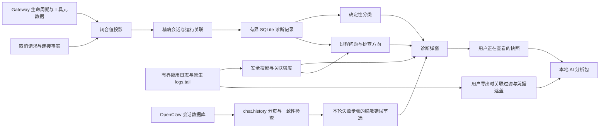

# 会话诊断

标题栏“AI 引擎启动失败 → 查看原因”使用独立的引擎失败诊断，按启动时间与进程身份采集 Main/Gateway 日志，不读取会话历史、不创建本页的会话诊断快照。采集与复制范围见[引擎失败诊断](../../architecture/05-agent-engine.md#按需采集引擎失败诊断)。两者复用日志安全扫描与凭据遮盖，但不共享运行归属或结论。

会话列表右键 →「诊断」查看最新或历史一轮的本地运行证据。该操作不切换聊天、不发送模型消息、不启动 Gateway、不运行修复命令，也不上传数据。

打开弹窗、切换运行或刷新时，先显示本地元数据，再并行采集会话历史与日志。
历史完成分页和游标一致性检查后，立即展示已验证的失败步骤与最后回复形状，
不必等待日志扫描；界面说明日志仍在采集，期间禁止导出半成品。日志采集失败
保留已经显示的会话证据与本地快照，之后仍可重试或导出。应用记录中的运行
状态、开始/结束时间单独展示，不将历史 `failed` 状态当成已经查明根因。

## 同一块正文在流式期间连续重复

先区分同一 Content 内文字重复与历史／实时区域各显示一份。两者都可能在原生
历史接管后消失，但不能根据刷新恢复就认定相同根因，也不能据此认定模型重复生成。

同块重复需要核对 Chat 与 Agent 两条流的重叠：例如 Agent 序号 1 已显示 `A`，
Chat 序号 2 的累计快照先显示 `AB`，随后 Agent 合并序号 2、3 的增量只携带
最终序号 3 和 `BC`；如果两者都追加，就会临时显示 `ABBC`。原生连接可因节流和
背压合并增量，缺少起点／文字偏移的最终序号不能用来裁出重叠部分。

Renderer 因此在收到 Agent 正文后保留该来源，忽略同轮非撤回 Chat 增量；没有
Agent 正文时仍使用 Chat 兜底。不能按相同字符串或最长重叠直接删字，真实模型
可能有意重复表达。原生空替换撤回、终态和历史接管继续生效。故障机器的具体归因
仍需其版本与同轮事件顺序；摘要日志省略的增量不能作为未发布的证据。

另一条路径是 Completions 正文预览转为工具前说明：独立 reasoning、content 内嵌
`<think>…</think>` 的旧格式和普通正文都可以先发布
`assistant` 预览，在工具参数开始流入后将同一段归类为 commentary，并发布
`item(kind=preamble, phase=update)`。如果只在 `message_end` 撤回预览，两份内容会在
工具参数生成期间并存，结束时突然恢复一份。参数较长时，这个窗口可能持续数十秒。
029 为这两条通路补充同源 `assistantTextScope.id`，Renderer 在收到非空 commentary
时原子隐藏同 scope 的预览；保留底层正文以承接 Gateway 的 delta-only 续写。
真实 message_end 的空 assistant 替换继续清理原生 Chat buffer。
身份从实际 source message 捕获，不能从当前消息指针、run 序号或相同文字猜测。
无网络语义回归覆盖真实 transport → subscriber → Renderer 每一步，并在工具参数
尚未结束时检查只保留一份。日志中的 `item` 类别本身不证明它是 preamble，需要结合
原生控制流或带 kind、itemId、replace 的事件记录核对。

还需检查临时工具回滚：模型可能先流出工具参数，最终却以 `stop` 结束，原生会
移除临时工具及 commentary signature，正文恢复为普通回答。已发布的 preamble
必须按同一原生消息的完整完成事实协调；只清正文预览或只查最终 `final_answer` ID 都
不充分。029 只在真正 message_end 附上仍保留的 commentary IDs，Renderer 隐藏该 scope
已失效的 preamble，并恢复实际收到的最终正文；只含 metadata 的超限快照不能把旧预览
提升为最终答案。重连优先回放原生 keyed snapshots，避免再追加 run 累计的 text。
不同消息中的同文说明和合法 commentary／final 混合消息继续保留。

### Chat 兜底先到时的正文交接

2026-10-21 的关联日志已确认一种应用交接缺口：原生 Chat `sourceSeq=256` 先发布
`XML`，随后到达 Thinking 255，最后是同源 Agent assistant 256。旧 Renderer 把 Chat
兜底放在猜测的位置 254；Thinking 将其封段，Agent 另建有 scope 的正文。后续正文
转为 commentary 时只隐藏了后一块，旧 `XML` 直到 message_end 的 Chat 空替换才消失。
Main 与 Renderer 接收及归约记录共同证明了这个顺序，不能归因于模型重复生成。

兜底保留真实覆盖水位用于定位，较早 Thinking 不再切开该正文。Chat 水位可能来自
Tool/item flush，不能当成正文身份。两路正文分别累积，完整原生基线追上后一次交接；
较短 Agent 快照不能截断已显示预览，delta 也不能拼到 Chat 全量文本后。

首帧缺基线或 flush 水位先行时，前台／后台／侧聊通过认证历史接口恢复精确 owner
的完整 keyed 快照，并校验请求开始时的覆盖水位和完整会话代次。读取失败、过期
响应或只有身份的快照保留预览，不猜测补字。回归覆盖多包先行、合并增量、空首帧、
commentary 先行和撤回；不包含原始用户日志或工具参数。临时正文/DOM详细抓取日志
已移除，日常诊断继续使用现有可选时间线跟踪。

## 029 逐项审查：原生缺陷、能力扩展与应用适配

本节对应锁定的 OpenClaw 2026.10.4。保留前提是：独立 reasoning 后的公开正文仍需
及时展示，真实消息阶段和持久回复由原生决定，并支持切换／重连及历史接管。
“保留”表示满足这些产品要求时有必要，不表示原生所有调用方式都必须打补丁。

### 已独立复现的原生问题

真实 pristine transport 和 pristine subscriber 的内存 SSE 对照：先收到独立 reasoning、
正文 `Checking.`、未完成的 `tool_calls`，最后收到 `finish_reason: stop`。原生主动
回滚工具及临时 text signature；最终消息已无工具和 commentary signature，但事件流先发布带独立 owner
的同文 preamble，再发布 assistant 正文，没有撤回或共同消息归属事实。只使用原生
事件的当前消费者仍显示两份。这是**临时 commentary 回滚的事件一致性缺口**，
并非 SSE 重复生成，也不是整个 reasoning parser 都有缺陷。

对应正式用例为 `reasoning-completions-semantic.test.ts` 的
`audits unpatched subscriber behavior when stop rolls back a provisional tool`。
该对照对 transport/subscriber 均不应用 transform；使用已打补丁产物时明确跳过，
不能把跳过或 patched-only 结果当作原版证据。

仅对 `structuredTextStreaming: true` 发布源事实会漏掉旧格式：内嵌 `<think>` 已由原生
parser 分离，但不会进入独立 reasoning 的准入分支；同源 assistant/preamble 仍会
被当成两条独立正文。新增纯 inline 的 pristine 对照稳定复现两份同文。现在每条
Completions 消息均携带原生消息身份及实际完成事实，Renderer 复用已有交接逻辑。
身份与流式能力分开，不据此解除显式 strict、提前发送 durable 回复或暴露私有内容。
原版延后公开正文、缺少新的 scope 字段、恢复接口仅提供累计文字，分别是保守策略
或接口能力限制，不能因与产品需求不同就一概称为上游 bug。

### 保留项及删除后果

| 改动 | 分类 | 当前保留理由与反例 |
| --- | --- | --- |
| `beginReasoning` 不自动进入 strict；同包公开内容走 `pushVisible` | 流式能力扩展 | 原生 `push` 自带 strict，subscriber 又依据 `textPhaseRequiresTerminal` 拒绝提前正文；只改 Renderer 不能释放尚未发布的内容。独立和同包 reasoning/content 用例证明需同时打通。 |
| `structuredRecoveryMode`、孤立关闭标签处理、未闭合标签 EOF 保护 | 扩展的安全配套 | 取消整段缓冲后必须继续隐藏私有标签，不能在 EOF 恢复未闭合 reasoning，也不能追溯隐藏已发布正文。Markdown 代码中的字面标签及显式 strict 保持原规则。 |
| 非终态 flush 暂存 pending syntax，实际终态才完整 flush | 扩展的安全配套 | reasoning／tool 事件会触发中间 flush；把拆成两包的 `<think>` 当 EOF 处理会破坏标签归属。真实 native 拆包及同包 stop/tool 用例覆盖。 |
| subscriber 只准入带标记的预览，同时维持 durable partial/block 门禁 | 流式能力扩展 | 可以先显示，但尚未确定 commentary/final 的正文不能提前变成持久回复；删除任一半会失去流式或提前交付不确定正文。 |
| commentary-only `message_end` 的空 assistant replacement | 原生预览的应用侧缓冲适配 | 结构化扩展或普通流式的预览都可能进入原生 Chat buffer；只在 Renderer 隐藏仍会让 Chat 终态兜底包含旧预览。只清对应 assistant，不清独立 Thinking/Tool/preamble。 |
| transport 消息 UUID；具体 source message 透传；assistant/preamble 同源 scope | 应用展示协议扩展 | 两类原生 owner 使用不同身份，回滚还会删除 signature，不能靠同文、run 顺序或回调后的当前消息猜归属。共用 commentary 分支不能仅按局部 Responses 变量假定其他路径不可达。 |
| 真正 `message_end` 的 retained commentary IDs，正文未变也投递 | 原生回滚缺口的应用侧适配 | Renderer 按同一 scope 隐藏失效旁白；缺失集合为未知，`[]` 才证明没有保留项。`text_end` 和内部 `finalMessage` flush 都不等于消息完成，合法 mixed commentary/final 必须保留。 |
| 真正完成投递使用完整 `replace:true` 正文 | 我们的历史／live 适配 | 历史可能已补入 prefix 或 suffix；再追加终态 delta 会丢后缀或重复后缀。Gateway 的 delta 压缩本身没有失效，只是当前应用无法从被历史改写的基线安全追加。 |
| 原生现有有界快照保留 keyed assistant 和 preamble scope | 重连能力扩展 | run 累计 `text` 无法分离已转旁白的预览；只恢复 scope 消息又会丢掉后续普通模型的正文。用原生 itemId 恢复各 owner，未知／无正文来源保持原有规则。 |
| 同 owner 修订继承 scope；超限仅保留身份／完成事实；整 scope 淘汰 | 新快照协议的安全配套 | 避免空修订丢归属、预算截断后旧旁白复活，或只淘汰关联记录的一半。维持原有条数、字节、冻结和顺序限制，不另建 transcript 权威。 |
| Renderer scope 归约、完成事实 Map、隐藏标记与真实正文恢复 | 我们的展示适配 | 即时交接和回滚在软件侧完成；隐藏时保留正文前缀以承接 delta，metadata-only 完成不能把旧预览提升成最终答案。Map 只存活动 turn 的身份／序号，不存第二份正文。 |
| 展示层、浏览器 project/finish、side-chat 内容收集与截断补全都过滤隐藏项；clone 复制 Map | 我们的展示适配 | 这些读者不全部经过桌面 `projectTurnItems`；漏一处就会重新暴露旧预览。侧聊快照也不能与活动 turn 共用可变归属集合。 |
| controller 回放 owned 快照后跳过累计 `text` | 我们的恢复适配 | 否则已恢复的旁白／正文会再被累计 buffer 追加一次。只有序号的旧 assistant marker 仍使用原有 text 兜底，不把无正文当成已恢复。 |
| 精确 AST 形态、当前形态幂等、拒绝历史／部分形态及源码／bundle 原子校验 | 构建保护 | 属于仓库补丁契约，不是业务 bug 修复；防止锁定版本或构建绑定变化后静默误改。公共工具不是 029 专有实现。 |

### 删除项及依据

- 删除 `beginReasoning` 条件中的 `streamStructuredText ||`，保留原生
  `!hasFollowingVisibleText || !hasPendingSyntax()` 条件及精确校验。消融后真实 native
  语义用例仍通过；`Interim. <thi` 后同包出现 reasoning 与剩余标签时，旧 override
  会额外强制封段并改变 phase。新增回归确保不再强制这个分类，同时仍不暴露私有文字。
- 删除 `assistantTextSnapshotTruncated`。它没有生产读者；已有 snapshot marker、
  itemId/scope 和缺失的 text 足够表达预算退化，不能恢复旧正文的规则继续生效。
- 原生发布回执扩展、FIFO／批量发布方法及逐条 preamble 撤回队列已删除。
  最终方案只传递源事实，软件侧负责显示决策，不恢复这些中间实现。

安全边界、普通流式、合法同文、mixed phase、回滚、历史补载、metadata-only 超限、
独立 owner 恢复及取消／失败的用例共同构成保留依据，不能仅凭测试总数判断必要性。
取消提前展示需求可以整体撤掉扩展和配套，但单独删其身份或安全保护会留下不完整协议。
上游补齐公开增量、共同消息归属、真实完成依据和 keyed recovery 后，重新验证并移除
对应原生部分；应用展示职责继续留在 Renderer。

## 正文在结束时集中出现

先对照完整原生 JSON 日志中的 Agent `thinking`、`assistant` 和 `usage` 事件，
再判断问题属于模型服务、运行时适配还是 Renderer。控制台捕获会合并流事件，
不能凭捕获文件中缺少增量就断言运行时没有发布。

2026-10-17 在锁定的 pristine OpenClaw 2026.10.4 npm 产物上，可通过以下纯本地探针
复现 Chat Completions 的正文缓冲，不启动 Gateway、不读用户状态、不调用模型服务：

```powershell
node tests/openclaw/runtime/completions-stream-latency.native-smoke.mjs --runtime-dir '<pristine-runtime>' --expect-buffered
node tests/openclaw/runtime/completions-stream-latency.native-smoke.mjs --expect-streaming
```

探针通过 scoped AI host 在内存中分时发送两段 SSE 正文，不发起任何真实网络请求。
没有 reasoning 时，正文在各自
到达时透出；先发送 `reasoning_content` 时，运行时将正文留至 terminal 后合并透出，
并标记 `openclawDelivery.textPhaseRequiresTerminal`。原生 Agent 订阅层还会依据该标记
抑制提前正文。因此，删除 Renderer 播放队列或放行连续 Chat 快照无法释放这部分文本。
当前 029 补丁按原生归一后的 thinking/text 通道提供可替换的实时 Agent 预览，
不判断模型名、厂商或 endpoint。独立 reasoning 字段及类型化 thinking 保留私有通道；
公开正文继续通过原生 Markdown/tag 解析。专用 structured 恢复模式保证未闭合的
思考标签不会在成功结束、工具 flush、失败或取消时恢复成正文，显式 strict 保持
原生整轮缓冲。正文仍需原生终态确定 final/commentary，失败或被归为 commentary
的预览会按原 message/item 身份撤回，不提前触发持久回复。
范围、原生接口不足的证据与移除条件见[补丁总账](../../../scripts/patches/v2026.10.4/README.md)。
探针输出仅有相对耗时、事件类别和字符数，没有真实请求、凭据或用户正文。

升级运行时后应重新运行探针，不能把当前产物行为当作所有模型、协议或版本的结论。
正文展示前的根因仍需原始模型 SSE 才能进一步区分；原生 Agent 日志只能证明
Gateway 发布的时间，不能证明模型服务何时产生了正文。关闭页面的思考展示与停止
模型生成 reasoning 是不同设置，不能以隐藏 thinking 作为解决该缓冲的依据。

## 用户操作

首屏只突出「本轮结束原因」「判断依据」「建议下一步」，并区分记录已确认、
根据现有记录判断及还需补充记录。结束不使用任务成功的绿色状态；thinking-only
和空回复按异常突出显示。记录缺失在首屏提醒，不因折叠统计而隐藏。
运行时间、应用保存的状态和扫描统计默认折叠；日志明细、时间线、环境和原始
技术字段继续按需展开。复制摘要与首屏结论一致，不再追加相矛盾的泛化结束原因。

### 为什么任务突然停止

先使用数据库已有历史判断，不以安装新运行时补丁为前提。若完整扫描找到精确关联
本轮的最后回复，正文非空、结束标记为 `stop/end_turn`、无工具调用且未明确要求
继续生成，可显示「模型主动结束了回复，没有请求调用工具」。这是模型回复的
结束决定，不虚构系统队列或循环分支；仅时间窗口关联、截断、静默终态或
`endTurn:false` 不使用该判断。只有 thinking、空回复和错误继续走各自诊断。

033 循环退出观测补丁已移除。诊断只采用原生 lifecycle 的 executionSettled、
stopReason、errorObservation、timeoutPhase 和 terminalReply.disposition，以及
通过 Gateway 临时采集的有限历史证据。不反推工具队列为空、内部 policy_stop 或
handoff 分支；没有最终回复观察时，明确说明结束原因证据不足。模型正常结束标记
仍只是回复结束决定，不代表用户任务已经完成。

报告首屏单独展示停止原因、判断依据和下一步建议。整轮生命周期仍决定超时、
取消、被替换、等待或正常终止；正常终止不等于模型交付了可用结果。
在已结束的一轮中，通过 `chat.history` 只投影最后一次可关联 assistant 回复的
内容种类（thinking、正文、工具调用、其他）、结束原因和完整性，识别仅 thinking
或空回复。正文及思考文本不保留。该观察不能证明模型部署配置的具体根因，
时间窗口关联也不能等同于精确运行关联。扫描不完整、同时间戳顺序不明、未知截断
或仍在运行时，不据此断言停止原因。原生 `display-cap` 仅截短各块文本，可用于
内容种类判断；`oversized` 和可能丢块的流式片段截断不能用于空回复判断。

原生终态的 `terminalReply.disposition` 只保留闭合类别，防止展示历史隐藏静默回复
后误用更早的一次尝试。超时保留原生 `timeoutPhase`，区分排队、准备、模型响应、
回复后处理及 Gateway 退出阶段。输出长度限制与 thinking-only 可同时展示。
日志识别原生 reasoning-only/empty/incomplete 重试提示，以及
`model_fallback_decision` 的闭合结果码和 `chain_exhausted`；只有精确关联运行的
耗尽记录能作为停止线索，已恢复的重试和仅时间窗口相关的日志不覆盖终态结论。

复制摘要和 ZIP 使用同一停止判断。回复形状仅在短期报告和导出中存在；持久事件
仅新增超时阶段、空回复类别及终态回复类别，不增加消息缓存或数据库 schema。
建议帮助用户检查输出预算、推理设置、聊天模板、模型接口适配和工具调用能力；
证据不足时明确显示无法确认，不把所有停止都归咎于模型。

### 工具调用格式纠正

格式纠正进度只表示原生已安排一次新的模型生成，不证明原工具执行成功或整轮完成。
诊断解释须区分“当前被拒绝批次没有派发”和“此前操作已结算”；存在此前工具时，
不能将“本次未执行”扩大为“本轮所有操作均未执行”。中间 assistant error 和恢复次数
耗尽均不替代带 `executionSettled: true` 的整轮终态。

同一响应的 commentary 可以按原消息/分段身份保留，恢复成功或历史接管不重播正文。
只有当前原生生产者的完整流/整批拒绝事实能够授予恢复，历史错误文案、工具块被移除、
provider response ID 或服务器汇总的 finish_reason 都不能单独证明该事实。
导出继续使用有界闭合原因和次数，不新增原始参数、命令、thinking 或认证材料。
当前验收限制见[恢复方案](../../plans/tool-call-format-recovery-plan.md)。

具体格式反馈只保留有界的固定类别和数值：最多检查 16 个调用、保留 3 个问题，
共享 16 Ki UTF-16 诊断扫描预算；反馈 JSON 上限 2 KiB、附加提示上限 3 KiB。
超限时省略诊断并标记 omitted，不截成无效 JSON，也不猜测未检查调用有错。
原参数、命令、工具名及解析异常全文不进入这条反馈。

JSON/对象格式拒绝现在与 schema 拒绝一样，在当前原生 Agent 循环内反馈给模型；
两者保留各自的校验与派发语义。隐藏 custom 反馈不能成为新的用户发送或恢复授权，
具体适配和混合错误验收见[当前修复记录](../../plans/tool-call-format-feedback-plan.md#18-schema-后出现坏-json-的原生循环修复)。

纠正期间遇到其它模型错误，最终必须呈现最近一次模型生成的原生脱敏原因，
如无法连接模型服务或服务过载，不能以最初的工具格式错误覆盖，也不能静默报成功。
继续沿用原生 SDK 的错误字段长度限制和公开 errorDetail 白名单；
过长服务端正文经脱敏和摘要处理，不另建原文投递通道。
错误与精确 run/session 的 executionSettled 整轮终态对应，
未恢复时保留 error，并且不因出现新错误再开启一组格式纠正或重放已经完成的操作。

已接管格式恢复链的普通错误，在原生 dispatch 发布摘要时读取当前结果自有的、
已经脱敏的 terminal diagnostic，再由 Runtime Services 投影为 JSON 编码后最多 2 KiB
的摘要；`agent.wait` / plugin `waitForRun` 和 Swarm 节点沿用这一错误，不增加原因缓存。
缺少该诊断、普通非恢复链、incognito、取消及超时仍沿用原生协议，异常抛出路径不变。
此接线不改变整轮终态、重试额度或工具派发；修复前发现及独立产物验收见
[假模型实测](../../plans/tool-call-format-feedback-plan.md#16-假模型驱动的真实-gateway-验证)及其后续修复记录。

### OpenClaw 2026.10.4 接口适配

2026.10.4 的完整历史页返回消息本身，游标 delta 返回 `session.message` 包装。
诊断对 delta 逐条核对精确 `sessionKey`，解包 `message`，补入原生 `messageId`
与运行标识后，再与同页 activity 对照。包装与消息内的身份冲突时丢弃整次
历史证据；包装损坏显示读取不完整，不能把跳过所有消息称为扫描完成。

原生按字节预算分页可能重放边界记录。最后回复观察按原生消息 ID 与
transcriptPosition 来源去重、替换边界观察，不将同一条回复的重放当作时间冲突。
同时间戳的不同回复或缺少可靠身份的回复仍保留不确定性，不能仅凭时间排序
确认最后回复。计数仍是检查过的分页记录数，不承诺为去重后的消息总数。

历史与日志各自完成后才合并成最终快照。提前历史通知绑定原请求的 snapshotId、
窗口 owner、会话和原生绑定；切换运行、关闭窗口或取消后不接收迟到通知。
日志结束时再次核对绑定，发生变化就撤销提前历史结果。并行任务全部收尾前
继续占用扫描并发额度并固定快照，不能在其中一项结束后提前释放。

### 已保存用户轮次的准入错误

`Persisted user turn changed before replay admission` 来自原生已持久化用户轮次的准入，
不是 Renderer 或模型生成的错误文案。每次普通 durable attempt 准备时，只要具备原生
target、带 idempotencyKey 的 prepared user 和 recorder，便会探测同一轮是否已经保存；
并非只有用户点击重试或 Gateway 重启后才调用。第一次取得 witness 后，核心执行前
还会重新读取并核对；没有初始 witness 时通常继续普通追加，但探测期间的版本竞争仍可报错。

当前锁定 2026.10.4 的源码及 Windows x64 产物保留三个同文案抛错点：

| 位置 | 精确拒绝条件 |
| --- | --- |
| `session-accessor.sqlite-current-turn.ts` 的 current-turn reader | 当前 generation、rawSeq 或 updatedAt 与准备快照不一致。rawSeq 来自 transcript 事件最大序号，updatedAt 是 transcript 更新时间。 |
| `pre-persisted-user-turn.ts` 的第二次 readCurrentTurn | 无法重新找到匹配 user 的 witness，或 entryId / generation 不再匹配初始 anchor。 |
| 同文件的 assertPreparedCurrentTurn | 已有 witness 后又回到 row 缺失、initialWriter 尚未提交且 transcript header 不存在的狭窄防御状态。普通 session/lifecycle/writer 失配通常先抛另一句 writer claim 错误。 |

有源码和原生测试支撑的候选包括：异步快照与 entry 读取之间发生 transcript 追加；
准备后有新输入实际占据当前轮次（包括不进模型上下文的隐藏 user）；已出现 final、
reset、分支替换或历史重写；或导航碰到不能安全越过的未知 custom / 其它 run 活动。
比较的是完整持久消息及身份，不只是屏幕上的文字。上述条件是可能路径，不证明
某次故障发生了哪一种，也不能直接说明数据库损坏。

正常的同轮中断尾部、已知 runtime/system update、metadata 和 compaction 有各自的
受限导航规则。原生测试覆盖正常重复重启、pre-core compaction、成功 admit 后的内部
重试及压缩；通常的 transient retry / overflow 会转为 internal prompt，并跳过原始
prepared user。当前 030 工具格式纠正在同一个 native Agent loop 内进行，已删除旧的
outer-attempt retry。不能仅凭故障前有压缩、模型重试或格式纠正就把它们定为根因。
网络错误、模型 HTTP 错误、电脑慢和系统时钟变化也不是上述三个拒绝条件；它们可能
影响准备流程或扩大时间窗口，仍需证实对应的历史或身份变化。

排查应取得故障机器的应用版本、当时已加载 Gateway 身份、精确 run/session 与失败时间，
并核对前后输入消费、attempt、retry、compaction、reset/分支及重启事件。现有 lane 和
Embedded agent 错误日志通常只写消息摘要，不保证记录栈或 expected/current 版本值；
因此诊断包也未必能区分三个位置，更不能从缺少记录推导没有写入。
证据不足时需要可控复现，或在锁定运行时的准确边界增加不含正文的受限诊断。
保留原生身份与恢复保护，不能通过自动重发或放宽检查来消除提示，避免再次执行已消费的旧请求。

公开 `run-failed-before-reply` 回执在聊天中使用现有红色错误头像及错误行，
不再进入未知 `custom` 角色的问号头像兜底。回执不替代整轮 lifecycle 的终态依据。

### 既有活动结果与失败回执契约

本次按本地 `../openclaw` 的 `2026.9.8` 源码核对，确认两类漏诊来源：

1. `chat-display-projection.canvas.ts` 的 `projectToolResultDetails` 会移除原始执行
   `status`、`exitCode` 等字段；`chat-history-response-page.ts` 在独立的 `activity`
   字段返回裁剪前生成的活动结果。仅检查 `messages[].isError/details` 会漏掉
   失败命令和审批阻止。诊断现在保留分页及 delta 响应的 `activity`，同时匹配
   `__openclaw.id` 与 `toolCallId`，只采纳终态 `failed/blocked`；正常、跳过或
   无法关联的活动不生成异常。不会复制活动标题、参数、命令或审批标识。
2. `sessions/session-run-error.ts` 会保存 `customType: run-failed-before-reply`
   的原生失败回执。该记录不属于 assistant/toolResult，旧扫描会跳过。现在提取
   回执的公开失败正文与闭合的 `state_contention` 类别，不读取私有数据库或
   原始报告字段，也不据此替代整轮 lifecycle 的权威结论。

失败步骤显示证据来源、失败/被阻止/中断、脱敏节选和下一步建议。建议优先匹配
闭合机器错误码，再从已确认失败的节选中识别认证、限流、额度、上下文、网络、
证书、权限和存储线索；文本匹配明确标注为推测，不据普通聊天关键词生成故障。
模型中断不一概归为模型服务失败；原生状态争用使用专门建议。步骤失败不说明
整轮失败，也不保证故障尚未被后续重试恢复。复制摘要使用同一建议逻辑，ZIP
保留来源、状态和扫描缺口供后续分析。

扫描不可用/不完整时分别解释离线、缺少运行记录、缺少原生绑定、取消、请求
超时、读取/格式失败、分页上限和历史变化。取消会立即结束本地等待；上游 RPC
可能继续完成，但迟到结果不会进入报告。所有错误正文仍仅在短期快照中存在。

### 原生诊断能力的取舍

OpenClaw 的 `diagnose-gateway` 将配置、服务、凭据和通道检查分开，并要求证据
支撑与后续验证，这一方式适合定位环境问题；其中普通 `doctor` 可能执行迁移，
因此会话右键诊断不启动 CLI 或自动修复。这里借鉴“观察 → 依据 → 下一步”的
呈现方式，保留用户自行确认和验证的边界。

`diagnostics.stability` 的内存快照会裁掉会话/运行身份，无法精确定位某个会话。
在线环境现在读取最多 1000 条原生保留记录，展示模型错误、工具错误、被阻止
工具、失败命令、会话卡住和运行服务响应异常的闭合分类计数，以及实际样本时间
范围和丢失数量。长时间执行或正常忙碌不自动判为卡住。分类可对应同一次故障，
不相加解释为独立失败次数；服务重启会清空样本，空样本也不证明健康。这些统计
只存在于环境区及导出环境字段，不加入本轮问题卡片或生命周期结论。

会话诊断不依赖额外运行时观测补丁，不引入全局诊断订阅、原始消息缓存或数据库迁移；
日志证据和整轮终态判定继续保持各自的权威边界。

诊断同时通过已连接 Gateway 的 `chat.history` 分页扫描 OpenClaw 会话数据库。
Main 从会话记录解析原生绑定；显式 `nativeSessionKey` 优先，否则按该会话的助手身份生成托管 key，
不能默认读取 main 的同名会话。绑定缺失时不发起历史读取，采集期间绑定变化则丢弃旧节选。
逐页提取工具失败结果（含嵌套 toolResult、非零退出码）及模型错误，排除正常输出、
用户消息和不同运行标识。没有运行标识时仅按所选轮次的严格时间范围关联，并在卡片中说明。
界面显示工具名、时间及脱敏错误正文；复制摘要和 ZIP 的 `session-evidence.json` 也包含这些节选。
每次最多读取 100 页、每页 200 条，保留 40 条失败节选，每条 1600 字符；限制和读取失败
显示为扫描不完整。使用原生 delta cursor 检查扫描期间重置，发生变化则丢弃节选。
不直接访问数据库文件、不启动离线 Gateway、不把历史正文写入 SQLite 或会话缓存；
节选仅随短期诊断快照存在。离线显示历史不可用，不把“没读到”说成“没有问题”。

- 「刷新本地记录」读取最新已采集证据。历史运行按 20 条分页。
- 「采集在线环境」仅使用已连接的 Gateway，3 秒超时；采集全局 stability 数量与丢失计数，不将它们当成当前会话根因。
- 「采集日志证据」读取本软件 Main/Cowork 日志、运行服务输出，并通过已连接的 OpenClaw `logs.tail` 读取原生日志。生成新的可预览快照，分别显示来源缺失、截断、丢弃、解析失败与关联级别。离线仍可采集本地来源。
- 「复制摘要」复制结论、采集时间与完整性，不复制会话标题或技术标识。
- 「导出诊断包」使用原生保存对话框，基于当前所选运行重新读取日志，导出该运行的元数据与脱敏日志正文。快照过期须刷新，不能静默导出另一轮。取消保存不会读取原文。

键盘 ContextMenu/Shift+F10 可打开菜单；弹窗支持 Escape、Tab 焦点约束与关闭返回。正在运行、失败和离线会话都可以打开。

## 证据解释



只有带 `executionSettled: true` 的外层 lifecycle end/error 才确定整轮执行结果。attempt finishing/error、工具失败和 chat final 单独保留，不能推导任务完成。正常结束仅表示本轮结束；异常终态冲突显示无法确认。

用户取消必须存在匹配 run 的用户请求及原生中止终态；取消 RPC 返回仅表示请求处理结果。未知来源的 aborted 不标成用户停止。断连说明连接丢失，不证明后台执行已经停止。

`chat aborted` 是回复中止观察，可能先于后台执行释放，单独出现时显示「尚未确认整轮执行结束」。原生终态中的超时、失败或中止优先于同时携带的 `yielded` 标记，避免把中断误判为等待。

使用 `sessionKey`/活动 run 映射与 SQLite rootRunId/clientTurnId 精确关联，不能将未知事件附到最新运行。先到 chat final 后到带会话键的 lifecycle 可补充原因，且不会重新激活会话。复制/fork 的计时不复制诊断证据。

## 存储、隐私和边界

每轮最多 200 条普通记录加 32 条取消/终态记录，单条最多 2 KiB；全局最多 20,000 条事件、14 天。独立 coverage 表保存被裁剪计数，随产品运行删除级联清理，不删除原有计时记录。未关联元数据队列最多 100 条、30 秒；其丢失数量标为当前进程的全局采集缺口，不能归因到某个会话。

持久诊断事件与本地日志安全投影不保存正文、思考、工具名/参数/输出、任意错误文本、配置或凭据。按需 chat.history 产生的短期失败节选另按下文所述范围保存，不能与持久事件混为一谈。原因和错误类别使用有限枚举；未知值回退 unknown。技术视图只包含这一安全投影与身份标识。元数据导出时身份标识进一步替换为包内别名，并再次验证所有枚举值；额外日志正文保留关联标识用于排查。

ZIP 包含 `summary.md`、`report.json`、`manifest.json`、`ai-analysis.md`、有限字段投影 `logs.json`，以及 `logs/main.log`、`logs/cowork.log`、`logs/gateway.log`、`logs/native.log` 四份可读日志正文。日志在选择保存位置后重新扫描，保留错误原文、堆栈与普通上下文；按运行/会话身份或前后两分钟窗口筛选，已知其他运行的记录排除。正文不经过预览的 400 条分类/采样限制，每来源最多 2 MiB，超限省略记录数写入 `exportedLogCoverage`；扫描及解析缺口仍在 `logCoverage` 中报告。空文件不代表没有故障。常见凭据尽力遮盖，但任务正文、路径和关联标识可能保留，界面提示分享前检查。只读既有日志，不读 transcript 文件；这四份日志原文不进入 SQLite、Main 快照或 Renderer，只在本地导出内存与目标 ZIP 中存在；通过 chat.history 读取的脱敏失败节选仍可在短期报告中展示。manifest 区分日志原文与元数据别名，并附下述采集环境身份。Main 中快照最多 8 份，每份 512 KiB、5 分钟，绑定窗口、会话和运行。导出重入受限，ZIP 写入有 30 秒超时；完整临时 ZIP 写完并重新校验快照后才发布目标文件，失败不会删除原目标。

`report.json` 和 `manifest.json` 的 `runtimeInfo` 仅表示采集时环境，明确标为
`scope: collection_environment`，不归因到所选历史运行。Gateway 版本、协议版本
和有限构建哈希来自当前已认证连接的 `hello-ok`；断连清空握手身份，连接在
采集期间变化则标为 changed，不用应用声明版本替代。`nativeRuntimeVersion`
仅在当前连接握手提供有效版本时填入，其他情况继续为 `not_collected`。

`installedArtifact` 单独记录 Main 所管理 runtime 根目录中当前安装产物的版本、
patch-set、build-recipe 和 gateway.asar SHA-256。仅读取有界的
`runtime-build-info.json`，缺失、损坏、超时或取消不影响诊断其余结果；不运行 CLI、
启动 Gateway 或遍历产物。该元数据不是重新验签的证明，也不能证明磁盘产物与
已经载入的 Gateway 完全相同；二者版本可以不同。导出再次验证版本与哈希格式，
不包含路径、连接/启动标识、认证、原始握手或构建元数据。历史环境尚未记录时
必须保持未知，不从当前环境回填。

日志采集不改变生命周期结论。结构化字段与目标运行完整匹配时标记 `run`，会话字段匹配标记 `session`，仅时间相关标记 `time_window`；会话级或全局异常不能证明本轮故障。任意文本只可推导有限类别提示，并标记 `inferred`，不把日志错误原文、凭据、文件路径或聊天内容带入日志预览快照；原生历史失败节选按上文的单独约束处理。未知文本在预览中省略，但用户导出时的日志正文保留，常见凭据遮盖。

本地日志使用 256 KiB 缓冲区逐块读取所有发现文件的完整捕获大小，不按文件尾部、总字节数、文件数或总扫描耗时截断。Main 包括目录中仍保留的每日与轮转日志，Cowork 包括当前及 `.old`，运行服务输出扫描完整 `gateway.log`。每个文件打开时固定大小，新增内容留待刷新，避免持续写入导致扫描永不结束。每块读取后让出事件循环；单次 I/O 超时 30 秒，支持取消、进度和窗口关闭清理。大小变化/替换、缺失、权限、超时分别记录缺口，不能将部分扫描标为完成。OS 中已经发起的 I/O 无法保证立即取消；迟到结果不发布，句柄在操作返回后关闭。

原生 `logs.tail` 会将旧游标快进到最新尾部，不能作为历史分页接口。本软件只信任当前已连接本地运行服务 RPC 返回的结构化 `file` 来源，不读取日志正文中的路径或接受 Renderer 路径。通过常规文件、无符号链接/目录联接和句柄身份校验后，扫描该文件；默认 `openclaw-YYYY-MM-DD.log` 来源枚举同目录同命名族的所有保留日文件。自定义文件名仅扫描精确来源，不推测其他文件。原生路径不可用时保留 1000 行/512 KiB 有界 RPC 尾部并明确标记扫描未完成；离线不启动服务或猜测临时目录。

单记录解析上限 64 KiB，跨块 UTF-8 与多行记录在有界缓冲中拼接；超大/损坏记录显式计入解析缺口。每来源预览最多 100 条、合计最多 400 条，达到容量后仍继续扫描、匹配并累计闭合类别 `signalCounts` 和 `matched`，输出省略计入 `outputOmitted`；按错误级别、关联强度与类别优先保留线索。`scanComplete` 仅指所有发现文件的捕获内容已扫描，不保证已被删除的历史或未写入的事件存在，也不表示没有解析缺口。导出包含同一覆盖状态和统计，AI 不得把 Main/服务的重复记录相加当成独立重试。

缺少时区的 Main 时间按采集时本机时区解释，无法确认历史时区变化。并发最多两个扫描任务；扫描中的快照固定并免于过期/容量淘汰，完成后结果有新的五分钟导出有效期。切换运行会取消并等待上一扫描收尾，再启动新扫描，迟到进度和结果不会覆盖当前运行。

已知边界：

- 功能启用前的历史可收集仍被保留的日志提示，但不会自动从提示或消息重建权威运行结论；没有终态证据即说明无法确认。
- 无会话键且活动身份已清理的迟到事件可能无法关联；断连期间的漏收终态不自动从原生历史恢复。
- 本版不查询原生实时运行/审批/子任务状态。历史 start 不能证明当前仍运行，`yielded` 仅解释为让出控制的证据；外部会话/协作入口只能展示已关联的主会话证据。
- 存储完全不可读时返回诊断不可用，不用聊天状态伪造证据。进程级采集失败会在可读报告中提示完整性问题。
- 在线环境采集不刷新本轮证据和本地连接快照；需要最新本地事实时先点击刷新本地记录。UI 分开标明两个采集时间。
- 旧运行的日志可能已经被清理，默认族之外的原生自定义轮转文件不自动猜测；OpenClaw 原生日志离线不可读时明确缺失，不冒充完整采集。Main 日志能反映已有的进程退出/渲染进程崩溃记录，但尚未转发到 Main 的浏览器错误没有全量采集保证。
- 原生日志的写入与保留由 OpenClaw 负责；本软件确认来源后本地读取。普通采集只保留有限字段投影，用户明确导出时额外保留匹配日志的脱敏正文；已删除、未写入或离线无法发现的日志不能恢复。

## 诊断面板展示

“整轮结果”与“问题与线索”分别展示：即使整轮正常结束，已记录的工具失败、模型错误、超时或断连仍会汇总到统计卡片之前。没有可识别异常时仅显示轻量提示，不声称任务成功或未发生故障。正常结束结论保持紧凑，证据限制默认折叠。

依据展示具体观察（工具结果失败标记、结构化错误类别、原生错误事件、HTTP 状态码或警告/错误文本推断），并展示可用的数值指标，不再只列时间、来源和“结束”。工具记录未保存工具名称与错误详情时，明确说明只能确认失败标记，需按时间回查会话中的工具结果。仅时间相关的日志不能证明当前会话有问题，页面在排查建议之前说明关联限制。同一秒内描述及指标一致的依据合并展示来源和记录数，不解释为独立故障次数；超过五组时折叠其余依据。

日志投影通过闭合 `basis` 枚举保留分类依据，导出时再次验证。普通信息/调试日志中的主题关键词不进入问题汇总；`authentication`、`context window` 等正常配置描述不能单独触发身份认证或上下文超限问题。JSON 的配置对象、工具参数和字段名不作为错误文本扫描。保留结构化错误与 HTTP 错误状态的识别；旧快照中缺少分类依据的信息日志也不提升为问题。

问题汇总由共享纯函数从当前快照的安全事件与日志投影生成，不新增持久缓存。每个类别优先展示最强关联证据：本轮事件、精确运行日志、会话日志、仅时间窗口日志；弱关联记录不升级为本轮根因。依据数量表示记录数，多来源可能重复，不推导独立故障次数或是否已恢复。正常排队、重连及成功工具事件不会单独列为问题；未分类日志仅保留在技术证据，不生成无法解释的警告卡片。本轮明确的错误事件仍保留。复制摘要包含同样的问题与建议，导出 `report.json.findings` 包含闭合类别、关联等级及包内证据别名。

日志投影补充识别 OpenClaw 的 `tool.execution.error`、`tool.execution.blocked`、`model.call.error` 以及 `tool_result_error`、`auth_permanent`、`context_overflow` 等结构化类别。仅当这些字段存在于实际采集到的日志中才能识别，并不意味着订阅了 OpenClaw 的全部内部诊断事件。界面与持久诊断记录仍不保留任意工具参数、模型内容或错误原文；用户导出日志正文的范围见上文。诊断仍不能自动判断答非所问、产物质量或任务目标是否完成，也不会从历史消息重建执行证据。

诊断面板采用可滚动内容区与固定操作栏，分别展示结论、证据统计、四类日志来源、事件时间线和在线环境。结论颜色同时配有图标与文字，未知结果不呈现为成功；扫描完成比例仅说明文件读取覆盖，解析缺口仍单独展示。扫描进度条表示当前文件的读取进度。

日志预览支持“全部”和“错误与警告”筛选，只改变当前展示，不影响采集结果与导出内容。来源覆盖详情和技术字段可折叠，保留全部证据限制说明。布局适配深浅主题和窄窗口，支持键盘焦点循环，并遵循系统减少动态效果设置。

报告首屏只展开有本轮事件或精确运行标识支撑的问题卡片，使用文字、图标及主题适配的颜色区分问题。卡片直接给出一组定位依据和下一步建议；仅会话或时间窗口匹配的日志放入默认折叠的“其他日志线索”，不对当前运行给出修复建议。日志来源、时间线和在线背景统一折叠。没有本轮异常依据时明确显示“尚未定位到具体故障”，不推断任务成功。

后续实时事件额外保留闭合系统错误码、400–599 的 HTTP 状态码及有限非负耗时；仍通过原有有界 JSON 事件存储，不新增表或消息缓存。历史日志识别 `exec.process.completed` 的非零整数退出码与 `timedOut`、模型及工具失败阶段，以及有限的 DNS、连接、权限、文件、数据库和证书错误码。成功调用不因错误关键词或错误码字段转为失败。OpenClaw 的 `httpStatus`、`requestBytes`、`responseBytes` 映射至既有指标。所有新增字符串经闭合枚举验证后才能导出。

本轮事件与同类别的精确运行日志共同保留，避免笼统的失败事件遮掉日志中的具体指标；不将不同类别强行解释为同一次故障。持久诊断事件不记录工具名称、命令正文、错误原文及工具输出，因此不能承诺所有故障均可定位；用户可另外导出日志正文排查。新增实时字段只在上游实际提供时存在，不回填历史记录，也不订阅或启动原生内部诊断流。

原生实时命令详情来自带运行身份的 `agent` / `command_output` 结束事件，而不是 `tool` 结果的假定字段。仅投影 `status`、整数退出码和有限非负耗时为 `command` 事件；命令失败与工具问题合并展示，不再次增加 `toolFailures`。上游没有提供的超时原因不能从耗时或非零退出码猜测。原生内部 `tool.execution.*`、`model.call.*`、`exec.process.completed` 默认属于 stability 内存记录，不保证写入日志；只有实际采集到相应日志时才走日志解析，不能把全局 stability 计数当成本轮定位证据。

显式成功调用保留 `routine` 分类依据，错误级别或附带关键词均不再将其提升为问题；命令 `outcome: failed` 即使缺少退出码也保留失败记录。日志及导出共用指标语义校验：HTTP 状态必须为 100–599 整数，退出码为整数，计数与字节数为非负整数，耗时为有限非负数。页面和复制摘要共享定位格式与处理建议，按机器错误码、命令阶段选择具体检查项；仅错误文本推导的类别明确标为日志提示。

工具结果仅有失败标记时，报告只显示“具体原因未记录”、记录时间和回查会话的指引，不重复列出没有额外信息的“依据”。后续原生工具事件按已知内置名称映射到闭合操作类别（命令、文件读写、浏览器等），不存原名称；`isError: true` 且 `toolErrorSummary` 精确符合上游固定参数校验失败格式时，只保存 `toolValidationFailed: true`，展示“参数不符合要求”及修正参数的建议。任意其他摘要不保留也不据其关键词推断，旧记录不能回填。
