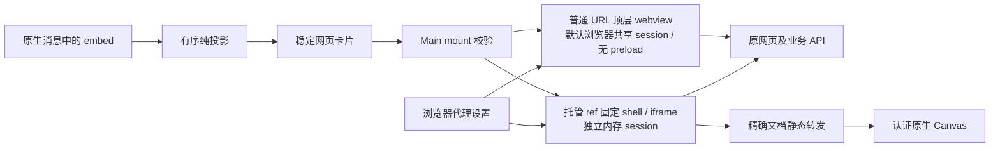

# 消息中的独立网页

桌面聊天将助手消息中的 `[embed ...]` 转为独立网页卡片。它展示已有 HTTP(S) 页面或
当前原生 profile 托管的静态 HTML，不要求 `show_widget`，也不把页面内容自动加入模型上下文。

完整 HTML、交互式 3D、游戏和复杂模拟默认使用本功能；简单自包含卡片与需要草稿桥的
控件使用 Widget。生成页面写入当前 profile 的静态托管目录后引用真实 ref；已有网站
直接引用 URL。两条路径在任务开始时选择，不自动迁移或重放不支持的保存 Widget。
没有专门的视频网站转换或播放器适配。

## 输入与选择

```text
[embed ref="report_2026" title="报告" height="480" /]
[embed url="/__openclaw__/canvas/documents/report_2026/index.html" title="报告" /]
[embed url="https://configured-service.example/report" title="业务页面" /]
```

普通外部 URL 的“设置 → 浏览器 → 内置浏览器设置 → 允许消息内嵌外部网页”默认开启，
对应原生配置 `gateway.controlUi.allowExternalEmbedUrls: true`。显式关闭时显示
不可用卡片并保留普通网页打开入口。开关读取现有原生值，打开设置不写配置；切换立即
通过 `config.get` revision / `config.patch` 条件写入，只修改这一项，不另存产品偏好。
读回原生值及应用状态后更新开关；冲突、断线或未能确认写入时禁用再次修改，用户刷新
读取后再决定，不自动重放写入。引擎未连接时显示不可用与刷新入口，不因查看设置启动
引擎。普通设置保存不覆盖此项，配置同步仅为缺失项补齐开启值，保留显式关闭。
开关作用于后续 mount 准入，
不会重装或撤销已经打开的网页。外链准入通过同一当前连接读取 `config.get` 的有效快照，
与设置页共同遵循原生 JSON5/`$include` 解析，不再直接读取根配置文件。允许正常企业内网地址，
拒绝任意本机端口、应用 origin、Gateway 控制面、元数据服务、文件和危险协议。
托管 ref 无需该外链开关。`file://` 或磁盘路径不是托管入口。

网页卡片的边框、14px 圆角、浅底标题栏与图标按钮参考现有 `show_widget`；浏览器打开、
固定和放大均有文字提示与可访问名称。填满侧栏时去除外层边框与圆角，放大、固定和
代理重试保持同一网页实例，样式复用不改变 Widget 或网页各自的准入规则。

Smart Canvas 的按需 `visualize` skill 负责交付选择。已有 HTTP(S) URL 直接输出消息短码，
没有查询工具或配置预读步骤；Main 在真实 mount 准入时检查当前外链开关和目标地址。
系统提示只将原生 embed 的一行网址限制改为宿主允许的 HTTP(S)，保留其余原生说明，
不添加工具名或查找步骤。已落盘的旧长引导规则按现有退休 ID 机制清除。
插件关闭时桌面渲染历史消息的能力保留。

新页面通过现有已授权 Gateway 本机 exec 精确读取非空 `OPENCLAW_STATE_DIR`，
将文件写入 `<stateDir>/canvas/documents/<fresh-id>/index.html` 及相对资源，再输出真实 ref，
无需 Widget manifest。环境不可读或无法确认是同一宿主时，不猜默认 profile、用户目录
或配置文件父目录，改用可用的 Widget 或真实文件交付。HTML 文件创建成功不等于已显示，
仍需检查实际页面与交互。网页解析、开关与静态文档授权均不依赖辅助工具结果。

## 投影与稳定展示

`pipeline/embed-shortcodes.ts` 在连续助手 text 范围内扫描有序 text/embed 片段；
`embed-presentation.ts` 同时分类短码与结构化 `canvas/render:url`。实时流、完成消息和
原生历史走同一投影。代码块、行内代码、转义、非法和未完成标记保留文字，不从用户、
thinking 或工具日志创建页面。显式 URL 优先；非法 URL 不借 ref 回退。
高度限制为 160–1200；标题/paired fallback 仅作文字；失败时显示备用文字。
Widget 和 MCP App 保留各自准入及精确去重，MCP 描述符不降为普通网页。

`webpage-embed` anchor 给出消息位置，独立 presentation manager 在首次 guest 创建前
捕获原聊天最小上下文和 prepare/release API。通用 `NativePresentationSurface` 持有同一
view；固定、放大、侧栏往返和拆出保留页面及输入，不重载。展示身份不是工具权限。
放大/收起显式通知展示载体更新，卡片内常驻 dialog 通过 top layer 切换，支持 Escape，
无 presentation scope 的窄历史抽屉也能放大；不移动或重建内层 webview。
会话、owner 或连接代次变化撤销旧绑定；不复制 transcript、HTML 或持久网页状态。

普通 URL 有常驻浏览器打开入口；受保护托管文档没有可转交另一浏览器 session 的公开地址，
其打开按钮禁用并解释，可在当前卡片放大或固定。不会泄露内部转发 URL 或原生租约。
普通页面的点击、输入和同页跳转保持原生行为。`target="_blank"` / `window.open` 请求由
Main 拦截，合法 HTTP(S) GET 链接通过精确 mount 的 Main-only 事件交给所属会话现有
侧栏浏览器打开，放大状态先收起，原网页实例和输入不变；不创建页面所有的原生窗口。
只在普通 URL webview
初次创建时允许请求到达拦截器，托管 iframe 仍不允许弹窗。代理未就绪、身份退休、保护
地址或 POST 新窗口请求不分派，不将 POST 重放成 GET。状态桥不能伪造打开链接事件。
初始化事件不作为页面成功凭据；托管 shell 初始化只表示 iframe 已创建。普通 URL 的
主 frame、托管页面的直属业务 frame 加载失败或受保护导航被阻止时显示不可用；普通
导航取消和更深子 frame/资源失败不直接判整个页面失败。

## 承载、网络和静态授权

普通 HTTP(S) URL 直接加载到顶层 webview，不安装网页 preload 或应用桥；加载/代理状态
由 Main 回传原聊天 owner。它使用默认侧栏
浏览器的 `BROWSER_PANEL_PARTITION`，共享 Cookie（包括 HttpOnly）、同源
localStorage/IndexedDB 与站点 worker；首个顶层请求按正常 SameSite Strict/Lax/None 规则
使用当前 Cookie，不复制凭据或放宽 Chromium 限制。
sessionStorage 和页面内存仍按页面隔离；仅在这些位置保存的登录状态不保证跨页可用。
导入、命名 profile 和用户 Chrome 不自动参与共享。

托管 ref 继续为每 mount 创建独立内存 partition，只允许固定不可变
`embed-viewer.html?mount=<UUID>`，装配最小 URL/代理状态/原生失败桥；内层 iframe
开启 scripts/same-origin/forms，不继承默认浏览器登录。两条路径的网页都没有应用、工具、
Gateway、Widget 或草稿桥；Node、弹窗、下载、系统权限和嵌套 webview 关闭，保留
sandbox/contextIsolation/webSecurity。CSP、CORS、mixed content 与 Cookie/SameSite 规则
不变；普通 URL 是顶层页面，X-Frame-Options/frame-ancestors 不阻止该加载，仍约束网站
被其他页面放入 iframe。托管 iframe 继续受相应嵌套策略约束，直接引用 Widget 文档不会
解除原生写入的 CSP。

两条路径都沿用现有 `browserProxy` 队列，缺省系统代理，Widget 存储仍独立。
每个 session 有设置代次和 pending/ready/failed 状态；设置变更先同步暂停新请求，
再应用代理并关闭旧连接，当前代次实际成功才开放。失败不隐式 DIRECT，不重建文档或
重放未知请求。代理重试不重建已加载页面；尚未发起首次请求时，代理就绪后开始一次
目标导航。源站认证不借用代理凭据。普通 URL 释放只销毁自身
页面并撤销准入，不清理共享存储、不注销整个 profile 的代理、不关闭 profile 连接或结束
共享 worker；托管 session 销毁时注销并清理自己的存储。
独立网页按上述代次守门保留原页面，不借用 Widget 权限或替换其恢复方式。

可归属 guest 的页面 URL、跳转、frame、子资源和 WebSocket 使用同一 Main 网络边界。直接路由使用该 session
的 DNS 检查保护地址；只含代理且没有 DIRECT fallback 的路由允许由已配置代理解析本机
无法解析的域名。这些页面请求始终拒绝已知保护地址。远端 DNS 的最终解析受用户配置代理控制；
本地预解析不是 TCP 地址固定，不能将它描述为完整 DNS rebinding 防护。

共享 session 的网络、权限和下载处理器由 Main 单一所有者安装，按精确 guest/mount 身份
分派页面准入，不能用一个 mount 的保护覆盖同 profile 其他页面。无法归属页面的 worker
请求遵循浏览器 profile 的基线网络政策并保留元数据服务防护，不获得 mount、静态转发、
工具或工作区权限；页面释放不能证明共享站点活动或已发请求全部停止。
已登记或退休的内嵌 guest 即使与侧栏同 host、同存储，也不能登记为 browser 工具 target。

托管页面通过 Main 在认证 hello 记录的 `pluginSurfaceUrls.canvas` 租约读取，绑定
实际 client、generation 与 Gateway stateDir。续期只调用已连接 client 的
`plugin.surface.refresh`；不启动 Gateway、不读 transcript 或任意磁盘文件。
每 mount 建独立 loopback origin，入口只覆盖本 document 的 GET/HEAD 相对静态资源，
同时要求 guest session 仅在精确范围注入的随机 Main-only header。入口没有原生 capability。
转发流式、不缓存 HTML、不改脚本/CSP、不代理页面业务 API。响应保留 MIME 与策略头，
拒绝跳转、压缩形状不匹配以及会暴露租约的策略头；不透传上游 Cookie、鉴权、Location
或原始错误。client/profile/mount 退休停止在途传输，不能复用旧入口读其它文档。



## 验证边界

2026-10-27 手动交互检查：隔离 Electron 从真实 surface host 通过 CDP 发送原生输入，确认
普通按钮、输入与同页跳转可用；缺少初始 `allowpopups` 时新窗口链接不产生 Main 回调。
修复后真实点击 `_blank` 链接及 `window.open` 按钮，经产品 Main / Renderer 链路在
合成侧栏 session 打开目标页且保留共享登录。Gateway 与 React 侧栏入口使用 fixture，
未覆盖真实 hao123、完整应用或生产站点。托管页面维持原沙箱。
8 个专项测试文件 122 项、构建及 Main/Renderer 类型检查通过，两位 Agent 独立复审通过。

2026-10-27 清理辅助查询工具与整段系统提示引导：8 个专项测试文件 108 项、lint、
构建及 Main 类型检查通过，两位 Agent 独立复审通过。覆盖消息语法、真实 mount 准入、
插件离线打包、单行原生提示修改及旧规则退休；未启动或重启用户 Gateway，未进行
本轮真实模型交付验收。本机冻结运行时的 source proof 已过期，原生探针未通过前置检查，
不将其计为运行时验收通过。

2026-10-27 共享登录改造：24 个专项测试文件 304 项、lint、构建及 Renderer/Main 类型检查
通过。隔离 Electron 42.7.0 实测默认侧栏 HTTPS 登录后，两个同 URL 内嵌页首次请求都携带
HttpOnly Strict/Lax/None Cookie；同源 localStorage/IndexedDB 共享，sessionStorage 保持隔离。
单个页面销毁不影响其他页面或侧栏，重开仍登录，侧栏登出同步生效。固定、放大、拆出、
停靠与返回消息均保留原生 guest、页面实例及输入。页面自动 JS/POST 表单 SSO 真正中断
初始导航后仍能到达合法目标，不误报失败、不由 Main 重放导航。真实组件/载体的 10 组
行为通过；Gateway 配置与会话响应使用 fixture，未覆盖完整 Cowork React/Gateway 流程、
应用重启、生产 SSO 或企业代理/PAC，未操作用户 profile 或 Gateway。

以下为固定 shell/iframe 路径的既有验证记录，不能据此推断普通 URL 顶层共享 session
的验收结果。

2026-10-27：新增浏览器设置开关与 Widget 风格卡片，已覆盖原生 revision 条件写入、
IPC owner、断线与不确定写入、运行时策略刷新、完整/最小配置及认证切换保留设置，
以及固定/放大不重建页面。设置浅色/深色预览和实际 hao123 网页加载在隔离 Electron
环境检查，网页使用系统代理；未修改用户配置或启动用户 Gateway。相关专项、构建、
lint、Renderer/Main 类型检查和两轮独立交叉审查通过。
同日额外验证了 Board/普通 Canvas/网页投影并存、viewer capability、插件注册及打包。
早期联网 Widget 的验证记录不代表当前支持该能力；完整页面现统一选择独立网页。
独立审查进一步补齐放大状态的主动布局通知、窄历史抽屉的 modal 展示及受保护跳转的
显式失败通知，并将外链准入统一到原生配置快照。隐藏 Electron 使用实际组件、mount、
guest 与原生展示载体验证放大/收起/Escape、输入和文档实例保留；Gateway 响应使用
fixture，未将其当作完整 Gateway 或 Cowork React 流程的端到端验证。
实际 guest → 固定 shell → owner 链路另验证了初始受保护 302 会返回失败事件，
深层 frame 相同跳转不误报整页失败，合法 302 正常加载。

2026-10-26：构建、lint、Renderer/Main 类型检查和两轮独立审查通过。最终专项组
12 文件 170 项通过。全量运行有 17,348 项通过；受共享原生 ABI、离线测试依赖及默认
超时影响的项目，在隔离工作树 SQLite、使用已有离线缓存并放宽测试期限后，12 文件
457 项复跑全部通过。另两个既有推理协议测试因本工作树没有预构建 OpenClaw AI 运行时
资源而无法执行；未将这些缺失资源当作本功能通过的证据。测试后已恢复 Electron ABI。

行为测试覆盖解析/live/history、稳定展示、Main owner/mount、代理代次及失败、精确静态
转发和租约退休。锁定 `2026.10.7` npm 包的 SHA256 已核对；用原生 serve/capability
实现进行隔离 HTTP 检查，覆盖无凭据拒绝、零 manifest 的普通 HTML/相对资源、原生 Widget
CSP、HEAD、租约轮换和退休。这不是完整 Gateway 进程 hello 握手端到端测试。
企业内网真实代理/PAC、目标站点认证/跨域策略与安装版冷启动仍需在目标部署环境验收。

隐藏 Electron 离线探针使用实际 guest controller、最小 preload 和不可变静态宿主，
验证 SYSTEM（本机实际路由为 DIRECT）、显式 DIRECT、自定义 HTTP 代理下页面、JS/CSS、
图片、fetch/API、WebSocket CONNECT；切换保留输入，无效 CUSTOM 阻断后续请求，
修复设置后同一 iframe 恢复。未覆盖真实 PAC、代理认证、源站登录；未启动用户 Gateway。
同一 Electron 路径还验证一级 iframe 的 X-Frame-Options 拒绝、跳转后拒绝和连接失败
会返回 NativeFailure；更深 iframe 被拒绝不会误判整个页面。远端域名通过假代理可正常
加载；本机 DNS 存在代理解析，无法在真实探针稳定制造 DNS 失败，该分支以行为测试覆盖。

当前实现入口：`src/main/chat/embed/`、`src/main/core/window/webpageEmbedGuest.ts`、
`src/renderer/libs/openclaw-chat/components/webpage-embed/`。
