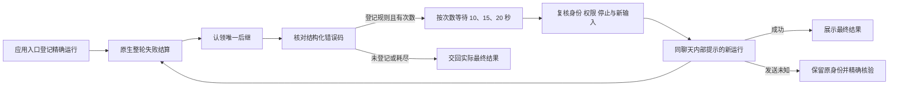

# 错误自动重试

自动重试模拟用户在原会话发送「继续」。命中已登记的原生执行错误后，应用向同一聊天追加
固定内部反馈，最多启动 n 次新运行。登记新错误时沿用现有重试等待、次数和发送准入。会话
历史是否可读等执行条件由正常发送和执行流程处理。
原生旧运行仍然失败，新运行有独立 run ID 和原生回执。宿主保留原始失败结果和工具注册，
并沿用原生记录的工具执行结果。锁定运行时的压缩恢复与补答耗尽标记由运行时补丁提供。

## 设置与规则

运行参数 `automaticErrorRetry.maxContinuations` 默认 3，范围 0–3；0 关闭。
缺少此设置时采用默认值，已有的显式次数继续生效。此应用侧设置不投影到 Gateway 配置。
每次确认命中规则且还有额度后开始计时。首次续跑等待 10 秒，后续每次增加 5 秒，默认三次
分别等待 10、15、20 秒。Main 的 `retryDecision.ts` 定义共用的初始等待与增量。
等待结束后才分配后继运行身份并记入次数。

规则只包含 `id`、`errorCodes`、`fixedPrompt`；重复 ID/错误码或空提示被拒绝。
已登记连续相同工具失败 `openclaw_repeated_tool_error`、上下文溢出 `context_overflow`、
会话读取许可失效 `session_reader_not_current`、会话历史索引重建
`session_transcript_projection_rebuilding` 和原生补答耗尽 `reply_generation_exhausted`。
规则共用同一续跑额度。
连续工具失败的反馈要求检查已有结果、修正参数或换用可用方法。
上下文溢出的反馈要求从已保存的进度继续，先核对可能已有副作用的操作，并限制文件读取和
命令回传的内容。读取许可失效、历史索引重建和原生补答耗尽的反馈从原会话中已保存的用户输入继续，
先核对已有操作结果。

各规则复用同一个调度器和 Goal 交接。错误识别模块按来源核对原生失败证据。

## 模块归属

Main 的执行实现集中在 `src/main/engine/openclaw/automaticErrorRetry/`，按职责分为：

| 模块 | 职责 |
| --- | --- |
| `retryDecision.ts` | 共用错误规则核对和可取消的阶梯等待 |
| `coordinator.ts` | 桌面和 Chrome 重试链、次数及原生前驱关联 |
| `rules.ts` | 固定错误规则及规则索引验证 |
| `failureCode.ts` | 核对原生生命周期、Runtime Services 错误码和所需的已保存输入 |
| `host.ts` | 已准入桌面及 Chrome 来源、工作区/权限准备、条件发送和重试状态发布 |
| `lifecycle.ts` | 已接纳的原生结果暂存、错误展示延后和业务 owner 交接 |
| `historyPresentation.ts` | 无正文历史关联的显示恢复，不重建执行 |

Adapter 继续持有原生 active turn、未知发送、连接代次和会话准备；原生恢复的身份核验
在入口完成后才把精确结果交给重试模块。共享的 `ExecutionSuccessorClaims` 由 Adapter
组合根创建并分别注入 Goal 和 Host，两者不通过对方取得调度能力。

Renderer 的 `controllers/automatic-error-retry-presentation.ts` 只拥有订阅、元数据和计时器；
纯消息/Turn 投影在现有 `pipeline/automatic-error-retry-display.ts`，Lit 负责组合呈现。
preload 的最小桥和 shared 的跨进程契约保持单文件；IPC 只校验来源并组合响应，
数据库 schema 和回执读写继续由 SqliteStore/CoworkStore 持有，不另建重试存储权威。

## 执行与归属

Main 先登记发送与 key、物理 SID、lifecycle revision、客户端代次的关联，再允许输入。
只接受精确原生整轮 `executionSettled:true` 终态；chat final、空闲和 Stop ACK 不替代结算。
丢失实时事件时，精确 `agent.wait` 结果使用独立证明类型，不制造 agentSeq。
外部执行若在核对该回执的会话身份时收到匹配的实时整轮终态，采用实时终态及其结构化失败标记。
正常完成时，已核验的 wait 仍可提供实时终态未携带的答复。
桌面已接纳的技术后继继续观察原 `agent` RPC 的最终响应。响应到达只唤起同一运行的
`agent.wait` 核对。聊天显示在查询前或查询中收敛时，Main 可用短期保留的原生绑定完成核对。
当前连接、原生会话身份与当前末轮仍须匹配。发送 ACK 丢失时，显示结果使该聊天保持已收敛，
同一运行继续保留待核对状态并占用发送准入。Main 使用精确原生回执核对原发送。
关闭自动重试或候选核验已到期时，普通聊天同样使用发送时绑定的原生会话及连接身份核对。
确认前保持待核对，确认后释放发送准入。
桌面运行断线或退出显示后，带原生结束时间的成功暂停让出（`yielded`、`paused`）可释放当前运行的通用重试认领。
若原生回执包含 `stopReason`，该字段须为 `end_turn`。Goal 接收让出结果，后续子任务由原生运行时接管。
来源分组的逻辑任务仍由其原 owner 结算。已请求停止的未知运行保留原停止归属，等待对子任务的原生处理。

Runtime Services 的只读 `runtimeServices.executionFailure`
使用公开 Session Store/Transcript API。它短期记录 Gateway 实际观察到的两种原生整轮失败码，
按 run、key、SID、revision、运行时代次和结束时间核对证据。匹配时直接返回整轮失败码和
`identityMatched`。原生整轮结果优先于单次尝试，也能在长历史尚未就绪时完成核对。
后续 RPC 可能晚于原生终态，此时 wait 还须带明确的 `stopReason:error`，
或与同轮原生报错的规范化摘要匹配。摘要仅核对两个回执的对应关系，失败类型仍来自原生整轮事件。
早于终态的 wait 时间无法匹配。同一 run 的新 start 或后续整轮终态会退休该 run 的先前证据。
派发前还会核对会话当前末轮。证据的匹配有效期为 60 秒，
无需保留原始报错、聊天正文或参数。整轮终态缺席时，沿用历史错误码查询，并核对读取前后的
SID/revision。

读回确认 `identityMatched:true` 后，使用原生 transcript 错误码。上下文溢出使用同一运行的
整轮 lifecycle 证据，要求 `phase:error`、`executionSettled:true`、`livenessState:blocked` 和
`errorObservation.failoverReason:context_overflow`，排除取消和超时。原生 transcript 保存
模型接口返回的 `context_length_exceeded` 时，也要求这组 lifecycle 证据。OpenClaw 也可能在
压缩本身因上下文不足而失败时保留该观测。一般压缩错误、尝试结束和裸 `agent.wait`
状态缺少这一证据。已结算的 wait 可以与 Runtime Services 观察到的同轮原生失败匹配。
OpenClaw 先完成自己的压缩与恢复，Main 再决定是否派发续跑。
压缩后若物理会话身份已变，现有身份校验会放弃本次应用侧续跑。
应用在完整、启动及仅认证配置同步中投影相同的原生压缩策略。压缩切点使用 8,000 token 的
近期历史预算，safeguard 摘要阶段保留一轮近期对话原文，较早历史更早进入摘要。
这些值用于选取切点和构造摘要。当前输入、不能拆开的工具调用配对和其他必需内容仍由原生
预算与质量检查处理。聊天历史仍由原生记录提供。
工具结果回填后的预检允许估算在模型完整窗口内的普通请求继续。超过完整窗口仍进入原生恢复，
真正由模型端拒绝的溢出继续使用原生溢出恢复。整段摘要有效而本轮工具前缀补写耗尽时，
原生压缩可采用通过预算和质量审核的有界摘录。模型窗口小于必留的系统提示、当前输入或工具
定义，或者模型持续生成无效摘要且无可用的压缩产物时，保留原生终态。
实际零条裁剪沿用原生压缩恢复和预算。已有工具结果和原发送归属由 Gateway 持有。

读取许可失效有时只发布 `chat.error`。已知固定错误文案可唤起有界 `agent.wait` 查询，随后必须取得
精确 run 的已结束失败结果、同一原生 SID/revision 和当前 `lastRunId`。读取许可失效没有
结构化失败码时，Main 通过有界 `chat.history` 读取当前分支。要求已保存用户输入
有精确的原生输入幂等键，并核对其后的 `run-failed-before-reply` 自定义回执确属失败 run，
正文精确匹配这一种原生拒绝。发送前再次复核 `lastRunId`，避免旧错误接管较新的运行。
错误气泡和助手正文均不能单独触发续跑。原始输入无需重新发送。

历史索引重建以实时、精确的已结算原生失败为依据。其 `error` 必须是锁定版本的
`Session transcript projection is rebuilding: <sessionId>`，且其中的物理会话 ID 与本轮相同。
命中后直接进入共用的阶梯等待和续跑派发。会话历史的读取由 OpenClaw 在执行续跑时负责。
后继运行也以同一错误结算时，只要仍有额度，就进入下一次续跑。

原生补答耗尽使用同一运行的已结算错误事件，要求 `stopReason:error` 和
`replyGenerationExhausted:true`，覆盖 OpenClaw 确认已耗尽内部补答的空回复、仅推理回复，
以及满足原生安全判据的未形成结构化调用的 `toolUse`。缺失助手消息还可能来自扩展主动接管
输入，宿主需取得本轮确有模型调用的证据，才能续跑这一类失败。
该标记随普通聊天与后端执行的原生生命周期发布。应用排除取消、让出和超时后进入共用等待，
续跑时先核对已有进度和操作结果。丢失实时事件时，精确 `agent.wait` 和 Runtime Services
观察到的同轮耗尽标记共同构成依据。通用报错文案只触发核对，证据不足时保留真实失败。

已结算工具的隔离总结由原生同轮完成。内置执行器首次尝试后，正常空正文与明确的短暂模型
请求故障共用最多三次重试。各次均禁用工具并沿用同一运行。自定义执行器沿用其原生空回复额度。
暂时故障包括原生分类确认的瞬时 HTTP 5xx，以及没有输出的原生传输中断
诊断。恢复重查取消、会话写入权和结果交付状态。若原轮已失败、有部分回复或失败不可重试，
保留原生结果。`The tool run finished, but no final summary was produced.` 是原生兜底提示，
不会据此发起新的带工具运行。原轮准备好的上下文如果保留当前用户输入和原生确认的结算工具
配对，隔离总结沿用它作为模型输入，继续使用原生消息清理和写入权。
工具已确认完成时，因输出长度截断而留下的独立 `<tool_call>` 标签不算用户已收到的答复。
原生可以继续在同轮生成禁用工具的总结，并保留未完成的长度截断结算及提示。原始记录、
Markdown 代码示例和媒体仍由原生各自的记录与投影规则保留。
桌面聊天在同轮的已结算原生回执提供完整可见总结时，直接展示总结并省去重复的固定截断提示。
若聊天错误帧先到，暂缓这条固定提示，等候同轮终态或历史确认，窗口最长为 5 秒。
原生明确返回空或静默总结，以及等待期结束仍无法确认补答时，按界面语言显示实际失败。
原生结算及诊断不受展示影响。

发送前重新准备当前工作目录和权限，复核原始发送归属、key、SID、revision、客户端代次及
活动运行。对上下文溢出、补答耗尽及通过 wait 核对的错误，休眠期间出现更晚的原生运行也会阻止旧失败续跑。
沿用现有 `agent` RPC，传入 `expectedExistingSessionId`、
`expectedExistingSessionLifecycleRevision`、稳定幂等键、`internal_system` provenance
和 `suppressPromptPersistence:true`。新运行保留正常可见生命周期；固定反馈不产生用户气泡。
原生跳过续跑提示词的用户消息持久化。若实时消息更新或历史响应仍带有标记为
`internal_system` 的用户消息，聊天按原生来源过滤。用户手动发送相同文字时仍正常显示。

次数属于同一业务请求的整条链，记录应用侧后继运行的派发额度。模型请求量以模型端点实际
收到的请求为准。run ID 变化、部分工具成功、A 规则切换 B 规则均不重发额度。
未知 ACK 也消耗次数，保留原始认领和幂等身份，仅核验原运行，不盲目重发。
Stop、新输入、实例或连接变化取消后续派发；未知原生发送仍须等待实际证据。
重启不从历史错误重建自动执行。

## 与 Goal 的组合

通用协调器不导入 Goal，不采用其提示、授权字段、重试方法或计数。
普通桌面聊天开启或关闭 Goal 都可使用同一规则。Main 按精确前驱认领唯一后继，认领早于
异步错误查询；Goal 在实际发送前也核验认领，避免两套策略各续跑一次。
某轮在发布 start 前失败时，若 Gateway 确认该失败是同一物理会话的当前末轮，且 Gateway 和
Main 都没有可交接的 Goal，上一轮的本地 lifecycle 记录不阻挡本轮续跑。

技术交接保留 Goal 的业务计数、退避次数、目标实例与前驱，不当作新用户请求重置状态。
明确未发送时回滚交接并交回原始结果；未知 ACK 不回滚。链的最终实际结果交回原业务
owner。Goal 对同一步的业务重试继承已消耗的通用次数；独立准入的新步骤才有新额度。

## 展示与存储

Renderer 按 Main 的精确运行关联隐藏待核验和续跑中的报错。续跑过程中显示执行状态，
发送结果未知时显示执行状态核对，待精确结果确认后收敛。
已绑定运行的固定原生错误有时在整轮结算前经正文流到达，桌面暂存这类尚无正式正文归属的
固定文本。正常结算后，作为答复引用的原文按普通正文显示。
阶梯等待和发送准备期间，输入框保持活动状态并提供停止按钮，会话列表持续显示运行中。
列表也跟踪未选中的会话。原生运行间隙保留草稿，停止后取消尚未派发的续跑。
额度耗尽、规则不匹配或确认无法发送时，只显示最后一次实际失败。续跑成功时，中间失败
仍保留在原生历史和诊断，聊天保留有效的部分回复、工具活动、文件和媒体。
外部客户端还处理 Gateway 在整轮结算前经文本流发出的固定失败文案。显示层只处理已绑定的
续跑候选，实际续跑仍以精确终态和原生错误证据为准。公开历史可能只保留失败正文，显示层
通过同一运行的原生终态消息标记识别并移除固定文案。

已有 `cowork_session_runs` 的可空 `automatic_error_retry` 字段保存无正文关联，只服务呈现，
不建立 transcript 缓存或执行恢复权威。刷新历史、切回和重连可恢复已确认处理的失败关联；
应用重启后从持久元数据恢复已被取代的失败关联。对仍未取得整轮结算的候选错误，Main
在 10 秒核验窗口结束后终止该次续跑资格，再显示原失败。已认领续跑的运行及发送结果
未知的运行由其实际结果决议。Renderer 的计时器仅限制元数据加载等待。

CLI、入站 ACP 和通用 app-server 经共用外部执行入口使用相同错误规则、预算和等待时间。
外部执行在请求返回前完成重试，保留原客户端请求 ID 和会话预约。原请求持有的审批和
MCP 资源由各自连接管理，后继运行重新建立与新原生运行的精确审批关联。取消、连接归属变化或
原生发送结果未知会停止后续派发。恢复及历史关联只使用已保存的运行回执。

支持客户端审批的 Chrome 侧栏沿用原轮次 ID、状态和历史通知。等待时轮次保持运行中，点击停止可
取消尚未派发的续跑。已开始的续跑使用独立的原生运行 ID，审批和停止都绑定到发起该轮次的
连接及当前运行。外部客户端在等待期主动停止时，请求显示已中止，上一轮的原生失败仍保留在
诊断。Chrome 发起连接撤回订阅或断开后，未派发的续跑失去该连接的审批归属，保留最后一次
实际结果。已派发的原生运行按现有规则等待结算。

## 范围与验证边界

接入范围为能证明发送归属及准备身份的桌面聊天、已准入的 Goal 后继、CLI、入站 ACP、
通用 app-server 和普通 Chrome 侧栏发送。Chrome 网页启动任务保留自己的运行回执和取消流程。
原生 ACP 完成回传、子代理、Agent Team、Swarm、cron 及原生子任务回报触发的
主会话运行由各自原生 owner 处理。原生主会话回报续跑的公开事件缺少精确前驱关系，且运行
结束后原生投递仍可能排队重试。仅凭同一会话或空闲状态接管会与原生调度竞争。
插件重载后的原生接续轮也归原生 owner。`Session event configuration changed` 发生在该轮时，
公开接口只能核对物理运行，缺少原事件的接续归属和原始生产者权限，应用侧续跑不接管。

原生整轮终态仍决定技术后继的执行结果。Gateway 重启、会话替换、候选退休或 wait 只给出
临时结果时，RPC 响应缺少独立执行证据。收到接纳回执后的响应观察不会据此再次发送。

测试覆盖规则与共用预算、旧设置、实际 Main 准备与错误延后、内部发送、拒绝/未知 ACK、
停止与身份竞态、先终态后 ACK、`agent.wait`、Goal 单后继和计数，以及实际聊天组件的
首次错误绘制、历史接管、工具/文件/部分正文保留和最终错误放开。
历史索引重建和原生补答耗尽的回归覆盖实时终态归类，以及连续同类失败使用完整的共用续跑额度。
原生补答耗尽另覆盖外部流与历史投影、同文案的成功回复，以及缺少原生标记时保留失败。
隔离 Gateway 用本地合成模型重放两个 ID 不同的空 `delta` 及流结束标记。普通聊天和后端
执行各发起两次模型请求，并发布与当前运行精确关联的补答耗尽终态。
通用 app-server 在约 10 秒后于同一会话发起新运行，返回正常回复并完成原客户端轮次。
实时输出和历史不显示中间错误或内部提示，历史接口将两条原生空助手消息投影为空 `agentMessage`。
将空响应延长到第二次应用续跑结束时，通用 app-server 在同一物理会话完成三次续跑。合成端点
按原轮和三次后继分别收到 2、2、2、1 条实际请求。第三次续跑返回正常答复，中间失败和内部
提示未出现在客户端实时输出及历史中。以类型明确的 HTTP 400 上下文溢出做同样回放时，
端点在原轮及三次后继各收到一条请求，第四条成功。

冻结 Gateway 的相同长历史对照中，模拟端点均拒绝了约 144 KB 的普通请求。原生默认配置和
应用裁剪策略分别以约 79 KB 和 33 KB 的请求恢复。该用例中后者另使用两条摘要请求，前者
使用一条。两边均保留原生历史与会话身份，恢复请求均携带本轮输入和对应工具结果，工具仅执行一次。

使用冻结运行包和本地合成模型执行真实 Gateway 端到端验证。连续相同工具失败用例覆盖
Windows CLI、入站 ACP、通用 app-server 和 Chromium 中实际加载的 Chrome 侧栏。四个入口均
完成同一轮次的自动续跑，等待期取消后未派发后继，客户端实时输出和适用的历史界面均隐藏
中间失败及内部反馈。通用 app-server 额外验证默认三次续跑耗尽后交付最终失败。Chrome 侧栏
额外验证最终失败只展示一次、停止按钮恢复为发送，以及成功回答引用同一文案时仍能显示。
通用 app-server 还通过模型接口的 HTTP 400 响应验证了上下文溢出可在原会话续跑，且实时
输出和历史不展示中间报错或内部反馈。首次外部执行可在原生会话创建时确认模型，避免创建后
重复设置模型，使原生模型切换抢先处理该次错误。
浏览器探针通过隔离配置提供本地连接信息，生产安装包及浏览器 Native Messaging 注册仍需单独验收。

[返回执行控制](README.md)
