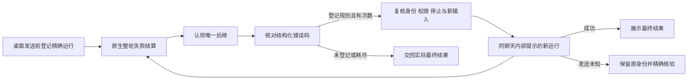

# 错误自动重试

应用可在已登记的原生执行错误后，向同一聊天追加固定内部反馈，最多启动 n 次新运行。
原生旧运行仍然失败；新运行有独立 run ID 和原生回执。不删除工具注册，不重放失败命令，
不改写失败结果，不增加 OpenClaw runtime patch。

## 设置与规则

运行参数 `automaticErrorRetry.maxContinuations` 默认 1，范围 0–3；0 关闭。
旧设置只补缺失的新字段，不重置其他设置。此应用侧设置不投影到 Gateway 配置。

规则只包含 `id`、`errorCodes`、`fixedPrompt`；重复 ID/错误码或空提示被拒绝。
当前只登记 `openclaw_repeated_tool_error`。其他错误正常展示，不根据英文报错、模型正文
或工具名猜测规则。固定提示要求检查已有结果，修正参数或换用可用方法继续原任务，
提醒失败操作可能已有副作用，并在无法继续时说明完成情况和阻塞原因。

新增错误只增加规则及行为测试，不改公共调度器或 Goal 业务。

## 模块归属

Main 的执行实现集中在 `src/main/engine/openclaw/automaticErrorRetry/`，按职责分为：

| 模块 | 职责 |
| --- | --- |
| `coordinator.ts` | 重试链、共用次数和唯一尝试的策略状态 |
| `rules.ts` | 固定错误规则及规则索引验证 |
| `failureCode.ts` | 经现有 Runtime Services 接口核对精确错误码 |
| `host.ts` | 已准入桌面来源、工作区/权限准备、条件发送和回执持久化 |
| `lifecycle.ts` | 已接纳的原生结果暂存、错误展示延后和业务 owner 交接 |
| `historyPresentation.ts` | 无正文历史关联的显示恢复，不重建执行 |

Adapter 继续持有原生 active turn、未知发送、连接代次和会话准备；原生恢复的身份核验
在入口完成后才把精确结果交给重试模块。共享的 `ExecutionSuccessorClaims` 由 Adapter
组合根创建并分别注入 Goal 和 Host，两者不通过对方取得调度能力。

Renderer 的 `controllers/automatic-error-retry-presentation.ts` 只拥有订阅、元数据和计时器；
纯消息/Turn 投影在现有 `pipeline/automatic-error-retry-display.ts`，Lit 负责组合呈现。
preload 的最小桥和 shared 的跨进程契约保持单文件；IPC 只校验来源并组合响应，
数据库 schema 和回执读写继续由 SqliteStore/CoworkStore 持有，不另建重试存储权威。

## 执行与归属

Main 先登记桌面发送与 key、物理 SID、lifecycle revision、客户端代次的关联，再允许输入。
只接受精确原生整轮 `executionSettled:true` 终态；chat final、空闲和 Stop ACK 不替代结算。
丢失实时事件时，精确 `agent.wait` 结果使用独立证明类型，不制造 agentSeq。

结束事件不携带该错误码。Runtime Services 的只读 `runtimeServices.executionFailure`
使用公开 Session Store/Transcript API，核对读取前后的 SID/revision，只返回指定 run
最后一条 assistant 的结构化错误码。不缓存原始报错、聊天正文或参数。读取有界，失败则
保留普通失败行为。

发送前重新准备当前工作目录和权限，复核原始发送归属、key、SID、revision、客户端代次及
活动运行。沿用现有 `agent` RPC，传入 `expectedExistingSessionId`、
`expectedExistingSessionLifecycleRevision`、稳定幂等键、`internal_system` provenance
和 `suppressPromptPersistence:true`。新运行保留正常可见生命周期；固定反馈不产生用户气泡。

次数属于同一业务请求的整条链。run ID 变化、部分工具成功、A 规则切换 B 规则均不重发
额度。未知 ACK 也消耗次数，保留原始认领和幂等身份，仅核验原运行，不盲目重发。
Stop、新输入、实例或连接变化取消后续派发；未知原生发送仍须等待实际证据。
重启不从历史错误重建自动执行。

## 与 Goal 的组合

通用协调器不导入 Goal，不采用其提示、授权字段、重试方法或计数。
普通桌面聊天开启或关闭 Goal 都可使用同一规则。Main 按精确前驱认领唯一后继，认领早于
异步错误查询；Goal 在实际发送前也核验认领，避免两套策略各续跑一次。

技术交接保留 Goal 的业务计数、退避次数、目标实例与前驱，不当作新用户请求重置状态。
明确未发送时回滚交接并交回原始结果；未知 ACK 不回滚。链的最终实际结果交回原业务
owner。Goal 对同一步的业务重试继承已消耗的通用次数；独立准入的新步骤才有新额度。

## 展示与存储

Renderer 根据 Main 精确关联等待候选错误的规则决议。确认续跑后隐藏对应合成终止文案，
显示“正在调整方法（1/n）”。有效的部分回复、工具活动、文件和媒体保留；原生历史、
执行归约和诊断记录保持真实。最终失败、未登记错误及未知发送正常可见。

已有 `cowork_session_runs` 的可空 `automatic_error_retry` 字段保存无正文关联，只服务呈现，
不建立 transcript 缓存或执行恢复权威。刷新历史、切回和重连可恢复已确认处理的失败关联；
重启不恢复 Candidate/Pending 临时隐藏。元数据或候选决议无法取得时，有界放开原生失败显示。

## 范围与验证边界

当前只接入能证明普通桌面发送归属及准备身份的执行，包括其已准入的 Goal 后继。
不自动接管 ACP 完成回传、子代理、Agent Team、Swarm、cron、外部客户端或无法保留原始
委派权限上限的执行；这些来源使用各自 owner 的已有错误处理。

测试覆盖规则与共用预算、旧设置、实际 Main 准备与错误延后、内部发送、拒绝/未知 ACK、
停止与身份竞态、先终态后 ACK、`agent.wait`、Goal 单后继和计数，以及实际聊天组件的
首次错误绘制、历史接管、工具/文件/部分正文保留和最终错误放开。

尚未使用与本次源码一致的冻结运行包执行真实 Gateway + 合成模型端到端验证。
单元/集成测试及源码核对不替代此项验证或安装包验收。

[返回执行控制](README.md)
