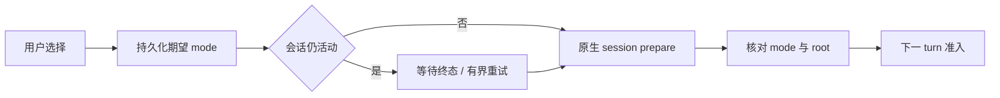

# 会话权限：保存、应用与执行准入

权限链路已使用 OpenClaw 原生 session permissionMode/sessionRoot。本文按当前 coordinator 与发送流程说明。

## 1. 用户选择对应什么

| 产品模式 | 原生模式  | 范围                     |
| -------- | --------- | ------------------------ |
| ask      | guarded   | 原生受保护执行与审批     |
| auto     | workspace | 工作区策略及原生自动审查 |
| full     | full      | 当前会话的完整权限语义   |

三种模式都属于当前 session。默认值只影响新会话；不能因为一个会话选 full 就改全局 tools.exec.mode。全局仍保持 restricted fallback。

## 2. 保存和应用是两个时点

用户切换权限后先将期望值写入 cowork_sessions。会话空闲时立即准备原生 session 并回读核对；仍有运行时先记录 pending，终态后立即尝试应用。UI 简洁显示用户选择，不额外弹出等待提示；该选择不表示旧 run 已立即换权限。

SessionPermissionModeCoordinator 按 session 串行，而非全局阻塞所有任务。失败保留待应用状态，不擅自恢复旧期望；prepareSessionForRun 必须严格成功才允许下一次发送。

## 3. 工作目录是权限的一部分

sessionRoot 来自产品任务 cwd，并规范化验证。变更项目路径、模型或恢复旧会话时仍需准备，不能只比较模式字符串。原生身份与 root 不匹配就拒绝发送，不能用修改助手角色 workspace 代替任务权限。

已有普通会话（含已绑定的历史会话）可通过标题栏“更改工作目录”选择现有文件夹。
Main 仅接受主窗口主 frame 的类型化请求；拒绝外部来源、原生 Worktree、插件托管、
副本创建中、停止中、未知发送、未结算运行、在途准备和待处理计划（含仍可恢复的
最新失败计划）。准备计数覆盖终端、权限和模型排队期间，完成或失败后释放；
已派发 `sessions.create` 的超时／断线另保留当前 Gateway 进程的未确认保护，单纯重连
或后续准备成功不能清除，也不重试原写入；确认 Gateway 进程替换后才允许更改目录。
未结算运行直接按空结束时间查询，不依赖运行开始时间的排序。修改前定向确认本会话及
后代空闲，读取后重新核对产品身份、原目录和最新运行回执，陈旧选择不能覆盖新值。

保存只更新产品期望 cwd，后续消息和新终端沿用原生准备流程应用并校验 mode/root；
不立即写原生会话、不重试未知写入。Renderer 的发送准入携带权限准备前捕获的
`expectedWorkspaceRoot`，Main 在全部异步检查后、建立运行回执前复核，防止准备后
目录改变仍按旧根发送。历史记录和文件不迁移，角色工作区不变，已打开终端保持
创建时的目录与原生 PTY 身份。旧消息中的相对文件链接按当前会话目录解析。

## 4. 与其他控制面的关系

计划模式限制当前规划工作流，automation-permission 控制定时任务变更，session visibility 控制跨会话访问，MXC 控制工具进程隔离。它们各自生效，不因 permissionMode 显示 full 就全部关闭。

原生 exec/plugin approval 有独立 pending、期限和 decision 集合。Main 验证响应属于有效请求；关弹窗、页面卸载、断线不表示允许。审批已解决、过期和拒绝也不是执行整轮终态。桌面已有命令会话授权按精确命令与环境指纹复用，收到原生会话 reset/new/delete 或显式清理时撤销；普通一轮执行完成不会自动清空该会话的授权。

“本会话允许”必须有真实原生 session ID，指纹同时包含该 incarnation 和精确命令环境，
不能只按 session key 在重置后的会话复用。Main 先确认原生单次批准，再提交本地 grant；
等待期间的重置、停止、连接替换或连接代次变化会使待提交 grant 失效。失效的旧响应不能
把已清除授权重新写回，也不会清除其他子 Agent 的授权。缺少原生身份的请求仍可按原生
提供的单次决策处理，界面不提供会话复用按钮。

待审批列表和会话 grant 的自动应用绑定开始读取时的 Gateway client、连接代次与
响应上下文；列表返回、逐项应用及最终快照提交前均重新核对。旧连接的快照不能向
新连接发送批准，也不能在自动批准失败后重新发布旧请求。读取失败保留现有界面队列，
由重连后的权威快照收敛。解析失败的错误文字即使含 `unknown`、`expired` 或
`not found`，也不证明该请求已结算；只有成功响应、原生 resolved 事件、成功快照
或请求自身期限到达才移除审批入口。

外部客户端的审批展示 owner 同样捕获该连接绑定。等待人工选择、原生身份读取或
展示失败后，连接已变更就不向后继连接发送批准或补发拒绝；owner 仍保留排他归属，
直到实际执行结算后释放，不能在取消未确认时转交桌面审批。

### app-server 客户端审批

app-server 复用同一原生审批路由，标准 presenter 位于 `main/clients/appServer/protocol/`，浏览器发送 owner 和连接撤回位于 `main/chrome/`。只有实际发送连接能接收该运行的审批；恢复订阅、观察者、客户端声明或当前 UI 选择不能转移 owner。已知原生 run 使用精确绑定；发送前尚无实际 run ID 时，先保留精确 key、物理 SID、revision、客户端和连接代次上的 owner，等待原生 ACK 后再展示匹配的请求。审批自己的 runId 不能反向认领发送；无法归属的请求拒绝并保留 owner，不回落到桌面或新连接授权。

| 原生请求与客户端选项     | 实际授权                                                                                                                          |
| ------------------------ | --------------------------------------------------------------------------------------------------------------------------------- |
| exec：`accept`           | 对当前原生审批执行 `allow-once`                                                                                                   |
| exec：`acceptForSession` | 仅在实验性能力、已安装连接 scope 和安全指纹均成立时提供；仍向原生提交 `allow-once`，成功并再次核验身份后才记入连接内会话授权      |
| plugin：允许一次／拒绝   | 用标准 `item/tool/requestUserInput` 显示真实标题、说明和详情，仅精确匹配已提供的选项；需要实验性能力                              |
| plugin：始终允许此 App   | 仅当 `pluginId=bundle-mcp`、`allowedDecisions` 和原生 decision action 都明确提供 `allow-always` 时出现，回传真实原生 App 持久授权 |
| 拒绝、失效或非提供选项   | 返回拒绝，不写授权规则                                                                                                            |
| 显式 `cancel`            | 先拒绝当前审批，再异步请求停止本次发送方持有的精确原生运行；Stop ACK 不证明执行已结算                                             |

`acceptForSession` 缓存绑定连接、原生 key、物理 SID、revision、客户端与连接代次，复用现有 command/argv、目录、宿主、策略、环境和执行计划指纹。只有环境键但没有可信环境绑定时不提供该选项。每次复用仍重新核对原生身份和本次 `allowedDecisions`；不写全局规则、不使用 `allow-always` 代替会话授权。普通结算后可在同一 scope 内复用；审批的 `cancel` 选择、scope 撤回、身份变化或连接关闭撤销。Chrome 退订还会关闭该线程的 scope；通用客户端的空闲退订只卸载观察，scope 保留至连接结束或其他撤销边界。

App 持久授权与上述内存缓存不同：其效果和持久化由原生 App 权限管理，连接关闭不会撤销已明确保存的原生授权。其他插件的持久选项、execpolicy／network policy amendment 和独立文件修改审批没有对应的真实映射，不伪装成已支持能力。

原生 resolved、到期、断线和 UI 撤回使等待响应失效，迟到允许不能提交；断线或切换界面本身不请求取消借用的原生运行。Chrome 审批面板不默认勾选答案，秘密输入只保留在当前表单，撤回时清空，`turn/start` 响应不会将焦点从秘密输入移回普通草稿。界面可呈现标准多题、自由输入和秘密问题，但这不表示已接入原生所有复杂 `ask_user_question` 流程。当前字段与限制见[统一 app-server](../external-clients/app-server.md)。

当前桌面只加载无业务联网能力的 pinned HTML 卡片；声明非空 `netOrigins`、工具能力或
使用不支持注册类型的 board 卡片，在审批、HTML 读取及执行前显示不支持。即使原生已
返回 granted 或会话选择 full，也不绕过这项宿主准入；桌面不发起 `board.widget.grant`，
不清空声明后运行。

普通 inline Widget 沿用原生 CSP，不因代理或会话权限开放业务 fetch，
Main 不提供 Widget 业务下载通道。完整页面使用独立网页 embed，按其浏览器设置、代理
和来源规则准入，不继承 Widget 权限或草稿桥。详见[交互式回答](../chat/interactive-answers.md)
与[消息中的独立网页](../chat/webpage-embeds.md)。

审批弹窗优先于问答弹窗显示；问答暂时隐藏并暂停焦点捕获，保留已有草稿，审批结束后恢复。命令审批分层展示命令与实际工作目录，插件详情按正文排版；长内容在正文区域滚动，操作按钮保持可见，不展示节点等产品未开放的执行概念。

## 5. 拒绝和延迟如何反馈

| 情况             | 行为                         |
| ---------------- | ---------------------------- |
| 保存失败         | 返回失败，不显示已保存       |
| 旧 run 仍活动    | 待应用；发送准备不能绕过     |
| Gateway 无法核对 | 保留期望并拒绝新 turn        |
| 用户快速连续切换 | 串行收敛到最终持久期望       |
| 已删除会话的重试 | 清 pending/timer，不重建会话 |

## 6. 实现入口与验证范围

主入口是 `src/main/openclaw/permissions/sessionPermissionModeCoordinator.ts`，发送由 Cowork handler/Router 复用，合约位于 `src/shared/security/approvals.ts`。测试应覆盖活动期间变更、失败重试、快速切换、删除与新 turn 同步，而不是只断言生成的 JSON 有某字段。

客户端审批还覆盖 ACK 前等待、逻辑与原生 run ID 不同、同会话并发提交、撤回后的迟到响应、原生 resolve 结果未知、会话指纹不匹配、持久 App action 伪造和取消期间身份变化。运行授权、审批交互结束和执行结算分别验证，不能由一次正常允许替代。

审批边界测试位于 `openclawRuntimeAdapter.approvals.test.ts`、
`sessionExecApprovalGrants.test.ts`、`externalApprovalRouting.test.ts` 与
`approvalQueue.test.ts`：覆盖同文不同来源、缺少原生身份、清理与迟到确认、client
替换、同 client 连接代次变化、响应上下文失效、逐条自动批准中重连，以及无法确认
结果时保留队列。界面决策与期限覆盖见 `ExecApprovalModal.test.ts`。
