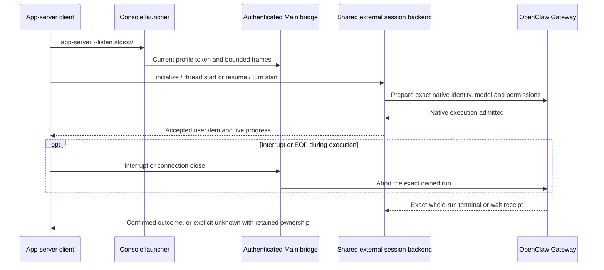

# Agent CLI and inbound ACP

The installed `<productName lowercase>-cli` command is the desktop application's
normal console entry. CLI commands, inbound ACP and the supported Codex app-server
protocol are available by default while the application is running or in the tray.
There is no integration enable switch. Previous CLI or client-specific enable
preferences no longer control admission. Help and version also work without a
running desktop. A separately installed Node.js, first-run download and public
network service are not required. The entry never opens a second product database
or starts a separate Gateway.

The Codex app-server adapter and Chrome side chat use one
`main/appServer/AppServerConnection` protocol implementation. WebSocket and stdio
retain separate authenticated transports and capability bindings. The console
binding owns one external thread and its cancellation; it cannot acquire browser
history, images or automation pairing by requesting those methods. See the
[shared app-server contract](app-server.md). ACP and ordinary CLI commands keep
their existing adapters and execution backend.

Settings → External connections → App access shows a shared CLI entry with
launcher/bridge availability and a wrapping, copyable command path. ACP appears
as the `acp` command alongside the other CLI commands, with its configuration
copy action. A separate Codex app-server section groups stdio launch configuration
and the application's native-client WebSocket address/configuration in peer panels.
The collapsed Multica example belongs to stdio. Rechecking
only reads status. WebSocket copying fetches the current Bearer configuration
through a separate main-frame-only IPC; it is never part of CLI status output.
Opening settings, copying values or installing a particular client is not required
to activate the entry.

Windows installs `<productName lowercase>-cli.exe` alongside the application.
Development startup generates a profile-specific executable under
`.agent-tasks/external-agent/development/<profile-hash>/`; the development preparation
command is declared in `package.json`. Windows uses the explicit command path rather
than modifying PATH. On macOS and Linux, the advertised command is the profile's
private `external-agent/bin/<productName lowercase>-cli` wrapper. A managed PATH
alias, preferring `~/.local/bin`, remains a convenience for its first owning profile;
preparing another profile does not replace that alias. The private wrapper pins
its owning profile explicitly and strips bootstrap environment overrides.

The external executable name follows the lowercase external product name plus
`-cli`. Protocol selection is an argument of this single entry. There are no old
client-specific executable, bootstrap-switch or bridge-discovery aliases. After
changing installation or development paths, copy the current path into clients.

## Commands

In these examples `<cli>` means the command path copied from settings. Quote paths
and prompts containing spaces as required by the invoking shell.

```text
<cli> --help
<cli> --version
<cli> status --json
<cli> models list --json
<cli> exec --cwd <project-directory> --json "Describe this project"
<cli> exec --session <external-session-id> --stream-json "Continue the task"
<cli> acp
<cli> app-server --listen stdio://
<cli> debug models --bundled
```

Help and version work without a running desktop application. Status reads existing
state and does not start Gateway. Models are enabled, configured chat models with
available provider credentials. `exec` accepts `--cwd`, `--session`, `--model`,
`--json`, `--stream-json` and either `--prompt <text>` or one positional prompt.
`--` permits a dash-leading positional prompt. New sessions default to the launch
directory. Resume retains the stored directory unless an explicit `--cwd` is
provided; changing a resumed session's real directory is rejected. Model selection
is confirmed through the existing per-session mutation queue, without changing the
application default.

Text mode writes the final answer to stdout and diagnostics to stderr. JSON mode
writes one final `result` or `error` object. Streaming JSON writes `event` objects
with external session ID, run ID and native events, followed by the final result.
An unknown execution returns `EXECUTION_UNKNOWN` with its known external session
and run IDs. It does not authorize retrying the prompt. Exit codes are 0 for
success, 64 for invalid arguments, 69 for an unavailable host, 70 for bridge or
execution failure, and 130 for confirmed cancellation. Unexpected output or bridge
closure is not successful execution.

## Ownership and transport

```mermaid
flowchart LR
  Client[Scripts / ACP / app-server clients] --> Console[Console CLI]
  Console -->|authenticated local pipe / socket| Bridge[Main bridge]
  Bridge --> Commands[CLI / ACP / Codex app-server adapters]
  Commands --> Sessions[External session and execution services]
  Sessions --> Prepare[Existing permissions / model confirmation]
  Prepare --> Gateway[OpenClaw Gateway]
  Gateway --> History[(Native transcripts)]
```



The transport retains bounded v4 frames, UTF-8 handling, FIFO output, queue limits
and slow-consumer backpressure. Main publishes only `external-agent/bridge.json` with the current pipe token.
Every command uses that discovery location. The pipe/socket endpoint and all
transport, launcher, model and session services belong to the generic
`externalAgent` domain; no backend probes, configures or authenticates a named
third-party application. Commands forward no task environment except the optional
`CODEX_HOME` value for app-server identity markers. Client-specific variables,
including tokens and server/workspace IDs, are never forwarded or required.
Gateway credentials are not exposed as CLI arguments or protocol output.

Access is scoped to the current operating-system user and application profile.
Client-reported names and optional marker directories are presentation metadata,
not credentials or authorization boundaries between programs running as that user.
Default availability does not grant extra permissions: native preparation, model
validation, approval rules, exact identity checks and bounded local transport all
remain enforced. Application shutdown closes owned connections and requests exact
run cancellation; a cancellation acknowledgement alone cannot settle execution.

All new CLI, ACP and app-server sessions use one `ExternalAgentBackendFactory`,
`createExternalAgentExecution` and `ExternalSessionStore` with `source='cli'`.
Product storage retains only external/native identity and execution receipts in
`cowork_external_sessions`; it stores no messages. New sessions appear in the
CLI source group. Earlier client-specific mappings, tombstones, scoped IDs
and native identities are retained unchanged and shown as read-only external-client
history. New protocol APIs do not infer an old scope, scan markers for authority or
claim old records using a bare UUID.
External UUIDs cannot be replaced with arbitrary Gateway session keys. Resume
checks source, surviving product conversation, assistant, real cwd and pinned
native session identity. Native admission also receives the expected SID and
lifecycle revision, so a reset between preparation and dispatch rejects the send.
Every protocol shares execution reservations by product conversation ID.

## Client examples and Codex app-server subset

ACP clients launch the copied command with `args: ["acp"]` and negotiate the
advertised protocol version and capabilities. The following app-server example
uses a different protocol; it does not launch ACP.

The Multica runtime configuration is a frontend setup example: select base
protocol **codex**, use the same command path and supply no additional arguments.
Its [Codex adapter](https://github.com/multica-ai/multica/blob/main/server/pkg/agent/codex.go)
launches `app-server --listen stdio://`. Other clients can use
that same command and the implemented JSON-RPC subset without Multica credentials,
installation detection, a client-specific enable flag or backend registration.
Client interoperability depends on the methods, version and capabilities it uses,
not its application name. This is not a claim that every Codex or ACP client feature
is implemented.

The app-server subset supports `initialize`, `model/list`, `thread/start`,
`thread/resume`, `thread/name/set`, `turn/start` and `turn/interrupt`, plus streamed
reasoning, text, user-message admission and tool item notifications. The separate
`debug models [--bundled]` command supports model discovery. Model IDs, permission
preparation, assistant ownership, execution reservations and native settlement use
the same backend as CLI and ACP. Each app-server connection owns one thread.
New threads may select an absolute existing cwd; resume keeps the saved cwd unless
the same real directory is explicitly supplied. Text is supported; unsupported
execution overrides, additional inputs, reasoning/service tiers and client-specific
MCP configuration fail explicitly. This adapter does not advertise ACP's interactive
approval or session MCP surface.



When a client supplies `CODEX_HOME`, the adapter may write one identity-only
`session_meta` marker at `sessions/rollout-external-<thread-id>.jsonl` under that home.
This optional marker contains no messages, tool results or usage. It is not required
to initialize, create or run a thread, and does not authorize resume. Conflicting
files and marker-file symlinks are rejected; an existing client-owned sessions
folder may resolve to that client's actual marker directory. Native Gateway history
remains authoritative. A failed marker write during creation rolls back only the
new empty product conversation before native dispatch; resume never deletes an
existing conversation.

Native completion maps to a completed turn even if a local interrupt races with it.
Only confirmed native cancellation maps to interrupted. An unknown outcome is
reported explicitly, retains its original receipt/reservation and blocks another
turn. Connection close/EOF still requests cancellation of that exact unknown run.
Output failure remains distinct from cancellation and never replays the prompt.

## ACP capabilities

The transport uses the exactly pinned ACP SDK, with stable protocol v1. It supports
`initialize`, `session/new`, `session/prompt`, `session/cancel`, `session/close`,
streamed `session/update`, model selection via `session/set_config_option`, and
bidirectional `session/request_permission`. Multiple independently rooted sessions
may share one connection. The requested absolute session cwd is authoritative;
it need not equal the CLI launch directory.

Basic prompts accept text and resource links. Resource references are preserved
without an implicit file read or network fetch. Native tools enforce access when
the model chooses to read a reference. Images, audio, embedded resources,
additional roots, HTTP/SSE MCP, client filesystem methods and client terminals are
not advertised. `loadSession` is false: the Codex identity marker or a truncated
history page does not implement ACP's complete replay requirement. Newer protocol
versions are not advertised by changing a version number.

Prompt handling never blocks the receive loop: cancellation notifications and
permission replies remain processable while a prompt or output drain is pending.
Text, reasoning and tool events are projected directly from native execution.
Provisional terminal-guard text is held until commit and discarded on rollback.
The final prompt response follows all queued updates for that turn.

Native progress can omit its session ID while the session projection is pending.
Main admits unstamped text, thinking and tool progress only after the same source
connection's `sessions.describe` proves the pinned session ID and incarnation.
It also requires the exact active run or an earlier native lifecycle start with
that exact session identity; projected owners can omit the active-run list. An
exact whole-run terminal can prove earlier queued events after the run leaves the
active list and always bounds the stream. Explicit identity conflicts and
unstamped lifecycle events remain rejected. All output shares one FIFO, bounded
to 1024 frames / 8 MiB with
five-second proof and drain deadlines. Progress cannot settle execution; an output
failure preserves its separately confirmed native outcome.

### Session MCP tools

On Windows and Linux, ACP-provided stdio MCP definitions are retained per session
and connected before the first prompt is admitted to native execution. Absolute
executable paths are recommended; executable names can also resolve through the
managed process PATH. Servers and packages must already be available locally.
Runtime Services owns discovery, subprocesses and cleanup through authenticated
`runtimeServices.externalMcp.open/close` methods. These definitions are ephemeral;
they never modify global MCP configuration or another session's tool catalog.
The open method declares the native session-write scope and required profile;
its handler also requires the connection's authenticated admin scope before
starting servers and throughout the lease. Close retains admin access without
requiring a surviving session, so reset or deleted sessions can still be cleaned up.

Ordinary CLI commands and ACP prompts remain available on macOS. Session stdio MCP
is rejected there before launching a process: the locked public MCP SDK does not
expose detached process-group creation, and the native cleanup API cannot retire
attached wrapper descendants on macOS.

The locked native SDK requires statically declared tool names. Runtime Services
therefore exposes the fixed `external_mcp` tool only to the exact leased native
session. Its `list` action returns the supplied servers' original tool schemas,
including root references; `call` selects a server/tool and validates its arguments
against that schema. Original MCP results remain available in tool details. Native
MCP App registration and client terminal UI are not synthesized by this proxy.

Every MCP call uses native plugin approval with a one-use decision, including
sessions whose general permission mode is full. Approvals are bound to the
current lease, native session, tool call and canonical arguments; client-supplied
annotations do not confer permission. Root, permission or incarnation changes
invalidate the old lease. Closing an ACP session or its transport revokes its
lease and stops owned MCP processes; application shutdown stops the registry.

### Permissions, cancellation and uncertain outcomes

Only ACP declares an interactive approval surface to native execution, after its
prepared turn installs the exact approval owner. It uses the internal `webchat`
channel with `deliver:false`; this enables permission requests without granting
them or sending task replies to an external channel. Ordinary CLI `exec` retains
native non-interactive approval behavior.

Main gives an ACP turn exclusive presentation ownership of its exact native run's
exec/plugin approvals. Desktop approval lists exclude requests routed to that
owner. Client replies offer only native-supported single-use allow/reject options;
Main rechecks run, session, incarnation, connection, expiry and option ID before
resolving. Late, cancelled or disconnected replies never allow an operation, and
uncertain permission sends are not replayed on a new connection. Cancellation
withdraws the turn's approval authority immediately, including replies pending a
native identity read. Presentation ownership remains reserved until settlement;
later requests cannot fall back to desktop approval while Stop is unconfirmed.

Cancellation targets the exact owned native run. A Stop ACK, chat final, attempt
completion, history message or idle state cannot establish settlement. Completion
uses the exact whole-run lifecycle terminal or exact native wait receipt. A
transport loss preserves the original execution identity and reservation instead
of resending the task. A local Stop request racing with an already confirmed
success or failure never changes that native outcome into cancellation.
When the exact authority or receipt stays unavailable, a bounded reconciliation
window returns an unknown outcome. Exact evidence that the owned run is still
active extends that window; it is not a total task-duration limit.

Native terminal reply text is a bounded snapshot of at most 4096 UTF-16 units.
After confirmed completion, a potentially capped reply is restored only from the
same run's final RPC with matching producer metadata and snapshot projection,
within five seconds. Unverifiable or missing full output returns an output error
while preserving the completed execution outcome; it never replays the prompt or
appends a truncated snapshot to already streamed ACP text.

There are deliberate conservative recovery limits. A yielded run whose later
continuation cannot be attributed through the public API returns an unknown
outcome and remains reserved. Replacing Gateway while ACP owns session MCP or
approval resources also returns unknown rather than silently transferring those
resources. Later cancellation/EOF still requests exact-run abort; cancellation
acknowledgement does not clear unknown state. On application restart unknown CLI
records stay blocked; no automatic replay or assumed cancellation is performed.

## Verification

Focused tests cover real Windows console executables, real ACP SDK peers, split
UTF-8, generic discovery, default availability without client task variables, slow output, permission/cancellation concurrency,
stdio MCP processes, schema fidelity, one-use approvals, source isolation and
durable unknown metadata. Both resource-sync and TypeScript precompile cold ESM
plugin tests bundle the actual registry, Ajv
and MCP client without external node_modules, exercise a real local stdio server
and validate registration against the manifest. Native session and process-tree
boundaries use test substitutes. The registration regression also loads the real
locked native Gateway method registry to validate scope and profile requirements.
These checks are separate from final packaged
application and real Gateway/model/client acceptance.

Windows development acceptance on 2026-10-23 exercised the real console executable
without Node on the client's PATH and without client-specific task variables.
Help/version and the unavailable-host exit code passed. Real model calls passed
through CLI, an independent ACP peer and an app-server peer without CODEX_HOME;
CLI/app-server resumed each other's new sessions. The optional identity marker and
clean EOF exit passed. The Multica 0.6.5 frontend example also completed a fresh
conversation through the same command; its new mapping used source='cli', settled
receipts and exact native identity. Earlier scoped mappings remained unchanged.
The saved proxy settings were restored after temporary direct model access.
These development checks do not establish final installer or POSIX acceptance.

Release acceptance must use the final installer without system Node, public
network access or a warmed cache, under Chinese/space-containing paths. Exercise
a plain CLI, an independent ACP peer and a Codex app-server peer; then test the
Multica configuration example, including model selection, actual
MCP calls, approvals, cancel, EOF, disconnect and restart. Do not record private
prompts, tokens or raw native transcripts as test artifacts.
