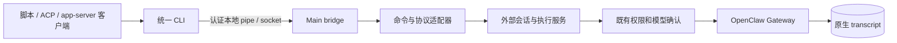

# CLI 与入站 ACP

安装后的 `<productName lowercase>-cli` 是桌面应用共用的命令行入口。
应用运行或驻留托盘时，CLI、ACP 和已实现的 app-server 子集默认可用，没有客户端专用启用开关。
入口使用随包运行时，不依赖系统 Node、首次下载或公网；不会打开第二份产品数据库或启动另一套 Gateway。

本页先说明命令用法，再说明 ACP 的会话、MCP 与审批资源。app-server 的握手、路由、WebSocket
和断连差异统一见[通用 app-server](app-server.md)，逐字段定义见[外部客户端规范](../../app-server-api/external-clients.md)。

## 1. 找到入口并运行命令

“设置 → 外部连接 → 应用接入”显示可复制的完整 CLI 路径及 launcher/bridge 状态。
刷新状态只读，不启动 Gateway。ACP 通过该入口的 `acp` 参数启动；app-server 提供并列的 stdio
与 WebSocket 配置面板。打开设置、复制配置或安装某个客户端都不是启用条件。

| 环境            | 入口位置与规则                                                                                                        |
| --------------- | --------------------------------------------------------------------------------------------------------------------- |
| Windows 安装版  | 应用旁的 `<productName lowercase>-cli.exe`；使用明确路径，不修改 PATH                                                 |
| Windows 开发版  | `.agent-tasks/external-agent/development/<profile-hash>/` 下的 profile 专属程序；准备命令以 `package.json` 为准       |
| macOS / Linux   | profile 私有 `external-agent/bin/<productName lowercase>-cli` wrapper；明确绑定所属 profile 并剔除 bootstrap 环境覆盖 |
| POSIX PATH 别名 | 优先 `~/.local/bin`，仅作为首个所属 profile 的便利入口；准备其他 profile 不覆盖它                                     |

可执行文件名来自外部产品名的小写形式加 `-cli`；协议通过参数选择。安装路径或开发路径变化后，
客户端需要更新命令路径，不提供旧客户端专用 executable、bootstrap 或 discovery 别名。

以下 `<cli>` 指复制出的路径。按所用 shell 为带空格的路径和提示词加引号。

```text
<cli> --help
<cli> --version
<cli> status --json
<cli> models list --json
<cli> exec --cwd <project-directory> --json "Describe this project"
<cli> exec --session <external-session-id> --stream-json "Continue the task"
<cli> acp
<cli> app-server --listen stdio://
<cli> debug models --bundled
```

### exec 的输入与会话规则

- help/version 无需运行桌面应用；status 只读取已有状态。
- 模型列表只包含已启用、已配置且凭据可用的聊天模型。
- `exec` 接受 `--cwd`、`--session`、`--model`、`--json`、`--stream-json`，以及 `--prompt <text>` 或一个位置提示词。
  `--` 后可提供以短横线开头的提示词。
- 新会话默认使用命令启动目录。恢复会话默认保留已存目录；明确传 cwd 也必须是同一真实目录。
- 模型选择经现有会话 mutation 队列确认，不改应用默认模型。

### 输出与退出码

| 输出模式       | stdout                                                     | stderr |
| -------------- | ---------------------------------------------------------- | ------ |
| 文本           | 最终回答                                                   | 诊断   |
| JSON           | 一个最终 `result` 或 `error`                               | 诊断   |
| Streaming JSON | 带外部 session ID、run ID 和原生事件的 `event`，最后为结果 | 诊断   |

退出码：成功 0、参数错误 64、宿主不可用 69、桥接或执行失败 70、确认取消 130。
意外输出或桥断连不代表成功。`EXECUTION_UNKNOWN` 保留已知 session/run ID，不能据此重试提示词。

## 2. 所有入口共用的执行与身份边界



### 本地桥与信任范围

传输保留 v4 有界帧、UTF-8、FIFO、队列上限和慢消费者背压。Main 只发布
`external-agent/bridge.json` 供所有命令发现当前 pipe token。端点和 launcher/model/session
服务归通用 `externalAgent` 领域，不探测或认证指定第三方应用。

命令仅允许为 app-server 身份标记转发可选 `CODEX_HOME`；不转发其他任务环境、客户端 token
或 server/workspace ID。Gateway 凭据不进入命令参数或协议输出。

访问范围是当前操作系统用户和应用 profile。客户端名称、标记目录只是显示资料，不是同用户
程序之间的授权边界。默认可用不增加权限，原生准备、模型校验、审批、身份与容量检查仍然生效。

### 外部会话与恢复

CLI、ACP、app-server 共用 `ExternalAgentBackendFactory`、`createExternalAgentExecution`
和 `ExternalSessionStore`，新会话 `source='cli'`。`cowork_external_sessions` 只保留
外部/原生身份与执行回执，不保存消息；新会话显示在 CLI 来源分组。

历史客户端的 scoped ID、tombstone 和原生映射保持原样，作为只读外部客户端历史展示。
新协议不会推测旧 scope、扫描 marker 获取授权或用裸 UUID 认领旧记录。

恢复必须核对来源、仍存在的产品会话、助手、真实 cwd 和已固定的原生会话身份。
外部 UUID 不能替换成任意 Gateway key。原生准入还接收预期 SID 和 lifecycle revision，
准备与派发之间发生 reset 时拒绝发送。所有协议按产品会话 ID 共用执行预留。

## 3. app-server 子集与客户端配置

ACP 客户端使用复制出的 command 和 `args: ["acp"]`。app-server 是另一协议，使用
`app-server --listen stdio://`。每个 app-server 连接只拥有一个外部线程。

支持 `initialize`、`model/list`、`thread/start`、`thread/resume`、`thread/name/set`、
`turn/start`、`turn/interrupt`，以及 reasoning、正文、用户准入和工具 item 通知。
只接受文本；不支持的 execution override、额外输入、reasoning/service tier 和客户端专用 MCP
配置会明确失败，不宣称拥有 ACP 的交互审批和会话 MCP 能力。

Multica 的配置示例选择基础协议 **codex**，使用同一 command，不添加额外参数；其
[适配器](https://github.com/multica-ai/multica/blob/main/server/pkg/agent/codex.go)
启动上述 app-server 命令。这是前端配置示例，不要求 Multica 凭据、安装检测或后端注册。
互通取决于方法、版本与能力，不取决于客户端名字，也不代表支持所有 Codex/ACP 功能。

### 可选 CODEX_HOME 身份标记

客户端提供 `CODEX_HOME` 时，可在该目录的
`sessions/rollout-external-<thread-id>.jsonl` 写一个仅含身份的 `session_meta`。
标记不含正文、工具结果或用量；不是初始化、创建、执行的条件，也不能授权 resume。

冲突文件及 marker 文件 symlink 被拒绝；已有客户端 sessions 目录可解析到其实际标记目录。
创建时标记失败只回滚尚未原生派发的新空产品会话；resume 失败不能删除已有会话。

## 4. ACP 的能力与进度流

ACP 使用精确锁定的 SDK，声明稳定协议 v1。支持：

- `initialize`、`session/new`、`session/prompt`、`session/cancel`、`session/close`；
- 流式 `session/update`、`session/set_config_option` 模型选择；
- 双向 `session/request_permission`；同连接可拥有多个独立 cwd 的会话。

会话请求中的绝对 cwd 是权威，不必等于 CLI 启动目录。prompt 支持文本与 resource link；
引用不会触发隐式读文件或联网，模型真正读取时仍由原生工具授权。

不声明图片、音频、embedded resource、额外 roots、HTTP/SSE MCP、客户端文件系统或 terminal。
`loadSession` 为 false：身份标记或截断历史页无法满足 ACP 完整回放要求，不能靠改版本号宣称兼容。

### 进度准入与输出顺序

prompt 不阻塞接收循环，取消通知和审批回复可与执行/输出 drain 并发处理。
正文、reasoning 和工具事件直接投影原生执行；暂定 terminal-guard 正文等待 commit，rollback 时丢弃。
最终 prompt 响应排在本轮所有已排队 update 后面。

原生进度可能在会话投影准备中省略 SID。此时 Main 只有在同一来源连接的 `sessions.describe`
证明固定 SID 与 incarnation 后，才接纳未标注的正文、thinking 和工具进度；还需精确 active run，
或先前带精确会话身份的 lifecycle start。owner 投影可能不含 active-run 列表。
精确整轮终态可在 run 离开活动列表后证明先前排队事件，并为流划界。
显式身份冲突和未标注 lifecycle 仍拒绝。

输出使用同一 FIFO，上限 1024 帧 / 8 MiB，身份证明和 drain 各有五秒期限。
进度不能结算执行；输出失败也不能覆盖另行确认的原生结论。

## 5. ACP 会话 MCP 的资源管理

### 创建、目录与平台范围

Windows/Linux 接受每会话的 stdio MCP 定义，在首个 prompt 获准执行前连接。
服务器和包必须已在本地；推荐绝对 executable 路径，也可由受管 PATH 解析名称。
Runtime Services 经认证的 `runtimeServices.externalMcp.open/close` 拥有发现、子进程与清理。
定义仅属于该会话，不修改全局 MCP 或其他会话目录。

open 声明原生 session-write scope 和必要 profile，handler 在启动和整个 lease 期间还要求
连接的认证 admin scope。close 保留 admin 要求，但不要求会话仍存在，以便 reset/删除后清理。

macOS 可使用普通 CLI/ACP，但在启动会话 MCP 进程前拒绝该能力：锁定公开 MCP SDK 不提供
独立进程组创建，原生清理 API 无法确认回收 wrapper 后代进程。

### 工具调用与审批

锁定 SDK 要求静态工具名，因此 Runtime Services 只向精确 leased session 暴露固定
`external_mcp`。`list` 返回原服务器 schema（含 root 引用），`call` 选择 server/tool 并按
该 schema 验参；原始结果保留在工具详情。不伪造原生 MCP App 注册或客户端 terminal UI。

每次调用使用原生插件的一次性审批，Full 模式也不例外。审批绑定当前 lease、原生 session、
tool call 和 canonical 参数；客户端 annotations 不授权。root、权限或 incarnation 变化使旧 lease
失效。会话/连接关闭撤销 lease 并停止所属 MCP 进程，应用退出停止 registry。

## 6. 审批、取消与未知结果

### 审批归属

只有 ACP 在 prepared turn 安装精确 approval owner 后声明交互审批；内部使用
`webchat` 和 `deliver:false` 以接收权限请求，不自动授权或向外部渠道投递回答。
普通 `exec` 保留原生非交互审批行为。

ACP 独占本轮精确 native run 的 exec/plugin 审批展示；桌面列表排除已路由给该 owner 的请求。
客户端只能选择原生支持的一次性允许/拒绝，Main 在解决前复核 run、session、incarnation、
连接、到期和 option ID。迟到、已取消、断连回复不允许操作；未知审批发送不在新连接重放。

取消立即撤回本轮审批权限，包含正等待身份读取的回复；展示归属保留至结算，Stop 未确认时
不能让后续审批回退到桌面。

### 结算与恢复

| 证据或事件                                               | 处理                                                                       |
| -------------------------------------------------------- | -------------------------------------------------------------------------- |
| 精确整轮终态 / 精确原生 wait 回执                        | 确认原生结果；本地取消与已确认成功/失败竞争时不改写结果                    |
| Stop ACK、chat final、attempt completion、历史正文、idle | 不足以结算                                                                 |
| 原生确认取消                                             | 才映射为 interrupted，退出码才可为 130                                     |
| 传输丢失或提交未知                                       | 保留原身份、回执与预留，不重发任务；后续 EOF/取消仍请求精确 abort          |
| 权威/回执长期不可用                                      | 有界核对后返回 unknown；精确证据表明仍 active 时可延长观察，不设总任务时限 |

yielded 后续执行若无法经公开 API 精确归属，保持 unknown 和预留。ACP 持有 MCP/审批资源时
替换 Gateway，也不能静默把资源转给新进程。应用重启后未知 CLI 记录继续阻塞，不假定取消或自动重放。

### 最终输出的补全

原生终态正文快照最多 4096 UTF-16 units。确认完成后，只有同 run 的 final RPC、匹配 producer
metadata 与 snapshot projection，才可在五秒内恢复可能截断的全文。
无法核验或缺少全文时返回输出错误，保留已确认的执行结论；不重发提示词，也不把截断快照
追加到已流出的 ACP 正文。

## 验证范围与发布验收

| 证据层                      | 已覆盖内容                                                                                                                            | 不能替代什么                                                 |
| --------------------------- | ------------------------------------------------------------------------------------------------------------------------------------- | ------------------------------------------------------------ |
| 定向测试                    | 真实 Windows console、独立 ACP SDK peer、UTF-8 拆包、默认发现、慢输出、审批/取消并发、stdio MCP、schema、来源隔离及未知元数据         | 正式安装包及真实远端服务                                     |
| 插件冷构建                  | resource sync / TS precompile 的实际 registry、Ajv、MCP client；无外部 node_modules 的本地 stdio server；清单及原生方法 scope/profile | 完整 Gateway/model/client 验收；原生会话和进程树边界仍有替身 |
| 2026-10-23 Windows 开发验收 | 无系统 Node/客户端任务变量；CLI、独立 ACP/app-server 真实模型调用；相互 resume、可选 marker、EOF；Multica 0.6.5 新会话                | POSIX 或最终 installer                                       |

历史开发验收的新映射为 `source='cli'`、精确原生身份及 settled 回执，旧 scoped 映射未改；
临时直连模型测试后恢复了原代理设置。上述历史证据不表示本次文档修改重新运行这些验收。

发布仍需在最终安装包、无系统 Node、公网阻断、无缓存、中文/空格路径下验证普通 CLI、独立
ACP 和 app-server peer，再验证 Multica 配置示例。覆盖模型选择、真实 MCP、审批、cancel、EOF、
断连及重启。测试产物不得保存私有 prompt、token 或原生 transcript。
