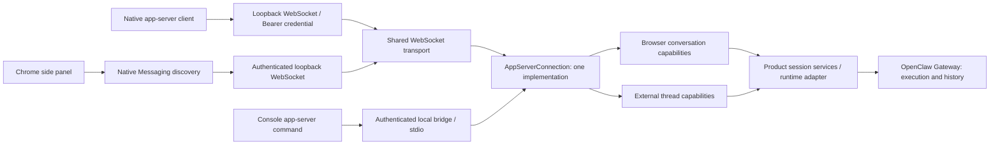

# Shared app-server protocol

The native-client WebSocket, Chrome side chat and the CLI's
`app-server --listen stdio://` entry use one
`AppServerConnection` implementation in `src/main/appServer/`. Each authenticated
connection has its own instance. The common implementation owns request parsing,
request IDs, initialization, method routing, response/error envelopes, notification
opt-out and suppression of output after disconnect. There is one method dispatch
table; no endpoint implements another RPC dispatcher. Both WebSocket listeners
also use the same `AppServerWebSocketServer` transport implementation.



## Capabilities and authority

Main supplies a typed binding when constructing each connection. Client names,
requested capabilities and notification preferences cannot add operations or
change session authority. An absent operation returns method-not-found; the router
does not fall back to another endpoint's backend.

| Capability | Chrome extension profile | stdio and native-client WebSocket |
| --- | --- | --- |
| Initialization, requests, errors and notification envelopes | Shared protocol engine | Shared protocol engine |
| Session scope | Only conversations created by the browser extension | One external thread owned by the connection |
| Create and continue | Extension conversations | New or explicitly resumed external thread |
| List, history, images and composer options | Extension conversations | Not exposed |
| Model discovery | Composer options | `model/list` |
| Text and cancellation | Supported | Supported |
| Attachments, page context and per-turn model/permission selection | Supported under existing validation | Not exposed |
| Live progress | Native `thread/stream` and calibrated `thread/updated` | Standard item and text/reasoning notifications |
| Automation pairing | Authenticated browser-specific operation | Not exposed |

Browser scope is checked by `source: browser-extension` at the domain boundary,
including list, read, stream subscription, image/media access, composer selection,
send and stop. Supplying a desktop or CLI conversation ID cannot bypass that
scope. The desktop can still display and continue an extension conversation.
No database migration or rewriting of historical source identities is required.

The browser binding retains product conversation/history projections, shared
native-stream subscriptions and terminal reconciliation. The console binding
retains opaque external thread mappings, working-directory/model validation,
optional identity-only markers and execution reservations. These services own
different capabilities; they do not parse RPC envelopes, choose error codes or
implement method dispatch. Typed notifications leave through the common engine.

## Connection lifecycle

Chrome keeps its strict `initialize` response followed by `initialized`
notification. The console remains usable after its `initialize` response, as
required by its existing clients. Chrome executes implemented notifications
without replying; the console ignores notifications that could perform work.
Notification opt-out matches exact method names. Error classification lives in
the common engine, preserving each endpoint's existing error shape and Chrome's
conservative `turn/start.error.data.requestSent` semantics.

Request handling waits for operation admission rather than execution completion.
A pending start cannot block an interrupt. Chrome can receive native progress
before its send acknowledgement. The console returns its start response before
deferred execution begins. Closing a connection invalidates pending output.

Disconnect policy belongs to the binding. Chrome releases only that panel's
subscriptions; accepted and uncertain work can continue and be reconciled after
reconnection. A browser server restart preserves its active-turn reconciliation.
Restart pauses observations and invalidates in-flight poll continuations before
resuming them once. A complete server stop advances the hub generation: late
start/read/interrupt results from an old generation cannot recreate subscriptions,
polls or output, including after the service is started again. This retires only
the observer; an accepted execution keeps its original product/native identity.
Console EOF requests cancellation of its exact active or unknown execution and
waits for owned cleanup. Native-client WebSocket disconnect and service shutdown
use the same exact cancellation and drain policy. Abnormal transport closure or
output failure retains its stream-error reason rather than reporting a successful
or normally cancelled execution. Neither policy cancels another connection's work or
converts a cancellation acknowledgement into a completed execution.

Both bindings continue to require matching native session identity, incarnation,
connection generation and whole-run terminal or exact wait receipts. Chat final,
idle, history content and Stop ACK are not terminal evidence. Unknown sends retain
their identities and reservations; reconnection never replays them.

## Transports and related protocols

The native-client WebSocket service starts with the desktop application, without
an enable switch. It listens on a random `127.0.0.1` port at `/app-server` and
requires an independent random 32-byte Bearer token in the HTTP Upgrade
`Authorization` header. This endpoint accepts native clients without an `Origin`
header; browser clients use the extension profile below. Neither a client name
nor browser credentials select or upgrade its binding. Every connection uses
`AgentCommandService.connectAppServer`, the same `CliAppServerBinding`, backend,
external session namespace, reservations and CLI conversation group as stdio.
No `CODEX_HOME` or ambient client environment is used for WebSocket connections.
The default cwd is the application-configured working directory, captured on
authenticated connection; explicit `thread/start.cwd` can override it. Resume
without cwd preserves the stored directory.

Settings → External connections → App access groups the `acp` command and its
configuration copy action with the shared CLI entry. Codex app-server has peer
stdio and WebSocket panels; the stdio panel retains a collapsed Multica example.
The WebSocket panel presents its address and connection configuration directly.
The WebSocket status IPC is a read-only `{running, url}` projection
without credentials and cannot start the listener or Gateway. A separate IPC,
restricted to the current main application frame, supplies the current connection
configuration only when the user copies it:

```json
{
  "url": "ws://127.0.0.1:<current-port>/app-server",
  "headers": { "Authorization": "Bearer <current-token>" }
}
```

This is a connection configuration example, not an additional RPC method or an
official client-specific configuration schema. The credential is not rendered,
persisted, logged or included in CLI status output. Port and token change after
restart; copy the configuration again. Shutdown immediately revokes discovery
and new handshakes before waiting for owned native cleanup; a pending listen
cannot republish an obsolete instance. No persistent discovery file is added.
Application exit waits up to five seconds for this drain, then continues the
existing Gateway teardown if a native task is still pending. The original drain
remains observed; the deadline never marks an execution complete or cancelled.
The CLI itself continues to accept `--listen stdio://`; the WebSocket is the
already running application's listener, not a separate CLI-launched runtime.

The shared transport bounds incoming frames to 8 MiB, connections to 32 and
pending input to 64 frames / 8 MiB per connection. Native-client output is bounded
to 8 MiB per frame / 16 MiB pending. Chrome selects 32 MiB / 64 MiB output bounds
to retain its existing 20 MiB image reader and base64 overhead. Pending close
drains remain tracked after a socket disconnects, so service shutdown cannot
finish early while an owned execution is still cleaning up.
Ordinary pending RPC handlers retain their connection-capacity accounting until
they return, but do not block Chrome restart. Each binding's `close()` determines
its execution cleanup; late browser results remain fenced by the hub generation.

The browser WebSocket still binds only to loopback and requires the fixed
extension Origin, exact path, random capability and bounded frames. Native
Messaging only discovers an already running application. The CLI's local bridge
retains its own authenticated pipe/socket, frame and backpressure rules. Sharing
the protocol does not share credentials or open browser capabilities to the CLI.

ACP and ordinary CLI commands remain separate protocol/command adapters using
their existing external execution backend. Browser automation relay, Gateway
credentials, native history, permissions and application lifecycle ownership are
unchanged by app-server consolidation.

See [CLI and ACP](agent-cli.md), [Chrome side chat](../browser/browser-extension-side-chat.md)
and the [browser wire contract](../../browser-extension-api/README.md) for each
endpoint's supported fields and limitations.

The [official Codex app-server documentation](https://learn.chatgpt.com/docs/app-server#protocol)
describes stdio and WebSocket transports (the upstream WebSocket is experimental).
This product implements the documented subset above; Chrome-only events and
methods remain explicit extensions rather than being advertised as standard APIs.
