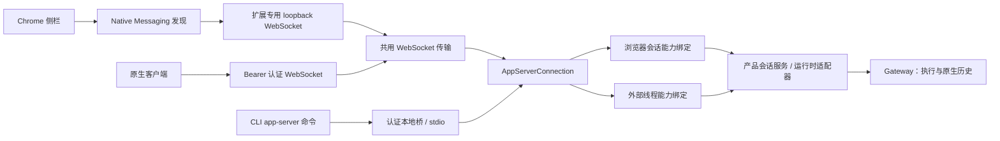

# 通用 app-server：连接、能力与生命周期

桌面原生客户端 WebSocket、Chrome 侧栏聊天与 CLI 的
`app-server --listen stdio://` 共用 `src/main/appServer/` 中的协议引擎。
本页维护共享协议和连接边界；命令行与 ACP 的使用、执行和资源管理见
[CLI / ACP](agent-cli.md)，逐字段规范见 [app-server API](../../app-server-api/README.md)。

## 1. 一个协议引擎，三种连接入口

每条认证连接拥有一个 `AppServerConnection`。它统一处理请求解析、ID、初始化、方法路由、
响应/错误、通知过滤和断连后的输出撤销。两种 WebSocket 监听器还共用
`AppServerWebSocketServer`，各入口不另建 RPC 分发器。



Main 在创建连接时传入类型化能力绑定。客户端名称、请求的 capabilities 或通知偏好不能增加
操作权限；绑定中没有的方法返回 method-not-found，不回退到其他入口的后端。

| 能力                            | Chrome 扩展连接                                  | stdio / 原生客户端 WebSocket     |
| ------------------------------- | ------------------------------------------------ | -------------------------------- |
| 连接范围                        | 扩展创建的会话                                   | 每连接一个外部线程               |
| 创建与继续                      | 扩展会话                                         | 新建或明确恢复外部线程           |
| 列表、历史、图片与输入选项      | 扩展会话内提供                                   | 不提供                           |
| 模型发现                        | composer options                                 | `model/list`                     |
| 文本与取消                      | 支持                                             | 支持                             |
| 附件、页面上下文、每轮模型/权限 | 按现有校验支持                                   | 不提供                           |
| 进度                            | 原生 `thread/stream` 与校准后的 `thread/updated` | 标准 item、正文与 reasoning 通知 |
| 自动化配对                      | 浏览器专用认证操作                               | 不提供                           |

浏览器领域按 `source: browser-extension` 校验列表、读取、订阅、媒体、输入选项、发送和停止。
传入桌面或 CLI 会话 ID 不会获得访问权；桌面仍可查看和继续扩展会话，无需改写历史来源。

两类绑定只提供领域能力，不解析 RPC 包、不选错误码，也不自行分发方法：

- 浏览器绑定保留产品历史投影、共享原生流订阅和终态核对。
- 外部绑定保留不透明线程映射、cwd/模型校验、可选身份标记和执行预留。

## 2. 初始化、请求与输出顺序

| 行为         | Chrome                                     | stdio / 原生客户端          |
| ------------ | ------------------------------------------ | --------------------------- |
| 初始化       | `initialize` 响应后还需 `initialized` 通知 | `initialize` 响应后即可使用 |
| 客户端通知   | 执行已实现通知，不回复                     | 忽略可能产生工作的通知      |
| 开始执行     | 原生进度可能早于发送 ACK                   | start 响应先于延后执行      |
| 通知退出订阅 | 按完整方法名精确匹配                       | 同左                        |

请求处理只等待操作准入，不阻塞到执行完成；尚未返回的 start 不能阻塞 interrupt。
错误分类由共用引擎维护，保留各入口既有错误形态，尤其 Chrome 的
`turn/start.error.data.requestSent` 保守语义。连接关闭后不再发布旧输出。

## 3. 断连、重启与执行结算

### Chrome：撤回观察，不取消已接纳工作

面板断连只释放本面板的订阅。已接纳或结果未知的工作可以继续，重连后按原身份核对，不能重放。
浏览器服务器重启时暂停观察、撤销在途轮询续体，随后只恢复一次；完整 stop 则推进 hub generation。
旧代次的 start/read/interrupt 即使迟到，也不能重建订阅、轮询或输出。

观察者退役不改变已接纳执行的产品/原生身份。服务再次启动也不能接纳旧代次的输出。

### 外部线程：取消精确运行，等待所属资源清理

stdio EOF、原生客户端 WebSocket 断连或服务关闭，都会请求取消本连接拥有的 active/unknown
执行，并等待清理。异常断连或输出失败保留 stream-error 原因，不能报告为成功或正常取消。
关闭一条连接不能取消另一条连接的工作。

应用退出最多等待该 drain 五秒，之后继续既有 Gateway 关闭流程；原 drain 仍被观察。
这个期限只约束退出等待，不把执行标为已完成或已取消。

### 共同约束

两类绑定均核对原生会话身份、incarnation、连接代次，以及整轮终态或精确原生 wait 回执。
chat final、idle、历史正文和 Stop ACK 都不能结算执行。未知提交保留原身份与预留，重连不重发。

## 4. 原生客户端 WebSocket 的接入

### 地址与凭据

该监听器随桌面应用启动，没有启用开关。它使用随机 `127.0.0.1` 端口和固定 `/app-server` 路径，
HTTP Upgrade 必须提供独立随机 32 字节 Bearer token。该入口允许不带 `Origin` 的原生客户端；
浏览器使用自己的扩展入口。客户端名称或扩展凭据不能改变能力绑定。

每连接通过 `AgentCommandService.connectAppServer` 使用与 stdio 相同的
`CliAppServerBinding`、外部会话命名空间、预留和 CLI 来源分组。WebSocket 不读取客户端
`CODEX_HOME` 或环境变量。认证时捕获应用配置的默认工作目录；`thread/start.cwd` 可以明确覆盖，
resume 未传 cwd 时保留已存目录。

### 设置页与复制配置

“设置 → 外部连接 → 应用接入”提供 CLI/ACP 入口，并将 app-server 的 stdio 与 WebSocket
作为并列面板；Multica 示例归 stdio 面板。状态 IPC 只返回 `{running, url}`，没有凭据，
也不能启动监听器或 Gateway。用户复制连接配置时，独立的主应用 main-frame-only IPC 才返回：

```json
{
  "url": "ws://127.0.0.1:<current-port>/app-server",
  "headers": { "Authorization": "Bearer <current-token>" }
}
```

这是连接信息示例，不是新增 RPC 或特定客户端的官方配置格式。凭据不在界面显示、不持久化、
不写日志，也不进入 CLI status。端口和 token 重启后变化，需要重新复制。

服务关闭先撤销发现与新握手，再等待资源清理；尚未完成的 listen 不能重新发布旧实例。
不创建持久发现文件。CLI 仍只接受 `--listen stdio://`，WebSocket 属于正在运行的桌面应用，
不由 CLI 启动另一套运行时。

## 5. 传输容量与其他协议的边界

| 限制             | 共用输入      | 原生客户端输出 | Chrome 输出 |
| ---------------- | ------------- | -------------- | ----------- |
| 单帧             | 8 MiB         | 8 MiB          | 32 MiB      |
| 每连接待处理     | 64 帧 / 8 MiB | 16 MiB         | 64 MiB      |
| WebSocket 连接数 | 32            | —              | —           |

Chrome 较大的输出上限用于保留既有 20 MiB 图片读取及 Base64 开销。
已断连 socket 的 close drain 继续登记，服务不能在所属执行尚未清理时提前完成关闭。
普通 pending RPC 到返回前仍占连接容量，但不阻止 Chrome 重启；其迟到结果受 hub generation 限制。

扩展 WebSocket 继续要求 loopback、固定扩展 Origin、精确路径、随机 capability 和有界帧。
Native Messaging 只发现已经运行的应用。CLI 本地桥保留自己的认证 pipe/socket、帧和背压规则。
共享协议不会共享凭据，也不会把浏览器能力开放给 CLI。

ACP 与普通 CLI 是独立的协议/命令适配器，复用外部执行后端；浏览器自动化 relay、Gateway
凭据、原生历史、权限和应用生命周期不因 app-server 共用引擎而改变。

## 6. 规范与支持范围

- [外部客户端规范](../../app-server-api/external-clients.md)：stdio 与原生 WebSocket 字段。
- [Chrome 规范](../../app-server-api/browser/README.md)：浏览器专属字段和通知。
- [Chrome 侧栏](../browser/browser-extension-side-chat.md)：用户流程和产品集成。
- [上游协议参考](https://learn.chatgpt.com/docs/app-server#protocol)：本产品仅实现上述明确子集。

Chrome 专属方法和事件作为显式扩展维护，不宣称是标准 API。真实客户端与安装包的验收范围随
[CLI / ACP](agent-cli.md#验证范围与发布验收)及浏览器功能文档维护。
