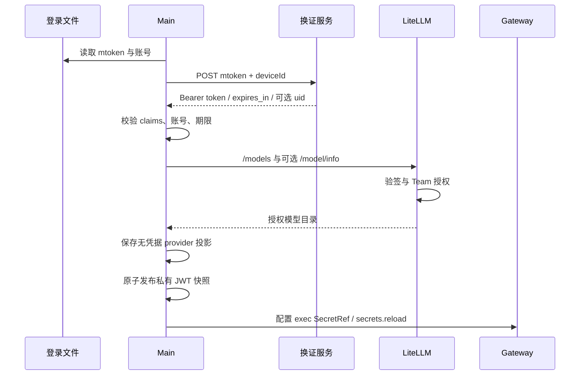

# 内置模型认证与账号生命周期

内置 provider 的稳定 ID 为 builtin_models。当前生产路径使用登录 mtoken 换短期 JWT，服务端 Team 授权，OpenClaw SecretRef 解析。本文按客户端配置、换证、模型发现和服务端 Hook 分层说明，不把登录文件、JWT 和模型 API Key 混为同一凭据。

登录模块实际接线、调用顺序和失败语义见[登录与模型生命周期接口](../../developer-integration/login-model-lifecycle-api.md)。

## 1. 部署前必须确定的配置

`src/config/builtinModelAuth.ts` 编入 Main，包含完整 tokenExchangeUrl、maxJwtLifetimeSeconds 和仅开发模式使用的认证选择。仓库换证地址、模型 base URL 和出站请求头白名单留空，部署时填写；JWT 上限保留 10800 秒。空换证地址禁用换证，不从模型 base URL 推断，也不发送 mtoken。

组织接口若签发更长 token，客户端与服务端必须显式配置一致上限，支持范围 30–10800 秒，不能根据返回值自动放宽。修改配置需重启开发 Main 或重新打包，用户目录不存在另一套自动生成的换证配置。

未打包开发可临时使用 api-key 模式，正式包忽略该模式，打包钩子要求恢复 jwt 并清空调试 key。配置说明见 [部署客户端](../../../deploy/client/README.md)。

## 2. 凭据的去向

| 数据           | 来源                    | 允许到达                                     |
| -------------- | ----------------------- | -------------------------------------------- |
| mtoken         | 登录组件 user_info.json | Main → 明确配置的换证服务                    |
| X-User-Account | 同一登录身份            | Main 校验与直发请求、既有出站代理注入       |
| deviceId       | 本机有效网卡 MAC        | 换证请求；不代表设备密钥绑定                 |
| JWT            | 换证服务                | Main、私有派生快照、Gateway 内存、模型数据面 |
| X-Cookie       | 既有登录/工具链         | 不作为 JWT 或模型独立授权                    |
| Team 权限      | 服务端数据库            | 模型目录、预算、blocked、限流                |

登录文件由 `resolveOutboundHeaderUserInfoPath()` 定位到
`<app.getPath('appData')>/<productName>/<directoryName>/<userInfoFileName>`，目录名与文件名由
`src/config/loginStorage.ts` 的 `LOGIN_STORAGE_CONFIG` 分别配置，实际名称以构建配置为准。
Windows 路径为 `%APPDATA%/<productName>/<directoryName>/<userInfoFileName>`。
历史迁移及中断恢复不归档 `directoryName` 配置的登录目录，登录信息和同目录其他业务文件均保留原位。
更改名称不自动迁移或回退读取旧文件；配置修改方式见[部署配置](../../../src/config/README.md#登录信息目录)。
隔离开发 profile 仍读取这个固定产品路径，
不能用该 profile 的 `userData` 推导登录文件。JWT 不回写登录文件，mtoken 不进入 Gateway 或产品数据库。

deviceId 通过 Main 公共模块 `src/main/core/network/macAddress.ts` 的 `getMacAddress(): string` 获取。按系统网卡枚举顺序选择第一个非 internal、非全零且格式有效的 MAC，去掉冒号并转为 12 位大写十六进制；不额外按网卡名称猜测物理、虚拟或连接状态。登录模块应复用同一函数。没有可用 MAC 或网卡查询失败时抛错，不生成替代标识；换证在发送请求前失败。

MAC 按调用时的网卡信息获取，不缓存或写入设备标识文件，也不读取已有 model-device.json。换证服务只接受规范化后的 MAC；网卡选择或随机 MAC 变化可能改变 deviceId，登录与换证须遵循同一设备绑定约定。服务端不能通过自身网卡重新计算客户端 MAC。

## 3. 换证、发现与原生接入

换证拒绝 redirect，timeout 15 秒，响应最大 32 KiB。返回必须为 Bearer，uid/sub 与登录账号一致，JWT 期限需满足本地上限和 expires_in。Main 要求非对称算法、非空 iss/jti、整数 iat/exp 和字符串 `aud: 'justdo-litellm'`；kid 可选，兼容内网 `RS256`、无 kid 的签发形态。Main 做结构、账号、audience 与时间预检，真正的签名、可信 issuer、audience 和 Team 授权在服务端完成。

模型发现 `/models` 必需，`/model/info` 可选增强；区分 chat/embedding 并规范化能力。Main 直发请求使用 `Authorization: Bearer <真实JWT>`，同时保留 `X-ACCESS-JWT` 和 `X-User-Account`；api-key 开发模式只发送 Bearer key。provider 配置中的非秘密占位符仅用于应用内配置投影，不能作为网络请求凭据。Gateway 和 memory search 通过同一 JWT SecretRef 解析真实 JWT 并发送 Bearer 认证。

换证日志只记录受控失败阶段（URL、MAC、网络请求、响应、JWT、身份复核）、固定原因、可选 HTTP 状态，并单独区分超时。网络请求异常可附带 `networkCode`，只接受固定白名单中的 DNS、连接和 TLS 错误码；有界读取 Error/cause 和聚合连接异常，不记录其原始内容、未知错误码、URL、请求体、响应体、mtoken、JWT、Cookie 或 MAC。本地凭据校验失败附带受控 `credentialCode`，区分编码、必需字段、账号、audience、算法、时间、期限上限及 `expires_in` 不一致，不记录 claims 的值，也不改变原有校验或表示客户端已验签。对外继续返回统一失败错误。

## 4. 轮换与并发

Main 监听登录文件，通常在剩余 60 秒续签；短生命周期 token 按有效期一半安排并预留安全窗口，避免高频循环换证。并发 refresh 合并，generation 和 AbortController 使账号切换后的旧结果失效。

短暂网络错误可继续使用尚有效 token，到期前 15 秒失效；400/401/403 立即清除。显式退出后旧 mtoken 即使尚留文件也不能被后台重试重新启用。重新换证成功还需复核当前身份，不能把 A 账号结果写给 B。

同一已确认认证会话的有效轮换直接发布派生快照并等待原生 `secrets.reload`，不再先等待模型目录发现。
首次登录、显式刷新目录、认证会话替换及 provider 清理后的恢复仍执行完整目录同步；同 token 的新登录也不能复用旧会话确认。
轮换不撤销同一登录中尚未完成的目录发现，发现完成后仍需投影最新目录；退出和新登录继续撤销旧会话工作。
轮换应用失败保留待确认状态，不能把文件已写或后续文件字节未变当作已加载；只有同认证会话、同 Gateway 进程及生命周期的 ACK 和权限核验均成功才确认。
配置与凭据同时变化时，先等待对应配置应用，并核对原生 `configRevisionHash` 与 `appliedConfigHash`，再重载凭据；
`secrets.reload` 使用已加载的 source config，单独的成功 ACK 不能确认尚未加载的新 SecretRef。延后的配置重启同样保留未确认状态。
已接受或请求结果未知的原生重启继续等待 ready，后续环境变更不能竞争发起宿主重启；
同一进程的原生 ready 也不能结清仍需更新启动环境的完整重启。

凭据重载对 `UNAVAILABLE`、客户端超时及明确的传输断连最多尝试三次，间隔 500/1500 毫秒。
它是同一实例的幂等快照刷新，不重发聊天、模型请求或工具；原生权限、协议拒绝及非法 ACK 不按临时故障重试。
每次请求前、重连后、ACK 后和最终停止前核对所属实例及认证会话，迟到结果不能确认替代登录或停止替代进程。
Windows PowerShell 冷启动解析预算为 60 秒，凭据重载 RPC 为 90 秒，覆盖命令权限检查及快照发布；其他平台为 5/35 秒。

连续失败仍拒绝应用并停止 Gateway。后续后台同步只允许对这次刷新导致的确切失败实例尝试一次受控启动恢复，
重新加载当前配置并初始化权限；再次失败继续保持未确认，不循环重启，也不自动启动用户主动停止的实例。
恢复后仍完成当前同步所需的模型引用修复和已移除 provider 的凭据清理；恢复启动本身不能替代整次同步确认。
显式退出先撤销旧刷新及恢复债务，退出同步不能借其重新启动 Gateway。
正常轮换不重启活跃 Gateway。配置本身变化仍走原生配置 watcher 与受管同步。

正常登录启用、退出关闭内置模型同样使用热更新：增删 Provider、更新默认模型引用和 SecretRef，
不会改变 Gateway 启动环境或监听配置。默认启用的 `memory-core` 为 `memory.search` 声明热更新归属，
其索引服务可以重新加载，不代表整个 AI 引擎重启。显式禁用该插件或更换 memory slot 后，
不能沿用这项服务归属假设。登录遇到正在启动的 Gateway 会先等待原启动完成再发布配置。
登录的配置热更新未确认时仍允许恢复性重启；退出的撤权热更新未确认时停止 Gateway，不能自动恢复旧登录。

隔离回归通过实际配置投影与锁定运行时的原生重载计划，覆盖无自定义供应商和保留自定义供应商时的
启动、登录、退出及再次登录；同时检查监听配置、启动环境、内置 embedding 与默认模型引用。
测试只收集原生记忆插件的服务声明，不启动 Gateway、索引服务或真实登录流程，不代表远端服务可达性验收。

### 长任务的请求级凭据

原生运行会捕获 `resolvedApiKey` 和模型请求头；`secrets.reload` 更新后续准入使用的快照，
不能改写已经运行的任务闭包。只做后台换证会使长任务在旧 JWT 到期后，下一次模型请求仍携带旧值。

必需的 Runtime Services 通过公开 Provider API 为 `builtin_models` 注册 `wrapStreamFn`
和 `wrapSimpleCompletionStreamFn`。每次模型请求通过原生 `resolveSecretRefValues` 无缓存解析
同一受管 exec SecretRef，复用其路径、权限、输出大小和超时校验；保留原生模型传输、
工具结果、取消和执行结算。仅克隆本次请求的模型和 options，同步替换 `apiKey`、
`Authorization` 和大小写不敏感的 `X-ACCESS-JWT`，不修改运行快照或重放任务。
开发 API key 模式仅使用 Bearer，不新增 JWT 头；自定义 provider 不进入此包装。

Main 为每次模型登录生成随机 `authSessionId`。JWT 正常续签和临时到期后的同身份恢复保持此标识；
显式退出、mtoken/账号/换证配置变化、认证拒绝和应用重启都会撤销旧标识。
派生快照记录该标识，受管 exec 配置的 `MODEL_AUTH_SESSION_ID`、`MODEL_AUTH_TYPE`
仅携带非秘密会话标识与认证类型。任务保留其原 exec 环境，解析器每次核对当前快照的
会话与认证类型，因此同账号重新登录也不能让旧任务借用新登录的 JWT。
凭据失效时 Main 在等待目录或配置清理前同步删除派生快照。
同步删除若因文件占用或权限失败，退出协调器仍等待原有 provider/config 清理；
后续清理失败继续走既有 Gateway 停止保护，不能因撤销异常跳过清理。应用退出同样保留运行时关闭流程。

缺失、到期、会话不符、解析失败或请求路由不匹配均拒绝发送，不回退捕获的旧 JWT；
已取消的请求不再进入模型传输。该机制不依赖新增本地 HTTP 服务、公网服务或 runtime patch，
也不能撤回已经发出的远端请求。

## 5. 本地持久化边界

builtin provider 在 SQLite/Renderer 中 apiKey 为空，只保存 base URL、模型与产品标记。openclaw.json 中的 apiKey 和 X-ACCESS-JWT 使用 justdo_login exec SecretRef；launch env 不放 JWT。内置 provider 不再投影 X-User-Account 请求头，也不把它包装成 SecretRef；exec 解析器只返回 JWT 并拒绝请求账号，避免账号进入原生精确值脱敏名单或模型缓存。私有快照仍保存已验证的 JWT、账号和到期时间，不复制 X-Cookie。

该调整不改变 Main 的 JWT sub/账号校验、Main 直发请求、服务端账号一致性校验或出站代理注入。Gateway 请求所需的 X-User-Account 继续由既有代理按 URL 白名单注入，同名头替换保持既有规则；依赖该身份头的服务必须匹配正确的代理策略。已经进入旧 Gateway 进程的账号脱敏记录不会因配置更新自动清除，需要在更新后重启应用；已有历史中已保存的星号不会据此恢复。

快照采用私有权限及 AES-GCM 包装，但材料可由客户端推导，不抵御同用户逆向；安全依赖短期凭据和服务端验证。解析器只接受已知 secret id，复核期限，通过受限管道返回，不新增长期本地 token 转发服务。

自定义 provider 保持自己的 file SecretRef 路径和配置，不因 builtin logout 被清理。产品 appConfigCredentials 也不能被描述成统一加密所有自定义 key，见[存储](../../architecture/10-data-storage.md)。

内置语言模型与自定义语言模型统一投影 `models.providers.<id>.request.allowPrivateNetwork: true`，用于模型 HTTP 传输访问企业内网或代理 Fake-IP；授权也覆盖原生重定向。该字段随登录生成、凭据解析和轮换保留，退出时随内置 Provider 一起删除，不改变 JWT、开发 API Key、账号绑定或 SecretRef 验证。换证、目录发现及记忆检索沿用各自网络策略，不从这个模型请求字段继承授权。

## 6. 退出、失效与发现失败

凭据缺失/失效时清内存、中止旧发现，移除 builtin provider、相关 memory search 引用与受管 SecretRef，同步 Gateway 并通知 Renderer；不继续请求模型服务。

发现失败但凭据有效且 generation 仍最新时，保留最近成功目录及最新模型启用状态，避免把暂时网络失败误判为模型下架。账号切换必须先完成退出清理，再写入新账号并调用登录入口，避免继承上一账号缓存。成功返回空目录则真实清空，已失效默认模型按可用列表回退。当前可选 `/model/info` 返回非成功 HTTP 状态时降级为无增强元数据；网络异常或 JSON 解析失败仍按整次目录刷新失败处理并保留缓存。

## 7. 服务端长期授权

仓库内参考 LiteLLM JWT Hook 验证非对称签名、kid、issuer/audience、时间与账号，解析 internal user 和唯一非 legacy jwt_managed Team，再进入公共模型、blocked、预算和 RPM/TPM 检查。该 Hook 的 kid 策略与当前内网签发形态不同；内网服务应使用其实际配置的可信验签密钥，客户端允许缺少 kid 不会替代服务端验签。JWT 轮换不会重新创建 Team 或每用户 Virtual Key。

认证 dispatch 将 JWT 与普通 Key/管理会话分开，JWT 失败不得回退到旧 Key。多 worker 用量协调与权限缓存传播属于部署范围，不能承诺权限变更瞬时生效。

旧客户端限时 legacy Key 是独立服务端兼容机制，不是新版客户端凭据。部署前若旧值仍为 master key，先旋转 master；兼容期限不自动延长。操作步骤见 [LiteLLM 部署](../../../deploy/litellm/README.md)。

## 8. 活动上报不是认证

ACTIVITY_REPORTING_CONFIG 默认开启，控制 startup、周期心跳和失败重试。关闭不影响 JWT 或模型调用，不清除服务端历史。上报正文账号仍须与 JWT 一致，clientTime/loginTime 与数据库接收时间分开；离线未上报不能证明未启动。

## 9. 验证与限制

测试覆盖 claims、期限、跨账号迟到响应、退出后重试、必需/可选发现、SecretRef 轮换和敏感值不外泄。
`runtime-services/tests/model-auth.test.ts` 覆盖请求级凭据替换、路由隔离、失败拒绝与取消；
`tests/openclaw/runtime/builtin-model-auth.test.ts` 使用当前安装的原生凭据解析器、运行凭据包装和
真实 Completions 传输，在内存 HTTP 宿主中模拟同一任务跨过 30 分钟 JWT 到期点，
验证后续请求的两个认证头均使用新 JWT，以及退出、同账号重新登录后的旧任务拒绝。
测试不访问真实模型或 JWT 服务。真实部署另验签发方/JWKS、Team 白名单、预算限流、管理路由拒绝与并发。

JWT 是 bearer token，在剩余有效期内可重放；MAC deviceId 不是设备签名。若需要防重放，必须由身份系统提供设备密钥绑定等额外协议，客户端不能自行宣称已实现。
