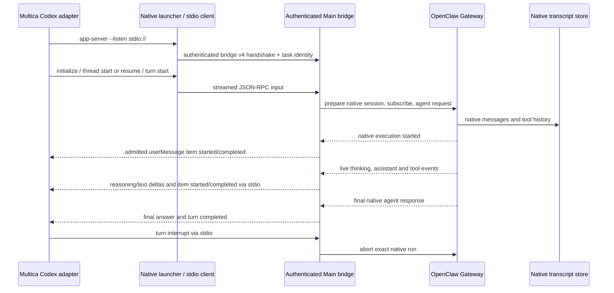

# Multica integration

JustDo exposes a local Codex-compatible app-server to Multica. The Multica 0.6.1 adapter used for the recorded integration checks consumed tool
activity and final answers without changes
to its code. OpenClaw remains the execution engine and transcript authority.
The previous external OpenClaw CLI command interface has been removed.

## Setup

Enable Multica integration in application settings and copy the displayed launcher
command. In Multica, create or edit a runtime with **Base protocol `codex`** and
that command, without extra arguments. Select this runtime for the Multica agent.
Keep the application running, including in its tray. Existing OpenClaw-provider
runtime profiles must be changed to Codex; old conversations are not migrated.
Start a new Multica conversation after switching protocols. For a Windows
development checkout, `npm run electron:dev` rebuilds the launcher automatically;
`npm run multica:dev-agent` can also rebuild it while the application is running.
Development launchers live inside the checkout at
`.agent-tasks/multica/development/<profile-hash>/<productName>-agent.exe`, not in
Roaming. The hash comes from the absolute user-data path, so normal and isolated
development profiles have separate launchers bound to their own bridge metadata.
User data and bridge metadata retain their existing locations. Packaged Windows
builds generate the launcher alongside the main executable in the installation
directory. Windows status and the copyable command resolve the current
checkout/install target even when the shared profile contains an older launcher
path; an existing launcher from another environment cannot establish readiness.
Refreshing an enabled integration validates and saves its current launcher.
After changing environments or launcher locations, copy the current command into
Multica's runtime settings again.

Model discovery (`debug models` and `model/list`) lists enabled, configured chat
models with available provider credentials. Model IDs are provider-qualified
native catalog routes, and labels include the model and provider name. Assistant
names are not model IDs. New conversations use the `main` assistant and the
application's configured default unless Multica selects a model explicitly.
Refresh Multica's runtime model catalog and select a real model when an existing
agent still has a cached assistant ID such as `main` in its model setting.

Resume retains the existing assistant and confirmed model unless Multica selects
a different enabled model. The selection belongs to that connection until it
acquires the conversation's execution reservation. After native preparation,
the existing application model-mutation queue applies the choice and confirms
the Gateway's resolved identity before execution starts. Failed confirmation
does not launch a task; the application-wide default is not changed. Permissions,
skills and tools remain managed in the application. Unsupported execution
overrides and non-text inputs are rejected rather than silently discarded.
Multica's Codex reasoning controls and fast service tiers are not implemented.

## Flow and ownership

The Windows console launcher connects directly to the authenticated local named
pipe and flushes each input/output chunk. It does not launch an Electron GUI
subprocess: Electron's Windows entry closes stdin, which otherwise makes the
Codex initialize handshake exit before receiving input. POSIX launchers use
the application's stdio bridge entry. The authenticated bridge
uses a bounded newline frame buffer rather than a lifetime output cap, allowing
long conversations. Output is split into 64 KiB byte chunks and sent through a
FIFO queue capped at 64 MiB, including socket-buffered bytes. The queue admits
both native input-item notifications and waits for transport drain without
changing Codex JSON lines or UTF-8 bytes. Input EOF cancels the owned execution
immediately, independently of output drain. Disconnect and bridge shutdown abort
the owned turn.
Cancellation acknowledgement does not imply execution has settled: the turn's
terminal notification waits for native completion.

The native execution start publishes the accepted user input as a standard Codex
`userMessage` item exactly once. Multica's first-event watchdog otherwise stops a
turn after 60 seconds when the configured model is slow to return its first token.
The input item records real admission, without inventing model output or sending
periodic heartbeats. Multica's subsequent inactivity and execution timeouts still
apply. Preparation failure or cancellation before native start does not publish
an admitted input item.

Assistant text is streamed as `item/agentMessage/delta`. Each text segment keeps
one item ID through completion, so the final snapshot supplies only any missing
suffix in Multica. Tool boundaries complete preceding text as commentary; the
native final reply completes the last segment as `final_answer`. Provisional
native terminal-guard text remains buffered until commit and is discarded on
rollback. Thinking uses standard reasoning items and deltas.

Each turn owns a named native message subscription, so cleanup cannot remove
the browser extension's subscription. An uncertain transport outcome retains
the active-turn reservation until an authoritative native receipt is available.
Yielded runs wait for the session and its subagents to settle. Recovery reads
bounded history through the Gateway to locate the current continuation, then
checks its native run receipt; history alone never establishes success. These
recovery paths are covered by focused regression tests.

`cowork_external_sessions` stores only external/native identity and lifecycle
metadata. Scope includes the Multica server, workspace and agent. Resume checks
ownership, cwd, assistant availability and the surviving local conversation.
Deleted or mismatched conversations cannot be recreated through resume.

Multica checks for a local Codex rollout filename before permitting resume. The
adapter writes a single identity-only `session_meta` marker under the supplied
`CODEX_HOME/sessions` directory, which Multica may link to its per-chat store.
It contains no messages, tool results or usage counts. Native OpenClaw storage
continues to own the complete conversation. Local external conversations remain
read-only in the application.

## Boundaries

This is an application runtime, not a general Codex binary. Supported commands
are `--version`, `debug models [--bundled]` and `app-server --listen stdio://`.
The reported version is the actual application version.

Multica receives tool names, arguments, start/completion status and streamed
assistant text. Its current Codex adapter reduces MCP results to
status/duration/error. Reasoning events update its activity watchdog but are not
rendered by the 0.6.1 adapter used in those checks. Other client versions require a fresh compatibility check. No fabricated reasoning or usage is sent.
Task-specific Codex MCP configuration and shell environment injection are not
implemented; configure execution tools in the application. Task credentials
are used for integration identity validation and are not copied into prompts or
the shared Gateway environment. This verification covers local tool tasks, not
Multica API tool calls from the executing model.

## Verification and remaining scope

Recorded Windows checks used Multica 0.6.1 with isolated and later real development
launchers. They covered initialization, tool start/result events, final text,
conversation resume, exact-run cancellation, model discovery/selection and model
switching without changing the application default. Those checks apply to their
versions and environments; they do not prove current packaged-install behavior
or compatibility with a newer Multica client.

Regression tests in `src/main/integrations/multica/` and `tests/scripts/` cover
launcher/pipe framing, split UTF-8, bounded queues and backpressure, stdin EOF,
environment filtering, session ownership, model confirmation, stable text items,
guard rollback, cancellation and recovery. A test file existing does not mean it
was rerun for a later change; record the commit, commands and actual outcomes.

Release validation should use the final launcher and application, with an explicit
allowed model: discover models, create a task, observe tools and streamed text,
resume, switch model, interrupt, disconnect and restart. Check Windows console
stdio separately from POSIX, and confirm deleted conversations cannot resume.
Local event delivery and Multica cloud persistence/UI refresh are separate stages;
a downstream upload timeout is not proof that the local bridge withheld output.
Do not commit task transcripts, credentials or raw daemon/native logs as evidence.
