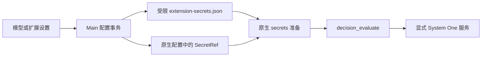

# 决策模型设置与宿主集成

本页维护宿主的模型目录、默认选择、受管配置和凭据发布。TypeSafe 的工具、服务协议、原生准入、传输错误与包内验证由[插件决策评估说明](../../plugins/extensions/typesafe/decision-evaluation.md)维护。

Jev / Kev 提供类型化分类、量表评分和布尔概率，不生成聊天回复。保存模型不会自动建立业务流程，评估结果也不授予后续动作权限。

## 配置与使用

1. 在“设置 → 模型 → 决策模型”添加供应商，填写 URL 和 API Key，两项均必填，不提供账号登录或 OAuth。
2. 服务必须实现 **TypeSafe System One**，仅兼容 OpenAI 聊天补全接口不够。基础地址后追加 `/systemone`，粘贴完整接口地址时会规范化。
3. 发现模型；服务没有 `/models` 时手动填写实际模型 ID，例如部署的 `jev-latest` 或 `kev-latest`。
4. 在模型行选择默认并保存。此操作启用 TypeSafe，发布原生 `agents.defaults.decisionModel`。
5. 让助手按具体证据执行分类、评分或概率评估。结果不授予后续动作权限。

请求仅访问显式配置的服务，使用 Bearer 认证，不跟随重定向、不使用环境代理，也不回退到公共服务。公司内网部署需另行完成；地址可使用部署方提供的内网端点。忽略认证的测试服务仍需填写非空测试 key，生产认证由服务或反向代理实施。评估会发送任务证据；若用户自行配置托管服务，费用及数据处理由该服务承担。

## 默认模型与手动插件配置

| 操作或状态                       | 配置所有者 | 生效结果                                             |
| -------------------------------- | ---------- | ---------------------------------------------------- |
| 有效默认决策模型已保存           | 模型设置   | 启用扩展，锁定扩展页的独立配置和开关                 |
| 取消默认并保存，或删除全部供应商 | 扩展页     | 保留当前端点、凭据引用、开关和其他字段，释放受管状态 |
| 目录为空或有目录但未选默认       | 扩展页     | 不自动选择供应商，不因打开或保存目录而接管           |
| 再次设为默认并保存               | 模型设置   | 重新接管并启用扩展                                   |

取消默认只清除能证明由应用先前发布的准确原生默认值；无法确认来源的原生默认不按名称归因。释放管理后，启动、设置保存、登录和退出同步均保留手动改动，不恢复过时快照。供应商和模型列表都标识当前默认，导入导出沿用其他模型的密码加密流程。

未受管时，扩展通用表单可编辑 `baseUrl`、`serviceUrl` 与凭据。只保存实际修改的文本，清空可选地址删除覆盖；两种地址互斥，切换时须清空旧项。此表单不选择默认模型，也不启用扩展。

配置和启停共用应用设置事务队列，等待保存或回滚结束再准入后续操作。首次接管失败通过明确回滚上下文恢复最新手动配置；正常释放不还原旧快照。模型凭据槽按端点及密钥版本隔离，新选择不能覆盖仍被手动扩展引用的旧槽。失败恢复后的引用仍解析到原值，已有固定槽可读而不迁移。

## 凭据发布、轮换与失败恢复



只有 manifest 同时声明 secret 输入和结构化引用 schema 的字段才发布 SecretRef；已有仅接受字符串的插件配置仍支持。Main 从内置及已安装扩展读取声明，将凭据写入 `<OpenClaw state directory>/extension-secrets.json`，使用既有 `justdo-extension-secrets` 文件 provider。临时文件先限制权限，再写入并原子发布；原生配置与 inventory 不含密钥值。

模型设置中的凭据仍保存在现有应用配置，与其他模型一致。文件权限保护不等于静态加密，不能把应用配置称为加密保险库。

扩展对话框轮换凭据后先 `secrets.reload`，再 `plugins.reload` 使捕获凭据的插件热应用；取得原生确认则不重启 Gateway，即使引用本身没有变化。只有原生不支持热应用或明确要求时，既有 coordinator 才安排重启。相同值无变化时不写入，禁用扩展保留凭据。

轮换后若配置发布或运行时刷新失败，在当前应用保留 pending refresh；同 key 再次保存仍刷新，secret-provider 错误不通过重启兜底。新进程从已保存 key 启动。模型设置的仅密钥变更走受管 `secrets.reload`，运行时应用失败沿既有 app-config 回滚；完整、最小及登录/退出同步保留 secret provider 和无关工具政策。

## 工具政策与产品边界

显式工具 deny 和插件禁用继续有效。已有非空 `tools.allow` 直接加入原生决策工具；否则使用 `alsoAllow`，避免把原来不受限的空名单变为限制名单。本地与 sandbox 会话仍经过各自原生政策。

应用不提供逐助手决策模型编辑、自动业务路由、模型下载或服务部署；已有原生 per-agent `decisionModel` override 仍由原生拥有。助手档案的聊天模型选择是[独立能力](../assistants/profiles-and-subagents.md#保存创建失败与退役)。此页面配置已经部署的 System One 服务。

## 集成验证

宿主测试覆盖凭据隔离与轮换、内置凭据编辑、默认关闭、受管配置释放／接管、生命周期同步及原生工具准入。适配器与原生状态单例的仓库验证入口为：

```sh
npx vitest run --config scripts/openclaw/typesafe.vitest.config.mts
node scripts/test/verify-decision-secret-runtime.cjs vendor/openclaw-runtime/current
```

`OPENCLAW_RUNTIME` 可选择其他已准备 SDK 目录。第二个入口启动隔离的打包 Gateway 和本地合成 System One 服务，经真实 `/tools/invoke` 验证凭据轮换、不可用 owner 拒绝及恢复；测试 key 刻意与模型名重叠。另检查 scope、错误类和传递依赖单例，不修改原生源码字节，不调用真实对话模型、不读取用户凭据。真实托管验收必须另获操作者授权和真实 key，合成 key 不得发往公共端点。
