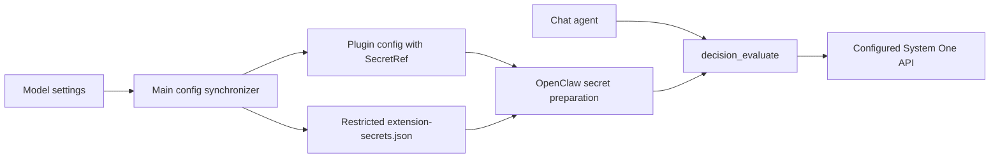

# Jev evaluations

The application bundles the upstream TypeSafe plugin as an optional extension.
The native core `decision_evaluate` tool is exposed when an agent has a decision model;
the conversational model still controls when to call it. Jev supplies typed
classification, rubric scores, and Boolean probabilities, not chat responses.

## Setup and use

1. Open Settings → Models → Decision models and add a provider.
2. Enter the **URL and API Key**, both required. No account login or OAuth is offered.
   Hosted Jev uses `https://api.typesafe.ai/v1`; an intranet server might use
   `http://inference.corp:8009/v1`.
3. Detect models or add one manually when `/models` is unavailable, for example
   `jev-latest` for Jev or `kev-latest` for a deployed Kev server.
4. Select the default model and save. This enables TypeSafe and selects native
   `agents.defaults.decisionModel`.
5. Ask the assistant to classify, score or estimate probabilities. The chat model
   decides when to call the evaluation tool; native decision consumers use the
   configured default. Saving a model does not create automatic business workflows.

The server must implement **TypeSafe System One**, not just OpenAI chat completions.
The API base is followed by `/systemone`; a full endpoint URL is normalized.
Requests go directly to the configured origin with Bearer auth, without redirects,
environment proxies or hosted fallback. Deploy self-hosted servers separately.
For a test server that ignores authentication, enter a nonempty test key; production
authentication must be enforced by the server or reverse proxy.

Only a valid default decision-model selection gives this category ownership of
TypeSafe settings and activation. While selected, the extension panel cannot
independently edit or toggle it. Use **Clear default** in the selected model's row
and save to return configuration and activation to the extension panel. The provider
and model lists both mark the selected default. This preserves
the current enabled state, endpoint, credential reference and other plugin settings;
the synchronizer clears only the exact native default it previously projected.
An empty or unselected catalog never locks the extension. Subsequent startup,
settings, login and logout synchronization preserves manual plugin changes, including
after restarting the application. Native defaults without a known prior application
projection are preserved rather than attributed to model settings by their name.
Selecting **Set as default** enables the extension and takes ownership again.
Saving or reopening an unselected catalog never chooses a provider automatically;
deleting all providers also returns manual control. Provider import/export
includes decision models using the same credential encryption as other model types.

Whenever no default decision model is selected, the generic extension form exposes the
explicitly editable `baseUrl` and `serviceUrl` text fields alongside the credential.
It displays saved addresses and saves only edited text; clearing an optional address
removes that override. Clear the old address when switching modes, since the plugin
rejects both endpoints together. This form does not select a decision model or enable
the extension. Once managed by model settings, its existing configuration restrictions
continue to apply. TypeSafe configuration and enable/disable operations share the
application-settings transaction queue, so they observe committed settings after
application or rollback. A failed first takeover restores the latest manual native
configuration through an explicit rollback context; ordinary release does not
restore an old snapshot or clear manual fields.
Model-settings credentials use slots scoped to the endpoint and credential. A new
selection cannot overwrite the value behind a reference retained by a released
manual extension; failed takeover restores a reference that still resolves to its
original value. Existing fixed-slot references remain readable without migration.

Evaluation sends task evidence to the selected service. Hosted Jev may incur API
charges. Results use the existing OpenClaw stream, without a transcript cache.

## Native decision tool

OpenClaw 2026.10.7 owns the provider-neutral `decision_evaluate` tool. It accepts
Boolean, Choice and Score questions and routes them through the selected agent's
`decisionModel`. TypeSafe is a decision provider, with manifest-declared capabilities,
lazy evaluator loading, and native decision fallback for TypeSafe HTTP 400, 413
and 422 responses classified as unavailable/unsupported-input. This classification
does not retry transport requests or expose response bodies. HTTP 401/403 remain
authentication errors; 429 remains rate-limited with retryAfter metadata.
The former TypeSafe-specific optional tool, plugin model setting and bundled skill
were removed upstream. The application uses the current native tool and model
selection only; it does not move legacy plugin model selections or rename old tool
policies. The unreleased 9.6 compatibility additions were removed at the user's
request. Current `decision_evaluate` policies and explicit denies remain respected.

The native admission callback remains authoritative through lazy evaluator loading
and HTTP preparation. TypeSafe rechecks it before guarded-fetch preparation and
after native DNS/transport preparation, immediately before dispatch. If admission
is revoked while either operation is pending, the evaluation returns unavailable
without sending the request or retrying. The same checks protect authenticated
intranet `serviceUrl` requests and the legacy loopback endpoint.

## Ownership and credential lifecycle



The extension service reads bundled configuration hints as well as locally
installed extension hints. A field is stored as a SecretRef only when its
manifest declares the secret input and a structured reference schema. Existing
string-only plugin configuration remains supported.

Main stores these credentials separately in
`<OpenClaw state directory>/extension-secrets.json`, using the
`justdo-extension-secrets` file provider. It restricts the temporary file's
permissions before writing any credential, then publishes it atomically. The native
Gateway configuration and extension inventory contain no credential values.
Model settings persist credentials in the existing application config, just like
other model types; this application config is not an encrypted vault. This is
filesystem access protection, not encryption at rest.

Changing credentials in the extension dialog refreshes native prepared secrets with
`secrets.reload`, then applies `plugins.reload` to the capturing plugin. A successful
native hot-application receipt avoids a Gateway restart, including rotations where
the reference itself is unchanged. The existing coordinator handles a restart only
when hot application is unavailable or explicitly requires it. Saving the same value
is a no-op. Disabling the plugin retains its credential for subsequent re-enablement.

If configuration publication or runtime refresh fails after rotation, a pending
refresh remains in the running application. Secret-provider errors are reported
without attempting a restart. Retrying the same key still refreshes the runtime;
a new application process loads the saved key on startup.

Full, minimal, login and logout synchronization applies the settings selection
and preserves secret providers and additional tool policy. Model settings use
managed credential refresh (`secrets.reload` when only the key changed). Failed
runtime application triggers the existing app-config rollback flow.
Existing nonempty `tools.allow` lists receive the native decision tool directly;
otherwise synchronization uses `alsoAllow`, keeping empty allowlists unrestricted.
Explicit tool denies remain in force across full and authentication syncs.
The native tool is admitted in both local and sandbox sessions; native plugin
disable and tool-deny policies still apply. Evaluation output does not grant
permission to perform actions.

## Packaging and verification

`plugins/extensions/typesafe/UPSTREAM.md` records the reviewed upstream revision.
The local-extension pipeline installs its locked production dependency,
precompiles it against the host SDK, and preserves license files when pruning.
It does not depend on a future npm publication of `@openclaw/typesafe`.

Focused tests cover secret isolation and rotation, bundled credential editing,
default-off behavior, configuration persistence across lifecycle synchronization,
and native decision tool admission. Real hosted validation requires an operator's API
key; synthetic credentials must never be sent to the public endpoint.

The native adapter suite can be run offline against a prepared runtime:

```sh
npx vitest run --config scripts/openclaw/typesafe.vitest.config.mts
```

Set `OPENCLAW_RUNTIME` to use a different prepared SDK directory. It covers the
explicit endpoint, authentication failure without fallback, schema validation,
cancellation and existing upstream behavior. Registered-provider regressions also
cover initial admission denial and revocation during lazy loading or native DNS
preparation, including the authenticated intranet endpoint, with admitted requests
as positive controls. No real hosted key is used.

## Remaining scope

Per-assistant model selection, automatic business routing, model downloads and
server deployment are not added. Explicit native per-agent decision overrides
remain native-owned. Settings configures an already deployed System One service.

## Packaged Gateway credential identity

Gateway bundling preserves the native `secret-input-runtime` SDK state-owner modules as
external runtime modules. Both the Gateway and dynamically loaded plugins resolve
the same ESM instances for prepared secrets, config snapshots, auth revisions and
unavailable-owner state, including their configuration preparation scopes,
environment publication, auth ownership/read caches and error classes. Inlining
these owners into a second bundle can lose state, invalidate the wrong cache or
break native `instanceof` error classification. Inlining the prepared-secret owner silently
creates an empty SDK credential snapshot even when the file SecretRef is valid.
No upstream credential implementation or capability-scope checks are changed.

After preparing a pristine runtime with the current build recipe, run:

```sh
node scripts/test/verify-decision-secret-runtime.cjs vendor/openclaw-runtime/current
```

This starts an isolated packaged Gateway and local synthetic System One provider.
It invokes the actual plugin through `/tools/invoke`, rotates the file credential
with `secrets.reload`, verifies unavailable owners cannot make provider requests,
and verifies recovery. It does not invoke a conversational model or read user
credentials. Its first synthetic credential overlaps the selected model name to
cover short-key reflection false positives. The ordinary unit suite also reproduces
the old split-module failure and checks scopes, class identity and transitive
state sharing without changing native source bytes.

Response credential checks run after native schema validation. Answer labels and
score legends must match the request; the exact selected model is also an expected
echo. Short credentials overlapping those values or numeric results do not cause
false failures. An unexpected provider model name containing the credential is
still rejected, and provider error bodies are never returned to the agent.
