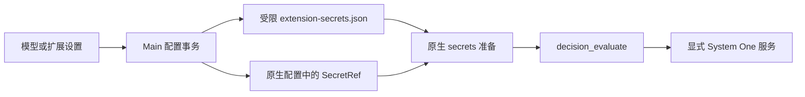

# Jev / TypeSafe 决策评估

Jev 提供类型化分类、量表评分和布尔概率，不生成聊天回复。应用将 TypeSafe 作为可选决策 provider 打包；原生 `decision_evaluate` 由当前助手的 `decisionModel` 选择服务，何时调用仍由对话模型或原生消费者决定。保存模型不自动建立业务流程。

## 配置与使用

1. 在“设置 → 模型 → 决策模型”添加供应商，填写 URL 和 API Key，两项均必填，不提供账号登录或 OAuth。
2. 服务必须实现 **TypeSafe System One**，仅兼容 OpenAI 聊天补全接口不够。基础地址后追加 `/systemone`，粘贴完整接口地址时会规范化。
3. 发现模型；服务没有 `/models` 时手动填写实际模型 ID，例如部署的 `jev-latest` 或 `kev-latest`。
4. 在模型行选择默认并保存。此操作启用 TypeSafe，发布原生 `agents.defaults.decisionModel`。
5. 让助手按具体证据执行分类、评分或概率评估。结果不授予后续动作权限。

请求仅访问显式配置的服务，使用 Bearer 认证，不跟随重定向、不使用环境代理，也不回退到公共服务。公司内网部署需另行完成；地址可使用部署方提供的内网端点。忽略认证的测试服务仍需填写非空测试 key，生产认证由服务或反向代理实施。评估会发送任务证据；若用户自行配置托管服务，费用及数据处理由该服务承担。

## 默认模型与手动插件配置

| 操作或状态                       | 配置所有者 | 生效结果                                             |
| -------------------------------- | ---------- | ---------------------------------------------------- |
| 有效默认决策模型已保存           | 模型设置   | 启用扩展，锁定扩展页的独立配置和开关                 |
| 取消默认并保存，或删除全部供应商 | 扩展页     | 保留当前端点、凭据引用、开关和其他字段，释放受管状态 |
| 目录为空或有目录但未选默认       | 扩展页     | 不自动选择供应商，不因打开或保存目录而接管           |
| 再次设为默认并保存               | 模型设置   | 重新接管并启用扩展                                   |

取消默认只清除能证明由应用先前发布的准确原生默认值；无法确认来源的原生默认不按名称归因。释放管理后，启动、设置保存、登录和退出同步均保留手动改动，不恢复过时快照。供应商和模型列表都标识当前默认，导入导出沿用其他模型的密码加密流程。

未受管时，扩展通用表单可编辑 `baseUrl`、`serviceUrl` 与凭据。只保存实际修改的文本，清空可选地址删除覆盖；两种地址互斥，切换时须清空旧项。此表单不选择默认模型，也不启用扩展。

配置和启停共用应用设置事务队列，等待保存或回滚结束再准入后续操作。首次接管失败通过明确回滚上下文恢复最新手动配置；正常释放不还原旧快照。模型凭据槽按端点及密钥版本隔离，新选择不能覆盖仍被手动扩展引用的旧槽。失败恢复后的引用仍解析到原值，已有固定槽可读而不迁移。

## 原生工具、权限与错误

`decision_evaluate` 接受 Boolean、Choice 和 Score 问题。TypeSafe 按 manifest 声明能力、延迟加载 evaluator；当前工具和模型选择由原生拥有，不迁移旧插件专用模型、不改名旧工具政策，也不恢复未发布的兼容实现。

原生最终调用准入贯穿延迟加载与 HTTP 准备。TypeSafe 在 guarded fetch 准备前，以及 DNS/transport 准备结束、实际派发前重新核验；任一步撤权都返回不可用，不发送或重试请求。认证内网 `serviceUrl` 和旧 loopback 端点遵循相同检查。

| 响应                                    | 原生分类                        | 限制                                                          |
| --------------------------------------- | ------------------------------- | ------------------------------------------------------------- |
| HTTP 400 / 413 / 422 且属于不支持的输入 | unavailable / unsupported-input | 可进入原生决策 fallback，不重试本次 transport，不暴露响应正文 |
| HTTP 401 / 403                          | 认证错误                        | 不伪装为可切换 provider 的输入限制                            |
| HTTP 429                                | 限流                            | 保留 retryAfter 元数据                                        |

显式工具 deny 和插件禁用继续有效。已有非空 `tools.allow` 直接加入原生决策工具；否则使用 `alsoAllow`，避免把原来不受限的空名单变为限制名单。本地和 sandbox 会话仍经过各自原生政策，决策输出不扩大权限。

响应先通过原生 schema 校验，再做凭据反射检查。答案标签、评分图例和准确所选模型可以合法回显，短 key 与这些值或数字结果重叠不会误拒绝；意外 provider 模型名包含凭据仍拒绝，错误正文不返回模型。

## 凭据发布、轮换与失败恢复



只有 manifest 同时声明 secret 输入和结构化引用 schema 的字段才发布 SecretRef；已有仅接受字符串的插件配置仍支持。Main 从内置及已安装扩展读取声明，将凭据写入 `<OpenClaw state directory>/extension-secrets.json`，使用既有 `justdo-extension-secrets` 文件 provider。临时文件先限制权限，再写入并原子发布；原生配置与 inventory 不含密钥值。

模型设置中的凭据仍保存在现有应用配置，与其他模型一致。文件权限保护不等于静态加密，不能把应用配置称为加密保险库。

扩展对话框轮换凭据后先 `secrets.reload`，再 `plugins.reload` 使捕获凭据的插件热应用；取得原生确认则不重启 Gateway，即使引用本身没有变化。只有原生不支持热应用或明确要求时，既有 coordinator 才安排重启。相同值无变化时不写入，禁用扩展保留凭据。

轮换后若配置发布或运行时刷新失败，在当前应用保留 pending refresh；同 key 再次保存仍刷新，secret-provider 错误不通过重启兜底。新进程从已保存 key 启动。模型设置的仅密钥变更走受管 `secrets.reload`，运行时应用失败沿既有 app-config 回滚；完整、最小及登录/退出同步保留 secret provider 和无关工具政策。

## 打包与状态单例

上游来源由 `plugins/extensions/typesafe/UPSTREAM.md` 锁定。local-extension 流水线安装锁定生产依赖、针对宿主 SDK 预编译并保留许可证，不依赖未来发布的 npm 包。

Gateway bundle 与动态插件必须解析到同一组原生 `secret-input-runtime` ESM 状态所有者，包含 prepared secrets、配置快照/准备作用域、环境发布、auth revision/ownership/read cache、不可用 owner 和错误类。将这些模块分别内联会产生空凭据快照、失效错误缓存或破坏 `instanceof` 分类；不能靠修改原生凭据算法或能力检查补救。构建从锁定 pristine 包重建并保留这些外部模块。

## 验证与未提供能力

定向测试覆盖凭据隔离与轮换、内置凭据编辑、默认关闭、配置释放/接管、生命周期同步及原生工具准入。适配器离线入口：

```sh
npx vitest run --config scripts/openclaw/typesafe.vitest.config.mts
node scripts/test/verify-decision-secret-runtime.cjs vendor/openclaw-runtime/current
```

`OPENCLAW_RUNTIME` 可选择其他已准备 SDK 目录。适配器套件覆盖端点、认证失败不回退、schema、取消、初始拒绝及加载/DNS 期间撤权，含内网正负例，不使用真实托管 key。

第二个入口启动隔离的打包 Gateway 和本地合成 System One 服务，通过真实 `/tools/invoke` 验证凭据轮换、不可用 owner 拒绝及恢复；测试 key 刻意与模型名重叠。单测另复现模块状态分裂，并检查 scope、错误类和传递依赖单例，不改原生源码字节。这些验证不调用真实对话模型，也不读取用户凭据。

真实托管验收需操作者自己的 key，合成 key 不得发往公共端点。应用不提供逐助手模型编辑、自动业务路由、模型下载或服务部署；已有原生 per-agent override 仍由原生拥有。此页面只配置已经部署的 System One 服务。
