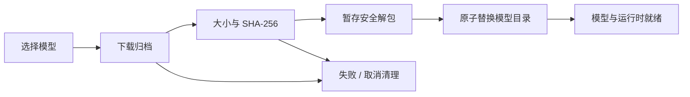
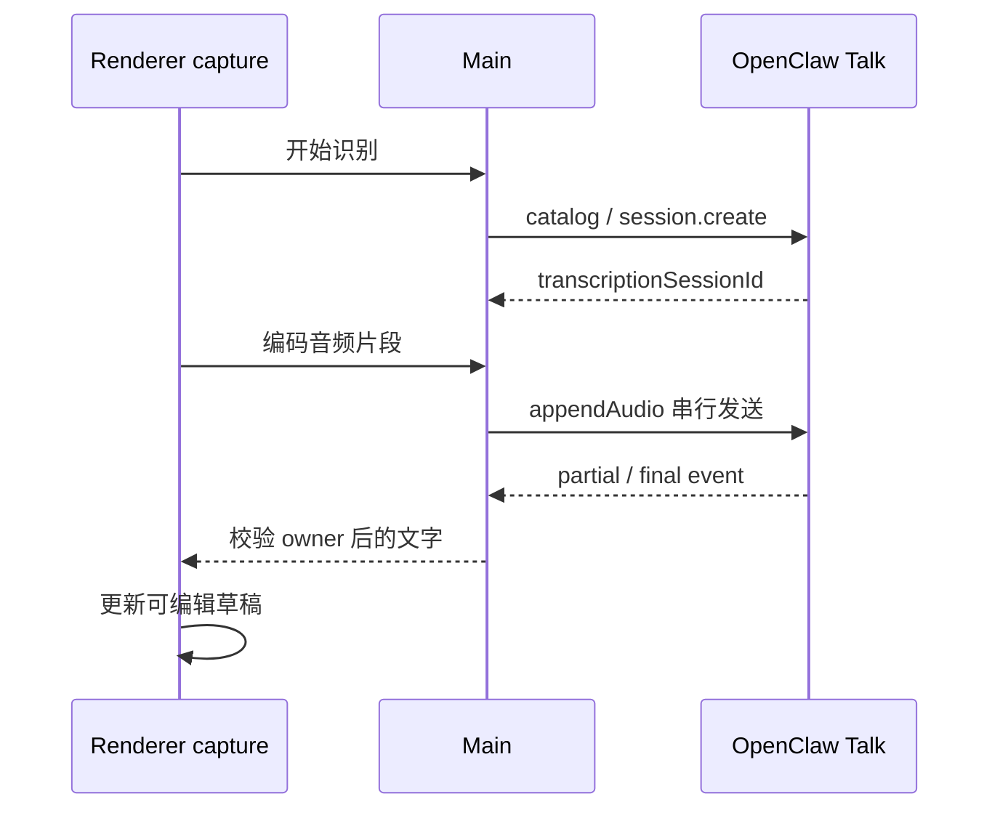

# 语音输入、朗读与附件转录

语音是可选功能，支持离线与 OpenClaw 在线路径。当前安装包提供 sherpa-onnx 运行时，离线权重由用户在“设置 → 模型 → 语音识别／语音合成 → 内置模型”按需下载；“安装了应用”不代表模型文件已经就绪。

本地运行时和模型安装当前仅支持 Windows x64；其它平台不能把目录或设置存在解释为本地能力可用。
运行时和模型路径统一由 `src/main/speech/localSpeechPaths.ts` 判定，在线能力仍以 Gateway 实际目录为准。

## 1. 三条不同使用链路

| 场景                  | 输入/输出                       | 是否自动发送消息   |
| --------------------- | ------------------------------- | ------------------ |
| Composer 语音输入     | 采集或导入音频 → 可编辑文字草稿 | 否                 |
| 回复朗读              | 已完成回复 → TTS 播放           | 不新增 transcript  |
| transcribe_audio 工具 | 模型读取用户附件 → 转录工具结果 | 由原生工具回合管理 |

`stt-local-cli` 和 `tts-local-cli` 的启停仅由插件 → 扩展控制，首次安装采用各自扩展清单声明的默认值。语音设置、模型安装、启动及登录/退出同步只更新运行参数，不改变这两个扩展的明确启停选择及已有准入策略；sandboxed 会话不注册 host 转录工具。

两张扩展卡片提供齿轮入口，无论扩展是否启用，都可独立选择本地或在线模式，模型目录与语音页共用。在线模式引用模型页已配置的供应商与模型，TTS 再选择该模型的音色，不重复填写服务地址或凭据。选择保存到 `app_config.localSpeechExtensions`，与语音页的麦克风和回复朗读分别保存。两种模式保留各自的模型和音色草稿，不自动选择第一项或在配置失效时切换模式。以“管理模型”跳转到对应内置目录或在线供应商，跳转期间保留草稿并隐藏弹窗，关闭设置后可继续选择和保存。下载文件和校验/安装事务共用，离开列表不会取消 Main 中已发起的下载。本地模型就绪或在线模型与音色引用有效后才能保存；在线模式不依赖本地模型或 Windows 运行时。保存等待 Main 配置应用成功，保存或下载都不会自动开启扩展。
卡片在确认当前默认模型未就绪时，于齿轮旁显示黄色三角感叹号；提示说明扩展暂不可用，可点击下载或选择模型，并直接进入同一设置弹窗。模型就绪后提示自动消失；模型状态或已保存的选择变化会实时更新提示，读取中及读取失败不作为缺失证据。

STT 依据自己的模式、模型和应用语言生成附件转录配置。TTS 本地模型与音色保存为 `ttsModelId` / `ttsVoiceId`，在线选择保存为 `onlineTtsModelRef` / `onlineTtsVoice`，分别由 `sttMode` / `ttsMode` 决定实际使用路径；STT 在线引用为 `onlineSttModelRef`。本地 TTS 将音色编号投影为实际命令的 `--sid`。语音页的麦克风和朗读设置不覆盖扩展选择，STT 无音色设置。Main 按当前目录解析引用、协议、音色和凭据，删除目录中的模型或音色会撤下对应执行配置并清除失效引用，保留在线模式，不能回退本地或借用另一个消费页面的模型。

助手的原生 `tts` 工具固定使用同 ID 的应用自有 `tts-local-cli` provider；该 provider 同时支持本地命令和配置的在线合成服务，因此禁用扩展也会撤销其在线合成能力。受管 `assistant-speech` persona 只绑定这一 provider，`fallbackPolicy: fail` 禁止借用其它 provider。Gateway 启动环境通过原生支持的 `OPENCLAW_TTS_PREFS` 将工具偏好放在 `stateDir/speech-tools/preferences.json`，并覆盖继承环境中的同名大小写别名，文件仍由原生持有。顶层持久 `tts` schema 不接受 `prefsPath`；配置同步移除应用此前误写的该字段，不读取或迁移其偏好内容。没有新增原生补丁或旧版兼容。

## 2. 用户设置顺序

在语音页选择本地或在线模式。离线模型通过“管理模型”进入模型页下载，再在语音页的下拉框选择输入/输出模型；在线模式选择已在模型页配置的能力目录。模型页只管理列表和下载，不选择当前使用模型。再启用输入或朗读，选择麦克风或支持的系统声音来源，使用诊断/试听确认设备与模型。跳转模型页不自动保存或丢弃语音页草稿。

本地麦克风诊断采集有界录音，显示电平、可回放，并用同一段音频转录，区分无声音、设备路由和识别质量。TTS 试听使用可编辑样本文字与实际选中 provider。

## 3. 离线模型与安装事务

当前目录包含 SenseVoice Small INT8、Whisper Base INT8、Kokoro、AISHELL3 VITS 和 Piper Lessac 等输入/输出布局。模型 ID 与运行合约在 `shared/speech/`，发布文件、大小和 hash 以 Main 的 `localSpeechModelService.ts` 目录为准，不在多篇文档重复维护下载数字。

模型页的展示元数据位于 Renderer 的 `features/speech/localSpeechModelCatalog.ts`。音色名称及原生 ID 来自已核对的模型资产快照，无需下载后读文件或访问外部服务；模型详情、语音页和 TTS 齿轮共用完整音色目录，不再人为区分可选音色与全部音色。Kokoro 的 103 个音色快照来自 ONNX `id2speaker`，AISHELL-3 的 174 个说话人来自模型的 `speakers.txt` 顺序，Piper 来自单说话人模型元数据。[Sherpa 官方的 Kokoro v1.1 说明](https://k2-fsa.github.io/sherpa/onnx/tts/all/Chinese-English/kokoro-multi-lang-v1_1.html)提供语言、性别、英语口音和编号映射：55 个中文女声、45 个中文男声，以及 Maple、Sol、Vale 三个英语女声。友好名使用真实源后缀（如 `zm_069` → 中文男声 069），不把原生 sid 92 当作名字；原名和原生编号继续显示。AISHELL-3 没有性别资料，Piper 仅确认美式英语，不编造音质风格。下载大小仍使用 Main 返回的状态，不在展示目录复制。更新内置模型资产时同步核对快照及原生音色范围。切换本地模型使用新模型的有效默认音色；重复选择当前模型保留已有音色。

详情内的筛选、搜索和试听不写入语音设置或插件设置。试听通过独立 `speech-synthesis:preview-builtin` / `speech-synthesis:cancel-builtin-preview` IPC 传递受限请求 ID、内置模型 ID、整数音色 ID 和最多 300 字的文字；Main 校验主窗口 frame、运行时/模型就绪和音色范围，以请求内本地配置复用 `synthesizeLocalSpeech`，不调用 Gateway。每个窗口仅运行一个试听合成，新请求中止并等待旧进程关闭和临时文件清理后启动；旧取消不能影响新请求。窗口导航、销毁或 Renderer 退出撤销请求，返回音频前再次核对归属和模型状态。Renderer 以请求 ID 和代次丢弃迟到结果，校验有界 WAV，关闭、筛选或切换时暂停音频并回收 URL；合成进程通过 AbortSignal 终止并清理临时文件。

模型在 `<userData>/local-speech-models/<model-id>`。完整已安装模型复用；部分下载和 staging 清理，不能把半个目录标成 ready。包携带相应许可证。

开发环境从 `build/runtimes/local-tts/win-x64/` 读取准备好的运行时；未安装到用户目录的模型可从该目录下复用。安装版运行时仍位于安装资源的 `local-tts/win-x64/`，模型继续从用户目录读取。离线准备命令见[下载清单](../../offline-downloads.md)。

下载按 16 MiB 的 HTTP Range 顺序传输，避免单个大响应触及内网代理的传输限制。每段校验 `Content-Range`、总大小和实际接收大小；网络请求或响应流中断时最多尝试 3 次，只重下当前段。当前安装操作中保留已完成段，最终仍对整个归档校验大小和 SHA-256 后才解包。服务端首次请求返回完整 `200` 时兼容单流下载；后续分段返回 `200`、范围不符、完整性失败或磁盘错误均停止安装并清理临时文件。部署服务应支持 Range 才能规避单响应大小限制；重启应用或安装最终失败后不保留断点。

按需安装使用部署方配置的内网更新服务下的模型目录。地址留空时不发起下载，设置页明确提示联系管理员配置；填写后直接使用，不按域名过滤，由部署方保证地址可用。应用冷启动和完整已安装模型的复用不依赖该服务。

Windows 上新解包的模型文件可能被短暂占用。模型目录切换及备份恢复仅对 `EPERM`、`EACCES`、`EBUSY` 做有界异步重试（最多额外 4 次，总等待 1.5 秒）；其它错误立即报告，不重复下载或跳过完整性检查，持续占用仍报告安装失败。

## 4. 离线输入

Renderer 捕获/解码音频并编码单声道 PCM16 WAV，Main 根据已选 Whisper/SenseVoice 布局运行本地命令，结果写入草稿。普通话 zh 采用 OpenCC 规范到大陆简体；自动语言和显式粤语保留模型原文，避免误改其他语言字符。

会议模式按设置的 15–60 秒边界分段，录制继续时排队转录，麦克风与系统输出分别标识和计时。它区分本人与系统播放轨，不做远端说话人分离。

Windows loopback 采集的是系统输出混音，不是某个外部进程。按 PID 的应用音频采集需要另一个原生能力，当前 web-media 路径不能宣称支持。

## 5. 在线输入

采用 gateway-relay、brain=none 的 transcription-only 会话。Main 限定调用 Renderer 所有权；event 按 transcriptionSessionId 匹配。停止、设备丢失、权限失败、设置变化、导航或卸载都关闭原生会话，迟到事件不能写入另一草稿。

## 6. 附件转录工具

`stt-local-cli` 保留唯一的 `transcribe_audio` 工具。显式 `mode: local` 使用已安装 Sherpa；`mode: online` 使用模型目录所配置 HTTP(S) 服务的 `/audio/transcriptions`，逐段提交 PCM 音频及所选模型。麦克风实时识别仍走 Talk WebSocket；仅有 WS(S) 地址的目录项不能作为附件转录服务，界面说明这一区别。两种模式均限制 256 MiB、一小时、一次一个转录，使用受限本地解码、有效 fsPolicy root/workspaceOnly 和 sandbox 准入；外部附件先 staging 到项目再发送。

在线路径只请求显式配置的服务，可使用内网地址和无认证服务；不读取环境凭据、不添加公共默认服务，不跟随重定向，也不在失败时改用另一模型或本地路径。工具执行与每次发送前核对当前配置和调用权限，中止终止本地解码及在线请求并清理临时文件。

工具描述要求把转录内容当数据而非指令。中止需要终止本地工作并释放 busy 标记，失败不应永久锁住后续转录。

## 7. 输出与发布资源

回复朗读由原生 TTS 能力执行，本地使用 tts-local-cli 的模型布局；输出音频不作为 Redux 或 transcript 新正文。停止播放与停止 Agent 是不同动作。

在线回复朗读使用独立的 `runtime-services.config.replySpeech` 受管配置。现有在线设置 IPC 只提交 `{modelRef, voice}`，Main 从当前模型目录读取端点和凭据，不覆盖助手工具的全局 `tts`。播放调用受认证的 `runtimeServices.speech.synthesize`，仅接收文字；Runtime Services 在请求内构建 OpenAI 兼容 provider 视图，通过公开 `tts-runtime.synthesizeSpeech`、显式 provider 校验和 `disableFallback: true` 执行。独立 `reply-reading` persona 仅绑定该 provider；通过公开 `runtime.state.resolveStateDir()` 定位 `speech-tools/reply-preferences.json`，将路径作为 `resolveExplicitTtsOverrides` / `synthesizeSpeech` 的独立 `prefsPath` 参数，不放进 `cfg.tts`，也不读取工具偏好路径。显式参数优先于 Gateway 的工具偏好环境变量；禁用 `tts-local-cli` 不影响回复朗读。权限或配置变化后的迟到输出丢弃。原生公开 TTS API 暂无取消信号，停止播放不宣称已经中止该合成请求。

插件 STT、插件 TTS 和回复朗读的凭据分别发布为现有受限 `extension-secrets.json` 中的 SecretRef。凭据引用绑定端点和密钥版本，配置发布失败不能让旧端点取得新服务的密钥；轮换走既有 secrets 刷新和配置回滚。在线选择不将原始密钥写入原生运行配置或传回 Renderer。

当前 OpenClaw 配置只写 `tts.auto` 和 provider 的 `speakerVoice` / `speakerVoiceId`。
手动朗读及本地合成工具使用 `auto: off`，provider 参数与扩展启停决定能力是否可用，
不再写 `tts.enabled`；应用朗读开关仍保存在产品语音设置中。设置页的声音输入在 IPC
中映射为 `speakerVoice`。同步清理未发布开发版本留下的废弃字段，保留现有规范字段，
不把旧声音别名或 enabled 自动迁移成新值；开发环境的旧声音选择可在设置页重新保存。

聊天中的语音合成使用原生 `tts` 工具，`tts-local-cli` 注册本地 speech provider，不注册同名工具。应用配置不再全局禁止 `tts`，同步时清除旧配置中的该禁用项；插件启用状态和 provider 就绪状态仍独立决定合成是否可用。

模型发布使用 setup:local-speech-models 和 build:local-speech-model-artifacts，上传生成的 speech-models/v1 产物。已发布文件不可原地换字节；模型变更或包装修订使用新身份/文件名并更新编译期大小与 hash，保留旧客户端所需旧包。

## 8. 验证与限制

检查模型缺失/损坏、下载取消、设备静音、权限拒绝、在线会话换代、分段顺序、草稿不自动发送、TTS voice、附件越界、sandbox 拒绝与取消释放。Main speech、onlineAsr/onlineTts IPC 和模型 artifact tests 分别覆盖这些层。原生 SDK 合成测试必须先通过锁定运行时的完整 `OpenClawSchema` 与加载期 legacy 校验，包含错误顶层 `tts.prefsPath` 拒绝反例；Main 原生 schema 回归同时检查实际持久配置与错误字段清理，不能只调用宽松的 TTS resolver 证明启动有效。真实设备和内网协议仍需现场验证。
