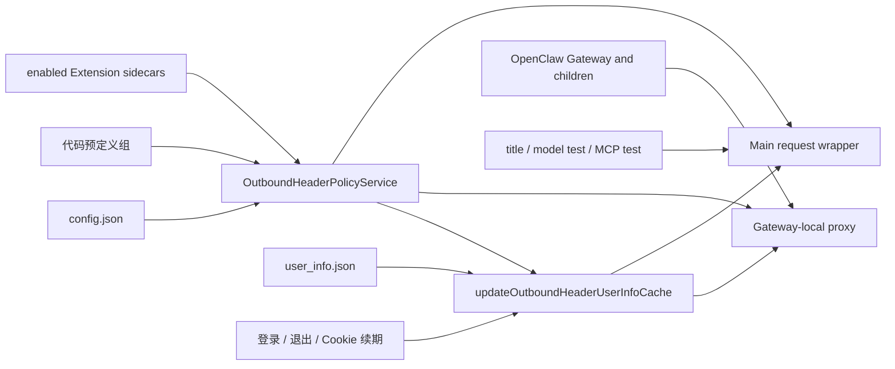
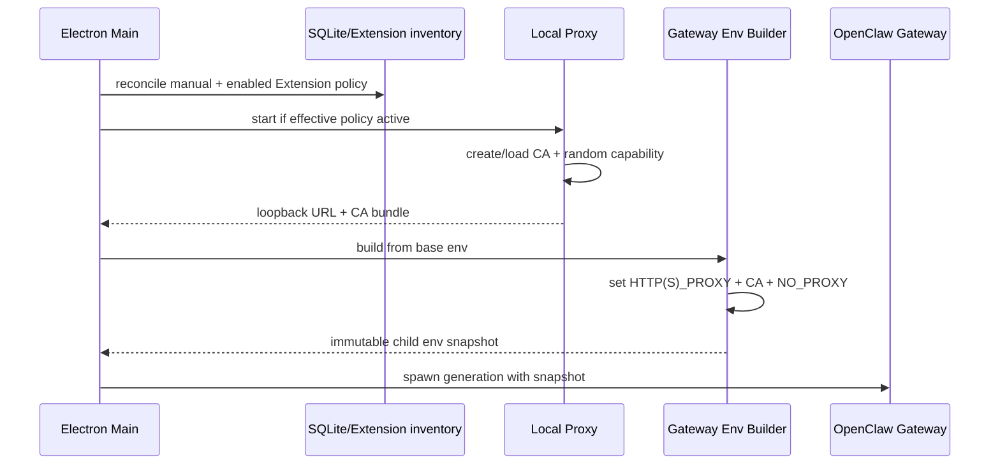

# 出站请求头：策略、代理与生命周期

本文是出站请求头的现行实现说明，统一维护 Extension 声明、手工策略、Main 注入与 Gateway 代理。配置与可分发样例见[接入指南](../../developer-integration/outbound-headers/README.md)，登录后的值刷新接口见[开发接口](../../developer-integration/outbound-header-user-info-refresh-api.md)。打包客户端与企业代理组合仍须实际验收；本地 Header 注入不等于远端授权。

阅读顺序：先确认请求属于[哪条路径](#3-两条数据路径与实现入口)，再配置[策略来源与合并](#2-策略来源声明与合并)；排查证书或请求缺头时按[启动与证书](#4-gateway-启动环境与证书)、[单请求匹配](#5-一个请求如何匹配和注入)、[并发与诊断](#7-并发与诊断)三层定位。
Extension 启停、卸载和运行时重载见[策略生命周期](#6-策略变化失败与关闭)。

## 1. 适用范围与安全边界

OpenClaw Gateway、其支持的 tool 子进程，以及显式 opt-in 的 OpenClaw one-shot CLI 访问指定
远端 URL 时，应用可以注入一组共享校验 Header。当前 memory index CLI 会 opt-in，搜索使用 Gateway RPC，
使查询和重建索引产生的 embedding 请求与 Gateway 请求使用同一 URL policy。典型用途是让远端
服务识别来自本地 Agent 环境的授权请求。

真正的授权必须由远端服务验证 Header 并拒绝缺失/无效值。本地代理只是注入机制，不是防火墙，也不能约束主动忽略代理环境的网络程序。

明确不在数据面内：

- Electron Renderer 的普通网络请求；
- Electron Main 的更新、配置同步等请求；
- Gateway 进程树及显式 opt-in CLI 之外的其他程序；
- 不匹配 URL 白名单的请求 Header 注入。

Main 中少量确需相同 Header 的确定性调用（当前包括模型测试、会话标题生成与 MCP“测试”探测）应在调用点基于白名单显式注入，不得通过全局 `fetch` monkey patch。MCP 探测只为 probe transport 注入，普通 resource 读取不因此扩大策略范围；probe fetch 拒绝自动重定向，避免已注入 Header 被带到未重新匹配白名单的目标。
Renderer 的通用 fetch IPC 默认不注入；模型 discovery/test 必须携带受限 purpose，Main 校验 HTTP
method、允许的模型 endpoint、header 与 body，并重建固定的连接测试请求后才应用策略。

### 必须保持的约束

1. 只有 Gateway generation 和显式 opt-in 的受管 CLI 获得本地 proxy URL、CA 和 capability。
2. 未认证的 loopback 客户端不能使用代理。
3. 未命中完整 URL 白名单时绝不注入业务 Header。
4. `Proxy-Authorization` 只用于本地/上游代理，不转发给目标服务。
5. Header 值、代理密码、capability 和 CA 私钥不进入日志。
6. Main/Renderer 的全局 `process.env` 和 Chromium 网络栈不被修改。
7. 并发请求使用独立 request context 与 headers。
8. 普通 loopback 保持 direct，不因 LiteLLM 或 Header Proxy 被整体劫持。

## 2. 策略来源、声明与合并

每个策略组的 `baseUrlWhitelist[]` 对应本组 `headerNames[]`。同一请求命中多个组时按组顺序和组内顺序合并，比较目标 Header 名时忽略大小写。只命中字符串声明时，使用最先匹配的同名字符串。对象声明优先于同名字符串，同名对象之间使用最后一个匹配的声明。

手工 `config.json` 是长期支持入口。旧顶层 `baseUrlWhitelist` / `headerNames` 结构不再接受；`overwrite` 仅兼容解析，不触发启动覆写。Extension 贡献只在内存合并，不写回手工文件。

### Extension 的生效条件

生效条件只有三项：Extension 已安装、已启用、声明文件合法。

本功能不增加独立的权限弹窗、审批令牌、授权记录、SQLite 表或 Renderer 状态。Extension 的
安装和启用已经是用户动作，不再为同一个动作叠加第二套授权协议。通用 Extension 安装
直接接受原生能力声明，不弹安装审核；显式启用的确认边界保持独立，均不因出站请求头声明增加弹窗。

Extension 根目录可选包含：

```text
outbound-header-policy.json
```

没有该文件的 Extension 行为不变。文件存在但无效时，该 Extension 的规则不生效并记录脱敏
诊断；不降级为不受约束的规则。

### 声明格式

```json
{
  "schemaVersion": 1,
  "groups": [
    {
      "baseUrlWhitelist": ["https://api.example1.com/v1/"],
      "headerNames": [
        "X-User-Account",
        { "name": "X-Service-Token", "from": "X-Access-Token" },
        { "name": "X-Client-Mode", "value": "desktop" }
      ]
    }
  ]
}
```

约束：

- 仅支持 `schemaVersion: 1`；
- 支持显式声明绝对 `http://` 或 `https://` URL，包括内网 HTTP 服务；
- URL 路径末尾的 `/` 可省略，统一按协议、主机、端口和路径边界精确匹配；
- 禁止 localhost、loopback、链路本地、未指定地址，以及带用户名密码、query 或 fragment 的 URL（包括空的 `?`、`#` 标记）；
- 禁止 `Host`、`Connection`、`Content-Length`、`Proxy-Authorization` 等传输层头；
- 手工配置和 Extension 支持相同的 `headerNames` 写法。字符串使用 `user_info.json` 中完全同名的顶层属性。`{ "name": "X-Target", "from": "sourceKey" }` 使用 `from` 指定的顶层属性，保留键名大小写，并以 `name` 作为目标 Header。
- `{ "name": "X-Target", "value": "literal" }` 直接使用配置中的字符串。空字符串合法，固定值必须满足 HTTP 请求头字符约束。Extension 文件中的固定值会随包分发，运行时凭据应使用 `from` 或同名字符串引用。

HTTP 与 HTTPS 不互相授权；主机、端口或相邻路径不同也不会命中。默认端口按 URL 协议规范化，
例如 HTTP 的 `:80` 和 HTTPS 的 `:443` 可省略，但 HTTP 的 `:443` 与 HTTPS 的 `:80` 必须保留。

无效 URL 的错误会给出声明文件名、原始组和地址的序号以及具体约束，区分格式、协议、嵌入
账号信息、query、fragment 和受禁目标；错误不回显原 URL、账号、凭据或查询内容。将位置和
原因交给插件提供方修正对应声明；已保存或结果待确认的操作仍按结果弹窗核对，不重复提交。

### 手工规则与 Extension 的合并

`OutboundHeaderPolicyService` 每次 reconcile 都重新读取：

1. 代码中的默认策略；
2. 用户手工 `config.json`（缺失时自动创建空默认配置）；
3. 当前安装清单；
4. 按 ID 排序的已启用 Extension 的合法 sidecar；
5. `user_info.json` 中被字符串或 `from` 引用的属性值。

等价规则为：

```text
effective = manual.enabled
  ? builtIn.groups + manual.groups + enabledExtensions.validSidecarGroups
  : []
```

缺少 `config.json` 时创建空的 `DEFAULT_OUTBOUND_HEADER_POLICY_CONFIG`。无效文件（包括旧版无 `groups`
的格式）会重写为 `DEFAULT_OUTBOUND_HEADER_POLICY_CONFIG`，其 `groups` 为空。预定义组只存在于
代码中，不写入文件。旧版本写入的预定义组在合并时去重。
`config.json` 的全局 `enabled` 控制所有注入。内置规则先合并，随后依次合并手工规则和已启用 Extension 规则。Extension 规则带 owner id 仅用于诊断，不单独持久化。

服务生成 canonical digest，用于判断有效策略是否变化以及是否需要刷新运行时。digest 不是
授权凭据，也不写入数据库。

完全相同且只含字符串声明的组去重时保留最先出现的位置。含对象声明的组只合并相邻的完全重复项，保留其他组的覆盖顺序。只有命中当前请求的声明参与同名 Header 的选择。扩展包变更流程本身要求的 Gateway 停启独立处理。

## 3. 两条数据路径与实现入口



代理只绑定 loopback，并只服务应用管理的 Gateway 环境。Main 请求不能绕到该代理里复用，
否则容易形成代理递归；它必须在请求封装层直接注入。

Renderer 的通用 fetch IPC 不获得注入能力。模型设置页必须声明受限的 discovery/test purpose，
Main 再校验 method、模型 endpoint、header 与 body，并重建固定的连接测试请求；标题生成和 MCP
探测使用各自的 Main 内部入口。

两条路径必须共享 URL 规范化、路径边界、头冲突和敏感信息脱敏规则，避免行为漂移。

### 组件职责

| 组件                | 代码                                                               | 职责                                                |
| ------------------- | ------------------------------------------------------------------ | --------------------------------------------------- |
| 配置解析            | `outboundHeaderPolicyConfig.ts` / `outboundHeaderPolicyService.ts` | 合并手工配置与已启用 Extension 声明                 |
| 本地代理            | `src/main/core/network/outboundHeaderProxy.ts`                     | 认证、CONNECT 判别、MITM/raw tunnel、注入           |
| OpenClaw 环境       | `src/main/core/network/gatewayNetworkEnvironment.ts`               | 为 Gateway/opt-in CLI 生成 proxy/CA/NO_PROXY env    |
| Embedding transport | `runtime-services` extension                                       | 让 guarded fetch 使用 eligible env proxy            |
| Manual reindex      | 原生 forced CLI rebuild intent                                     | 重建语义由原生运行时处理，不再依赖已退役的 009 补丁 |
| Runtime lifecycle   | `openclawEngineManager.ts` / `main.ts`                             | 先起代理、再 spawn Gateway；退出时反序停止          |
| 用户值来源          | outbound header user-info 文件/cache                               | 按活动策略引用的源字段缓存用户值                   |

`OutboundHeaderProxy` 使用 `http-mitm-proxy`，并针对库的连接错误和内部行为做有限适配。依赖私有 hook 是维护风险，升级库时必须跑真实 TLS 集成测试。

### 代码入口

- `src/shared/plugins/outboundHeaderPolicy.ts`：sidecar 类型和文件名；
- `src/main/plugins/extensions/extensionNetworkPolicyManifest.ts`：解析、规范化和校验；
- `src/main/core/network/outboundHeaderPolicyService.ts`：手工配置与 Extension 规则合并；
- `src/main/core/network/outboundHeaderProxy.ts`：Gateway/子进程数据面；
- `src/main/core/network/mainProcessFetch.ts`：Main 自有请求数据面；
- `src/main/plugins/extensions/openclawExtensionImportService.ts`：安装、启停、卸载后的 reconcile；
- `src/main/main.ts`：代理与 Gateway generation 生命周期。

Renderer、preload 和 SQLite 不承担本功能状态。

## 4. Gateway 启动、环境与证书



### 启动代理与 CA 自检

策略未启用或白名单为空时，`start()` 返回 null。启用时：

1. 绑定 loopback 随机端口，创建/加载用户数据目录中的 CA。
2. 为当前 generation 生成 32 字节随机 base64url capability，Gateway proxy URL 以 Basic auth 携带它。
3. preflight 核对 CA 自签名、CA/站点证书有效期、公私钥和签发关系。

新 CA 的 Subject 带公钥标识派生的唯一后缀，避免系统证书库中的同名旧 `CN=NodeMITMProxyCA`
被 OpenSSL 选中并产生 `CERT_SIGNATURE_FAILURE`。若发现旧固定 Subject、不完整文件、尚未生效/
过期证书、密钥不匹配或跨 CA 叶子证书，只清理应用生成的 `certs/`、`keys/` 后重建，
不修改系统证书库。

### 子进程环境与显式 opt-in

环境只传给 Gateway/后代和显式 opt-in CLI，不写回 Main `process.env`。Memory search 走 Gateway
原生 RPC，memory index CLI 显式 opt-in，memory status 保持普通继承环境。CA bundle 通过 Node、Python 等常见环境变量进入受支持
客户端；OpenClaw embedding provider 由 `runtime-services` 让 guarded fetch 使用 eligible
env proxy。未配置代理、命中 `NO_PROXY` 或未命中 Header URL 白名单时，分别保持直连、bypass 或
不注入业务 Header。

### Windows 中文路径的 CA 加载

Windows 随包 Node 的 OpenSSL 入口可能无法通过中文路径加载 `NODE_EXTRA_CA_CERTS`。
在 Windows 上构造 Gateway 和受管 CLI 的子进程环境时，Main 先检查继承的 `NODE_EXTRA_CA_CERTS`。
有效的 PEM 路径可继续用于基础网络环境，相对路径以 OpenClaw 运行时目录为基准。
文件缺失、不可读或内容无效时，Main 记录警告并使用默认和系统信任。此处理只影响应用传给子进程的环境。
Gateway、Node/npm 启动脚本及 MCP 显式 `--require` 共用的用户目录 preload 会在业务代码前
通过 Node 文件接口读取同一 PEM，并将证书合入现有默认和系统 CA。证书校验保持启用；
传给 preload 的 CA bundle 缺失或无效时仍明确失败。该过程不修改安装资源或系统证书库。
普通 MCP 保留其既有环境边界：不自动继承 Gateway 私有 CA 或代理 capability；
共用 preload 保留系统信任，并只加载传输层实际收到的显式额外 CA，不能绕过原生环境策略。
随包引擎仍可能打印原生路径加载 warning；release 验证以真实本地 TLS 受信成功、
不受信失败及系统根保留为准。

### 记忆索引不另建传输通道

手动“重建索引”通过 OpenClaw 原生 `force: true`、`reason: "cli"` 意图触发，缓存与重建由原生运行时处理。是否需要重建按真实原生回执判断，不从代理收到请求与否推断成功。

## 5. 一个请求如何匹配和注入

### 使用绝对 URL 转发的 HTTP 请求

明文 HTTP 请求必须提供本地 Proxy-Authorization。代理验证后移除凭证、解析绝对 URL、选择上游路径，再按完整 URL 匹配白名单。只有匹配时才复制业务 Header 到该请求的 upstream headers。

### CONNECT 隧道

客户端也可以通过 CONNECT 发送明文 HTTP，例如 Gateway 使用代理环境的 Node `fetch`。
CONNECT 首先验证 capability 和 `host:port`。连接建立后读取首个 tunnel 数据包，区分 HTTP/TLS：

- origin 是拦截候选时交给 MITM 路径；
- 非候选 origin 使用 raw tunnel，不生成站点证书、不解密内容；
- 隧道内 HTTP 请求的 authority 必须与 CONNECT authority 和 forwarding target 一致；
- 最终仍按 scheme/host/port/path 的完整 URL 判断是否注入。

选择性 MITM 最细只能在 CONNECT 阶段按 origin 决定。某 origin 只要存在任一白名单 path，该 origin 的其他 path 也会经过本地 TLS 解密，但不会注入 Header。这是 HTTPS 协议边界，不能声称做到同 origin 的 path 级“不解密”。

### Raw tunnel

非候选 origin 通过原始 socket 转发，代理不解析隧道内的请求 path 或 header。HTTPS 继续使用端到端 TLS。
CONNECT 解析失败、authority 不合法或 capability 失效时 fail closed。

### URL 与 Header 校验

每个分组都有独立的 base URL 白名单与 Header 名列表。白名单匹配必须规范化
scheme、hostname、port 和 path 边界，防止：

- `example.com.evil.test` 伪装 hostname；
- `/api2` 误匹配 `/api`；
- redirect 到不同 origin 后继续携带 Header；
- CONNECT host 与请求 Host 不一致；
- 用户 URL 凭证或 fragment 参与错误匹配。

本地 loopback URL 不能加入白名单，包括 `localhost`、`.localhost` 子域、任意
`127.x.x.x`、`0.0.0.0`、`::1` 和 IPv4-mapped IPv6 loopback 地址；这些条目会被忽略，
请求保持直连且不会注入 Header，以避免代理递归和扩大本地流量暴露面。

Header 名只需满足 HTTP field-name 语法，不强制 `X-` 前缀。Header 值在注入前检查 CR/LF 等不安全字符。已有同名 header 采用大小写不敏感替换，不能同时存在两个大小写变体。

### 本地 capability 的使用与撤销

代理监听 loopback 仍不能假定只有应用自身可访问。同一用户的其他进程可以连接本地端口，因此每个 HTTP 请求或 CONNECT 必须携带随机 capability。

- 验证使用 constant-time 比较；
- 认证后从 headers 中消费 Proxy-Authorization；
- CONNECT 与解密后的请求通过 WeakMap 绑定 capability；
- rotation 会销毁已认证 tunnel，生成新 capability；
- stop 清空 capability、policy、headers 和 socket 集合。

Capability 是 generation scoped bearer secret。不能写日志、配置文件或 Renderer 状态。

### 上游代理与 NO_PROXY

Gateway 到本地代理是第一跳；本地代理到目标或企业代理是第二跳。`buildGatewayEnvironment` 会：

- 保存父环境的 NO_PROXY 供第二跳判断；
- 从 Gateway 第一跳环境移除会与远端白名单冲突的 bypass，使匹配请求确实到达本地代理；
- 重新加入应用定义的普通 bypass/loopback；
- 对冲突记录脱敏告警，不泄漏认证。

固定上游 HTTP/HTTPS proxy 可用于普通请求和 CONNECT。PAC 的有序多候选、显式 DIRECT fallback、SOCKS 与复杂认证不能被单个 URL 完整表达，当前不应宣称支持。固定代理失败时也不能静默直连，除非配置语义明确允许。

## 6. 策略变化、失败与关闭

### 启动

Main 在每次启动 Gateway 进程前 reconcile 策略并确认本地代理已启动。策略摘要相同且代理仍在监听时复用现有代理；
代理启动失败后即使回退到相同摘要，也重新尝试启动。有效规则对应的代理环境只注入到受管 Gateway 进程。
Main 请求入口同时读取同一份已激活快照。

### 安装

安装前校验来源 sidecar，尽早拒绝无效包；安装成功后再从最终安装目录严格读取。最终安装目录是
运行时权威，合法内容自动进入 reconcile；若有效策略变化，刷新 Gateway 网络运行时。

本地安装和 Marketplace 安装遵守同一规则，不增加 Marketplace 专用审批分支。

### 启用与禁用

状态写入成功后 reconcile。有效策略摘要变化时，若当前 Gateway 路由可以复用，新请求立即使用新策略。
需要重建路由时，已确认成功的启停交给既有重启协调，等待 Gateway 安全挂起后再重启进程。
延后时启停结果会提示路由仍待更新。应用伴随扩展仍保留原生 `restartRequired` 的热更新结果处理。

### 卸载

卸载成功后 reconcile，已不存在的 Extension 自然从有效策略中消失，无需删除授权记录。

### 哪些变化需要重启

默认构造的代理会在新 CONNECT 和请求时读取当前策略，已有拦截连接上的新请求也会采用当前路径规则和值。
已建立的直通 CONNECT 无法切换为拦截。当前进程缺少代理环境，或已存在新规则需要拦截的直通连接时，需受控重启 Gateway 进程。

非浏览器代理偏好的 system/custom/direct 切换只改变第二跳上游选择。Manager 保留绑定到实际子进程的私有环境快照，由代理核对当前第一跳 URL/capability、证书变量及 bypass 环境；全部匹配且没有待更新启动环境时，新请求使用动态上游，不重启 Gateway，不切断已建立的流或 CONNECT。没有受控本地路由、旧 capability、代理停止或启动环境变化时仍走安全完整重启。

### 失败处理

标题生成、模型探测和 MCP 探测都拒绝自动重定向，避免任何已注入 Header 被带到第二个目标。

失败处理策略：

- 手工配置无法解析或结构非法：重写为空默认配置，继续合并代码预定义组和已启用扩展组；
- 导入来源的 sidecar 无效：导入失败；
- 已安装 Extension 的 sidecar 后续损坏：排除该 Extension 的全部规则；
- 已安装 Extension 清单无法可靠读取：不沿用可能过期的 Extension 贡献；
- 代理无法启动：不启动依赖代理注入的 Gateway generation。

日志只记录 Extension id、目标 origin、匹配结果和错误类别；不得记录请求头值、完整
credential 对象、URL query 或代理认证信息。

### 关闭顺序

启动顺序必须是代理 ready → 构建 Gateway env → spawn Gateway。关闭顺序必须让依赖方先停止：

1. 停止接收新的 Agent 工作；
2. 停止 Gateway 及其 tool 子进程；
3. drain/cancel 剩余连接；
4. 关闭本地代理和认证 socket；
5. 清理内存中的 capability/header snapshot。

受控退出先停止相关 runtime，再调用 `outboundHeaderProxy.stop()`。代理重建产生新 capability/CA/端口时必须创建新的 Gateway generation；已运行子进程不会自动读取新环境变量。仅动态切换第二跳上游的例外见本节“哪些变化需要重启”。

## 7. 并发与诊断

### 查看应用当前加载的策略

在“设置 → 通用”累计点击页面标题 10 次，展开开发者区域，点击“全局出站请求头策略”旁的“查看策略”。每次打开都读取 Main 内存中当前加载的策略和请求头值。视图按匹配地址展示键、值、来源和状态。来源列显示“策略固定值”或映射的字段名，例如 `account_id`。长值可在单元格内横向滚动。

每个地址按实际请求的规则匹配顺序、同名覆盖和请求头字符校验计算，重叠路径各自展示对应结果。值为空白时，对号表示注入了空字符串，横杠表示未注入。查看只接受主应用窗口的主 frame，匹配地址只返回 origin 和路径，值只用于当前弹窗，不写入日志或设置。查看不会重读文件、刷新策略或发出网络请求；若启停结果提示 Gateway 路由待更新，需等路由更新后再验证请求。

### 并发请求

并发请求不能共享可变 Header 或请求上下文。当前实现保持以下边界：

- active policy/header snapshot 为只读；
- 每次请求独立计算 URL、upstream route 和 headers；
- 首次 TLS 证书初始化由补丁/测试约束并发行为；
- capability 不在普通 request completion 时旋转；
- 代理/环境生命周期与 Gateway generation 绑定。

排查类似问题应按三层证据：

1. 三个客户端请求是否都遵循 proxy env；
2. 代理是否看到三个 request id 且匹配同一规范化 URL；
3. echo server 是否收到三个 Header。

不能仅看最终服务端结果就认定是 Header 对象竞态。

### 可以记录什么

允许记录：request id、origin、matched、注入 header 数、route 类型、耗时和错误类别。禁止记录完整 URL query（可能含 token）、Header 值、Proxy-Authorization、上游密码、capability 与 CA 私钥。

策略激活日志包含规则组数与目标条目数，目标为零时没有可命中的地址。匹配日志包含随机 request id、origin 和 injectedHeaderCount。生产诊断还应关联 Gateway generation，但不能通过把 secret 写入 correlation id 达成。

## 8. 支持范围与验证

以下能力不完整或不保证：

- 任意客户端强制遵循 proxy/CA env；
- PAC 多候选、SOCKS 和所有企业代理组合；
- 新 interception origin 无重启热加入；
- path 级 HTTPS 不解密；
- 把代理当网络访问控制/防火墙；
- 所有平台打包环境的 curl/Python/Node/MCP 客户端兼容。

### 代理与客户端验证

- policy：URL 规范化、host/path 边界、默认端口、redirect、非法 header；
- auth：HTTP/CONNECT 缺 capability、错误/过期 capability、rotation；
- TLS：候选 MITM、非候选 raw tunnel、authority mismatch、CA trust；
- concurrency：同 origin 首次 3/100 并发、不同 origin、慢请求与 stop；
- upstream：direct、固定 HTTP/HTTPS proxy、NO_PROXY 冲突、代理失败；
- scope：Main fetch 与 Renderer 不被注入，Gateway 子进程及 memory index CLI 被注入；
- clients：Node fetch/https、curl、bundled Python、OpenClaw network tool；
- secrets：日志和错误不含 Header 值、密码、capability。

真实 HTTPS echo server 的打包 E2E 是最终验收，mock `http-mitm-proxy` 只能证明控制流。

### Extension 与 Main 注入验证

- 手工 `config.json` 单独使用时行为保持不变；
- 安装并启用带合法 sidecar 的 Extension 后，无额外弹窗即可对两条数据路径生效；
- 禁用或卸载 Extension 后规则立即从新 generation 消失；
- 无效 sidecar、危险 URL 和危险传输头被拒绝；
- 显式内网 HTTP 和 HTTPS 声明均按协议、主机、端口和路径精确匹配，保留跨协议的非默认端口；
- Main 重定向不会把策略头带到不匹配目标；
- Gateway 子进程得到隔离的代理环境，其他进程不受影响；
- 日志和错误中不出现请求头值。

发布前除单元测试外，还需用真实 HTTPS echo 服务验证 Node、curl、内置 Python、OpenClaw 客户端
以及标题生成、模型测试、MCP 测试。mock 测试不能代替 packaged 环境的证书和代理兼容性验证。
