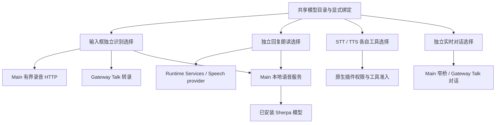

# 通用语音接口与兼容边界

语音服务按明确的接口合同接入。服务名称是用户自定义的连接别名，任意本机、内网或托管服务只要实现相应合同，就可使用同一适配器。供应商名称、模型 ID、域名和模型发现成功都不决定执行协议。

“通用”指应用支持的兼容合同，不代表所有语音服务有统一行业标准。HTTP、WebSocket、WebRTC 和 gRPC 只说明传输方式；相同路径也不保证请求、响应、认证和结束语义相同。目录与选择流程见[模型管理](../models/model-management.md)，设备、权限和请求生命周期见[语音功能](voice-and-transcription.md)。

## 1. 四份核心合同

| 协议标识 | 当前请求与结果合同 | 消费入口 | 参考协议 |
| --- | --- | --- | --- |
| `openai-transcription-http` | `POST <baseUrl>/audio/transcriptions`，multipart 含 WAV 文件、model 和可选 language；完整 JSON 响应的 `text` 字段 | 输入框录完转写、音视频文件导入、STT 附件工具 | [Transcriptions](https://developers.openai.com/api/reference/resources/audio/subresources/transcriptions/methods/create) |
| `openai-speech-http` | `POST <baseUrl>/audio/speech`，JSON 含 input/model/voice 及受支持参数；完整音频字节 | 回复朗读、试听、TTS 工具 | [Speech](https://developers.openai.com/api/docs/guides/text-to-speech) |
| `openai-transcription-realtime` | Realtime 兼容 WebSocket 转录会话、音频和配置事件；增量/最终文字，停止采集后有界等待 final | 输入框实时听写 | [Realtime transcription](https://developers.openai.com/api/docs/guides/realtime-transcription) |
| `openai-voice-realtime` | Realtime 兼容 WebSocket 双向音频与字幕；VAD 自动轮次、打断、受控原生助手委托 | 独立实时语音入口 | [Realtime conversation](https://developers.openai.com/api/docs/guides/realtime-conversations) |

四份合同分别配置、测试和准入。服务实现其中一份，不推导其支持另外三份。“OpenAI 兼容”描述请求协议，不要求连接官方服务，不预置公共端点、环境凭据或公共模型作为兜底。

语音源码只保留这些通用协议的实现。服务专属的账号请求头、订阅认证、私有会话接口和按具体模型分流的代码不属于适配层，也不能以“当前没有调用”为由保留；删除时同步清理专用 Worker、依赖和打包入口。协议规定的路径与消息字段由适配器实现，服务地址、模型、音色和所需凭据由用户明确配置。

显式配置要求覆盖插件公开工厂、原生 provider、媒体音频转录与底层传输，不存在另一条自动补模型或音色的旧入口。在线模型和音色没有应用内置目录，接口元数据也不提供默认模型；缺少端点、模型或所需音色时不可执行。模型与音色标识的原始字符串不超过 256 字符、不能包含控制字符，去除首尾空白后须非空；不按名称前缀限制服务实际提供的标识。

HTTP 识别与合成当前都完整缓冲响应后校验；没有 ASR SSE、TTS SSE 或逐块播放。实时听写是持续输入音频的独立会话；HTTP 响应分块和录完返回文字都不因此成为实时听写。剩余响应流工作见[语音增量响应计划](../../plans/speech-response-streaming.md)。

实时对话使用已注册的受管 provider、Gateway relay 和明确配置的服务 WebSocket，当前为 VAD 自动轮次。界面没有手动音频 commit；WebRTC、managed-room、SIP 和断线续传未接入。完整会话合同和终态边界见[实时语音对话](voice-and-transcription.md#8-实时语音对话)。

## 2. 分类、绑定和用途选择

模型页按功能分类，协议在分类内部选择：

| 模型分类 | 允许登记的服务协议 | 本地能力 |
| --- | --- | --- |
| 语音识别 | 录音 HTTP、Realtime 转录 | SenseVoice、Whisper |
| 语音合成 | Speech HTTP | Kokoro、AISHELL3 VITS、Piper |
| 语音对话 | Realtime 双向语音对话 | 不将离线 ASR/TTS 自动组合成对话 |

实时转录仍归语音识别；完整双向会话使用“语音对话”标签。五种既有离线模型保留资源身份、安装布局和数字音色 sid，继续使用本地 Sherpa 运行时，不要求包装成网络服务。

一条供应商配置代表一个接口连接，保存名称、`protocolId`、基础地址和凭据；其下所有模型共用这一协议。同一服务提供不同接口时分别添加连接，各连接下面可以添加多个模型。连接卡先选择协议，再填写地址与密钥，并展示所选协议的实际端点。模型只保存用户填写的 ID、名称、音色目录及实时对话需要的 `inputTranscriptionModel`，不按供应商、域名或模型名称执行特殊逻辑。

输入框识别、回复朗读、实时对话、STT 工具、TTS 工具仍独立选择模型和必要音色，继承所选模型所属连接的协议。所有消费页面均不提供接口下拉框；有效选择显示只读协议，未选择模型时不显示接口行，旧接口待配置时引导到模型设置。内部仍以派生的 `provider` binding 复用现有执行合同，已有合法旧选择继续读取，不自动猜测或改写失效 ID。语音设置统一编辑草稿，保存成功后才应用，取消保留原有效选择。STT/TTS 各自齿轮只编辑自己的用途设置；关闭工具插件不关闭输入框或回复朗读，保存目录也不自动启用工具。

设置将转文字与语音对话放在同一“语音输入”区域，共用麦克风，但保持两个启用开关和独立模型。两个编辑标签不构成互斥的协议选择；录音 HTTP 与 Realtime 转录都属于“语音转文字”，只有完整双向会话属于“语音对话”。系统声音与混合音源只用于转文字，对话始终使用明确选择的麦克风。会议分段功能已经移除，不影响四份接口合同。

模型发现只补充实际返回的模型元数据。已选择协议的连接中新模型继承同一协议；未明确协议的旧连接仍不猜出可执行接口。显式未知协议、废弃字段和失效选择不能执行，不试探其它协议。

没有供应商协议字段的旧目录继续读取 `model.bindings`；旧模型也缺少该字段时，按旧消费者语义解析：输入框使用 Realtime transcription，STT 工具使用 HTTP transcription，TTS 使用 HTTP speech，实时对话没有旧默认。旧多接口连接需要用户明确选择统一协议，不在打开页面或保存其它设置时取第一项。提升模型参数只接受所选协议下唯一的旧值，冲突时要求明确填写。旧绑定数据与选择 ID 保留兼容，仍存在的旧 ID 可以作为别名；未知或已删除的非空 ID 不会因协议上移自动恢复可用。

### 音色与模型参数

在线音色保存为 `{kind: 'preset', voiceId}`，音色 ID 由用户填写或从服务实际发现，并且必须属于当前模型。没有音色目录时仍可登记模型，但需补齐有效音色才能合成。应用不猜默认音色、不预置供应商音色表，不为缺失选择填入任意 ID。

实时对话当前要求预置音色和模型参数 `inputTranscriptionModel`，后者用于强制助手委托的输入转录，不借用输入框模型或公共默认。旧 `onlineTtsVoice` 仅在新选择字段缺失时载入为预置选择；显式空选择不恢复旧字符串。本地 sid 与在线 voice 保持各自语义。

参数以适配器已实现的字段为限，不支持任意请求头、JSON 模板、表达式或透传未知字段。音色克隆与设计流程尚未接入。

旧的私有协议、废弃兼容字段或默认音色配置不进入执行准入，不能被清洗成缺字段后恢复旧默认。导入或保存遇到这些字段明确拒绝，已有目录可保留为不可用以便用户重新配置；不会自动切换为另一协议、模型或音色。模型遗留绑定也须合法，不能通过旧 ID 别名绕过校验。

## 3. 运行入口与复用边界



纯协议包 `plugins/sdk/speech-protocols/` 定义协议标识、端点规范、请求/响应和标识校验，静态打入各消费制品。它不持有网络、凭据、文件系统、DOM 或应用状态；Main 不依赖可选插件，插件不导入应用 `src`。

Main 管理输入框完整录音 HTTP 的权限、代理、取消和请求归属。[STT 插件](../../plugins/extensions/stt-local-cli/transcription.md)复用相同编解码，保留附件权限和工具取消。实时转录与对话由原生 Talk 管理会话，分别投影独立的受管配置，详见 [OpenAI 转录](../../plugins/extensions/openai/transcription.md)及[实时对话](../../plugins/extensions/openai/realtime-voice.md)。

实时对话内嵌当前聊天：圆形状态图标位于输入框上方，扬声器静音只关闭本地声音，文字继续流入普通消息区。公开 Talk 助手委托由 Main 按原生 call/run 身份交付，实际语音字幕由现有 ChatController 临时投影，再按真实原生消息 ID 接替；这不是 HTTP ASR/TTS 流式播放，也不另建产品转录历史。

在线回复朗读从独立的 [Runtime Services `replySpeech`](../../plugins/extensions/runtime-services/reply-speech.md) 配置调用原生 Speech provider，不覆盖 TTS 工具偏好。[TTS 插件](../../plugins/extensions/tts-local-cli/synthesis.md)独立委托同一在线协议实现；本地回复与试听仍可由 Main 直接合成。静音、停止本地播放、撤销等待与取消原生助手运行分别处理，详情见[语音功能](voice-and-transcription.md)。

### 端点与配置撤销

基础地址支持明确配置的内网 HTTP(S)/WS(S)，完整端点按所选合同去除重复后缀，保留部署路径与版本前缀，不自动添加公共 `/v1`。拒绝 URL 用户名/密码、fragment 和未定义 query；实时转录只兼容唯一 `intent=transcription`，实时对话拒绝全部 query。当前不提供签名 URL、OAuth、厂商私有认证或任意头部框架。

协议、绑定、端点、模型、当前音色和凭据版本进入有效配置及请求校验。切换配置、撤权、窗口/连接变化和取消会使旧结果失效；A → B → A 不能复活旧请求。创建或提交结果未知时不自动重试、不重放未确认音频。原生历史与准确 whole-run terminal 仍是执行结果权威，临时字幕不成为产品正文缓存。

回复朗读另由 Main 为完整标准化 `replySpeech` 配置生成非敏感 `configurationId`，随文字提交合成 RPC；Runtime Services 核对它与当前原生 profile 的 ID 一致后才调用模型。配置文件已经写入但原生仍等待应用时不能误用旧 profile，配置同步成功也不代替实际应用。内存代次继续阻止 A → B → A 的旧音频恢复播放。

依赖 Gateway 的就绪读取和实时会话创建还要求原生 `config.get` 的 `configRevisionHash` 非空且等于 `appliedConfigHash`；磁盘快照已经包含目标 profile、但运行时仍等待重载时，不报告就绪或启动旧服务。HTTP 录音识别由 Main 直接使用已保存的明确配置，不依赖这份原生应用状态。

## 4. 其它接口的边界

业界还存在原始音频 HTTP、JSON/Base64、SSML/XML、异步任务、私有 WebSocket 二进制封包、gRPC 和专用 SDK。例如 [FunASR WebSocket](https://github.com/modelscope/FunASR/blob/main/runtime/docs/websocket_protocol_zh.md)、[Google gRPC 转录](https://docs.cloud.google.com/speech-to-text/docs/reference/rpc/google.cloud.speech.v2)和 [Azure SSML 合成](https://learn.microsoft.com/en-us/azure/ai-services/speech-service/rest-text-to-speech)各有独立合同。

这些格式未因使用 HTTP/WS 就获得兼容性，也不构成逐供应商接入清单。部署方可自行提供核心兼容接口；应用不自动部署转换代理、不上传第三方中转。其它扩展需有明确部署需求及独立的合同、权限和生命周期设计。

## 5. 验证与当前限制

协议测试见[纯协议测试](../../../plugins/sdk/speech-protocols/tests/protocols.test.ts)，覆盖四种通用合同、格式、必需音色和严格字段边界。[模型绑定测试](../../../src/shared/speech/onlineSpeechModels.test.ts)覆盖多绑定、旧用途语义和废弃配置拒绝执行；设置与导入导出另有定向回归。

[Main 录音服务测试](../../../src/main/speech/recordedOnlineAsrService.test.ts)覆盖录音/响应上限、取消、迟到结果及代理准备后的发送前复核。原生插件的 HTTP 和 profile 测试覆盖 provider 委托、当前 SDK schema、SecretRef 与受管注册；[Realtime 控制器](../../../src/renderer/features/speech/realtime/realtimeVoiceController.test.ts)和[音频测试](../../../src/renderer/features/speech/realtime/realtimeVoiceAudio.test.ts)覆盖并发关闭、换代和媒体失败清理。资源构建另验证纯协议代码进入各消费制品，不留下指向源码 SDK 的运行时导入。

### 本机假模型端点验证

下面的用例会启动仅监听 `127.0.0.1` 随机端口的 HTTP 或 WebSocket 服务，实际传输请求和响应；假服务使用固定测试模型与凭据，不读取或改写用户当前的模型设置，不启动用户 Gateway。服务端独立校验请求，不复用生产编解码生成期望结果。

| 接口合同 | 实际通路 | 自动化入口 |
| --- | --- | --- |
| `openai-transcription-http` | Main 录音服务及真实 fetch／代理传输；插件 HTTP／SSRF SDK | [Main loopback](../../../src/main/speech/recordedOnlineAsrService.loopback.test.ts)、[原生 HTTP 合同](../../../plugins/extensions/tts-local-cli/tests/native-sdk-contract.test.ts) |
| `openai-speech-http` | 原生 Speech provider、TTS 工具委托与独立回复朗读 | [原生 HTTP 合同](../../../plugins/extensions/tts-local-cli/tests/native-sdk-contract.test.ts) |
| `openai-transcription-realtime` | 实际 provider factory、锁定原生 WebSocket transport 与本机服务 | [Realtime wire](../../../plugins/extensions/openai/tests/speech-realtime-wire.test.ts) |
| `openai-voice-realtime` | 实际受管 provider／bridge 与本机 WebSocket 服务 | 同上 |

Main loopback 用例覆盖非根部署路径、任意模型 ID、multipart 文件字节、无认证与固定 Bearer、真实代理转发、上传后取消断链、重定向目标零请求、HTTP 状态脱敏、错误合同及实际分块响应越限。插件的具体 wire 字段、取消／超时和 Realtime 帧边界由各自[转录](../../plugins/extensions/stt-local-cli/transcription.md)、[合成](../../plugins/extensions/openai/speech.md)及[实时对话](../../plugins/extensions/openai/realtime-voice.md)验证段维护。

运行前显式指定已准备且匹配锁定版本的原生运行包根目录；该目录包含 `dist/plugin-sdk/`。不要把默认缺少运行包而跳过的原生用例算作通过。下例在仓库根目录、Node 24 的 PowerShell 中运行，替换第一行的目录后可复测：

```powershell
$env:SPEECH_TEST_RUNTIME_ROOT = 'E:\path\to\prepared\openclaw-runtime\current'
$env:OPENCLAW_TEST_NATIVE_RUNTIME_DIR = $env:SPEECH_TEST_RUNTIME_ROOT
$env:OPENCLAW_SDK_ROOT = Join-Path $env:SPEECH_TEST_RUNTIME_ROOT 'dist/plugin-sdk'
npm test -- src/main/speech/recordedOnlineAsrService.loopback.test.ts plugins/extensions/tts-local-cli/tests/native-sdk-contract.test.ts plugins/extensions/openai/tests/speech-realtime-wire.test.ts plugins/sdk/speech-protocols/tests/protocols.test.ts
```

这些用例验证当前已实现的接口收发和代表性异常，不验证模型识别语义、真实语音质量、设备权限、现场内网代理或完整桌面操作。TTS 的原生 provider 没有 AbortSignal，测试其超时不能表述为支持远端取消；实时转录仍以它自己的原生重连合同为准，不能从实时对话的禁止续传推导转录同样禁止重连。

自动化使用合成端点和锁定原生 SDK，没有调用真实付费模型。这些证据不证明真实麦克风/扬声器、目标内网服务、代理部署的端到端兼容性、音质或延迟，仍需现场验收。HTTP SSE、逐块 TTS 播放、克隆/设计、WebRTC、手动 commit、断线续传和组合式 ASR → 助手 → TTS 自动对话不属于当前支持范围。
